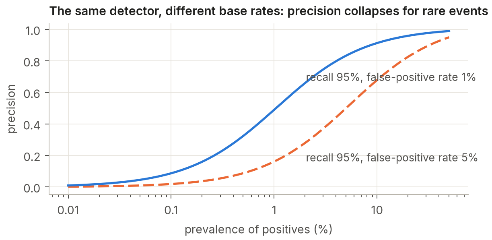

# 1 · The maths you actually use

Part I · Foundations. The maths behind the rest of the book, limited to what practitioners use. Every idea here shows up later: cosine similarity in retrieval, SVD in matrix factorisation and LoRA, Bayes in naive Bayes and calibration, cross-entropy and KL in every model you train.

## Why it matters

You do not need a maths degree to be a strong applied ML engineer, but you need fluent intuition for a small set of ideas, because interviewers use them to test whether you understand models or only call them. "Why cosine and not Euclidean?", "what is LoRA doing in linear-algebra terms?", "why is cross-entropy the classification loss?" all come from this chapter.

The ideas fall into three groups, and the chapter takes them in that order. **Linear algebra** (1.1, 1.2, 1.7) is how data and models are represented: an embedding is a vector, a layer is a matrix, and most of what a network computes is a chain of matrix products. Similarity search, matrix factorisation, attention and LoRA are all statements about vectors and matrices. **Probability** (1.3, 1.4) is how models reason about uncertainty: it explains why a 95%-accurate fraud detector can be wrong most of the times it fires, and where training objectives and regularisers come from. **Calculus and information theory** (1.5, 1.6, 1.8) are how models learn and how we measure them: gradients drive every training step, and cross-entropy and KL divergence are the losses and penalties those steps optimise.

Each section starts from the question the idea answers, builds the intuition before the formula, and works a small example with numbers you can check by hand. The aim is not to prove theorems but to make each idea usable: you should finish the chapter able to explain these concepts at a whiteboard, compute them in a few lines of NumPy, and recognise them when they reappear in later chapters under other names.

## Key concepts

- **Vector, dot product, cosine similarity**: a vector is a list of numbers (an embedding, a feature row); the dot product measures how aligned two vectors are; cosine similarity is the dot product of their length-normalised versions. [3Blue1Brown: Essence of linear algebra](https://www.3blue1brown.com/topics/linear-algebra).
- **Matrix multiplication**: every neural-network layer is one; it maps vectors from one space to another. Same series as above.
- **Eigenvectors and SVD**: directions a matrix only stretches; SVD factorises any matrix into rotations and stretches and gives the best low-rank approximation. [Singular value decomposition](https://en.wikipedia.org/wiki/Singular_value_decomposition).
- **PCA**: SVD of centred data; finds the directions of largest variance. [Principal component analysis](https://en.wikipedia.org/wiki/Principal_component_analysis).
- **Bayes' rule and base rates**: how to update a probability with evidence, and why rare events produce many false alarms. [Bayes' theorem](https://en.wikipedia.org/wiki/Bayes%27_theorem).
- **MLE and MAP**: choose parameters that make the data most likely; MAP adds a prior, which is where regularisation comes from. [Maximum likelihood estimation](https://en.wikipedia.org/wiki/Maximum_likelihood_estimation), [MAP estimation](https://en.wikipedia.org/wiki/Maximum_a_posteriori_estimation).
- **Gradient and chain rule**: the direction of steepest increase, and how derivatives compose through layers; together they give gradient descent and backpropagation. [Gradient descent](https://en.wikipedia.org/wiki/Gradient_descent).
- **Entropy, cross-entropy, KL divergence**: measures of uncertainty and of the gap between two distributions; cross-entropy is the standard classification loss. [Kullback–Leibler divergence](https://en.wikipedia.org/wiki/Kullback%E2%80%93Leibler_divergence).
- **Whole-subject reference**: [Mathematics for Machine Learning](https://mml-book.github.io/) (Deisenroth, Faisal and Ong), free online.

## 1.1 Vectors, dot products and cosine similarity

Almost everything a model handles becomes a vector before the model sees it: a row of tabular features, a word, a sentence, an image, a user, a product. Once two things are vectors, the most common question is how similar they are. Retrieval, recommendation, deduplication, clustering and attention all reduce to that question, so the choice of similarity measure, and an understanding of how it behaves in hundreds of dimensions, sits underneath a large share of applied ML.

A vector is a list of numbers; in ML, a point in a feature or embedding space. The **dot product** a·b = Σaᵢbᵢ measures alignment weighted by length; **cosine similarity** a·b / (‖a‖‖b‖) measures only the angle: 1 for the same direction, 0 for orthogonal, −1 for opposite.

```python
import numpy as np

def cosine(a, b):
    return a @ b / (np.linalg.norm(a) * np.linalg.norm(b))

cosine(np.array([1., 2, 0]), np.array([2., 4, 0]))   # 1.0: same direction, different length
cosine(np.array([1., 0]), np.array([0., 1]))         # 0.0: orthogonal
```

**Why cosine for text embeddings:** vector length often reflects things like text length or frequency rather than meaning; cosine ignores it. On L2-normalised vectors, cosine, dot product and (monotonically) Euclidean distance give the same ranking, which is why vector databases normalise.

**Norms:** L2 (Euclidean length) and L1 (sum of absolute values) appear as regularisers (Chapter 3.4). In high dimensions, distances between random points concentrate (all look similar), one reason kNN and clustering struggle without good representations.

**Geometry in high dimensions.** Intuitions from 2-D and 3-D mislead in the 768- or 4,096-dimensional spaces of embeddings. Take two random vectors with independent standard-normal entries. Their dot product is a sum of d independent products, so its spread grows like √d, while their lengths grow like √d each; the cosine therefore shrinks like 1/√d. Measured on 20,000 random pairs, the standard deviation of the cosine is 0.578 in 3 dimensions, 0.125 in 64 and 0.036 in 768, matching 1/√d. In high dimensions, almost every pair of random directions is nearly orthogonal.


*Distribution of the cosine between two random vectors (computed in `tools/figures.py`). In 768 dimensions nearly all pairs fall within ±0.1.*

Two consequences follow. A cosine of 0.3 between two embeddings is a strong signal, not a weak one, because chance alone almost never produces it. And trained embedding spaces are usually **anisotropic**: real embeddings crowd into a narrow cone, so even unrelated texts can score 0.6–0.8. Similarity thresholds must therefore be calibrated per model on labelled pairs, never carried over from another model (Chapter 29).

## 1.2 Matrices, eigenvectors and the SVD

If vectors are the data, matrices are what act on them. A neural-network layer is a matrix that maps one vector space to another; a dataset is a matrix with one row per example; a user–item table is a matrix waiting to be factorised. Two questions come up constantly: what does a given matrix *do* to the vectors it touches, and how much of it actually matters? Eigenvectors and the singular value decomposition answer both, and the second answer, that most real matrices are close to low rank, is the idea behind PCA, recommendation by matrix factorisation and LoRA.

**Matrix multiplication** is the core operation of every model: a linear layer computes Wx; a batch is XWᵀ; attention is QKᵀ. Track shapes: (n × d) @ (d × k) = (n × k). Most bugs in from-scratch code are shape bugs.

**Eigenvectors** of a square matrix are directions it only stretches: Av = λv. For a covariance matrix, eigenvectors are the principal components and eigenvalues the variance along them (PCA, Chapter 40.10).

**The singular value decomposition** factors any matrix: A = UΣVᵀ, with orthonormal U and V and non-negative singular values in Σ, largest first. Keeping the top k gives the **best rank-k approximation** (Eckart–Young theorem).

**What the SVD says geometrically.** Every matrix, applied to a vector, does three things in sequence: Vᵀ rotates the input into a special set of axes, Σ stretches each axis by its singular value, and U rotates the result into the output space. A circle of input vectors becomes an ellipse whose semi-axes are the singular values. For the 2 × 2 matrix [[3, 0], [4, 5]], the singular values are 6.708 and 2.236: the matrix stretches one direction by about 6.7 and another by about 2.2. Keeping only the first gives a rank-1 approximation with 31.6% relative error, because the second stretch is not negligible. Real data matrices typically have a few large singular values and a long tail of small ones, which is exactly when truncation works.

**Why real matrices are approximately low rank.** A user–item matrix is low rank when a few hidden factors (price sensitivity, cuisine preference, time of day) explain most behaviour; each user's row is then roughly a mix of a few typical rows. The same holds for the weight *change* when fine-tuning a large model on a narrow task: LoRA bets that the update has low effective rank. For a 4,096 × 4,096 weight matrix, a rank-16 update has 16 × (4,096 + 4,096) = 131,072 parameters instead of 16,777,216: 0.78% of them (Chapter 20).


*truncated SVD · a 100 × 80 matrix at rank 5*

```python
U, S, Vt = np.linalg.svd(A, full_matrices=False)
A_k = U[:, :k] * S[:k] @ Vt[:k]                 # rank-k reconstruction
rel_error = np.linalg.norm(A - A_k) / np.linalg.norm(A)
```

On a 100 × 80 test matrix built as rank 5 plus noise, rank 1 left 83% relative error, rank 5 only 4.6%, and rank 20 3.3% (the rest is noise). Storage at rank 5: 900 numbers instead of 8,000.

This single idea explains **matrix factorisation** for recommendations (Chapter 43.2: the user-item matrix is approximately low rank), **LoRA** (Chapter 20.3: the fine-tuning update is approximately low rank), **PCA**, and embedding compression.

## 1.3 Probability, Bayes and common distributions

Models output probabilities, and decisions are taken on them: flag this order, show this ad, accept this loan. Reading those probabilities correctly requires two skills. The first is updating a belief with evidence, which is Bayes' rule, and its main practical lesson: how rare the thing you are looking for is matters as much as how good your detector is. The second is choosing a sensible distribution for the quantity you are modelling, because that choice fixes the loss you train with and the assumptions you make about noise.

**Bayes' rule** turns the probability of the evidence given a hypothesis into the probability of the hypothesis given the evidence:

$$
P(A\mid B) = \dfrac{P(B\mid A)\,P(A)}{P(B)}
$$

P(A) is the **prior** (how common A is before looking), P(B | A) the **likelihood** (how often the evidence appears when A is true), and P(B) the overall rate of the evidence, from both true and false cases. The practical lesson is the **base rate**: a fraud model with 95% recall and a 5% false positive rate, on a population with 1% fraud, gives P(fraud | flagged) = 0.95·0.01 / (0.95·0.01 + 0.05·0.99) ≈ 16%. Most flags are false alarms, which is why precision collapses for rare events (Chapter 4.2).

**The same calculation in natural frequencies**, which is how to explain it to anyone: of 10,000 orders, 100 are fraudulent and 9,900 are not. The model catches 95 of the 100 frauds, and wrongly flags 5% of the 9,900 good orders, which is 495. Of the 590 flagged orders, only 95 are fraud: 16%. Halving the false positive rate helps more than raising recall, because the false alarms come from the huge majority class.



*Precision of the same detector (95% recall) as prevalence changes. At 0.1% prevalence it is 1.9% with a 5% false-positive rate and 8.7% with 1%; at 10% prevalence, 68% and 91%.*

| Distribution | Models | Used for |
|---|---|---|
| Bernoulli / binomial | Yes/no outcomes, counts of successes | Clicks, conversions; logistic regression's likelihood |
| Categorical / multinomial | One of k outcomes | Next-token prediction; softmax classifiers |
| Poisson | Counts of events in an interval | Orders per hour, demand forecasting |
| Normal (Gaussian) | Sums of many small effects | Measurement noise, the CLT, regression errors |
| Log-normal | Products of factors; skewed positive values | Basket values, delivery durations |
| Beta | A probability itself | Prior for click rates; Thompson sampling |
| Exponential | Waiting times | Time between orders |

**Expectation and variance** rules worth knowing: E[aX + b] = aE[X] + b; Var(aX) = a²Var(X); variances of independent variables add; the variance of a mean of n independent draws is σ²/n (why bigger samples give tighter estimates).

## 1.4 MLE and MAP

Every model has parameters, and training is the choice of their values. Behind almost every loss function is one principle: pick the parameters under which the data you actually observed would have been most probable. That principle, maximum likelihood, explains why squared error is the regression loss and cross-entropy the classification loss. Its Bayesian extension, MAP estimation, adds what you believed before seeing the data, and turns out to be exactly what regularisation and smoothing do. This section derives both on the simplest possible model, a single click rate, because the steps are the same for a deep network.

**Maximum likelihood (MLE):** choose parameters that make the observed data most probable. For a click rate with 3 clicks in 10 impressions, MLE = 0.3.

**The derivation**, because the same steps recur everywhere: with k clicks in n impressions and click probability θ, the likelihood is θᵏ(1 − θ)ⁿ⁻ᵏ. Take the log (products become sums and the maximum does not move): k log θ + (n − k) log(1 − θ). Set the derivative k/θ − (n − k)/(1 − θ) to zero and solve: θ = k/n. Training a classifier with log loss is this same calculation with θ produced by a model for each example instead of one shared number.

**Maximum a posteriori (MAP):** add a prior and maximise the posterior. With a Beta(2, 38) prior (mean 5%, a typical click rate), the MAP estimate is (3 + 2 − 1)/(10 + 2 + 38 − 2) ≈ 0.083, and the posterior mean (3 + 2)/(10 + 40) = 0.10. The prior pulls small-sample estimates towards the typical value: exactly the **smoothing** used for CTR features and target encoding (Chapters 3.8, 44.4).

**Why the Beta prior is convenient.** The Beta distribution is *conjugate* to the binomial: a Beta(a, b) prior plus k successes in n trials gives a Beta(a + k, b + n − k) posterior, so updating is just adding counts. The prior acts like a + b imaginary impressions with a imaginary clicks. With Beta(2, 38):

| Observed | Raw rate | Posterior mean (k + 2)/(n + 40) |
|---|---|---|
| 3 / 10 | 0.300 | 0.100 |
| 30 / 100 | 0.300 | 0.229 |
| 300 / 1,000 | 0.300 | 0.290 |
| 0 / 5 | 0.000 | 0.044 |

The same raw rate is trusted more as evidence accumulates, and an item with no clicks yet is not ranked as if it were certainly worthless. This is empirical Bayes: fit a and b to the distribution of rates across all items, then shrink each item towards it.

**Connections to remember:** minimising squared error = MLE under Gaussian noise; minimising log loss = MLE for Bernoulli labels; L2 regularisation = MAP with a Gaussian prior on weights; L1 = MAP with a Laplace prior.

## 1.5 Gradients and the chain rule

Once a loss is defined, training is a search for the parameters that minimise it, and with millions or billions of parameters the only practical search is to follow the slope downhill. The gradient tells you which way is downhill for every parameter at once; the chain rule tells you how to compute it through a model built from many layers. Together they are backpropagation, the algorithm behind every network in this book. Being able to do it by hand on a tiny example is the best protection against treating it as magic.

A gradient is the vector of partial derivatives: the direction of steepest increase. Training moves parameters against it (Chapter 3.5). The **chain rule** composes derivatives through nested functions, d/dx f(g(x)) = f′(g(x))·g′(x), and **backpropagation** applies it efficiently from the loss back through every layer (Chapter 5).

**The chain rule by hand.** Take one example with input x = 2, target y = 5 and the model z = w·x + b with w = 3 and b = 1, and the loss L = (z − y)². The forward pass gives z = 7 and L = 4. Going backwards: ∂L/∂z = 2(z − y) = 4; since ∂z/∂w = x and ∂z/∂b = 1, the chain rule gives ∂L/∂w = 4 × 2 = 8 and ∂L/∂b = 4. A gradient step with learning rate 0.01 moves w to 2.92 and b to 0.96, reducing z towards 5. Backpropagation is exactly this bookkeeping, done for millions of parameters by reusing the shared upstream factor (here ∂L/∂z) instead of recomputing it for each parameter.

The most useful derivative to know by heart: for logistic regression with log loss, the gradient is Xᵀ(σ(Xw) − y)/n, and the same "prediction minus target" form holds for softmax with cross-entropy.

**Check gradients numerically** when you implement them by hand: compare with central differences (f(w + ε) − f(w − ε))/2ε.

```python
def numerical_grad(f, w, eps=1e-6, *args):
    g = np.zeros_like(w)
    for i in range(len(w)):
        e = np.zeros_like(w); e[i] = eps
        g[i] = (f(w + e, *args) - f(w - e, *args)) / (2 * eps)
    return g

np.allclose(analytic_grad(w, X, y), numerical_grad(log_loss, w, 1e-6, X, y), atol=1e-6)   # True
```

## 1.6 Entropy, cross-entropy and KL divergence

These three quantities are the language in which almost every modern model is trained and compared. Cross-entropy is the loss of every classifier and every language model; KL divergence is the leash that keeps a fine-tuned model close to its starting point, the objective of distillation, and a standard drift alarm. They are worth understanding from first principles rather than as formulas, because interview questions about them are almost always "why" questions: why this loss, why this direction, why it can blow up. All three are built from one idea, **surprise**.

### Surprise: how unexpected was that outcome?

If an event had probability p, observing it carries a surprise of −log p. The definition is less arbitrary than it looks. Surprise should be zero for a certain event (−log 1 = 0), grow without limit as the event becomes rarer (−log p → ∞ as p → 0), and add up for independent events: seeing two independent things with probabilities p₁ and p₂ should be as surprising as the sum of the two surprises. Since the joint probability is p₁p₂, only the logarithm turns that product into a sum. With log base 2, surprise is measured in **bits**; with the natural log, in **nats** (1 nat = 1.443 bits). Deep-learning libraries use nats.

A fair coin landing heads has surprise −log₂ 0.5 = 1 bit. An outcome with probability 1/8 has 3 bits: it is as surprising as three fair coins all landing heads.

### Entropy: the average surprise of a distribution

Entropy is the surprise you should expect on average if outcomes really are drawn from p:

$$
H(p) = -\sum_{x} p(x)\,\log p(x)
$$

It measures how unpredictable a distribution is. A fair coin has 1 bit of entropy; a coin that lands heads 90% of the time has 0.469 bits, and a 99% coin only 0.081 bits: you are rarely surprised by it. Entropy is zero for a certain outcome and largest for the uniform distribution, where it equals log k for k outcomes.

There is a concrete reading in terms of codes. If you must transmit outcomes of p as a stream of bits, the best possible code gives outcome x a codeword of about −log₂ p(x) bits (short codes for common outcomes, long ones for rare ones, as Morse code does for "e"). The average length of that optimal code is exactly H(p). Entropy is the irreducible cost of describing the outcomes of p.

For a language model, the entropy of the next-token distribution says how many plausible continuations the model sees. After "The capital of France is", a good model has entropy close to zero; after "My favourite food is", it is high, and rightly so.

### Cross-entropy: paying for the wrong model

In practice you never know p, the true distribution. You have a model q, and you are charged according to q's beliefs while outcomes keep arriving from p. Cross-entropy is the average surprise under that arrangement:

$$
H(p, q) = -\sum_{x} p(x)\,\log q(x)
$$

The weights p(x) say how often each outcome really happens; the surprise −log q(x) is what your model feels when it does. In the coding story, you designed your codewords for q, but the messages follow p, so your average message is longer than it needs to be.

A worked example with three outcomes, true distribution p = [0.7, 0.2, 0.1] and model q = [0.5, 0.3, 0.2]. Codes designed for q have lengths −log₂ q = [1.00, 1.74, 2.32] bits. Weighted by how often each outcome actually occurs, the average is 0.7 × 1.00 + 0.2 × 1.74 + 0.1 × 2.32 = 1.280 bits. The best possible code, built for p itself, would average H(p) = 1.157 bits.

**Why it is the classification loss.** For one labelled example, p is the one-hot label: all its probability sits on the true class y. The sum collapses to a single term, and cross-entropy becomes −log q(y), the negative log of the probability the model gave to the correct answer. Averaged over a dataset, this is the negative log-likelihood of the labels, so minimising cross-entropy is maximum-likelihood estimation (1.4). The same holds token by token for a language model: its training loss is the average of −log q(next token).

### KL divergence: the extra cost

The gap between the two numbers above is the KL divergence (Kullback–Leibler), the average *extra* surprise caused by believing q when the truth is p:

$$
\mathrm{KL}(p\,\Vert\,q) = H(p,q) - H(p) = \sum_{x} p(x)\,\log\dfrac{p(x)}{q(x)}
$$

In the example, KL(p ‖ q) = 1.280 − 1.157 = 0.123 bits: the price, per outcome, of using the wrong model. Read term by term, each outcome contributes p(x) times the log of how much more (or less) likely p thinks it is than q does:

| Outcome | p | q | p · log₂(p/q) |
|---|---|---|---|
| A | 0.7 | 0.5 | +0.340 (q under-predicts a common outcome) |
| B | 0.2 | 0.3 | −0.117 |
| C | 0.1 | 0.2 | −0.100 |
| Total | | | 0.123 |

Individual terms can be negative, where q is more generous than needed, but the total never is. Three properties follow, and each one matters in practice.

1. **KL is never negative, and it is zero only when q = p** (Gibbs' inequality). No model can beat the truth on average. This is why a KL term works as a penalty: it is smallest exactly when the two distributions agree.
2. **KL is not symmetric.** KL(q ‖ p) for the same pair is 0.133 bits, not 0.123, because the expectation is taken under a different distribution. KL is therefore not a distance, and the direction you choose changes what an optimiser does (forward versus reverse KL, 1.8).
3. **KL explodes when q rules out what p allows.** If q(x) = 0 for an outcome with p(x) > 0, the term p(x) log(p(x)/0) is infinite. Even a near-zero q hurts: changing q to [0.6, 0.39, 0.01] raises KL(p ‖ q) from 0.123 to 0.295 bits, mostly because outcome C, which happens 10% of the time, was given only 1%. A model trained with cross-entropy is therefore pushed never to be certain that something is impossible. This is the same mechanism as the exploding loss in the table below.

Because H(p) does not depend on the model, minimising cross-entropy H(p, q) over q and minimising KL(p ‖ q) over q are the same optimisation: they differ by a constant. Training on cross-entropy is fitting the model by forward KL to the data distribution.

```python
def entropy(p):          return -np.sum(p * np.log2(p))
def cross_entropy(p, q): return -np.sum(p * np.log2(q))
def kl(p, q):            return cross_entropy(p, q) - entropy(p)

p, q = np.array([0.7, 0.2, 0.1]), np.array([0.5, 0.3, 0.2])
# entropy(p) = 1.157 bits, cross_entropy(p, q) = 1.28, kl(p, q) = 0.123, kl(q, p) = 0.133: not symmetric
```

**What cross-entropy charges for a prediction.** For one example, the loss is −log of the probability given to the true class:

| Probability on the true class | 0.9 | 0.5 | 0.1 | 0.01 |
|---|---|---|---|---|
| Cross-entropy (nats) | 0.105 | 0.693 | 2.303 | 4.605 |

Being confidently wrong is expensive and grows without bound, which is why cross-entropy pushes models towards honest probabilities, and why a handful of mislabelled examples can dominate a training loss. Label smoothing (training towards 0.9 on the true class instead of 1.0) caps how confident the model is asked to be.

### Where KL appears, and why each use needs it

- **RLHF and RL fine-tuning** (Chapters 18 and 19). The reward model is imperfect, and a policy optimised hard against it finds its blind spots. A penalty β · KL(π ‖ π_ref) charges the policy for every bit it drifts from the reference model, so it can only move where the reward gain is worth the cost. β sets the exchange rate.
- **Distillation** (Chapter 15.7). The student is trained to match the teacher's whole output distribution, not only its top answer, by minimising KL between them. The teacher's probabilities on wrong answers ("this is shawarma, but it looks a bit like falafel") carry information that one-hot labels do not.
- **Variational autoencoders and variational inference.** A KL term keeps the learned latent distribution close to a simple prior, which is what makes sampling from the prior produce sensible outputs.
- **Monitoring.** KL (or its symmetric cousin, the Jensen–Shannon divergence) between this week's and last month's feature or prediction distributions is a standard drift alarm (Chapter 47). The population stability index used in credit scoring is a symmetrised KL.

**Numerical stability:** compute softmax as exp(z − max z) / Σ, otherwise large logits overflow (softmax of [1000, 1001, 1002] works only with the shift and gives [0.09, 0.245, 0.665]); compute log-softmax directly rather than log(softmax), and never take the log of a probability that can be exactly zero.

## 1.7 Matrix calculus and curvature

Section 1.5 treated parameters one at a time. Real models have matrices of parameters, and papers and research code state their gradients in matrix form. A handful of facts cover almost every case: what shape a gradient has, how gradients flow through a linear layer and a softmax, and what the second derivative, the curvature, says about how large a learning rate can be. The last point explains much of the optimisation behaviour in Chapter 7.

Research code and papers use these facts constantly:

- **Gradient shapes match parameter shapes.** For y = Wx with loss L, ∂L/∂W = (∂L/∂y) xᵀ (an outer product) and ∂L/∂x = Wᵀ(∂L/∂y). Backpropagation through a linear layer is these two lines.
- **Jacobians** collect all first derivatives of a vector function: J_ij = ∂y_i/∂x_j. The chain rule multiplies Jacobians; backpropagation computes vector–Jacobian products without forming them.
- **Softmax Jacobian**: ∂s_i/∂z_j = s_i(δ_ij − s_j). Combined with cross-entropy it collapses to the famous gradient s − y.
- **The Hessian** (second derivatives) describes curvature. Its largest eigenvalue (the sharpness) limits the stable learning rate of gradient descent to about 2/λ_max; the ratio of largest to smallest eigenvalue (the condition number) explains why plain gradient descent zig-zags in narrow valleys and why adaptive and preconditioned optimisers help (Chapter 7).
- **Convexity**: linear and logistic regression have convex losses (one minimum); neural networks do not, yet in high dimensions most critical points are saddles rather than bad local minima, which is part of why gradient descent works.

## 1.8 Information theory for language models

Section 1.6 introduced entropy, cross-entropy and KL divergence. Language models give them concrete meanings: the training loss is a cross-entropy measured in nats per token, perplexity is that loss in another unit, and the direction of a KL penalty decides whether a fine-tuned model stays diverse or collapses onto a few answers. This section collects the information-theory facts that come up when training, comparing and fine-tuning language models.

**Forward versus reverse KL.** KL divergence is not symmetric, and which direction you minimise changes the answer. Fit a single Gaussian q to a two-mode target p (modes at −2 and +2, each with standard deviation 0.6):

| Objective | Fitted mean | Fitted sd | Behaviour |
|---|---|---|---|
| Forward KL(p ‖ q) | 0.00 | 2.09 | Mode-covering: spreads to cover both modes, puts mass where p has none |
| Reverse KL(q ‖ p) | 2.00 | 0.60 | Mode-seeking: picks one mode and fits it tightly |

Maximum-likelihood training (cross-entropy on data) minimises forward KL from the data to the model, so language models cover the data distribution, including its unlikely corners. The KL penalty in RLHF is a reverse KL from the policy to the reference, and on-policy distillation also uses reverse KL: both make the student or policy mode-seeking, which tends to produce sharper but less diverse outputs (Chapters 18 and 19).

**Perplexity and bits.** A language model's cross-entropy loss in nats per token converts to bits per token by dividing by ln 2, and to **perplexity** by exponentiating: loss 2.0 nats is 2.89 bits per token and perplexity 7.39, as if the model were choosing uniformly among about 7 tokens at each step. Because tokens differ in length between tokenizers, compare models in **bits per byte** (Chapter 23).

**Compression is prediction.** A model that assigns probability p to the next symbol can encode it in −log₂ p bits with arithmetic coding, so a language model's total log-loss on a text is the length of the shortest code it can produce for it. Better prediction is better compression; this is why pretraining loss is such a robust measure of model quality, and why "the model learns to compress the internet" is a precise statement rather than a metaphor.

**Mutual information** I(X; Y) = H(X) − H(X | Y) measures how much knowing Y reduces uncertainty about X. It underlies contrastive learning (InfoNCE is a lower bound on mutual information, Chapter 29) and some interpretability and data-selection methods.

## Pitfalls

- **Ignoring base rates** when reading a classifier's flags.
- **Comparing unnormalised dot products** when lengths carry no meaning.
- **Shape errors** in matrix code; print shapes at every step when debugging.
- **Naive softmax** without the max shift; log of zero in cross-entropy.
- **Treating KL as a distance:** it is not symmetric.
- **Estimating rates from tiny samples** without a prior or smoothing.

## Interview questions

**1. [B] Cosine similarity vs Euclidean distance for embeddings?** Cosine ignores length and measures direction; on normalised vectors both give the same ranking. Use cosine when length is not meaningful.

**2. [B] What is the SVD and its main use?** A = UΣVᵀ; truncating to the top k singular values gives the best rank-k approximation: PCA, matrix factorisation, compression, LoRA's intuition.

**3. [I] A test is 95% sensitive with a 5% false positive rate; prevalence is 1%. What share of positives are real?** About 16%: 0.95 × 0.01 / (0.95 × 0.01 + 0.05 × 0.99).

**4. [I] Relate L2 regularisation to Bayesian inference.** It is MAP estimation with a zero-mean Gaussian prior on the weights; L1 corresponds to a Laplace prior.

**5. [I] Why is cross-entropy preferred to squared error for classification?** It is the negative log-likelihood of the labels, penalises confident mistakes strongly, and with softmax gives gradients (p − y) that do not vanish when predictions are wrong and saturated.

**6. [I] What does KL divergence measure, and where does it appear in LLM training?** The extra expected log-loss from using q instead of p; as the penalty keeping an RLHF policy close to the reference model, and in distillation.

**7. [S] Why does LoRA work, in linear-algebra terms?** The weight change needed for a task has low effective rank, so it is well approximated by a product of two thin matrices, cutting trainable parameters from d·k to r(d + k).

**8. [S] How would you smooth click-through rates for restaurants with few impressions?** A Beta prior fitted to the overall distribution (empirical Bayes), using the posterior mean (clicks + α)/(impressions + α + β), which shrinks small samples towards the global rate.

## Practice

1. Implement cosine similarity, matrix-vector products and a softmax with the max shift in NumPy, without looking.
2. Reproduce the low-rank experiment: build a rank-5 matrix plus noise, plot reconstruction error against k.
3. Derive the gradient of logistic regression's log loss by hand, then check it numerically.
4. Fit a Beta prior to the CTRs of many items (method of moments) and compare raw and smoothed CTR rankings.
5. Compute entropy, cross-entropy and KL for a few distributions and verify KL ≥ 0 and its asymmetry.

## Read next

- *Mathematics for Machine Learning* (Deisenroth, Faisal and Ong, free online): chapters on linear algebra, matrix decompositions, probability and continuous optimisation.
- 3Blue1Brown, *Essence of Linear Algebra* and *Essence of Calculus* (video series), for intuition.
- *Dive into Deep Learning*, the preliminaries chapter.
- Gilbert Strang's linear algebra lectures (MIT OpenCourseWare), for SVD in depth.

**Free online:** [Mathematics for Machine Learning](https://mml-book.github.io/) · [3Blue1Brown: linear algebra](https://www.3blue1brown.com/topics/linear-algebra) · [3Blue1Brown: neural networks and backpropagation](https://www.3blue1brown.com/topics/neural-networks). Book titles above can be found by searching their title.

## Done when

You can explain cosine similarity, matrix shapes and the SVD's best-rank-k property. You can apply Bayes with base rates in your head. You can connect MLE, MAP and regularisation, and smooth rates with a Beta prior.

You can derive and numerically check a simple gradient. You can define entropy, cross-entropy and KL and say where each appears in ML.

---

[← Overview](00-overview.md) · [Contents](../README.md#contents) · [2 · Statistics and experimentation →](02-statistics-and-experimentation.md)
