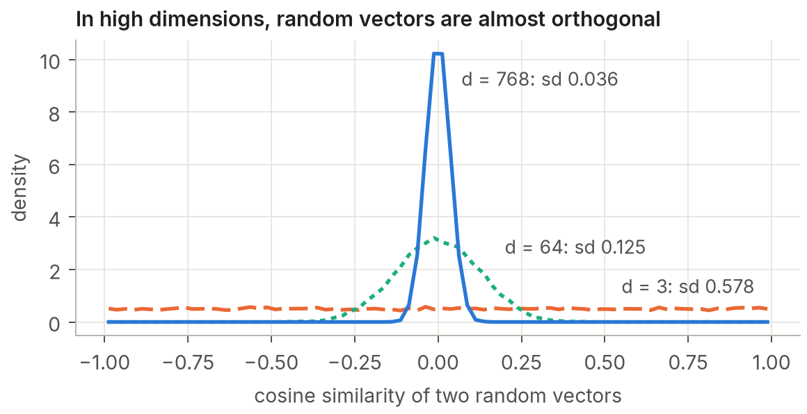
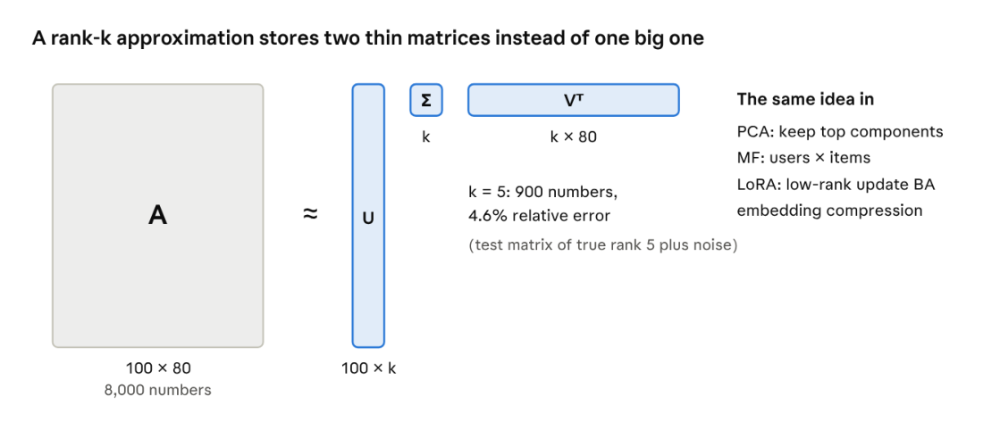

# 1 · The maths you actually use

Part I · Foundations. The maths behind the rest of the book, limited to what practitioners use. Every idea here shows up later: cosine similarity in retrieval, SVD in matrix factorisation and LoRA, Bayes in naive Bayes and calibration, cross-entropy and KL in every model you train.

## Why it matters

You do not need a maths degree to be a strong applied ML engineer, but you need fluent intuition for a small set of ideas, because interviewers use them to test whether you understand models or only call them. "Why cosine and not Euclidean?", "what is LoRA doing in linear-algebra terms?", "why is cross-entropy the classification loss?" all come from this chapter.

The ideas fall into three groups, and the chapter takes them in that order. **Linear algebra** (1.1, 1.2, 1.7) is how data and models are represented: an embedding is a vector, a layer is a matrix, and most of what a network computes is a chain of matrix products. Similarity search, matrix factorisation, attention and LoRA are all statements about vectors and matrices. **Probability** (1.3, 1.4) is how models reason about uncertainty: it explains why a 95%-accurate fraud detector can be wrong most of the times it fires, and where training objectives and regularisers come from. **Calculus and information theory** (1.5, 1.6, 1.8) are how models learn and how we measure them: gradients drive every training step, and cross-entropy and KL divergence are the losses and penalties those steps optimise. Two closing sections collect the tools that the LLM chapters lean on hardest: **estimating expectations by sampling** (1.9: Monte Carlo, importance sampling and the score-function trick, the mathematical base of REINFORCE, PPO's ratio and every KL estimator in Chapters 18 and 19), and **Jensen's inequality and the ELBO** (1.10, behind VAEs, diffusion and the InfoNCE bound).

What an interviewer is testing with this material is rarely recall of a formula. It is whether you can *derive* the formula from something simpler in a few lines ("show that squared error is Gaussian maximum likelihood", "derive the policy gradient", "why does softmax with cross-entropy give s − y?"), and whether you can attach a number to it on the spot. The chapter is written so that each of those derivations is on the page, with a small example you can check by hand.

Each section starts from the question the idea answers, builds the intuition before the formula, and works a small example with numbers you can check by hand. The aim is not to prove theorems but to make each idea usable: you should finish the chapter able to explain these concepts at a whiteboard, compute them in a few lines of NumPy, and recognise them when they reappear in later chapters under other names.

## Key concepts

- **Vector, dot product, cosine similarity**: a vector is a list of numbers (an embedding, a feature row); the dot product measures how aligned two vectors are; cosine similarity is the dot product of their length-normalised versions. [3Blue1Brown: Essence of linear algebra](https://www.3blue1brown.com/topics/linear-algebra).
- **Matrix multiplication**: every neural-network layer is one; it maps vectors from one space to another. Same series as above.
- **Eigenvectors and SVD**: directions a matrix only stretches; SVD factorises any matrix into rotations and stretches and gives the best low-rank approximation. [Singular value decomposition](https://en.wikipedia.org/wiki/Singular_value_decomposition).
- **PCA**: SVD of centred data; finds the directions of largest variance. [Principal component analysis](https://en.wikipedia.org/wiki/Principal_component_analysis).
- **Bayes' rule and base rates**: how to update a probability with evidence, and why rare events produce many false alarms. [Bayes' theorem](https://en.wikipedia.org/wiki/Bayes%27_theorem).
- **MLE and MAP**: choose parameters that make the data most likely; MAP adds a prior, which is where regularisation comes from. [Maximum likelihood estimation](https://en.wikipedia.org/wiki/Maximum_likelihood_estimation), [MAP estimation](https://en.wikipedia.org/wiki/Maximum_a_posteriori_estimation).
- **Gradient and chain rule**: the direction of steepest increase, and how derivatives compose through layers; together they give gradient descent and backpropagation. [Gradient descent](https://en.wikipedia.org/wiki/Gradient_descent).
- **Entropy, cross-entropy, KL divergence**: measures of uncertainty and of the gap between two distributions; cross-entropy is the standard classification loss. [Kullback–Leibler divergence](https://en.wikipedia.org/wiki/Kullback%E2%80%93Leibler_divergence).
- **Hessian, sharpness and condition number**: second derivatives describe curvature; the largest eigenvalue caps the stable learning rate at 2/λ_max, and the ratio of largest to smallest sets how slowly gradient descent converges. [Hessian matrix](https://en.wikipedia.org/wiki/Hessian_matrix).
- **Monte Carlo, importance sampling and the score-function trick**: estimate an expectation by averaging samples, reweight samples drawn from the wrong distribution, and turn the gradient of an expectation into an expectation you can sample. The base of REINFORCE, PPO and KL estimators. [Importance sampling](https://en.wikipedia.org/wiki/Importance_sampling).
- **Jensen's inequality and the ELBO**: log of an average ≥ average of logs, which gives the evidence lower bound used to train latent-variable models. [Evidence lower bound](https://en.wikipedia.org/wiki/Evidence_lower_bound).
- **Whole-subject reference**: [Mathematics for Machine Learning](https://mml-book.github.io/) (Deisenroth, Faisal and Ong), free online.

## 1.1 Vectors, dot products and cosine similarity

Almost everything a model handles becomes a vector before the model sees it: a row of tabular features, a word, a sentence, an image, a user, a product. Once two things are vectors, the most common question is how similar they are. Retrieval, recommendation, deduplication, clustering and attention all reduce to that question, so the choice of similarity measure, and an understanding of how it behaves in hundreds of dimensions, sits underneath a large share of applied ML.

A vector is a list of numbers; in ML, a point in a feature or embedding space. The **dot product** a·b = Σaᵢbᵢ measures alignment weighted by length; **cosine similarity** a·b / (‖a‖‖b‖) measures only the angle: 1 for the same direction, 0 for orthogonal, −1 for opposite.

```python
import numpy as np

def cosine(a, b):
    return a @ b / (np.linalg.norm(a) * np.linalg.norm(b))

cosine(np.array([1., 2, 0]), np.array([2., 4, 0]))   # 1.0: same direction, different length
cosine(np.array([1., 0]), np.array([0., 1]))         # 0.0: orthogonal
```

**Why cosine for text embeddings:** vector length often reflects things like text length or frequency rather than meaning; cosine ignores it. On L2-normalised vectors, cosine, dot product and (monotonically) Euclidean distance give the same ranking, which is why vector databases normalise. The reason is one line of algebra. For unit vectors a and b,

$$
\Vert a-b\Vert^2 = \Vert a\Vert^2 + \Vert b\Vert^2 - 2\,a\cdot b = 2 - 2\cos(a,b)
$$

so the squared distance is a decreasing function of the cosine, and sorting by one sorts by the other. Check with a = (0.6, 0.8) and b = (1, 0): the cosine is 0.6, and ‖a − b‖² = 0.4² + 0.8² = 0.8 = 2 − 1.2.

### When the raw dot product is the better choice

Cosine throws away the norm, which is right when the norm is noise and wrong when it carries signal. A **two-tower recommender** (Chapter 43.4) scores a user vector u against an item vector v with u·v, and whether to normalise is a real design choice. Left unnormalised, the item norm learns something like popularity or the model's confidence in the item: a popular item gets a longer vector and scores higher for everyone. Normalised (as in the Chapter 43.4 code), that signal is gone, and the model needs a temperature, and often a separate popularity or bias term, to sharpen its scores. Attention scores (Chapter 10.2) are also raw dot products, scaled by 1/√d, because the length of a query is how sharply it wants to attend. The rule a senior answer gives: use cosine when the norm is an artefact of the encoder (text length, token frequency) and the dot product when the norm was trained to mean something; and remember that maximum-inner-product search is a different index problem from nearest-neighbour search (Chapter 30).

**Norms:** L2 (Euclidean length) and L1 (sum of absolute values) appear as regularisers (Chapter 3.4). In high dimensions, distances between random points concentrate (all look similar), one reason kNN and clustering struggle without good representations.

**Geometry in high dimensions.** Intuitions from 2-D and 3-D mislead in the 768- or 4,096-dimensional spaces of embeddings. Take two random vectors with independent standard-normal entries. Their dot product is a sum of d independent products, so its spread grows like √d, while their lengths grow like √d each; the cosine therefore shrinks like 1/√d. Measured on 20,000 random pairs, the standard deviation of the cosine is 0.578 in 3 dimensions, 0.125 in 64 and 0.036 in 768, matching 1/√d. In high dimensions, almost every pair of random directions is nearly orthogonal.



*Distribution of the cosine between two random vectors (computed in `tools/figures.py`). In 768 dimensions nearly all pairs fall within ±0.1.*

Two consequences follow. A cosine of 0.3 between two embeddings is a strong signal, not a weak one, because chance alone almost never produces it. And trained embedding spaces are usually **anisotropic**: real embeddings crowd into a narrow cone, so even unrelated texts can score 0.6–0.8. Similarity thresholds must therefore be calibrated per model on labelled pairs, never carried over from another model (Chapter 29).

**Fixing anisotropy.** The cone is mostly a shared offset: every embedding contains the same large mean vector, and that common component dominates every cosine. Subtracting the corpus mean (**mean-centring**) removes it. In the check script, 768-dimensional random vectors with a shared offset have an average pairwise cosine of 0.45; after centring it is 0.00. **Whitening** goes one step further: it rescales by the inverse square root of the covariance so that every direction has unit variance, which also removes the few dominant directions that survive centring. Both are cheap post-processing steps and both change the ranking of neighbours, so evaluate them on labelled pairs rather than assuming they help; contrastive fine-tuning (Chapter 29.2) fixes the geometry at the source.

## 1.2 Matrices, eigenvectors and the SVD

If vectors are the data, matrices are what act on them. A neural-network layer is a matrix that maps one vector space to another; a dataset is a matrix with one row per example; a user–item table is a matrix waiting to be factorised. Two questions come up constantly: what does a given matrix *do* to the vectors it touches, and how much of it actually matters? Eigenvectors and the singular value decomposition answer both, and the second answer, that most real matrices are close to low rank, is the idea behind PCA, recommendation by matrix factorisation and LoRA.

**Matrix multiplication** is the core operation of every model: a linear layer computes Wx; a batch is XWᵀ; attention is QKᵀ. Track shapes: (n × d) @ (d × k) = (n × k). Most bugs in from-scratch code are shape bugs.

**Eigenvectors** of a square matrix are directions it only stretches: Av = λv. For a covariance matrix, eigenvectors are the principal components and eigenvalues the variance along them (PCA, Chapter 40.10).

**The singular value decomposition** factors any matrix: A = UΣVᵀ, with orthonormal U and V and non-negative singular values in Σ, largest first. Keeping the top k gives the **best rank-k approximation** (Eckart–Young theorem).

**What the SVD says geometrically.** Every matrix, applied to a vector, does three things in sequence: Vᵀ rotates the input into a special set of axes, Σ stretches each axis by its singular value, and U rotates the result into the output space. A circle of input vectors becomes an ellipse whose semi-axes are the singular values. For the 2 × 2 matrix [[3, 0], [4, 5]], the singular values are 6.708 and 2.236: the matrix stretches one direction by about 6.7 and another by about 2.2. You can get them by hand, because the singular values of A are the square roots of the eigenvalues of AᵀA (substitute A = UΣVᵀ: AᵀA = VΣUᵀUΣVᵀ = VΣ²Vᵀ, an eigendecomposition with eigenvalues σᵢ²). Here AᵀA = [[25, 20], [20, 25]], whose eigenvalues are 25 ± 20 = 45 and 5, and √45 = 6.708, √5 = 2.236. Keeping only the first gives a rank-1 approximation with 31.6% relative error, because the second stretch is not negligible. Real data matrices typically have a few large singular values and a long tail of small ones, which is exactly when truncation works.

**Why real matrices are approximately low rank.** A user–item matrix is low rank when a few hidden factors (price sensitivity, genre or category preference, time of day) explain most behaviour; each user's row is then roughly a mix of a few typical rows. The same holds for the weight *change* when fine-tuning a large model on a narrow task: LoRA bets that the update has low effective rank. For a 4,096 × 4,096 weight matrix, a rank-16 update has 16 × (4,096 + 4,096) = 131,072 parameters instead of 16,777,216: 0.78% of them (Chapter 20).



*truncated SVD · a 100 × 80 matrix at rank 5*

```python
U, S, Vt = np.linalg.svd(A, full_matrices=False)
A_k = U[:, :k] * S[:k] @ Vt[:k]                 # rank-k reconstruction
rel_error = np.linalg.norm(A - A_k) / np.linalg.norm(A)
```

On a 100 × 80 test matrix built as rank 5 plus noise, rank 1 left 83% relative error, rank 5 only 4.6%, and rank 20 3.3% (the rest is noise). Storage at rank 5: 900 numbers instead of 8,000.

This single idea explains **matrix factorisation** for recommendations (Chapter 43.2: the user-item matrix is approximately low rank), **LoRA** (Chapter 20.3: the fine-tuning update is approximately low rank), **PCA**, and embedding compression.

### From the SVD to PCA

PCA asks for the directions along which centred data varies most. The answer is the eigenvectors of the covariance matrix, and the SVD gives them without forming that matrix. Let X be the n × d data matrix with each column's mean subtracted, and write its SVD as X = UΣVᵀ. Then

$$
\dfrac{X^{T}X}{n-1} = \dfrac{V\,\Sigma^{2}\,V^{T}}{n-1}
$$

The left side is the sample covariance matrix; the right side is its eigendecomposition. So the right singular vectors (the columns of V) are the principal components, and σᵢ²/(n − 1) is the variance of the data along component i. The projections of the data onto the components are XV = UΣ. In the check script, the squared singular values of a centred 500 × 3 matrix divided by 499 match the eigenvalues of `np.cov` to machine precision (5.07, 0.69 and 0.09).

Two practical consequences. Working from the SVD of X is numerically better than forming XᵀX, which squares the condition number (1.7). And forgetting to centre is a common bug: without centring, the first "component" points at the mean of the data rather than along its largest spread.

## 1.3 Probability, Bayes and common distributions

Models output probabilities, and decisions are taken on them: flag this order, show this ad, accept this loan. Reading those probabilities correctly requires two skills. The first is updating a belief with evidence, which is Bayes' rule, and its main practical lesson: how rare the thing you are looking for is matters as much as how good your detector is. The second is choosing a sensible distribution for the quantity you are modelling, because that choice fixes the loss you train with and the assumptions you make about noise.

**Bayes' rule** turns the probability of the evidence given a hypothesis into the probability of the hypothesis given the evidence:

$$
P(A\mid B) = \dfrac{P(B\mid A)\,P(A)}{P(B)}
$$

P(A) is the **prior** (how common A is before looking), P(B | A) the **likelihood** (how often the evidence appears when A is true), and P(B) the overall rate of the evidence, from both true and false cases. The practical lesson is the **base rate**: a fraud model with 95% recall and a 5% false positive rate, on a population with 1% fraud, gives P(fraud | flagged) = 0.95·0.01 / (0.95·0.01 + 0.05·0.99) ≈ 16%. Most flags are false alarms, which is why precision collapses for rare events (Chapter 4.2).

**The same calculation in natural frequencies**, which is how to explain it to anyone: of 10,000 orders, 100 are fraudulent and 9,900 are not. The model catches 95 of the 100 frauds, and wrongly flags 5% of the 9,900 good orders, which is 495. Of the 590 flagged orders, only 95 are fraud: 16%. Halving the false positive rate helps more than raising recall, because the false alarms come from the huge majority class.


*Precision of the same detector (95% recall) as prevalence changes. At 0.1% prevalence it is 1.9% with a 5% false-positive rate and 8.7% with 1%; at 10% prevalence, 68% and 91%.*

| Distribution | Models | Used for |
|---|---|---|
| Bernoulli / binomial | Yes/no outcomes, counts of successes | Clicks, conversions; logistic regression's likelihood |
| Categorical / multinomial | One of k outcomes | Next-token prediction; softmax classifiers |
| Poisson | Counts of events in an interval | Orders per hour, demand forecasting |
| Normal (Gaussian) | Sums of many small effects | Measurement noise, the CLT, regression errors |
| Log-normal | Products of factors; skewed positive values | Basket values, delivery durations |
| Beta | A probability itself | Prior for click rates; Thompson sampling |
| Exponential | Waiting times | Time between orders |

**Expectation and variance** rules worth knowing: E[aX + b] = aE[X] + b; Var(aX) = a²Var(X); variances of independent variables add; the variance of a mean of n independent draws is σ²/n (why bigger samples give tighter estimates).

## 1.4 MLE and MAP

Every model has parameters, and training is the choice of their values. Behind almost every loss function is one principle: pick the parameters under which the data you actually observed would have been most probable. That principle, maximum likelihood, explains why squared error is the regression loss and cross-entropy the classification loss. Its Bayesian extension, MAP estimation, adds what you believed before seeing the data, and turns out to be exactly what regularisation and smoothing do. This section derives both on the simplest possible model, a single click rate, because the steps are the same for a deep network.

**Maximum likelihood (MLE):** choose parameters that make the observed data most probable. For a click rate with 3 clicks in 10 impressions, MLE = 0.3.

**The derivation**, because the same steps recur everywhere: with k clicks in n impressions and click probability θ, the likelihood is θᵏ(1 − θ)ⁿ⁻ᵏ. Take the log (products become sums and the maximum does not move): k log θ + (n − k) log(1 − θ). Set the derivative k/θ − (n − k)/(1 − θ) to zero and solve: θ = k/n. Training a classifier with log loss is this same calculation with θ produced by a model for each example instead of one shared number.

**Maximum a posteriori (MAP):** add a prior and maximise the posterior. With a Beta(2, 38) prior (mean 5%, a typical click rate), the MAP estimate is (3 + 2 − 1)/(10 + 2 + 38 − 2) ≈ 0.083, and the posterior mean (3 + 2)/(10 + 40) = 0.10. The prior pulls small-sample estimates towards the typical value: exactly the **smoothing** used for CTR features and target encoding (Chapters 3.8, 44.4).

**Why the Beta prior is convenient.** The Beta distribution is *conjugate* to the binomial: a Beta(a, b) prior plus k successes in n trials gives a Beta(a + k, b + n − k) posterior, so updating is just adding counts. The prior acts like a + b imaginary impressions with a imaginary clicks. With Beta(2, 38):

| Observed | Raw rate | Posterior mean (k + 2)/(n + 40) |
|---|---|---|
| 3 / 10 | 0.300 | 0.100 |
| 30 / 100 | 0.300 | 0.229 |
| 300 / 1,000 | 0.300 | 0.290 |
| 0 / 5 | 0.000 | 0.044 |

The same raw rate is trusted more as evidence accumulates, and an item with no clicks yet is not ranked as if it were certainly worthless. This is empirical Bayes: fit a and b to the distribution of rates across all items, then shrink each item towards it.

**Connections to remember:** minimising squared error = MLE under Gaussian noise; minimising log loss = MLE for Bernoulli labels; L2 regularisation = MAP with a Gaussian prior on weights; L1 = MAP with a Laplace prior. "Derive it" is a standard interview request for each of these, and each takes four or five lines.

### Squared error is Gaussian maximum likelihood

Assume each target is the model's prediction plus Gaussian noise: yᵢ = f(xᵢ; w) + εᵢ, with εᵢ ~ N(0, σ²) independent. The probability density of one target is then

$$
p(y_i \mid x_i, w) = \dfrac{1}{\sqrt{2\pi\sigma^2}}\,\exp\left(-\dfrac{(y_i - f(x_i;w))^2}{2\sigma^2}\right)
$$

Take the negative log and sum over the n examples. The product of densities becomes a sum, the exponential disappears, and what remains is

$$
-\log p(y \mid X, w) = \dfrac{1}{2\sigma^2}\sum_i \left(y_i - f(x_i;w)\right)^2 + \dfrac{n}{2}\log(2\pi\sigma^2)
$$

The second term does not depend on w, and the factor 1/(2σ²) is a positive constant, so the w that minimises the sum of squared errors is exactly the w that maximises the likelihood. The derivation also says when squared error is the *wrong* loss: when the noise is heavy-tailed (a Laplace noise model gives absolute error, which is robust to outliers), or when its variance changes with the input (then each term should be divided by its own σᵢ², or the model should predict σ as well).

### L2 is a Gaussian prior, L1 a Laplace prior

MAP adds a prior on the weights and maximises the posterior p(w | data) ∝ p(data | w) p(w). Put an independent Gaussian prior with variance τ² on each weight, p(w) ∝ exp(−‖w‖²/(2τ²)). The negative log posterior is the negative log likelihood above plus ‖w‖²/(2τ²), up to constants. Multiply everything by 2σ², which does not move the minimum:

$$
\hat{w}_{\mathrm{MAP}} = \arg\min_w \sum_i \left(y_i - f(x_i;w)\right)^2 + \lambda\,\Vert w\Vert^2, \qquad \lambda = \dfrac{\sigma^2}{\tau^2}
$$

That is ridge regression, and the derivation gives λ a meaning: the ratio of the noise variance to the prior variance. Noisy data (large σ²) or a tight prior (small τ²) both call for more regularisation. With a Laplace prior p(w) ∝ exp(−|w|/b) instead, the same steps give a penalty (2σ²/b)·Σ|wⱼ|: the L1 penalty of the lasso.

**A worked example with one weight.** Fit y = wx to three points x = (1, 2, 3), y = (1, 3, 2), with noise variance σ² = 1. Write Sxy = Σxᵢyᵢ = 13 and Sxx = Σxᵢ² = 14.

- **MLE (least squares):** set the derivative of Σ(yᵢ − wxᵢ)² to zero: w = Sxy/Sxx = 13/14 = 0.929.
- **MAP with a Gaussian prior, τ² = 0.5:** λ = 1/0.5 = 2, and the derivative gives w = Sxy/(Sxx + λ) = 13/16 = 0.8125. The prior shrinks the weight towards zero.
- **MAP with a Laplace prior, b = 0.5:** the penalty is λ₁|w| with λ₁ = 2σ²/b = 4. For w > 0 the derivative is −2(Sxy − wSxx) + λ₁, so w = (Sxy − λ₁/2)/Sxx = 11/14 = 0.786. If Sxy were smaller than λ₁/2 = 2, no positive or negative w would satisfy the condition and the minimum would sit exactly at w = 0.

That last case is why L1 produces **exact zeros** and L2 does not: the Laplace prior has a kink at zero that holds weak weights there, while the Gaussian prior only shrinks them proportionally (Chapter 3.4).

## 1.5 Gradients and the chain rule

Once a loss is defined, training is a search for the parameters that minimise it, and with millions or billions of parameters the only practical search is to follow the slope downhill. The gradient tells you which way is downhill for every parameter at once; the chain rule tells you how to compute it through a model built from many layers. Together they are backpropagation, the algorithm behind every network in this book. Being able to do it by hand on a tiny example is the best protection against treating it as magic.

A gradient is the vector of partial derivatives: the direction of steepest increase. Training moves parameters against it (Chapter 3.5). The **chain rule** composes derivatives through nested functions, d/dx f(g(x)) = f′(g(x))·g′(x), and **backpropagation** applies it efficiently from the loss back through every layer (Chapter 5).

**The chain rule by hand.** Take one example with input x = 2, target y = 5 and the model z = w·x + b with w = 3 and b = 1, and the loss L = (z − y)². The forward pass gives z = 7 and L = 4. Going backwards: ∂L/∂z = 2(z − y) = 4; since ∂z/∂w = x and ∂z/∂b = 1, the chain rule gives ∂L/∂w = 4 × 2 = 8 and ∂L/∂b = 4. A gradient step with learning rate 0.01 moves w to 2.92 and b to 0.96, reducing z towards 5. Backpropagation is exactly this bookkeeping, done for millions of parameters by reusing the shared upstream factor (here ∂L/∂z) instead of recomputing it for each parameter.

The most useful derivative to know by heart: for logistic regression with log loss, the gradient is Xᵀ(σ(Xw) − y)/n, and the same "prediction minus target" form holds for softmax with cross-entropy (derived in 1.7).

**Check gradients numerically** when you implement them by hand: compare with central differences (f(w + ε) − f(w − ε))/2ε.

```python
def numerical_grad(f, w, eps=1e-6, *args):
    g = np.zeros_like(w)
    for i in range(len(w)):
        e = np.zeros_like(w); e[i] = eps
        g[i] = (f(w + e, *args) - f(w - e, *args)) / (2 * eps)
    return g

np.allclose(analytic_grad(w, X, y), numerical_grad(log_loss, w, 1e-6, X, y), atol=1e-6)   # True
```

## 1.6 Entropy, cross-entropy and KL divergence

These three quantities are the language in which almost every modern model is trained and compared. Cross-entropy is the loss of every classifier and every language model; KL divergence is the leash that keeps a fine-tuned model close to its starting point, the objective of distillation, and a standard drift alarm. They are worth understanding from first principles rather than as formulas, because interview questions about them are almost always "why" questions: why this loss, why this direction, why it can blow up. All three are built from one idea, **surprise**.

### Surprise: how unexpected was that outcome?

If an event had probability p, observing it carries a surprise of −log p. The definition is less arbitrary than it looks. Surprise should be zero for a certain event (−log 1 = 0), grow without limit as the event becomes rarer (−log p → ∞ as p → 0), and add up for independent events: seeing two independent things with probabilities p₁ and p₂ should be as surprising as the sum of the two surprises. Since the joint probability is p₁p₂, only the logarithm turns that product into a sum. With log base 2, surprise is measured in **bits**; with the natural log, in **nats** (1 nat = 1.443 bits). Deep-learning libraries use nats.

A fair coin landing heads has surprise −log₂ 0.5 = 1 bit. An outcome with probability 1/8 has 3 bits: it is as surprising as three fair coins all landing heads.

### Entropy: the average surprise of a distribution

Entropy is the surprise you should expect on average if outcomes really are drawn from p:

$$
H(p) = -\sum_{x} p(x)\,\log p(x)
$$

It measures how unpredictable a distribution is. A fair coin has 1 bit of entropy; a coin that lands heads 90% of the time has 0.469 bits, and a 99% coin only 0.081 bits: you are rarely surprised by it. Entropy is zero for a certain outcome and largest for the uniform distribution, where it equals log k for k outcomes.

There is a concrete reading in terms of codes. If you must transmit outcomes of p as a stream of bits, the best possible code gives outcome x a codeword of about −log₂ p(x) bits (short codes for common outcomes, long ones for rare ones, as Morse code does for "e"). The average length of that optimal code is exactly H(p). Entropy is the irreducible cost of describing the outcomes of p.

For a language model, the entropy of the next-token distribution says how many plausible continuations the model sees. After "The capital of France is", a good model has entropy close to zero; after "My favourite food is", it is high, and rightly so.

### Cross-entropy: paying for the wrong model

In practice you never know p, the true distribution. You have a model q, and you are charged according to q's beliefs while outcomes keep arriving from p. Cross-entropy is the average surprise under that arrangement:

$$
H(p, q) = -\sum_{x} p(x)\,\log q(x)
$$

The weights p(x) say how often each outcome really happens; the surprise −log q(x) is what your model feels when it does. In the coding story, you designed your codewords for q, but the messages follow p, so your average message is longer than it needs to be.

A worked example with three outcomes, true distribution p = [0.7, 0.2, 0.1] and model q = [0.5, 0.3, 0.2]. Codes designed for q have lengths −log₂ q = [1.00, 1.74, 2.32] bits. Weighted by how often each outcome actually occurs, the average is 0.7 × 1.00 + 0.2 × 1.74 + 0.1 × 2.32 = 1.280 bits. The best possible code, built for p itself, would average H(p) = 1.157 bits.

**Why it is the classification loss.** For one labelled example, p is the one-hot label: all its probability sits on the true class y. The sum collapses to a single term, and cross-entropy becomes −log q(y), the negative log of the probability the model gave to the correct answer. Averaged over a dataset, this is the negative log-likelihood of the labels, so minimising cross-entropy is maximum-likelihood estimation (1.4). The same holds token by token for a language model: its training loss is the average of −log q(next token).

### KL divergence: the extra cost

The gap between the two numbers above is the KL divergence (Kullback–Leibler), the average *extra* surprise caused by believing q when the truth is p:

$$
\mathrm{KL}(p\,\Vert\,q) = H(p,q) - H(p) = \sum_{x} p(x)\,\log\dfrac{p(x)}{q(x)}
$$

In the example, KL(p ‖ q) = 1.280 − 1.157 = 0.123 bits: the price, per outcome, of using the wrong model. Read term by term, each outcome contributes p(x) times the log of how much more (or less) likely p thinks it is than q does:

| Outcome | p | q | p · log₂(p/q) |
|---|---|---|---|
| A | 0.7 | 0.5 | +0.340 (q under-predicts a common outcome) |
| B | 0.2 | 0.3 | −0.117 |
| C | 0.1 | 0.2 | −0.100 |
| Total | | | 0.123 |

Individual terms can be negative, where q is more generous than needed, but the total never is. Three properties follow, and each one matters in practice.

1. **KL is never negative, and it is zero only when q = p** (Gibbs' inequality). No model can beat the truth on average. This is why a KL term works as a penalty: it is smallest exactly when the two distributions agree.
2. **KL is not symmetric.** KL(q ‖ p) for the same pair is 0.133 bits, not 0.123, because the expectation is taken under a different distribution. KL is therefore not a distance, and the direction you choose changes what an optimiser does (forward versus reverse KL, 1.8).
3. **KL explodes when q rules out what p allows.** If q(x) = 0 for an outcome with p(x) > 0, the term p(x) log(p(x)/0) is infinite. Even a near-zero q hurts: changing q to [0.6, 0.39, 0.01] raises KL(p ‖ q) from 0.123 to 0.295 bits, mostly because outcome C, which happens 10% of the time, was given only 1%. A model trained with cross-entropy is therefore pushed never to be certain that something is impossible. This is the same mechanism as the exploding loss in the table below.

Because H(p) does not depend on the model, minimising cross-entropy H(p, q) over q and minimising KL(p ‖ q) over q are the same optimisation: they differ by a constant. Training on cross-entropy is fitting the model by forward KL to the data distribution.

```python
def entropy(p):          return -np.sum(p * np.log2(p))
def cross_entropy(p, q): return -np.sum(p * np.log2(q))
def kl(p, q):            return cross_entropy(p, q) - entropy(p)

p, q = np.array([0.7, 0.2, 0.1]), np.array([0.5, 0.3, 0.2])
# entropy(p) = 1.157 bits, cross_entropy(p, q) = 1.28, kl(p, q) = 0.123, kl(q, p) = 0.133: not symmetric
```

**What cross-entropy charges for a prediction.** For one example, the loss is −log of the probability given to the true class:

| Probability on the true class | 0.9 | 0.5 | 0.1 | 0.01 |
|---|---|---|---|---|
| Cross-entropy (nats) | 0.105 | 0.693 | 2.303 | 4.605 |

Being confidently wrong is expensive and grows without bound, which is why cross-entropy pushes models towards honest probabilities, and why a handful of mislabelled examples can dominate a training loss. Label smoothing (training towards 0.9 on the true class instead of 1.0) caps how confident the model is asked to be.

### Where KL appears, and why each use needs it

- **RLHF and RL fine-tuning** (Chapters 18 and 19). The reward model is imperfect, and a policy optimised hard against it finds its blind spots. A penalty β · KL(π ‖ π_ref) charges the policy for every bit it drifts from the reference model, so it can only move where the reward gain is worth the cost. β sets the exchange rate.
- **Distillation** (Chapter 15.7). The student is trained to match the teacher's whole output distribution, not only its top answer, by minimising KL between them. The teacher's probabilities on wrong answers ("this is a husky, but it looks a bit like a wolf") carry information that one-hot labels do not.
- **Variational autoencoders and variational inference.** A KL term keeps the learned latent distribution close to a simple prior, which is what makes sampling from the prior produce sensible outputs.
- **Monitoring.** KL (or its symmetric cousin, the Jensen–Shannon divergence) between this week's and last month's feature or prediction distributions is a standard drift alarm (Chapter 47). The population stability index used in credit scoring is a symmetrised KL.

**Numerical stability:** compute softmax as exp(z − max z) / Σ, otherwise large logits overflow (softmax of [1000, 1001, 1002] works only with the shift and gives [0.09, 0.245, 0.665]); compute log-softmax directly rather than log(softmax), and never take the log of a probability that can be exactly zero.

## 1.7 Matrix calculus and curvature

Section 1.5 treated parameters one at a time. Real models have matrices of parameters, and papers and research code state their gradients in matrix form. A handful of facts cover almost every case: what shape a gradient has, how gradients flow through a linear layer and a softmax, and what the second derivative, the curvature, says about how large a learning rate can be. The last point explains much of the optimisation behaviour in Chapter 7.

### Gradients of a linear layer

The first fact to internalise is that **a gradient has the same shape as the thing it is the gradient of**: if W is 4,096 × 1,024, so is ∂L/∂W. That alone catches most transposition bugs. For a linear layer y = Wx feeding into some loss L, write g = ∂L/∂y for the gradient arriving from above. Each output is yᵢ = Σⱼ Wᵢⱼxⱼ, so Wᵢⱼ affects the loss only through yᵢ, with ∂yᵢ/∂Wᵢⱼ = xⱼ. The chain rule gives ∂L/∂Wᵢⱼ = gᵢxⱼ, which in matrix form is an outer product; and xⱼ affects every yᵢ with weight Wᵢⱼ, so the gradient passed further down sums over i:

$$
\dfrac{\partial L}{\partial W} = g\,x^{T}, \qquad \dfrac{\partial L}{\partial x} = W^{T} g
$$

Backpropagation through a linear layer is these two lines. With g = (1, −2) and x = (3, 0.5), ∂L/∂W = [[3, 0.5], [−6, −1]]. For a batch, X is n × d and the weight gradient becomes a sum of outer products, Gᵀ X, which is why the backward pass costs about twice the forward pass: one matrix product for ∂L/∂W and one for ∂L/∂x (Chapter 10.8 uses this for the 6ND rule).

### Jacobians and vector–Jacobian products

For a function from vectors to vectors, y = f(x), the **Jacobian** J collects every first derivative, Jᵢⱼ = ∂yᵢ/∂xⱼ. The chain rule for a composition is then a product of Jacobians. A network never forms these matrices, because for a layer with a million inputs and a million outputs J would have 10¹² entries. Instead, backpropagation multiplies the incoming gradient row vector by the Jacobian, a **vector–Jacobian product** gᵀJ, which costs about as much as the forward computation. That is why reverse-mode differentiation gives the gradient of a scalar loss with respect to all parameters in one backward pass.

### Softmax and cross-entropy give s − y

The softmax sᵢ = exp(zᵢ)/Σₖ exp(zₖ) has Jacobian ∂sᵢ/∂zⱼ = sᵢ(δᵢⱼ − sⱼ), where δᵢⱼ is 1 when i = j and 0 otherwise. (Differentiate the quotient: the numerator contributes sᵢδᵢⱼ, the denominator −sᵢsⱼ.) Cross-entropy against a one-hot or soft target y is L = −Σᵢ yᵢ log sᵢ. Chain the two:

$$
\dfrac{\partial L}{\partial z_j} = -\sum_i y_i\,\dfrac{1}{s_i}\,s_i(\delta_{ij} - s_j) = -y_j + s_j\sum_i y_i = s_j - y_j
$$

using Σᵢyᵢ = 1. The 1/sᵢ from the log cancels the sᵢ in the softmax Jacobian, which is why the gradient is so clean and why it does not vanish when the model is confidently wrong. With logits z = (2, 1, 0) and the true class second, s = (0.665, 0.245, 0.090) and the gradient is (0.665, −0.755, 0.090): push the wrong classes down in proportion to the probability they received and pull the right one up by what it lacked. A central-difference check reproduces the same three numbers.

### Curvature and the largest stable learning rate

The **Hessian** H is the matrix of second derivatives; it says how the gradient changes as you move. Near a minimum the loss looks like a quadratic bowl, and the Hessian's eigenvalues are the curvatures along its principal axes. The largest, λ_max, is called the **sharpness**.

The learning-rate limit follows from one dimension. Take L(w) = ½λw², whose gradient is λw. A gradient-descent step gives

$$
w_{t+1} = w_t - \eta\lambda w_t = (1 - \eta\lambda)\,w_t
$$

so after t steps w has been multiplied by (1 − ηλ)ᵗ. This shrinks to zero only if |1 − ηλ| < 1, that is 0 < η < 2/λ. With λ = 10 the limit is η = 0.2. At η = 0.1 the factor is 0 and the step lands on the minimum at once; at 0.15 the factor is −0.5 and w oscillates in sign while shrinking (to about 10⁻⁶ after 20 steps); at 0.19 it is −0.9 and the oscillation dies slowly (0.12 after 20 steps); at 0.21 it is −1.1 and w grows (6.7 after 20 steps); at 0.25 it has reached 3,325. In many dimensions each eigen-direction obeys its own copy of this equation, so the stiffest direction sets the limit: η < 2/λ_max.

### Condition number, and why plain gradient descent is slow

The other eigenvalues matter too. If the flattest direction has curvature λ_min, a learning rate safely below 2/λ_max shrinks that direction by only (1 − ηλ_min) per step. The ratio κ = λ_max/λ_min is the **condition number**. Take λ_max = 10 and λ_min = 0.1 (κ = 100), and η = 0.2 at the stability limit: the flat direction shrinks by a factor 0.98 per step, so reducing its error 100-fold takes ln 0.01 / ln 0.98 ≈ 228 steps, while the stiff direction rattles back and forth. The number of steps grows in proportion to κ. This is the zig-zag in a narrow valley, and it is what momentum, Adam's per-coordinate scaling and preconditioned optimisers such as Shampoo and Muon attack (Chapter 7.4).

The same vocabulary applies to a single matrix. The **spectral norm** ‖W‖₂ is its largest singular value, the most it can stretch any vector, and its condition number is σ_max/σ_min: for [[3, 0], [4, 5]], 6.708/2.236 = 3.0. Spectral norms control how much a layer can amplify activations and gradients, which is why modern analyses of Muon and µP are phrased in terms of them (Chapters 7.4 and 7.5), and why forming XᵀX, which squares the condition number, is avoided in numerical code.

### Measuring curvature in a real network

A network with a billion parameters has a Hessian with 10¹⁸ entries, so nobody forms it. A **Hessian–vector product** Hv can be computed exactly for about the cost of two backward passes, as the gradient of (∇L · v) with respect to the weights. Repeating it in a power iteration (v ← Hv / ‖Hv‖) converges to the top eigenvector and gives λ_max. That is how sharpness is measured in practice, and how Cohen et al. found the **edge of stability**: full-batch gradient descent pushes λ_max up until it hovers near 2/η, exactly the limit derived above, while the loss keeps falling non-monotonically (Chapter 7.7).

### Convexity and saddle points

Linear regression and logistic regression have convex losses: every local minimum is the global one, and the Hessian is positive semi-definite everywhere. Neural networks are not convex, yet gradient descent trains them reliably. Part of the reason is that in high dimensions a critical point with gradient zero is far more likely to be a **saddle** (curving up in some directions and down in others) than a bad local minimum, and noisy gradient steps escape saddles along their downhill directions. Saddles slow training rather than trapping it.

## 1.8 Information theory for language models

Section 1.6 introduced entropy, cross-entropy and KL divergence. Language models give them concrete meanings: the training loss is a cross-entropy measured in nats per token, perplexity is that loss in another unit, and the direction of a KL penalty decides whether a fine-tuned model stays diverse or collapses onto a few answers. This section collects the information-theory facts that come up when training, comparing and fine-tuning language models.

**Forward versus reverse KL.** KL divergence is not symmetric, and which direction you minimise changes the answer. Fit a single Gaussian q to a two-mode target p (modes at −2 and +2, each with standard deviation 0.6):

| Objective | Fitted mean | Fitted sd | Behaviour |
|---|---|---|---|
| Forward KL(p ‖ q) | 0.00 | 2.09 | Mode-covering: spreads to cover both modes, puts mass where p has none |
| Reverse KL(q ‖ p) | 2.00 | 0.60 | Mode-seeking: picks one mode and fits it tightly |

Maximum-likelihood training (cross-entropy on data) minimises forward KL from the data to the model, so language models cover the data distribution, including its unlikely corners. The KL penalty in RLHF is a reverse KL from the policy to the reference, and on-policy distillation also uses reverse KL: both make the student or policy mode-seeking, which tends to produce sharper but less diverse outputs (Chapters 18 and 19).

**Perplexity and bits.** A language model's cross-entropy loss in nats per token converts to bits per token by dividing by ln 2, and to **perplexity** by exponentiating: loss 2.0 nats is 2.89 bits per token and perplexity 7.39, as if the model were choosing uniformly among about 7 tokens at each step. Because tokens differ in length between tokenizers, compare models in **bits per byte** (Chapter 23).

### Bits per byte

Per-token loss is not comparable across tokenizers: a tokenizer with longer tokens has fewer, harder predictions to make, so its per-token loss is higher even if the model is better. The fix is to divide the total information by a unit both models share, the bytes of raw text. If a model's mean loss is L nats per token over N_tok tokens, and the text is N_bytes bytes long,

$$
\mathrm{BPB} = \dfrac{L \cdot N_{\mathrm{tok}}}{\ln 2 \cdot N_{\mathrm{bytes}}}
$$

The numerator is the total loss in nats; dividing by ln 2 converts it to bits; dividing by the byte count spreads it over the text. Model A, with a smaller vocabulary, reaches 2.0 nats per token at 4.0 bytes per token: 2.885 bits per token and 0.721 bits per byte. Model B, with a larger vocabulary, has a worse-looking 2.3 nats per token (3.318 bits), but its tokens average 4.8 bytes, so it needs only 0.691 bits per byte. B compresses the text better, and is the better model on this data, even though its per-token loss is higher. Perplexity has the same problem, which is why tokenizer research (Chapter 9) and cross-family comparisons report bits per byte.

**Compression is prediction.** A model that assigns probability p to the next symbol can encode it in −log₂ p bits with arithmetic coding, so a language model's total log-loss on a text is the length of the shortest code it can produce for it. Better prediction is better compression; this is why pretraining loss is such a robust measure of model quality, and why "the model learns to compress the internet" is a precise statement rather than a metaphor.

**Mutual information** I(X; Y) = H(X) − H(X | Y) measures how much knowing Y reduces uncertainty about X. It underlies contrastive learning (InfoNCE is a lower bound on mutual information, Chapter 29) and some interpretability and data-selection methods.

## 1.9 Expectations by sampling: Monte Carlo, importance sampling and the score function

Many quantities in modern ML are expectations that cannot be computed exactly: the expected reward of a language-model policy over all possible responses, the KL divergence between two models over all possible sequences, the gradient of either. There are far too many sequences to sum over, so all three are estimated from samples. Three tools do the work, and together they are the mathematics of reinforcement learning for LLMs: plain Monte Carlo averages, importance sampling for samples drawn from the wrong distribution, and the score-function trick for taking gradients of an expectation. Frontier-lab interviews probe all three, usually as "derive the policy gradient" or "why does PPO have a ratio in it?".

### Monte Carlo estimation

The expectation E_p[f(x)] = Σₓ p(x) f(x) is approximated by drawing x₁, …, xₙ from p and averaging f(xᵢ). The average is unbiased, and its standard error is sd(f)/√n, by the same √n argument as any sample mean (Chapter 2.1). Two estimators with the same mean can therefore differ hugely in usefulness, because the one with the smaller per-sample variance needs proportionally fewer samples. That is the whole story behind baselines in REINFORCE and behind the choice of KL estimator in RLHF.

A worked example, reusing p = (0.7, 0.2, 0.1) and q = (0.5, 0.3, 0.2) from 1.6. Suppose you can sample from p and evaluate both probabilities, and want KL(p ‖ q), whose true value is 0.0851 nats (0.123 bits). With the ratio r = q(x)/p(x) on each sample, two estimators are unbiased:

- **k1 = −log r**, the textbook term. Its values on the three outcomes are 0.336, −0.405 and −0.693: individual samples can be negative. Per-sample variance 0.153.
- **k3 = r − 1 − log r**, which adds r − 1, a term with expectation zero under p (since E_p[q/p] = Σq = 1). Its values are 0.051, 0.095 and 0.307, all non-negative. Per-sample variance 0.0058.

Both average to exactly 0.0851, but with 100 samples k1 has a standard error of 0.039 nats, almost half the quantity being estimated, while k3 has 0.0076. Adding a zero-mean term that is correlated with the original is a **control variate**, and k3 is the estimator many RLHF implementations use for the KL penalty (Chapter 18.4).

### Importance sampling

Often the samples come from a different distribution q than the one you need. Since p(x) f(x) = q(x) · (p(x)/q(x)) f(x),

$$
\mathbb{E}_{p}[f(x)] = \mathbb{E}_{q}\left[\dfrac{p(x)}{q(x)}\,f(x)\right]
$$

so averaging the reweighted values w(x) f(x), with **importance weight** w = p/q, over samples from q estimates the expectation under p. The price is variance. The weights average to 1 under q, and their second moment E_q[w²] = Σₓ p(x)²/q(x) measures how uneven they are; a common summary is the **effective sample size**, roughly n / E_q[w²]. Sampling from q = (0.5, 0.3, 0.2) to learn about p = (0.7, 0.2, 0.1) gives E_q[w²] = 1.163, so 100 samples are worth about 86. Sampling from q = (0.6, 0.39, 0.01) instead, which almost never produces the third outcome, gives E_q[w²] = 1.919 and an effective sample size of about 52: the rare samples of the third outcome arrive with weight 10 and dominate the average. This is the same mechanism that makes KL(p ‖ q) explode when q under-covers p (1.6).

Importance sampling is why PPO's objective contains the ratio π_θ(y)/π_old(y): the responses were sampled from the policy before the update, and the ratio corrects for the policy having moved. It is also why PPO **clips** that ratio: for sequences the ratio is a product of per-token ratios, its variance grows quickly with length, and an unclipped estimate can be dominated by a few samples (Chapter 18.4; Chapter 19 covers the truncated importance weights used when the inference engine and the trainer disagree).

### The score-function (log-derivative) trick

Reinforcement learning needs the gradient of an expected reward, ∇θ E_{x∼p_θ}[f(x)], where the parameters θ sit in the distribution being sampled from, not in f. You cannot push the gradient through a discrete sample, but you can move it onto the probabilities. Differentiate the sum, then multiply and divide by p_θ(x):

$$
\nabla_\theta\,\mathbb{E}_{p_\theta}[f(x)] = \sum_x f(x)\,\nabla_\theta\,p_\theta(x) = \sum_x p_\theta(x)\,f(x)\,\nabla_\theta \log p_\theta(x)
$$

using ∇p = p ∇log p. The right side is again an expectation under p_θ:

$$
\nabla_\theta\,\mathbb{E}_{p_\theta}[f(x)] = \mathbb{E}_{p_\theta}\left[f(x)\,\nabla_\theta \log p_\theta(x)\right]
$$

so you can estimate it by sampling x, scoring it with f, and weighting the gradient of its log-probability. For a language model, ∇log p_θ(response) is the sum of the per-token gradients of log-probabilities, which is the gradient a standard training step already computes. That is **REINFORCE**: maximum-likelihood training on your own samples, weighted by their reward.

**Baselines cost nothing in bias.** The score has expectation zero: E_p[∇log p] = Σ ∇p = ∇Σp = ∇1 = 0. So subtracting any constant b from f leaves the expected gradient unchanged, while it can change the variance enormously.

**A two-outcome example.** Let x ∈ {0, 1} with P(x = 1) = σ(θ), and evaluate at θ = 0, where both outcomes have probability 0.5. The true gradient of E[f] = f(0) + σ(θ)(f(1) − f(0)) is σ′(0)(f(1) − f(0)) = 0.25(f(1) − f(0)). The scores are ∇log p(1) = 1 − σ(θ) = 0.5 and ∇log p(0) = −σ(θ) = −0.5.

| Rewards (f(1), f(0)) | Baseline b | Estimate on x = 1 | Estimate on x = 0 | Mean | Variance |
|---|---|---|---|---|---|
| (1, 0) | 0 | 0.5 | 0 | 0.25 | 0.0625 |
| (1, 0) | 0.5 | 0.25 | 0.25 | 0.25 | 0 |
| (10, 9) | 0 | 5.0 | −4.5 | 0.25 | 22.56 |
| (10, 9) | 9.5 | 0.25 | 0.25 | 0.25 | 0 |

Adding 9 to every reward changes nothing about which action is better, and the true gradient stays 0.25, yet without a baseline the per-sample variance jumps from 0.0625 to 22.6: the estimator spends its effort pushing up the log-probability of whatever was sampled, because every reward looks good. Subtracting the mean reward removes that, and here removes the variance entirely. With more than two outcomes the baseline cannot remove all of it, but the effect remains large: in the check script, a 10-action softmax policy with rewards between 5.0 and 5.9 has a total per-sample gradient variance of 26.8 without a baseline and 0.066 with the mean reward as baseline. This is why every policy-gradient method for LLMs subtracts something: a learned value function in PPO, the group mean in GRPO, the leave-one-out mean in RLOO (Chapters 18.4 and 19.3).

**Where else the trick appears.** It is how you differentiate through any discrete sampling step: hard attention, discrete latent variables, and black-box rewards such as a unit test or a human preference. The alternative, the **reparameterisation trick** (write x = μ + σε with ε ~ N(0, 1) and differentiate through x), needs a continuous x and a differentiable f, and usually has much lower variance; it is what VAEs use (1.10).

## 1.10 Jensen's inequality and the ELBO

Some quantities that models need are intractable: the probability of an image under a model with latent variables requires summing over every possible latent, and the same is true of the likelihood of a diffusion model. The standard way out is to optimise a lower bound instead, and the inequality that produces almost every such bound in ML is Jensen's.

### Jensen's inequality

For a concave function such as log, the function of an average is at least the average of the function:

$$
\log\,\mathbb{E}[X] \geq \mathbb{E}[\log X]
$$

The picture is a curve that bends downward: the chord between two points on it lies below the curve, so averaging first and then taking the log lands higher than taking logs first. If X is 1 or 4 with equal probability, log E[X] = log 2.5 = 0.916 while E[log X] = (0 + 1.386)/2 = 0.693. Equality holds only when X is constant. The inequality reverses for convex functions, which is how Gibbs' inequality, KL ≥ 0, is proved: KL(p ‖ q) = −E_p[log(q/p)] ≥ −log E_p[q/p] = −log 1 = 0.

### The evidence lower bound

Take a model with an observed x and a hidden z, with joint p(x, z). The **evidence** log p(x) = log Σ_z p(x, z) is what maximum likelihood wants, and the sum over z is what makes it intractable. Introduce any distribution q(z) that you can sample from, rewrite the sum as an expectation under q, and apply Jensen:

$$
\log p(x) = \log\,\mathbb{E}_{q}\left[\dfrac{p(x,z)}{q(z)}\right] \geq \mathbb{E}_{q}\left[\log\dfrac{p(x,z)}{q(z)}\right] = \mathrm{ELBO}
$$

The gap is exactly a KL divergence: log p(x) − ELBO = KL(q(z) ‖ p(z | x)). So the ELBO is tight when q equals the true posterior, and maximising it over q pushes q towards the posterior while maximising it over the model's parameters pushes the likelihood up.

**A worked example.** Let z ∈ {0, 1} with prior p(z) = (0.5, 0.5), and let the observed x have likelihood p(x | z) = (0.8, 0.2). Then p(x) = 0.5 · 0.8 + 0.5 · 0.2 = 0.5, so log p(x) = −0.693, and the true posterior is p(z | x) = (0.8, 0.2). With q = (0.5, 0.5), the ELBO is 0.5 log(0.4/0.5) + 0.5 log(0.1/0.5) = −0.916, a gap of 0.223 nats, and KL(q ‖ posterior) = 0.5 log(0.5/0.8) + 0.5 log(0.5/0.2) = 0.223 as promised. Setting q to the posterior closes the gap: the ELBO becomes −0.693.

**Where it shows up.** A **VAE** maximises the ELBO with an encoder network for q(z | x), written as a reconstruction term minus KL(q(z | x) ‖ p(z)): that KL is the "keep the latent close to the prior" term in 1.6. **Diffusion models** are trained on an ELBO over the chain of noisy latents, which simplifies to the familiar noise-prediction loss (Chapter 14.6). The **EM algorithm** alternates between setting q to the posterior and maximising the ELBO over parameters. And the **InfoNCE** contrastive loss is a lower bound on mutual information obtained by a related argument (Chapter 29.2).

## Pitfalls

- **Ignoring base rates** when reading a classifier's flags.
- **Comparing unnormalised dot products** when lengths carry no meaning, or normalising away a norm that was trained to carry signal (popularity in a two-tower model).
- **Shape errors** in matrix code; print shapes at every step when debugging. A gradient always has the shape of its parameter.
- **Naive softmax** without the max shift; log of zero in cross-entropy.
- **Treating KL as a distance:** it is not symmetric, and the direction changes what the optimiser does.
- **Estimating rates from tiny samples** without a prior or smoothing.
- **Running PCA on uncentred data:** the first component then points at the mean, not along the largest spread.
- **A learning rate above 2/λ_max** in the stiffest direction: the loss oscillates and then diverges, however good the rest of the setup.
- **Policy gradients without a baseline,** or importance weights without clipping: unbiased on paper, unusable in practice because of the variance.
- **Comparing per-token losses or perplexities across tokenizers;** use bits per byte on the same text.

## Interview questions

**1. [B] Cosine similarity vs Euclidean distance for embeddings?** Cosine ignores length and measures direction; on normalised vectors both give the same ranking, because ‖a − b‖² = 2 − 2cos(a, b) for unit vectors, so a cosine of 0.6 is a squared distance of 0.8. Use cosine when length is an artefact of the encoder (text length, token frequency), which is why vector databases normalise. When not to: if the norm was trained to mean something, as with item popularity in an unnormalised two-tower recommender or the sharpness of a query in attention, the raw dot product is the right score. Follow-up: "is a cosine of 0.3 high?" For random 768-dimensional vectors the cosine has standard deviation 1/√768 ≈ 0.036, so 0.3 would be about eight standard deviations; but trained embeddings are anisotropic (unrelated texts often score 0.6–0.8), so thresholds must be calibrated per model, and mean-centring helps.

**2. [B] What is the SVD and its main use?** A = UΣVᵀ: rotate, stretch each axis by a singular value, rotate again. Truncating to the top k singular values gives the best rank-k approximation (Eckart–Young), which is the basis of PCA, matrix factorisation, compression and LoRA's intuition. A number: a rank-16 factorisation of a 4,096 × 4,096 matrix has 131,072 parameters instead of 16.8 million, 0.78%. Follow-up: "how does it relate to eigendecomposition?" The singular values are the square roots of the eigenvalues of AᵀA (for [[3, 0], [4, 5]], √45 = 6.708 and √5 = 2.236), and the SVD exists for any rectangular matrix while an eigendecomposition needs a square one and need not be orthogonal.

**3. [I] A test is 95% sensitive with a 5% false positive rate; prevalence is 1%. What share of positives are real?** About 16%: 0.95 × 0.01 / (0.95 × 0.01 + 0.05 × 0.99). In natural frequencies, of 10,000 cases 100 are positive; the test catches 95 and falsely flags 495 of the 9,900 negatives, so 95 of 590 flags are real. The lever that matters is the false positive rate, not recall: halving it to 2.5% lifts precision to 28%, while raising recall to 99% only reaches 17%. Follow-up: "what do you do about it in production?" Report precision at the operating threshold rather than accuracy, choose the threshold from the costs of each error, and add a second, more specific stage (a stronger model or human review) for the flagged cases.

**4. [I] Relate L2 regularisation to Bayesian inference.** It is MAP estimation with a zero-mean Gaussian prior on the weights. With Gaussian noise of variance σ² and a prior of variance τ², the negative log posterior is the squared error over 2σ² plus ‖w‖²/(2τ²); multiplying by 2σ² gives ridge regression with λ = σ²/τ². So noisy data or a tight prior means more regularisation: with σ² = 1 and τ² = 0.5, λ = 2, and in the one-weight example of 1.4 the estimate shrinks from 0.929 to 0.8125. A Laplace prior gives L1, whose kink at zero produces exact zeros. Follow-up: "is weight decay in Adam the same as L2?" No: an L2 term added to the gradient gets divided by Adam's √v, so heavily updated weights are barely regularised; AdamW applies the decay directly to the weights (Chapter 7.1).

**5. [I] Why is cross-entropy preferred to squared error for classification?** It is the negative log-likelihood of the labels, so minimising it is maximum likelihood, and it penalises confident mistakes without bound. The mechanism is in the gradient: with a sigmoid output σ(z), squared error gives (σ − y)σ′(z), and σ′ vanishes when the model is confidently wrong, while cross-entropy cancels the σ′ and gives σ − y. At z = −4 with true label 1, σ = 0.018 and σ′ = 0.0177, so the squared-error gradient is −0.017 against −0.982 for cross-entropy, about 57 times smaller exactly when learning is needed. Cross-entropy is also convex in the weights for logistic regression; sigmoid plus squared error is not. When not to: unbounded penalties make cross-entropy sensitive to mislabelled examples, so with noisy labels use label smoothing or a robust loss. Follow-up: "what does label smoothing do to the gradient?" The target becomes (1 − ε)y + ε/K, so the gradient s − y_smooth is zero once the model reaches that target, and logits stop growing.

**6. [I] What does KL divergence measure, and where does it appear in LLM training?** The extra expected log-loss from using q instead of p. In RLHF it is the penalty β · KL(π ‖ π_ref) that keeps the policy close to the reference: a reverse KL, estimated on samples from the policy, so it is mode-seeking, and β is the exchange rate between reward and drift (large β, little reward hacking but little gain). The KL-regularised objective has the closed-form optimum π* ∝ π_ref · exp(r/β), which is the starting point of DPO (Chapter 18.6). Implementations differ in where the KL goes: subtracted from the reward per token (PPO in the InstructGPT style) or added to the loss (GRPO). And in which estimator: on the example of 1.9, k1 = −log r has per-sample variance 0.153 and k3 = r − 1 − log r only 0.0058, with the same mean. It also appears in distillation, forward KL from teacher to student offline and reverse KL for on-policy distillation. Follow-up: "why reverse and not forward KL for the penalty?" Forward KL would need samples from the reference and would reward covering everything the reference does; the penalty is meant to stop the policy going where the reference would not, which is what reverse KL punishes.

**7. [S] Why does LoRA work, in linear-algebra terms?** The weight change needed for a task has low effective rank, so it is well approximated by a product of two thin matrices, ΔW = BA, cutting trainable parameters from d·k to r(d + k): 131,072 instead of 16.8 million for a 4,096 × 4,096 layer at rank 16. The evidence is that fine-tuning can be done in a surprisingly low-dimensional random subspace (Aghajanyan et al., 2020, on intrinsic dimension) and that measured updates have rapidly decaying spectra. B starts at zero so the model starts exactly at the base weights. When not to: tasks that need a lot of new knowledge or a large distribution shift, such as continued pretraining on code or a new language, where LoRA lags full fine-tuning; the flip side, reported in "LoRA Learns Less and Forgets Less" (Biderman et al., 2024), is that it also forgets less of the base model. Follow-up: "how would you check the low-rank assumption?" Take a full fine-tune, compute the SVD of W_ft − W_base per layer, and measure how much of the squared Frobenius norm the top r singular values hold (Chapter 20.3).

**8. [S] How would you smooth click-through rates for items (restaurants, products, ads) with few impressions?** Use a Beta prior fitted to the distribution of rates across all items (empirical Bayes) and rank by the posterior mean (clicks + α)/(impressions + α + β), which shrinks small samples towards the global rate. With a Beta(2, 38) prior, 3 clicks in 10 impressions becomes 0.10 rather than 0.30, while 300 in 1,000 stays at 0.29. Fit α and β by the method of moments: with mean m and variance v of the rates, α + β = m(1 − m)/v − 1, after removing the binomial noise from v, or by maximising the beta-binomial likelihood. Trade-off: one global prior shrinks niche items towards the wrong mean, so use a prior per category when there is enough data. Follow-up: "is the posterior mean the right thing to rank new items by?" Not for exploration: it never gives a new item the chance to prove itself, so sample from the Beta posterior (Thompson sampling) or add an upper confidence bonus (Chapter 43).

**9. [I] Derive the gradient of softmax followed by cross-entropy.** The softmax Jacobian is ∂sᵢ/∂zⱼ = sᵢ(δᵢⱼ − sⱼ), and L = −Σᵢ yᵢ log sᵢ. By the chain rule ∂L/∂zⱼ = −Σᵢ yᵢ(δᵢⱼ − sⱼ) = sⱼ − yⱼ, because the 1/sᵢ from the log cancels and Σyᵢ = 1. For logits (2, 1, 0) with the second class true, s = (0.665, 0.245, 0.090) and the gradient is (0.665, −0.755, 0.090). Practical point: compute log-softmax directly (log-sum-exp with the max shift) rather than log(softmax), which underflows to log 0 for very negative logits. Follow-up: "what if y is a soft target, as in distillation?" The same derivation holds for any y that sums to 1, so the gradient is still s − y.

**10. [I] Why can gradient descent not use a learning rate above 2/λ_max?** On a quadratic with curvature λ, a step multiplies the distance to the minimum by (1 − ηλ), which shrinks only if |1 − ηλ| < 1, i.e. η < 2/λ; in many dimensions the stiffest direction, the largest Hessian eigenvalue, sets the limit. With λ = 10 the limit is 0.2: at 0.19 the error oscillates and shrinks, at 0.21 it grows by 10% a step. The flattest direction then converges at rate 1 − ηλ_min, so the number of steps scales with the condition number λ_max/λ_min, which is what momentum and adaptive optimisers fight. Follow-up: "how do you measure λ_max for a large network?" Power iteration with Hessian–vector products, each costing about two backward passes; doing so shows the edge-of-stability effect, where sharpness rises to about 2/η during training (Chapter 7.7).

**11. [S] Derive the policy gradient, and explain why a baseline helps.** Write ∇θ E_{p_θ}[R] = Σ R ∇p_θ = Σ p_θ R ∇log p_θ = E_{p_θ}[R ∇log p_θ], using ∇p = p∇log p, so you can sample responses, score them and weight the gradient of their log-probability (REINFORCE). Because E[∇log p_θ] = ∇Σp_θ = 0, subtracting any baseline b from R leaves the expectation unchanged but can collapse the variance. On a two-outcome example with rewards 10 and 9 the per-sample variance is 22.6 without a baseline and 0 with b = 9.5, against a true gradient of 0.25; with ten actions it falls from 26.8 to 0.066. PPO uses a learned value function as the baseline, GRPO the group mean and RLOO the leave-one-out mean. Follow-up: "is the group mean an unbiased baseline when it includes the sample itself?" Not exactly: rᵢ minus the mean over G samples equals (G − 1)/G times rᵢ minus the mean of the other G − 1, so it is the unbiased leave-one-out advantage scaled by a constant, which only rescales the gradient.

**12. [S] What is importance sampling, and why does PPO clip its ratio?** E_p[f] = E_q[(p/q) f]: samples from q, reweighted by p/q, estimate expectations under p. PPO's ratio π_θ/π_old is exactly this correction, because the batch was generated by the policy before the update. The cost is variance, measured by E_q[w²] = Σp²/q: reweighting from q = (0.5, 0.3, 0.2) to p = (0.7, 0.2, 0.1) leaves an effective sample size of about 86 per 100, but a q that gives the third outcome only 1% drops it to 52, because those rare samples carry weight 10. For a sequence the ratio is a product of per-token ratios, so the variance grows with length; clipping bounds each update's dependence on any one sample at the cost of some bias. Follow-up: "where else does this bite in LLM RL?" When the inference engine and the trainer compute slightly different probabilities for the same tokens, the samples are off-policy even at step zero, and truncated importance weights are used to correct it (Chapter 19.10).

**13. [I] You are comparing two language models with different tokenizers. Which loss do you compare?** Bits per byte, BPB = total loss in nats / (ln 2 × bytes of text), on the same text. Per-token loss and perplexity favour whichever tokenizer makes more, easier predictions. Example: model A at 2.0 nats per token with 4.0 bytes per token is 0.721 bits per byte, and model B at 2.3 nats per token with 4.8 bytes per token is 0.691, so B is better despite its higher per-token loss. Follow-up: "is bits per byte fully fair across languages?" Not quite: UTF-8 spends two to four bytes on many non-Latin characters, so compare models on the same text rather than comparing languages with it.

**14. [S] What is the ELBO, and what is the gap between it and the log-likelihood?** For a latent-variable model, log p(x) = log E_q[p(x, z)/q(z)] ≥ E_q[log p(x, z)/q(z)] by Jensen's inequality, for any q; that lower bound is the ELBO, and the gap is exactly KL(q(z) ‖ p(z | x)). In the two-state example of 1.10, log p(x) = −0.693, the ELBO with a uniform q is −0.916, and the gap of 0.223 nats equals that KL; with q equal to the posterior the bound is tight. VAEs, diffusion models and EM all optimise it. Follow-up: "why do VAEs use the reparameterisation trick rather than the score-function estimator?" z is continuous and the decoder is differentiable, so writing z = μ + σε lets gradients flow through the sample with much lower variance than REINFORCE.

**15. [B] Why is PCA computed from the SVD of the centred data matrix?** If X is centred and X = UΣVᵀ, then the covariance XᵀX/(n − 1) = VΣ²Vᵀ/(n − 1): the right singular vectors are the principal components and σᵢ²/(n − 1) are the variances along them. Using the SVD avoids forming XᵀX, which squares the condition number and loses precision. Forgetting to centre makes the first component point at the mean of the data. Follow-up: "how many components do you keep?" Enough to explain a chosen share of variance (say 90–95%), or the elbow of the scree plot, checked against the downstream task.

## Practice

1. Implement cosine similarity, matrix-vector products and a softmax with the max shift in NumPy, without looking.

<details><summary>Hint and expected result</summary>

softmax([1000, 1001, 1002]) must return [0.090, 0.245, 0.665]; without the shift it returns NaN. Check your functions against `scipy.special.softmax` and `np.dot` on random inputs.

</details>

2. Reproduce the low-rank experiment: build a rank-5 matrix plus noise, plot reconstruction error against k.

<details><summary>Hint and expected result</summary>

With the setup in `code/ch01_check.py` (100 × 80, noise 0.1), the relative error is 0.827 at k = 1, 0.046 at k = 5 and 0.033 at k = 20. The curve has a sharp elbow at the true rank; beyond it you are fitting noise.

</details>

3. Derive the gradient of logistic regression's log loss by hand, then check it numerically.

<details><summary>Hint and expected result</summary>

Use dσ/dz = σ(1 − σ) and the log loss −[y log σ + (1 − y) log(1 − σ)]; the σ(1 − σ) cancels and the gradient is Xᵀ(σ(Xw) − y)/n. The central-difference check with ε = 1e-6 should agree to 1e-6.

</details>

4. Fit a Beta prior to the CTRs of many items (method of moments) and compare raw and smoothed CTR rankings.

<details><summary>Hint and expected result</summary>

Simulate 1,000 items with true CTRs from Beta(2, 38) and impressions between 5 and 5,000. With mean m and variance v of the observed rates, α + β ≈ m(1 − m)/v − 1; v includes binomial noise, so the fitted prior is too wide unless you subtract the average m(1 − m)/nᵢ. Expected (the setup in `code/ch01_check.py`, impressions log-uniform between 5 and 5,000): the fitted prior is close to Beta(1.8, 36.1); 8 of the raw top 10 have fewer than 20 impressions and none of the smoothed top 10 do; the true CTR of the raw top 10 averages 0.088, of the smoothed top 10 0.179.

</details>

5. Compute entropy, cross-entropy and KL for a few distributions and verify KL ≥ 0 and its asymmetry.

<details><summary>Hint and expected result</summary>

For p = (0.7, 0.2, 0.1) and q = (0.5, 0.3, 0.2): H(p) = 1.157 bits, H(p, q) = 1.280, KL(p ‖ q) = 0.123, KL(q ‖ p) = 0.133.

</details>

6. Derive ridge regression as MAP with a Gaussian prior, then check λ = σ²/τ² numerically.

<details><summary>Hint and expected result</summary>

On x = (1, 2, 3), y = (1, 3, 2) with σ² = 1 and τ² = 0.5, the closed form Sxy/(Sxx + λ) gives 0.8125; minimising the negative log posterior with `scipy.optimize.minimize` should give the same value.

</details>

7. Run gradient descent on the quadratic ½(10w₁² + 0.1w₂²) from (1, 1) with learning rates 0.1, 0.19 and 0.21.

<details><summary>Hint and expected result</summary>

The limit is 2/λ_max = 0.2. At 0.21 the w₁ coordinate grows by a factor 1.1 every step and diverges; at 0.19 it oscillates and converges, but w₂ shrinks only by 0.981 per step and needs about 240 steps to fall below 0.01. Plot both coordinates on a log scale to see the condition number at work.

</details>

8. **Research exercise: measure the variance of the policy-gradient estimator.** Take a 10-action softmax policy with all logits at zero and deterministic rewards r_k = 5 + k/10 (k = 0, …, 9). Estimate the gradient of the expected reward with the score-function estimator, using batches of 64 samples, 1,000 batches per setting, once without a baseline and once with the mean reward as baseline. Report the per-sample variance of each estimator (summed over the ten logits) and the average cosine between each batch estimate and the exact gradient. Then try a learned baseline (a running average of rewards) and a leave-one-out baseline within each batch.

<details><summary>Hint and expected result</summary>

The exact gradient is πₖ(rₖ − Σπr). Both estimators should be unbiased (their averages match it to within about 0.01). The per-sample variance should be about 26.8 without a baseline and 0.066 with the mean baseline, a factor of about 400; the average cosine to the true gradient is about 0.13 without a baseline and 0.95 with it. `code/ch01_check.py` is the oracle. The lesson transfers directly to LLMs: without a baseline, a batch gradient points mostly in the direction of whichever responses happened to be sampled.

An optional extension with real models: download a small base model and a fully fine-tuned version of it, compute the singular values of W_ft − W_base for a few layers, and report how many singular values hold 90% of the squared Frobenius norm. Compare with a random Gaussian matrix of the same shape and norm, whose spectrum is much flatter. This is the measurement behind LoRA's low-rank bet.

</details>

## Read next

- *Mathematics for Machine Learning* (Deisenroth, Faisal and Ong, free online): chapters on linear algebra, matrix decompositions, probability and continuous optimisation.
- 3Blue1Brown, *Essence of Linear Algebra* and *Essence of Calculus* (video series), for intuition.
- *Dive into Deep Learning*, the preliminaries chapter.
- Gilbert Strang's linear algebra lectures (MIT OpenCourseWare), for SVD in depth.
- Sutton and Barto, *Reinforcement Learning: An Introduction* (2nd ed., free online), chapter 13, for the policy-gradient theorem and baselines.
- Aghajanyan, Zettlemoyer and Gupta, [Intrinsic Dimensionality Explains the Effectiveness of Language Model Fine-Tuning](https://arxiv.org/abs/2012.13255) (2020), the evidence behind LoRA's bet.

**Free online:** [Mathematics for Machine Learning](https://mml-book.github.io/) · [3Blue1Brown: linear algebra](https://www.3blue1brown.com/topics/linear-algebra) · [3Blue1Brown: neural networks and backpropagation](https://www.3blue1brown.com/topics/neural-networks) · [Sutton and Barto](http://incompleteideas.net/book/the-book-2nd.html). Book titles above can be found by searching their title.

## Done when

- Without notes, compute the singular values of [[3, 0], [4, 5]] from AᵀA in 3 minutes: answer 6.708 and 2.236.
- In your head, compute P(positive | flagged) for 95% recall, a 5% false positive rate and 1% prevalence: answer ≈ 16%.
- Without notes, derive in 5 minutes that squared error is Gaussian maximum likelihood and that ridge is MAP with λ = σ²/τ².
- Derive ∂L/∂W and ∂L/∂x for y = Wx on paper, and the softmax–cross-entropy gradient s − y; for z = (2, 1, 0) with class 2 true, the gradient is (0.665, −0.755, 0.090). A central-difference check of your code agrees to 1e-6.
- Compute H(p), H(p, q) and both KLs for p = (0.7, 0.2, 0.1), q = (0.5, 0.3, 0.2): 1.157, 1.280, 0.123 and 0.133 bits.
- State the largest stable learning rate for curvature λ = 10 (0.2) and explain in two sentences why the condition number sets the number of steps.
- Without notes, derive the policy gradient with the log-derivative trick and show that a constant baseline does not bias it, in 5 minutes.
- Compute bits per byte for 2.3 nats per token at 4.8 bytes per token: answer 0.691.
- Derive the ELBO with Jensen's inequality and name the gap: KL(q(z) ‖ p(z | x)).

---

[← Overview](00-overview.md) · [Contents](../README.md#contents) · [2 · Statistics and experimentation →](02-statistics-and-experimentation.md)
