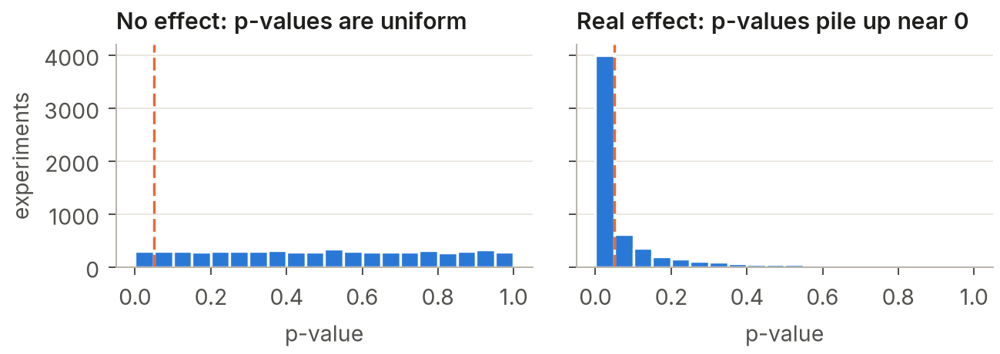

# 2 · Statistics and experimentation

Part I · Foundations. Assumes basic probability (Chapter 1). Chapter 4 covers confidence intervals on model metrics; this chapter covers experiments on products. Worked designs and chapters that rely on it: every "online evaluation" section, Chapter 45 (marketplace experiments), E.1 and E.8.

## Why it matters

Every model you ship is judged by an experiment, and in a delivery marketplace experiments are hard: effects are small, metrics are noisy, users interact, and couriers are shared between test groups. Data scientists at delivery and marketplace companies spend a large share of their time on experiment design and analysis, and interviewers test it directly ("how many users do you need?", "the test is significant on day 3, do you stop?", "how do you test a new dispatch algorithm?"). Getting these answers right is one of the clearest signals of seniority.

The chapter follows the life of an experiment. It starts with the problem every measurement has: a number computed from a sample would have come out differently with another sample (2.1). Hypothesis tests turn that uncertainty into a decision rule (2.2), and power analysis turns it into a plan: how much data you need before you start (2.3). Sections 2.4 to 2.7 are the practice of A/B testing: design, variance reduction, the traps of testing many things at once and of looking at results too early. Sections 2.8 and 2.9 cover designs for situations where a plain user-level split fails: comparing rankers, and marketplaces where the two arms compete for the same couriers. Section 2.10 covers what to do when you cannot randomise at all, and 2.11 applies the same ideas to comparing models.

One thread runs through all of it. An experiment is a measurement with noise, and almost every mistake in this chapter, from peeking to reporting the best of twenty metrics, is a way of mistaking noise for signal. The tools are there to keep the false-alarm rate where you think it is, and to make the signal large enough relative to the noise that a real effect can be seen.

## Key concepts

- **Sampling distribution and the central limit theorem**: an average computed from a sample varies from sample to sample; for large samples that variation is roughly normal, which is what makes confidence intervals and tests work. [Central limit theorem](https://en.wikipedia.org/wiki/Central_limit_theorem); see it animated at [Seeing Theory](https://seeing-theory.brown.edu/).
- **Confidence interval**: a range that would contain the true value in 95% of repeated experiments. [Confidence interval](https://en.wikipedia.org/wiki/Confidence_interval).
- **Bootstrap**: estimate uncertainty by resampling your data with replacement many times. [Bootstrapping](https://en.wikipedia.org/wiki/Bootstrapping_(statistics)).
- **Hypothesis test and p-value**: how surprising the data would be if there were no effect. [P-value](https://en.wikipedia.org/wiki/P-value).
- **Statistical power and sample size**: the chance of detecting a real effect of a given size; decides how long a test must run. [Power](https://en.wikipedia.org/wiki/Power_(statistics)), [sample size calculator](https://www.evanmiller.org/ab-testing/sample-size.html).
- **A/B test (online controlled experiment)**: randomly split users and compare outcomes to measure causal impact. [A/B testing](https://en.wikipedia.org/wiki/A/B_testing).
- **Peeking and sequential testing**: checking results repeatedly and stopping when significant inflates false positives. [How Not To Run an A/B Test](https://www.evanmiller.org/how-not-to-run-an-ab-test.html).
- **Multiple comparisons**: testing many metrics or segments guarantees some false wins. [Multiple comparisons problem](https://en.wikipedia.org/wiki/Multiple_comparisons_problem).
- **Variance reduction (CUPED) and interference (switchbacks)**: using pre-experiment data to shrink noise, and randomising by time and area when users share couriers. Covered in this chapter; the reference book is [Trustworthy Online Controlled Experiments](https://experimentguide.com/).

## 2.1 Sampling, confidence intervals and the bootstrap

Suppose this week's conversion rate is 5.2%. Is that different from last week's 5.0%? The question cannot be answered from the two numbers alone, because each was computed from a sample of users, and a different sample would have given a slightly different rate. Before comparing anything, you need to know how much a number would move if you repeated the measurement. That spread is what this section quantifies, with a formula when one exists and with the bootstrap when it does not.

**The sampling distribution.** A metric computed on a sample (a conversion rate, a mean order value) varies from sample to sample. Its standard deviation across samples is the **standard error**: for a mean, σ/√n; for a proportion, √(p(1−p)/n). The central limit theorem says the sampling distribution of a mean is approximately normal for large n, whatever the data's distribution.

The last clause is what makes the theorem so useful. Basket values are strongly skewed: in the simulated data below (log-normal, like real order values) the mean is about 22.8 euros and the standard deviation about 12.1, with a long tail of large orders. A single order tells you little. But the *average* of 2,000 orders, recomputed on many independent samples, forms a narrow, symmetric bell curve centred on the true mean with standard deviation 12.1/√2,000 ≈ 0.27 euros. The individual data are not normal; their average is, and every test in this chapter is a test about averages. The approximation needs more data when the distribution is very skewed or the event is rare: with a 0.1% conversion rate, a few thousand users give only a handful of conversions, and normal-based intervals become unreliable.

**Why √n.** If each observation has standard deviation σ, the sum of n independent observations has variance nσ² (variances add), so the mean, the sum divided by n, has variance σ²/n and standard deviation σ/√n. Precision improves only with the square root of the data: four times the users halve the uncertainty, and a hundred times the users cut it by ten. This one fact drives every sample-size calculation in this chapter.

**A 95% confidence interval** is estimate ± 1.96 × standard error. The 1.96 comes from the normal distribution: 95% of its mass lies within 1.96 standard deviations of the centre. Correct reading: if we repeated the experiment many times, 95% of intervals built this way would contain the true value. It is not "a 95% probability that the true value is in this interval" (a Bayesian credible interval says that).

**The bootstrap** gives intervals for any statistic (medians, ratios, percentiles, model metrics) without formulas: resample the data with replacement many times, recompute the statistic, take percentiles. Resample the independent unit (users, not orders, if one user has many orders; Chapter 4.9).

```python
import numpy as np
rng = np.random.default_rng(0)

order_values = rng.lognormal(3, 0.5, 2000)            # skewed, like real basket values
boots = [np.median(rng.choice(order_values, len(order_values))) for _ in range(2000)]
np.median(order_values), np.percentile(boots, [2.5, 97.5])   # ~20.3, (19.7, 20.9)
```

**Ratio metrics** (orders per session, revenue per order) where both parts vary by user need the **delta method** or a user-level bootstrap; treating each order as independent understates the variance.

## 2.2 Hypothesis tests and p-values

A confidence interval says how uncertain an estimate is. A product decision needs something sharper: did the change work, yes or no, with a known risk of being fooled by noise? Hypothesis testing provides that rule. Its logic is indirect, and most misreadings of p-values come from forgetting how indirect it is.

**The logic:** assume no effect (the null hypothesis); compute how surprising the observed difference would be under that assumption. The **p-value** is the probability of a result at least this extreme *if the null were true*. If that probability is small, either something unusual happened or the assumption of no effect is wrong, and you choose to reject the assumption.

**Worked through once.** Control converts 1,000 of 20,000 users (5.0%) and treatment 1,080 of 20,000 (5.4%), a difference of 0.4 points. Under the null both arms share one rate, best estimated by pooling them: 2,080 / 40,000 = 5.2%. The standard error of a difference between two such rates is √(0.052 × 0.948 × (1/20,000 + 1/20,000)) = 0.222 points. The observed difference is 0.4 / 0.222 = 1.80 standard errors from zero. Under the null, a normal variable lands at least 1.80 standard errors from zero (either side) 7% of the time: p = 0.07. Noise alone produces a gap this large about one experiment in fourteen, too often to rule out at the usual 5% threshold. The function `two_prop_ztest` below does the same calculation.

What a p-value is not: the probability that the null is true, the probability the result is a fluke, or the size or importance of the effect. A tiny, useless effect can have p < 0.001 with enough data.

**Errors:** a type I error (false positive) happens with probability α, usually 0.05; a type II error (false negative) with probability β; **power** = 1 − β, usually targeted at 0.8.

**Common tests:**

| Data | Test |
|---|---|
| Two proportions (conversion) | Two-proportion z-test, or chi-square |
| Two means (order value) | Welch's t-test (does not assume equal variances) |
| Heavily skewed metrics | t-test still works for large n by the CLT; consider winsorising outliers, a log transform, or bootstrap / Mann-Whitney for medians |
| Paired data (same users before and after, two models on the same cases) | Paired t-test, McNemar for binary outcomes |
| Counts across categories, sample ratio checks | Chi-square |

```python
import math
from scipy import stats

def two_prop_ztest(conv_a, n_a, conv_b, n_b):
    p_a, p_b = conv_a / n_a, conv_b / n_b
    p_pool = (conv_a + conv_b) / (n_a + n_b)
    se = math.sqrt(p_pool * (1 - p_pool) * (1 / n_a + 1 / n_b))            # SE under the null
    z = (p_b - p_a) / se
    p_value = 2 * (1 - stats.norm.cdf(abs(z)))
    se_diff = math.sqrt(p_a * (1 - p_a) / n_a + p_b * (1 - p_b) / n_b)     # SE for the interval
    return z, p_value, (p_b - p_a - 1.96 * se_diff, p_b - p_a + 1.96 * se_diff)

two_prop_ztest(1000, 20000, 1080, 20000)
# 5.0% vs 5.4% conversion: z = 1.80, p = 0.07, 95% CI of the difference (-0.04, +0.84) points
```

An 8% relative lift that is not significant with 20,000 users per arm: the next section explains why, and how many users it would take.

**A test you can always build yourself: the permutation test.** If the treatment did nothing, the labels "A" and "B" are arbitrary, so shuffling them should produce differences as large as the observed one quite often. Shuffle many times and count:

```python
def permutation_p_value(a, b, n_perm=10_000, seed=0):
    rng = np.random.default_rng(seed)
    observed = abs(b.mean() - a.mean())
    pooled = np.concatenate([a, b]); count = 0
    for _ in range(n_perm):
        rng.shuffle(pooled)
        count += abs(pooled[len(a):].mean() - pooled[:len(a)].mean()) >= observed
    return count / n_perm
# two groups of 200, observed difference 0.92: permutation p = 0.048, Welch t-test p = 0.045
```

It makes no distributional assumptions and works for any statistic (medians, ratios, model metrics), which makes it a good way to check a formula-based test, and a good answer when an interviewer asks how you would test something unusual.

**What p-values look like across many experiments.** When there is no effect, a p-value is equally likely to fall anywhere between 0 and 1: 5% of experiments land below 0.05 by construction. When there is an effect, p-values pile up near zero, and how strongly depends on power.



*6,000 simulated experiments with 500 users per arm. Left: no effect, 5.0% below 0.05. Right: a true effect of 0.15 standard deviations, 66.7% below 0.05: even a real effect is missed a third of the time at this sample size.*

## 2.3 Power and sample size

The example in 2.2 ended with a real-looking 8% lift that the test could not confirm. That is not bad luck; it is a design failure. A test with 20,000 users per arm simply cannot distinguish an effect of that size from noise most of the time. Power analysis is the step that prevents it: before launching, you decide what effect you care about and compute how much data it takes to see it reliably. It is also the calculation that tells you when an experiment is not worth running at all.

Before running a test, decide the **minimum detectable effect (MDE)**: the smallest effect worth detecting. Then compute the sample size that detects it with the desired power. For two proportions p₁ and p₂, per arm:

$$
n \approx \dfrac{\left(z_{1-\alpha/2} + z_{1-\beta}\right)^2\,\left[p_1(1-p_1) + p_2(1-p_2)\right]}{(p_2 - p_1)^2}
$$

and for means with standard deviation σ and absolute effect δ:

$$
n \approx \dfrac{2\left(z_{1-\alpha/2} + z_{1-\beta}\right)^2\,\sigma^2}{\delta^2}
$$

With α = 0.05 (two-sided) and 80% power, z₁₋α/₂ = 1.96 and z₁₋β = 0.84, so the squared factor is about 7.85. The numerator is the noise per user; the denominator is the squared signal. Every lever of experiment design acts on one of them.

```python
def n_per_arm_proportion(p_base, mde_rel, alpha=0.05, power=0.8):
    p2 = p_base * (1 + mde_rel)
    za, zb = stats.norm.ppf(1 - alpha / 2), stats.norm.ppf(power)
    return math.ceil((za + zb) ** 2 * (p_base * (1 - p_base) + p2 * (1 - p2)) / (p2 - p_base) ** 2)

def n_per_arm_mean(sd, mde_abs, alpha=0.05, power=0.8):
    za, zb = stats.norm.ppf(1 - alpha / 2), stats.norm.ppf(power)
    return math.ceil(2 * (za + zb) ** 2 * sd ** 2 / mde_abs ** 2)

n_per_arm_proportion(0.05, 0.05)   # 5% base conversion, detect +5% relative: ~122,000 per arm
n_per_arm_proportion(0.05, 0.02)   # detect +2% relative: ~753,000 per arm
n_per_arm_mean(25.0, 0.5)          # basket value sd 25 euros, detect +0.50: ~39,000 per arm
```

**Where the formula comes from.** Picture two bell curves for the estimated difference: one centred at zero (the null) and one centred at the true effect δ, both with the same standard error. The test rejects when the estimate lands beyond 1.96 standard errors from zero. Power is the share of the second curve beyond that line. To get 80% power, the line must sit 0.84 standard errors *below* δ, so δ must equal (1.96 + 0.84) standard errors. Since the standard error shrinks like 1/√n, solving for n gives the formula above, with δ² in the denominator.


*Power against users per arm for a 5% baseline conversion. A 10% relative lift needs about 32k users per arm for 80% power, 5% about 125k, 2% about 760k.*

The rule to remember: **halving the MDE quadruples the sample size.** This is why small improvements need large traffic, variance reduction (2.5) or more sensitive designs (interleaving, 2.8). Run for whole weeks to cover weekly cycles, and compute duration from traffic before launching, not after.

**Underpowered tests exaggerate.** When power is low, the experiments that happen to reach significance are the ones where noise inflated the estimate. Simulating a true effect of 0.1 measured with a standard error of 0.1 (17% power): the significant positive results average 0.249, two and a half times the truth, and about 1% of significant results even have the wrong sign. This "winner's curse" is why an effect discovered in a small test usually shrinks in the follow-up, and why the honest response to "it was significant" is "with what power?".

## 2.4 A/B test design

Randomisation is what makes an A/B test causal: if users are assigned to arms by a coin flip, the arms differ, on average, only in the treatment, so any systematic difference in outcomes was caused by it. Everything else in a test's design exists to protect that property, or to make sure the result answers the question you care about. Most failed experiments are not failed statistics; they are a wrong unit of randomisation, a metric chosen after the fact, or a broken assignment that nobody checked.

A checklist that covers what interviewers probe:

1. **Hypothesis and decision:** what change, what you expect, and what you will do with each outcome.
2. **Randomisation unit:** user, session, order, restaurant, city, or time slot. Use the unit at which the treatment acts and at which interference is contained. The analysis unit must match (or use clustered standard errors).
3. **Metrics:** one primary metric (sensitive and aligned with the goal), secondary metrics, **guardrails** (latency, cancellations, delivery time, revenue) and counter-metrics (Chapter 4.7). Written down before the test.
4. **Sample size and duration** from the MDE (2.3); at least one or two full weeks.
5. **Checks during the test:** sample ratio mismatch, guardrail breaches, data quality. No peeking at the primary metric to decide early (2.7).
6. **Analysis:** effect with confidence interval, segments defined in advance, multiple-testing awareness (2.6).
7. **Decision and documentation. Sample ratio mismatch (SRM):** if you planned a 50/50 split and got 50,500 vs 49,500 users, a chi-square test gives p ≈ 0.0016: the assignment or logging is broken (bots, redirects, crashes in one arm), and the results cannot be trusted until the cause is found. Check SRM on every test.

```python
def srm_p_value(n_a, n_b, expected_ratio=0.5):
    total = n_a + n_b
    return stats.chisquare([n_a, n_b], [total * expected_ratio, total * (1 - expected_ratio)]).pvalue
```

**Novelty and primacy effects:** users react to change itself at first (clicking a new widget out of curiosity, or avoiding an unfamiliar layout). Plot the effect by day since exposure; run long enough to see it stabilise.

**Other threats:** interference between units (2.9), seasonality and holidays, other experiments running at once, survivorship (analysing only users who reached a page that the treatment changed).

## 2.5 Variance reduction with CUPED

Section 2.3 showed that the sample size is driven by noise divided by signal. You usually cannot make the effect bigger, and traffic is limited, so the remaining lever is the noise. Much of it is not random at all: it comes from differences between users that existed before the experiment started. Variance reduction removes that predictable part, and it is the cheapest way to make an experimentation platform more sensitive.

**CUPED** (Deng et al., Microsoft, 2013) uses pre-experiment data to remove predictable variance. For each user, adjust the metric with their pre-period value of a correlated covariate X (often the same metric before the test):

$$
Y_{\mathrm{cuped}} = Y - \theta\,(X - \bar{X}),\qquad \theta = \dfrac{\mathrm{Cov}(Y,X)}{\mathrm{Var}(X)}
$$

Randomisation makes X independent of treatment, so the effect estimate stays unbiased while its variance shrinks by a factor of (1 − ρ²), where ρ is the correlation between X and Y.

**Why it works, in one paragraph.** Much of the variation in what a user spends during the test is explained by what they spent before it: heavy users stay heavy. That variation is the same in both arms on average, but it adds noise to the comparison. CUPED subtracts the part of each user's outcome predicted by their history (θ is just the regression slope of Y on X), leaving the part that history cannot explain, which is where the treatment effect lives. Because X was measured before randomisation, the treatment cannot have changed it, so subtracting it cannot bias the effect.

```python
theta = np.cov(post, pre)[0, 1] / np.var(pre, ddof=1)
post_cuped = post - theta * (pre - pre.mean())
# then run the usual test on post_cuped instead of post
```

In a simulation with a correlation of about 0.82 between pre- and in-test order value, the standard error of the effect fell from 0.197 to 0.113, a 67% variance reduction, exactly 1 − ρ². That is equivalent to running the test with about three times the users. New users have no pre-period: use 0 with an indicator, or other covariates. The regression version (ANCOVA, Y ~ treatment + X) is equivalent and extends to several covariates.

## 2.6 Multiple testing

A 5% significance level means that each test, on its own, has a 5% chance of a false alarm. Real experiments rarely run one test. They track a dozen metrics, slice results by country, platform and user type, and compare several variants. Each extra comparison is another draw from the same 5% lottery, and the chance that at least one of them comes up "significant" by luck grows quickly.

Test 20 metrics at α = 0.05 with no real effect and you expect one false positive. The chance of at least one is 1 − 0.95²⁰ = 64%; with five metrics it is already 23%. A results dashboard that highlights every metric below 0.05 will, on almost every experiment, show something green. Segments, metrics, variants and repeated looks all multiply the chances.

The corrections differ in what they promise:

- **Bonferroni:** test each of m hypotheses at α/m. Controls the chance of any false positive (family-wise error); very conservative.
- **Benjamini-Hochberg:** controls the **false discovery rate** (the expected share of false positives among discoveries); more power, the usual choice for many metrics or segments.

```python
def benjamini_hochberg(p_values, q=0.05):
    p = np.asarray(p_values); m = len(p)
    order = np.argsort(p)
    passed = p[order] <= q * np.arange(1, m + 1) / m          # compare k-th smallest with q·k/m
    k = np.max(np.nonzero(passed)[0]) + 1 if passed.any() else 0
    reject = np.zeros(m, bool); reject[order[:k]] = True
    return reject

# p-values 0.001, 0.008, 0.039, 0.041, ...: BH rejects the first two; Bonferroni (0.005) only the first
```

The practical defence: one pre-registered primary metric, a small set of guardrails, and segment analyses labelled as exploratory.

## 2.7 Sequential testing and peeking

Peeking is the multiple-testing problem in time. A test that is checked every day and stopped at the first significant result is not one test but many, each a new chance for noise to cross the threshold. The temptation is strong, because stakeholders want results and early wins look real, so it is worth seeing exactly how badly it distorts the error rate, and what designs allow early looks safely.

Checking results every day and stopping the first time p < 0.05 inflates false positives dramatically. In a simulated A/A test (no real difference) checked daily for 20 days, about 25% of runs reached "significance" at some point, five times the nominal 5%.


*Simulated A/A tests checked at evenly spaced looks, stopping at the first p < 0.05: 5% with one look, 15% with five, 26% with twenty, 32% with fifty.*

The reason is that the running test statistic is a random walk: it wanders, and a test that is allowed to stop whenever the walk crosses ±1.96 will eventually see a crossing even when the true effect is zero. Sequential methods widen the boundary at early looks so that the total chance of a false crossing stays at 5%.

Options:

- **Fixed horizon:** compute the sample size, run to the end, look once. Simple; monitor only guardrails meanwhile.
- **Group sequential designs:** a few planned interim looks with stricter thresholds (O'Brien-Fleming boundaries) that preserve overall α.
- **Always-valid inference:** mixture sequential probability ratio tests (mSPRT) and confidence sequences let you look at any time; used by several experimentation platforms.
- **Bayesian analysis** with a decision rule on expected loss; still needs discipline about stopping.

## 2.8 Interleaving for ranking

Ranking changes are hard to A/B test. A better search ranker might lift orders by a fraction of a percent, far below what a user-level split can detect without enormous traffic, because users differ much more from one another than two good rankers do. Interleaving avoids that between-user noise by letting every user compare the two rankers directly.

**How it works.** For each request, both rankers produce a list, and the two lists are merged into one. In **team-draft interleaving**, the most common scheme, the rankers take turns like captains picking teams: a coin flip decides who goes first, each picks its highest-ranked item not yet chosen, and every item remembers which ranker contributed it. The user sees a single, normal-looking list. Clicks or orders are credited to the ranker that contributed the item, and the ranker that wins more credit across many requests is preferred.

**Why it is so sensitive.** Each user acts as their own control: a heavy user and a light user both contribute a comparison between the two rankers on the same query, at the same moment, so differences between users cancel out. Industry reports (Netflix, Airbnb and others) put the traffic saving at one or two orders of magnitude relative to an A/B test for detecting which ranker is better.

**What it does not tell you.** Interleaving measures preference between rankers, not the business impact of shipping one: a ranker can win the interleaving test and still not move total orders. Use it to screen many candidates quickly; confirm the winner's impact with an A/B test (Chapter 44.9).

## 2.9 Experiments in two-sided marketplaces

Every method so far assumes that one user's outcome depends only on their own treatment. In a marketplace that assumption breaks, because both arms draw on the same pool of couriers, restaurants or drivers. The treatment can then change the control group's outcomes, and the A/B comparison measures something that would never happen at full rollout.

In a delivery marketplace, users in treatment and control **share couriers and restaurants**. If a new dispatch algorithm grabs the nearest couriers for treatment orders, control orders get worse couriers: the measured difference overstates the real effect (and the effect at 100% rollout may even be negative). This violates the assumption that one unit's treatment does not affect another (SUTVA).

**Designs that contain the interference:**


*switchback design · 3 cities × 8 time slots, illustrative assignment*

- **Switchback tests:** randomise **time slots within a region** (for example 30–60 minute blocks per city). Everything in the slot gets the same treatment, so arms never compete for supply. Watch for carryover between slots (orders assigned in one slot delivered in the next): use buffers or discard boundary periods, and analyse at the slot level with clustered standard errors.
- **Geo (cluster) experiments:** randomise whole cities or zones. Clean but few units, so low power; use matched pairs or synthetic controls.
- **Two-sided randomisation** or budget-split designs for pricing and ads.

User-level A/B tests remain fine for changes whose effect stays on the demand side and does not draw on shared supply (most UI changes, ranking within what is available, notification copy). The senior skill is recognising which kind of change you have. Chapter 45 covers marketplace experiments further.

## 2.10 Causal inference basics

Many important questions arrive after the fact: a loyalty programme launched everywhere at once, a promotion offered only to some users, a policy change in one city. There is no randomised control group, and comparing those who were treated with those who were not almost always misleads.

**Why naive comparisons fail.** Users who joined the loyalty programme ordered more afterwards, but they also ordered more *before*: the programme attracted heavy users. The variable that drives both who gets treated and the outcome is a **confounder**, and its effect is mixed into the naive difference. Formally, each unit has two potential outcomes, one with treatment and one without, and you only ever observe one of them. Randomisation makes the unobserved outcomes of the control group a fair stand-in for the treated group's; without it, you have to make that substitution valid by design and assumptions. The methods below are different ways of building a credible comparison group.

When you cannot randomise, you estimate effects from observational data, with assumptions.

**Difference-in-differences (DiD):** compare the change over time in a treated group with the change in a control group. Assumes **parallel trends**: without treatment, both would have moved alike. Check pre-period trends.

```python
import statsmodels.formula.api as smf
# df: one row per city-period with y, treated (0/1) and post (0/1)
model = smf.ols("y ~ treated * post", data=df).fit(cov_type="cluster", cov_kwds={"groups": df["city"]})
model.params["treated:post"]          # the DiD estimate
```

**Inverse propensity weighting (IPW):** model the probability of treatment given confounders (the propensity score), then weight each unit by the inverse of the probability of the treatment it actually got, so the weighted groups look alike on observed confounders.

```python
from sklearn.linear_model import LogisticRegression

ps = LogisticRegression().fit(X_confounders, t).predict_proba(X_confounders)[:, 1]
ps = np.clip(ps, 0.01, 0.99)                                   # avoid extreme weights
ate = np.mean(t * y / ps) - np.mean((1 - t) * y / (1 - ps))
```

In a simulation where heavy users are more likely to get a promotion and the true effect is 1.0, the naive difference in means was 3.1 and the IPW estimate 1.03. IPW only fixes **observed** confounders; unobserved ones still bias it.

**Uplift modelling** estimates the effect per user, to target treatments (vouchers, push notifications) at people they actually change: T-learner (separate outcome models for treated and control, difference of predictions), X-learner, causal forests. Train on randomised data where possible, and evaluate with uplift (Qini) curves.

Other tools to name: regression discontinuity, instrumental variables, synthetic control, and causal graphs (DAGs) to reason about which variables to adjust for.

## 2.11 Statistics for model evaluation

Comparing two models on a benchmark is an experiment too: the benchmark is a sample of possible questions, and a different sample would have given different scores. The mistakes are the same as in product experiments (declaring a winner on noise, testing many variants and reporting the best), and so are the remedies.

The same tools apply when the "experiment" is a comparison between models rather than between product variants, with three differences covered in depth in Chapter 23:

- **The unit is a question, not a user**, and questions are often clustered (several per passage, repository or template), so standard errors must be clustered.
- **Comparisons are paired**: two models answer the same questions, so analyse per-question differences (McNemar for binary outcomes, a paired bootstrap otherwise). Pairing removes shared difficulty and makes small differences detectable.
- **Training is random**: the same recipe trained with a different seed gives a different model. Seed variance is a second source of noise on top of question sampling, and for small models it is often the larger one (Chapter 34).

Rule of thumb: a difference between two models smaller than twice its paired standard error, or smaller than the seed-to-seed spread of the baseline, is not a result.

## Pitfalls

- **Peeking and stopping early** when the primary metric looks significant.
- **No power calculation,** then calling a non-significant result "no effect".
- **Randomising by user but analysing by order** without clustered errors.
- **Ignoring sample ratio mismatch.**
- **Testing many metrics and segments** and reporting the significant ones.
- **User-level A/B tests for supply-side changes** (dispatch, pricing, courier incentives).
- **Short tests** that capture novelty effects or miss weekly cycles.
- **Confusing statistical and practical significance.**
- **Observational comparisons without a causal design** ("users who used the feature order more").

## Interview questions

Questions 1–5 basic, 6–11 intermediate, 12–15 senior.

**1. What is a p-value?** The probability of observing a result at least as extreme as this one if there were no real effect. Not the probability that the null is true, and not the effect size.

**2. What is statistical power and why does it matter?** The probability of detecting an effect of a given size if it exists. Underpowered tests miss real effects and, when they do find something, exaggerate its size.

**3. How do you compute the sample size for an A/B test?** From the baseline rate or variance, the minimum detectable effect, α and power: n ≈ (zα/2 + zβ)² · variance terms / MDE² per arm. Halving the MDE quadruples n.

**4. What are guardrail metrics?** Metrics you commit not to harm (latency, cancellations, delivery time, revenue); a launch needs the primary metric up and no significant guardrail degradation.

**5. How do you build a confidence interval for a median?** Bootstrap: resample the independent units with replacement, recompute the median, take the 2.5th and 97.5th percentiles.

**6. What is CUPED and why does it work?** Adjust each user's outcome by a pre-experiment covariate times θ = cov(Y, X)/var(X); randomisation keeps the estimate unbiased, and variance falls by 1 − ρ².

**7. Your test was significant on day 3 of a planned 14. Do you stop?** No: early peeking inflates false positives, and early effects often include novelty. Continue to the planned horizon, or use a sequential method designed for interim looks.

**8. What is sample ratio mismatch?** The observed split differs significantly from the planned one, signalling broken assignment or logging; results are untrustworthy until it is explained.

**9. How do you handle 15 secondary metrics?** Pre-register one primary metric; treat secondaries as supporting evidence; control the false discovery rate with Benjamini-Hochberg; label segment findings exploratory and confirm in follow-up tests.

**10. Why is interleaving more sensitive than A/B testing for rankers?** Each user sees both rankers in one list, so preference is measured within users, removing between-user variance.

**11. What is difference-in-differences and its key assumption?** The change in the treated group minus the change in the control group; it assumes parallel trends without treatment, checked on pre-period data.

**12. How would you test a new courier dispatch algorithm?** User-level randomisation is invalid because arms share couriers. Use a switchback design (city × time slots) or geo randomisation, with slot-level analysis, clustered errors, buffers for carryover, and metrics such as delivery time, courier utilisation, cancellations and orders per hour.

**13. The A/B test shows +3% orders but the effect disappears after full rollout. Why?** Novelty; interference (treatment took supply from control, inflating the difference); a winner's-curse overestimate from an underpowered test; seasonality; or a changed mix of users at full rollout.

**14. How would you measure the effect of a loyalty programme that was launched without an experiment?** Difference-in-differences against comparable cities or users not yet eligible, matched or propensity-weighted comparisons on observed confounders, checking pre-trends, and sensitivity analyses for unobserved confounding; ideally, randomise the next expansion.

**15. How do you target vouchers to maximise incremental orders?** Uplift modelling on randomised voucher data (T- or X-learner, causal forests), ranking users by predicted incremental effect rather than predicted ordering probability; evaluate with Qini curves and a holdout test.

## Practice

1. **Implement** the two-proportion z-test, Welch's t-test, sample size functions, SRM check, CUPED and Benjamini-Hochberg from scratch; check against `scipy` and `statsmodels`.
2. **Peeking simulation:** reproduce the A/A peeking experiment and plot false positive rate against number of looks.
3. **CUPED:** on a public e-commerce dataset with user histories, simulate an experiment and measure variance reduction from pre-period spending.
4. **Switchback simulation:** simulate a small city where treatment orders take the nearest couriers, compare user-level and switchback estimates against the true global effect.
5. **Causal:** reproduce the IPW example; then add an unobserved confounder and watch IPW fail.
6. **Interview drill:** design the experiment for E.1 (restaurant feed) and E.8 (demand forecasting changes) in five minutes each.

## Read next

- Kohavi, Tang and Xu, *Trustworthy Online Controlled Experiments* (2020): chapters on metrics, sample ratio mismatch, threats to validity, variance reduction.
- Deng et al., *Improving the Sensitivity of Online Controlled Experiments by Utilizing* *Pre-Experiment Data* (CUPED, 2013).
- Johari et al., *Peeking at A/B Tests: Why It Matters, and What to Do About It* (2017).
- DoorDash and Lyft engineering blogs on switchback experiments; Bojinov, Simchi-Levi and Zhao, *Design and Analysis of Switchback Experiments* (2020).
- Angrist and Pischke, *Mostly Harmless Econometrics*, or Cunningham, *Causal* *Inference: The Mixtape* (free online), for DiD, IV and RD.
- Gutierrez and Gérardy, *Causal Inference and Uplift Modeling: A Review of the* *Literature* (2017).

**Links:** [Trustworthy Online Controlled Experiments](https://experimentguide.com/) · [Evan Miller's A/B testing tools and essays](https://www.evanmiller.org/ab-testing/sample-size.html) · [Seeing Theory](https://seeing-theory.brown.edu/). Other titles above can be found by searching their title.

## Done when

You can explain p-values, intervals and power precisely, including what they are not. You can compute sample sizes for proportions and means and explain the MDE trade-off. You can design an A/B test end to end, including SRM checks and guardrails. You can implement CUPED and explain its variance reduction.

You can handle multiple testing and explain why peeking is a problem. You can design a switchback or geo experiment for a marketplace change. You can explain and code DiD and IPW, and when uplift modelling is needed.

---

[← 1 · The maths you actually use](01-the-maths-you-actually-use.md) · [Contents](../README.md#contents) · [3 · ML fundamentals →](03-ml-fundamentals.md)
