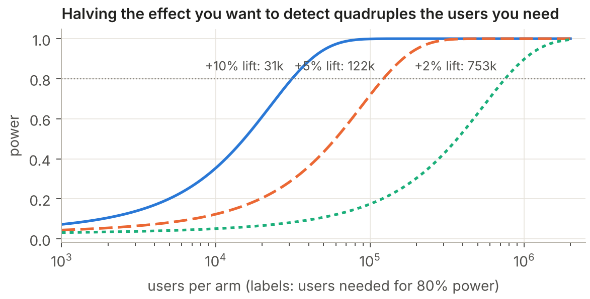
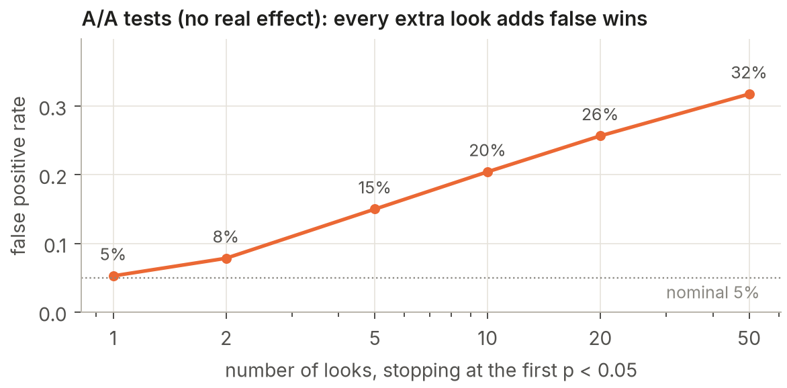
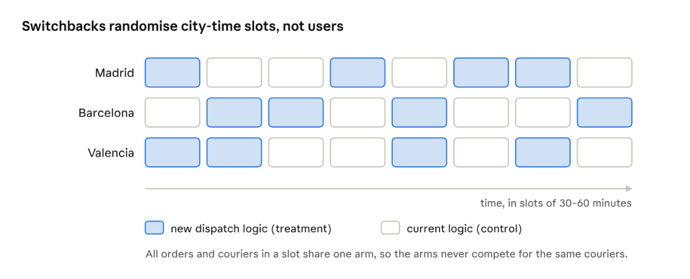

# 2 · Statistics and experimentation

Part I · Foundations. Assumes basic probability (Chapter 1). Chapter 4 covers confidence intervals on model metrics; this chapter covers experiments on products and the statistics of comparing models (2.11), which Chapter 23 develops for LLM evaluation. Worked designs and chapters that rely on it: every "online evaluation" section, Chapter 45 (marketplace experiments), E.1 and E.8.

## Why it matters

Every model you ship, and every claim that one model beats another, is judged by an experiment. Product teams A/B test rankers, prompts and LLM features; research teams compare checkpoints on benchmarks, sweep seeds and read ablation tables. In both settings the effects worth having are small, the measurements are noisy, and the temptation to read noise as signal is strong. Interviewers test this directly: "how many users do you need?", "the test is significant on day 3, do you stop?", "model B is 1.5 points better on 1,000 questions; is that real?", "p = 0.06 on revenue, do you ship?". Getting these answers right, with a number attached, is one of the clearest signals of seniority in both applied and research loops.

Some settings make experiments harder still. In a two-sided marketplace such as a delivery platform, users interact and couriers are shared between test groups, so the arms of a test are not independent; that case runs through the chapter as a worked example and gets its own section (2.9).

The chapter follows the life of an experiment. It starts with the problem every measurement has: a number computed from a sample would have come out differently with another sample (2.1). Hypothesis tests turn that uncertainty into a decision rule (2.2), and power analysis turns it into a plan: how much data you need before you start (2.3). Sections 2.4 to 2.7 are the practice of A/B testing: design, variance reduction, the traps of testing many things at once and of looking at results too early. Sections 2.8 and 2.9 cover designs for situations where a plain user-level split fails: comparing rankers, and marketplaces where the two arms compete for the same couriers. Section 2.10 covers what to do when you cannot randomise at all, 2.11 applies the same ideas to comparing models (how many questions, pairing, win rates and seeds), and 2.12 closes with the decision itself: what to do when the evidence is suggestive but not conclusive.

One thread runs through all of it. An experiment is a measurement with noise, and almost every mistake in this chapter, from peeking to reporting the best of twenty metrics, is a way of mistaking noise for signal. The tools are there to keep the false-alarm rate where you think it is, and to make the signal large enough relative to the noise that a real effect can be seen.

## Key concepts

- **Sampling distribution and the central limit theorem**: an average computed from a sample varies from sample to sample; for large samples that variation is roughly normal, which is what makes confidence intervals and tests work. [Central limit theorem](https://en.wikipedia.org/wiki/Central_limit_theorem); see it animated at [Seeing Theory](https://seeing-theory.brown.edu/).
- **Confidence interval**: a range that would contain the true value in 95% of repeated experiments. [Confidence interval](https://en.wikipedia.org/wiki/Confidence_interval).
- **Bootstrap**: estimate uncertainty by resampling your data with replacement many times. [Bootstrapping](https://en.wikipedia.org/wiki/Bootstrapping_(statistics)).
- **Hypothesis test and p-value**: how surprising the data would be if there were no effect. [P-value](https://en.wikipedia.org/wiki/P-value).
- **Statistical power and sample size**: the chance of detecting a real effect of a given size; decides how long a test must run. [Power](https://en.wikipedia.org/wiki/Power_(statistics)), [sample size calculator](https://www.evanmiller.org/ab-testing/sample-size.html).
- **A/B test (online controlled experiment)**: randomly split users and compare outcomes to measure causal impact. [A/B testing](https://en.wikipedia.org/wiki/A/B_testing).
- **Peeking and sequential testing**: checking results repeatedly and stopping when significant inflates false positives. [How Not To Run an A/B Test](https://www.evanmiller.org/how-not-to-run-an-ab-test.html).
- **Multiple comparisons**: testing many metrics or segments guarantees some false wins. [Multiple comparisons problem](https://en.wikipedia.org/wiki/Multiple_comparisons_problem).
- **Delta method**: the standard error of a ratio metric (clicks per session, revenue per order) from a first-order Taylor expansion. [Delta method](https://en.wikipedia.org/wiki/Delta_method).
- **Potential outcomes and confounding**: each unit has an outcome with and without treatment, and only one is observed; causal estimates need assumptions that make the missing one guessable. [Rubin causal model](https://en.wikipedia.org/wiki/Rubin_causal_model).
- **Paired comparisons and Bradley–Terry**: comparing two models on the same questions, and turning pairwise wins into ratings. [Bradley–Terry model](https://en.wikipedia.org/wiki/Bradley%E2%80%93Terry_model).
- **Variance reduction (CUPED) and interference (switchbacks)**: using pre-experiment data to shrink noise, and randomising by time and area when users share couriers. Covered in this chapter; the reference book is [Trustworthy Online Controlled Experiments](https://experimentguide.com/).

## 2.1 Sampling, confidence intervals and the bootstrap

Suppose this week's conversion rate is 5.2%. Is that different from last week's 5.0%? The question cannot be answered from the two numbers alone, because each was computed from a sample of users, and a different sample would have given a slightly different rate. Before comparing anything, you need to know how much a number would move if you repeated the measurement. That spread is what this section quantifies, with a formula when one exists and with the bootstrap when it does not.

**The sampling distribution.** A metric computed on a sample (a conversion rate, a mean order value) varies from sample to sample. Its standard deviation across samples is the **standard error**: for a mean, σ/√n; for a proportion, √(p(1−p)/n). The central limit theorem says the sampling distribution of a mean is approximately normal for large n, whatever the data's distribution.

The last clause is what makes the theorem so useful. Basket values are strongly skewed: in the simulated data below (log-normal, like real order values) the mean is about 22.8 euros and the standard deviation about 12.1, with a long tail of large orders. A single order tells you little. But the *average* of 2,000 orders, recomputed on many independent samples, forms a narrow, symmetric bell curve centred on the true mean with standard deviation 12.1/√2,000 ≈ 0.27 euros. The individual data are not normal; their average is, and every test in this chapter is a test about averages. The approximation needs more data when the distribution is very skewed or the event is rare: with a 0.1% conversion rate, a few thousand users give only a handful of conversions, and normal-based intervals become unreliable.

**Why √n.** If each observation has standard deviation σ, the sum of n independent observations has variance nσ² (variances add), so the mean, the sum divided by n, has variance σ²/n and standard deviation σ/√n. Precision improves only with the square root of the data: four times the users halve the uncertainty, and a hundred times the users cut it by ten. This one fact drives every sample-size calculation in this chapter.

**A 95% confidence interval** is estimate ± 1.96 × standard error. The 1.96 comes from the normal distribution: 95% of its mass lies within 1.96 standard deviations of the centre. Correct reading: if we repeated the experiment many times, 95% of intervals built this way would contain the true value. It is not "a 95% probability that the true value is in this interval" (a Bayesian credible interval says that).

**The bootstrap** gives intervals for any statistic (medians, ratios, percentiles, model metrics) without formulas: resample the data with replacement many times, recompute the statistic, take percentiles. Resample the independent unit (users, not orders, if one user has many orders; Chapter 4.9).

```python
import numpy as np
rng = np.random.default_rng(0)

order_values = rng.lognormal(3, 0.5, 2000)            # skewed, like real basket values
boots = [np.median(rng.choice(order_values, len(order_values))) for _ in range(2000)]
np.median(order_values), np.percentile(boots, [2.5, 97.5])   # ~20.3, (19.7, 20.9)
```

**Ratio metrics** (orders per session, revenue per order) where both parts vary by user need the **delta method** or a user-level bootstrap; treating each order as independent understates the variance.

### The delta method for ratio metrics

Most product metrics are ratios: clicks per session, revenue per order, tokens per conversation. The experiment randomises users, so the independent unit is the user, but the metric is computed over sessions or orders, and one heavy user contributes many correlated sessions. Treating sessions as independent draws pretends there is more information than there is. The delta method gives the right standard error from user-level totals.

For each user i, let Yᵢ be their total clicks and Xᵢ their total sessions. The metric is R̂ = Ȳ/X̄, a smooth function of two means. Expand it to first order around the true means μ_Y and μ_X, where R = μ_Y/μ_X:

$$
\hat{R} \approx R + \dfrac{\bar{Y} - \mu_Y}{\mu_X} - \dfrac{R\,(\bar{X} - \mu_X)}{\mu_X}
$$

The right side is a linear combination of two sample means, and the variance of a linear combination follows from the rules in Chapter 1.3:

$$
\mathrm{Var}(\hat{R}) \approx \dfrac{1}{\mu_X^2}\left[\mathrm{Var}(\bar{Y}) - 2R\,\mathrm{Cov}(\bar{Y},\bar{X}) + R^2\,\mathrm{Var}(\bar{X})\right]
$$

where Var(Ȳ) = Var(Yᵢ)/n, Var(X̄) = Var(Xᵢ)/n and Cov(Ȳ, X̄) = Cov(Yᵢ, Xᵢ)/n are computed across the n users. Every ingredient is a user-level sample statistic, so the formula costs one pass over the data.

**A worked example** (in `code/ch02_check.py`). 5,000 users have between 1 and several dozen sessions each (30,248 in all), and each user has their own click-through rate. The pooled rate is 9.70%. Three standard errors:

| Method | Standard error |
|---|---|
| Naive: sessions as independent Bernoulli draws, √(R(1 − R)/30,248) | 0.170 points |
| Delta method on user totals | 0.198 points |
| Bootstrap resampling users (2,000 resamples) | 0.197 points |

The delta method and the user-level bootstrap agree; the naive formula is 14% too small, so its confidence intervals are too narrow and its false-positive rate is above 5%. The gap grows with how much users differ and how unequal their session counts are. The delta method is what experimentation platforms use, because it is a closed form that scales to millions of users; the bootstrap is the check, and the fallback for statistics with no convenient derivative.

## 2.2 Hypothesis tests and p-values

A confidence interval says how uncertain an estimate is. A product decision needs something sharper: did the change work, yes or no, with a known risk of being fooled by noise? Hypothesis testing provides that rule. Its logic is indirect, and most misreadings of p-values come from forgetting how indirect it is.

**The logic:** assume no effect (the null hypothesis); compute how surprising the observed difference would be under that assumption. The **p-value** is the probability of a result at least this extreme *if the null were true*. If that probability is small, either something unusual happened or the assumption of no effect is wrong, and you choose to reject the assumption.

**Worked through once.** Control converts 1,000 of 20,000 users (5.0%) and treatment 1,080 of 20,000 (5.4%), a difference of 0.4 points. Under the null both arms share one rate, best estimated by pooling them: 2,080 / 40,000 = 5.2%. The standard error of a difference between two such rates is √(0.052 × 0.948 × (1/20,000 + 1/20,000)) = 0.222 points. The observed difference is 0.4 / 0.222 = 1.80 standard errors from zero. Under the null, a normal variable lands at least 1.80 standard errors from zero (either side) 7% of the time: p = 0.07. Noise alone produces a gap this large about one experiment in fourteen, too often to rule out at the usual 5% threshold. The function `two_prop_ztest` below does the same calculation.

What a p-value is not: the probability that the null is true, the probability the result is a fluke, or the size or importance of the effect. A tiny, useless effect can have p < 0.001 with enough data.

**Errors:** a type I error (false positive) happens with probability α, usually 0.05; a type II error (false negative) with probability β; **power** = 1 − β, usually targeted at 0.8.

**Common tests:**

| Data | Test |
|---|---|
| Two proportions (conversion) | Two-proportion z-test, or chi-square |
| Two means (order value) | Welch's t-test (does not assume equal variances) |
| Heavily skewed metrics | t-test still works for large n by the CLT; consider winsorising outliers, a log transform, a bootstrap for medians and quantiles, or Mann-Whitney for "does one arm tend to produce larger values?" |
| Paired data (same users before and after, two models on the same cases) | Paired t-test, McNemar for binary outcomes |
| Counts across categories, sample ratio checks | Chi-square |

```python
import math
from scipy import stats

def two_prop_ztest(conv_a, n_a, conv_b, n_b):
    p_a, p_b = conv_a / n_a, conv_b / n_b
    p_pool = (conv_a + conv_b) / (n_a + n_b)
    se = math.sqrt(p_pool * (1 - p_pool) * (1 / n_a + 1 / n_b))            # SE under the null
    z = (p_b - p_a) / se
    p_value = 2 * (1 - stats.norm.cdf(abs(z)))
    se_diff = math.sqrt(p_a * (1 - p_a) / n_a + p_b * (1 - p_b) / n_b)     # SE for the interval
    return z, p_value, (p_b - p_a - 1.96 * se_diff, p_b - p_a + 1.96 * se_diff)

two_prop_ztest(1000, 20000, 1080, 20000)
# 5.0% vs 5.4% conversion: z = 1.80, p = 0.07, 95% CI of the difference (-0.04, +0.84) points
```

An 8% relative lift that is not significant with 20,000 users per arm: the next section explains why, and how many users it would take.

**A test you can always build yourself: the permutation test.** If the treatment did nothing, the labels "A" and "B" are arbitrary, so shuffling them should produce differences as large as the observed one quite often. Shuffle many times and count:

```python
def permutation_p_value(a, b, n_perm=10_000, seed=0):
    rng = np.random.default_rng(seed)
    observed = abs(b.mean() - a.mean())
    pooled = np.concatenate([a, b]); count = 0
    for _ in range(n_perm):
        rng.shuffle(pooled)
        count += abs(pooled[len(a):].mean() - pooled[:len(a)].mean()) >= observed
    return count / n_perm
# two groups of 200, observed difference 0.92: permutation p = 0.048, Welch t-test p = 0.045
```

The permutation test makes no distributional assumptions and works for any statistic (medians, ratios, model metrics), which makes it a good way to check a formula-based test, and a good answer when an interviewer asks how you would test something unusual.

**What Mann–Whitney actually tests.** It is often described as a test of medians, and that is wrong in general. The U statistic counts, over all pairs of one observation from each arm, how often the treatment value is larger; U/(n₁n₂) estimates P(X_treatment > X_control), and the test asks whether that probability differs from 0.5. This is **stochastic dominance**, not a difference in medians: two arms with the same median but different shapes (one more spread out, or skewed differently) can give a significant result, and two arms with different medians can give an insignificant one. Only if you assume the distributions differ by a pure shift does it become a test of the median. The same quantity, U/(n₁n₂), is the ROC-AUC of a classifier (Chapter 4.2): the probability that a random positive outscores a random negative.

**What p-values look like across many experiments.** When there is no effect, a p-value is equally likely to fall anywhere between 0 and 1: 5% of experiments land below 0.05 by construction. When there is an effect, p-values pile up near zero, and how strongly depends on power.


*6,000 simulated experiments with 500 users per arm. Left: no effect, 5.0% below 0.05. Right: a true effect of 0.15 standard deviations, 66.7% below 0.05: even a real effect is missed a third of the time at this sample size.*

## 2.3 Power and sample size

The example in 2.2 ended with a real-looking 8% lift that the test could not confirm. That is not bad luck; it is a design failure. A test with 20,000 users per arm simply cannot distinguish an effect of that size from noise most of the time. Power analysis is the step that prevents it: before launching, you decide what effect you care about and compute how much data it takes to see it reliably. It is also the calculation that tells you when an experiment is not worth running at all.

Before running a test, decide the **minimum detectable effect (MDE)**: the smallest effect worth detecting. Then compute the sample size that detects it with the desired power. For two proportions p₁ and p₂, per arm:

$$
n \approx \dfrac{\left(z_{1-\alpha/2} + z_{1-\beta}\right)^2\,\left[p_1(1-p_1) + p_2(1-p_2)\right]}{(p_2 - p_1)^2}
$$

and for means with standard deviation σ and absolute effect δ:

$$
n \approx \dfrac{2\left(z_{1-\alpha/2} + z_{1-\beta}\right)^2\,\sigma^2}{\delta^2}
$$

With α = 0.05 (two-sided) and 80% power, z₁₋α/₂ = 1.96 and z₁₋β = 0.84, so the squared factor is about 7.85. The numerator is the noise per user; the denominator is the squared signal. Every lever of experiment design acts on one of them.

```python
def n_per_arm_proportion(p_base, mde_rel, alpha=0.05, power=0.8):
    p2 = p_base * (1 + mde_rel)
    za, zb = stats.norm.ppf(1 - alpha / 2), stats.norm.ppf(power)
    return math.ceil((za + zb) ** 2 * (p_base * (1 - p_base) + p2 * (1 - p2)) / (p2 - p_base) ** 2)

def n_per_arm_mean(sd, mde_abs, alpha=0.05, power=0.8):
    za, zb = stats.norm.ppf(1 - alpha / 2), stats.norm.ppf(power)
    return math.ceil(2 * (za + zb) ** 2 * sd ** 2 / mde_abs ** 2)

n_per_arm_proportion(0.05, 0.05)   # 5% base conversion, detect +5% relative: ~122,000 per arm
n_per_arm_proportion(0.05, 0.02)   # detect +2% relative: ~753,000 per arm
n_per_arm_mean(25.0, 0.5)          # basket value sd 25 euros, detect +0.50: ~39,000 per arm
```

**Where the formula comes from.** Picture two bell curves for the estimated difference: one centred at zero (the null) and one centred at the true effect δ, both with the same standard error. The test rejects when the estimate lands beyond 1.96 standard errors from zero. Power is the share of the second curve beyond that line. To get 80% power, the line must sit 0.84 standard errors *below* δ, so δ must equal (1.96 + 0.84) standard errors. Since the standard error shrinks like 1/√n, solving for n gives the formula above, with δ² in the denominator.



*Power against users per arm for a 5% baseline conversion. From the formula, a 10% relative lift needs about 31k users per arm for 80% power, 5% about 122k, 2% about 753k.*

The rule to remember: **halving the MDE quadruples the sample size.** This is why small improvements need large traffic, variance reduction (2.5) or more sensitive designs (interleaving, 2.8). Run for whole weeks to cover weekly cycles, and compute duration from traffic before launching, not after.

**Underpowered tests exaggerate.** When power is low, the experiments that happen to reach significance are the ones where noise inflated the estimate. Simulating a true effect of 0.1 measured with a standard error of 0.1 (17% power): the significant positive results average 0.249, two and a half times the truth, and about 1% of significant results even have the wrong sign. This "winner's curse" is why an effect discovered in a small test usually shrinks in the follow-up, and why the honest response to "it was significant" is "with what power?".

## 2.4 A/B test design

Randomisation is what makes an A/B test causal: if users are assigned to arms by a coin flip, the arms differ, on average, only in the treatment, so any systematic difference in outcomes was caused by it. Everything else in a test's design exists to protect that property, or to make sure the result answers the question you care about. Most failed experiments are not failed statistics; they are a wrong unit of randomisation, a metric chosen after the fact, or a broken assignment that nobody checked.

A checklist that covers what interviewers probe:

1. **Hypothesis and decision:** what change, what you expect, and what you will do with each outcome.
2. **Randomisation unit:** user, session, order, restaurant, city, or time slot. Use the unit at which the treatment acts and at which interference is contained. The analysis unit must match (or use clustered standard errors).
3. **Metrics:** one primary metric (sensitive and aligned with the goal), secondary metrics, **guardrails** (latency, cancellations, delivery time, revenue) and counter-metrics (Chapter 4.7). Written down before the test.
4. **Sample size and duration** from the MDE (2.3); at least one or two full weeks.
5. **Checks during the test:** sample ratio mismatch, guardrail breaches, data quality. No peeking at the primary metric to decide early (2.7).
6. **Analysis:** effect with confidence interval, segments defined in advance, multiple-testing awareness (2.6).
7. **Decision and documentation:** state the decision, the effect with its interval and what was learned, whatever the outcome; a library of past results is what calibrates future MDEs and priors.

**Sample ratio mismatch (SRM):** if you planned a 50/50 split and got 50,500 vs 49,500 users, a chi-square test gives p ≈ 0.0016: the assignment or logging is broken (bots, redirects, crashes in one arm), and the results cannot be trusted until the cause is found. Check SRM on every test.

```python
def srm_p_value(n_a, n_b, expected_ratio=0.5):
    total = n_a + n_b
    return stats.chisquare([n_a, n_b], [total * expected_ratio, total * (1 - expected_ratio)]).pvalue
```

**Novelty and primacy effects:** users react to change itself at first (clicking a new widget out of curiosity, or avoiding an unfamiliar layout). Plot the effect by day since exposure; run long enough to see it stabilise.

**Other threats:** interference between units (2.9), seasonality and holidays, other experiments running at once, survivorship (analysing only users who reached a page that the treatment changed).

### A/A tests: testing the test

An **A/A test** splits users into two arms that receive the same experience. Nothing differs, so a correct pipeline should show a significant result 5% of the time, p-values spread uniformly between 0 and 1, and no sample ratio mismatch. Running many A/A tests (or replaying historical data through random splits) is the standard way to validate a new metric, a new randomisation unit or a new variance formula before trusting it. If 21 of 200 A/A tests come out significant at 5%, against an expected 10, the chance of that many by luck is about 0.1%: something in the pipeline, usually a variance formula that ignores clustering like the naive ratio SE in 2.1, is understating the noise.

### Triggered analysis and dilution

Many changes affect only some users: a new checkout flow matters only to users who reach checkout, a change to long-context handling only to conversations longer than some threshold. If you analyse everyone, the users who never saw the change add noise and no signal, and the effect is **diluted**. With a 5% conversion rate, a +5% relative lift among the 10% of users who are triggered needs about 122,000 *triggered* users per arm, about 1.2 million users per arm in total. Analysing all users instead, the lift is diluted to +0.5% relative and needs about 12 million users per arm: ten times more. The fix is a **triggered analysis**: log, in both arms, whether each user reached the point where the treatment *would* differ (the counterfactual trigger in control is essential, otherwise the two groups are not comparable), and analyse only those users. Then translate the effect back to the whole population, multiplying by the trigger rate, before making a business case.

### What to measure: the OEC, guardrails and long-term effects

A mature programme agrees one **overall evaluation criterion** (OEC) in advance: a metric, or a weighted combination, that is sensitive in a two-week test and predictive of long-term value. Revenue in the test window is often a poor OEC, because it can be bought at the expense of the future (more ads today, fewer returning users next quarter). Two tools address the gap between what a test can see and what the business cares about. **Long-term holdouts** keep a small share of users (say 1–5%) on the old experience for months, so that the cumulative effect of many launches can be measured directly. **Surrogate metrics** are short-term metrics validated, on past experiments, to predict the long-term outcome; they are only as good as that validation, and a change that games the surrogate breaks the relationship.

### Heterogeneous effects

An average effect of zero can hide a positive effect for new users and a negative one for heavy users. Looking at segments is legitimate, but every segment is another test (2.6), so pre-register the few segments you have reasons to expect differ, and treat the rest as hypotheses for a follow-up. For targeting decisions, model the heterogeneity directly with uplift models (2.10).

### A/B testing an LLM feature

LLM features break several of the defaults above, and a senior answer names each:

- **Outputs are stochastic.** The same prompt gives different answers, so the per-user outcome has extra variance on top of user differences. Fix the model version, temperature and system prompt for the whole test, and do not change prompts mid-test.
- **The randomisation unit is the user or the conversation, never the response.** Randomising per response lets one user see both arms within a conversation, which contaminates both. With several turns per conversation, turns are correlated, and the variance must be clustered. The **design effect** 1 + (m − 1)ρ says by how much: with m = 5 turns per conversation and an intra-conversation correlation ρ = 0.3, the variance is 2.2 times what a per-turn analysis assumes.
- **The metric is often a judgement.** Resolution rate, helpfulness or correctness may be scored by an LLM judge, which is a measurement instrument with its own bias and noise: calibrate it against human labels before the test, and keep the judge fixed during it (Chapter 24.7).
- **Cost and latency are first-class guardrails.** A better model that doubles tokens per conversation or adds two seconds to time to first token can lose on net value; track cost per conversation and latency percentiles as guardrails alongside quality.
- **Offline evaluation first.** An online test is the expensive last step, after an offline evaluation on a fixed set has shown the change is worth testing (Chapters 23 and 24).

## 2.5 Variance reduction with CUPED

Section 2.3 showed that the sample size is driven by noise divided by signal. You usually cannot make the effect bigger, and traffic is limited, so the remaining lever is the noise. Much of it is not random at all: it comes from differences between users that existed before the experiment started. Variance reduction removes that predictable part, and it is the cheapest way to make an experimentation platform more sensitive.

**CUPED** (Deng et al., Microsoft, 2013) uses pre-experiment data to remove predictable variance. For each user, adjust the metric with their pre-period value of a correlated covariate X (often the same metric before the test):

$$
Y_{\mathrm{cuped}} = Y - \theta\,(X - \bar{X}),\qquad \theta = \dfrac{\mathrm{Cov}(Y,X)}{\mathrm{Var}(X)}
$$

Randomisation makes X independent of treatment, so the effect estimate stays unbiased while its variance shrinks by a factor of (1 − ρ²), where ρ is the correlation between X and Y.

**Where (1 − ρ²) comes from.** For any constant θ, the variance of the adjusted metric is

$$
\mathrm{Var}(Y - \theta X) = \mathrm{Var}(Y) - 2\theta\,\mathrm{Cov}(X,Y) + \theta^2\,\mathrm{Var}(X)
$$

a quadratic in θ. Setting its derivative −2Cov(X, Y) + 2θVar(X) to zero gives θ* = Cov(X, Y)/Var(X), the regression slope. Substituting back, the minimum variance is Var(Y) − Cov(X, Y)²/Var(X), and since ρ² = Cov(X, Y)²/(Var(X)Var(Y)), that is Var(Y)(1 − ρ²). Subtracting the constant θX̄ only re-centres the metric. With ρ = 0.5 the variance falls by 25%; with ρ = 0.8, by 64%, and the required sample size falls in proportion.

**Why it works, in one paragraph.** Much of the variation in what a user spends during the test is explained by what they spent before it: heavy users stay heavy. That variation is the same in both arms on average, but it adds noise to the comparison. CUPED subtracts the part of each user's outcome predicted by their history (θ is just the regression slope of Y on X), leaving the part that history cannot explain, which is where the treatment effect lives. Because X was measured before randomisation, the treatment cannot have changed it, so subtracting it cannot bias the effect.

```python
theta = np.cov(post, pre)[0, 1] / np.var(pre, ddof=1)
post_cuped = post - theta * (pre - pre.mean())
# then run the usual test on post_cuped instead of post
```

In a simulation with a correlation of about 0.82 between pre- and in-test order value, the standard error of the effect fell from 0.197 to 0.113, a 67% variance reduction, exactly 1 − ρ². That is equivalent to running the test with about three times the users. New users have no pre-period: use 0 with an indicator, or other covariates. The regression version (ANCOVA, Y ~ treatment + X) is equivalent and extends to several covariates.

**Two extensions worth naming.** The covariate does not have to be the same metric: any pre-treatment quantity works, including the prediction of a machine-learning model trained on pre-experiment features to predict Y. That version is often called **CUPAC**, and it helps most for new users and for metrics whose own history is a weak predictor; because the model's inputs are all pre-treatment, it cannot bias the estimate. And if the treatment might change the relationship between X and Y (heavy users respond more), fit the regression with a treatment × centred-covariate interaction, Y ~ T + X + T·(X − X̄). Lin (2013) showed that this version is never less precise than the plain difference in means asymptotically, even when the linear model is wrong, which makes it the safe default for regression adjustment.

## 2.6 Multiple testing

A 5% significance level means that each test, on its own, has a 5% chance of a false alarm. Real experiments rarely run one test. They track a dozen metrics, slice results by country, platform and user type, and compare several variants. Each extra comparison is another draw from the same 5% lottery, and the chance that at least one of them comes up "significant" by luck grows quickly.

Test 20 metrics at α = 0.05 with no real effect and you expect one false positive. The chance of at least one is 1 − 0.95²⁰ = 64%; with five metrics it is already 23%. A results dashboard that highlights every metric below 0.05 will, on almost every experiment, show something green. Segments, metrics, variants and repeated looks all multiply the chances.

The corrections differ in what they promise:

- **Bonferroni:** test each of m hypotheses at α/m. Controls the chance of any false positive (family-wise error); very conservative.
- **Holm:** the free improvement on Bonferroni. Sort the p-values from smallest to largest and compare the k-th smallest with α/(m − k + 1): the smallest against α/m, the next against α/(m − 1), and so on, stopping at the first that fails. It controls the same family-wise error under the same (absent) assumptions and always rejects at least as much as Bonferroni, so there is no reason to use plain Bonferroni.
- **Benjamini-Hochberg:** controls the **false discovery rate** (the expected share of false positives among discoveries); more power, the usual choice for many metrics or segments.

```python
def benjamini_hochberg(p_values, q=0.05):
    p = np.asarray(p_values); m = len(p)
    order = np.argsort(p)
    passed = p[order] <= q * np.arange(1, m + 1) / m          # compare k-th smallest with q·k/m
    k = np.max(np.nonzero(passed)[0]) + 1 if passed.any() else 0
    reject = np.zeros(m, bool); reject[order[:k]] = True
    return reject

# p-values 0.001, 0.008, 0.039, 0.041, ...: BH rejects the first two; Bonferroni (0.005) only the first
```

On these ten p-values Holm also rejects only the first (0.008 is above 0.05/9 = 0.0056), so here its gain over Bonferroni is nil; it shows up when several p-values are small. The difference between the families of corrections is in what they promise: Bonferroni and Holm bound the chance of *any* false positive, which suits a launch decision gated on a few guardrails; BH bounds the *share* of false positives among the discoveries, which suits screening many metrics or segments where a few false leads are acceptable.

The practical defence: one pre-registered primary metric, a small set of guardrails, and segment analyses labelled as exploratory.

## 2.7 Sequential testing and peeking

Peeking is the multiple-testing problem in time. A test that is checked every day and stopped at the first significant result is not one test but many, each a new chance for noise to cross the threshold. The temptation is strong, because stakeholders want results and early wins look real, so it is worth seeing exactly how badly it distorts the error rate, and what designs allow early looks safely.

Checking results every day and stopping the first time p < 0.05 inflates false positives dramatically. In a simulated A/A test (no real difference) checked daily for 20 days, about 25% of runs reached "significance" at some point, five times the nominal 5%.



*Simulated A/A tests checked at evenly spaced looks, stopping at the first p < 0.05: 5% with one look, 15% with five, 26% with twenty, 32% with fifty.*

The reason is that the running test statistic is a random walk: it wanders, and a test that is allowed to stop whenever the walk crosses ±1.96 will eventually see a crossing even when the true effect is zero. Sequential methods widen the boundary at early looks so that the total chance of a false crossing stays at 5%.

There are four ways to live with the problem, and they trade simplicity against flexibility.

The simplest is the **fixed horizon**: compute the sample size, run to the end and look at the primary metric once. Guardrails can still be monitored throughout, because stopping for harm is a different decision from declaring a win (a test that is hurting users should be stopped whatever the statistics say).

**Group sequential designs** allow a few planned interim looks, each with a stricter threshold, chosen so that the total false-positive rate over all looks stays at 5%. The classic choice, **O'Brien–Fleming** boundaries, is very strict early and close to 1.96 at the end. For five equally spaced looks at a two-sided 5% level:

| Look | 1 | 2 | 3 | 4 | 5 |
|---|---|---|---|---|---|
| Share of the planned sample | 20% | 40% | 60% | 80% | 100% |
| O'Brien–Fleming |z| boundary | 4.56 | 3.23 | 2.63 | 2.28 | 2.04 |
| Constant 1.96 at every look | 1.96 | 1.96 | 1.96 | 1.96 | 1.96 |

The boundaries are c·√(5/k) for look k, with c = 2.04 chosen to make the overall rate 5%. In 200,000 simulated A/A tests in the check script, stopping at the first crossing of 1.96 gives a false-positive rate of about 14% (the figure above, with fewer runs, shows 15%), while the O'Brien–Fleming boundaries give 5.0%. The cost is small: for an effect that a single look would detect with 80% power, the five-look design has 79% power, and when the effect is real it stops on average at the fourth look, saving a fifth of the traffic. The final boundary of 2.04 instead of 1.96 is the price of the early looks. (Pocock boundaries use one constant at every look, 2.41 for five looks, which makes early stopping easier and the final test stricter.)

**Always-valid inference** removes the need to plan the looks at all. Mixture sequential probability ratio tests (mSPRT) and **confidence sequences** produce p-values and intervals that remain valid however often you look and whenever you stop: the guarantee is that, under the null, the probability that the always-valid p-value *ever* drops below 5% over the entire test is at most 5%. The price is width: at any fixed sample size the interval is wider than the fixed-horizon one, so if you only ever look once you lose power. Several commercial experimentation platforms use this approach because it matches how people actually behave with dashboards.

Finally, a **Bayesian analysis** with a decision rule on expected loss (2.12) gives a posterior you can read at any time, but it is not immune to optional stopping in the frequentist sense, and still needs a rule written down before the test about when you will stop.

## 2.8 Interleaving for ranking

Ranking changes are hard to A/B test. A better search ranker might lift orders by a fraction of a percent, far below what a user-level split can detect without enormous traffic, because users differ much more from one another than two good rankers do. Interleaving avoids that between-user noise by letting every user compare the two rankers directly.

**How it works.** For each request, both rankers produce a list, and the two lists are merged into one. In **team-draft interleaving**, the most common scheme, the rankers take turns like captains picking teams: a coin flip decides who goes first, each picks its highest-ranked item not yet chosen, and every item remembers which ranker contributed it. The user sees a single, normal-looking list. Clicks or orders are credited to the ranker that contributed the item, and the ranker that wins more credit across many requests is preferred.

**Why it is so sensitive.** Each user acts as their own control: a heavy user and a light user both contribute a comparison between the two rankers on the same query, at the same moment, so differences between users cancel out. Industry reports (Netflix, Airbnb and others) put the traffic saving at one or two orders of magnitude relative to an A/B test for detecting which ranker is better.

**What it does not tell you.** Interleaving measures preference between rankers, not the business impact of shipping one: a ranker can win the interleaving test and still not move total orders. Use it to screen many candidates quickly; confirm the winner's impact with an A/B test (Chapter 44.9).

## 2.9 Experiments in two-sided marketplaces

Every method so far assumes that one user's outcome depends only on their own treatment. In a marketplace that assumption breaks, because both arms draw on the same pool of couriers, restaurants or drivers. The treatment can then change the control group's outcomes, and the A/B comparison measures something that would never happen at full rollout.

In a delivery marketplace, users in treatment and control **share couriers and restaurants**. If a new dispatch algorithm grabs the nearest couriers for treatment orders, control orders get worse couriers: the measured difference overstates the real effect (and the effect at 100% rollout may even be negative). This violates the assumption that one unit's treatment does not affect another (SUTVA).

**Designs that contain the interference:**



*switchback design · 3 cities × 8 time slots, illustrative assignment*

- **Switchback tests:** randomise **time slots within a region** (for example 30–60 minute blocks per city). Everything in the slot gets the same treatment, so arms never compete for supply. Watch for carryover between slots (orders assigned in one slot delivered in the next): use buffers or discard boundary periods, and analyse at the slot level with clustered standard errors.
- **Geo (cluster) experiments:** randomise whole cities or zones. Clean but few units, so low power; use matched pairs or synthetic controls.
- **Two-sided randomisation** or budget-split designs for pricing and ads.

User-level A/B tests remain fine for changes whose effect stays on the demand side and does not draw on shared supply (most UI changes, ranking within what is available, notification copy). The senior skill is recognising which kind of change you have. Chapter 45 covers marketplace experiments further.

## 2.10 Causal inference basics

Many important questions arrive after the fact: a loyalty programme launched everywhere at once, a promotion offered only to some users, a policy change in one city. There is no randomised control group, and comparing those who were treated with those who were not almost always misleads. When you cannot randomise, you estimate effects from observational data, and the price is assumptions: this section is about stating them precisely, because a senior answer is judged on whether it knows which assumption each method leans on.

**Why naive comparisons fail.** Users who joined the loyalty programme ordered more afterwards, but they also ordered more *before*: the programme attracted heavy users. The variable that drives both who gets treated and the outcome is a **confounder**, and its effect is mixed into the naive difference. Formally, each unit has two potential outcomes, one with treatment and one without, and you only ever observe one of them. Randomisation makes the unobserved outcomes of the control group a fair stand-in for the treated group's; without it, you have to make that substitution valid by design and assumptions. The methods below are different ways of building a credible comparison group.

### Potential outcomes and the assumptions

Write Yᵢ(1) for unit i's outcome if treated and Yᵢ(0) if not, and Tᵢ for the treatment it actually received; you observe Yᵢ = Yᵢ(Tᵢ) and never the other one. Two estimands come up constantly. The **average treatment effect** is ATE = E[Y(1) − Y(0)] over everyone; the **average treatment effect on the treated** is ATT = E[Y(1) − Y(0) | T = 1], the effect on those who actually got the treatment, which is what "did the loyalty programme work for its members?" asks. They differ whenever the effect varies and treatment is not random.

Observational methods identify these from data under three assumptions:

- **Ignorability** (no unmeasured confounding): given the measured covariates X, treatment is as good as random, (Y(0), Y(1)) ⊥ T | X. This is the strong one, and it cannot be tested from the data.
- **Positivity** (overlap): every kind of unit had some chance of each treatment, 0 < P(T = 1 | X) < 1. If no heavy user was ever left untreated, the data say nothing about heavy users without treatment.
- **SUTVA**: one unit's outcome does not depend on others' treatments (the assumption marketplaces break, 2.9), and there is only one version of the treatment.

Randomisation delivers ignorability and positivity by design, which is why an experiment needs none of this machinery.

### Which variables to adjust for: confounders and colliders

A causal graph (DAG) draws an arrow from each cause to its effect. A **confounder** causes both treatment and outcome, and opens a non-causal "backdoor" path between them; the **backdoor criterion** says that adjusting for a set of variables that blocks every such path, without including anything caused by the treatment, identifies the effect.

```text
confounder:                    collider:
      heavy user (Z)              novelty     rigour
       ↙        ↘                       ↘    ↙
promotion (T) → orders (Y)            accepted (C)
```

Adjusting is not always safe. A **collider** is a variable caused by two others, and conditioning on it creates a correlation that does not exist. Suppose a venue accepts papers when novelty plus rigour is high enough, and novelty and rigour are independent across submitted papers. Among accepted papers, a paper that is weak on one must be strong on the other to get in. In the check script, the two scores have correlation 0.00 across 100,000 submissions and −0.55 among the 16% accepted: "novel papers are sloppier" is manufactured by the selection. The same mechanism biases any analysis restricted to users who survived, converted or were selected on an outcome, and any regression that controls for a variable the treatment itself affects. The rule: adjust for causes of treatment and outcome, never for consequences of either.

### Methods

**Difference-in-differences (DiD):** compare the change over time in a treated group with the change in a control group. Assumes **parallel trends**: without treatment, both would have moved alike. Check pre-period trends.

```python
import statsmodels.formula.api as smf
# df: one row per city-period with y, treated (0/1) and post (0/1)
model = smf.ols("y ~ treated * post", data=df).fit(cov_type="cluster", cov_kwds={"groups": df["city"]})
model.params["treated:post"]          # the DiD estimate
```

**Inverse propensity weighting (IPW):** model the probability of treatment given confounders (the propensity score), then weight each unit by the inverse of the probability of the treatment it actually got, so the weighted groups look alike on observed confounders.

```python
from sklearn.linear_model import LogisticRegression

ps = LogisticRegression().fit(X_confounders, t).predict_proba(X_confounders)[:, 1]
ps = np.clip(ps, 0.01, 0.99)                                   # avoid extreme weights
ate = np.mean(t * y / ps) - np.mean((1 - t) * y / (1 - ps))
```

In a simulation where heavy users are more likely to get a promotion and the true effect is 1.0, the naive difference in means was 3.1 and the IPW estimate 1.03. IPW only fixes **observed** confounders; unobserved ones still bias it.

**Why clipping the propensities biases the estimate.** The weights 1/e(x) are what make IPW unbiased; clipping e(x) at 0.01 replaces some of them with smaller ones, so the units that the method most needed to up-weight (treated units that looked unlikely to be treated) count for less than they should. When overlap is good, few units are clipped and the bias is negligible. When it is poor, the choice is between variance and bias. In the check script, with strong confounding (a quarter of units have true propensities below 0.01 or above 0.99) and a true effect of 1.0, 200 repetitions give: unclipped IPW 0.98 on average but with a standard deviation of 1.03 across repetitions; clipped at 0.01, 1.54 with a standard deviation of 0.07; clipped at 0.05, 1.87. Clipping turned an unbiased but useless estimator into a precise wrong one. The honest fixes are to change the question (estimate the effect only on the region of overlap, and say so), or to use an estimator less dependent on the weights.

### Doubly robust estimation (AIPW)

The **augmented IPW** estimator combines an outcome model with the propensity model. Fit μ₁(x) and μ₀(x), predictions of the outcome under treatment and control, and the propensity e(x); then

$$
\hat{\tau}_{\mathrm{AIPW}} = \dfrac{1}{n}\sum_i \left[\mu_1(x_i) - \mu_0(x_i) + \dfrac{T_i\,(Y_i - \mu_1(x_i))}{e(x_i)} - \dfrac{(1-T_i)\,(Y_i - \mu_0(x_i))}{1 - e(x_i)}\right]
$$

The first two terms are the regression estimate; the last two use IPW to correct its residual errors. The estimator is consistent if *either* the outcome model *or* the propensity model is correct, hence "doubly robust", and when the outcome model is good the weighted residuals are small, so extreme weights do much less damage. In the check script, with the same strong confounding and propensities clipped at 0.01, AIPW gives 1.00 with a standard deviation of 0.04, where clipped IPW gave 1.54. With moderate confounding, AIPW with a deliberately useless outcome model (a constant) still recovers 0.96, because the propensity model is right. It is the default estimator in modern causal-inference libraries, usually with cross-fitting when the nuisance models are flexible machine-learning models (double machine learning).

### Uplift modelling and other designs

**Uplift modelling** estimates the effect per user, to target treatments (vouchers, push notifications) at people they actually change: T-learner (separate outcome models for treated and control, difference of predictions), X-learner, causal forests. Train on randomised data where possible, and evaluate with uplift (Qini) curves.

Three more designs are worth knowing by name and by the assumption each rests on. **Regression discontinuity** uses a threshold rule (a voucher for users with more than ten orders): users just above and just below the threshold are nearly identical, so the jump in the outcome at the threshold estimates the effect there, assuming nothing else changes at the same cut-off. **Instrumental variables** use something that shifts treatment but affects the outcome only through treatment (a random encouragement, a rollout date that varied for operational reasons); the assumption that the instrument has no other path to the outcome is untestable and usually where the argument is attacked. **Synthetic control** builds the counterfactual for one treated unit, such as a city, as a weighted combination of untreated units that tracked it closely before the treatment, a generalisation of difference-in-differences for the case of one treated unit and many candidate controls.

## 2.11 Statistics for model evaluation

Comparing two models on a benchmark is an experiment too: the benchmark is a sample of possible questions, and a different sample would have given different scores. The mistakes are the same as in product experiments (declaring a winner on noise, testing many variants and reporting the best), and so are the remedies, with three differences that Chapter 23 develops in depth. **The unit is a question, not a user**, and questions are often clustered (several per passage, repository or template), so standard errors must be clustered. **Comparisons are paired**: two models answer the same questions, so analyse per-question differences (McNemar for binary outcomes, a paired bootstrap otherwise); pairing removes shared difficulty and makes small differences detectable. And **training is random**: the same recipe trained with a different seed gives a different model, a second source of noise on top of question sampling that for small models is often the larger one (Chapter 34).

For an LLM-research interview this is the most-used section of the chapter, so it is worth working through with numbers.

### How many questions?

A benchmark score at accuracy p on n independent questions has standard error √(p(1 − p)/n). At 70% accuracy, p(1 − p) = 0.21: with 1,000 questions the SE is 1.45 points and the 95% interval is ±2.8 points. Comparing two models scored on *separate* question samples, the variance of the difference is the sum of the two variances. To make the 95% interval on the difference as narrow as ±3 points takes 1.96² × (0.21 + 0.21)/0.03² ≈ 1,800 questions per model; to have 80% power to *detect* a true 3-point difference (70% vs 73%) takes 7.85 × (0.21 + 0.197)/0.03² ≈ 3,550. Most public benchmarks are smaller than that.

### Pairing

The two models are, in practice, scored on the *same* questions, and that changes the arithmetic. For each question let dᵢ = aᵢ − bᵢ, which is +1, 0 or −1. Its mean is the accuracy difference δ, and since dᵢ² is 1 exactly when the models disagree, Var(dᵢ) = E[dᵢ²] − δ² = (share of questions where they disagree) − δ². So

$$
\mathrm{SE}_{\mathrm{paired}} = \sqrt{\dfrac{d_{\mathrm{disagree}} - \delta^2}{n}}
$$

Questions both models get right or both get wrong contribute nothing to the noise. Suppose model A scores 70%, model B 73%, and they disagree on 15% of questions (B alone right on 9%, A alone right on 6%). On 1,000 questions the paired SE is √((0.15 − 0.0009)/1000) = 1.22 points, against 2.02 points unpaired; for 80% power to detect the 3-point gain you need about 1,300 questions instead of 3,550. Strongly correlated models (two checkpoints of the same run) disagree on few questions and gain the most from pairing. The paired test on binary outcomes is McNemar's test, which uses exactly the two discordant counts.

### Win rates and Bradley–Terry

Open-ended outputs are often compared pairwise, by humans or a judge: which of the two responses is better? A win rate w from n independent comparisons has SE √(w(1 − w)/n): 55% over 400 comparisons gives SE 2.5 points and a 95% interval from 50.1% to 59.9%, barely excluding a tie. With more than two models, the **Bradley–Terry** model gives each model i a strength θᵢ and assumes

$$
P(i \succ j) = \dfrac{1}{1 + e^{-(\theta_i - \theta_j)}}
$$

so the log-odds of i beating j is the difference of strengths. Fitting it is a logistic regression with one +1/−1 indicator per model, and every comparison informs the strengths of all models through the chain of opponents. A 55% win rate corresponds to θᵢ − θⱼ = log(0.55/0.45) = 0.20; arena leaderboards multiply by 400/ln 10 to report Elo-style points, here 35, with an interval from about 1 to 70 points. A 35-point gap from 400 comparisons is therefore much less certain than it looks on a leaderboard (Chapter 23.7). Ties, judge position bias and non-transitive preferences all need care beyond this basic model.

### Sampling variance at temperature above zero

If each answer is sampled at a temperature above zero, the same model on the same question is right only some of the time, and a single sample per question adds noise on top of the choice of questions. By the law of total variance, the Bernoulli variance p(1 − p) splits into a between-question part, the variance of the per-question success rates pᵢ, and a within-question part, the average of pᵢ(1 − pᵢ). Drawing k samples per question and averaging shrinks only the second:

$$
\mathrm{SE} = \sqrt{\dfrac{\sigma^2_{\mathrm{between}} + \sigma^2_{\mathrm{within}}/k}{n}}
$$

At 70% accuracy with a between-question variance of 0.12 and a within-question variance of 0.09 (they sum to 0.21), four samples per question reduce the variance from 0.21/n to 0.1425/n, a 1.21-fold smaller SE: useful, but more questions help more than more samples once k is a few. Report how many samples per question you drew, and resample them in the bootstrap.

### Seeds

When the claim is about a training recipe rather than a checkpoint, the unit is the training run, and the noise is the seed-to-seed spread σ of the metric. The sample-size formula from 2.3 applies with seeds as the sample: n per arm ≈ 2(1.96 + 0.84)² σ²/δ². With σ = 0.4 points and a hoped-for gain of δ = 0.3 points, that is 28 seeds per arm for a two-sided test (22 one-sided), far more than the one or three runs most papers report. When that is unaffordable, say so, report the baseline's seed spread next to the gain, and prefer evaluations with less seed noise (Chapter 34.6).

Rule of thumb: a difference between two models smaller than twice its paired standard error, or smaller than the seed-to-seed spread of the baseline, is not a result.

## 2.12 Deciding under uncertainty

Statistics gives an estimate and its uncertainty; a launch or a research bet needs a decision, and the 5% threshold was never designed to make it. "Not significant" is not the same as "no effect", and treating p = 0.051 and p = 0.049 as opposite answers throws away information. Senior candidates are expected to reason about the decision directly: what is the evidence, what does each kind of mistake cost, and can the decision be reversed?

**A worked example.** A pricing change shows +2.0% revenue with p = 0.06 (two-sided). The p-value fixes the standard error: z = 1.88, so SE = 2.0/1.88 = 1.06 points, and the 95% interval runs from −0.1% to +4.1%. Read with a flat prior, the posterior for the true effect is approximately normal with mean 2.0 and SD 1.06, so P(effect > 0) = 0.97, and the probability that the true effect is worse than −1% is 0.2%. A decision based on expected loss compares the two errors. If you ship, you lose only in the cases where the effect is negative, and the expected loss is E[max(−effect, 0)] = 0.012 points. If you do not ship, you forgo the expected gain of about 2 points. On those numbers shipping is clearly right, despite p > 0.05.

**Two caveats keep this honest.** First, a flat prior is optimistic. Most changes have small effects, and the winner's curse (2.3) says an estimate that only just reached significance is probably inflated. With a sceptical prior that the true effect is normal with mean 0 and SD 1 point, the posterior mean shrinks from 2.0 to 0.94 and P(effect > 0) falls to 0.90: still a reasonable bet, but the expected gain to put in the business case is half the measured one. Second, the costs are rarely symmetric. A UI change can be rolled back tomorrow, so a 90% chance of a gain is plenty. A price increase that customers notice, a model whose outputs other teams start depending on, or a change to a pretraining data mixture that will cost a month of compute to undo deserves a stricter bar, a longer test or a staged rollout with a holdout (2.4).

**The cost of waiting is part of the decision.** Running another week narrows the interval by about √(n/(n + Δn)), but it also delays the gain and occupies traffic other tests could use. Sequential designs (2.7) make the trade explicit. In research the same logic applies to "do we scale this up?": a 90%-likely small gain from a cheap ablation may justify one larger run, not a paper.

## Pitfalls

- **Peeking and stopping early** when the primary metric looks significant.
- **No power calculation,** then calling a non-significant result "no effect".
- **Randomising by user but analysing by order** (or session, or turn) without clustered errors or the delta method.
- **Ignoring sample ratio mismatch.**
- **Testing many metrics and segments** and reporting the significant ones.
- **User-level A/B tests for supply-side changes** (dispatch, pricing, courier incentives).
- **Short tests** that capture novelty effects or miss weekly cycles.
- **Confusing statistical and practical significance.**
- **Observational comparisons without a causal design** ("users who used the feature order more").
- **Conditioning on a collider** or on something the treatment affects, which manufactures correlations.
- **Analysing all users when only a few were triggered,** diluting the effect tenfold or more.
- **Comparing models on separate or unpaired scores,** one seed each, and calling a 1-point gain a result.
- **Treating p = 0.06 as "no effect" and p = 0.04 as "proven",** instead of reasoning about the decision.

## Interview questions

Questions 1–5 basic, 6–11 and 16–18 intermediate, 12–15 and 19–21 senior.

**1. What is a p-value?** The probability of observing a result at least as extreme as this one if there were no real effect. It is not the probability that the null is true, not the probability that the result is a fluke, not the size or importance of the effect, and p > 0.05 does not mean "no effect". Example: 5.0% against 5.4% conversion with 20,000 users per arm gives z = 1.80 and p = 0.07: noise alone produces a gap that large about one experiment in fourteen. If the question people actually want answered is "how likely is it that the treatment helps?", that is a Bayesian quantity, a posterior probability that needs a prior; with a flat prior it is roughly 1 − p/2 for the sign of the effect. Follow-up: "is p = 0.049 really different from p = 0.051?" No; report the effect with its interval and make the decision on costs (2.12), not on which side of 0.05 it fell.

**2. What is statistical power and why does it matter?** The probability of detecting an effect of a given size if it exists, usually targeted at 80%. Underpowered tests miss real effects and, when they do find something, exaggerate its size: with 17% power, the significant positive estimates average 2.5 times the true effect, and about 1% of significant results have the wrong sign. That is why effects found in small tests shrink in follow-ups. Follow-up: "can you compute power after the test from the observed effect?" Not usefully: "observed power" is a one-to-one function of the p-value and adds nothing; compute power for the minimum effect you decided in advance was worth detecting.

**3. How do you compute the sample size for an A/B test?** From the baseline rate or variance, the minimum detectable effect, α and power: n ≈ (z₁₋α/₂ + z₁₋β)² × variance terms / MDE² per arm, where (1.96 + 0.84)² ≈ 7.85. At a 5% baseline, detecting a +5% relative lift needs about 122,000 users per arm and +2% about 753,000: halving the MDE quadruples n. Then divide by daily traffic to get a duration, rounded up to whole weeks. Follow-up: "122,000 per arm is six weeks of traffic; what now?" Raise the MDE if a smaller effect would not change the decision, reduce variance with CUPED (ρ = 0.5 saves 25% of the sample), analyse only triggered users, choose a more sensitive metric, or decide the test is not worth running.

**4. What are guardrail metrics?** Metrics you commit not to harm, such as latency, cancellations, delivery time, revenue, or for an LLM feature cost per conversation and refusal rate; a launch needs the primary metric up and no meaningful guardrail degradation. "No significant degradation" is weak evidence when the test is underpowered for the guardrail, so the careful version is a **non-inferiority** test: decide a margin in advance (say latency may not rise by more than 2%) and require the upper end of the 95% interval on the degradation to sit below it. Follow-up: "the primary metric is up but a guardrail is down; do you ship?" That trade-off should have been priced in the overall evaluation criterion before the test; if it was not, escalate with both effects and their intervals rather than deciding alone.

**5. How do you build a confidence interval for a median?** Bootstrap: resample the independent units with replacement, recompute the median, take the 2.5th and 97.5th percentiles. On 2,000 log-normal order values the median is 20.3 with a bootstrap interval of (19.7, 20.9). Resample users, not orders, if users have several orders. When not to: with very small samples or heavily discrete data the percentile bootstrap of a median is unreliable, and a different interval (an order-statistic interval, or a smoothed bootstrap) is better. Follow-up: "how do you compare medians between two arms?" Bootstrap each arm independently and take percentiles of the difference, or use quantile regression; do not use Mann–Whitney, which tests something else (2.2).

**6. What is CUPED and why does it work?** Adjust each user's outcome by a pre-experiment covariate, Y − θ(X − X̄) with θ = cov(Y, X)/var(X); because X is measured before randomisation, the estimate stays unbiased, and the variance falls by the factor 1 − ρ². That follows from minimising Var(Y − θX) = Var(Y) − 2θCov + θ²Var(X) over θ. With ρ = 0.82, as in 2.5, variance drops 67%, the same as running the test with three times the users. When not to: a covariate measured after the treatment starts can be affected by it and biases the estimate; new users have no history. Follow-up: "what if the pre-period metric is a weak predictor?" Use a model's prediction from many pre-treatment features as the covariate (CUPAC), or regression adjustment with a treatment × covariate interaction (Lin's estimator), which is never less precise asymptotically.

**7. Your test was significant on day 3 of a planned 14. Do you stop?** Not to declare a win: stopping at the first significant look inflates false positives (about 14% with five looks instead of 5%), and early effects often include novelty. Continue to the planned horizon, or use a sequential method designed for interim looks: with O'Brien–Fleming boundaries over five looks, an early stop needs |z| above 4.56 at the first look. Two exceptions. You can and should stop early for harm, when a guardrail is clearly breached. And the business framing matters: the cost of waiting (a delayed gain, blocked traffic) against the cost of a false ship, which is low for an easily reversed change. Follow-up: "the product manager insists on shipping now" Offer a staged rollout to a small share with a holdout, so the decision can be revisited, and propose a sequential design for the next test.

**8. What is sample ratio mismatch?** The observed split differs significantly from the planned one, signalling broken assignment or logging; results are untrustworthy until it is explained. A planned 50/50 split that comes out 50,500 vs 49,500 gives a chi-square p of about 0.0016. Common causes: bots filtered differently in each arm, redirects or crashes that lose users from one arm, a trigger condition that depends on the treatment. Debug by slicing the ratio by day, platform and browser to see where it breaks. Follow-up: "one of fifty tests has SRM with p = 0.04; is that alarming?" On its own, no, one in twenty will by chance; platforms usually alert on a much stricter threshold such as p < 0.001.

**9. How do you handle 15 secondary metrics?** Pre-register one primary metric; treat secondaries as supporting evidence; control the false discovery rate with Benjamini–Hochberg, or the family-wise error with Holm when the metrics gate a decision; label segment findings exploratory and confirm them in follow-up tests. With 15 metrics and no real effects, the chance that at least one is significant at 5% is 1 − 0.95¹⁵ = 54%. Follow-up: "Bonferroni or Holm?" Holm, always: it gives the same guarantee and rejects at least as much.

**10. Why is interleaving more sensitive than A/B testing for rankers?** Each user sees both rankers merged in one list, so preference is measured within users, removing the between-user variance that dominates an A/B test of a ranker; industry reports put the traffic saving at one to two orders of magnitude. The trade-off: it measures which ranker users prefer, not the business impact of shipping it, so use it to screen candidates and confirm the winner with an A/B test. Follow-up: "when can interleaving mislead?" When the outcome is a page-level metric (total orders, session length) rather than per-item clicks, or when the rankers differ in properties such as diversity that only show at the level of the whole list.

**11. What is difference-in-differences and its key assumption?** The change in the treated group minus the change in the control group: if the treated city goes from 10 to 13 orders per user and the control city from 8 to 10, the estimate is 3 − 2 = 1. It assumes parallel trends without treatment, which you check on several pre-period points, not one. Use clustered standard errors at the level of the treated unit (city), and remember that few clusters means wide intervals. Follow-up: "what if cities adopted the treatment at different times?" The standard two-way fixed-effects regression can then be biased when effects vary over time, because already-treated units act as controls; use an estimator designed for staggered adoption, or compare each cohort only with not-yet-treated units.

**12. How would you test a new courier dispatch algorithm?** User-level randomisation is invalid because arms share couriers, and the measured difference can even have the wrong sign at full rollout. Use a switchback design (city × time slots of 30–60 minutes) or geo randomisation, with slot-level analysis, clustered errors, buffers for carryover, and metrics such as delivery time, courier utilisation, cancellations and orders per hour. Power comes from the number of slots, not orders: 3 cities × 14 days × 24 hourly slots is about 1,000 units, so size the test on slot-level variance. Follow-up: "what goes wrong with switchbacks?" Carryover (orders assigned in one slot are delivered in the next) and time trends; discard or buffer the boundaries and balance the assignment across hours of the day.

**13. The A/B test shows +3% orders but the effect disappears after full rollout. Why?** Novelty; interference (treatment took supply from control, inflating the difference); a winner's-curse overestimate from an underpowered test (at 17% power significant estimates average 2.5 times the truth); seasonality; or a changed mix of users at full rollout. Diagnose with the effect by day since exposure (novelty decays), a long-term holdout (measures the effect at 100%), the original test's power, and whether the change touched shared supply. Follow-up: "how do you prevent it next time?" Pre-compute power, shrink estimates towards a prior from past experiments when forecasting impact, and keep a holdout after launch.

**14. How would you measure the effect of a loyalty programme that was launched without an experiment?** Define the estimand first, usually the effect on members (ATT). Then use difference-in-differences against comparable cities or users not yet eligible, or matched, propensity-weighted or doubly robust (AIPW) comparisons on observed confounders such as pre-period order frequency, checking pre-trends and overlap. Do not adjust for anything the programme itself changes, such as post-launch activity, which is a collider-style error. In the chapter's simulation the naive difference was 3.1 against a true effect of 1.0, and IPW recovered 1.03. Follow-up: "what about unobserved confounding?" Run a sensitivity analysis (how strong would a hidden confounder need to be to explain the effect away?), look for an instrument or a threshold rule, and above all randomise the next expansion.

**15. How do you target vouchers to maximise incremental orders?** Uplift modelling on randomised voucher data (T- or X-learner, causal forests, or a doubly robust learner), ranking users by predicted incremental effect rather than predicted ordering probability: the users most likely to order are often "sure things" who would have ordered anyway, and a propensity model spends the budget on them. Evaluate with Qini curves on held-out randomised data and confirm with a holdout test. Follow-up: "you only have observational voucher data" Then propensity-adjusted learners under ignorability, with the warning that the targeting will be only as good as the confounders you measured; budget for a randomised test to calibrate it.

**16. Your metric is clicks per session and you randomised by user. How do you get its standard error?** The session is not the independent unit, so the naive Bernoulli formula over sessions is wrong. Use the delta method on user-level totals, Var(Ȳ/X̄) ≈ [Var(Ȳ) − 2R·Cov(Ȳ, X̄) + R²Var(X̄)]/μ_X², or bootstrap users. In the 2.1 example the naive SE is 0.170 points, the delta method 0.198 and the user bootstrap 0.197: the naive one is 14% too small, so its tests reject too often. Follow-up: "how would you know the naive formula is wrong without the derivation?" Run A/A tests: with the naive SE, more than 5% of them come out significant.

**17. A Mann–Whitney test is significant but the medians of the two arms are equal. Is that a contradiction?** No. Mann–Whitney tests whether P(X_treatment > X_control) differs from 0.5, stochastic dominance, not medians; arms with equal medians but different spread or skew can differ on it. It becomes a test of medians only under a pure location-shift assumption. U/(n₁n₂) is the ROC-AUC between the two samples, so the effect size to report is that probability, for example "a random treated user spends more than a random control user 53% of the time". Follow-up: "what would you use for medians?" A bootstrap of the difference in medians, or quantile regression.

**18. What is an A/A test, and what do you conclude if 21 of 200 A/A tests are significant at 5%?** Both arms get the same experience, so about 5% (10 of 200) should be significant and the p-values should be uniform. Getting 21 or more by chance has probability about 0.1%, so the pipeline is understating variance or the split is broken: check for analysis at a finer unit than randomisation (sessions instead of users), missing clustering, SRM, or metrics with heavy outliers. Follow-up: "how do you use A/A tests routinely?" Replay historical data through many random splits to validate every new metric and variance formula before it is used in a real decision.

**19. How do you A/B test an LLM feature?** Randomise users or conversations, never individual responses, and fix the model version, prompt and decoding settings for the test. Expect extra variance from stochastic outputs and correlation between turns: with 5 turns per conversation and intra-conversation correlation 0.3, the design effect 1 + (m − 1)ρ = 2.2 means a per-turn analysis understates the variance by more than half. Quality metrics are often LLM-judge scores, which must be calibrated against human labels and held fixed; cost per conversation, latency percentiles and refusal or escalation rates are guardrails. An offline evaluation on a fixed set comes first, and the online test answers whether the offline gain reaches users. Follow-up: "the new model wins on judge scores but users' resolution rate is flat" Suspect the judge (verbosity or style bias), check whether the feature was triggered for the users who matter, and treat the online behavioural metric as primary.

**20. A pricing change shows +2% revenue with p = 0.06. Do you ship?** Probably, and say why with numbers. p = 0.06 means z = 1.88 and an SE of 1.06 points, so the 95% interval is −0.1% to +4.1%; with a flat prior the probability the effect is positive is 0.97, the chance it is worse than −1% is 0.2%, and the expected loss from shipping is about 0.01 points against an expected gain of 2. A sceptical prior (most changes are small) shrinks the expected gain to about 0.9 points with P(positive) ≈ 0.90, so put the smaller number in the business case. When not to: if the change is hard to reverse (prices customers notice) or a guardrail moved, run longer or stage the rollout with a holdout. Follow-up: "isn't this p-hacking?" No, provided the metric and the decision rule were fixed in advance; reasoning about expected loss is a different, explicit decision rule, not a way to rescue a result after the fact.

**21. Model B beats model A by 1.5 points on a 1,000-question benchmark. Is it real?** Not from that number alone; analyse it paired. If the models disagree on 12% of questions, the paired SE is √((0.12 − 0.015²)/1000) = 1.09 points, z = 1.37 and p = 0.17: not distinguishable from noise. Detecting a true 1.5-point gain with 80% power at that disagreement rate needs about 4,200 questions. Also ask whether the gain exceeds the baseline's seed-to-seed spread (one training run each is a sample of one), whether questions are clustered, whether the evaluation sampled at temperature above zero with one sample per question, and whether B was the best of many checkpoints (selection makes the gain optimistic). Follow-up: "how many seeds would you need?" n ≈ 2 × 7.85 × σ²/δ² per arm: with a seed spread of 0.4 points and a 0.3-point gain, 28 per arm.

## Practice

1. **Implement** the two-proportion z-test, Welch's t-test, sample size functions, SRM check, CUPED and Benjamini-Hochberg from scratch; check against `scipy` and `statsmodels`.

<details><summary>Hint and expected result</summary>

Compare with `statsmodels.stats.proportion.proportions_ztest`, `scipy.stats.ttest_ind(..., equal_var=False)` and `statsmodels.stats.multitest.multipletests(method="fdr_bh")`. Expected: 1,000/20,000 vs 1,080/20,000 gives z = 1.80, p = 0.072; the 5%-baseline, +5%-relative sample size is 122,121 per arm; the SRM p-value for 50,500 vs 49,500 is about 0.0016.

</details>

2. **Peeking simulation:** reproduce the A/A peeking experiment and plot false positive rate against number of looks.

<details><summary>Hint and expected result</summary>

Simulate the running z-statistic as a cumulative sum of independent increments and check it at evenly spaced looks. Expected false-positive rates with a 1.96 threshold: 5% at one look, about 14% at five, about 25% at twenty. Use at least 20,000 runs or the curve is noisy.

</details>

3. **CUPED:** on a public e-commerce dataset with user histories, such as the UCI *Online Retail II* transactions (two years of purchases with customer IDs), simulate an experiment and measure variance reduction from pre-period spending.

<details><summary>Hint and expected result</summary>

Use the first year as the pre-period and a later window as the test period, keep customers seen in both, assign them randomly to two arms and add a known lift (say +3%) to one. The variance reduction should match ρ² between pre- and in-test spend computed on the same customers; spend is heavy-tailed, so also try log spend or winsorising at the 99th percentile and see how ρ² changes.

</details>

4. **Switchback simulation:** simulate a small city where treatment orders take the nearest couriers, compare user-level and switchback estimates against the true global effect.

<details><summary>Hint and expected result</summary>

The true global effect is the difference between two simulations with everyone in treatment and everyone in control. Expected: the user-level A/B estimate overstates it (control orders get the worse couriers), and can even have the wrong sign; the switchback estimate is close to the global effect but has a much wider interval, because the unit is the slot.

</details>

5. **Causal:** reproduce the IPW example; then add an unobserved confounder and watch IPW fail.

<details><summary>Hint and expected result</summary>

Expected with the check-script setup: naive 3.1, IPW 1.03. Add a variable u that raises both the chance of treatment and the outcome but is left out of the propensity model: the IPW estimate moves away from 1.0 in proportion to u's effect on the outcome, and no amount of data fixes it. Then reproduce the clipping result: with strong confounding, clipped IPW at 0.01 averages about 1.54 and AIPW about 1.00.

</details>

6. **Interview drill:** design the experiment for E.1 (restaurant feed) and E.8 (demand forecasting changes) in five minutes each.

<details><summary>Hint and expected result</summary>

For each, state the randomisation unit and why (user for a feed ranking change; store or region and time for forecasting, since forecasts drive shared stock and staffing), the primary metric and guardrails, the MDE and a sample-size number, the duration in whole weeks, and one threat to validity with its mitigation.

</details>

7. **Delta method:** simulate users with varying session counts and click rates, and compare the naive, delta-method and user-bootstrap standard errors of clicks per session.

<details><summary>Hint and expected result</summary>

With the setup in `code/ch02_check.py`: naive 0.170 points, delta method 0.198, bootstrap 0.197. Then make session counts more unequal (a heavier-tailed distribution) and watch the naive SE fall further behind.

</details>

8. **Research exercise: measure the false-positive rate and power of sequential designs, and the value of pairing.** (a) Simulate 200,000 A/A tests with five equally spaced looks. Measure the false-positive rate when stopping at the first |z| > 1.96, then find the constant c for which the O'Brien–Fleming boundaries c·√(5/k) give 5%. Add a true effect that gives 80% power at a single look, and measure the power and the average stopping look of the sequential design. (b) Simulate a benchmark of 1,000 questions on which model A scores 70% and model B 73%, disagreeing on 15% of questions. Over 10,000 replications, measure the power of an unpaired two-proportion test and of a paired (McNemar-style) test.

<details><summary>Hint and expected result</summary>

(a) About 14% with a constant 1.96; c ≈ 2.04 restores 5% (boundaries 4.56, 3.23, 2.63, 2.28, 2.04); power falls only from 80% to about 79%, and with a real effect the test stops at look 4.0 on average. (b) The paired test should have about 69% power, matching the formula in 2.11. The unpaired test comes out at about 23%, even below the 32% that the unpaired formula predicts for two independent samples of questions: on shared questions the scores are positively correlated, so the unpaired standard error (2.02 points) overstates the real noise in the difference (1.22 points) and the test is needlessly conservative. `code/ch02_check.py` is the oracle. Extend (b) by making the two models more correlated (fewer disagreements at the same accuracy gap) and plot power against the disagreement rate.

</details>

## Read next

- Kohavi, Tang and Xu, *Trustworthy Online Controlled Experiments* (2020): chapters on metrics, sample ratio mismatch, threats to validity, variance reduction.
- Deng et al., *Improving the Sensitivity of Online Controlled Experiments by Utilizing* *Pre-Experiment Data* (CUPED, 2013).
- Johari et al., *Peeking at A/B Tests: Why It Matters, and What to Do About It* (2017).
- DoorDash and Lyft engineering blogs on switchback experiments; Bojinov, Simchi-Levi and Zhao, *Design and Analysis of Switchback Experiments* (2020).
- Angrist and Pischke, *Mostly Harmless Econometrics*, or Cunningham, *Causal* *Inference: The Mixtape* (free online), for DiD, IV and RD.
- Gutierrez and Gérardy, *Causal Inference and Uplift Modeling: A Review of the* *Literature* (2017).
- Hernán and Robins, *Causal Inference: What If* (free online), for potential outcomes, DAGs and doubly robust estimation.
- Miller, [Adding Error Bars to Evals](https://arxiv.org/abs/2411.00640) (2024), for the statistics of model evaluation in 2.11.

**Links:** [Trustworthy Online Controlled Experiments](https://experimentguide.com/) · [Evan Miller's A/B testing tools and essays](https://www.evanmiller.org/ab-testing/sample-size.html) · [Seeing Theory](https://seeing-theory.brown.edu/). Other titles above can be found by searching their title.

## Done when

- Without notes, compute the sample size per arm for a 5% baseline and a +5% relative MDE in 3 minutes: answer ≈ 122,000; and say what happens to it if the MDE halves (×4).
- Compute the two-proportion z-test for 1,000/20,000 vs 1,080/20,000 by hand: z = 1.80, p ≈ 0.07, and state three things the p-value is not.
- Derive the CUPED variance factor 1 − ρ² by minimising Var(Y − θX) over θ, in 3 minutes.
- Write the delta-method variance of a ratio of means from memory and say when the naive per-session formula understates it.
- State the O'Brien–Fleming boundaries for five looks (≈ 4.56, 3.23, 2.63, 2.28, 2.04) and the false-positive rate of naive peeking at five looks (≈ 14%).
- Given two models at 70% and 73% that disagree on 15% of 1,000 questions, compute the paired SE (1.22 points) and the unpaired one (2.02 points) in 3 minutes.
- Convert a 55% win rate over 400 comparisons into a 95% interval (50.1% to 59.9%) and a Bradley–Terry strength difference (0.20, about 35 Elo-style points).
- Given σ = 0.4 and δ = 0.3, compute seeds per arm for 80% power: 28 two-sided (22 one-sided).
- Write the potential-outcomes definition of ATE and ATT, name ignorability, positivity and SUTVA, and draw one confounder and one collider.
- Write the AIPW estimator and explain in two sentences why it is doubly robust and why clipping propensities biases IPW.
- Design a switchback or geo experiment for a marketplace change, and an online test for an LLM feature, each in 10 minutes, naming the unit, metrics, guardrails and sample size.
- Answer "p = 0.06 on +2% revenue: ship?" with an interval, a probability and an expected loss.

---

[← 1 · The maths you actually use](01-the-maths-you-actually-use.md) · [Contents](../README.md#contents) · [3 · ML fundamentals →](03-ml-fundamentals.md)
