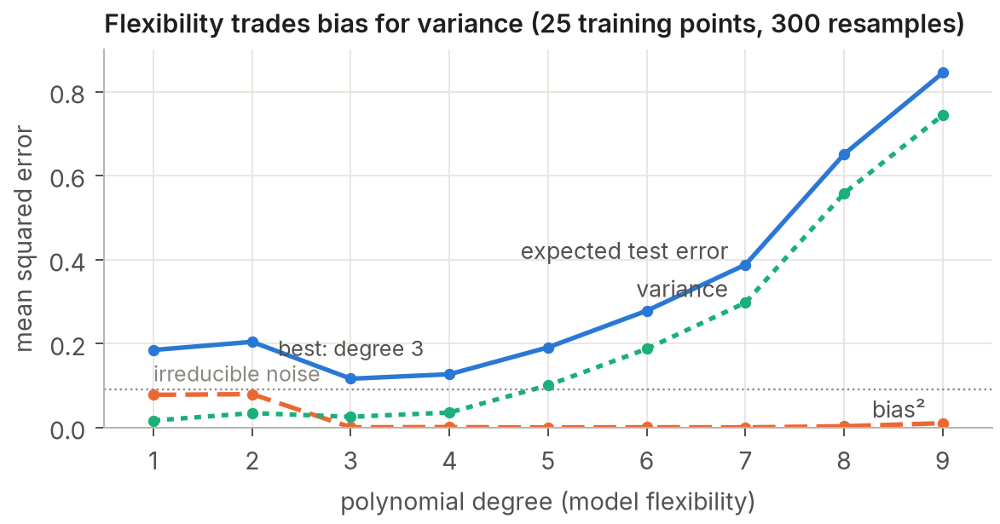
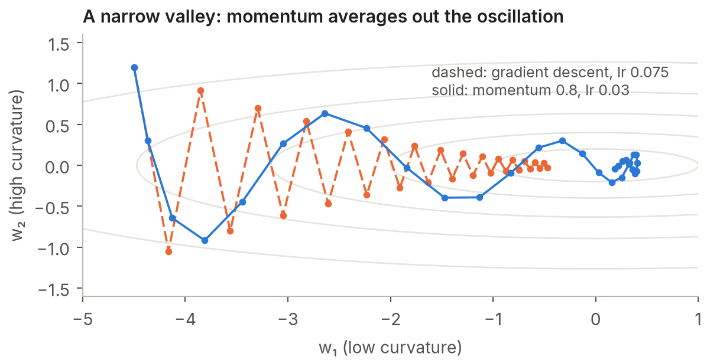

# 3 · ML fundamentals

Part I · Foundations. The concepts every later chapter assumes. Chapter 40 covers the classic models themselves, Chapter 4 how to measure them, Chapter 5 neural networks.

## Why it matters

The ML depth round starts here. "What is the bias-variance trade-off?", "how would you handle class imbalance?", "what is leakage and how did you prevent it?" are among the most common interview questions, and the answers separate people who have shipped models from people who have trained them in notebooks. These fundamentals also decide whether real projects work: most production model failures are leakage, wrong splits or a mis-framed target, not the wrong algorithm.

The chapter is organised around one question: will this model do as well on tomorrow's data as it did on the data I have? Every topic is a part of the answer. Framing (3.1) decides what "doing well" means. The bias-variance trade-off (3.2) explains why fitting the training data and predicting new data are different goals, and losses, regularisation and optimisation (3.3 to 3.5) are the controls you use to balance them. Splits and leakage (3.6, 3.7) are how you *measure* generalisation honestly, which is harder than it sounds: most over-optimistic results come from a validation set that quietly knew something about the answers. Features, imbalance and calibration (3.8 to 3.10) are the practical decisions that come up on almost every tabular project.

Two sections close the chapter. Distribution shift (3.11) asks what happens when tomorrow's data is *not* drawn from the same source as today's, which is the normal case in production and the central question behind every claim that an LLM "generalises". Section 3.12 maps every idea in the chapter onto LLM work: leakage becomes benchmark contamination, the bias–variance trade-off becomes scaling laws and double descent, imbalance becomes the threshold of a safety classifier, calibration becomes "does the model know what it knows".

Read it as a sequence of decisions you will make on a real project, in roughly the order you will make them. The worked numbers come from small simulations you can rerun (`code/ch03_check.py` and `tools/figures.py`), so each claim can be checked rather than memorised. An interviewer probing this material is rarely testing definitions. They want to see that you can derive the bias–variance split, explain *why* L1 gives zeros, say when a validation score is lying, and recognise the same failure when it reappears in a language-model evaluation.

## Key concepts

- **Problem framing**: turning a business question into a prediction target, a unit of prediction, features available at prediction time, and a metric. [Google ML crash course](https://developers.google.com/machine-learning/crash-course).
- **Bias–variance trade-off**: simple models miss patterns (bias); flexible models chase noise (variance). [Bias–variance trade-off](https://en.wikipedia.org/wiki/Bias%E2%80%93variance_tradeoff).
- **Overfitting and regularisation**: fitting the training data too closely, and the penalties (L1, L2, early stopping, dropout) that prevent it. [Overfitting](https://en.wikipedia.org/wiki/Overfitting), [Regularisation](https://en.wikipedia.org/wiki/Regularization_(mathematics)).
- **Train, validation and test splits; cross-validation**: estimate how a model will do on unseen data; split by time or by user when the data has that structure. [scikit-learn: cross-validation](https://scikit-learn.org/stable/modules/cross_validation.html).
- **Data leakage**: information that would not be available at prediction time sneaking into training. [Leakage](https://en.wikipedia.org/wiki/Leakage_(machine_learning)).
- **Feature engineering**: encoding categories, scaling, aggregates over time windows, text and embedding features.
- **Class imbalance**: when positives are rare; handled with the right metric, class weights or resampling, and threshold choice (Chapter 4).
- **Double descent and benign overfitting**: past the point where a model can interpolate its training data, test error can fall again; why the classical U-curve is not the whole story for large models. [Belkin et al., 2019](https://arxiv.org/abs/1812.11118).
- **Distribution shift**: covariate, label (prior) and concept shift; detecting them and correcting with importance weights. [Dataset shift](https://en.wikipedia.org/wiki/Domain_adaptation).

## 3.1 Framing a problem as ML

Most of the value of an ML project is decided before any model is trained. A business problem ("too many late deliveries", "users churn") does not come with a target, a prediction moment or a metric; someone has to choose them, and a well-trained model of the wrong target is worthless however good its validation score. Framing is the step that turns a vague goal into a learning problem whose solution someone will actually use.

Before choosing a model, answer these questions, in this order:

1. **What decision will the prediction change, and who makes it?** If nothing changes, no model is needed.
2. **Is ML needed at all?** Rules or a heuristic often get 80% of the value. ML earns its cost when patterns are too complex for rules, change over time, or need to scale.
3. **What exactly is the label?** "Will the user churn?" needs a definition: no order in 30 days? 60? Measured from when? Labels decide what the model learns more than any architecture.
4. **What is the prediction moment, and what is known then?** Only data available at that moment may be used as features (3.7).
5. **What are the costs of each kind of error?** That decides the metric and the threshold (Chapter 4.1).
6. **What is the baseline?** Popularity, last value, a rule, the current system. A model that does not beat the baseline by a margin worth its cost does not ship.

**Common framings:** classification (will it happen?), regression (how much?), ranking (in what order?), forecasting (how much, when?), clustering or anomaly detection (what is unusual?), generation (write it). The same business problem can be framed several ways: "reduce late deliveries" can be ETA regression, a late-or-not classifier, or a quantile forecast of delivery time. Choose the framing whose output the decision-maker can use.

**Proxy labels.** Often the true target is slow or unobservable (lifetime value, satisfaction), so you train on a proxy (30-day orders, a rating). Name the proxy explicitly and check that it moves with the real goal.

## 3.2 The bias-variance trade-off

A model is trained on one sample of data but used on new data. It can fail in two opposite ways. It can be too rigid to represent the pattern, and then it is wrong in the same way whatever data it sees. Or it can be so flexible that it reproduces the accidents of its particular training sample, and then it is wrong in a different way for every sample. The bias-variance decomposition makes those two failure modes precise and shows that, for a fixed amount of data, reducing one tends to increase the other.

A model's expected error on new data splits into three parts:

$$
\mathrm{expected\ error} = \mathrm{bias}^2 + \mathrm{variance} + \mathrm{irreducible\ noise}
$$

- **Bias:** error from wrong assumptions; the model is too simple to capture the pattern (a straight line through a curve). Shows as high training error and similar validation error: **underfitting**.
- **Variance:** error from sensitivity to the particular training sample; the model fits noise. Shows as low training error and much higher validation error: **overfitting**.
- **Noise:** randomness no model can remove.

More flexible models lower bias and raise variance; more data lowers variance; regularisation trades a little bias for less variance.

### Where the decomposition comes from

"Expected error" needs a precise meaning, because two things are random. Assume labels are generated as y = f(x) + ε, where f is the true function and ε is noise with mean 0 and variance σ², independent of everything else. A training set D is a random sample from the same source; training on it gives a fitted model f̂_D. Imagine training the same model many times, each time on a fresh D, and predicting at one fixed input x. The predictions scatter around their average f̄(x) = E_D[f̂_D(x)]. The expected error at x averages over both the training set and the new label's noise:

$$
\mathbb{E}_{D,\varepsilon}\left[(y - \hat f_D(x))^2\right] = (\bar f(x) - f(x))^2 + \mathbb{E}_D\left[(\hat f_D(x) - \bar f(x))^2\right] + \sigma^2
$$

The three terms are the bias², how far the *average* model is from the truth; the variance, how much the model moves with the training sample; and the irreducible noise.

The derivation is two "add and subtract" steps. First write y − f̂_D = (f − f̂_D) + ε. Squaring gives (f − f̂_D)² + 2ε(f − f̂_D) + ε². The new label's noise ε is independent of D and has mean zero, so the cross term averages to zero and E[ε²] = σ². Second, inside the remaining term add and subtract f̄: f − f̂_D = (f − f̄) + (f̄ − f̂_D). Squaring gives (f − f̄)² + 2(f − f̄)(f̄ − f̂_D) + (f̄ − f̂_D)². Now (f − f̄) is a constant with respect to D, and E_D[f̄ − f̂_D] = 0 by the definition of f̄, so the cross term vanishes again. What remains is bias² + variance + σ². The total error over a test set is this quantity averaged over x.

**A worked example you can check by hand.** Estimate a constant μ = 2 from n = 4 noisy observations with σ² = 1, and predict a new observation. The sample mean ȳ is unbiased: bias² = 0, variance = σ²/n = 0.25, expected error 0 + 0.25 + 1 = 1.25. Now shrink it, predicting 0.9·ȳ. Its average is 1.8, so bias² = 0.2² = 0.04; its variance is 0.9² × 0.25 = 0.2025; expected error 1.2425. The *biased* estimator is better, because it bought 0.0475 of variance for 0.04 of bias. Shrinking to 0.8·ȳ goes too far (0.16 + 0.16 + 1 = 1.32). This is regularisation (3.4) in miniature: the best shrinkage factor here is μ²/(μ² + σ²/n) = 0.94, and it depends on how noisy the data are relative to the signal, which is why the penalty strength must be tuned.

The figure makes it concrete. Polynomials of increasing degree are fitted to 25 noisy points from a sine curve, 300 times with fresh data each time:



*Bias² falls to almost zero by degree 3, while variance keeps climbing (0.03 at degree 3, 0.56 at degree 8); total expected error is lowest at degree 3. Computed in `tools/figures.py`.*

A degree-1 or 2 model cannot bend enough to follow the sine (bias), a degree-8 model bends to follow each sample's noise (variance), and the best model is the simplest one flexible enough for the true pattern.

**Diagnosing from learning curves** (training and validation error as training-set size grows):

| What you see | Diagnosis | What helps |
|---|---|---|
| Both errors high and close together | High bias | More features, a more flexible model, less regularisation |
| Training error low, validation error much higher | High variance | More data, regularisation, simpler model, early stopping, bagging |
| Validation error still falling as data grows | Data-limited | Collect more data before tuning models |
| Both low and close | Good fit | Ship, then monitor |

Modern deep networks complicate the classical picture: very large models can generalise well even when they fit training data perfectly (the "double descent" observations). For tabular and classic ML work, the classical trade-off is still the right mental model, and it is what interviewers expect first. At a frontier lab the very next question is "does bias–variance apply to LLMs?", and the answer needs the rest of this section.

### Beyond the U-curve: interpolation and double descent

The classical curve assumes that past some flexibility, extra capacity only adds variance. That assumption breaks at the **interpolation threshold**, the point where the model has just enough parameters to fit every training point exactly. Below it, the model averages noise away; exactly at it, there is a single solution that passes through every noisy point, and it must contort itself to do so; above it, there are infinitely many interpolating solutions, and the training algorithm picks one of them. Which one it picks is the whole story.

Gradient descent started from zero on a least-squares problem converges to the **minimum-norm** interpolating solution: of all weight vectors that fit the data, the smallest. As the number of parameters p grows past the number of examples n, the minimum-norm solution can spread the fit across more directions, each carrying a little weight, so it becomes smoother and the variance falls again. This is **implicit regularisation**: no penalty was written down, yet the optimiser prefers simple solutions. Test error therefore rises to a peak near p = n and then descends a second time: **double descent**.

A random-features regression shows it (`code/ch03_check.py`). With n = 100 training points in 10 dimensions, p random ReLU features and the minimum-norm least-squares fit, the median test error over 10 seeds is:

| Features p | 10 | 25 | 50 | 90 | 100 (= n) | 125 | 200 | 400 | 1,000 | 4,000 |
|---|---|---|---|---|---|---|---|---|---|---|
| Test MSE | 0.57 | 0.38 | 0.45 | 2.68 | 135 | 2.29 | 0.82 | 0.58 | 0.52 | 0.49 |
| Train MSE | 0.78 | 0.36 | 0.16 | 0.03 | 0 | 0 | 0 | 0 | 0 | 0 |

The first descent and the classical rise are on the left; the spike sits exactly at p = n, where the feature matrix is square and nearly singular; past it, error falls steadily while training error stays at zero. Two caveats keep this honest. In this run the second descent (0.49 at p = 4,000) does not beat the classical optimum (0.38 at p = 25). And a small explicit ridge penalty removes the spike altogether: at p = 100, λ = 10 gives a test error of 0.13. Double descent is mostly a statement about *unregularised* interpolation; a tuned regulariser smooths the curve.

**Benign overfitting.** Fitting noisy labels perfectly is not automatically harmful. When there are many more parameters than examples, the noise can be absorbed by many small, high-frequency components that barely affect predictions at new points. Large neural networks can fit randomly relabelled training sets (Zhang et al., 2017) and still generalise on real labels, which is why "training error is zero, therefore it overfits" is not a valid argument for them.

**Why scaling laws replace the U-curve for LLMs.** LLM pretraining usually sees each token once or a few times. A model that never revisits its training data cannot memorise its particular sample, so the variance term in the classical sense stays small, and the model is in the *under*-fitting regime: training and validation loss track each other closely. Bigger models then help monotonically, with loss falling as a smooth power law in parameters and data (Chapter 13). The relevant trade-off becomes compute allocation between parameters and tokens, not flexibility against variance. Variance comes back when data runs out and must be repeated over many epochs, or in fine-tuning on a few thousand examples, where the classical picture and its regularisers return in full.

**Grokking.** On small algorithmic tasks (modular arithmetic), networks trained with weight decay can memorise the training set early, sit at perfect training accuracy and chance validation accuracy for a long time, and then suddenly generalise. One reading: weight decay slowly moves the network from a high-norm memorising solution to a lower-norm general one. The lesson for practice is narrow but real: validation curves can change regime long after training loss has flattened, so "loss has converged" is a weaker statement than it sounds.

## 3.3 Loss functions

A model does not know what you want; it knows only the loss it is trained to minimise. The loss therefore defines what a "good" prediction is: the average outcome, the typical outcome, a cautious upper bound, or an honest probability. Choosing it is a business decision expressed in maths, and the most useful fact about losses is which summary of the outcome each one makes the model predict.

The loss is what training optimises; choose it so its optimum is what the business needs.

| Loss | Formula (per example) | Optimal prediction | Use for |
|---|---|---|---|
| MSE | (y − p)² | Mean | Regression when large errors are much worse |
| MAE | \|y − p\| | Median | Regression robust to outliers |
| Huber | Quadratic near zero, linear beyond δ | Between mean and median | Regression with some outliers |
| Quantile (pinball) | max(q(y−p), (q−1) (y−p)) | q-th quantile | ETA promises, demand buffers |
| Log loss (cross-entropy) | −[y log p + (1−y) log(1−p)] | True probability | Classification with probabilities |
| Hinge | max(0, 1 − y·f) with y in {−1, 1} | Margin | SVMs |
| Focal | −(1−pₜ)^γ log pₜ | A probability pulled towards 0.5 (not a proper scoring rule) | Extreme imbalance, dense detection; recalibrate afterwards |
| Ranking losses | Pairwise, listwise | Correct order | Search and recommendation (Chapter 44) |

**Why each loss predicts what it predicts.** For a fixed input with uncertain outcome Y, the best constant prediction p minimises the expected loss. For squared error, E[(Y − p)²] = Var(Y) + (E[Y] − p)², minimised at p = E[Y]: the **mean**. For absolute error, moving p up by a small step costs the probability mass below p and saves the mass above it; the two balance where half the mass is on each side: the **median**. For the pinball loss at q, the costs are weighted q and 1 − q, so the balance point has a fraction q of the mass below it: the **q-th quantile**. This is why an ETA model trained with squared error is late half the time, and why a promise you want to meet 90% of the time should be trained with the 0.9 pinball loss.

```python
import numpy as np

def mse(y, p):        return np.mean((y - p) ** 2)
def mae(y, p):        return np.mean(np.abs(y - p))
def huber(y, p, delta=1.0):
    r = np.abs(y - p)
    return np.mean(np.where(r <= delta, 0.5 * r ** 2, delta * (r - 0.5 * delta)))
def log_loss(y, p, eps=1e-12):
    p = np.clip(p, eps, 1 - eps)
    return -np.mean(y * np.log(p) + (1 - y) * np.log(1 - p))
def focal_loss(y, p, gamma=2.0, eps=1e-12):
    p = np.clip(p, eps, 1 - eps)
    pt = np.where(y == 1, p, 1 - p)                  # probability of the true class
    return -np.mean((1 - pt) ** gamma * np.log(pt))

y = np.array([3.0, 5.0, 2.0, 30.0]); p = np.array([2.5, 5.5, 2.0, 8.0])
mse(y, p), mae(y, p), huber(y, p)    # 121.1, 5.75, 5.44: the one outlier dominates MSE
```

**Focal loss is not a proper loss.** Focal loss multiplies the log loss by (1 − pₜ)^γ, so examples the model already gets right (pₜ near 1) contribute almost nothing and training concentrates on the hard ones. That reweighting has a price. Apply the same "best constant prediction" argument: if the true probability is π = 0.9, log loss is minimised at p = 0.9, but focal loss with γ = 2 is minimised at p = 0.694, and with γ = 5 at 0.597 (`code/ch03_check.py`). The loss rewards hedging, so a focal-trained model is systematically under-confident. That is fine if you only rank or threshold, and wrong if you use the outputs as probabilities without recalibrating them (Chapter 4.3). It is also why focal loss can *improve* the calibration of networks that cross-entropy makes over-confident: the two biases partly cancel.

### Noisy labels

Real labels are wrong some of the time: annotators disagree, proxy labels (3.1) misfire, and a refund might be logged as a complaint. Noise changes what the loss optimises. With symmetric noise (each label flipped with probability ρ < 0.5, regardless of class), the noisy-label probability is ρ + (1 − 2ρ)π for true probability π, a monotone transform, so rankings and the 0.5 threshold survive but probabilities are squashed towards 0.5. Class-dependent noise (positives missed more often than negatives are invented, which is typical when "no complaint filed" stands for "satisfied") shifts the decision boundary and cannot be fixed by thresholds alone.

Three practical responses, in order of cost. **Measure** the noise rate by relabelling a random sample of a few hundred examples by hand; this alone bounds the accuracy you can expect. **Find** the suspicious examples: those with very high loss under an out-of-fold model are disproportionately mislabelled (the idea behind confident learning), and reviewing the top few hundred is cheap. **Make training robust**: log loss charges without limit for a confident miss (Chapter 1.6), so a few wrong labels can dominate; label smoothing, early stopping (noisy labels are memorised late) and bounded losses limit the damage. Always keep a small, carefully cleaned *test* set: noise in training data costs accuracy, but noise in test data corrupts every decision you make.

## 3.4 Regularisation

Section 3.2 showed that flexible models fail by fitting noise. Regularisation is the set of techniques that let you keep a flexible model while discouraging it from using its flexibility unless the data really demand it. The common forms add a penalty on the size of the weights to the loss, so that the model must "pay" for every large weight with a matching improvement in fit.

There is a second way to see the same idea, which explains why it works rather than only what it does. Chapter 1.4 showed that an L2 penalty is MAP estimation with a Gaussian prior centred at zero: before seeing data, you believe small weights are more likely than large ones. With little data, that belief dominates and the weights stay small; with plenty of data, the evidence outweighs the prior. Regularisation is a prior, and its strength says how much you trust it relative to the data. The common forms:

- **L2 (ridge, weight decay):** adds λ∑w². Shrinks all weights smoothly; handles correlated features by spreading weight between them.
- **L1 (lasso):** adds λ∑|w|. Pushes some weights exactly to zero, so it also selects features. On a test with 20 features of which 3 matter, Lasso kept exactly 3 non-zero weights while Ridge kept all 20 small but non-zero.
- **Elastic net:** both; useful with many correlated features.
- **Early stopping:** stop training when validation loss stops improving; the most-used regulariser in deep learning and boosting.
- **Model-specific:** tree depth, minimum samples per leaf and learning rate in boosting (Chapter 40); dropout and data augmentation in neural networks (Chapter 5).

**Why L1 gives zeros:** geometrically, the L1 constraint region is a diamond with corners on the axes, and the loss contours usually first touch it at a corner, where some weights are zero. The L2 region is a circle with no corners.

The picture is suggestive; the one-dimensional calculation is the rigorous answer, and the one to give in an interview. Suppose the unpenalised loss near its minimum is ½(w − z)², where z is the weight the data alone would choose. With an L1 penalty, minimise

$$
\frac{1}{2}(w - z)^2 + \lambda\,|w|
$$

For w > 0 the derivative is w − z + λ, which is zero at w = z − λ; that point is valid only if z > λ. Symmetrically, w = z + λ when z < −λ. When |z| ≤ λ neither works, and the minimum sits at the kink, w = 0, because the penalty's slope (±λ) is steeper than the data's pull (|z|). The result is the **soft-thresholding** operator:

$$
w^* = \mathrm{sign}(z)\,\max(|z| - \lambda,\ 0)
$$

The same calculation with an L2 penalty ½λw² gives w* = z/(1 + λ): it scales every weight down and never reaches zero. With λ = 0.5, a weak feature with z = 0.3 becomes exactly 0 under L1 and 0.2 under L2; a strong one with z = 2 becomes 1.5 under L1 and 1.33 under L2. L1 subtracts a constant, so it kills small weights and leaves large ones nearly intact; L2 divides, so it shrinks every weight by the same fraction. This operator is also the update used by the proximal-gradient and coordinate-descent solvers behind scikit-learn's Lasso.

**L2 penalty and weight decay are not the same thing under Adam.** For plain SGD, adding λw to the gradient and multiplying the weights by (1 − ηλ) each step are identical, so "L2" and "weight decay" are used interchangeably. Adam divides every gradient component by √v, the running size of that component's gradient. An L2 term added to the gradient gets divided too, so parameters with large or frequent gradients receive almost no regularisation, and rarely-updated parameters receive a lot: the opposite of what you intended. AdamW (Loshchilov and Hutter) applies the decay to the weights directly, outside the adaptive rescaling, so every weight decays at the same rate. That is the whole difference, and it is why every transformer recipe uses AdamW (Chapter 7.1 writes out the update).

**How much L2 shrinks, in one dimension.** For a single feature, ridge regression gives w = (x·y) / (x·x + λ): the penalty simply adds λ to the denominator. On 50 points with a true slope of 2, the least-squares slope is 2.18; λ = 10 gives 1.79, λ = 50 gives 1.04 and λ = 200 gives 0.40. The penalty matters relative to x·x, which grows with the number of examples, so the same λ regularises less as data grows: regularisation is most useful exactly when data is scarce.

Regularisation strength is a hyperparameter: tune it on validation data, and scale features first, since penalties on unscaled features punish features measured in small units unfairly.

## 3.5 Optimisation

Once the loss and the penalty are fixed, training is a minimisation problem, usually over far too many parameters for a closed-form solution. Every method below follows the same principle from Chapter 1.5, take a small step against the gradient, and they differ in how they estimate the gradient and how they decide the size and direction of each step. The basic update, with learning rate η, is

$$
w_{t+1} = w_t - \eta\,\nabla L(w_t)
$$

The learning rate is the critical choice: too small and training crawls, too large and each step overshoots the minimum and the loss diverges. The methods below are, in effect, increasingly clever ways of choosing a good step for each parameter.

**Gradient descent** computes the gradient over the whole dataset before each step. The step is exact, but each one costs a full pass over the data, so on a million rows you get one update per pass. **Stochastic (mini-batch) gradient descent** estimates the gradient from a batch of, say, 64 examples. Each estimate is noisy, but its expected value is the true gradient, and you get thousands of updates per pass; the noise even helps escape sharp, poor regions of the loss surface. Almost all training today is mini-batch.

**Momentum** keeps a running average of past gradients, v ← βv + g, and steps along v instead of g. Directions in which the gradient is consistent build up speed (with β = 0.9, a constant gradient eventually produces steps ten times larger), while directions in which it alternates sign cancel out. The figure below shows why that matters.

**Adam** adds a second running average, of the *squared* gradient, and divides the momentum by its square root. Each parameter's step is then measured in units of its own typical gradient size, so a parameter with tiny gradients and one with huge gradients both move at roughly the learning rate. Both averages start at zero, which biases them towards zero early on: after the first step with β₁ = 0.9, m = 0.1g, a tenth of the actual gradient, and with β₂ = 0.999, v = 0.001g². **Bias correction** divides by (1 − βᵗ), which at t = 1 restores m̂ = g and v̂ = g² exactly, so the first step is η·g/|g| = ±η for every parameter. The small ε in the denominator (about 10⁻⁸) only prevents division by zero for parameters whose gradient is essentially zero. The cost is memory: two extra values per parameter, which for a model trained in mixed precision is 8 of the 16 bytes per parameter (Chapter 6). **AdamW** decouples weight decay from this rescaling (3.4) and is the standard for transformers.

**Learning-rate schedules** change η during training: a warm-up from a small value, then a decay (cosine, linear, or warm-up–stable–decay). For deep networks the learning rate is the single most important hyperparameter (Chapter 7.2).

Adam is not always best. Well-tuned SGD with momentum often generalises slightly better on vision models trained for many epochs, and for convex problems such as logistic regression, a second-order solver (L-BFGS, scikit-learn's default) converges in far fewer steps than either.

All three from scratch, training logistic regression with mini-batches:

```python
def sigmoid(z):
    return 1 / (1 + np.exp(-z))

def grad(w, Xb, yb):
    return Xb.T @ (sigmoid(Xb @ w) - yb) / len(yb)         # gradient of mean log loss

def sgd(w, g, state, lr):
    return w - lr * g

def momentum(w, g, state, lr, beta=0.9):
    state["v"] = beta * state.get("v", 0) + g
    return w - lr * state["v"]

def adam(w, g, state, lr, b1=0.9, b2=0.999, eps=1e-8):
    state["t"] = state.get("t", 0) + 1
    state["m"] = b1 * state.get("m", 0) + (1 - b1) * g          # first moment
    state["v"] = b2 * state.get("v", 0) + (1 - b2) * g ** 2     # second moment
    m_hat = state["m"] / (1 - b1 ** state["t"])                  # bias correction
    v_hat = state["v"] / (1 - b2 ** state["t"])
    return w - lr * m_hat / (np.sqrt(v_hat) + eps)

def train(X, y, optimizer, lr, epochs=20, batch=64, seed=0):
    rng = np.random.default_rng(seed)
    w, state = np.zeros(X.shape[1]), {}
    for _ in range(epochs):
        idx = rng.permutation(len(y))
        for start in range(0, len(y), batch):
            b = idx[start:start + batch]
            w = optimizer(w, grad(w, X[b], y[b]), state, lr)
    return w
```

On synthetic data with true weights [2, −1, 0.5, 0, 0], all three recover about [1.94, −1.02, 0.56, 0.02, 0.1], close to scikit-learn's unregularised fit.

**Why momentum helps.** Real loss surfaces are often shaped like long narrow valleys: steep across, shallow along. Plain gradient descent must use a learning rate small enough not to diverge across the steep direction, which makes it crawl along the shallow one, and it bounces between the valley walls. Momentum accumulates the consistent part of the gradient (along the valley) and lets the alternating part (across it) cancel out.



*Thirty steps on the loss ½(w₁² + 25 w₂²), whose curvature differs 25-fold between directions. After 30 steps, gradient descent reaches loss 0.100 and momentum 0.033.*

The ratio between the steepest and shallowest curvature (the condition number, 25 here) is what makes optimisation hard, and adaptive methods such as Adam, which rescale each parameter by its own gradient size, attack the same problem from a different angle (Chapter 7). This is a common coding-round task: "implement logistic regression with gradient descent". Know it cold.

## 3.6 Train, validation and test splits

The training error says how well a model fits data it has already seen, which is the wrong question: what matters is how it does on data it has not. The only way to estimate that is to hold some data back and never let the model, or you, learn from it. The subtlety is that "learning from it" includes every decision you take after looking at a score: each choice of feature, hyperparameter or threshold that improves a validation number fits that validation set a little. A good splitting scheme keeps one set of data untouched by any decision.

- **Training set:** fits the parameters.
- **Validation set:** chooses hyperparameters, features, thresholds and models. Every decision you make on it leaks a little information, so it becomes optimistic.
- **Test set:** used once, at the end, for an honest estimate. If you tune on the test set, you no longer have one.

**Cross-validation** (k-fold) gives a more stable estimate when data is small: train on k−1 folds, validate on the remaining one, rotate. Variants matter more than k:

| Data | Split | Why |
|---|---|---|
| Independent rows, imbalanced classes | Stratified k-fold | Keeps class ratios equal across folds |
| Several rows per user, store or restaurant | Group k-fold | The same entity must not appear in train and validation, or the model memorises it |
| Anything with time | Time-based (walk-forward) | The model will predict the future, so validate on the future |


*Walk-forward validation · three folds and a final test*

```python
from sklearn.model_selection import TimeSeriesSplit, GroupKFold

for tr, va in TimeSeriesSplit(n_splits=3).split(X):        # expanding window
    model.fit(X[tr], y[tr]); evaluate(model, X[va], y[va])

for tr, va in GroupKFold(n_splits=5).split(X, y, groups=user_ids):   # no user in both
    ...
```

In most product data almost everything has time, and many rows belong to the same user, store or restaurant (food delivery is a typical case), so the honest split is often **both**: by time, and with care about entities seen in training. Add a **gap** between training and validation equal to the label horizon (if the label is "orders in the next 30 days", training labels must end 30 days before validation starts).

### Nested cross-validation and hyperparameter search

If you tune hyperparameters with k-fold cross-validation and then report the best fold-averaged score, that score is optimistic: it is the maximum of many noisy estimates, and the maximum of noisy numbers is biased upwards. With 50 configurations whose true scores are equal, the "winner" still looks better than the rest by roughly two standard errors. **Nested cross-validation** separates the two jobs. An outer loop splits the data into k folds for *evaluation*; inside each outer training split, an inner cross-validation chooses the hyperparameters; the chosen model is then scored once on the untouched outer fold. The outer average estimates how well the whole procedure, tuning included, will do on new data. It costs k_outer × k_inner × (number of configurations) fits, so use it when data is small enough that a single held-out test set would be too noisy, and a plain train/validation/test split otherwise.

How to search the space matters as much as how to score it. **Grid search** wastes most of its budget when only a few hyperparameters matter: a 10 × 10 grid tries only 10 distinct values of the one that counts. **Random search** (Bergstra and Bengio, 2012) tries a new value of every hyperparameter on every trial, and it has a simple guarantee: with 60 random trials, the chance that at least one lands in the best 5% of the space is 1 − 0.95⁶⁰ = 0.95, whatever the dimension. **Bayesian optimisation** (Gaussian-process or tree-structured Parzen estimators, as in Optuna) fits a model of score against hyperparameters and proposes the next trial where improvement is likely; it pays off when each fit is expensive and the budget is tens of trials. Search learning rates and regularisation strengths on a log scale, and early-stop poor trials (successive halving, Hyperband) so the budget goes to promising ones.

## 3.7 Leakage

A validation score is only honest if the model sees, at training time, exactly the information it will have at prediction time, and no more. Leakage is any violation of that rule: information in training that will not be available at prediction time. It is dangerous because it never shows up as an error: the pipeline runs, the score improves, and the problem appears only after launch, when the information the model relied on is not there. It is the most common cause of the gap between great offline results and disappointing production ones.

| Type | Example | Prevention |
|---|---|---|
| Target leakage | A "refund issued" feature in a model predicting complaints | Ask of every feature: is it known at the prediction moment? |
| Temporal leakage | Features computed with data after the prediction time; random splits on time data | Point-in-time feature joins (`merge_asof`, Chapter 48.3 and Chapter 46); time-based splits |
| Preprocessing leakage | Scaling, imputation or target encoding fitted on all data before splitting | Fit preprocessing inside each training fold (scikit-learn Pipelines) |
| Entity leakage | The same user in train and test with user-specific patterns | Group splits |
| Duplicate leakage | Near-duplicate rows across splits (same review posted twice) | Deduplicate before splitting |
| Label-definition leakage | The label's window overlaps the feature window | Gaps equal to the label horizon |

**Warning signs:** a single feature with enormous importance; validation scores far better than any published or previous result; offline-online gaps after launch. When results look too good, assume leakage until proven otherwise.

**A worked leak.** Suppose customer behaviour flips every few weeks (promotion periods on and off), and the row's timestamp is available as a feature. With a random split, test rows come from the same periods as training rows, so a gradient-boosted model learns "in this time range, the relationship goes this way" and scores an AUC of 0.633. With an honest time split, the test period is new and the timestamp feature is useless: AUC 0.521, barely better than chance. Nothing in the model changed; only the split. The random-split number described a situation that will never occur in production: predicting a period you have already seen (the simulation is in `code/ch03_check.py`).

## 3.8 Feature engineering

A model can only learn from what its inputs make visible. A gradient-boosted tree cannot compute "this user's average order value over the last 30 days" from raw order rows, and a linear model cannot discover that hour 23 is next to hour 0. Feature engineering is the work of turning raw data into inputs that expose the patterns you expect to matter, without letting information from the future slip in.

For tabular problems, features usually matter more than the model. What a feature needs depends on the model that consumes it, and the common cases follow from that.

**Numeric features.** Linear models, kNN, SVMs and neural networks compare raw magnitudes, so they need features on similar scales (standardise them); trees split on thresholds and are indifferent to scale. Skewed amounts such as spend or counts usually work better after a log transform, which turns multiplicative differences into additive ones, and extreme outliers should be clipped so they cannot dominate a linear fit. Ratios and differences often carry more signal than raw values: a price compared with the user's usual price says more than the price alone.

**Categorical features.** One-hot encoding works for a handful of categories. For many (thousands of store or zone ids), one-hot is too sparse, and the usual answer is **target encoding**: replace each category with the mean label for that category, *smoothed* towards the global mean and computed *out-of-fold*, or it leaks the label (code below). The smoothed estimate is (sum + m·prior)/(count + m): with prior 0.10, smoothing m = 20 and a category seen 5 times with 3 positives, the encoding is (3 + 2)/(5 + 20) = 0.20 instead of the raw 0.60, because five rows are weak evidence. For huge, open vocabularies, hash categories into a fixed number of buckets; neural networks learn an embedding per category instead.

**Time.** Hour, weekday, holiday flags and "time since the last event" capture most temporal patterns. Linear models need cyclical encodings (sin and cos of the hour) so that 23:00 sits next to 00:00. **Aggregates** over windows, such as orders in the last 7 and 30 days, are often the strongest features of all, and they are where temporal leakage hides, so always compute them point-in-time.

**Text, images and missing values.** Text and images enter tabular models as embeddings from pretrained models (Chapters 29 and 41). For missing values, impute (median, or a model) and add a "was missing" flag, because missingness is often informative: a user with no saved address behaves differently from one with an address of unknown value.

**Out-of-fold target encoding** (a frequent interview follow-up):

```python
import numpy as np, pandas as pd
from sklearn.model_selection import KFold

def target_encode_oof(df, col, target, n_splits=5, smoothing=20, seed=0):
    prior = df[target].mean()
    enc = pd.Series(np.nan, index=df.index)
    for tr, va in KFold(n_splits, shuffle=True, random_state=seed).split(df):
        stats = df.iloc[tr].groupby(col)[target].agg(["sum", "count"])
        smoothed = (stats["sum"] + smoothing * prior) / (stats["count"] + smoothing)   # shrink small groups
        enc.iloc[va] = df.iloc[va][col].map(smoothed).fillna(prior).values  # unseen -> prior
    return enc
```

Each row's encoding comes from other folds, so its own label never contributes. At serving time, use the encoding computed on all training data. With time-ordered data, compute it from the past only.

## 3.9 Class imbalance

When positives are rare, two things go wrong at once. The usual metrics stop meaning anything: a fraud model that never flags anything is 99% accurate when 1% of orders are fraud. And the training signal is dominated by the majority class, so a model can reduce its average loss mostly by getting better at the easy negatives. The fixes are best applied in order, starting with the cheapest and most important, because the first two steps alone solve most cases.

1. **Use the right metrics first:** PR-AUC, precision and recall at the operating point, not accuracy (Chapter 4).
2. **Class weights:** weight the loss so rare-class errors cost more (`class_weight="balanced"`). Simple and usually enough.
3. **Resampling:** undersample the majority class (fast, loses data) or oversample the minority (SMOTE and variants create synthetic examples; often less helpful on real tabular data than people expect). Resample only the training folds, never validation or test.
4. **Threshold tuning:** often the biggest lever; choose the threshold from costs on validation data.
5. **Correct probabilities** if you reweighted or resampled (Chapter 4.3), before using them as probabilities.
6. **Focal loss** or anomaly-detection framing for extreme imbalance.

And question the framing: with 50 positives in a year, you may need rules plus human review rather than a model.

### What imbalance really changes

The senior answer starts from a less obvious fact: for a reasonably specified probabilistic model trained with log loss, imbalance mostly changes the *threshold* and the *metric*, not the model. Log loss is a proper loss (Chapter 4.3), so a model trained on 3% positives learns to output well-calibrated small probabilities, and its *ranking* of examples is already as good as the features allow. Reweighting changes the probabilities, not the ranking. In a simulation with 2.9% positives (`code/ch03_check.py`), logistic regression with and without `class_weight="balanced"` has test AUCs of 0.8737 and 0.8740, indistinguishable; but the mean prediction jumps from 0.028 (the true rate is 0.030) to 0.295. The weighted model ranks identically and lies about probabilities. So "do nothing to the training, choose the threshold from costs" is a valid and often the best answer; reweighting earns its place mainly when the model is too small or too regularised to fit the rare class at all, or when the optimiser would otherwise ignore it (very rare classes in deep networks).

**Undoing the weights.** Class weights and resampling change the base rate the model believes in, and the correction is exact for the odds. If positives are weighted by k relative to negatives (or, equivalently, negatives are subsampled with keep-rate 1/k), the model's odds are k times the true odds:

$$
\frac{p_{\mathrm{model}}}{1 - p_{\mathrm{model}}} = k \cdot \frac{p_{\mathrm{true}}}{1 - p_{\mathrm{true}}}
$$

The reason: weighting multiplies the effective count of positives at every x by k, and the model's odds at x estimate the ratio of positive to negative counts there. With `class_weight="balanced"` and prevalence π, positives get weight 1/(2π) and negatives 1/(2(1 − π)), so k = (1 − π)/π. At π = 0.01 (k = 99), a model output of 0.5 has odds 1, true odds 1/99, so the true probability is 0.01; an output of 0.9 corrects to 0.083, and only an output of 0.99 corrects to 0.5. Reading a weighted model's 0.9 as "90% likely" overstates the risk eleven-fold. In the simulation above, the correction brings the mean prediction from 0.295 back to 0.027. Chapter 4.3 gives the same formula for negative downsampling.

## 3.10 Calibration

Covered in Chapter 4.3: when predicted probabilities are used as numbers (expected value, bids, combining heads), check reliability diagrams and fix with Platt, isotonic or temperature scaling on held-out data. Trees, boosted models trained with resampling, and neural networks are often miscalibrated; logistic regression usually is not.

This section exists to connect calibration to the training choices in this chapter, because most miscalibration is self-inflicted. Every choice that changes what the loss rewards also changes the probabilities. Class weights and resampling inflate the base rate by a known factor (3.9), which you can undo exactly. Focal loss (3.3) and label smoothing pull predictions towards the middle, which makes models under-confident. Strong regularisation does the same; overfitting an expressive model does the opposite, pushing training-set probabilities towards 0 and 1, which become over-confident on new data. A shift in the base rate between training and deployment (3.11) moves every probability even when nothing about the model is wrong. The practical rule follows: if you changed the loss, the sampling or the population, assume the probabilities are wrong until a reliability diagram on held-out data says otherwise.

The same question has a sharper form for language models: does the probability a model assigns to its answer, or the confidence it states in words, match how often it is right? Pretrained LLMs are often reasonably calibrated on multiple-choice questions when you read the probability of the answer token, and post-training (RLHF) tends to make them more confident than they should be. Chapter 4.10 covers how to measure this.

## 3.11 Distribution shift

Everything so far assumed that tomorrow's data comes from the same distribution as the data you trained and validated on. In production that assumption fails constantly: a new market launches, a competitor changes prices, users of a chatbot start asking different questions, a policy change redefines a label. A model that was honestly validated can still degrade, and the first question when it does is *what* shifted, because each kind of shift has a different diagnosis and a different fix.

### Three kinds of shift

Write the joint distribution of inputs and labels as p(x, y) = p(x)·p(y | x), or equivalently p(y)·p(x | y). Shift means p_train ≠ p_test, and the useful question is which factor changed.

**Covariate shift**: p(x) changes, p(y | x) does not. The relationship is the same, but you now see inputs from a different region: more night-time orders, longer prompts, a new device. A model that learned the relationship well everywhere is fine; a model that was only accurate where training data was dense degrades in the newly common region.

**Label (prior) shift**: p(y) changes, p(x | y) does not. Fraud becomes three times as common, but fraud still looks the same. Rankings survive; probabilities and thresholds do not. The correction is the odds formula of 3.9: multiply the model's odds by the ratio of new to old prior odds. A model trained at 10% prevalence that outputs 0.5 (odds 1) for a case should, at 2% deployment prevalence, have odds 1 × (0.02/0.98)/(0.10/0.90) = 0.18, a probability of 0.155.

**Concept shift**: p(y | x) itself changes. The same input now has a different answer: what counted as spam last year, a product's "correct" category after a taxonomy change, a factual question whose answer changed. No reweighting fixes this; you need new labels.

### Correcting covariate shift with importance weights

If only p(x) changed, the test loss can be rewritten as a reweighted training loss. For any loss ℓ,

$$
\mathbb{E}_{x \sim p_{\mathrm{test}}}[\ell(x)] = \mathbb{E}_{x \sim p_{\mathrm{train}}}\left[w(x)\,\ell(x)\right],\qquad w(x) = \frac{p_{\mathrm{test}}(x)}{p_{\mathrm{train}}(x)}
$$

The proof is one line: multiply and divide the test expectation's integrand by p_train(x). Training with sample weights w(x) therefore optimises for the test population. You rarely know the two densities, but you can estimate their ratio with a **domain classifier**: label training rows 0 and (unlabelled) test rows 1, fit any probabilistic classifier, and use w(x) = P(test | x)/P(train | x) × n_train/n_test.

**A worked example.** Train inputs are x ~ N(0, 1), test inputs x ~ N(1, 1), and the true relationship is y = x² plus noise. A straight-line model fitted on training data learns slope ≈ 0 and intercept ≈ 1, the best line around x = 0. On the test region its mean squared error is E[(x² − 1)²] = 7 under N(1, 1), plus the noise. The weights here are exactly w(x) = exp(x − 0.5); with them, the line fitted on the *same training data* approaches the best line for the test region (slope 2, intercept 0), whose error is 2. The simulation (`code/ch03_check.py`, noise variance 0.25) gives test MSE 7.64 unweighted, 2.40 with the true weights and 2.41 with weights from a logistic domain classifier.

Weighting has a cost, which is variance. A few training points in the region the test cares about get very large weights, so the fit leans on them. The **effective sample size** (Σw)²/Σw² measures this; for a mean shift of δ standard deviations between two Gaussians it is n·exp(−δ²), so a one-standard-deviation shift leaves only 37% of the data effectively in play (the simulation gives 38%). For large shifts, collecting data from the new population beats reweighting the old one. And importance weighting only helps a *misspecified* model: a model flexible enough to learn p(y | x) correctly everywhere it has data needs no reweighting at all.

### Detecting shift

Monitor input distributions per feature (population stability index or KL, Chapter 47), but the single most useful check is the domain classifier itself: if a classifier can tell training rows from recent production rows with AUC well above 0.5, the populations differ, and its most important features say where. In the example above, the domain classifier's AUC is 0.76 (the theoretical value for a one-standard-deviation shift is Φ(1/√2) = 0.76). Label shift shows up as a change in the predicted-positive rate with stable per-class feature distributions; concept shift shows up only when fresh labels arrive and accuracy drops on inputs that look like the old ones. That last point is the senior one: input monitoring cannot detect concept shift, so a system whose labels can change needs a stream of fresh labels.

## 3.12 In LLM work

Every idea in this chapter reappears when the model is a language model, usually under a new name. Knowing the mapping is what lets you transfer judgement from tabular projects to LLM research, and interviewers at labs test exactly that transfer.

**Leakage becomes contamination.** A benchmark question that appeared in the pretraining corpus is target leakage in its purest form: the model has seen the answer. It inflates scores the same way, it never shows up as an error, and the same warning sign applies: a result far better than expected. Detection mirrors 3.7: n-gram overlap between the test set and the training corpus, canary strings embedded in benchmarks, comparing accuracy on items published before and after the training cut-off (a time split), and checking whether perturbed or paraphrased versions of the questions score much lower (Chapter 23.6).

**Test-set reuse becomes adaptive overfitting.** Validation sets go stale when every decision is tuned on them (3.6). A research community that selects methods by their score on one public benchmark for years is tuning on a test set collectively. Keep a held-out evaluation that is consulted rarely, and treat small gains on heavily used benchmarks with suspicion.

**Bias–variance becomes scaling laws and seeds.** Single-epoch pretraining sits in the under-fitting regime, where loss falls predictably with scale (3.2 and Chapter 13). Variance reappears in two places: fine-tuning on small datasets, where early stopping and weight decay matter again, and run-to-run variance across seeds, which can be as large as the effect of the idea being tested (Chapter 23.3).

**Imbalance becomes thresholds for safety classifiers.** Harmful requests, jailbreaks and policy violations are rare among real traffic. A classifier that guards a model faces exactly the problem of 3.9: report precision and recall at the operating point, choose the threshold from the cost of over-refusal against the cost of a miss, and recompute it when the base rate shifts.

**Calibration becomes "does the model know what it knows"** (3.10 and Chapter 4.10), and **distribution shift becomes the gap between the eval set and real prompts**: a model evaluated on benchmark-style questions is then used on messy, multi-turn, multilingual requests. That is covariate shift at minimum, and if users' expectations of a "good answer" differ from the benchmark's, concept shift too.

## Pitfalls

- **Random splits on time-ordered data.** The most common source of over-optimistic results.
- **Preprocessing before splitting.** Scalers, imputers and encoders fitted on all data leak the validation set.
- **Target encoding without out-of-fold computation.**
- **Tuning on the test set,** or peeking at it repeatedly.
- **Choosing a label nobody has defined precisely** ("churn", "good restaurant").
- **Skipping the baseline.**
- **Resampling validation or test data** to fix imbalance; it changes the metric, not the model.
- **Using accuracy for imbalanced problems.**
- **Not scaling features** for linear models, SVMs, kNN and neural networks.
- **Treating feature importance as causation.**
- **Reading the outputs of a reweighted, resampled or focal-loss model as probabilities** without correcting or recalibrating them.
- **Reporting the best cross-validation score of a hyperparameter search** as the expected performance; use nested CV or a held-out test set.
- **Assuming a validated model stays valid.** Check what shifted (inputs, base rate or the relationship itself) before retraining blindly.

## Interview questions

Questions 1–5 basic, 6–11 intermediate, 12–18 senior.

**1. Explain the bias-variance trade-off.** Expected error = bias² + variance + noise. Simple models underfit (high bias), flexible models overfit (high variance). Regularisation, more data and model choice move the balance; learning curves diagnose which side you are on. A strong answer defines the expectation: over training sets D drawn from the same source, at a fixed x, with bias = f̄(x) − f(x) and variance = E_D[(f̂_D − f̄)²]; the cross terms vanish because the noise has mean zero and E_D[f̂_D − f̄] = 0. Give a number: estimating a mean from 4 points with σ² = 1, shrinking ȳ to 0.9ȳ when μ = 2 trades 0.04 of bias² for 0.0475 less variance, so the biased estimator wins. Expect the follow-up "does this apply to LLMs?": past the interpolation threshold, test error can fall again (double descent), and single-epoch pretraining is mostly bias-limited, so scaling laws replace the U-curve (3.2).

**2. L1 vs L2 regularisation?** L2 shrinks all weights smoothly and handles correlated features well; L1 drives some weights to exactly zero, performing feature selection, because its constraint region has corners on the axes. The rigorous version is the one-dimensional problem ½(w − z)² + λ|w|, whose solution is soft-thresholding, sign(z)·max(|z| − λ, 0): any weight whose data pull |z| is below λ sits exactly at zero, whereas L2 gives z/(1 + λ), never zero. With λ = 0.5 and z = 0.3, L1 gives 0 and L2 gives 0.2. Trade-off: with correlated features L1 picks one arbitrarily and can flip between them across resamples, so use elastic net when you need both sparsity and stability. Follow-up: "is weight decay the same as L2?" Under SGD yes, under Adam no (question 18).

**3. Why do we need a validation set and a test set?** Validation is used for decisions (hyperparameters, features, thresholds), which makes it optimistic; the test set, used once, gives an unbiased estimate. The optimism is real and measurable: choosing the best of 50 equally good configurations inflates the winner by about two standard errors, purely from selection. When data is small, nested cross-validation (tuning inside each outer fold) gives an honest estimate of the whole procedure at k_outer × k_inner times the cost. Follow-up: "what if you have already looked at the test set many times?" Then it has become a validation set; say so in the report and collect or hold out a fresh one.

**4. What is data leakage? Give examples.** Information unavailable at prediction time entering training: target-derived features, future data in aggregates, preprocessing fitted on all data, the same entity in train and test, duplicates across splits. Name the test that catches each: ask of every feature "is it known at the prediction moment?", split by time and by entity, fit preprocessing inside folds, deduplicate before splitting. In the chapter's simulation a timestamp feature on drifting data gives AUC 0.633 under a random split and 0.521 under a time split. The LLM version is benchmark contamination: test items in the pretraining corpus.

**5. How would you handle class imbalance?** Right metrics (PR-AUC, precision/recall at threshold), class weights, threshold tuning by cost, resampling only on training folds if needed, probability correction afterwards. The senior point is that a well-specified model trained with log loss already ranks correctly, so "do nothing, choose the threshold from costs" is often the best answer: in the chapter's simulation, class weights change test AUC from 0.8737 to 0.8740 but inflate the mean prediction from 0.028 to 0.295. If you do reweight by k, divide the odds by k afterwards. Follow-up: "when does reweighting genuinely help?" When the model is too constrained, or the class too rare, for the optimiser to fit it at all.

**Intermediate**

**6. Explain Adam.** Momentum (running mean of gradients) plus per-parameter adaptive step sizes (running mean of squared gradients), with bias correction for the early steps. AdamW applies weight decay separately from the gradient update. Why bias correction: both averages start at zero, so after step 1 with β₁ = 0.9 the first moment is 0.1g and with β₂ = 0.999 the second is 0.001g²; dividing by 1 − βᵗ restores g and g², so the first step is ±η for every parameter, which is also why Adam needs warm-up. ε (about 1e-8) only guards against division by zero. Cost: two extra fp32 states, 8 bytes per parameter. When not to: well-tuned SGD with momentum still often generalises slightly better on long vision runs, and convex problems are better served by L-BFGS. Follow-up: "why AdamW?" An L2 term inside Adam is divided by √v, so frequently-updated weights are barely regularised.

**7. When would you use MAE, MSE or a quantile loss?** MSE when large errors are disproportionately costly (predicts the mean); MAE when robust to outliers (predicts the median); quantile when you need a buffer, such as an ETA you will meet 90% of the time. Derive the first: E[(Y − p)²] = Var(Y) + (E[Y] − p)², minimised at the mean; for the pinball loss, the balance point has a fraction q of the mass below it. Consequence worth saying: an ETA trained with MSE is late about half the time. Follow-up: "how do you evaluate a quantile model?" Pinball loss at the same q, plus coverage: the fraction of outcomes below the prediction should be close to q.

**8. How do you validate a model that predicts next week's demand?** Walk-forward validation with expanding or rolling windows, a gap equal to the forecast horizon, features computed point-in-time, metrics per segment, and comparison with seasonal-naive baselines. Use several folds, not one, because a single week can be unusual (a holiday), and report the spread across folds. Use WAPE rather than MAPE when some series are near zero (Chapter 4.5). Follow-up: "the model beats the baseline on average but not in December": seasonal regimes need either their own features or a separate evaluation slice.

**9. How does target encoding work and what can go wrong?** Replace a category with the (smoothed) mean target of that category. Computed naively, each row's own label leaks into its feature; use out-of-fold encoding with smoothing, and past-only data for time series. Smoothing shrinks small categories to the prior: with prior 0.10, smoothing 20 and 3 positives in 5 rows, the encoding is (3 + 2)/(5 + 20) = 0.20, not 0.60. The leak is largest exactly for rare categories, where one row's label moves the mean most, so naive encoding looks great on validation and fails on new data. Follow-up: "what do you use at serving time?" The encoding fitted on all training data, refreshed on the same schedule as the model.

**10. Your model has 0.99 AUC offline. What do you do?** Suspect leakage: check feature importances for a dominant feature, review feature timestamps against the prediction moment, check splits by time and entity, look for duplicates, and compare with simple baselines. A fast test: retrain without the top feature; if AUC collapses to a plausible level, that feature is the leak. Also ask what a human expert or the previous system achieves; a result far above every reference is the warning sign. Only after these checks consider that the problem is genuinely easy, and then ask whether it needed ML at all.

**11. What does early stopping do and why does it regularise?** Stops training when validation loss stops improving; it limits how far parameters move from their initial values, restricting effective model capacity. For a quadratic loss, gradient descent from zero for t steps with learning rate η behaves approximately like L2 regularisation with λ ≈ 1/(ηt): directions with high curvature are fitted early, low-curvature (noise-dominated) directions late. Trade-off: it costs nothing and needs no tuning beyond patience, but it ties the regularisation strength to the learning rate and schedule. Follow-up: "why does it help with noisy labels?" Networks fit clean patterns first and memorise mislabelled examples late.

**Senior**

**12. How do you frame "reduce late deliveries" as an ML problem?** Clarify the decision (promise times, dispatching, restaurant prep alerts), then choose a framing whose output that decision uses: quantile ETA regression for promises, a late-risk classifier for proactive alerts. Define the label (minutes late vs promise), the prediction moment, features available then, error costs, and the baseline. Make the costs concrete: if a late order costs about five times as much goodwill as a slightly pessimistic promise costs conversion, the promise should sit near the 1 − 1/(1 + 5) ≈ 0.83 quantile, which is why a 0.8–0.9 pinball loss is the natural target. Name the failure mode: promises affect behaviour (customers cancel long promises), so the offline metric must be checked with an A/B test.

**13. Your validation metric improves but production does not. What could be wrong with your training setup?** Leakage, splits that do not mirror production (random vs time, entity overlap), a training distribution different from serving (selection bias in logged data), train-serve skew in features, a proxy label misaligned with the business metric. Order the investigation by cost: log the serving features and diff them against the training features for the same rows (skew is the cheapest to confirm), re-run the offline evaluation with a time split, then fit a domain classifier between training and recent production inputs; an AUC well above 0.5 says the populations differ, and its top features say where. Follow-up: "everything checks out": then the proxy label is wrong, or the online test is underpowered.

**14. When should you not use ML?** When rules achieve the goal, when there is no reliable label or feedback loop, when errors are unacceptable and unexplainable, when data is too small, or when nobody will act on the prediction. A concrete threshold helps: with 50 positives a year, a model's precision estimate at any threshold has a standard error of several points, so a rule plus human review is more honest. ML also carries ongoing costs (monitoring, retraining, on-call), so a heuristic delivering 80% of the value often wins. Follow-up: "how do you decide later whether to add ML?" Ship the rule, log its decisions and outcomes, and use that log as the training data and baseline.

**15. Does the bias-variance trade-off apply to large neural networks and LLMs?** The decomposition always holds; the U-shaped curve does not. Past the interpolation threshold (parameters ≈ examples), gradient descent picks the minimum-norm interpolating solution, which gets smoother as parameters grow, so test error falls again: double descent. In the chapter's random-features run, test MSE peaks at 135 at p = n = 100 and falls to 0.49 at p = 4,000, while a ridge penalty of 10 removes the peak (0.13). LLM pretraining sees most tokens once, so it is bias-limited, and loss falls as a power law in scale (Chapter 13). Variance returns when data is repeated or in small fine-tunes. Follow-up: "is overfitting impossible then?" No: multi-epoch training on limited data, fine-tuning and benchmark tuning all overfit in the classical way.

**16. Explain covariate, label and concept shift, and how you would detect and correct each.** Covariate shift changes p(x) with p(y | x) fixed: correct with importance weights p_test(x)/p_train(x), estimated by a domain classifier. Label shift changes p(y) with p(x | y) fixed: rankings survive, and you correct probabilities by multiplying the odds by the ratio of new to old prior odds (10% to 2% prevalence turns a 0.5 into 0.155). Concept shift changes p(y | x): only fresh labels reveal it. Trade-off: weights cost variance; the effective sample size is n·exp(−δ²) for a δ-standard-deviation Gaussian shift, 37% at δ = 1. Follow-up: "how do you monitor?" Input drift (PSI, domain-classifier AUC) for the first two, and a trickle of fresh labels for the third.

**17. What is benchmark contamination and how would you detect it?** It is target leakage for LLMs: test items, or close paraphrases, appear in the pretraining or fine-tuning data, so the score measures recall rather than ability. Detect it with n-gram or embedding overlap between benchmark and corpus, canary strings, comparing accuracy on items released before versus after the training cut-off, and checking whether rephrased or perturbed items score much lower. Mitigate with decontamination filters, private held-out sets, and fresh items written after the cut-off (Chapter 23.6). Trade-off: overlap filters miss paraphrases and over-filter common text. Follow-up: "a model scores 15 points higher on old items than on new ones of the same difficulty": strong evidence of contamination, but check that difficulty is truly matched.

**18. Is L2 regularisation the same as weight decay?** For plain SGD, yes: adding λw to the gradient and shrinking the weights by (1 − ηλ) each step give the same update. Under Adam, no: the L2 gradient term is divided by √v along with everything else, so parameters with large or frequent gradients are hardly regularised and rare ones are over-regularised. AdamW decays the weights directly, outside the adaptive rescaling, which is why it generalises better and why transformer recipes use it with decay around 0.1 on matrices but not on norms or biases. Follow-up: "why not decay norms and biases?" They have few parameters, do not cause overfitting, and decaying a norm's gain fights the scale the network needs.

## Practice

1. **Logistic regression from scratch** with SGD, momentum and Adam (3.5), including L2 regularisation; compare with scikit-learn. Time yourself: under 30 minutes.

<details><summary>Hint and expected result</summary>

The gradient of mean log loss is Xᵀ(σ(Xw) − y)/n; add λw for L2 (do not regularise the bias). On the synthetic data in `code/ch03_check.py` (true weights [2, −1, 0.5, 0, 0], 2,000 rows) all three optimisers reach weights within about 0.05 of scikit-learn's unregularised fit, [1.99, −1.03, 0.56, 0.02, 0.11], and a log loss of 0.422. If Adam oscillates, the learning rate is too high; if momentum diverges at the SGD learning rate, divide it by about 10, that is, 1/(1 − β).

</details>

2. **Learning curves.** On the UCI Adult (census income) dataset, or scikit-learn's California housing data, plot training and validation error against training size for a depth-2 tree and an unlimited-depth tree; diagnose each.

<details><summary>Hint and expected result</summary>

Use `sklearn.model_selection.learning_curve` with 5 folds and sizes from 1% to 100%. The depth-2 tree shows high bias: training and validation errors close together and both high, flat as data grows. The deep tree shows high variance: training error near zero, validation error much higher and still falling as data grows, which says more data (or a forest) would help.

</details>

3. **Leakage hunt.** Take a dataset with timestamps; train once with a random split and once with a time split; explain the gap.

<details><summary>Hint and expected result</summary>

If you have no such dataset, reproduce the simulation in `code/ch03_check.py`: behaviour that flips every 2,000 rows, with the timestamp as a feature. Expected: AUC about 0.63 with a random split, about 0.52 with a time split. Then drop the timestamp feature and repeat: the random-split advantage should vanish, which proves the gap came from the model memorising periods.

</details>

4. **Target encoding.** Implement out-of-fold target encoding and compare with naive target encoding on a high-cardinality feature: the naive version should look better on validation and worse on test.

<details><summary>Hint and expected result</summary>

Make the leak visible with a category that carries *no* signal: 5,000 rows, 2,000 random ids, a label independent of the id. Naive in-sample encoding gives a training AUC far above 0.5 (the encoding contains each row's own label), while out-of-fold encoding gives about 0.5 on every split, which is the truth.

</details>

5. **Imbalance.** On the credit card fraud dataset, compare no handling, class weights, undersampling and SMOTE on PR-AUC and recall at 90% precision.

<details><summary>Hint and expected result</summary>

Resample only inside training folds. Expect the four to be close on PR-AUC for logistic regression (often within a few hundredths), with class weights and no handling usually ahead of SMOTE, and the mean predicted probability badly inflated for every option except no handling. Apply the odds correction from 3.9 and check that the mean prediction returns close to the base rate of about 0.17%.

</details>

6. **Framing drill.** For three problems from different domains (a late-delivery problem, subscription churn, and search abandonment on a content site), write the six framing answers from 3.1.

<details><summary>Hint and expected result</summary>

A good answer names, for each problem, a decision someone will change, a label with an exact time window, a prediction moment, two features that are and one that is *not* available at that moment, the costlier error, and a non-ML baseline. If you cannot name the decision, the project should stop at question 1.

</details>

7. **Research exercise: reproduce double descent.** Using random ReLU features and minimum-norm least squares (`np.linalg.pinv`, or the dual solution Φᵀ(ΦΦᵀ)⁻¹y when p > n), fit n = 100 noisy points in 10 dimensions for p from 10 to 4,000 features. Repeat over 10 seeds and plot median test error against p on a log axis. Then add a ridge penalty and repeat.

<details><summary>Hint and expected result</summary>

Expected (the setting in `code/ch03_check.py`): a classical minimum near p = 25 (test MSE about 0.38), a sharp peak exactly at p = n = 100 (median about 135, and much larger in the mean because a few seeds blow up), and a second descent to about 0.49 at p = 4,000, with training error at zero for every p ≥ 100. A ridge penalty of λ = 10 removes the peak (about 0.13 at p = 100). Report the spread across seeds: near the peak it covers orders of magnitude, which is itself the finding: the interpolation threshold is where variance explodes.

</details>

## Read next

- *An Introduction to Statistical Learning* (free PDF): chapter 2 (bias-variance), chapter 5 (cross-validation), chapter 6 (ridge, lasso).
- *Designing Machine Learning Systems* (Chip Huyen): chapters on training data, feature engineering (with its leakage section), and model development.
- Kaufman et al., *Leakage in Data Mining: Formulation, Detection, and Avoidance* (2012).
- Kingma and Ba, *Adam: A Method for Stochastic Optimization* (2014); Loshchilov and Hutter, *Decoupled Weight Decay Regularization* (AdamW, 2017).
- scikit-learn user guide: "Cross-validation" and "Common pitfalls and recommended practices".
- Belkin, Hsu, Ma and Mandal, *Reconciling modern machine-learning practice and the classical bias–variance trade-off* (PNAS 2019, [arXiv:1812.11118](https://arxiv.org/abs/1812.11118)); Nakkiran et al., *Deep Double Descent* (2019); Zhang et al., *Understanding deep learning requires rethinking generalization* (ICLR 2017).
- Bergstra and Bengio, *Random Search for Hyper-Parameter Optimization* (JMLR 2012).
- Quiñonero-Candela et al. (eds.), *Dataset Shift in Machine Learning* (MIT Press, 2009); Lipton, Wang and Smola, *Detecting and Correcting for Label Shift with Black Box Predictors* (ICML 2018).

**Links:** [Google ML crash course](https://developers.google.com/machine-learning/crash-course) · [scikit-learn user guide](https://scikit-learn.org/stable/user_guide.html) · [Rules of Machine Learning](https://developers.google.com/machine-learning/guides/rules-of-ml). Other titles above can be found by searching their title.

## Done when

- Without notes, write the bias–variance decomposition with every symbol defined and derive it (both cross terms vanishing) in 5 minutes. Check: for ȳ from n = 4, σ² = 1, μ = 2, compute the expected error of 0.9ȳ: answer 1.2425.
- Derive soft-thresholding from ½(w − z)² + λ|w| in 3 minutes, and give the L1 and L2 solutions for z = 2, λ = 0.5: answers 1.5 and 1.33.
- Write logistic regression with SGD, momentum and Adam (with bias correction) from memory in 30 minutes, and match scikit-learn's weights to within 0.05 on the chapter's data.
- Compute the corrected probability for a model trained with `class_weight="balanced"` at 1% prevalence that outputs 0.9: answer ≈ 0.083.
- Correct a probability for label shift: trained at 10% prevalence, deployed at 2%, output 0.5: answer ≈ 0.155.
- For a one-standard-deviation Gaussian covariate shift, state the importance weight and the effective-sample-size fraction: exp(x − 0.5) and ≈ 0.37.
- Given a dataset description, choose a split (stratified, group, time, or both, with a gap) and name the leakage it prevents, for six leakage types, in 10 minutes.
- Implement out-of-fold target encoding in 10 minutes, and show on a random-id feature that the naive version leaks (training AUC well above 0.5) while out-of-fold does not.
- Reproduce the double-descent curve of Practice 7 and explain in two minutes why the peak sits at p = n and why ridge removes it.
- Answer "does bias–variance apply to LLMs?" and "what is benchmark contamination?" in under two minutes each, with one number in each answer.

---

[← 2 · Statistics and experimentation](02-statistics-and-experimentation.md) · [Contents](../README.md#contents) · [4 · Evaluation and metrics →](04-evaluation-and-metrics.md)
