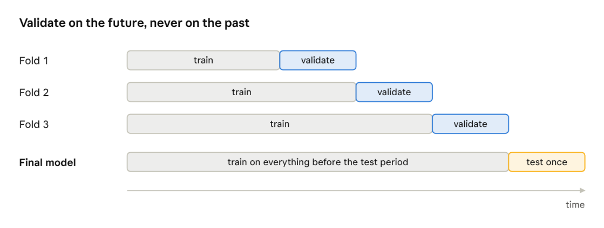

# 3 · ML fundamentals

Part I · Foundations. The concepts every later chapter assumes. Chapter 40 covers the classic models themselves, Chapter 4 how to measure them, Chapter 5 neural networks.

## Why it matters

The ML depth round starts here. "What is the bias-variance trade-off?", "how would you handle class imbalance?", "what is leakage and how did you prevent it?" are among the most common interview questions, and the answers separate people who have shipped models from people who have trained them in notebooks. These fundamentals also decide whether real projects work: most production model failures are leakage, wrong splits or a mis-framed target, not the wrong algorithm.

The chapter is organised around one question: will this model do as well on tomorrow's data as it did on the data I have? Every topic is a part of the answer. Framing (3.1) decides what "doing well" means. The bias-variance trade-off (3.2) explains why fitting the training data and predicting new data are different goals, and losses, regularisation and optimisation (3.3 to 3.5) are the controls you use to balance them. Splits and leakage (3.6, 3.7) are how you *measure* generalisation honestly, which is harder than it sounds: most over-optimistic results come from a validation set that quietly knew something about the answers. Features, imbalance and calibration (3.8 to 3.10) are the practical decisions that come up on almost every tabular project.

Read it as a sequence of decisions you will make on a real project, in roughly the order you will make them. The worked numbers come from small simulations you can rerun (`code/ch03_check.py` and `tools/figures.py`), so each claim can be checked rather than memorised.

## Key concepts

- **Problem framing**: turning a business question into a prediction target, a unit of prediction, features available at prediction time, and a metric. [Google ML crash course](https://developers.google.com/machine-learning/crash-course).
- **Bias–variance trade-off**: simple models miss patterns (bias); flexible models chase noise (variance). [Bias–variance trade-off](https://en.wikipedia.org/wiki/Bias%E2%80%93variance_tradeoff).
- **Overfitting and regularisation**: fitting the training data too closely, and the penalties (L1, L2, early stopping, dropout) that prevent it. [Overfitting](https://en.wikipedia.org/wiki/Overfitting), [Regularisation](https://en.wikipedia.org/wiki/Regularization_(mathematics)).
- **Train, validation and test splits; cross-validation**: estimate how a model will do on unseen data; split by time or by user when the data has that structure. [scikit-learn: cross-validation](https://scikit-learn.org/stable/modules/cross_validation.html).
- **Data leakage**: information that would not be available at prediction time sneaking into training. [Leakage](https://en.wikipedia.org/wiki/Leakage_(machine_learning)).
- **Feature engineering**: encoding categories, scaling, aggregates over time windows, text and embedding features.
- **Class imbalance**: when positives are rare; handled with the right metric, class weights or resampling, and threshold choice (Chapter 4).

## 3.1 Framing a problem as ML

Most of the value of an ML project is decided before any model is trained. A business problem ("too many late deliveries", "users churn") does not come with a target, a prediction moment or a metric; someone has to choose them, and a well-trained model of the wrong target is worthless however good its validation score. Framing is the step that turns a vague goal into a learning problem whose solution someone will actually use.

Before choosing a model, answer these questions, in this order:

1. **What decision will the prediction change, and who makes it?** If nothing changes, no model is needed.
2. **Is ML needed at all?** Rules or a heuristic often get 80% of the value. ML earns its cost when patterns are too complex for rules, change over time, or need to scale.
3. **What exactly is the label?** "Will the user churn?" needs a definition: no order in 30 days? 60? Measured from when? Labels decide what the model learns more than any architecture.
4. **What is the prediction moment, and what is known then?** Only data available at that moment may be used as features (3.7).
5. **What are the costs of each kind of error?** That decides the metric and the threshold (Chapter 4.1).
6. **What is the baseline?** Popularity, last value, a rule, the current system. A model that does not beat the baseline by a margin worth its cost does not ship.

**Common framings:** classification (will it happen?), regression (how much?), ranking (in what order?), forecasting (how much, when?), clustering or anomaly detection (what is unusual?), generation (write it). The same business problem can be framed several ways: "reduce late deliveries" can be ETA regression, a late-or-not classifier, or a quantile forecast of delivery time. Choose the framing whose output the decision-maker can use.

**Proxy labels.** Often the true target is slow or unobservable (lifetime value, satisfaction), so you train on a proxy (30-day orders, a rating). Name the proxy explicitly and check that it moves with the real goal.

## 3.2 The bias-variance trade-off

A model is trained on one sample of data but used on new data. It can fail in two opposite ways. It can be too rigid to represent the pattern, and then it is wrong in the same way whatever data it sees. Or it can be so flexible that it reproduces the accidents of its particular training sample, and then it is wrong in a different way for every sample. The bias-variance decomposition makes those two failure modes precise and shows that, for a fixed amount of data, reducing one tends to increase the other.

A model's expected error on new data splits into three parts:

$$
\mathrm{expected\ error} = \mathrm{bias}^2 + \mathrm{variance} + \mathrm{irreducible\ noise}
$$

- **Bias:** error from wrong assumptions; the model is too simple to capture the pattern (a straight line through a curve). Shows as high training error and similar validation error: **underfitting**.
- **Variance:** error from sensitivity to the particular training sample; the model fits noise. Shows as low training error and much higher validation error: **overfitting**.
- **Noise:** randomness no model can remove.

More flexible models lower bias and raise variance; more data lowers variance; regularisation trades a little bias for less variance.

**Where the decomposition comes from.** Imagine training the same model many times, each time on a fresh training set drawn from the same source, and predicting at one input x. The predictions scatter around their average f̄(x). The expected squared error against the truth f(x) plus noise splits cleanly: (f̄(x) − f(x))² is the bias², how far the *average* model is from the truth; the scatter of predictions around f̄(x) is the variance; and the noise in the labels is the irreducible part. The cross terms vanish because the noise is independent of the training set.

The figure makes it concrete. Polynomials of increasing degree are fitted to 25 noisy points from a sine curve, 300 times with fresh data each time:


*Bias² falls to almost zero by degree 3, while variance keeps climbing (0.03 at degree 3, 0.56 at degree 8); total expected error is lowest at degree 3. Computed in `tools/figures.py`.*

A degree-1 or 2 model cannot bend enough to follow the sine (bias), a degree-8 model bends to follow each sample's noise (variance), and the best model is the simplest one flexible enough for the true pattern.

**Diagnosing from learning curves** (training and validation error as training-set size grows):

| What you see | Diagnosis | What helps |
|---|---|---|
| Both errors high and close together | High bias | More features, a more flexible model, less regularisation |
| Training error low, validation error much higher | High variance | More data, regularisation, simpler model, early stopping, bagging |
| Validation error still falling as data grows | Data-limited | Collect more data before tuning models |
| Both low and close | Good fit | Ship, then monitor |

Modern deep networks complicate the classical picture: very large models can generalise well even when they fit training data perfectly (the "double descent" observations). For tabular and classic ML work, the classical trade-off is still the right mental model, and it is what interviewers expect first.

## 3.3 Loss functions

A model does not know what you want; it knows only the loss it is trained to minimise. The loss therefore defines what a "good" prediction is: the average outcome, the typical outcome, a cautious upper bound, or an honest probability. Choosing it is a business decision expressed in maths, and the most useful fact about losses is which summary of the outcome each one makes the model predict.

The loss is what training optimises; choose it so its optimum is what the business needs.

| Loss | Formula (per example) | Optimal prediction | Use for |
|---|---|---|---|
| MSE | (y − p)² | Mean | Regression when large errors are much worse |
| MAE | \|y − p\| | Median | Regression robust to outliers |
| Huber | Quadratic near zero, linear beyond δ | Between mean and median | Regression with some outliers |
| Quantile (pinball) | max(q(y−p), (q−1) (y−p)) | q-th quantile | ETA promises, demand buffers |
| Log loss (cross-entropy) | −[y log p + (1−y) log(1−p)] | True probability | Classification with probabilities |
| Hinge | max(0, 1 − y·f) with y in {−1, 1} | Margin | SVMs |
| Focal | −(1−pₜ)^γ log pₜ | Down-weights easy examples | Extreme imbalance, dense detection |
| Ranking losses | Pairwise, listwise | Correct order | Search and recommendation (Chapter 44) |

**Why each loss predicts what it predicts.** For a fixed input with uncertain outcome Y, the best constant prediction p minimises the expected loss. For squared error, E[(Y − p)²] = Var(Y) + (E[Y] − p)², minimised at p = E[Y]: the **mean**. For absolute error, moving p up by a small step costs the probability mass below p and saves the mass above it; the two balance where half the mass is on each side: the **median**. For the pinball loss at q, the costs are weighted q and 1 − q, so the balance point has a fraction q of the mass below it: the **q-th quantile**. This is why an ETA model trained with squared error is late half the time, and why a promise you want to meet 90% of the time should be trained with the 0.9 pinball loss.

```python
import numpy as np

def mse(y, p):        return np.mean((y - p) ** 2)
def mae(y, p):        return np.mean(np.abs(y - p))
def huber(y, p, delta=1.0):
    r = np.abs(y - p)
    return np.mean(np.where(r <= delta, 0.5 * r ** 2, delta * (r - 0.5 * delta)))
def log_loss(y, p, eps=1e-12):
    p = np.clip(p, eps, 1 - eps)
    return -np.mean(y * np.log(p) + (1 - y) * np.log(1 - p))
def focal_loss(y, p, gamma=2.0, eps=1e-12):
    p = np.clip(p, eps, 1 - eps)
    pt = np.where(y == 1, p, 1 - p)                  # probability of the true class
    return -np.mean((1 - pt) ** gamma * np.log(pt))

y = np.array([3.0, 5.0, 2.0, 30.0]); p = np.array([2.5, 5.5, 2.0, 8.0])
mse(y, p), mae(y, p), huber(y, p)    # 121.1, 5.75, 5.44: the one outlier dominates MSE
```

## 3.4 Regularisation

Section 3.2 showed that flexible models fail by fitting noise. Regularisation is the set of techniques that let you keep a flexible model while discouraging it from using its flexibility unless the data really demand it. The common forms add a penalty on the size of the weights to the loss, so that the model must "pay" for every large weight with a matching improvement in fit.

There is a second way to see the same idea, which explains why it works rather than only what it does. Chapter 1.4 showed that an L2 penalty is MAP estimation with a Gaussian prior centred at zero: before seeing data, you believe small weights are more likely than large ones. With little data, that belief dominates and the weights stay small; with plenty of data, the evidence outweighs the prior. Regularisation is a prior, and its strength says how much you trust it relative to the data. The common forms:

- **L2 (ridge, weight decay):** adds λ∑w². Shrinks all weights smoothly; handles correlated features by spreading weight between them.
- **L1 (lasso):** adds λ∑|w|. Pushes some weights exactly to zero, so it also selects features. On a test with 20 features of which 3 matter, Lasso kept exactly 3 non-zero weights while Ridge kept all 20 small but non-zero.
- **Elastic net:** both; useful with many correlated features.
- **Early stopping:** stop training when validation loss stops improving; the most-used regulariser in deep learning and boosting.
- **Model-specific:** tree depth, minimum samples per leaf and learning rate in boosting (Chapter 40); dropout and data augmentation in neural networks (Chapter 5).

**Why L1 gives zeros:** geometrically, the L1 constraint region is a diamond with corners on the axes, and the loss contours usually first touch it at a corner, where some weights are zero. The L2 region is a circle with no corners.

**How much L2 shrinks, in one dimension.** For a single feature, ridge regression gives w = (x·y) / (x·x + λ): the penalty simply adds λ to the denominator. On 50 points with a true slope of 2, the least-squares slope is 2.18; λ = 10 gives 1.79, λ = 50 gives 1.04 and λ = 200 gives 0.40. The penalty matters relative to x·x, which grows with the number of examples, so the same λ regularises less as data grows: regularisation is most useful exactly when data is scarce.

Regularisation strength is a hyperparameter: tune it on validation data, and scale features first, since penalties on unscaled features punish features measured in small units unfairly.

## 3.5 Optimisation

Once the loss and the penalty are fixed, training is a minimisation problem, usually over far too many parameters for a closed-form solution. Every method below follows the same principle from Chapter 1.5, take a small step against the gradient, and they differ in how they estimate the gradient and how they decide the size and direction of each step. The basic update, with learning rate η, is

$$
w_{t+1} = w_t - \eta\,\nabla L(w_t)
$$

The learning rate is the critical choice: too small and training crawls, too large and each step overshoots the minimum and the loss diverges. The methods below are, in effect, increasingly clever ways of choosing a good step for each parameter.

- **Gradient descent:** w ← w − η∇L over the whole dataset. Exact but slow per step.
- **Stochastic / mini-batch gradient descent (SGD):** use a batch of examples per step. Noisy but fast; the noise even helps escape poor regions.
- **Momentum:** keep a running average of gradients, so steps build speed in consistent directions and damp oscillation.
- **Adam:** momentum plus a per-parameter step size scaled by the running average of squared gradients, with bias correction. The default for deep learning; AdamW decouples weight decay from the update and is the standard for transformers.
- **Learning-rate schedules:** warm-up then decay (cosine or linear) for deep networks; the learning rate is the single most important hyperparameter.

All three from scratch, training logistic regression with mini-batches:

```python
def sigmoid(z):
    return 1 / (1 + np.exp(-z))

def grad(w, Xb, yb):
    return Xb.T @ (sigmoid(Xb @ w) - yb) / len(yb)         # gradient of mean log loss

def sgd(w, g, state, lr):
    return w - lr * g

def momentum(w, g, state, lr, beta=0.9):
    state["v"] = beta * state.get("v", 0) + g
    return w - lr * state["v"]

def adam(w, g, state, lr, b1=0.9, b2=0.999, eps=1e-8):
    state["t"] = state.get("t", 0) + 1
    state["m"] = b1 * state.get("m", 0) + (1 - b1) * g          # first moment
    state["v"] = b2 * state.get("v", 0) + (1 - b2) * g ** 2     # second moment
    m_hat = state["m"] / (1 - b1 ** state["t"])                  # bias correction
    v_hat = state["v"] / (1 - b2 ** state["t"])
    return w - lr * m_hat / (np.sqrt(v_hat) + eps)

def train(X, y, optimizer, lr, epochs=20, batch=64, seed=0):
    rng = np.random.default_rng(seed)
    w, state = np.zeros(X.shape[1]), {}
    for _ in range(epochs):
        idx = rng.permutation(len(y))
        for start in range(0, len(y), batch):
            b = idx[start:start + batch]
            w = optimizer(w, grad(w, X[b], y[b]), state, lr)
    return w
```

On synthetic data with true weights [2, −1, 0.5, 0, 0], all three recover about [1.94, −1.02, 0.56, 0.02, 0.1], close to scikit-learn's unregularised fit.

**Why momentum helps.** Real loss surfaces are often shaped like long narrow valleys: steep across, shallow along. Plain gradient descent must use a learning rate small enough not to diverge across the steep direction, which makes it crawl along the shallow one, and it bounces between the valley walls. Momentum accumulates the consistent part of the gradient (along the valley) and lets the alternating part (across it) cancel out.


*Thirty steps on the loss ½(w₁² + 25 w₂²), whose curvature differs 25-fold between directions. After 30 steps, gradient descent reaches loss 0.100 and momentum 0.033.*

The ratio between the steepest and shallowest curvature (the condition number, 25 here) is what makes optimisation hard, and adaptive methods such as Adam, which rescale each parameter by its own gradient size, attack the same problem from a different angle (Chapter 7). This is a common coding-round task: "implement logistic regression with gradient descent". Know it cold.

## 3.6 Train, validation and test splits

The training error says how well a model fits data it has already seen, which is the wrong question: what matters is how it does on data it has not. The only way to estimate that is to hold some data back and never let the model, or you, learn from it. The subtlety is that "learning from it" includes every decision you take after looking at a score: each choice of feature, hyperparameter or threshold that improves a validation number fits that validation set a little. A good splitting scheme keeps one set of data untouched by any decision.

- **Training set:** fits the parameters.
- **Validation set:** chooses hyperparameters, features, thresholds and models. Every decision you make on it leaks a little information, so it becomes optimistic.
- **Test set:** used once, at the end, for an honest estimate. If you tune on the test set, you no longer have one.

**Cross-validation** (k-fold) gives a more stable estimate when data is small: train on k−1 folds, validate on the remaining one, rotate. Variants matter more than k:

| Data | Split | Why |
|---|---|---|
| Independent rows, imbalanced classes | Stratified k-fold | Keeps class ratios equal across folds |
| Several rows per user, store or restaurant | Group k-fold | The same entity must not appear in train and validation, or the model memorises it |
| Anything with time | Time-based (walk-forward) | The model will predict the future, so validate on the future |



*walk-forward validation · three folds and a final test*

```python
from sklearn.model_selection import TimeSeriesSplit, GroupKFold

for tr, va in TimeSeriesSplit(n_splits=3).split(X):        # expanding window
    model.fit(X[tr], y[tr]); evaluate(model, X[va], y[va])

for tr, va in GroupKFold(n_splits=5).split(X, y, groups=user_ids):   # no user in both
    ...
```

In food delivery almost everything has time, and many rows belong to the same user or restaurant, so the honest split is often **both**: by time, and with care about entities seen in training. Add a **gap** between training and validation equal to the label horizon (if the label is "orders in the next 30 days", training labels must end 30 days before validation starts).

## 3.7 Leakage

A validation score is only honest if the model sees, at training time, exactly the information it will have at prediction time, and no more. Leakage is any violation of that rule. It is dangerous because it never shows up as an error: the pipeline runs, the score improves, and the problem appears only after launch, when the information the model relied on is not there.

Leakage is information in training that will not be available at prediction time. It makes offline results look great and production results disappoint, and it is the most common cause of that gap.

| Type | Example | Prevention |
|---|---|---|
| Target leakage | A "refund issued" feature in a model predicting complaints | Ask of every feature: is it known at the prediction moment? |
| Temporal leakage | Features computed with data after the prediction time; random splits on time data | Point-in-time feature joins (`merge_asof`, Chapter 46); time-based splits |
| Preprocessing leakage | Scaling, imputation or target encoding fitted on all data before splitting | Fit preprocessing inside each training fold (scikit-learn Pipelines) |
| Entity leakage | The same user in train and test with user-specific patterns | Group splits |
| Duplicate leakage | Near-duplicate rows across splits (same review posted twice) | Deduplicate before splitting |
| Label-definition leakage | The label's window overlaps the feature window | Gaps equal to the label horizon |

**Warning signs:** a single feature with enormous importance; validation scores far better than any published or previous result; offline-online gaps after launch. When results look too good, assume leakage until proven otherwise.

**A worked leak.** Suppose customer behaviour flips every few weeks (promotion periods on and off), and the row's timestamp is available as a feature. With a random split, test rows come from the same periods as training rows, so a gradient-boosted model learns "in this time range, the relationship goes this way" and scores an AUC of 0.633. With an honest time split, the test period is new and the timestamp feature is useless: AUC 0.521, barely better than chance. Nothing in the model changed; only the split. The random-split number described a situation that will never occur in production: predicting a period you have already seen (the simulation is in `code/ch03_check.py`).

## 3.8 Feature engineering

A model can only learn from what its inputs make visible. A gradient-boosted tree cannot compute "this user's average order value over the last 30 days" from raw order rows, and a linear model cannot discover that hour 23 is next to hour 0. Feature engineering is the work of turning raw data into inputs that expose the patterns you expect to matter, without letting information from the future slip in.

For tabular problems, features usually matter more than the model.

- **Numeric:** scaling for linear models and neural networks (not needed for trees); log transforms for skewed amounts; clipping outliers; ratios and differences (price vs the user's usual price).
- **Categorical:** one-hot for few categories; **target encoding** for many (restaurant id, zone), which must be computed out-of-fold with smoothing, or it leaks the label; hashing for huge, open vocabularies; learned embeddings in neural networks.
- **Time:** hour, weekday, holiday flags, time since last event; cyclical encoding (sin/cos) for linear models.
- **Aggregates:** counts, means and rates over windows (orders in the last 7 and 30 days), always computed point-in-time.
- **Text and images:** embeddings from pretrained models (Chapters 41, 29).
- **Missing values:** impute and add a "was missing" flag; missingness is often informative.

**Out-of-fold target encoding** (a frequent interview follow-up):

```python
import numpy as np, pandas as pd
from sklearn.model_selection import KFold

def target_encode_oof(df, col, target, n_splits=5, smoothing=20, seed=0):
    prior = df[target].mean()
    enc = pd.Series(np.nan, index=df.index)
    for tr, va in KFold(n_splits, shuffle=True, random_state=seed).split(df):
        stats = df.iloc[tr].groupby(col)[target].agg(["sum", "count"])
        smoothed = (stats["sum"] + smoothing * prior) / (stats["count"] + smoothing)   # shrink small groups
        enc.iloc[va] = df.iloc[va][col].map(smoothed).fillna(prior).values  # unseen -> prior
    return enc
```

Each row's encoding comes from other folds, so its own label never contributes. At serving time, use the encoding computed on all training data. With time-ordered data, compute it from the past only.

## 3.9 Class imbalance

When positives are rare, two things go wrong at once. The usual metrics stop meaning anything: a fraud model that never flags anything is 99% accurate when 1% of orders are fraud. And the training signal is dominated by the majority class, so a model can reduce its average loss mostly by getting better at the easy negatives. The fixes are best applied in order, starting with the cheapest and most important, because the first two steps alone solve most cases.

1. **Use the right metrics first:** PR-AUC, precision and recall at the operating point, not accuracy (Chapter 4).
2. **Class weights:** weight the loss so rare-class errors cost more (`class_weight="balanced"`). Simple and usually enough.
3. **Resampling:** undersample the majority class (fast, loses data) or oversample the minority (SMOTE and variants create synthetic examples; often less helpful on real tabular data than people expect). Resample only the training folds, never validation or test.
4. **Threshold tuning:** often the biggest lever; choose the threshold from costs on validation data.
5. **Correct probabilities** if you reweighted or resampled (Chapter 4.3), before using them as probabilities.
6. **Focal loss** or anomaly-detection framing for extreme imbalance.

And question the framing: with 50 positives in a year, you may need rules plus human review rather than a model.

## 3.10 Calibration

Covered in Chapter 4.3: when predicted probabilities are used as numbers (expected value, bids, combining heads), check reliability diagrams and fix with Platt, isotonic or temperature scaling on held-out data. Trees, boosted models trained with resampling, and neural networks are often miscalibrated; logistic regression usually is not.

## Pitfalls

- **Random splits on time-ordered data.** The most common source of over-optimistic results.
- **Preprocessing before splitting.** Scalers, imputers and encoders fitted on all data leak the validation set.
- **Target encoding without out-of-fold computation.**
- **Tuning on the test set,** or peeking at it repeatedly.
- **Choosing a label nobody has defined precisely** ("churn", "good restaurant").
- **Skipping the baseline.**
- **Resampling validation or test data** to fix imbalance; it changes the metric, not the model.
- **Using accuracy for imbalanced problems.**
- **Not scaling features** for linear models, SVMs, kNN and neural networks.
- **Treating feature importance as causation.**

## Interview questions

Questions 1–5 basic, 6–11 intermediate, 12–14 senior.

**1. Explain the bias-variance trade-off.** Expected error = bias² + variance + noise. Simple models underfit (high bias), flexible models overfit (high variance). Regularisation, more data and model choice move the balance; learning curves diagnose which side you are on.

**2. L1 vs L2 regularisation?** L2 shrinks all weights smoothly and handles correlated features well; L1 drives some weights to exactly zero, performing feature selection, because its constraint region has corners on the axes.

**3. Why do we need a validation set and a test set?** Validation is used for decisions (hyperparameters, features, thresholds), which makes it optimistic; the test set, used once, gives an unbiased estimate.

**4. What is data leakage? Give examples.** Information unavailable at prediction time entering training: target-derived features, future data in aggregates, preprocessing fitted on all data, the same entity in train and test, duplicates across splits.

**5. How would you handle class imbalance?** Right metrics (PR-AUC, precision/recall at threshold), class weights, threshold tuning by cost, resampling only on training folds if needed, probability correction afterwards.

**6. Explain Adam.** Momentum (running mean of gradients) plus per-parameter adaptive step sizes (running mean of squared gradients), with bias correction for the early steps. AdamW applies weight decay separately from the gradient update.

**7. When would you use MAE, MSE or a quantile loss?** MSE when large errors are disproportionately costly (predicts the mean); MAE when robust to outliers (predicts the median); quantile when you need a buffer, such as an ETA you will meet 90% of the time.

**8. How do you validate a model that predicts next week's demand?** Walk-forward validation with expanding or rolling windows, a gap equal to the forecast horizon, features computed point-in-time, metrics per segment, and comparison with seasonal-naive baselines.

**9. How does target encoding work and what can go wrong?** Replace a category with the (smoothed) mean target of that category. Computed naively, each row's own label leaks into its feature; use out-of-fold encoding with smoothing, and past-only data for time series.

**10. Your model has 0.99 AUC offline. What do you do?** Suspect leakage: check feature importances for a dominant feature, review feature timestamps against the prediction moment, check splits by time and entity, look for duplicates, and compare with simple baselines.

**11. What does early stopping do and why does it regularise?** Stops training when validation loss stops improving; it limits how far parameters move from their initial values, restricting effective model capacity.

**12. How do you frame "reduce late deliveries" as an ML problem?** Clarify the decision (promise times, dispatching, restaurant prep alerts), then choose a framing whose output that decision uses: quantile ETA regression for promises, a late-risk classifier for proactive alerts. Define the label (minutes late vs promise), the prediction moment, features available then, error costs, and the baseline.

**13. Your validation metric improves but production does not. What could be wrong with your training setup?** Leakage, splits that do not mirror production (random vs time, entity overlap), a training distribution different from serving (selection bias in logged data), train-serve skew in features, a proxy label misaligned with the business metric.

**14. When should you not use ML?** When rules achieve the goal, when there is no reliable label or feedback loop, when errors are unacceptable and unexplainable, when data is too small, or when nobody will act on the prediction.

## Practice

1. **Logistic regression from scratch** with SGD, momentum and Adam (3.5), including L2 regularisation; compare with scikit-learn. Time yourself: under 30 minutes.
2. **Learning curves.** On a Kaggle tabular dataset, plot training and validation error against training size for a shallow tree and a deep tree; diagnose each.
3. **Leakage hunt.** Take a dataset with timestamps; train once with a random split and once with a time split; explain the gap.
4. **Target encoding.** Implement out-of-fold target encoding and compare with naive target encoding on a high-cardinality feature: the naive version should look better on validation and worse on test.
5. **Imbalance.** On the credit card fraud dataset, compare no handling, class weights, undersampling and SMOTE on PR-AUC and recall at 90% precision.
6. **Framing drill.** For three food-delivery problems (late deliveries, restaurant churn, search abandonment), write the six framing answers from 3.1.

## Read next

- *An Introduction to Statistical Learning* (free PDF): chapter 2 (bias-variance), chapter 5 (cross-validation), chapter 6 (ridge, lasso).
- *Designing Machine Learning Systems* (Chip Huyen): chapters on training data, feature engineering (with its leakage section), and model development.
- Kaufman et al., *Leakage in Data Mining: Formulation, Detection, and Avoidance* (2012).
- Kingma and Ba, *Adam: A Method for Stochastic Optimization* (2014); Loshchilov and Hutter, *Decoupled Weight Decay Regularization* (AdamW, 2017).
- scikit-learn user guide: "Cross-validation" and "Common pitfalls and recommended practices".

**Links:** [Google ML crash course](https://developers.google.com/machine-learning/crash-course) · [scikit-learn user guide](https://scikit-learn.org/stable/user_guide.html) · [Rules of Machine Learning](https://developers.google.com/machine-learning/guides/rules-of-ml). Other titles above can be found by searching their title.

## Done when

You can frame a business problem with the six questions in 3.1. You can explain bias and variance and diagnose them from learning curves.

You can choose a loss function from what the business needs.

You can explain L1, L2 and early stopping, including why L1 gives zeros. You can write logistic regression with SGD, momentum and Adam from memory. You can choose a split strategy (stratified, group, time) and add gaps. You can list six types of leakage and how to prevent each. You can implement out-of-fold target encoding. You can handle class imbalance in the right order.

---

[← 2 · Statistics and experimentation](02-statistics-and-experimentation.md) · [Contents](../README.md#contents) · [4 · Evaluation and metrics →](04-evaluation-and-metrics.md)
