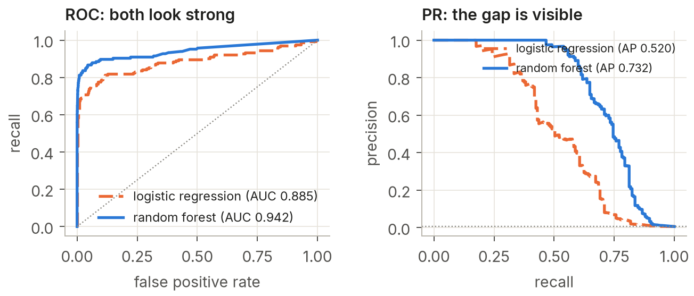
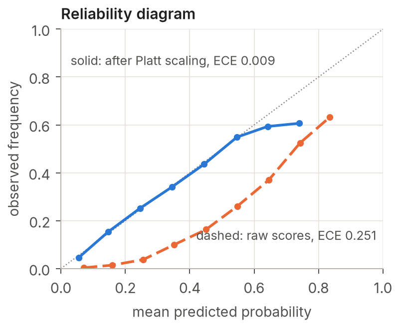

# 4 · Evaluation and metrics

Part I · Foundations. No prerequisites beyond basic probability. Chapters 43 and 44 go deeper on ranking metrics, Chapter 2 on experiments, Chapter 24 on evaluating LLMs.

## Why it matters

A model is only as good as the way you measure it. Most failed ML projects did not fail on modelling: they optimised a metric that did not match the business goal, evaluated on the wrong split, or celebrated a difference that was noise. Choosing and defending metrics is one of the clearest signals of seniority in interviews, and it comes up in every round: ML depth ("why PR-AUC here?"), coding ("implement AUC"), system design ("how do you evaluate it?") and behavioural ("tell me about a model that looked good offline and failed online").

A metric is a summary, and every summary throws information away. Accuracy forgets which kind of mistake was made; AUC forgets the threshold you will actually use; RMSE forgets whether you were early or late; an average forgets the city where the model fails. Choosing a metric is choosing what to forget, and the right choice depends on the decision the model feeds. The chapter is organised by the kind of output being judged: hard decisions at a threshold (4.1), rankings of scores (4.2), probabilities (4.3), many classes (4.4), numbers (4.5) and ordered lists (4.6).

The last three sections are about trusting the result. An offline metric is a proxy for what happens when the model is live, and the link has to be checked (4.7). A single number hides the segments where things go wrong (4.8). And every metric on a finite test set is an estimate with an error bar (4.9). The aim is that for any model you build, you can say which number you report, why that one, and how sure you are of it.

Section 4.10 carries all of this over to language models, where the same metrics appear under new names: a reward model's accuracy is a pairwise AUC, a hallucination detector is judged by AUROC and calibration, a code model by pass@k, and a chatbot comparison by a win rate that needs a confidence interval like any other proportion. The examples in 4.1 to 4.9 are mostly tabular because the definitions are cleanest there; the interview questions at frontier labs ask the same things about LLM evaluations.

This chapter is the reference for all later chapters: every metric used in the book is defined here once, with code you should be able to write from memory.

## Key concepts

- **Confusion matrix**: counts of true and false positives and negatives at a threshold. [Confusion matrix](https://en.wikipedia.org/wiki/Confusion_matrix).
- **Precision and recall (and F1)**: of what you flagged, how much was right; of what was there, how much you found. [Precision and recall](https://en.wikipedia.org/wiki/Precision_and_recall).
- **ROC curve and AUC; PR curve**: performance across all thresholds; PR curves are more informative when positives are rare. [ROC](https://en.wikipedia.org/wiki/Receiver_operating_characteristic).
- **Calibration**: whether a predicted 0.8 really happens 80% of the time; matters whenever probabilities drive decisions. [scikit-learn: probability calibration](https://scikit-learn.org/stable/modules/calibration.html).
- **Log loss and Brier score**: metrics that reward good probabilities, not just good rankings. [Brier score](https://en.wikipedia.org/wiki/Brier_score).
- **Ranking metrics (NDCG, MAP, MRR, recall@k)**: quality of an ordered list, weighting the top positions most. [Discounted cumulative gain](https://en.wikipedia.org/wiki/Discounted_cumulative_gain).
- **Regression metrics (MAE, RMSE, MAPE, quantile loss)**: which errors you penalise and how. [MAPE](https://en.wikipedia.org/wiki/Mean_absolute_percentage_error).
- **Offline–online gap**: offline metrics predict but do not guarantee online impact; experiments decide (Chapter 2).
- **LLM evaluation metrics (pairwise accuracy, pass@k, win rate, risk–coverage)**: the same ideas applied to reward models, sampled programs, model comparisons and abstention (4.10). [Chen et al., 2021 (pass@k)](https://arxiv.org/abs/2107.03374).

## 4.1 The confusion matrix, precision, recall and thresholds

Most classifiers end in a yes/no action: block the payment, send the voucher, escalate the ticket. The two possible mistakes, acting when you should not and failing to act when you should, almost never cost the same. A blocked legitimate payment loses a customer; a missed fraud loses money. Before any summary metric, you need a way to count each kind of mistake separately, and to see how the counts move as you make the model more or less eager to say yes.

A binary classifier outputs a score; a **threshold** turns it into a decision. Every decision falls into one of four cells.


*Confusion matrix · fraud example*

| Metric | Formula | Question it answers |
|---|---|---|
| Precision | TP / (TP + FP) | When the model says yes, how often is it right? |
| Recall (sensitivity, TPR) | TP / (TP + FN) | Of all real positives, how many did we catch? |
| Specificity (TNR) | TN / (TN + FP) | Of all real negatives, how many did we leave alone? |
| False positive rate | FP / (FP + TN) | How often do we wrongly flag a negative? |
| Accuracy | (TP + TN) / all | Share of correct decisions; misleading when classes are imbalanced |
| F1 | 2PR / (P + R) | Harmonic mean of precision and recall; low if either is low |
| Fβ | (1 + β²)PR / (β²P + R) | β > 1 weights recall more, β < 1 weights precision more |

**Accuracy trap.** With 1% fraud, a model that never flags anything is 99% accurate and useless. Use precision, recall and the metrics in 4.2 for imbalanced problems.

**From scratch** (a classic coding-round warm-up):

```python
import numpy as np

def confusion(y_true, y_pred):
    tp = int(np.sum((y_true == 1) & (y_pred == 1)))
    fp = int(np.sum((y_true == 0) & (y_pred == 1)))
    fn = int(np.sum((y_true == 1) & (y_pred == 0)))
    tn = int(np.sum((y_true == 0) & (y_pred == 0)))
    return tp, fp, fn, tn

def precision_recall_f(y_true, y_pred, beta=1.0):
    tp, fp, fn, _ = confusion(y_true, y_pred)
    precision = tp / (tp + fp) if tp + fp else 0.0
    recall = tp / (tp + fn) if tp + fn else 0.0
    b2 = beta ** 2
    f = (1 + b2) * precision * recall / (b2 * precision + recall) if precision + recall else 0.0
    return precision, recall, f
```

**Choosing the threshold is a business decision.** Raising the threshold trades recall for precision. The principled way is to put a cost on each error and pick the threshold that minimises total cost. For promo abuse, a missed abuser might cost €10 in vouchers, while blocking a real customer costs a lost order and goodwill.

```python
def best_threshold_by_cost(y_true, scores, cost_fp, cost_fn):
    best_t, best_cost = None, float("inf")
    for t in np.unique(scores):
        tp, fp, fn, tn = confusion(y_true, (scores >= t).astype(int))
        cost = fp * cost_fp + fn * cost_fn
        if cost < best_cost:
            best_t, best_cost = t, cost
    return best_t, best_cost
```

Other common rules: a fixed precision floor ("at least 90% of flags must be real fraud, maximise recall under that"), a capacity limit ("the review team handles 500 cases a day, so flag the top 500"), or a recall target for safety-critical cases. In interviews, say which rule you would use and why: it shows you connect the model to the operation around it.

## 4.2 Threshold-free metrics: ROC-AUC and PR-AUC

While a model is being developed, the threshold is usually not settled yet: it depends on costs, capacity and policy, which may change after launch. You still need to compare models, and precision and recall cannot do it because they depend on the threshold. Threshold-free metrics judge the quality of the scores themselves, by asking how well they separate positives from negatives across every possible threshold. The two standard ones answer different questions, and choosing the wrong one is a classic mistake with rare events.

**ROC curve and ROC-AUC.** Plot recall (TPR) against the false positive rate for every threshold. The area under it has a clean meaning: **the probability that a random positive gets a higher score than a random negative.** 0.5 is random, 1.0 is perfect. That meaning gives a one-line implementation through ranks (the Mann-Whitney U statistic):

```python
import pandas as pd

def roc_auc(y_true, scores):
    ranks = pd.Series(scores).rank().to_numpy()          # average ranks handle ties
    n_pos = y_true.sum()
    n_neg = len(y_true) - n_pos
    return (ranks[y_true == 1].sum() - n_pos * (n_pos + 1) / 2) / (n_pos * n_neg)
```

**AUC by counting pairs.** Five items with labels [1, 0, 1, 0, 0] and scores [0.9, 0.8, 0.4, 0.3, 0.1]: there are 2 × 3 = 6 (positive, negative) pairs. The positive scored 0.9 beats all three negatives; the positive scored 0.4 beats two of them (0.3 and 0.1) but not 0.8. Five of six pairs are ordered correctly, so AUC = 0.833. The rank formula above computes the same count without enumerating pairs, in O(n log n).

**Why the rank formula works.** Sort all n₁ positives and n₀ negatives by score, rank 1 being the lowest. A positive at rank r has r − 1 items below it, so summing (r − 1) over the positives counts, for each positive, every item scored below it. Some of those items are other positives: each pair of positives is counted exactly once, n₁(n₁ − 1)/2 in total. Subtracting them, Σr − n₁ − n₁(n₁ − 1)/2 = Σr − n₁(n₁ + 1)/2 is the number of (positive, negative) pairs in which the positive is above, the Mann–Whitney statistic U. Dividing by n₁n₀, the number of such pairs, gives AUC = U/(n₁n₀). Ties count as half a correct pair, which is exactly what average ranks implement; a model that outputs only a few distinct scores (a rounded or bucketed score) gets many ties, and its AUC is lower than the same model with fine-grained scores.

Three properties follow from the pairwise definition, and each is a standard follow-up. AUC is **invariant to any monotone transform** of the scores, so it says nothing about calibration. It is **invariant to prevalence**: it is an average over (positive, negative) pairs, so duplicating every negative ten times leaves it unchanged. And it averages over *all* thresholds, including ones you would never use; when only the low-false-positive region matters (a fraud screen that may flag at most 1% of transactions), report **partial AUC** up to that false positive rate, or simply recall at that rate.

**PR curve and average precision (PR-AUC).** Plot precision against recall. Average precision summarises it as the mean of the precision at each position where a positive appears in the sorted list:

```python
def average_precision(y_true, scores):
    order = np.argsort(-scores, kind="mergesort")
    y_sorted = y_true[order]
    hits = np.cumsum(y_sorted)
    positions = np.flatnonzero(y_sorted == 1) + 1        # 1-based ranks of the positives
    return (hits[y_sorted == 1] / positions).mean()
```

Both match scikit-learn's `roc_auc_score` and `average_precision_score` on a test set.

**Which one to use.**

|  | ROC-AUC | PR-AUC |
|---|---|---|
| Baseline of a random model | Always 0.5 | The positive rate (0.01 for 1% fraud) |
| Sensitive to | Ranking of positives vs negatives overall | Precision among the top-scored items |
| Under heavy imbalance | Can look excellent (0.95) while precision at useful thresholds is poor, because the huge number of true negatives keeps FPR small | Shows the problem clearly |
| Depends on prevalence? | No | Yes: the same scores give a lower PR-AUC when positives are rarer, so values are not comparable across datasets or across time when base rates drift |
| Use when | Classes are roughly balanced, or you care about the whole ranking | Positives are rare and you act on the top of the list (fraud, moderation, rare-event detection) |

The figure shows the difference on a dataset with 0.55% positives. A logistic regression and a random forest have ROC-AUCs of 0.885 and 0.942: both "good". Their average precisions are 0.520 and 0.732, which tells you the forest is far better exactly where a fraud team works: at the top of the list.



*ROC and precision–recall curves for the same two models on the same test set (computed in `tools/figures.py`). The dotted lines are random baselines: the diagonal for ROC, the positive rate (0.0055) for PR.*

**PR-AUC depends on the base rate.** Precision is TP/(TP + FP), and at a fixed recall and false positive rate the number of false positives grows with the number of negatives. Holding the score distributions fixed (positives ~ N(1.5, 1), negatives ~ N(0, 1)) and changing only the prevalence, ROC-AUC stays at about 0.85 while average precision is 0.12 at 1% positives, 0.48 at 10% and 0.855 at 50% (`code/ch04_check.py`). A drop in PR-AUC from one month to the next can therefore mean that fraud became rarer, not that the model got worse; compare PR-AUC only on the same population, or report it next to the prevalence.

**Average precision, not the trapezoid.** "Area under the PR curve" computed with the trapezoidal rule interpolates linearly between points, and linear interpolation in precision–recall space is optimistic: precision does not vary linearly between two thresholds (Davis and Goadrich, 2006). With fine-grained scores the two agree, but with a coarse score the gap is large. Bucket the same scores above into three levels at 2% prevalence, and average precision is 0.081 while `sklearn.metrics.auc(recall, precision)` reports 0.308. Use average precision (the step-wise sum in the code above, `average_precision_score` in scikit-learn).

AUC is also blind to calibration: multiply all scores by 0.1 and AUC does not change, but any decision based on the probability does. That is why 4.3 exists.

## 4.3 Probabilistic metrics and calibration

Ranking metrics only care about order: a model that gives every fraud case 0.02 and every legitimate one 0.01 has a perfect AUC. Many decisions need more than order. Suppose an order is worth 30 euros in margin and a fraudulent one costs 200 euros: blocking pays off when p × 200 > (1 − p) × 30, that is, above p ≈ 0.13. That rule only works if a predicted 0.13 really means 13%. Whenever the model's probability is used as a number (multiplied by a value, compared with a bid, turned into an expected cost), it must be **calibrated**: of all cases scored 0.2, about 20% should be positive. That is a second property, separate from ranking quality.

**Log loss (cross-entropy)** punishes confident mistakes heavily:

$$
\mathrm{LogLoss} = -\dfrac{1}{n}\sum_{i=1}^{n}\left[\,y_i\log p_i + (1-y_i)\log(1-p_i)\,\right]
$$

It is the training loss of logistic regression and most classifiers, and a good evaluation metric for probabilities.

**Brier score** is the mean squared error of the probabilities:

$$
\mathrm{Brier} = \dfrac{1}{n}\sum_{i=1}^{n}\left(p_i - y_i\right)^2
$$

It is bounded between 0 and 1, less harsh on confident mistakes than log loss, and easier to explain to a non-technical audience. Both log loss and Brier are **proper scoring rules**: their expected value is best when the predicted probability equals the true one, so a model cannot improve its score by shading its probabilities up or down. That is the property that makes them suitable for judging probabilities, and it is what accuracy and AUC lack.

**Why Brier is proper, in one line.** Suppose the true probability of a case is π and you predict p. The expected Brier score is π(1 − p)² + (1 − π)p², and expanding and regrouping gives

$$
\mathbb{E}\left[(p - Y)^2\right] = (p - \pi)^2 + \pi(1 - \pi)
$$

The second term does not depend on p, so the expectation is minimised exactly at p = π: no shading of the probability can help. The same calculation for log loss, −π log p − (1 − π) log(1 − p), has derivative −π/p + (1 − π)/(1 − p), which is zero only at p = π. By contrast, accuracy at a 0.5 threshold is equally happy with p = 0.51 and p = 0.99 when π = 0.7, and focal loss is minimised *below* π (Chapter 3.3), so neither can judge probabilities.

```python
def log_loss(y_true, p, eps=1e-15):
    p = np.clip(p, eps, 1 - eps)                       # avoid log(0)
    return -np.mean(y_true * np.log(p) + (1 - y_true) * np.log(1 - p))
```

**Reliability diagram and ECE.** Bin predictions (0–0.1, 0.1–0.2, …), and plot each bin's mean prediction against its actual positive rate; a calibrated model sits on the diagonal. The expected calibration error (ECE) is the weighted average gap. With bins B₁ … B_M over n predictions,

$$
\mathrm{ECE} = \sum_{m=1}^{M} \frac{|B_m|}{n}\,\left|\,\bar p(B_m) - \bar y(B_m)\,\right|
$$

where p̄(B_m) is the mean prediction in bin m and ȳ(B_m) the fraction of positives in it:

```python
def expected_calibration_error(y_true, p, n_bins=10):
    bins = np.minimum((p * n_bins).astype(int), n_bins - 1)
    ece = 0.0
    for b in range(n_bins):
        mask = bins == b
        if mask.any():
            ece += mask.mean() * abs(p[mask].mean() - y_true[mask].mean())
    return ece
```

ECE is convenient but not a proper score, and three of its weaknesses come up as follow-ups. It **depends on the binning**: with fixed-width bins, most predictions of a rare-event model fall in the first bin, so the number is dominated by one bin; **equal-mass bins** (each holding the same number of predictions) fix that. It is **biased upwards** on small samples, because even a perfectly calibrated model shows a nonzero gap in each bin from sampling noise alone, so compare ECEs only at similar sample sizes and bin counts. And it **hides direction**: an ECE of 0.05 could be over- or under-confidence, which the reliability diagram shows and the number does not. Report it next to log loss or Brier, never alone.

**Multi-class calibration.** With K classes there are two common versions. **Top-label (confidence) ECE**, the usual one for neural networks, bins only the probability of the predicted class and compares it with accuracy: "when the model says 80%, is it right 80% of the time?" **Classwise ECE** computes a binary ECE for each class's probability and averages them; it catches miscalibration on the classes the model rarely predicts, which top-label ECE never looks at.

**Fixing calibration.** Fit a small mapping from raw score to probability on a held-out set (never the training set):

- **Platt scaling:** a logistic regression on the score. Two parameters, robust with little data.
- **Isotonic regression:** a monotone step function. More flexible; needs more data; can overfit small sets.
- **Temperature scaling:** divide neural network logits by one learned constant. Standard for deep models and LLM classifiers.

```python
from sklearn.linear_model import LogisticRegression
from sklearn.isotonic import IsotonicRegression

platt = LogisticRegression().fit(score_cal.reshape(-1, 1), y_cal)
p_platt = platt.predict_proba(score_test.reshape(-1, 1))[:, 1]

iso = IsotonicRegression(out_of_bounds="clip").fit(score_cal, y_cal)
p_iso = iso.predict(score_test)
```

On a synthetic test with a badly calibrated score (5,000 cases, 10% positives, in `code/ch04_check.py`), both methods cut ECE from 0.24 to about 0.02 (0.020 for Platt, 0.021 for isotonic) without changing AUC, because both mappings are monotone. The figure below is a different synthetic experiment, generated in `tools/figures.py`: 40,000 cases whose score is a power distortion of the true probability, recalibrated with Platt scaling on the logit of the score. There the ECE falls from 0.251 to 0.009.

**Temperature scaling, written out.** A network produces logits z for K classes. Temperature scaling divides them all by one scalar T > 0 before the softmax:

$$
p_k = \frac{\exp(z_k / T)}{\sum_{j=1}^{K} \exp(z_j / T)}
$$

T is fitted by minimising log loss on a held-out set. T > 1 softens over-confident predictions; T < 1 sharpens under-confident ones. Dividing every logit by the same positive number never changes which logit is largest, so accuracy (and the ranking within each class) is unchanged, and with a single parameter it cannot overfit. For logits [4, 1, 0], the top probability is 0.936 at T = 1 and 0.736 at T = 2. Guo et al. (2017) found that this one parameter fixed most of the over-confidence of modern deep networks, which is why it is the default for neural classifiers.

```python
from scipy.optimize import minimize_scalar

def fit_temperature(logits_cal, y_cal):
    def nll(T):
        z = logits_cal / T
        z = z - z.max(1, keepdims=True)
        logp = z - np.log(np.exp(z).sum(1, keepdims=True))
        return -logp[np.arange(len(y_cal)), y_cal].mean()
    return minimize_scalar(nll, bounds=(0.05, 20), method="bounded").x
```



*An over-confident score (dashed): cases scored 0.6 turn out positive only about 35% of the time. After Platt scaling fitted on a separate half of the data (solid), the points sit on the diagonal; ECE falls from 0.251 to 0.009.*

**Why models are miscalibrated in the first place.** It depends on the model family, and the honest answer is per family. Large neural networks trained long with cross-entropy push training-set probabilities towards 0 and 1, and modern deep networks are typically over-confident on new data (Guo et al., 2017). Random forests tend the other way: averaging many trees rarely produces predictions near 0 or 1, so they are *under*-confident at the extremes, and naive Bayes is over-confident because it double-counts correlated evidence (Niculescu-Mizil and Caruana, 2005). Gradient-boosted trees trained with log loss and early stopping are often close to calibrated, and logistic regression usually is, because both directly minimise a proper loss without much excess capacity. Resampling and class weights shift the base rate the model believes in. And temperature, label smoothing or a change in the population after training all move probabilities without changing rankings. Calibration is therefore a separate property to check every time probabilities are used as numbers.

**Negative downsampling breaks calibration, predictably.** If you keep only a fraction w of negatives for training (common in ad click prediction), the model over-predicts. Correct with `q = p / (p + (1 − p) / w)` (worked design E.7).

The derivation takes two lines. At any input x, the model's odds estimate the ratio of positives to negatives it saw there. Keeping each negative with probability w multiplies the negative count by w and leaves positives alone, so the training odds are the true odds divided by w:

$$
\frac{p}{1-p} = \frac{1}{w}\cdot\frac{q}{1-q}
$$

Solving for q gives q/(1 − q) = w·p/(1 − p), that is q = wp/(wp + 1 − p) = p/(p + (1 − p)/w). With w = 0.1, a model output of 0.5 corrects to 0.091 and an output of 0.2 to 0.024. The map is monotone, so ranking metrics such as AUC are unchanged; only the probabilities move. Class weights are the same correction with k = 1/w (Chapter 3.9).

```python
def correct_downsampling(p, w):
    """p: prediction from a model trained with a fraction w of negatives kept."""
    return p / (p + (1 - p) / w)
```

## 4.4 Multi-class and multi-label metrics

With many classes, a single accuracy number is dominated by the frequent ones. A taxonomy classifier can be 95% accurate while never getting a rare but important class right. The question becomes how to combine per-class performance into one number, and the three standard averages encode three different answers to "which classes matter".

With more than two classes (a merchant or dish taxonomy, intent classes), compute precision, recall and F1 per class, then average.

| Averaging | How | Favours | Use when |
|---|---|---|---|
| Micro | Pool all TP, FP, FN across classes, then compute | Frequent classes (equals accuracy for single-label problems) | Overall volume matters most |
| Macro | Compute per class, then plain average | Treats every class equally, so rare classes count | Rare classes matter (long-tail taxonomy nodes) |
| Weighted | Per class, averaged by class frequency | In between | Reporting a balanced single number |

Example: with true labels `[0,0,0,0,0,0,1,1,2,2]` and predictions `[0,0,0,0,0,1,1,0,2,0]`, micro-F1 is 0.70, weighted-F1 0.69 and macro-F1 0.65: the rare classes are handled worse, and only macro shows it.

```python
from sklearn.metrics import f1_score, classification_report, confusion_matrix

f1_score(y_true, y_pred, average="macro")
print(classification_report(y_true, y_pred))   # per-class precision, recall, F1, support
confusion_matrix(y_true, y_pred)               # which classes get confused with which
```

Other tools: **top-k accuracy** (is the true class in the top k predictions? Useful when a human picks from suggestions), **the confusion matrix** read row by row to find systematically confused pairs, and for a hierarchical taxonomy, accuracy at each level (right parent, wrong leaf is a smaller error than wrong parent).

**Multi-label** (one item can have several labels, like dietary tags): compute metrics per label and average (macro or micro), or use example-based measures such as the Jaccard overlap between predicted and true label sets. Thresholds are usually chosen per label.

## 4.5 Regression and forecasting metrics

For a numeric target (delivery time, demand, basket value), every prediction has an error e = ŷ − y, and a regression metric is a way of summarising those errors. The summaries differ in two ways that matter in practice: how strongly they punish large errors compared with small ones, and whether they are expressed in the target's units or as a percentage. Both choices should follow from what an error costs the business.

The two most common summaries average either the absolute errors or the squared errors. With n predictions,

$$
\mathrm{MAE} = \dfrac{1}{n}\sum_{i=1}^{n}\left|\hat{y}_i - y_i\right|
$$

The **mean absolute error** is in the units of the target (minutes, orders, euros), and every minute of error counts the same, whether it comes from one large miss or several small ones.

$$
\mathrm{RMSE} = \sqrt{\dfrac{1}{n}\sum_{i=1}^{n}\left(\hat{y}_i - y_i\right)^2}
$$

The **root mean squared error** is also in the target's units, because the square root undoes the squaring. But squaring before averaging gives large errors disproportionate weight: one 20-minute miss adds 400 to the sum, as much as a hundred 2-minute misses. RMSE is therefore always at least as large as MAE, and a big gap between them signals a few large misses. It was the official metric of the Netflix Prize.

Neither is comparable across targets of different scale: an MAE of 3 is excellent for a 45-minute delivery and terrible for a 5-minute pickup. **Scaled** metrics divide by the size of the target. The usual choice for demand is the weighted absolute percentage error, which divides total error by total volume:

$$
\mathrm{WAPE} = \dfrac{\sum_{i}\left|\hat{y}_i - y_i\right|}{\sum_{i}\left|y_i\right|}
$$

The table summarises these and the other common metrics.

| Metric | Formula | Properties | Use when |
|---|---|---|---|
| MAE | mean(\|ŷ − y\|) | In the target's units; robust to outliers; optimal prediction is the median | ETA error in minutes; easy to explain |
| RMSE | √mean((ŷ − y)²) | Punishes large errors more; optimal prediction is the mean | Large misses are disproportionately costly |
| MAPE | mean(\|ŷ − y\| / \|y\|) | Scale-free, but explodes near zero and punishes over-forecasts more than under-forecasts | Rarely; only with targets far from zero |
| WAPE | Σ\|ŷ − y\| / Σ\|y\| | Scale-free and stable with small values | Demand forecasting across many items or zones |
| Bias | mean(ŷ − y) | Direction of error | Always report next to an error metric |
| Pinball (quantile) loss | mean(max(q·(y − ŷ), (q − 1)·(y − ŷ))) | Evaluates a quantile forecast | P90 demand for courier staffing, P90 ETA promises |
| R² | 1 − SSE / SST | Share of variance explained | Explanatory analysis; poor for comparing forecasts across datasets |

```python
def regression_metrics(y_true, y_pred):
    err = y_pred - y_true
    return {
        "MAE": np.mean(np.abs(err)),
        "RMSE": np.sqrt(np.mean(err ** 2)),
        "MAPE": np.mean(np.abs(err) / np.abs(y_true)),
        "WAPE": np.sum(np.abs(err)) / np.sum(np.abs(y_true)),
        "bias": np.mean(err),
    }

def pinball_loss(y_true, y_pred, q):
    diff = y_true - y_pred
    return np.mean(np.maximum(q * diff, (q - 1) * diff))

regression_metrics(np.array([10, 12, 0.5, 30]), np.array([11, 10, 2, 28]))
# MAPE ≈ 0.83 because of the single 0.5 target; WAPE ≈ 0.12
```

The example shows why WAPE beats MAPE for demand: one small actual value (a quiet zone at 3 am) dominates MAPE.

**Matching the metric to the loss.** The prediction that minimises MAE is the median; for RMSE it is the mean; for pinball loss at q it is the q-th quantile. Train with the loss whose optimal prediction is what the business needs. For an ETA promise, users hate late orders far more than early ones, so a quantile above 0.5 is often the right target (worked design E.8 and Chapter 45).

## 4.6 Ranking metrics

Search results, recommendations and feeds are judged as lists, and users only look at the top of them. A good ranking metric therefore cares about position: a relevant item at rank 1 is worth much more than the same item at rank 20, and a list with the best item first beats one with it third. The metrics below differ in whether relevance is yes/no or graded, and in how fast credit decays with rank.

Ranking metrics evaluate an ordered list per query or user, then average over queries. Chapters 43 and 44 use them heavily and include the code; this is the summary.

| Metric | Definition | Graded relevance? | Use for |
|---|---|---|---|
| Precision@k | Share of the top k that are relevant | No | The visible part of the page |
| Recall@k | Share of all relevant items that appear in the top k | No | Retrieval stages |
| HitRate@k | 1 if any relevant item is in the top k | No | Next-item recommendation |
| MRR | Mean of 1 / rank of the first relevant item | No | One right answer (navigational search, "did we find the restaurant") |
| MAP | Mean over queries of average precision (4.2) | No | Several relevant items, all equally good |
| NDCG@k | DCG with gains 2^rel − 1 and a 1/log₂(rank + 1) discount, divided by the ideal DCG | Yes | Default for graded relevance |

**NDCG by hand.** A query returns four results with graded relevance [3, 2, 0, 1] (3 = perfect). With gains 2^rel − 1 and discount 1/log₂(rank + 1): DCG = 7/1 + 3/1.585 + 0/2 + 1/2.322 = 9.323. The ideal order [3, 2, 1, 0] gives 9.393, so NDCG = 0.993: only the last two items are swapped, and low positions are heavily discounted. Moving the best result from rank 1 to rank 3 instead ([0, 2, 3, 1]) drops NDCG to 0.620. The metric is designed to punish mistakes at the top, where users look.

**Ranking metrics from scratch.** Retrieval and RAG evaluation (Chapters 25 and 30) use these three constantly, so they belong in your coding-round repertoire, not only in the recommender chapters. Each takes, for one query, the list of retrieved item ids in rank order and the set (or graded dictionary) of relevant ones; average the result over queries.

```python
def recall_at_k(ranked, relevant, k):
    return len(set(ranked[:k]) & set(relevant)) / len(relevant)

def mrr(ranked, relevant):
    for i, item in enumerate(ranked, start=1):
        if item in relevant:
            return 1.0 / i
    return 0.0                                          # no relevant item retrieved

def ndcg_at_k(ranked, rel, k):
    """rel: dict item -> graded relevance (missing = 0); ideal DCG uses ALL known relevant items."""
    dcg = sum((2 ** rel.get(item, 0) - 1) / np.log2(i + 2) for i, item in enumerate(ranked[:k]))
    ideal = sorted(rel.values(), reverse=True)[:k]
    idcg = sum((2 ** r - 1) / np.log2(i + 2) for i, r in enumerate(ideal))
    return dcg / idcg if idcg > 0 else 0.0

ranked = ["a", "b", "c", "d"]; rel = {"a": 3, "b": 2, "c": 0, "d": 1}
ndcg_at_k(ranked, rel, 4)                    # 0.993, the worked example above
recall_at_k(ranked, {"b", "d", "e"}, 2)      # 1 of 3 relevant items in the top 2: 0.333
mrr(ranked, {"c", "d"})                      # first relevant at rank 3: 0.333
```

Two traps from the later chapters worth repeating: compute the ideal DCG from **all** known relevant items, not just the retrieved ones (Chapter 44.9), and do not evaluate against "the true item plus 100 random negatives" (Chapter 43.10). And for per-user ranking of a classifier's scores, **GAUC** (AUC computed per user, then averaged weighted by impressions) is what ad and feed teams often report, because a global AUC mixes up between-user differences with within-user ranking quality.

## 4.7 Offline vs online metrics

Everything so far measures a model on a fixed test set. The business, however, cares about what happens when the model is live: whether users order more, wait less or come back. Those outcomes can only be measured in an experiment, which is slow and expensive, so day-to-day work relies on offline metrics as stand-ins. The question this section addresses is when that substitution is safe.

**The metric hierarchy.** A well-run ML project has metrics at three levels, and you should be able to name all three for any system you design:

| Level | Example: restaurant feed | Who owns it |
|---|---|---|
| Business (north star) | Orders per active user per week; retention | The product team |
| Online product metric | Feed conversion (sessions with an order from the feed), plus guardrails: delivery time, cancellations, partner concentration | You and the product team, in A/B tests |
| Offline model metric | NDCG@10 on next-day orders; calibration of p(order) | You, every training run |

The offline metric is a **proxy**: cheap, fast and repeatable, but only useful if moving it tends to move the online metric. Check that link explicitly: across past experiments, did offline gains predict online gains? If not, the offline metric or the offline evaluation set needs work.

**Why offline and online disagree:**

- The offline label is not the online goal (clicks vs orders, relevance vs speed).
- The offline candidate set differs from production (availability, filters, re-ranking).
- Leakage or train-serve skew makes offline numbers optimistic.
- Feedback effects: offline logs come from the old model, so they cannot show what users would do with items the old model never showed.
- The online effect is real but small, or offset in another segment.

**Guardrail metrics** are the ones you promise not to hurt: latency, delivery time, cancellations, revenue, complaint rate. A launch needs the primary metric up and no guardrail significantly down. Name guardrails before the experiment, not after.

**Counter-metrics** catch gaming: if you optimise click-through, watch orders per click; if you optimise auto-resolution of support tickets, watch reopen rate. LLM features get their own metric families (faithfulness, judge scores, human preference): Chapter 24.

## 4.8 Slicing

A model that is better on average can still be worse for an important group of users. A new ETA model might improve the city-wide error while getting much worse in one district where couriers use bikes; a classifier might be excellent on English text and poor on Arabic. Averages weight groups by their size, so small groups can fail without moving the total. Slicing is the habit of breaking every key metric down by the segments that matter.

An average hides the segment where the model fails. Always report key metrics by slice: city, platform, new vs returning users, cuisine, language, time of day, high- vs low-value customers, and for text models, input length and language.

```python
def by_slice(df, col, metric, min_rows=200):
    """df has columns y (label) and p (score); metric(df) -> float."""
    rows = []
    for key, g in df.groupby(col):
        if len(g) >= min_rows and g["y"].nunique() == 2:      # skip slices too small to trust
            rows.append({col: key, "n": len(g), "positives": int(g["y"].sum()), "metric": metric(g)})
    return pd.DataFrame(rows).sort_values("metric")         # worst slices first

from sklearn.metrics import roc_auc_score
by_slice(df, "city", lambda g: roc_auc_score(g["y"], g["p"]))
```

**Simpson's paradox** is the reason slicing is not optional: model B can beat model A in every city and still lose overall (or the reverse) if the mix of cities differs between the two evaluation sets. Compare models on the same rows, and look at slices before trusting the total.

**What to do with a bad slice:** first check whether it is real (enough rows, confidence interval from 4.9), then whether it matters (volume, value, fairness or legal risk), then fix it with more data for that slice, slice-specific features, or a separate threshold. Report the slice table in every model review: it is what experienced reviewers look for first.

## 4.9 Confidence intervals on metrics

A test set is a sample, exactly like the users in an A/B test (Chapter 2), and a metric computed on it would come out differently on another sample. Before saying that one model beats another, you need to know how large that sampling noise is compared with the difference. The tools are the same as in Chapter 2; the main new difficulty is identifying what the independent unit is.

"Model B has AUC 0.912 vs 0.909" means nothing without an interval. Metrics computed on a finite test set are estimates.

**The bootstrap** works for any metric: resample the test set with replacement many times, recompute the metric each time, and take the 2.5th and 97.5th percentiles. **Resample the right unit:** if one user contributes many rows, rows are not independent, so resample users (or queries, or sessions), not rows. Row-level resampling gives intervals that are too narrow.

```python
def bootstrap_ci(df, metric, n_boot=1000, by="user", seed=0):
    rng = np.random.default_rng(seed)
    groups = df.groupby(by).indices                     # user -> row positions
    keys = np.array(list(groups))
    stats = []
    for _ in range(n_boot):
        sample = rng.choice(keys, size=len(keys), replace=True)
        rows = np.concatenate([groups[k] for k in sample])
        stats.append(metric(df.iloc[rows]))
    return np.percentile(stats, [2.5, 97.5])
```

**Comparing two models: the paired bootstrap.** Two separate intervals that overlap do not prove there is no difference. Instead, evaluate both models on the **same** resampled rows and bootstrap the difference. Because both models see the same hard and easy cases, the difference is far less noisy than either metric alone.

```python
def paired_bootstrap_diff(df, metric_a, metric_b, n_boot=1000, by="user", seed=0):
    rng = np.random.default_rng(seed)
    groups = df.groupby(by).indices
    keys = np.array(list(groups))
    diffs = []
    for _ in range(n_boot):
        rows = np.concatenate([groups[k] for k in rng.choice(keys, size=len(keys), replace=True)])
        s = df.iloc[rows]
        diffs.append(metric_b(s) - metric_a(s))
    return np.mean(diffs), np.percentile(diffs, [2.5, 97.5])   # interval excluding 0 = a real difference
```

**Other tools worth naming in an interview.** For a quick interval on any proportion (precision, recall, accuracy), the normal approximation p ± 1.96√(p(1 − p)/n) is enough; the bootstrap is for metrics without a simple formula. Two analytic tests compare models on the same examples, McNemar's for error rates and DeLong's for AUCs, and both come out of the sizing argument below.

### How big must the test set be?

Turn the normal approximation around before building an evaluation set. A proportion p (accuracy, precision, recall) measured on n independent items has standard error √(p(1 − p)/n), so a 95% interval of half-width E needs

$$
n = \frac{z^2\,p\,(1-p)}{E^2}
$$

with z = 1.96. To measure an accuracy near 80% to within ±1 point, n = 1.96² × 0.8 × 0.2 / 0.01² ≈ 6,150 items; ±2 points needs a quarter of that, about 1,540. The cost is quadratic: halving the error bar quadruples the labelling. For precision or recall, n counts only the items in the denominator (the flagged items, or the true positives), which is why recall on a rare class is so noisy: 50 positives give a standard error of about 6.5 points at 70% recall.

**Pairing makes comparisons much cheaper.** To compare two models you need the error of the *difference*. Scored on separate test sets, two accuracies near 80% on 1,000 items each give a standard error of the difference of √(2 × 0.16/1000) = 1.8 points. Scored on the *same* 1,000 items, the difference depends only on the items where the models disagree: with discordance rates b/n and c/n (A right and B wrong, and the reverse), the standard error is √((b/n + c/n − (b/n − c/n)²)/n). If they disagree on 10% of items, that is √((0.10 − 0.01²)/1000) = 1.0 point, close to half. Two models that differ only slightly disagree on few items, and that is exactly when pairing helps most.

**McNemar's test** turns the same counts into a test: under "no difference", the discordant items split evenly between b and c, and (b − c)²/(b + c) is approximately χ² with one degree of freedom. With b = 55 and c = 45 out of 1,000 (a 1-point accuracy gain), the statistic is 1.0, p = 0.32: a 1-point difference on 1,000 items, from 100 disagreements, is not evidence. **DeLong's test** does the analogous job for two correlated AUCs on the same examples: it estimates the variance of each AUC and their covariance from per-example "placement" values (the fraction of negatives each positive outranks, and vice versa), with no resampling. Use it when bootstrapping is too slow; the paired bootstrap above gives similar answers and works for any metric. Finally, with many slices or many metrics, expect some false alarms by chance (Chapter 2.6 covers multiple testing).

## 4.10 In LLM work

Language-model evaluation is often presented as a new field with its own vocabulary. Most of it is this chapter's metrics applied to new objects: preference pairs, generated answers, sampled programs and model confidences. Seeing the mapping lets you bring the same discipline, above all confidence intervals and the question "what does this number forget?", to every LLM result you report. Chapters 23 to 25 go deeper; this section gives the bridge and the formulas interviewers expect you to write.

### Reward models and detectors are ranking problems

A **reward model** is trained on pairs (chosen, rejected) and evaluated by **pairwise accuracy**: the fraction of held-out pairs in which it scores the chosen response higher. That is the AUC of 4.2 restricted to matched pairs, with the same pairwise meaning and the same blindness to scale: a reward model can rank perfectly while its reward differences are meaningless as magnitudes. Two numbers frame it. Random is 50%, and the ceiling is not 100% but the rate at which human labellers agree with each other, which for open-ended preferences is far from perfect (the InstructGPT labellers agreed with each other about 73% of the time). A reward model at 70% may therefore be close to the noise ceiling, and the next point of accuracy may be fitting annotator noise. Report pairwise accuracy with a confidence interval (a proportion over pairs, so ±1.96√(p(1 − p)/n)), and slice it by the size of the human margin: accuracy on clear-cut pairs is what matters for RL.

**Hallucination detectors, safety classifiers and LLM judges used as classifiers** are binary classifiers like any other. Report AUROC to compare detectors and, because harmful outputs are rare, PR-AUC or precision and recall at the operating threshold (4.1, 4.2). The threshold comes from the cost of over-refusal against the cost of a miss, and it must be recomputed when the base rate in traffic changes.

### Generated answers: exact match, token F1 and their limits

For short factual answers, **exact match** (EM) is 1 if the normalised prediction equals a normalised reference, else 0. **Token F1** gives partial credit: precision and recall of the answer's tokens against the reference's tokens, as in SQuAD. Normalisation (lower-casing, removing punctuation and the articles a, an, the) matters as much as the metric.

```python
import re, string
from collections import Counter

def normalise(text):
    text = "".join(ch for ch in text.lower() if ch not in string.punctuation)
    return " ".join(w for w in text.split() if w not in {"a", "an", "the"})

def exact_match(pred, gold):
    return float(normalise(pred) == normalise(gold))

def token_f1(pred, gold):
    p, g = normalise(pred).split(), normalise(gold).split()
    common = sum((Counter(p) & Counter(g)).values())
    if common == 0:
        return 0.0
    precision, recall = common / len(p), common / len(g)
    return 2 * precision * recall / (precision + recall)

token_f1("The Eiffel Tower, in Paris.", "the Eiffel Tower")   # 2 of 4 predicted tokens match: 0.667
exact_match("The Eiffel Tower!", "eiffel tower")              # 1.0 after normalisation
```

**BLEU** (n-gram precision with a brevity penalty, from machine translation) and **ROUGE** (n-gram recall, from summarisation) extend the same idea to long outputs. Their limits are the reason they are rarely the headline metric for modern LLMs: they reward surface overlap, so a correct paraphrase scores low and a fluent answer that copies the reference's words but reverses its meaning scores high; they need references, which open-ended tasks do not have; and they correlate poorly with human judgement once systems are good. They remain useful as cheap regression checks on tasks with a narrow range of correct outputs. Chapter 24.4 covers reference-based metrics, and LLM judges, in depth.

### pass@k: an unbiased estimator

For code and maths, a model can be sampled k times and succeeds if any sample passes the tests. **pass@k** is the probability of that. The naive estimate from per-problem success rate ĉ = c/n is 1 − (1 − ĉ)^k, and it is biased downwards: (1 − ĉ)^k is a convex function of ĉ, so its average over sampling noise exceeds (1 − p)^k (Jensen's inequality). The unbiased estimator (Chen et al., 2021) draws n ≥ k samples, counts the c correct ones, and asks: if k of the n samples are chosen at random without replacement, how likely is it that none is correct?

$$
\mathrm{pass@}k = 1 - \frac{\binom{n-c}{k}}{\binom{n}{k}}
$$

The fraction is the number of all-incorrect k-subsets over the number of k-subsets. Averaged over problems, its expectation is exactly the true pass@k. A worked example: n = 10 samples, c = 3 correct, k = 5. The number of all-wrong 5-subsets is C(7, 5) = 21 out of C(10, 5) = 252, so pass@5 = 1 − 21/252 = 0.917, against the naive 1 − 0.7⁵ = 0.832. The bias is not small: for a problem with true per-sample success 0.1, n = 20 and k = 10, the true pass@10 is 0.651, the unbiased estimator averages 0.652 over simulated runs, and the naive one 0.568 (`code/ch04_check.py`). Compute the ratio as a running product to avoid overflow, and never compare pass@k numbers computed with different n or with the naive formula (Chapter 13 discusses pass@k scaling).

### Win rates need intervals and a rule for ties

Pairwise comparisons, by humans or by an LLM judge, produce a **win rate**: the fraction of prompts on which model B's answer is preferred to model A's. It is a proportion, so it gets the interval of 4.9, with one choice to state: ties. Counting a tie as half a win keeps every prompt; dropping ties changes the denominator and the meaning. With 165 wins, 45 ties and 90 losses over 300 prompts, the win rate with ties as half is (165 + 22.5)/300 = 0.625, and the per-prompt scores (1, 0.5 or 0) have a standard error of 0.026, so the 95% interval is 0.575 to 0.675: B is better, but "62.5%" is accurate only to about ±5 points. If prompts come in clusters (several from one task or one user), bootstrap over clusters, as for users in 4.9. Arena-style leaderboards aggregate many such comparisons with a Bradley–Terry model (Chapter 23.7); judge biases such as position bias are covered in Chapter 24.7.

### Selective prediction: risk against coverage

A system that may abstain ("I don't know", or escalation to a human) should be judged on two axes at once: **coverage**, the fraction of inputs it answers, and **risk**, the error rate on those it answers. Sort answers by confidence, answer only the top fraction, and plot risk against coverage; the area under that curve (AURC) summarises it, and lower is better. For ten answers with confidences 0.95, 0.9, …, 0.2 in decreasing order and correctness 1, 1, 1, 0, 1, 1, 0, 1, 0, 0, overall accuracy is 60% (risk 0.4 at full coverage), but answering only the top 30% gives risk 0, and the top 50% gives risk 0.2. The curve is only as good as the confidence signal ranking right answers above wrong ones, which is an AUROC question: the AUROC of confidence against correctness measures how well the model knows when it is wrong.

### Calibration of language models

Calibration (4.3) has three versions for an LLM, and they behave differently. **Token-probability calibration**: on multiple-choice questions, read the probability the model assigns to each option letter. Pretrained models are often fairly well calibrated in this sense (Kadavath et al., 2022), and the GPT-4 technical report showed that post-training reduced the calibration of the base model, a pattern seen in other RLHF-tuned models too, plausibly because preference optimisation rewards confident-sounding answers. **Verbalised confidence**: ask the model to state a probability in words. It is easy to use with API-only models but tends to be over-confident and clustered on round numbers. **Sampling consistency**: sample the answer several times and use the agreement rate (or the entropy over semantically distinct answers, as in semantic entropy) as the confidence; it is expensive but works for free-form answers, where a single sequence's probability is not meaningful.

Whichever signal you use, the measurement is the same: a reliability diagram and ECE, with equal-mass bins because confidences cluster near 1, top-label for "is the chosen answer right?", and log loss or Brier alongside. Temperature scaling of the answer logits fixes much of the miscalibration of token probabilities when you have them and a held-out set to fit T.

## Pitfalls

- **Accuracy on imbalanced data.** Always check the base rate first.
- **ROC-AUC alone for rare events.** It can look excellent while precision at any usable threshold is poor. Report PR-AUC or precision at the operating point.
- **Threshold tuned on the test set.** Then the test set is no longer a test. Tune on validation; report once on test.
- **Calibrating on training data.** The calibrator learns the model's overconfidence on data it memorised. Use a held-out set.
- **Forgetting that downsampling and class weights change probabilities.** Correct them before using the scores as probabilities.
- **MAPE with near-zero targets.** One quiet hour dominates the metric. Use WAPE or MAE.
- **Reporting an error metric without bias.** A forecast can have low MAE and still always under-predict.
- **Micro averages hiding rare classes.** Report macro or per-class metrics for taxonomies.
- **Bootstrap over rows when rows are clustered.** Intervals come out too narrow; resample users, sessions or queries.
- **"The intervals overlap, so no difference".** Use a paired comparison on the same examples.
- **No slice analysis.** The average hides the city, language or user group where the model fails.
- **Offline metric never checked against online outcomes.** You can improve a proxy for months without moving the business.
- **Comparing PR-AUC across populations or months** with different base rates; report it next to the prevalence.
- **Trapezoidal "PR-AUC" on coarse scores.** It is optimistic; use average precision.
- **Naive pass@k, or pass@k computed with different n.** Use the unbiased estimator and report n.
- **A win rate without an interval or a stated rule for ties.**

## Interview questions

Questions 1–5 are basic, 6–11 intermediate, 12–19 senior.

**1. Define precision and recall, and give a case where each matters more.** Precision: of the items flagged, the share that are truly positive. Recall: of the true positives, the share flagged. Precision matters more when false alarms are costly (blocking good customers' orders); recall matters more when misses are costly (food-safety complaints, account takeovers). Add the number that makes it concrete: with 1% positives, a classifier with 90% recall and a 5% false positive rate flags 0.009 + 0.0495 of all items, so its precision is only 15%. Follow-up: "how do you pick between them?" Put a cost on each error and pick the threshold that minimises total cost (4.1).

**2. Why is accuracy a bad metric for fraud detection?** With 1% fraud, predicting "not fraud" for everything is 99% accurate. Accuracy is dominated by the majority class; precision, recall and PR-AUC focus on the rare class you care about. Accuracy also hides which error was made, and the two errors have very different costs in fraud. When is accuracy fine? Balanced classes with roughly symmetric error costs, such as many multiple-choice benchmarks, though even there it should come with a confidence interval.

**3. What does ROC-AUC measure?** The probability that a randomly chosen positive is scored above a randomly chosen negative. It measures ranking quality across all thresholds and ignores calibration. It equals U/(n₁n₀), the Mann–Whitney statistic, which is why it can be computed from ranks in O(n log n), and ties count as half a correct pair (average ranks). It is invariant to prevalence and to any monotone transform of the scores. Its weakness is that it averages over thresholds you will never use: for a screen that may flag at most 1% of items, report partial AUC up to FPR 0.01 or recall at that rate. Follow-up: "is AUC a decision metric?" No: it does not tell you what happens at your threshold, so pair it with precision and recall at the operating point.

**4. MAE or RMSE?** MAE is in the target's units, robust to outliers, and is minimised by the median. RMSE punishes large errors more and is minimised by the mean. Choose by the cost of errors: if one 30-minute ETA miss is much worse than three 10-minute misses, RMSE (or a quantile loss) fits better. A quick number: one 20-minute miss adds as much squared error as a hundred 2-minute misses. RMSE ≥ MAE always; a large gap between them signals a few big misses, worth inspecting before choosing.

**5. What is F1 and when would you use Fβ instead?** The harmonic mean of precision and recall, high only when both are high. Fβ with β > 1 when recall matters more, β < 1 when precision matters more. Better still: choose the threshold with explicit costs. Example: P = 0.9, R = 0.3 gives F1 = 0.45, much lower than the arithmetic mean of 0.6, which is the point of the harmonic mean. F1 also ignores true negatives entirely, so it is unsuitable when correctly leaving negatives alone matters.

**Intermediate**

**6. ROC-AUC or PR-AUC for a problem with 0.5% positives?** PR-AUC, or precision and recall at the operating point. Under heavy imbalance, the false positive rate stays tiny even with many false positives, so ROC-AUC looks great while precision is poor. The PR-AUC baseline is the positive rate (0.005), which makes progress visible. Two caveats a strong answer adds: PR-AUC depends on prevalence (the same scores give AP 0.12 at 1% positives and 0.48 at 10%), so it is not comparable across datasets or months with different base rates; and compute average precision, not a trapezoidal area, which is optimistic with coarse scores (0.31 against 0.08 in the chapter's example).

**7. What is calibration and when does it matter?** Predicted probabilities match observed frequencies. It matters whenever the probability is used as a number: multiplying p(order) by basket value, comparing p(click) × bid across ads, setting expected-cost thresholds, or combining heads of a multi-task model. Measure with a reliability diagram and ECE; fix with Platt, isotonic or temperature scaling on held-out data. Add that ECE depends on binning (prefer equal-mass bins), is biased upwards on small samples and hides the direction of the error, so report log loss or Brier with it. Family matters: deep networks tend to be over-confident, random forests under-confident at the extremes. Follow-up: "does calibration change AUC?" Not with a monotone recalibration.

**8. You trained on 10% of negatives. What happens to the predictions and how do you fix them?** They are inflated, because the model saw positives ten times more often than reality. Correct with q = p / (p + (1 − p) / w) with w = 0.1. Ranking (AUC) is unaffected, because the correction is monotone. The derivation: the model's odds estimate positives over negatives at each x, and keeping a fraction w of negatives divides the true odds by w, so p/(1 − p) = (1/w)·q/(1 − q); solve for q. A raw 0.5 becomes 0.091. Follow-up: "and with class weights of 10 on positives?" Identical correction, since weighting positives by 10 is equivalent in expectation to keeping 10% of negatives.

**9. Micro, macro or weighted F1 for a 300-class product taxonomy?** Macro (and per-class) if the long tail matters, because micro is dominated by the frequent classes. Report micro too as an overall volume view, plus a confusion analysis of the most confused class pairs. In the chapter's ten-item example micro-F1 is 0.70 and macro 0.65, and only macro shows the rare classes failing. Trade-off: per-class F1 on classes with a handful of test items is extremely noisy, so pool rare classes for reporting or show intervals. For a hierarchy, also report accuracy at each level.

**10. How do you choose a classification threshold?** From the business: minimise expected cost with explicit FP and FN costs; or maximise recall subject to a precision floor; or respect a capacity limit (top N per day for manual review). Tune on validation data, and revisit when base rates change. With calibrated probabilities, the cost-minimising threshold has a closed form: act when p × cost_FN > (1 − p) × cost_FP, so with a miss costing 200 and a false alarm 30, the threshold is 30/230 ≈ 0.13. That closed form is a reason to calibrate.

**11. Why is MAPE dangerous for demand forecasting?** It divides by the actual value, so small actuals (night hours, small zones) explode the error, and it is undefined at zero. WAPE (total absolute error over total actual) is stable and weights errors by volume. In the chapter's four-point example a single target of 0.5 pushes MAPE to 0.83 while WAPE is 0.12. MAPE is also asymmetric: an over-forecast can exceed 100% error while an under-forecast cannot, so optimising it biases forecasts low.

**Senior**

**12. Model B beats model A by 0.003 AUC. Do you ship it?** Not on that alone. Get a confidence interval on the difference with a paired bootstrap over users. Check slices, calibration and latency cost. Then ask whether offline AUC gains have historically translated into online gains for this system; if yes and the difference is significant, run an A/B test. A strong answer sets a minimum effect worth acting on *before* looking: if past experiments show online gains only for AUC improvements above about 0.005, a significant 0.003 is real but not worth B's extra complexity, latency or serving cost. Significance answers "is it real?"; the minimum effect answers "does it matter?". Follow-up: "the interval is [0.001, 0.005]": real but small; ship only if B costs nothing extra, or bundle it with other changes in one A/B test.

**13. Your offline metric improved but the A/B test shows no change. What are possible reasons?** Proxy mismatch (clicks vs orders), offline candidate set different from production, leakage or train-serve skew, feedback-loop bias in offline labels, an effect too small for the test's power, or segments moving in opposite directions. Investigate each with data, not opinions. Order by cost: compute the test's minimum detectable effect first (if it is larger than the effect you expected, the test could not have seen it), then diff logged serving features against training features, then check per-segment results. Follow-up: "how would you prevent this next time?" Track, across past launches, how well offline deltas predicted online deltas.

**14. How do you build the metric set for a new ML feature?** Start from the business goal (north star), choose an online primary metric that reflects it and is sensitive enough to move in a test, add guardrails and counter-metrics, then pick an offline metric and validate that it predicts the online one. Write them down before building the model. Sensitivity is quantitative: the primary metric must move detectably within your traffic, so prefer a per-session conversion over a monthly retention number that would need months of data. Counter-metrics catch gaming: optimising clicks, watch orders per click.

**15. How would you compute a confidence interval for NDCG@10 on a search test set?** NDCG is computed per query and averaged, so bootstrap over queries (or over users, if one user issues many queries): resample them with replacement, recompute the mean NDCG each time, take percentiles. For comparing two rankers, bootstrap the per-query difference. Because NDCG@10 is a mean of per-query values, the normal approximation also works: the standard error is the standard deviation of per-query NDCG over √(number of queries), so 1,000 queries with a per-query standard deviation of 0.3 give ±1.96 × 0.3/√1000 = ±0.019. The paired difference has a much smaller spread than either ranker alone.

**16. Explain the unbiased pass@k estimator and why the naive one is wrong.** Sample n ≥ k solutions, count c correct, and estimate pass@k = 1 − C(n − c, k)/C(n, k): the probability that a random k-subset of your samples contains at least one correct one. Its expectation equals the true pass@k. The naive 1 − (1 − c/n)^k is biased low, because (1 − ĉ)^k is convex in ĉ and Jensen's inequality pushes its average above (1 − p)^k. With n = 10, c = 3, k = 5 the estimates are 0.917 and 0.832. Follow-up: "how large should n be?" Several times k, because the estimator's variance grows as k approaches n; and report pass@k only with the n used.

**17. How many test items do you need to measure 80% accuracy to within ±1 point?** n = 1.96² × 0.8 × 0.2/0.01² ≈ 6,150, because the 95% half-width is 1.96√(p(1 − p)/n); ±2 points needs about 1,540, so halving the error bar quadruples the cost. To *compare* two models, pair them on the same items: if they disagree on 10% of 1,000 items, the standard error of the difference is about 1.0 point, against 1.8 for separate test sets. Then test with McNemar's (b − c)²/(b + c). Follow-up: "the items come in clusters of related questions": the effective sample size is smaller, so use a clustered standard error or bootstrap over clusters.

**18. How would you evaluate a reward model, and an LLM's calibration?** A reward model is judged by pairwise accuracy on held-out preference pairs, which is AUC over matched pairs. Compare it with the human agreement rate, which is the realistic ceiling (around 73% for the InstructGPT labellers), not with 100%, and slice by how clear-cut the human preference was. For calibration, choose the confidence signal (answer-token probability, verbalised confidence, or agreement across samples), then draw a reliability diagram with equal-mass bins and report ECE alongside Brier. Expect post-trained models to be over-confident relative to their base models, and fix token probabilities with temperature scaling on a held-out set. Follow-up: "reward-model accuracy went up but RL got worse": accuracy is not robustness under optimisation pressure; check for reward hacking on the policy's own outputs.

**19. Your PR-AUC fell from 0.40 to 0.31 month on month with no model change. What happened?** Probably the base rate fell. PR-AUC depends on prevalence: with the same score distributions, average precision is 0.48 at 10% positives and 0.12 at 1%. Check the positive rate first, then a prevalence-invariant metric such as ROC-AUC or recall at a fixed false positive rate on both months. If those are stable, the model is unchanged and the precision at your threshold has fallen because positives are rarer, which may still warrant moving the threshold. If ROC-AUC fell too, look for drift in inputs or labels. Follow-up: "what do you put on the dashboard?" PR-AUC next to the prevalence, and precision and recall at the operating threshold.

## Practice

Every exercise here is also a coding-round drill: do it in plain NumPy and pandas, autocomplete off, with a 20–30 minute timer.

1. **Metrics from scratch.** Implement the confusion matrix, precision, recall, Fβ, ROC-AUC (rank formula), average precision, log loss, ECE, MAE, RMSE, WAPE and pinball loss. Check each against scikit-learn on random data with `np.isclose`.

<details><summary>Hint and expected result</summary>

`code/ch04_check.py` is the oracle: every implementation there matches scikit-learn to floating-point precision (for its synthetic data, ROC-AUC 0.9116, average precision 0.6616, log loss 0.4115). The usual bugs are ties in AUC (use average ranks, not `argsort`), a stable sort in average precision, and forgetting to clip probabilities in log loss.

</details>

2. **ROC vs PR under imbalance.** Use the Kaggle credit card fraud dataset (about 0.17% positives). Train a logistic regression and a LightGBM model; plot ROC and PR curves for both. *Good solution:* a short paragraph explaining why ROC-AUC barely separates the models while PR-AUC does.

<details><summary>Hint and expected result</summary>

Split by time (the dataset has a `Time` column), not at random. Expect both ROC-AUCs in the high 0.9s and the average precisions much further apart, with the PR baseline at about 0.0017. The figure in 4.2 shows the same pattern on synthetic data: ROC-AUC 0.885 vs 0.942 and AP 0.520 vs 0.732.

</details>

3. **Threshold by cost.** On the same data, choose a threshold with FN cost = 50 × FP cost, and another with a 90% precision floor. Report recall at each.

<details><summary>Hint and expected result</summary>

With calibrated probabilities, the cost rule predicts the threshold directly: act when p > 1/(1 + 50) ≈ 0.02. Check that your swept threshold lands near that value; if it does not, your probabilities are miscalibrated. The cost-based threshold should give higher recall and lower precision than the 90%-precision one.

</details>

4. **Calibration.** Train a random forest (usually poorly calibrated), draw its reliability diagram, then fix it with Platt and isotonic calibration on a held-out split. Report ECE and Brier before and after, and confirm AUC is unchanged.

<details><summary>Hint and expected result</summary>

Expect the random forest's curve to be S-shaped, under-confident near 0 and 1, the pattern Niculescu-Mizil and Caruana describe. Both calibrators should cut ECE several-fold; AUC should be identical for Platt (strictly monotone) and nearly identical for isotonic (which creates ties). Compute ECE with both 10 fixed-width and 10 equal-mass bins and note how much the number moves.

</details>

5. **Bootstrap.** Simulate data where each user has 1–50 rows. Compare 95% intervals for AUC from row-level and user-level bootstraps. *Good solution:* user-level intervals are wider, and you can explain why.

<details><summary>Hint and expected result</summary>

Give each user a random effect on both label rate and score, so rows within a user are correlated. The user-level interval should be noticeably wider, and more so the stronger the user effect; with no user effect the two should agree, which is a useful sanity check of your code.

</details>

6. **Slicing.** On any dataset with a categorical column, write the slice report from 4.8 and find the worst slice. Decide whether it is real using bootstrap intervals.

<details><summary>Hint and expected result</summary>

A slice is a real problem only if its interval excludes the overall metric. In the synthetic example in `code/ch04_check.py`, the three city AUCs (0.902, 0.914, 0.918) differ by less than their bootstrap intervals, so none is a real outlier: report that, rather than "BCN is worst".

</details>

7. **Deep-ML and LeetCode.** Deep-ML has problems for precision, recall, F-score, confusion matrices and similar metrics; do five of them as timed warm-ups.

<details><summary>Hint and expected result</summary>

Aim for under 10 minutes each, including edge cases: no positive predictions (precision undefined; return 0 and say so), all labels one class (AUC undefined), and ties in scores.

</details>

8. **Research exercise: how biased are ECE and naive pass@k?** (a) Simulate a perfectly calibrated model (draw p uniform, y ~ Bernoulli(p)) and measure ECE with 10 and 30 bins at n = 100, 1,000 and 10,000, over 200 repetitions. (b) For a problem with true per-sample success 0.1, draw n = 20 samples 50,000 times and compare the average of the naive and unbiased pass@10 estimators with the true value.

<details><summary>Hint and expected result</summary>

(a) The true ECE is 0, but the measured ECE is clearly positive and shrinks roughly like 1/√n: about 0.10 with 10 bins and 0.17 with 30 bins at n = 100, 0.03 and 0.05 at n = 1,000, and 0.010 and 0.017 at n = 10,000. More bins means more bias. The lesson: compare ECEs only at matched n and binning. (b) True pass@10 is 0.651; the unbiased estimator averages 0.652, and the naive one 0.568, a bias of more than 8 points (`code/ch04_check.py`).

</details>

## Read next

- *An Introduction to Statistical Learning* (James, Witten, Hastie, Tibshirani; free PDF): chapter 4 (classification, ROC curves) and chapter 5 (resampling, the bootstrap).
- Saito and Rehmsmeier, *The Precision-Recall Plot Is More Informative than the ROC* *Plot When Evaluating Binary Classifiers on Imbalanced Datasets* (PLOS ONE, 2015).
- Niculescu-Mizil and Caruana, *Predicting Good Probabilities with Supervised Learning* (ICML 2005): which models are miscalibrated and how Platt and isotonic fix them.
- Guo et al., *On Calibration of Modern Neural Networks* (ICML 2017): temperature scaling.
- Hyndman and Athanasopoulos, *Forecasting: Principles and Practice* (free online), chapter on evaluating forecast accuracy.
- Kohavi, Tang and Xu, *Trustworthy Online Controlled Experiments*: chapters on metrics, guardrails and the overall evaluation criterion.
- scikit-learn user guide, "Metrics and scoring" and "Probability calibration" sections: accurate definitions and good examples.
- Davis and Goadrich, *The Relationship Between Precision-Recall and ROC Curves* (ICML 2006): why linear interpolation in PR space is wrong.
- Chen et al., *Evaluating Large Language Models Trained on Code* ([arXiv:2107.03374](https://arxiv.org/abs/2107.03374)): the unbiased pass@k estimator.
- Kadavath et al., *Language Models (Mostly) Know What They Know* ([arXiv:2207.05221](https://arxiv.org/abs/2207.05221)): calibration and self-evaluation of LLMs.
- Geifman and El-Yaniv, *Selective Classification for Deep Neural Networks* (NeurIPS 2017): risk–coverage curves.

**Links:** [scikit-learn: model evaluation](https://scikit-learn.org/stable/user_guide.html) · [scikit-learn: probability calibration](https://scikit-learn.org/stable/modules/calibration.html) · [Google ML crash course: classification metrics](https://developers.google.com/machine-learning/crash-course). Other titles above can be found by searching their title.

## Done when

- Without notes, implement ROC-AUC by ranks and average precision in under 10 minutes each, and compute the AUC of labels [1, 0, 1, 0, 0] with scores [0.9, 0.8, 0.4, 0.3, 0.1] by counting pairs: answer 5/6 = 0.833.
- Derive AUC = U/(n₁n₀) from the rank sum in 5 minutes, and state what AUC is invariant to (prevalence, monotone transforms) and what it ignores (calibration, the operating threshold).
- Explain in two minutes why PR-AUC is not comparable across months with different base rates, with the chapter's numbers (AP 0.12 at 1% vs 0.48 at 10% positives, same scores).
- Show in one line that Brier is proper (E[(p − Y)²] = (p − π)² + π(1 − π)), and derive the downsampling correction from the odds in 3 minutes; correct p = 0.5 with w = 0.1: answer 0.091.
- Write temperature scaling (formula and fitting code) from memory, and say why it cannot change accuracy.
- Compute the test-set size for ±1 point at 80% accuracy: answer ≈ 6,150; and the paired standard error of a difference for models disagreeing on 10% of 1,000 items: answer ≈ 1.0 point.
- Compute pass@5 from n = 10 samples with c = 3 correct: answer 0.917 (naive 0.832), and explain the direction of the naive bias.
- Give a win rate with a 95% interval for 165 wins, 45 ties and 90 losses: answer 0.625 ± 0.050.
- Implement recall@k, MRR and NDCG@k in 10 minutes and reproduce NDCG = 0.993 for relevances [3, 2, 0, 1].
- Define a metric hierarchy (business, online, offline, guardrails, counter-metrics) for a system you have worked on in 5 minutes, and produce a slice report with user-level bootstrap intervals, including a paired comparison of two models.

---

[← 3 · ML fundamentals](03-ml-fundamentals.md) · [Contents](../README.md#contents) · [5 · Neural network fundamentals →](05-neural-network-fundamentals.md)
