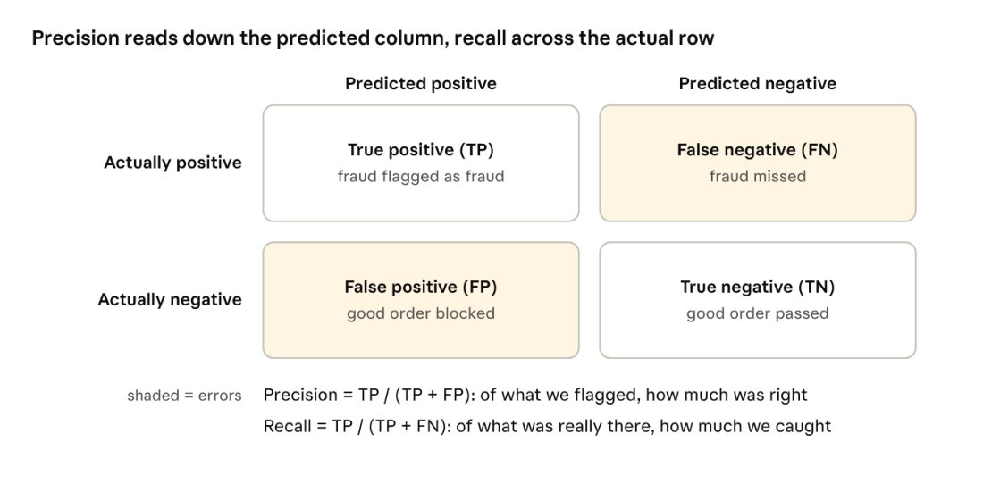

# 4 · Evaluation and metrics

Part I · Foundations. No prerequisites beyond basic probability. Chapters 43 and 44 go deeper on ranking metrics, Chapter 2 on experiments, Chapter 24 on evaluating LLMs.

## Why it matters

A model is only as good as the way you measure it. Most failed ML projects did not fail on modelling: they optimised a metric that did not match the business goal, evaluated on the wrong split, or celebrated a difference that was noise. Choosing and defending metrics is one of the clearest signals of seniority in interviews, and it comes up in every round: ML depth ("why PR-AUC here?"), coding ("implement AUC"), system design ("how do you evaluate it?") and behavioural ("tell me about a model that looked good offline and failed online").

This chapter is the reference for all later chapters: every metric used in the book is defined here once, with code you should be able to write from memory.

## Key concepts

- **Confusion matrix**: counts of true and false positives and negatives at a threshold. [Confusion matrix](https://en.wikipedia.org/wiki/Confusion_matrix).
- **Precision and recall (and F1)**: of what you flagged, how much was right; of what was there, how much you found. [Precision and recall](https://en.wikipedia.org/wiki/Precision_and_recall).
- **ROC curve and AUC; PR curve**: performance across all thresholds; PR curves are more informative when positives are rare. [ROC](https://en.wikipedia.org/wiki/Receiver_operating_characteristic).
- **Calibration**: whether a predicted 0.8 really happens 80% of the time; matters whenever probabilities drive decisions. [scikit-learn: probability calibration](https://scikit-learn.org/stable/modules/calibration.html).
- **Log loss and Brier score**: metrics that reward good probabilities, not just good rankings. [Brier score](https://en.wikipedia.org/wiki/Brier_score).
- **Ranking metrics (NDCG, MAP, MRR, recall@k)**: quality of an ordered list, weighting the top positions most. [Discounted cumulative gain](https://en.wikipedia.org/wiki/Discounted_cumulative_gain).
- **Regression metrics (MAE, RMSE, MAPE, quantile loss)**: which errors you penalise and how. [MAPE](https://en.wikipedia.org/wiki/Mean_absolute_percentage_error).
- **Offline–online gap**: offline metrics predict but do not guarantee online impact; experiments decide (Chapter 2).

## 4.1 The confusion matrix, precision, recall and thresholds

A binary classifier outputs a score; a **threshold** turns it into a decision. Every decision falls into one of four cells.



*confusion matrix · fraud example*

| Metric | Formula | Question it answers |
|---|---|---|
| Precision | TP / (TP + FP) | When the model says yes, how often is it right? |
| Recall (sensitivity, TPR) | TP / (TP + FN) | Of all real positives, how many did we catch? |
| Specificity (TNR) | TN / (TN + FP) | Of all real negatives, how many did we leave alone? |
| False positive rate | FP / (FP + TN) | How often do we wrongly flag a negative? |
| Accuracy | (TP + TN) / all | Share of correct decisions; misleading when classes are imbalanced |
| F1 | 2PR / (P + R) | Harmonic mean of precision and recall; low if either is low |
| Fβ | (1 + β²)PR / (β²P + R) | β > 1 weights recall more, β < 1 weights precision more |

**Accuracy trap.** With 1% fraud, a model that never flags anything is 99% accurate and useless. Use precision, recall and the metrics in 4.2 for imbalanced problems.

**From scratch** (a classic coding-round warm-up):

```python
import numpy as np

def confusion(y_true, y_pred):
    tp = int(np.sum((y_true == 1) & (y_pred == 1)))
    fp = int(np.sum((y_true == 0) & (y_pred == 1)))
    fn = int(np.sum((y_true == 1) & (y_pred == 0)))
    tn = int(np.sum((y_true == 0) & (y_pred == 0)))
    return tp, fp, fn, tn

def precision_recall_f(y_true, y_pred, beta=1.0):
    tp, fp, fn, _ = confusion(y_true, y_pred)
    precision = tp / (tp + fp) if tp + fp else 0.0
    recall = tp / (tp + fn) if tp + fn else 0.0
    b2 = beta ** 2
    f = (1 + b2) * precision * recall / (b2 * precision + recall) if precision + recall else 0.0
    return precision, recall, f
```

**Choosing the threshold is a business decision.** Raising the threshold trades recall for precision. The principled way is to put a cost on each error and pick the threshold that minimises total cost. For promo abuse, a missed abuser might cost €10 in vouchers, while blocking a real customer costs a lost order and goodwill.

```python
def best_threshold_by_cost(y_true, scores, cost_fp, cost_fn):
    best_t, best_cost = None, float("inf")
    for t in np.unique(scores):
        tp, fp, fn, tn = confusion(y_true, (scores >= t).astype(int))
        cost = fp * cost_fp + fn * cost_fn
        if cost < best_cost:
            best_t, best_cost = t, cost
    return best_t, best_cost
```

Other common rules: a fixed precision floor ("at least 90% of flags must be real fraud, maximise recall under that"), a capacity limit ("the review team handles 500 cases a day, so flag the top 500"), or a recall target for safety-critical cases. In interviews, say which rule you would use and why: it shows you connect the model to the operation around it.

## 4.2 Threshold-free metrics: ROC-AUC and PR-AUC

Precision and recall depend on the threshold. To judge the **ranking** of scores itself, sweep every threshold and summarise the curve.

**ROC curve and ROC-AUC.** Plot recall (TPR) against the false positive rate for every threshold. The area under it has a clean meaning: **the probability that a random positive gets a higher score than a random negative.** 0.5 is random, 1.0 is perfect. That meaning gives a one-line implementation through ranks (the Mann-Whitney U statistic):

```python
import pandas as pd

def roc_auc(y_true, scores):
    ranks = pd.Series(scores).rank().to_numpy()          # average ranks handle ties
    n_pos = y_true.sum()
    n_neg = len(y_true) - n_pos
    return (ranks[y_true == 1].sum() - n_pos * (n_pos + 1) / 2) / (n_pos * n_neg)
```

**AUC by counting pairs.** Five items with labels [1, 0, 1, 0, 0] and scores [0.9, 0.8, 0.4, 0.3, 0.1]: there are 2 × 3 = 6 (positive, negative) pairs. The positive scored 0.9 beats all three negatives; the positive scored 0.4 beats two of them (0.3 and 0.1) but not 0.8. Five of six pairs are ordered correctly, so AUC = 0.833. The rank formula above computes the same count without enumerating pairs, in O(n log n).

**PR curve and average precision (PR-AUC).** Plot precision against recall. Average precision summarises it as the mean of the precision at each position where a positive appears in the sorted list:

```python
def average_precision(y_true, scores):
    order = np.argsort(-scores, kind="mergesort")
    y_sorted = y_true[order]
    hits = np.cumsum(y_sorted)
    positions = np.flatnonzero(y_sorted == 1) + 1        # 1-based ranks of the positives
    return (hits[y_sorted == 1] / positions).mean()
```

Both match scikit-learn's `roc_auc_score` and `average_precision_score` on a test set.

**Which one to use.**

|  | ROC-AUC | PR-AUC |
|---|---|---|
| Baseline of a random model | Always 0.5 | The positive rate (0.01 for 1% fraud) |
| Sensitive to | Ranking of positives vs negatives overall | Precision among the top-scored items |
| Under heavy imbalance | Can look excellent (0.95) while precision at useful thresholds is poor, because the huge number of true negatives keeps FPR small | Shows the problem clearly |
| Use when | Classes are roughly balanced, or you care about the whole ranking | Positives are rare and you act on the top of the list (fraud, moderation, rare-event detection) |

The figure shows the difference on a dataset with 0.55% positives. A logistic regression and a random forest have ROC-AUCs of 0.885 and 0.942: both "good". Their average precisions are 0.520 and 0.732, which tells you the forest is far better exactly where a fraud team works: at the top of the list.


*ROC and precision–recall curves for the same two models on the same test set (computed in `tools/figures.py`). The dotted lines are random baselines: the diagonal for ROC, the positive rate (0.0055) for PR.*

AUC is also blind to calibration: multiply all scores by 0.1 and AUC does not change, but any decision based on the probability does. That is why 4.3 exists.

## 4.3 Probabilistic metrics and calibration

When the model's probability is used as a number (multiplied by a value, compared with a bid, turned into an expected cost), it must be **calibrated**: of all cases scored 0.2, about 20% should be positive.

**Log loss (cross-entropy)** punishes confident mistakes heavily:

$$
\mathrm{LogLoss} = -\dfrac{1}{n}\sum_{i=1}^{n}\left[\,y_i\log p_i + (1-y_i)\log(1-p_i)\,\right]
$$

It is the training loss of logistic regression and most classifiers, and a good evaluation metric for probabilities.

**Brier score** is the mean squared error of the probabilities: `mean((p − y)²)`. Less harsh on confident mistakes than log loss; easier to explain.

```python
def log_loss(y_true, p, eps=1e-15):
    p = np.clip(p, eps, 1 - eps)                       # avoid log(0)
    return -np.mean(y_true * np.log(p) + (1 - y_true) * np.log(1 - p))
```

**Reliability diagram and ECE.** Bin predictions (0–0.1, 0.1–0.2, …), and plot each bin's mean prediction against its actual positive rate; a calibrated model sits on the diagonal. The expected calibration error (ECE) is the weighted average gap:

```python
def expected_calibration_error(y_true, p, n_bins=10):
    bins = np.minimum((p * n_bins).astype(int), n_bins - 1)
    ece = 0.0
    for b in range(n_bins):
        mask = bins == b
        if mask.any():
            ece += mask.mean() * abs(p[mask].mean() - y_true[mask].mean())
    return ece
```

**Fixing calibration.** Fit a small mapping from raw score to probability on a held-out set (never the training set):

- **Platt scaling:** a logistic regression on the score. Two parameters, robust with little data.
- **Isotonic regression:** a monotone step function. More flexible; needs more data; can overfit small sets.
- **Temperature scaling:** divide neural network logits by one learned constant. Standard for deep models and LLM classifiers.

```python
from sklearn.linear_model import LogisticRegression
from sklearn.isotonic import IsotonicRegression

platt = LogisticRegression().fit(score_cal.reshape(-1, 1), y_cal)
p_platt = platt.predict_proba(score_test.reshape(-1, 1))[:, 1]

iso = IsotonicRegression(out_of_bounds="clip").fit(score_cal, y_cal)
p_iso = iso.predict(score_test)
```

On a synthetic test with a badly calibrated score, both methods cut ECE from about 0.24 to about 0.02 without changing AUC, because both mappings are monotone.


*An over-confident score (dashed): cases scored 0.6 turn out positive only about 35% of the time. After Platt scaling fitted on a separate half of the data (solid), the points sit on the diagonal; ECE falls from 0.251 to 0.009.*

**Why models are miscalibrated in the first place.** Boosted trees and neural networks are trained to minimise loss, and with enough capacity they push training-set probabilities towards 0 and 1, which makes them over-confident on new data. Resampling and class weights shift the base rate the model believes in. And temperature, label smoothing or a change in the population after training all move probabilities without changing rankings. Calibration is therefore a separate property to check every time probabilities are used as numbers.

**Negative downsampling breaks calibration, predictably.** If you keep only a fraction w of negatives for training (common in ad click prediction), the model over-predicts. Correct with `q = p / (p + (1 − p) / w)` (worked design E.7).

```python
def correct_downsampling(p, w):
    """p: prediction from a model trained with a fraction w of negatives kept."""
    return p / (p + (1 - p) / w)
```

## 4.4 Multi-class and multi-label metrics

With more than two classes (a merchant or dish taxonomy, intent classes), compute precision, recall and F1 per class, then average.

| Averaging | How | Favours | Use when |
|---|---|---|---|
| Micro | Pool all TP, FP, FN across classes, then compute | Frequent classes (equals accuracy for single-label problems) | Overall volume matters most |
| Macro | Compute per class, then plain average | Treats every class equally, so rare classes count | Rare classes matter (long-tail taxonomy nodes) |
| Weighted | Per class, averaged by class frequency | In between | Reporting a balanced single number |

Example: with true labels `[0,0,0,0,0,0,1,1,2,2]` and predictions `[0,0,0,0,0,1,1,0,2,0]`, micro-F1 is 0.70, weighted-F1 0.69 and macro-F1 0.65: the rare classes are handled worse, and only macro shows it.

```python
from sklearn.metrics import f1_score, classification_report, confusion_matrix

f1_score(y_true, y_pred, average="macro")
print(classification_report(y_true, y_pred))   # per-class precision, recall, F1, support
confusion_matrix(y_true, y_pred)               # which classes get confused with which
```

Other tools: **top-k accuracy** (is the true class in the top k predictions? Useful when a human picks from suggestions), **the confusion matrix** read row by row to find systematically confused pairs, and for a hierarchical taxonomy, accuracy at each level (right parent, wrong leaf is a smaller error than wrong parent).

**Multi-label** (one item can have several labels, like dietary tags): compute metrics per label and average (macro or micro), or use example-based measures such as the Jaccard overlap between predicted and true label sets. Thresholds are usually chosen per label.

## 4.5 Regression and forecasting metrics

| Metric | Formula | Properties | Use when |
|---|---|---|---|
| MAE | mean(\|ŷ − y\|) | In the target's units; robust to outliers; optimal prediction is the median | ETA error in minutes; easy to explain |
| RMSE | √mean((ŷ − y)²) | Punishes large errors more; optimal prediction is the mean | Large misses are disproportionately costly |
| MAPE | mean(\|ŷ − y\| / \|y\|) | Scale-free, but explodes near zero and punishes over-forecasts more than under-forecasts | Rarely; only with targets far from zero |
| WAPE | Σ\|ŷ − y\| / Σ\|y\| | Scale-free and stable with small values | Demand forecasting across many items or zones |
| Bias | mean(ŷ − y) | Direction of error | Always report next to an error metric |
| Pinball (quantile) loss | mean(max(q·(y − ŷ), (q − 1)·(y − ŷ))) | Evaluates a quantile forecast | P90 demand for courier staffing, P90 ETA promises |
| R² | 1 − SSE / SST | Share of variance explained | Explanatory analysis; poor for comparing forecasts across datasets |

```python
def regression_metrics(y_true, y_pred):
    err = y_pred - y_true
    return {
        "MAE": np.mean(np.abs(err)),
        "RMSE": np.sqrt(np.mean(err ** 2)),
        "MAPE": np.mean(np.abs(err) / np.abs(y_true)),
        "WAPE": np.sum(np.abs(err)) / np.sum(np.abs(y_true)),
        "bias": np.mean(err),
    }

def pinball_loss(y_true, y_pred, q):
    diff = y_true - y_pred
    return np.mean(np.maximum(q * diff, (q - 1) * diff))

regression_metrics(np.array([10, 12, 0.5, 30]), np.array([11, 10, 2, 28]))
# MAPE ≈ 0.83 because of the single 0.5 target; WAPE ≈ 0.12
```

The example shows why WAPE beats MAPE for demand: one small actual value (a quiet zone at 3 am) dominates MAPE.

**Matching the metric to the loss.** The prediction that minimises MAE is the median; for RMSE it is the mean; for pinball loss at q it is the q-th quantile. Train with the loss whose optimal prediction is what the business needs. For an ETA promise, users hate late orders far more than early ones, so a quantile above 0.5 is often the right target (worked design E.8 and Chapter 45).

## 4.6 Ranking metrics

Ranking metrics evaluate an ordered list per query or user, then average over queries. Chapters 43 and 44 use them heavily and include the code; this is the summary.

| Metric | Definition | Graded relevance? | Use for |
|---|---|---|---|
| Precision@k | Share of the top k that are relevant | No | The visible part of the page |
| Recall@k | Share of all relevant items that appear in the top k | No | Retrieval stages |
| HitRate@k | 1 if any relevant item is in the top k | No | Next-item recommendation |
| MRR | Mean of 1 / rank of the first relevant item | No | One right answer (navigational search, "did we find the restaurant") |
| MAP | Mean over queries of average precision (4.2) | No | Several relevant items, all equally good |
| NDCG@k | DCG with gains 2^rel − 1 and a 1/log₂(rank + 1) discount, divided by the ideal DCG | Yes | Default for graded relevance |

**NDCG by hand.** A query returns four results with graded relevance [3, 2, 0, 1] (3 = perfect). With gains 2^rel − 1 and discount 1/log₂(rank + 1): DCG = 7/1 + 3/1.585 + 0/2 + 1/2.322 = 9.323. The ideal order [3, 2, 1, 0] gives 9.393, so NDCG = 0.993: only the last two items are swapped, and low positions are heavily discounted. Moving the best result from rank 1 to rank 3 instead ([0, 2, 3, 1]) drops NDCG to 0.620. The metric is designed to punish mistakes at the top, where users look.

Two traps from the later chapters worth repeating: compute the ideal DCG from **all** known relevant items, not just the retrieved ones (Chapter 44.9), and do not evaluate against "the true item plus 100 random negatives" (Chapter 43.10). And for per-user ranking of a classifier's scores, **GAUC** (AUC computed per user, then averaged weighted by impressions) is what ad and feed teams often report, because a global AUC mixes up between-user differences with within-user ranking quality.

## 4.7 Offline vs online metrics

**The metric hierarchy.** A well-run ML project has metrics at three levels, and you should be able to name all three for any system you design:

| Level | Example: restaurant feed | Who owns it |
|---|---|---|
| Business (north star) | Orders per active user per week; retention | The product team |
| Online product metric | Feed conversion (sessions with an order from the feed), plus guardrails: delivery time, cancellations, partner concentration | You and the product team, in A/B tests |
| Offline model metric | NDCG@10 on next-day orders; calibration of p(order) | You, every training run |

The offline metric is a **proxy**: cheap, fast and repeatable, but only useful if moving it tends to move the online metric. Check that link explicitly: across past experiments, did offline gains predict online gains? If not, the offline metric or the offline evaluation set needs work.

**Why offline and online disagree:**

- The offline label is not the online goal (clicks vs orders, relevance vs speed).
- The offline candidate set differs from production (availability, filters, re-ranking).
- Leakage or train-serve skew makes offline numbers optimistic.
- Feedback effects: offline logs come from the old model, so they cannot show what users would do with items the old model never showed.
- The online effect is real but small, or offset in another segment.

**Guardrail metrics** are the ones you promise not to hurt: latency, delivery time, cancellations, revenue, complaint rate. A launch needs the primary metric up and no guardrail significantly down. Name guardrails before the experiment, not after.

**Counter-metrics** catch gaming: if you optimise click-through, watch orders per click; if you optimise auto-resolution of support tickets, watch reopen rate. LLM features get their own metric families (faithfulness, judge scores, human preference): Chapter 24.

## 4.8 Slicing

An average hides the segment where the model fails. Always report key metrics by slice: city, platform, new vs returning users, cuisine, language, time of day, high- vs low-value customers, and for text models, input length and language.

```python
def by_slice(df, col, metric, min_rows=200):
    """df has columns y (label) and p (score); metric(df) -> float."""
    rows = []
    for key, g in df.groupby(col):
        if len(g) >= min_rows and g["y"].nunique() == 2:      # skip slices too small to trust
            rows.append({col: key, "n": len(g), "positives": int(g["y"].sum()), "metric": metric(g)})
    return pd.DataFrame(rows).sort_values("metric")         # worst slices first

from sklearn.metrics import roc_auc_score
by_slice(df, "city", lambda g: roc_auc_score(g["y"], g["p"]))
```

**Simpson's paradox** is the reason slicing is not optional: model B can beat model A in every city and still lose overall (or the reverse) if the mix of cities differs between the two evaluation sets. Compare models on the same rows, and look at slices before trusting the total.

**What to do with a bad slice:** first check whether it is real (enough rows, confidence interval from 4.9), then whether it matters (volume, value, fairness or legal risk), then fix it with more data for that slice, slice-specific features, or a separate threshold. Report the slice table in every model review: it is what experienced reviewers look for first.

## 4.9 Confidence intervals on metrics

"Model B has AUC 0.912 vs 0.909" means nothing without an interval. Metrics computed on a finite test set are estimates.

**The bootstrap** works for any metric: resample the test set with replacement many times, recompute the metric each time, and take the 2.5th and 97.5th percentiles. **Resample the right unit:** if one user contributes many rows, rows are not independent, so resample users (or queries, or sessions), not rows. Row-level resampling gives intervals that are too narrow.

```python
def bootstrap_ci(df, metric, n_boot=1000, by="user", seed=0):
    rng = np.random.default_rng(seed)
    groups = df.groupby(by).indices                     # user -> row positions
    keys = np.array(list(groups))
    stats = []
    for _ in range(n_boot):
        sample = rng.choice(keys, size=len(keys), replace=True)
        rows = np.concatenate([groups[k] for k in sample])
        stats.append(metric(df.iloc[rows]))
    return np.percentile(stats, [2.5, 97.5])
```

**Comparing two models: the paired bootstrap.** Two separate intervals that overlap do not prove there is no difference. Instead, evaluate both models on the **same** resampled rows and bootstrap the difference. Because both models see the same hard and easy cases, the difference is far less noisy than either metric alone.

```python
def paired_bootstrap_diff(df, metric_a, metric_b, n_boot=1000, by="user", seed=0):
    rng = np.random.default_rng(seed)
    groups = df.groupby(by).indices
    keys = np.array(list(groups))
    diffs = []
    for _ in range(n_boot):
        rows = np.concatenate([groups[k] for k in rng.choice(keys, size=len(keys), replace=True)])
        s = df.iloc[rows]
        diffs.append(metric_b(s) - metric_a(s))
    return np.mean(diffs), np.percentile(diffs, [2.5, 97.5])   # interval excluding 0 = a real difference
```

**Other tools worth naming in an interview:** McNemar's test for comparing two classifiers' errors on the same examples; DeLong's test for comparing two AUCs analytically; the normal approximation for a proportion, `p ± 1.96√(p(1−p)/n)`, for quick back-of-envelope intervals on precision or accuracy. With many slices or many metrics, expect some false alarms by chance (Chapter 2 covers multiple testing).

## Pitfalls

- **Accuracy on imbalanced data.** Always check the base rate first.
- **ROC-AUC alone for rare events.** It can look excellent while precision at any usable threshold is poor. Report PR-AUC or precision at the operating point.
- **Threshold tuned on the test set.** Then the test set is no longer a test. Tune on validation; report once on test.
- **Calibrating on training data.** The calibrator learns the model's overconfidence on data it memorised. Use a held-out set.
- **Forgetting that downsampling and class weights change probabilities.** Correct them before using the scores as probabilities.
- **MAPE with near-zero targets.** One quiet hour dominates the metric. Use WAPE or MAE.
- **Reporting an error metric without bias.** A forecast can have low MAE and still always under-predict.
- **Micro averages hiding rare classes.** Report macro or per-class metrics for taxonomies.
- **Bootstrap over rows when rows are clustered.** Intervals come out too narrow; resample users, sessions or queries.
- **"The intervals overlap, so no difference".** Use a paired comparison on the same examples.
- **No slice analysis.** The average hides the city, language or user group where the model fails.
- **Offline metric never checked against online outcomes.** You can improve a proxy for months without moving the business.

## Interview questions

Questions 1–5 are basic, 6–11 intermediate, 12–15 senior.

**1. Define precision and recall, and give a case where each matters more.** Precision: of the items flagged, the share that are truly positive. Recall: of the true positives, the share flagged. Precision matters more when false alarms are costly (blocking good customers' orders); recall matters more when misses are costly (food-safety complaints, account takeovers).

**2. Why is accuracy a bad metric for fraud detection?** With 1% fraud, predicting "not fraud" for everything is 99% accurate. Accuracy is dominated by the majority class; precision, recall and PR-AUC focus on the rare class you care about.

**3. What does ROC-AUC measure?** The probability that a randomly chosen positive is scored above a randomly chosen negative. It measures ranking quality across all thresholds and ignores calibration.

**4. MAE or RMSE?** MAE is in the target's units, robust to outliers, and is minimised by the median. RMSE punishes large errors more and is minimised by the mean. Choose by the cost of errors: if one 30-minute ETA miss is much worse than three 10-minute misses, RMSE (or a quantile loss) fits better.

**5. What is F1 and when would you use Fβ instead?** The harmonic mean of precision and recall, high only when both are high. Fβ with β > 1 when recall matters more, β < 1 when precision matters more. Better still: choose the threshold with explicit costs.

**6. ROC-AUC or PR-AUC for a problem with 0.5% positives?** PR-AUC, or precision and recall at the operating point. Under heavy imbalance, the false positive rate stays tiny even with many false positives, so ROC-AUC looks great while precision is poor. The PR-AUC baseline is the positive rate (0.005), which makes progress visible.

**7. What is calibration and when does it matter?** Predicted probabilities match observed frequencies. It matters whenever the probability is used as a number: multiplying p(order) by basket value, comparing p(click) × bid across ads, setting expected-cost thresholds, or combining heads of a multi-task model. Measure with a reliability diagram and ECE; fix with Platt, isotonic or temperature scaling on held-out data.

**8. You trained on 10% of negatives. What happens to the predictions and how do you fix them?** They are inflated, because the model saw positives ten times more often than reality. Correct with q = p / (p + (1 − p) / w) with w = 0.1. Ranking (AUC) is unaffected, because the correction is monotone.

**9. Micro, macro or weighted F1 for a 300-class dish taxonomy?** Macro (and per-class) if the long tail matters, because micro is dominated by the frequent classes. Report micro too as an overall volume view, plus a confusion analysis of the most confused class pairs.

**10. How do you choose a classification threshold?** From the business: minimise expected cost with explicit FP and FN costs; or maximise recall subject to a precision floor; or respect a capacity limit (top N per day for manual review). Tune on validation data, and revisit when base rates change.

**11. Why is MAPE dangerous for demand forecasting?** It divides by the actual value, so small actuals (night hours, small zones) explode the error, and it is undefined at zero. WAPE (total absolute error over total actual) is stable and weights errors by volume.

**12. Model B beats model A by 0.003 AUC. Do you ship it?** Not on that alone. Get a confidence interval on the difference with a paired bootstrap over users. Check slices, calibration and latency cost. Then ask whether offline AUC gains have historically translated into online gains for this system; if yes and the difference is significant, run an A/B test.

**13. Your offline metric improved but the A/B test shows no change. What are possible reasons?** Proxy mismatch (clicks vs orders), offline candidate set different from production, leakage or train-serve skew, feedback-loop bias in offline labels, an effect too small for the test's power, or segments moving in opposite directions. Investigate each with data, not opinions.

**14. How do you build the metric set for a new ML feature?** Start from the business goal (north star), choose an online primary metric that reflects it and is sensitive enough to move in a test, add guardrails and counter-metrics, then pick an offline metric and validate that it predicts the online one. Write them down before building the model.

**15. How would you compute a confidence interval for NDCG@10 on a search test set?** NDCG is computed per query and averaged, so bootstrap over queries (or over users, if one user issues many queries): resample them with replacement, recompute the mean NDCG each time, take percentiles. For comparing two rankers, bootstrap the per-query difference.

## Practice

Every exercise here is also a coding-round drill: do it in plain NumPy and pandas, autocomplete off, with a 20–30 minute timer.

1. **Metrics from scratch.** Implement the confusion matrix, precision, recall, Fβ, ROC-AUC (rank formula), average precision, log loss, ECE, MAE, RMSE, WAPE and pinball loss. Check each against scikit-learn on random data with `np.isclose`.
2. **ROC vs PR under imbalance.** Use the Kaggle credit card fraud dataset (about 0.17% positives). Train a logistic regression and a LightGBM model; plot ROC and PR curves for both. *Good solution:* a short paragraph explaining why ROC-AUC barely separates the models while PR-AUC does.
3. **Threshold by cost.** On the same data, choose a threshold with FN cost = 50 × FP cost, and another with a 90% precision floor. Report recall at each.
4. **Calibration.** Train a random forest (usually poorly calibrated), draw its reliability diagram, then fix it with Platt and isotonic calibration on a held-out split. Report ECE and Brier before and after, and confirm AUC is unchanged.
5. **Bootstrap.** Simulate data where each user has 1–50 rows. Compare 95% intervals for AUC from row-level and user-level bootstraps. *Good solution:* user-level intervals are wider, and you can explain why.
6. **Slicing.** On any dataset with a categorical column, write the slice report from 4.8 and find the worst slice. Decide whether it is real using bootstrap intervals.
7. **Deep-ML and LeetCode.** Deep-ML has problems for precision, recall, F-score, confusion matrices and similar metrics; do five of them as timed warm-ups.

## Read next

- *An Introduction to Statistical Learning* (James, Witten, Hastie, Tibshirani; free PDF): chapter 4 (classification, ROC curves) and chapter 5 (resampling, the bootstrap).
- Saito and Rehmsmeier, *The Precision-Recall Plot Is More Informative than the ROC* *Plot When Evaluating Binary Classifiers on Imbalanced Datasets* (PLOS ONE, 2015).
- Niculescu-Mizil and Caruana, *Predicting Good Probabilities with Supervised Learning* (ICML 2005): which models are miscalibrated and how Platt and isotonic fix them.
- Guo et al., *On Calibration of Modern Neural Networks* (ICML 2017): temperature scaling.
- Hyndman and Athanasopoulos, *Forecasting: Principles and Practice* (free online), chapter on evaluating forecast accuracy.
- Kohavi, Tang and Xu, *Trustworthy Online Controlled Experiments*: chapters on metrics, guardrails and the overall evaluation criterion.
- scikit-learn user guide, "Metrics and scoring" and "Probability calibration" sections: accurate definitions and good examples.

**Links:** [scikit-learn: model evaluation](https://scikit-learn.org/stable/user_guide.html) · [scikit-learn: probability calibration](https://scikit-learn.org/stable/modules/calibration.html) · [Google ML crash course: classification metrics](https://developers.google.com/machine-learning/crash-course). Other titles above can be found by searching their title.

## Done when

You can draw the confusion matrix and define every metric in 4.1 without notes. You can implement ROC-AUC with ranks and average precision in under 10 minutes each. You can explain when to prefer PR-AUC over ROC-AUC, with the reason. You can explain calibration, measure it, fix it, and correct for negative downsampling. You can choose micro, macro or weighted averaging and defend the choice.

You can choose between MAE, RMSE, WAPE and pinball loss for a forecasting problem. You can define a metric hierarchy (business, online, offline, guardrails) for any system.

You can produce a slice report and a user-level bootstrap interval, including a paired comparison of two models.

---

[← 3 · ML fundamentals](03-ml-fundamentals.md) · [Contents](../README.md#contents) · [5 · Neural network fundamentals →](05-neural-network-fundamentals.md)
