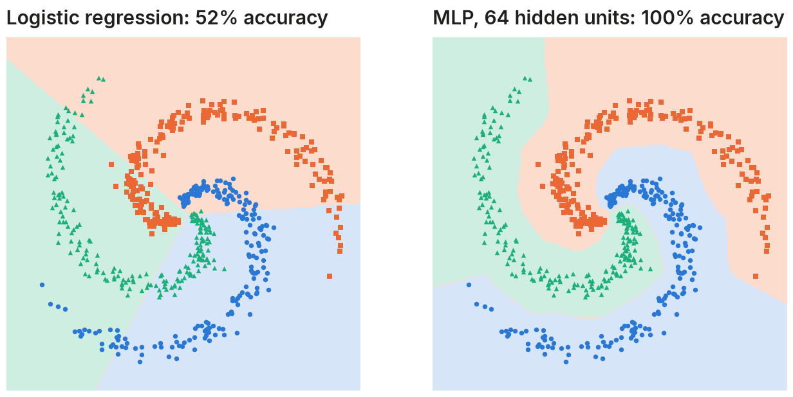
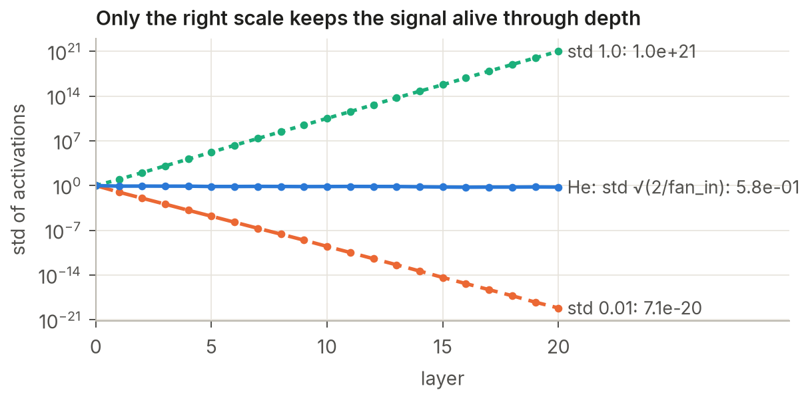

# 5 · Neural network fundamentals

Part II · Deep learning and training dynamics. Assumes Chapter 1 (gradients) and Chapter 3 (losses, optimisers). Chapter 6 moves the same ideas into PyTorch; Chapter 10 builds transformers from them.

## Why it matters

Every deep model, from a two-tower recommender to an LLM, is built from the pieces in this chapter. When training misbehaves (loss stuck, NaNs, overfitting), the fix comes from understanding them: initialisation, normalisation, learning rates, regularisation. Interviewers ask candidates to write backprop for a small network, explain why ReLU replaced sigmoid, or debug a model that will not learn.

The chapter has two halves. The first explains what a neural network is and how it learns: why stacking layers needs a non-linearity (5.1), how backpropagation computes every gradient in one backward sweep (5.2), and which non-linearities are used and why (5.3). The second half is about making learning actually work in deep networks. A signal passing through twenty layers is multiplied twenty times, so small scale errors compound into vanishing or exploding values; initialisation (5.4), normalisation (5.5), and optimiser and precision choices (5.6) all exist to keep those signals in a healthy range. Section 5.7 turns the whole chapter into a debugging procedure, and 5.8 covers residual connections, the single change that made networks hundreds of layers deep trainable and the backbone of every transformer.

Almost nothing here is specific to one architecture. The same ideas, with the same failure modes, reappear in the transformer (Chapter 10) and in the training-stability problems of large models (Chapter 7). A small NumPy network that you can write and gradient-check yourself is the best way to make them concrete, and the chapter builds one.

## Key concepts

- **Multilayer perceptron (MLP)**: stacked linear layers with non-linear activations between them; the building block of every deep model. [Multilayer perceptron](https://en.wikipedia.org/wiki/Multilayer_perceptron).
- **Activation functions (ReLU, GELU, sigmoid, softmax)**: the non-linearities that let networks model curved relationships. [Activation function](https://en.wikipedia.org/wiki/Activation_function).
- **Backpropagation**: the chain rule applied layer by layer to get every weight's gradient. [3Blue1Brown: neural networks](https://www.3blue1brown.com/topics/neural-networks); build it yourself with [Karpathy's micrograd](https://karpathy.ai/zero-to-hero.html).
- **Initialisation (Xavier, He)**: starting weights scaled so signals neither vanish nor explode. [He et al., 2015](https://arxiv.org/abs/1502.01852).
- **Normalisation layers**: batch norm normalises across the batch, layer norm across features of one example. [Batch norm](https://arxiv.org/abs/1502.03167), [Layer norm](https://arxiv.org/abs/1607.06450).
- **Dropout**: randomly zeroing units during training to regularise. [Dropout paper](https://jmlr.org/papers/v15/srivastava14a.html).
- **Optimisers (SGD with momentum, Adam, AdamW)**: rules for turning gradients into weight updates. [Adam](https://arxiv.org/abs/1412.6980).
- **Residual connections**: adding a layer's input to its output so very deep networks still train. [ResNet](https://arxiv.org/abs/1512.03385).
- **Mixed precision**: computing in 16-bit while keeping a 32-bit master copy of the weights (Chapter 6).

## 5.1 From perceptron to MLP

Linear models are fast, interpretable and often good enough, but they can only draw straight boundaries: they cannot represent "high value only when both of these features are high", let alone recognise a face. Neural networks keep the efficiency of linear algebra while lifting that limit. The trick is small, a non-linear function between linear layers, and it is worth seeing exactly why it is necessary and what it buys.

A **perceptron** computes a weighted sum and a threshold: a linear classifier. It cannot learn XOR or any non-linear boundary. Stacking linear layers does not help either: a product of linear maps is still linear. The fix is a **non-linear activation** between layers: a multi-layer perceptron (MLP) with one hidden layer can approximate any continuous function on a bounded domain, given enough units (the universal approximation theorem). Depth makes such approximations far more efficient in practice.

**XOR by hand.** XOR outputs 1 when exactly one input is 1. No single line separates {(0,1), (1,0)} from {(0,0), (1,1)}, but two ReLU units do it. Let h₁ = ReLU(x₁ + x₂) and h₂ = ReLU(x₁ + x₂ − 1), and output h₁ − 2h₂:

| x₁, x₂ | h₁ | h₂ | h₁ − 2h₂ |
|---|---|---|---|
| 0, 0 | 0 | 0 | 0 |
| 0, 1 | 1 | 0 | 1 |
| 1, 0 | 1 | 0 | 1 |
| 1, 1 | 2 | 1 | 0 |

The hidden layer bends the input space: h₂ only switches on in the corner where both inputs are 1, and subtracting it twice undoes h₁ there. Every ReLU network works this way: each unit adds a "hinge" along some direction, and the network builds a piecewise-linear function from many hinges. Training finds the hinges automatically.

On a three-class spiral dataset that no straight line can separate, logistic regression reaches 53% training accuracy; a 64-unit one-hidden-layer MLP written from scratch below reaches 99%.



*Decision regions on the spiral data (a fresh sample, trained with PyTorch in `tools/figures.py`). The linear model can only cut the plane with straight lines; the MLP's 64 hinges follow the spirals.*

**Why depth, not just width.** One hidden layer can approximate any function in principle, but it may need exponentially many units. Each extra layer can reuse and combine the features of the one before (edges into shapes into objects; characters into words into phrases), so deep networks represent the same functions with far fewer parameters, and they learn more general features. The price is that depth makes optimisation harder, which is what the rest of this chapter (initialisation, normalisation, residual connections) is about.

## 5.2 Backpropagation by hand

A network with millions of weights needs the gradient of the loss with respect to every one of them at every training step. Computing each by perturbing it (a numerical derivative) would take one forward pass per weight, which is hopeless. Backpropagation computes all of them in a single backward pass, at roughly twice the cost of one forward pass, by applying the chain rule from the loss towards the input and reusing each intermediate result. It is the reason deep learning is computationally possible at all.

For a two-layer network with input x, the forward pass is

$$
h = \mathrm{ReLU}(W_1 x + b_1),\qquad p = \mathrm{softmax}(W_2 h + b_2),\qquad L = -\log p_y
$$

and the backward pass walks the same steps in reverse, turning "how should the output change" into "how should each weight change".


*Forward and backward pass of a two-layer network*

Backprop is the chain rule applied layer by layer from the loss backwards, reusing each intermediate gradient. For softmax with cross-entropy, the gradient with respect to the logits simplifies to (p − y)/n, which is why this pair is used together.

### The softmax–cross-entropy gradient, derived

This is the most-asked derivation in the chapter, and it takes four lines. For one example with logits z, probabilities pᵢ = e^{zᵢ}/Σₖ e^{zₖ} and a one-hot label y, the loss is L = −Σᵢ yᵢ log pᵢ. First, the softmax Jacobian. Differentiating pᵢ with respect to zⱼ with the quotient rule gives pᵢ(1 − pᵢ) when i = j and −pᵢpⱼ when i ≠ j, which is written compactly with the Kronecker delta δᵢⱼ (1 if i = j, else 0):

$$
\frac{\partial p_i}{\partial z_j} = p_i\,(\delta_{ij} - p_j)
$$

Second, the chain rule through the log. Since ∂(−log pᵢ)/∂pᵢ = −1/pᵢ, the pᵢ cancels:

$$
\frac{\partial L}{\partial z_j} = -\sum_i \frac{y_i}{p_i}\,p_i\,(\delta_{ij} - p_j) = -y_j + p_j \sum_i y_i = p_j - y_j
$$

The last step uses Σᵢ yᵢ = 1. The gradient is "prediction minus target", and averaging the loss over a batch of n divides it by n. A three-class check: logits z = [2, 1, 0] with true class 0 give p = [0.665, 0.245, 0.090], so the gradient is [−0.335, 0.245, 0.090]. Central differences on the loss give the same three numbers to six decimals (`code/ch05_check.py`). The gradient is bounded between −1 and 1 in every coordinate whatever the logits, which is part of why this pairing trains stably; a sigmoid or softmax followed by squared error instead multiplies in the softmax Jacobian, which goes to zero when the output saturates, so a confidently wrong network learns slowly.

```python
import numpy as np

class MLP:
    def __init__(self, d_in, d_hidden, d_out, seed=0):
        rng = np.random.default_rng(seed)
        self.W1 = rng.normal(0, np.sqrt(2 / d_in), (d_in, d_hidden)); self.b1 = np.zeros(d_hidden)   # He init
        self.W2 = rng.normal(0, np.sqrt(2 / d_hidden), (d_hidden, d_out)); self.b2 = np.zeros(d_out)

    def forward(self, X):
        self.X = X
        self.z1 = X @ self.W1 + self.b1
        self.h = np.maximum(0, self.z1)                                   # ReLU
        logits = self.h @ self.W2 + self.b2
        logits -= logits.max(1, keepdims=True)                            # stable softmax
        self.p = np.exp(logits) / np.exp(logits).sum(1, keepdims=True)
        return self.p
    def loss(self, y):
        return -np.mean(np.log(self.p[np.arange(len(y)), y] + 1e-12))

    def backward(self, y):
        n = len(y)
        d = self.p.copy(); d[np.arange(n), y] -= 1; d /= n                # softmax + cross-entropy
        self.dW2, self.db2 = self.h.T @ d, d.sum(0)
        dh = d @ self.W2.T
        dz1 = dh * (self.z1 > 0)                                          # ReLU passes gradient where z > 0
        self.dW1, self.db1 = self.X.T @ dz1, dz1.sum(0)

    def step(self, lr):
        for p, g in [(self.W1, self.dW1), (self.b1, self.db1), (self.W2, self.dW2), (self.b2, self.db2)]:
            p -= lr * g
```

**Reading the backward pass.** Follow `backward` line by line and it is the chain rule from Chapter 1 with matrices. The error at the output, d = p − y, says how much each logit should move. The gradient of W₂ is hᵀd: each weight's gradient is the product of the activation feeding it and the error it contributes to. The error is sent back through the same weights (d W₂ᵀ) and gated by the ReLU's derivative, which is 1 where the unit was active and 0 where it was not. An inactive unit passes no gradient: the source of "dead" ReLUs when a unit is inactive for every input.

**Vanishing gradients, in numbers.** Each layer multiplies the backward signal by its weights and by its activation's derivative. The sigmoid's derivative is at most 0.25, so ten sigmoid layers can shrink the gradient by 0.25¹⁰ ≈ 10⁻⁶ before it reaches the first layer, which therefore barely learns. ReLU's derivative is exactly 1 where active, which is a large part of why it replaced sigmoids in hidden layers; good initialisation (5.4) and residual connections (5.8) handle the rest.

Training for 3,000 full-batch steps on the spiral data drives the loss to 0.03. A central-difference check on a weight agrees with the analytic gradient to 1e-6 (Chapter 1.5). Writing this class from memory, with shapes right, is a classic interview exercise.

**Why backprop runs backwards, and what it costs in memory.** The chain rule can be evaluated in either direction. *Forward-mode* differentiation pushes the derivative with respect to one input through the network alongside the forward pass, so it needs one pass per input, which for millions of parameters is hopeless. *Reverse-mode* (backpropagation) starts from the single scalar loss and pulls the derivative back, getting the gradient with respect to *every* parameter in one backward pass of about twice the cost of the forward pass. The price is memory. The backward pass of each layer needs that layer's inputs (here X, z₁ and h), so every activation from the forward pass must be kept until the backward pass reaches it. Activation memory grows with depth × batch size × width (and sequence length in transformers), and for large models it, not the weights, is what fills the GPU. Activation checkpointing (Chapter 6) trades this back: store only some activations and recompute the rest during the backward pass, roughly one extra forward pass of compute for a large memory saving.

## 5.3 Activations

The activation function is the only non-linear part of an MLP, and its shape affects how well gradients flow. Three properties matter. Does it **saturate**, flattening out so that its derivative approaches zero for large inputs? Saturating functions (sigmoid, tanh) shrink the gradient at every layer, which is the vanishing-gradient problem of 5.2. Is it **zero-centred**? Outputs that are always positive push all the next layer's gradients in the same direction, which slows learning. And is it **smooth**? ReLU's sharp corner at zero works well in practice, but smooth variants such as GELU and SiLU give slightly better results in large transformers, which is why they replaced ReLU there.

Output layers are a separate question: their activation is chosen to produce the right kind of output (sigmoid for one probability, softmax for a distribution over classes, nothing for a regression), and it is paired with the matching loss so that the gradient simplifies to prediction minus target.

| Activation | Formula | Notes |
|---|---|---|
| Sigmoid | 1/(1 + e^−x) | Output layer for binary probabilities; saturates, so gradients vanish in deep hidden layers |
| Tanh | (e^x − e^−x)/(e^x + e^−x) | Zero-centred sigmoid; still saturates; used in RNN gates |
| ReLU | max(0, x) | Cheap, no saturation for x > 0; units can "die" (stuck at 0) |
| Leaky ReLU | max(αx, x) | Avoids dead units |
| GELU | x·Φ(x) | Smooth ReLU; standard in BERT and GPT-2/3; current LLMs use gated SwiGLU (next row) |
| SiLU / Swish | x·σ(x) | Used inside SwiGLU in modern LLMs (Chapter 10.6) |
| Softmax | e^zᵢ/Σe^zⱼ | Output layer for multi-class distributions |

In the table, σ is the sigmoid, Φ(x) is the standard normal cumulative distribution function (the probability that a standard normal variable is below x), and α in Leaky ReLU is a small fixed slope, typically 0.01, for negative inputs.

**Why zero-centring matters.** For a unit with weights w and inputs h from the previous layer, the gradient of the loss with respect to weight wᵢ is δ·hᵢ, where δ is the error signal arriving at the unit. If every hᵢ is positive (as after a sigmoid, whose outputs lie in (0, 1)), all the weight gradients of that unit share the sign of δ: in one step they can all increase or all decrease, but not some of each. Reaching a target that needs some weights up and others down then takes a zig-zag of steps. Zero-centred activations (tanh) and normalisation layers (5.5) remove the constraint. ReLU outputs are also non-negative, which is one reason normalisation became standard alongside it.

**Dead ReLUs.** A ReLU unit whose pre-activation is negative for every input outputs zero and passes no gradient (5.2), so nothing can revive it. A large learning rate is the usual cause: one big update pushes the bias far negative. On the spiral data in `code/ch05_check.py`, the 64-unit MLP trained for 1,000 steps keeps every unit alive at learning rates up to 1, loses about 2% of units at 3, and at 10 loses all of them: accuracy falls to 33%, chance for three classes. Leaky ReLU, GELU and SiLU have nonzero gradient for negative inputs, so units cannot die completely.

**SwiGLU.** Modern LLM feed-forward blocks replace "linear, activation, linear" with a gated version. With input x, three weight matrices W, V and W₂, and ⊙ for element-wise multiplication,

$$
\mathrm{SwiGLU}(x) = \left(\mathrm{SiLU}(xW) \odot xV\right) W_2
$$

One branch, passed through SiLU, acts as a smooth gate on the other, linear branch, so the block can multiply features rather than only add them. It has three matrices instead of two, so implementations shrink the hidden width (to about 8/3 of the model width instead of 4×) to keep the parameter count equal. Chapter 10.6 covers it in the transformer.

## 5.4 Initialisation

Training starts from random weights, and the scale of that randomness matters more than it seems. In a deep network the forward signal, and the backward gradient, are multiplied by a weight matrix at every layer. If each layer slightly shrinks the signal, it is gone after twenty layers; if each slightly amplifies it, it overflows. Good initialisation chooses the scale that keeps the signal's size constant from layer to layer, so that training can begin at all.

Weights must start small enough not to explode activations and large enough not to vanish them, layer after layer. A test pushing random data through 20 ReLU layers of width 256 (the run in the figure): with weights of standard deviation 0.01 the output's spread collapsed to about 7 × 10⁻²⁰; with standard deviation 1 it exploded to about 10²¹; with **He initialisation** (std = √(2/fan_in)) it stayed near 0.6. (`code/ch05_check.py` repeats the experiment with a different random draw and gets the same orders of magnitude: 9 × 10⁻²⁰, 7 × 10²⁰ and 0.73. Only the order of magnitude is meaningful for the two failures.)



*Standard deviation of activations through 20 ReLU layers of width 256. Too small (0.01): the signal shrinks by roughly 10× per layer to 7 × 10⁻²⁰. Too large (1.0): it explodes to 10²¹. He initialisation holds it near 0.6.*

**The derivation.** A unit sums fan_in inputs, each multiplied by a weight. If inputs and weights are independent with zero mean, the variance of the sum is fan_in × Var(w) × E[x²]. To keep the scale constant from layer to layer, set Var(w) = 1/fan_in (LeCun). A ReLU zeroes half of its inputs, halving the second moment, so it needs twice as much: Var(w) = 2/fan_in (He). Anything else multiplies the scale by a constant factor per layer, and a constant factor raised to the 20th power is a disaster, as the figure shows: with std 0.01 and width 256, each layer multiplies the second moment by 256 × 0.0001 / 2 = 0.0128, about 0.11 in standard deviation, which over 20 layers is 10⁻¹⁹ to 10⁻²⁰.

**Where fan_out comes in: Xavier.** The same argument applies to the backward pass. The gradient arriving at a layer's input is the sum, over the fan_out units it feeds, of each unit's error times its weight, so its variance is fan_out × Var(w) × (the variance of the errors). Keeping gradient scale constant backwards therefore needs Var(w) = 1/fan_out. When fan_in ≠ fan_out, both conditions cannot hold, and Glorot and Bengio (2010) took a compromise, the harmonic mean of the two conditions 1/fan_in and 1/fan_out:

$$
\mathrm{Var}(w) = \frac{2}{\mathrm{fan}_{\mathrm{in}} + \mathrm{fan}_{\mathrm{out}}}
$$

For a square layer this equals 1/fan_in, the LeCun value. It was derived for tanh-like activations, which behave linearly near zero. For ReLU, He initialisation doubles the variance to account for the zeroed half, and keeps only the forward condition, 2/fan_in, as its default; He et al. showed that for ReLU networks satisfying either condition alone is enough to avoid exponential vanishing or explosion.

- **Xavier/Glorot** (std ≈ √(2/(fan_in + fan_out))) for tanh and sigmoid.
- **He/Kaiming** (std = √(2/fan_in)) for ReLU-family activations.
- Biases at zero; for transformers, small scaled initialisation of residual projections helps deep stacks. GPT-2's rule: initialise weights with standard deviation 0.02, and scale the output projection of every residual block by 1/√(2L) for L layers (two residual additions per layer, attention and MLP), so that the residual stream's variance stays bounded as depth grows. Section 5.8 shows why the scaling is needed, and Chapter 7.5 covers µP, which extends these rules to make hyperparameters transfer across widths.

## 5.5 Normalisation, dropout and other regularisers

Initialisation sets a healthy scale at step zero, but training moves the weights, and the distribution of each layer's inputs drifts with them. Normalisation layers re-standardise activations inside the network at every step, so each layer sees inputs of a stable scale whatever the layers before it have learned. In practice this allows larger learning rates and makes deep networks much less sensitive to initialisation. Dropout, covered in the same section, solves a different problem: overfitting in networks large enough to memorise their training data.

**Batch normalisation** normalises each feature over the batch, then scales and shifts with learned parameters; at inference it uses running averages. It speeds and stabilises training of CNNs and MLPs but depends on batch statistics. **Layer normalisation** normalises each example over its features, independent of batch size and sequence length: the choice for transformers (with RMSNorm as a cheaper variant, Chapter 10.5).

```python
def batchnorm(x, gamma, beta, eps=1e-5):          # x: (batch, features)
    return gamma * (x - x.mean(0)) / np.sqrt(x.var(0) + eps) + beta

def layernorm(x, gamma, beta, eps=1e-5):
    mu, var = x.mean(1, keepdims=True), x.var(1, keepdims=True)
    return gamma * (x - mu) / np.sqrt(var + eps) + beta

def dropout(h, p, train=True, rng=np.random.default_rng()):
    if not train or p == 0:
        return h
    return h * (rng.random(h.shape) > p) / (1 - p)  # inverted dropout: scale at train time, identity at test
```

**Which axis gets normalised.** For a batch of activations shaped (batch, features), batch norm computes one mean and variance per *feature*, across the examples in the batch; layer norm computes one mean and variance per *example*, across its features. Batch norm therefore couples examples (an example's output depends on what else is in the batch, and inference must use stored running averages), while layer norm treats each example independently. That independence is why layer norm suits variable-length sequences and small or single-example batches, which is the normal situation when generating text.

**Dropout** randomly zeroes activations during training, discouraging co-adaptation; inverted dropout rescales by 1/(1 − p) so nothing changes at inference. One way to see why it regularises: each training step uses a different random sub-network, all sharing weights, so the final network behaves like an average of exponentially many thinned networks, and no unit can rely on a specific partner being present. Other regularisers: weight decay (AdamW), early stopping, data augmentation, label smoothing.

**Why scale by 1/(1 − p).** With dropout rate p, each unit h is kept with probability 1 − p, so the kept-or-zeroed value has expectation (1 − p)h. Dividing by (1 − p) during training restores E[output] = h exactly, so the next layer sees inputs of the same average size in training and at test time, when every unit is used unscaled. With p = 0.3, a unit of value 1 becomes 0 with probability 0.3 and 1/0.7 = 1.43 otherwise: average 1.0 (the check script's mean over 10,000 units is 0.993). The variance is not preserved, which is one reason dropout and batch norm interact badly when combined: batch norm's running statistics are collected under dropout's extra variance and then used without it.

**Batch norm's train–eval gap.** In training, batch norm normalises with the current batch's mean and variance; at evaluation it uses running averages collected during training. If the two differ, the model behaves differently at test time. They differ when batches are small (the batch statistics are noisy: with 4 examples per batch, the batch mean of each feature has a standard error of half its standard deviation), when batches are not representative (sorted data, or a batch padded with dummy tokens that enter the statistics), and when the data distribution shifts after training. That is why batch norm is avoided for small-batch training and for sequence models, and why forgetting `model.eval()` changes results.

**Why does batch norm work?** The original paper's explanation was that it reduces "internal covariate shift", the drift of each layer's input distribution as earlier layers change. Santurkar et al. (2018) challenged that: they injected noise after batch norm to *increase* the distribution shift and saw training stay fast, and they measured that batch norm makes the loss surface smoother (gradients change less from step to step, more predictable over a step), which permits larger learning rates. Interviewers like this follow-up because the accepted story changed; a safe answer is that normalisation makes optimisation better conditioned and less sensitive to the scale of the weights, whatever the precise mechanism.

**Where the norm sits, and what LLMs use.** In a residual network the normalisation can go after the residual addition (**post-norm**, the original transformer) or at the input of each block, leaving the residual path untouched (**pre-norm**, GPT-2 onwards and nearly every LLM since). Pre-norm trains stably at depth without long warm-ups; Chapter 10.5 explains why. Modern LLMs use RMSNorm, which skips the mean subtraction. They also use little or no dropout in pretraining: with a single pass over trillions of tokens the model never sees an example twice, so there is little overfitting to prevent, and dropout would only slow learning. Dropout returns in fine-tuning on small datasets, and in other architectures trained for many epochs.

## 5.6 Optimisers, schedules and mixed precision

With the network itself in good shape, the remaining choices are about the training run: which update rule, how the learning rate changes over time, how large the batches are, and in what number format the arithmetic is done. These choices are less glamorous than architecture, but in practice they decide whether a run converges, how fast, and how much memory it needs. The defaults below are what most modern training uses; Chapter 7 explains the reasons behind them in depth.

**Why warm-up and decay.** At the start of training the weights are random and gradients can be large and erratic; Adam's running averages are also estimated from very few steps. A large learning rate at that point can throw the model into a region it never recovers from, so the rate is ramped up over the first steps. Later, a high rate keeps the weights bouncing around the bottom of the loss valley; decaying it lets them settle, which is why the loss often drops sharply at the end of a schedule (Chapter 7.2).

**Why lower precision works.** Neural network training tolerates rounding error far better than most numerical computing, because the gradient is already a noisy estimate. The danger is not precision but *range*: very small gradients rounding to zero, or large activations overflowing. bf16 keeps fp32's range with fewer digits of precision, which is the right trade.

**Optimisers.** SGD with momentum still generalises well for vision; Adam/AdamW is the default for transformers and most deep learning (Chapter 3.5 has both from scratch, and Chapter 7.1 explains why AdamW won). **Learning-rate schedules**: linear warm-up for the first few hundred or thousand steps, then cosine or linear decay, or a warm-up–stable–decay schedule (Chapter 7.2). The learning rate is the first hyperparameter to tune, and a learning-rate range test (increase it exponentially over a few hundred steps and watch where the loss starts to rise) finds a sensible range quickly.

**Gradient clipping** rescales the whole gradient when its global norm exceeds a threshold (often 1.0), so one rare, huge gradient (a bad batch, a spike in attention logits) cannot throw the weights far away. It matters most for RNNs and transformers, and a clipping rate that climbs during training is an early warning of instability (Chapter 7.7).

**Batch size.** Larger batches give less noisy gradients and better hardware utilisation, but beyond a point (the critical batch size, Chapter 7.3) they stop reducing the number of steps needed. When you change the batch size, change the learning rate with it: roughly in proportion for SGD (the linear scaling rule, with warm-up), closer to the square root for Adam, and re-tune if the change is more than about 2×. Gradient accumulation simulates a large batch on small GPUs by summing gradients over several micro-batches before each step (Chapter 6.8).

**Mixed precision.** Compute in bf16 (or fp16 with loss scaling) while keeping master weights in fp32. The formats differ in how they split 16 bits:

| Format | Sign / exponent / mantissa bits | Largest value | Relative precision (machine epsilon) | Smallest normal value |
|---|---|---|---|---|
| fp32 | 1 / 8 / 23 | 3.4 × 10³⁸ | 1.2 × 10⁻⁷ | 1.2 × 10⁻³⁸ |
| fp16 | 1 / 5 / 10 | 65,504 | 9.8 × 10⁻⁴ | 6.1 × 10⁻⁵ |
| bf16 | 1 / 8 / 7 | 3.4 × 10³⁸ | 7.8 × 10⁻³ | 1.2 × 10⁻³⁸ |

bf16 keeps fp32's 8 exponent bits, so it has the same range: activations of 70,000 or gradients of 10⁻⁸, which overflow to infinity or underflow to zero in fp16, are representable. It pays with only 7 mantissa bits, about two to three significant decimal digits, which is why master weights and optimiser states stay in fp32: an update of 1/300 of a weight's size is lost entirely in bf16 (1 + 1/300 rounds to 1). fp16 is still fine for inference and for training small models with dynamic loss scaling, which multiplies the loss so that small gradients stay above fp16's underflow threshold. Mixed precision roughly halves activation memory and speeds up matrix multiplications several-fold on GPUs with tensor cores (Chapter 7.6 covers fp8).

## 5.7 Debugging a model that won't learn

Neural network bugs rarely crash: a model with mislabelled data, a missing gradient step or a learning rate a hundred times too large still runs, it just learns badly or not at all. With no error message to follow, the fastest route is a fixed sequence of checks that each rule out one class of bug, from the cheapest to the most expensive.

A checklist in the order that finds most bugs fastest:

1. **Look at the data:** a few inputs and labels, after preprocessing. Are labels aligned with inputs? Are classes as expected?
2. **Check the initial loss:** for k balanced classes it should be about ln(k). Far off means a bug in the output layer or labels.
3. **Overfit one small batch:** a working model and training loop drive training loss near zero on 10–50 examples. If not, the bug is in the model, loss or optimiser, not in the data size.
4. **Check gradients flow:** non-zero gradients in every layer, no accidental `detach`, `requires_grad` set, `optimizer.zero_grad()` called each step.
5. **Learning rate:** too high gives divergence or NaNs; too low gives a flat loss. Try a range test.
6. **Train/eval mode:** dropout and batch norm behave differently; forgetting `model.eval()` makes validation noisy.
7. **NaNs:** log or division by zero, fp16 overflow, exploding gradients (clip), bad input values.
8. **Then** regularisation and capacity: only after the model can fit the training data.

## 5.8 Residual connections

Sections 5.4 and 5.5 keep signals at a healthy scale, but they do not remove the deeper problem: the gradient reaching the first layer of a deep network is a product of one factor per layer, and a product of many factors drifts towards zero or infinity unless every factor is very close to 1. Before 2015, networks deeper than about twenty layers trained *worse* than shallower ones, even on training data, which is an optimisation failure, not overfitting. Residual connections (He et al., 2015) fixed this with one addition, and every transformer is built on them.

### The idea: learn a correction, not a transformation

A residual block computes its input plus a learned function of it:

$$
x_{l+1} = x_l + F(x_l)
$$

Here x_l is the input to block l, and F is the block's layers (in a ResNet, two convolutions; in a transformer, an attention or MLP sublayer). Intuitively, each block only has to learn how to *change* the representation, and doing nothing is easy: F = 0 makes the block the identity. A deep residual network therefore starts out close to a shallow one, and depth can only help if the optimiser finds it useful.

### The gradient highway

Differentiate the block. With I the identity matrix and ∂F/∂x the Jacobian of the block's layers,

$$
\frac{\partial x_{l+1}}{\partial x_l} = I + \frac{\partial F}{\partial x_l}
$$

Through L blocks, the gradient is multiplied by the product of these factors. Expanding the product, one of its terms is I × I × … × I = I: the gradient from the loss reaches every layer *directly*, whatever the blocks do, plus the contributions of every path through some subset of blocks. A plain network has only the one path through all of them.

A scalar example shows the difference. Suppose each layer's own derivative is a = 0.5. A plain 20-layer network multiplies the gradient by 0.5²⁰ = 9.5 × 10⁻⁷: it has vanished. With residual connections each factor is 1 + a = 1.5, and 1.5²⁰ = 3,325: the gradient no longer vanishes, but now it explodes. The highway alone is not enough; the branches must be *small*. If each a is of order 1/L, the product stays bounded: (1 + 1/40)²⁰ = 1.64. That is the reason for the GPT-2 initialisation rule (5.4): scaling each block's output projection by 1/√(2L) makes every branch's contribution small enough that the sum over depth stays of order one. Other recipes initialise the last layer of each block to zero (in ResNets, the scale of the last batch norm, Goyal et al., 2017), so every block starts as the exact identity.

The NumPy experiment in `code/ch05_check.py` makes this concrete for 20 ReLU layers of width 256, measuring the gradient norm at the input relative to the output:

| Network | Weight scale | Gradient ratio (input/output) | Output standard deviation |
|---|---|---|---|
| Plain | He | 1.15 | 1.12 |
| Plain | ½ × He | 1.1 × 10⁻⁶ | 1.1 × 10⁻⁶ |
| Residual, unscaled branches | ½ × He | 19 | 77 |
| Residual, unscaled branches | He | 3,640 | 16,700 |
| Residual, branches scaled by 1/√(2L) | He | 1.31 | 1.47 |

The plain network works only at exactly the right initialisation; halve the weights' standard deviation and the gradient vanishes by six orders of magnitude. The residual network never vanishes, but with full-size branches its forward signal and gradient grow with depth, because every block adds variance to the running sum. Scaling the branches restores a healthy ratio. In real transformers, pre-norm (5.5 and Chapter 10.5) does the same job differently: each block sees a normalised input, so its output has a controlled scale however large the residual stream has grown.

### Consequences

Residual connections are why depth stopped being an obstacle: ResNets trained at 152 layers, and LLMs stack 30 to over 100 transformer blocks. They also change how to think about a deep network. Veit et al. (2016) showed that deleting a single block from a trained ResNet barely hurts it, while deleting a layer from a plain network destroys it: a residual network behaves like an ensemble of many paths of different lengths, mostly short ones. And in a transformer the running sum x_l, the **residual stream**, is the shared channel through which every attention head and MLP reads and writes information, which is the starting point of mechanistic interpretability (Chapter 26).

## Pitfalls

- **Sigmoid or tanh in deep hidden layers** (vanishing gradients).
- **Default or arbitrary initialisation scales** in custom layers.
- **Batch norm with tiny batches,** or in sequence models.
- **Forgetting** `model.eval()` or applying dropout at inference.
- **No warm-up** for transformers; no gradient clipping.
- **Tuning regularisation before the model can overfit** a small batch.
- **Comparing runs with different seeds and concluding from one run.**
- **Residual branches at full scale in a deep stack.** The residual stream grows with depth; scale or zero-initialise the branch outputs, or use pre-norm.
- **Softmax followed by squared error, or log of a softmax computed separately.** Use the fused cross-entropy on logits.
- **Keeping master weights in bf16.** Small updates round away; keep them in fp32.

## Interview questions

**1. [B] Why do we need non-linear activations?** Without them, any stack of layers is a single linear function: W₂(W₁x + b₁) + b₂ = (W₂W₁)x + (W₂b₁ + b₂), one matrix and one bias, so depth buys nothing and the model can only draw straight decision boundaries. With a non-linearity between layers, a one-hidden-layer network can approximate any continuous function on a bounded domain given enough units, and XOR needs only two ReLU units (5.1). Follow-up: "then why go deep?" Depth composes features, representing many functions with exponentially fewer units than one wide layer would need.

**2. [B] Why did ReLU replace sigmoid in hidden layers?** Sigmoid saturates and its gradient is at most 0.25, so gradients vanish through many layers; ReLU has gradient 1 for positive inputs and is cheap. The number: ten sigmoid layers can shrink a gradient by 0.25¹⁰ ≈ 10⁻⁶. ReLU's weakness is dead units: a unit whose input is negative for every example passes no gradient and never recovers, typically after a too-large learning rate (on the chapter's spiral MLP, all units die at learning rate 10). Leaky ReLU fixes that; GELU and SiLU are smooth variants that give slightly better results in transformers, and modern LLMs use the gated SwiGLU. Follow-up: "where is sigmoid still used?" Output layers for binary probabilities and gates (LSTMs, SwiGLU's SiLU).

**3. [I] Derive the gradient of softmax with cross-entropy with respect to the logits.** p − y (divided by n for a batch mean): the softmax Jacobian and the log combine into this simple form. Explicitly: ∂pᵢ/∂zⱼ = pᵢ(δᵢⱼ − pⱼ); then ∂L/∂zⱼ = −Σᵢ (yᵢ/pᵢ)·pᵢ(δᵢⱼ − pⱼ) = −yⱼ + pⱼΣᵢyᵢ = pⱼ − yⱼ, using Σyᵢ = 1. Check with logits [2, 1, 0] and true class 0: p = [0.665, 0.245, 0.090], gradient [−0.335, 0.245, 0.090]. The gradient is bounded in [−1, 1] and never saturates, unlike softmax with squared error. Follow-up: "how do you compute it stably?" Subtract the max logit before exponentiating, and compute log-softmax directly.

**4. [I] What problem do Xavier and He initialisation solve?** Keeping activation and gradient variance roughly constant across layers so signals neither vanish nor explode; He accounts for ReLU zeroing half the inputs. Derivation: a unit's pre-activation variance is fan_in × Var(w) × E[x²], so the forward pass needs Var(w) = 1/fan_in; the backward pass gives the same with fan_out; Xavier compromises with 2/(fan_in + fan_out), and He uses 2/fan_in for ReLU. The number: with std 0.01 at width 256, each ReLU layer multiplies the signal's scale by about 0.11, so 20 layers leave 10⁻¹⁹ to 10⁻²⁰. Follow-up: "what about residual networks?" Scale each block's output projection by 1/√(2L), as GPT-2 does, or zero-initialise it.

**5. [I] Batch norm vs layer norm, and why transformers use layer norm.** Batch norm normalises across the batch per feature; layer norm across features per example. Layer norm does not depend on batch size or sequence length and behaves the same in training and inference. Batch norm uses batch statistics in training and running averages at evaluation, so small batches (with 4 examples the batch mean has half a standard deviation of noise), padding tokens counted in the statistics and distribution shift all create a train–eval gap; autoregressive generation, one token at a time, has no meaningful batch at all. Most LLMs use RMSNorm, which drops the mean subtraction and the bias and is cheaper with no loss of quality. Follow-up: "why does BN help at all?" Its smoothing of the loss landscape allows larger learning rates; the original "internal covariate shift" explanation was challenged by Santurkar et al. (2018).

**6. [I] How does dropout work at train and test time?** Train: zero each unit with probability p and scale the rest by 1/(1 − p). Test: use all units unchanged. Why the scaling: a kept-or-dropped unit has expectation (1 − p)h, so dividing by (1 − p) makes the expected training activation equal h, matching test time; with p = 0.3 a kept unit becomes 1.43h. It regularises by training an implicit ensemble of thinned networks that share weights. When not to use it: LLM pretraining mostly uses none, because a single pass over the data gives little to overfit; and it interacts badly with batch norm, whose statistics are collected under dropout's extra variance. Follow-up: "Monte Carlo dropout?" Keep dropout on at test time and average several passes for an uncertainty estimate.

**7. [I] Why use learning-rate warm-up?** Early gradients and Adam's moment estimates are unreliable; large early steps can push training into bad regions. Warm-up ramps the rate up gently. The sharp version: Adam's first update moves every coordinate by about the learning rate whatever its gradient, because the second-moment estimate comes from a single gradient, so at step one the update is large in every direction at once. Warm-up over a few hundred to a few thousand steps (often about 1% of training) lets the estimates settle. Follow-up: "does post-norm need more warm-up than pre-norm?" Yes, its gradients at initialisation are poorly scaled across layers (Chapter 10.5).

**8. [S] Your network's training loss does not decrease. Walk through debugging.** Check data and labels; initial loss vs ln(k); overfit one batch; gradient flow; learning-rate range test; train/eval modes; then capacity and regularisation. Make each step concrete: for 10 balanced classes the initial loss should be ln 10 ≈ 2.30, and a much larger value means the output layer starts over-confident; a correct model and loop drive the loss on 20 examples to nearly zero within a few hundred steps; per-layer gradient norms of exactly zero point to a `detach`, a frozen parameter or dead ReLUs. The order matters because each check is cheaper than the next and rules out a whole class of bug. Follow-up: "loss goes down but validation does not": now it is a generalisation question (Chapter 3), not a bug.

**9. [S] Why is bf16 preferred over fp16 for training large models?** Same exponent range as fp32, so it avoids overflow and underflow without loss scaling, at slightly lower mantissa precision that training tolerates. The bit layouts: bf16 is 1 sign, 8 exponent and 7 mantissa bits (max about 3.4 × 10³⁸, epsilon 0.0078); fp16 is 1, 5 and 10 (max 65,504, smallest normal 6.1 × 10⁻⁵). Large activations or attention logits overflow fp16, and small gradients underflow it, which loss scaling only partly fixes. The cost of bf16's 7 mantissa bits is that tiny updates vanish (1 + 1/300 rounds to 1), so master weights and optimiser states stay in fp32. When fp16 is still fine: inference, and small models with dynamic loss scaling, especially on hardware without fast bf16. Follow-up: "and fp8?" It needs per-tensor or per-block scaling factors (Chapter 7.6).

**10. [I] What do residual connections do, and why are they needed?** A residual block computes x + F(x), so its Jacobian is I + ∂F/∂x: the gradient always has a direct path to every layer, and each block only learns a correction to the running representation. Without them, the gradient through L layers is a product of L factors and vanishes unless every factor is near 1 (0.5²⁰ ≈ 10⁻⁶). The catch is the opposite failure: if each branch is not small, (1 + a)ᴸ explodes (1.5²⁰ ≈ 3,300), so branches are scaled by about 1/√(2L), zero-initialised, or fed normalised inputs (pre-norm). Follow-up: "what does deleting one block of a trained ResNet do?" Very little, because the network behaves like an ensemble of many mostly short paths (Veit et al., 2016).

**11. [S] Why does training need so much more memory than inference, and what can you do about it?** Reverse-mode differentiation computes every parameter's gradient in one backward pass, but each layer's backward step needs the activations from its forward step, so all of them must be kept: activation memory grows with depth × batch × width (× sequence length for transformers), and for large models it exceeds the weights. On top come gradients and optimiser states: with Adam in mixed precision, about 16 bytes per parameter against 2 for bf16 inference. Remedies, by cost: smaller micro-batches with gradient accumulation (throughput only), activation checkpointing (about one extra forward pass, roughly 33% more compute, for most of the activation memory), and sharding optimiser states and weights across GPUs (communication). Follow-up: "why not forward-mode?" It needs one pass per input direction, millions of passes.

**12. [S] Should you use dropout and batch norm in a modern LLM?** Generally neither. LLMs use layer normalisation, nowadays RMSNorm in a pre-norm position, because it is independent of the batch, identical at training and inference, and works one token at a time during generation, where batch statistics are meaningless. Dropout is usually off in pretraining: each token is seen about once, so there is little overfitting to prevent, and dropout would cost useful signal per step. Both choices reverse in other regimes: batch norm remains strong in convolutional vision models with large batches, and dropout (or other regularisers) returns when fine-tuning on a few thousand examples for several epochs. Follow-up: "how do you regularise a large pretraining run, then?" Mainly with more data, weight decay around 0.1 and early stopping of the schedule.

## Practice

1. Write the MLP class with backprop from memory and train it on the spiral data; add L2 weight decay and momentum.

<details><summary>Hint and expected result</summary>

The reference in `code/ch05_check.py` reaches loss 0.03 and 99% training accuracy after 3,000 full-batch steps at learning rate 1.0, against 53% for logistic regression. With weight decay, add λW to each weight gradient (not to biases); with λ = 10⁻³ the accuracy stays at 99% while the training loss settles near 0.11 instead of 0.03, because the penalty stops the weights growing to fit the last few points. Momentum with β = 0.9 multiplies the effective step by up to 10, so a learning rate of 0.1 with momentum reaches the same 99% (loss 0.03) as 1.0 without it.

</details>

2. Gradient-check every parameter of your MLP.

<details><summary>Hint and expected result</summary>

Use central differences (L(θ + ε) − L(θ − ε))/2ε with ε = 10⁻⁵ in float64, on a small batch. Compare with the relative error |a − n|/max(|a|, |n|, 10⁻⁸): expect about 10⁻⁷ or better. Kinks of the ReLU can give occasional larger errors when a pre-activation is within ε of zero; skip those entries.

</details>

3. Reproduce the initialisation experiment (small, He, large) and plot activation spread per layer.

<details><summary>Hint and expected result</summary>

Expect straight lines on a log scale: std 0.01 falls by a factor of about 9 per layer (to about 10⁻¹⁹ to 10⁻²⁰ after 20 layers), std 1.0 grows by a factor of about 11 per layer (to about 10²¹), and He stays within a factor of two of its starting value. Then try LeCun initialisation (1/fan_in) with ReLU: it decays by √2 per layer, to about 10⁻³ after 20 layers.

</details>

4. Implement batch norm's backward pass (a classic exercise in Karpathy's makemore series).

<details><summary>Hint and expected result</summary>

With x̂ = (x − μ)/σ over a batch of m and upstream gradient g = ∂L/∂y, the input gradient is (γ/σ)·(g − mean(g) − x̂·mean(g·x̂)), with means over the batch, and ∂L/∂γ = Σ g·x̂, ∂L/∂β = Σ g. Check against a central-difference gradient: it should agree to about 10⁻⁷. The two subtracted terms come from μ and σ depending on every example in the batch.

</details>

5. Take a working PyTorch model, introduce three bugs (wrong label alignment, missing `zero_grad`, learning rate × 100), and practise finding them with the checklist in 5.7.

<details><summary>Hint and expected result</summary>

Each bug has a signature. Misaligned labels: the model cannot overfit a small batch beyond chance, and the initial loss is normal. Missing `zero_grad`: gradients accumulate, so the effective learning rate grows every step and the loss oscillates or diverges after looking fine at first. Learning rate × 100: the loss explodes or becomes NaN within a few steps, or ReLU units die and the loss freezes at ln(k).

</details>

6. **Research exercise: dead ReLUs and residual depth.** (a) Train the chapter's 64-unit MLP on the spiral data for 1,000 steps at learning rates 0.3, 1, 3, 10 and 30, with five seeds each, and record the fraction of hidden units that are inactive on every input and the final accuracy. (b) For 20-layer ReLU networks of width 256, measure the gradient norm at the input relative to the output, for plain and residual networks, at He initialisation and half of it, and with residual branches scaled by 1/√(2L).

<details><summary>Hint and expected result</summary>

(a) Expected (`code/ch05_check.py`): no dead units at 0.3 and 1, about 2% at 3 (varying by seed, from 0 to 9%), and essentially 100% at 10 and 30, where accuracy collapses to 33%, chance for three classes. Report the seed spread, which is large right at the transition. (b) Expected: plain networks give a ratio of about 1 at He initialisation and about 10⁻⁶ at half of it; residual networks with unscaled branches give 19 and about 3,600; scaled branches bring it back to about 1.3. The ablation shows that residual connections cure vanishing but need branch scaling to avoid explosion.

</details>

## Read next

- Andrej Karpathy, *Neural Networks: Zero to Hero* (micrograd, makemore parts 1–5), and his post *A Recipe for Training Neural Networks*.
- *Dive into Deep Learning*: chapters on multilayer perceptrons, numerical stability and initialisation, optimisation algorithms, batch normalisation.
- Goodfellow, Bengio and Courville, *Deep Learning*, chapters 6–8 (free online).
- He et al., *Delving Deep into Rectifiers* (2015); Ioffe and Szegedy, *Batch Normalization* (2015); Srivastava et al., *Dropout* (2014).
- He et al., *Deep Residual Learning for Image Recognition* ([arXiv:1512.03385](https://arxiv.org/abs/1512.03385)); Veit, Wilber and Belongie, *Residual Networks Behave Like Ensembles of Relatively Shallow Networks* (NeurIPS 2016).
- Glorot and Bengio, *Understanding the difficulty of training deep feedforward neural networks* (AISTATS 2010); Santurkar et al., *How Does Batch Normalization Help Optimization?* ([arXiv:1805.11604](https://arxiv.org/abs/1805.11604)).

**Links:** [Neural Networks: Zero to Hero](https://karpathy.ai/zero-to-hero.html) (Karpathy) · [3Blue1Brown: neural networks](https://www.3blue1brown.com/topics/neural-networks) · [Dive into Deep Learning](https://d2l.ai/) (free book). Other titles above can be found by searching their title.

## Done when

- Without notes, write the two-layer MLP with backprop in NumPy in 20 minutes, and pass a central-difference gradient check with relative error below 10⁻⁶.
- Derive ∂L/∂z = p − y for softmax with cross-entropy in 4 lines, and compute it for logits [2, 1, 0] with true class 0: answer [−0.335, 0.245, 0.090].
- Derive He initialisation from the variance of a sum in 3 minutes, and say where fan_out enters for Xavier. Compute the per-layer scale factor for std 0.01 at width 256 with ReLU: answer ≈ 0.11.
- Write ∂(x + F(x))/∂x and explain, with 0.5²⁰ and 1.5²⁰, why residual connections need small branches; state GPT-2's 1/√(2L) rule.
- Explain batch norm's train–eval difference and why LLMs use RMSNorm without dropout, in two minutes.
- State the bit layouts of fp32, fp16 and bf16 and their largest values (3.4 × 10³⁸, 65,504, 3.4 × 10³⁸), and show why 1 + 1/300 is lost in bf16.
- Given a model that will not learn, name the eight checks of 5.7 in order, and the expected initial loss for 10 classes (ln 10 ≈ 2.30).
- Reproduce the dead-ReLU result of the research exercise: all units dead at learning rate 10.

---

[← 4 · Evaluation and metrics](04-evaluation-and-metrics.md) · [Contents](../README.md#contents) · [6 · PyTorch for practitioners →](06-pytorch-for-practitioners.md)
