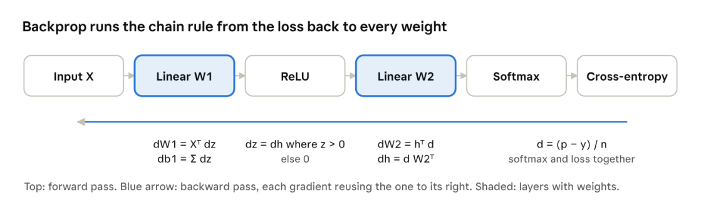

# 5 · Neural network fundamentals

Part II · Deep learning and training dynamics. Assumes Chapter 1 (gradients) and Chapter 3 (losses, optimisers). Chapter 6 moves the same ideas into PyTorch; Chapter 10 builds transformers from them.

## Why it matters

Every deep model, from a two-tower recommender to an LLM, is built from the pieces in this chapter. When training misbehaves (loss stuck, NaNs, overfitting), the fix comes from understanding them: initialisation, normalisation, learning rates, regularisation. Interviewers ask candidates to write backprop for a small network, explain why ReLU replaced sigmoid, or debug a model that will not learn.

## Key concepts

- **Multilayer perceptron (MLP)**: stacked linear layers with non-linear activations between them; the building block of every deep model. [Multilayer perceptron](https://en.wikipedia.org/wiki/Multilayer_perceptron).
- **Activation functions (ReLU, GELU, sigmoid, softmax)**: the non-linearities that let networks model curved relationships. [Activation function](https://en.wikipedia.org/wiki/Activation_function).
- **Backpropagation**: the chain rule applied layer by layer to get every weight's gradient. [3Blue1Brown: neural networks](https://www.3blue1brown.com/topics/neural-networks); build it yourself with [Karpathy's micrograd](https://karpathy.ai/zero-to-hero.html).
- **Initialisation (Xavier, He)**: starting weights scaled so signals neither vanish nor explode. [He et al., 2015](https://arxiv.org/abs/1502.01852).
- **Normalisation layers**: batch norm normalises across the batch, layer norm across features of one example. [Batch norm](https://arxiv.org/abs/1502.03167), [Layer norm](https://arxiv.org/abs/1607.06450).
- **Dropout**: randomly zeroing units during training to regularise. [Dropout paper](https://jmlr.org/papers/v15/srivastava14a.html).
- **Optimisers (SGD with momentum, Adam, AdamW)**: rules for turning gradients into weight updates. [Adam](https://arxiv.org/abs/1412.6980).
- **Residual connections**: adding a layer's input to its output so very deep networks still train. [ResNet](https://arxiv.org/abs/1512.03385).
- **Mixed precision**: computing in 16-bit while keeping a 32-bit master copy of the weights (Chapter 6).

## 5.1 From perceptron to MLP

A **perceptron** computes a weighted sum and a threshold: a linear classifier. It cannot learn XOR or any non-linear boundary. Stacking linear layers does not help either: a product of linear maps is still linear. The fix is a **non-linear activation** between layers: a multi-layer perceptron (MLP) with one hidden layer can approximate any continuous function on a bounded domain, given enough units (the universal approximation theorem). Depth makes such approximations far more efficient in practice.

On a three-class spiral dataset that no straight line can separate, logistic regression reaches 53% training accuracy; a 64-unit one-hidden-layer MLP written from scratch below reaches 99%.

## 5.2 Backpropagation by hand



*forward and backward pass of a two-layer network*

Backprop is the chain rule applied layer by layer from the loss backwards, reusing each intermediate gradient. For softmax with cross-entropy, the gradient with respect to the logits simplifies to (p − y)/n, which is why this pair is used together.

```python
import numpy as np

class MLP:
    def __init__(self, d_in, d_hidden, d_out, seed=0):
        rng = np.random.default_rng(seed)
        self.W1 = rng.normal(0, np.sqrt(2 / d_in), (d_in, d_hidden)); self.b1 = np.zeros(d_hidden)   # He init
        self.W2 = rng.normal(0, np.sqrt(2 / d_hidden), (d_hidden, d_out)); self.b2 = np.zeros(d_out)

    def forward(self, X):
        self.X = X
        self.z1 = X @ self.W1 + self.b1
        self.h = np.maximum(0, self.z1)                                   # ReLU
        logits = self.h @ self.W2 + self.b2
        logits -= logits.max(1, keepdims=True)                            # stable softmax
        self.p = np.exp(logits) / np.exp(logits).sum(1, keepdims=True)
        return self.p
    def loss(self, y):
        return -np.mean(np.log(self.p[np.arange(len(y)), y] + 1e-12))

    def backward(self, y):
        n = len(y)
        d = self.p.copy(); d[np.arange(n), y] -= 1; d /= n                # softmax + cross-entropy
        self.dW2, self.db2 = self.h.T @ d, d.sum(0)
        dh = d @ self.W2.T
        dz1 = dh * (self.z1 > 0)                                          # ReLU passes gradient where z > 0
        self.dW1, self.db1 = self.X.T @ dz1, dz1.sum(0)

    def step(self, lr):
        for p, g in [(self.W1, self.dW1), (self.b1, self.db1), (self.W2, self.dW2), (self.b2, self.db2)]:
            p -= lr * g
```

Training for 3,000 full-batch steps on the spiral data drives the loss to 0.03. A central-difference check on a weight agrees with the analytic gradient to 1e-6 (Chapter 1.5). Writing this class from memory, with shapes right, is a classic interview exercise.

## 5.3 Activations

| Activation | Formula | Notes |
|---|---|---|
| Sigmoid | 1/(1 + e^−x) | Output layer for binary probabilities; saturates, so gradients vanish in deep hidden layers |
| Tanh | (e^x − e^−x)/(e^x + e^−x) | Zero-centred sigmoid; still saturates; used in RNN gates |
| ReLU | max(0, x) | Cheap, no saturation for x > 0; units can "die" (stuck at 0) |
| Leaky ReLU | max(αx, x) | Avoids dead units |
| GELU | x·Φ(x) | Smooth ReLU; standard in BERT and GPT-2/3; current LLMs use gated SwiGLU (next row) |
| SiLU / Swish | x·σ(x) | Used inside SwiGLU in modern LLMs (Chapter 10.6) |
| Softmax | e^zᵢ/Σe^zⱼ | Output layer for multi-class distributions |

## 5.4 Initialisation

Weights must start small enough not to explode activations and large enough not to vanish them, layer after layer. A test pushing random data through 20 ReLU layers of width 256: with weights of standard deviation 0.01 the output's spread collapsed to about 1e-19; with standard deviation 1 it exploded to about 1e20; with **He initialisation** (std = √(2/fan_in)) it stayed around 0.7.

- **Xavier/Glorot** (std ≈ √(2/(fan_in + fan_out))) for tanh and sigmoid.
- **He/Kaiming** (std = √(2/fan_in)) for ReLU-family activations.
- Biases at zero; for transformers, small scaled initialisation of residual projections helps deep stacks.

## 5.5 Normalisation, dropout and other regularisers

**Batch normalisation** normalises each feature over the batch, then scales and shifts with learned parameters; at inference it uses running averages. It speeds and stabilises training of CNNs and MLPs but depends on batch statistics. **Layer normalisation** normalises each example over its features, independent of batch size and sequence length: the choice for transformers (with RMSNorm as a cheaper variant, Chapter 10.5).

```python
def batchnorm(x, gamma, beta, eps=1e-5):          # x: (batch, features)
    return gamma * (x - x.mean(0)) / np.sqrt(x.var(0) + eps) + beta

def layernorm(x, gamma, beta, eps=1e-5):
    mu, var = x.mean(1, keepdims=True), x.var(1, keepdims=True)
    return gamma * (x - mu) / np.sqrt(var + eps) + beta

def dropout(h, p, train=True, rng=np.random.default_rng()):
    if not train or p == 0:
        return h
    return h * (rng.random(h.shape) > p) / (1 - p)  # inverted dropout: scale at train time, identity at test
```

**Dropout** randomly zeroes activations during training, discouraging co-adaptation; inverted dropout rescales by 1/(1 − p) so nothing changes at inference. Other regularisers: weight decay (AdamW), early stopping, data augmentation, label smoothing.

## 5.6 Optimisers, schedules and mixed precision

- **SGD with momentum** still generalises well for vision; **Adam/AdamW** is the default for transformers and most deep learning (Chapter 3.5 has both from scratch).
- **Learning-rate schedules:** linear warm-up for the first few hundred or thousand steps, then cosine or linear decay. The learning rate is the first hyperparameter to tune; a learning-rate range test (increase it exponentially and watch the loss) finds a sensible range quickly.
- **Gradient clipping** (by global norm, often 1.0) prevents rare large gradients from destabilising training, especially for RNNs and transformers.
- **Batch size:** larger batches give smoother gradients and better hardware use; scale the learning rate with care; use gradient accumulation to simulate large batches on small GPUs.
- **Mixed precision:** compute in bf16 (or fp16 with loss scaling) while keeping master weights in fp32. bf16 has fp32's exponent range, so it rarely needs loss scaling; it roughly halves memory for activations and speeds up matrix multiplications on modern GPUs.

## 5.7 Debugging a model that won't learn

A checklist in the order that finds most bugs fastest:

1. **Look at the data:** a few inputs and labels, after preprocessing. Are labels aligned with inputs? Are classes as expected?
2. **Check the initial loss:** for k balanced classes it should be about ln(k). Far off means a bug in the output layer or labels.
3. **Overfit one small batch:** a working model and training loop drive training loss near zero on 10–50 examples. If not, the bug is in the model, loss or optimiser, not in the data size.
4. **Check gradients flow:** non-zero gradients in every layer, no accidental `detach`, `requires_grad` set, `optimizer.zero_grad()` called each step.
5. **Learning rate:** too high gives divergence or NaNs; too low gives a flat loss. Try a range test.
6. **Train/eval mode:** dropout and batch norm behave differently; forgetting `model.eval()` makes validation noisy.
7. **NaNs:** log or division by zero, fp16 overflow, exploding gradients (clip), bad input values.
8. **Then** regularisation and capacity: only after the model can fit the training data.

## Pitfalls

- **Sigmoid or tanh in deep hidden layers** (vanishing gradients).
- **Default or arbitrary initialisation scales** in custom layers.
- **Batch norm with tiny batches,** or in sequence models.
- **Forgetting** `model.eval()` or applying dropout at inference.
- **No warm-up** for transformers; no gradient clipping.
- **Tuning regularisation before the model can overfit** a small batch.
- **Comparing runs with different seeds and concluding from one run.**

## Interview questions

**1. [B] Why do we need non-linear activations?** Without them, any stack of layers is a single linear function.

**2. [B] Why did ReLU replace sigmoid in hidden layers?** Sigmoid saturates and its gradient is at most 0.25, so gradients vanish through many layers; ReLU has gradient 1 for positive inputs and is cheap.

**3. [I] Derive the gradient of softmax with cross-entropy with respect to the logits.** p − y (divided by n for a batch mean): the softmax Jacobian and the log combine into this simple form.

**4. [I] What problem do Xavier and He initialisation solve?** Keeping activation and gradient variance roughly constant across layers so signals neither vanish nor explode; He accounts for ReLU zeroing half the inputs.

**5. [I] Batch norm vs layer norm, and why transformers use layer norm.** Batch norm normalises across the batch per feature; layer norm across features per example. Layer norm does not depend on batch size or sequence length and behaves the same in training and inference.

**6. [I] How does dropout work at train and test time?** Train: zero each unit with probability p and scale the rest by 1/(1 − p). Test: use all units unchanged.

**7. [I] Why use learning-rate warm-up?** Early gradients and Adam's moment estimates are unreliable; large early steps can push training into bad regions. Warm-up ramps the rate up gently.

**8. [S] Your network's training loss does not decrease. Walk through debugging.** Check data and labels; initial loss vs ln(k); overfit one batch; gradient flow; learning-rate range test; train/eval modes; then capacity and regularisation.

**9. [S] Why is bf16 preferred over fp16 for training large models?** Same exponent range as fp32, so it avoids overflow and underflow without loss scaling, at slightly lower mantissa precision that training tolerates.

## Practice

1. Write the MLP class with backprop from memory and train it on the spiral data; add L2

weight decay and momentum.

2. Gradient-check every parameter of your MLP.
3. Reproduce the initialisation experiment (small, He, large) and plot activation spread per layer.
4. Implement batch norm's backward pass (a classic exercise in Karpathy's makemore series).
5. Take a working PyTorch model, introduce three bugs (wrong label alignment, missing `zero_grad`, learning rate × 100), and practise finding them with the checklist in 5.7.

## Read next

- Andrej Karpathy, *Neural Networks: Zero to Hero* (micrograd, makemore parts 1–5), and his post *A Recipe for Training Neural Networks*.
- *Dive into Deep Learning*: chapters on multilayer perceptrons, numerical stability and initialisation, optimisation algorithms, batch normalisation.
- Goodfellow, Bengio and Courville, *Deep Learning*, chapters 6–8 (free online).
- He et al., *Delving Deep into Rectifiers* (2015); Ioffe and Szegedy, *Batch Normalization* (2015); Srivastava et al., *Dropout* (2014).

**Links:** [Neural Networks: Zero to Hero](https://karpathy.ai/zero-to-hero.html) (Karpathy) · [3Blue1Brown: neural networks](https://www.3blue1brown.com/topics/neural-networks) · [Dive into Deep Learning](https://d2l.ai/) (free book). Other titles above can be found by searching their title.

## Done when

You can write a two-layer MLP with backprop in NumPy and gradient-check it.

You can explain activations, initialisation schemes and why they matter. You can explain batch norm, layer norm and dropout at train and test time. You can choose an optimiser, schedule and precision for a training run. You can debug a model that does not learn, step by step.

---

[← 05 · Evaluation and metrics](05-evaluation-and-metrics.md) · [Contents](../README.md#contents) · [07 · PyTorch for practitioners →](07-pytorch-for-practitioners.md)
