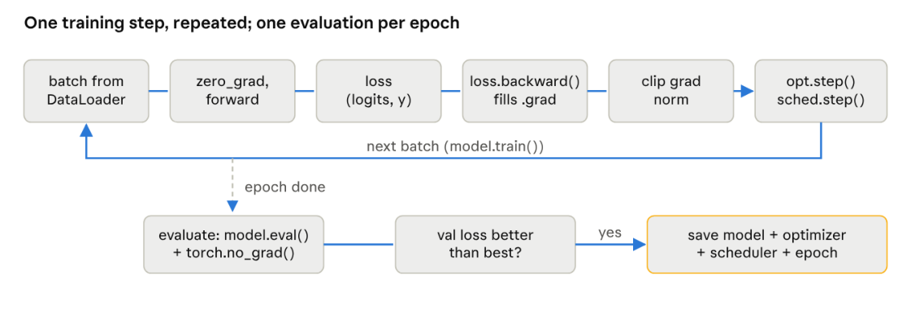
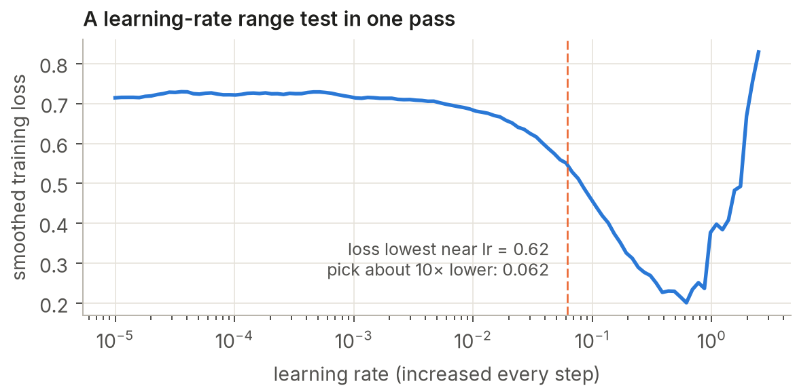

# 6 · PyTorch for practitioners

Part II · Deep learning and training dynamics.

## Why it matters

Every deep-learning question in a senior loop eventually turns into "write the training loop" or "why is this loss not going down". PyTorch is the default language for that conversation: Hugging Face, sentence-transformers, PEFT and most research code sit on top of it. You do not need to know its internals, but you need to write a correct loop from memory, put tensors on the right device, save and resume training, and debug shapes calmly. Live coding is where many otherwise strong candidates stumble, so this chapter is about fluency, not theory: type every snippet yourself.

The chapter follows the path of one training step. Data starts as tensors, and autograd records what is done to them so gradients can be computed automatically (6.1). Models are modules that own their parameters (6.2). Datasets and data loaders feed batches (6.3), and the training loop ties forward pass, loss, backward pass and optimiser step together in a fixed order (6.4). The remaining sections cover what turns a loop that works into one you can trust on real hardware: devices and memory (6.5), saving and resuming (6.6), reproducibility (6.7), fitting large batches into small GPUs (6.8), debugging (6.9) and finding where the time goes (6.10).

The same few patterns appear in nearly every PyTorch codebase, from a two-tower recommender to a fine-tuning script for an LLM. Once they are automatic, reading research code becomes much faster, because you can skip the familiar scaffolding and focus on what is new.

All code below was run on CPU with PyTorch 2.x; outputs quoted are from that run.

## Key concepts

- **Tensor**: an n-dimensional array with a data type and a device (CPU or GPU). Start with PyTorch's [Learn the Basics](https://docs.pytorch.org/tutorials/beginner/basics/intro.html) series.
- **Autograd**: PyTorch records operations on tensors and computes gradients automatically with `.backward()`.
- **nn.Module**: the class that holds a model's layers and parameters and defines `forward`.
- **Dataset and DataLoader**: how data is indexed, batched, shuffled and loaded in parallel. [torch.utils.data](https://docs.pytorch.org/docs/stable/data.html).
- **Training loop**: zero gradients, forward, loss, backward, optimiser step, repeated over batches; evaluation in `eval()` mode without gradients.
- **Mixed precision**: running in 16-bit for speed and memory with a 32-bit master copy. [Automatic mixed precision](https://docs.pytorch.org/docs/stable/amp.html).
- **Checkpointing and reproducibility**: saving model, optimiser and scheduler state; seeding every random source.
- **Distributed training (DDP, FSDP)**: copying the model across GPUs and splitting data, or sharding the model itself. [DDP tutorial](https://docs.pytorch.org/tutorials/intermediate/ddp_tutorial.html).
- **Debugging practice**: [A Recipe for Training Neural Networks](https://karpathy.github.io/2019/04/25/recipe/) (Karpathy).

## 6.1 Tensors and autograd

Chapter 5 computed gradients by hand, which is instructive for a two-layer network and impossible for a transformer. PyTorch's central feature is that you write only the forward computation, as ordinary Python, and it derives the backward pass for you. Understanding how it does this, by recording operations as they run, explains most of its behaviour, including the classic bugs: gradients that accumulate, tensors that silently stop tracking gradients, and memory that is never freed.

A tensor is an n-dimensional array with a `dtype`, a `device` and, optionally, a gradient. Autograd records the operations applied to tensors with `requires_grad=True` and, on `.backward()`, walks that graph in reverse to fill `.grad`.

```python
import torch
x = torch.tensor([2.0, 3.0], requires_grad=True)
y = (x ** 2).sum() + 3 * x[0]   # y = x0^2 + x1^2 + 3*x0
y.backward()
print(x.grad)                   # tensor([7., 6.])  -> dy/dx0 = 2*2+3, dy/dx1 = 2*3
```

**What autograd actually stores.** Every operation on a tensor that requires gradients adds a node to a graph and saves whatever it needs for its backward pass: a multiplication saves both inputs, a ReLU saves which entries were positive, a softmax saves its output. Those saved tensors are why training uses far more memory than inference: for a transformer, the activations saved for backward usually exceed the weights for long sequences (Chapter 17 does the arithmetic). After `.backward()` the graph is freed; `torch.no_grad()` never builds it. Activation checkpointing trades compute for memory by saving only some activations and recomputing the rest during the backward pass.

Rules worth saying out loud in an interview:

- `.backward()` only works on a scalar (or needs a `gradient=` argument). Losses are reduced to a scalar for that reason.
- Gradients **accumulate** into `.grad`. That is why every step starts with `opt.zero_grad()`, and also why gradient accumulation works for free.
- `torch.no_grad()` (or `torch.inference_mode()`) stops graph recording: faster, less memory, needed for evaluation. `inference_mode` goes one step further: tensors created inside it can never be used in autograd later, which lets PyTorch skip version-counter bookkeeping. Use it for pure inference; use `no_grad` when you might still feed the outputs into a graph (for example a frozen teacher whose outputs are targets).
- `.detach()` gives a tensor that shares data but is cut from the graph; `.item()` gives a Python number (and forces a device sync).
- Shapes: learn `view` vs `reshape` (view needs contiguous memory), `unsqueeze` / `squeeze`, `permute`, broadcasting rules (align from the right; size-1 dims stretch). Most bugs are silent broadcasting, for example a `(B,)` target against a `(B,1)` prediction giving a `(B,B)` loss.

### Autograd details that come up in debugging

Five behaviours explain most autograd error messages and most "how would you log X?" questions. All five are run in `code/ch06_check.py`.

**In-place operations.** Backward needs the tensors that forward saved. If you modify one of them in place, the gradient would be computed from the wrong values, so autograd keeps a version counter on every tensor and refuses: `b = a.sigmoid(); b.mul_(2); b.sum().backward()` raises "one of the variables needed for gradient computation has been modified by an inplace operation", because sigmoid saved its output `b`. The fix is to write `b = b * 2`. In-place ops on tensors that nothing saved (most activations inside `nn.ReLU(inplace=True)`) are fine, which is why the error appears only sometimes.

**Leaf and non-leaf tensors.** A leaf is a tensor you created with `requires_grad=True` (parameters are leaves); everything computed from leaves is a non-leaf. Only leaves keep `.grad` after backward, to save memory. To inspect the gradient of an intermediate, call `h.retain_grad()` before backward. With `x = [1, 2]`, `h = 3x` and `out = Σh²`, the check script prints `h.grad = [6, 12]` (2h) and `x.grad = [18, 36]` (2h · 3).

**`retain_graph`.** Backward frees the saved tensors as it goes, so a second `backward()` through the same graph fails. `backward(retain_graph=True)` keeps them, which you need only when two losses share part of a graph and you call backward on each separately; usually it is better to add the losses and call backward once. Note the second backward *adds* to `.grad` (the script's `x.grad` becomes `[36, 72]`).

**Custom `torch.autograd.Function`.** When you need a backward that is not the derivative of the forward (a straight-through estimator for quantisation, gradient clipping or reversal), write both:

```python
class ClampGrad(torch.autograd.Function):
    @staticmethod
    def forward(ctx, x):              # ctx.save_for_backward(...) if backward needs tensors
        return x.view_as(x)           # identity
    @staticmethod
    def backward(ctx, grad_out):      # one gradient per forward input
        return grad_out.clamp(-1, 1)
# (ClampGrad.apply(z) * [5.0, 0.3]).sum().backward()  ->  z.grad = [1.0, 0.3]
```

**Hooks.** `p.register_hook(fn)` calls `fn(grad)` when a tensor's gradient is computed, and `module.register_forward_hook(fn)` sees each module's output. They are the standard way to log per-layer gradient norms or the fraction of dead ReLUs without editing the model:

```python
for name, p in model.named_parameters():
    p.register_hook(lambda g, name=name: log[name].append(g.norm().item()))
model.act.register_forward_hook(lambda m, inp, out: stats.append((out == 0).float().mean().item()))
```

The `name=name` default argument matters: without it every lambda captures the last name of the loop. Logging `.item()` inside a hook forces a device sync, so on GPU log every N steps.

## 6.2 nn.Module

A model is more than a function: it has parameters to optimise, buffers such as running statistics, sub-models nested inside it, and behaviour that changes between training and evaluation. `nn.Module` is the container that keeps track of all of this, so that one call can move the whole model to a GPU, save it, or hand all its parameters to an optimiser.

A module owns parameters and sub-modules, and defines `forward`. Registering layers as attributes is what makes `model.parameters()`, `.to(device)`, `state_dict()` and `train()/eval()` work.

```python
import torch.nn as nn

class ReorderModel(nn.Module):
    def __init__(self, d_in, d_hidden=64, p_drop=0.1):
        super().__init__()
        self.net = nn.Sequential(
            nn.Linear(d_in, d_hidden), nn.ReLU(), nn.Dropout(p_drop),
            nn.Linear(d_hidden, 1))
    def forward(self, x):
        return self.net(x).squeeze(-1)   # logits, shape (B,)
```

**The broadcasting bug, worked through.** A regression model returns predictions of shape (4, 1); the targets have shape (4,). `((pred - target) ** 2).mean()` does not fail: broadcasting stretches (4, 1) against (4,) into a (4, 4) matrix of every prediction minus every target, and the "loss" averages 16 numbers, 12 of which compare a prediction with someone else's target. The model trains towards predicting the mean of all targets and the loss curve looks plausible. Assert shapes at the loss (`assert pred.shape == target.shape`), or `squeeze` explicitly.

Return **logits**, not probabilities, and use `BCEWithLogitsLoss` / `CrossEntropyLoss`: they fuse the sigmoid/softmax with the log for numerical stability. A plain Python list of layers is invisible to PyTorch; use `nn.ModuleList` or `nn.ModuleDict`. Non-trainable state that must move with the model (a running mean, a fixed embedding) goes in `self.register_buffer`.

## 6.3 Dataset and DataLoader

A GPU can consume a batch in milliseconds, but the data behind it may live in thousands of files, need decoding or tokenising, and come in examples of different lengths. If the model has to wait for each batch to be assembled, the expensive hardware idles. PyTorch separates the two jobs: a `Dataset` knows how to produce one example, and a `DataLoader` turns examples into batches, shuffles them, and prepares the next batches in background processes while the GPU works on the current one.

`Dataset` answers two questions: how many items (`__len__`) and give me item i (`__getitem__`). `DataLoader` batches, shuffles and parallelises.

```python
from torch.utils.data import Dataset, DataLoader

class OrdersDataset(Dataset):
    def __init__(self, X, y):
        self.X = torch.as_tensor(X, dtype=torch.float32)
        self.y = torch.as_tensor(y, dtype=torch.float32)
    def __len__(self):
        return len(self.y)
    def __getitem__(self, i):
        return self.X[i], self.y[i]

g = torch.Generator().manual_seed(0)
train_dl = DataLoader(train_ds, batch_size=128, shuffle=True, generator=g, num_workers=0)
val_dl = DataLoader(val_ds, batch_size=512)   # no shuffle for evaluation
```

Three settings matter in practice, each for a different reason. `num_workers > 0` runs `__getitem__` in parallel worker processes, so loading overlaps with compute; `pin_memory=True` puts batches in page-locked host memory, which makes the copy to the GPU faster and lets it run asynchronously with `.to(device, non_blocking=True)`. Text batches of different lengths need a `collate_fn` that pads each batch to its own longest example (Hugging Face's `DataCollatorWithPadding` does this); padding to a global maximum instead wastes compute on padding tokens, and sorting or bucketing examples by length wastes even less. Very large data that does not fit an index uses an `IterableDataset` that streams; it must split the stream between workers itself, or every worker yields the same examples.

Two details make runs repeatable. Shuffling uses the loader's `generator`, so a seeded generator gives the same order every run. Each worker process has its own random state for augmentation; PyTorch seeds the torch generator per worker, but libraries such as NumPy need a `worker_init_fn` that seeds them from `torch.initial_seed()`, or older setups give every worker identical "random" augmentations.

## 6.4 The training loop

Every training script, however large, has the same core: for each batch, run the model, compute the loss, compute gradients, update the weights, and clear the gradients for the next step. The order matters and so does what surrounds it (switching between training and evaluation mode, turning off gradient tracking for validation), because each mistake there produces a model that trains without errors and learns badly. Write it once carefully and then reuse the same skeleton everywhere.



*The training loop. The inner row runs once per batch; the bottom row once per epoch.*

```python
import torch.nn.functional as F

device = torch.device("cuda" if torch.cuda.is_available() else "cpu")
model = ReorderModel(10).to(device)
opt = torch.optim.AdamW(model.parameters(), lr=3e-3, weight_decay=0.01)
sched = torch.optim.lr_scheduler.OneCycleLR(opt, max_lr=3e-3, total_steps=20 * len(train_dl))

def evaluate(model, dl):
    model.eval(); total, n = 0.0, 0
    with torch.no_grad():
        for xb, yb in dl:
            xb, yb = xb.to(device), yb.to(device)
            total += F.binary_cross_entropy_with_logits(model(xb), yb, reduction="sum").item()
            n += len(yb)
    return total / n

best = float("inf")
for epoch in range(20):
    model.train()
    for xb, yb in train_dl:
        xb, yb = xb.to(device), yb.to(device)
        opt.zero_grad(set_to_none=True)
        loss = F.binary_cross_entropy_with_logits(model(xb), yb)
        loss.backward()
        torch.nn.utils.clip_grad_norm_(model.parameters(), 1.0)
        opt.step(); sched.step()
    val = evaluate(model, val_dl)
    if val < best:
        best = val
        torch.save({"model": model.state_dict(), "opt": opt.state_dict(),
                    "sched": sched.state_dict(), "epoch": epoch, "val": val}, "best.pt")
# run on 4,000 synthetic rows: best val loss 0.3973, at epoch 9
```

The order inside the step is the part interviewers check: zero, forward, loss, backward, (clip), step. Forgetting `model.eval()` keeps dropout on and batchnorm updating during validation; forgetting `no_grad` wastes memory. Note the scheduler is stepped per batch here because OneCycle is defined in steps; epoch-based schedulers are stepped once per epoch.

## 6.5 Devices, mixed precision and memory

A GPU is fast only when the model, the data and the computation are all on it, in a number format it handles efficiently, and within its memory. Most practical problems in deep-learning code come from one of these three: a tensor left on the CPU, a precision setting that overflows, or an out-of-memory error. The rules are simple once you know where the memory goes.

- Model and batch must be on the same device; move the model once and every batch inside the loop. `RuntimeError: Expected all tensors to be on the same device` is the most common error you will see.
- Mixed precision: run the forward pass in bf16 or fp16 for speed and memory, keep master weights in fp32.

```python
# GPU, fp16 needs a GradScaler; bf16 (A100/H100) does not
scaler = torch.amp.GradScaler("cuda")
with torch.autocast(device_type="cuda", dtype=torch.float16):
    loss = F.binary_cross_entropy_with_logits(model(xb), yb)
scaler.scale(loss).backward()
scaler.unscale_(opt); torch.nn.utils.clip_grad_norm_(model.parameters(), 1.0)
scaler.step(opt); scaler.update()

# the CPU version runs anywhere: output dtype is torch.bfloat16
with torch.autocast(device_type="cpu", dtype=torch.bfloat16):
    out = model(torch.randn(4, 10))
```

**What the scaler and autocast are doing.** fp16 represents nothing smaller than about 6 × 10⁻⁸, and many gradients of a large model are smaller than that, so they would round to zero. `scaler.scale(loss)` multiplies the loss by a large factor S (65,536 at the start) before backward, so every gradient is S times larger and stays representable. The gradients sitting in `.grad` are therefore S times too big. `scaler.step(opt)` divides them by S before the update, but clipping has to see the true gradients too: clipping scaled gradients at 1.0 would clip almost everything. That is why `scaler.unscale_(opt)` comes before `clip_grad_norm_`. `scaler.step` also skips the step if any gradient is inf or NaN, and `scaler.update()` halves S after such an overflow and slowly raises it again otherwise. bf16 has the same exponent range as fp32, so none of this is needed.

Autocast does not cast everything. It keeps a list of operations that are safe and fast in 16 bits (matrix multiplications, convolutions, linear layers) and runs those in low precision, and a list of operations that are numerically sensitive (softmax, log, exp, norms, reductions such as sums and means, and loss functions) and runs those in fp32. That is why the output of a linear layer under autocast is bf16 while a loss computed from it is fp32. Code that calls a custom kernel inside autocast must make the same choice explicitly.

### Where the memory goes

Mixed-precision training with AdamW needs about 16 bytes for every parameter before a single activation is stored. Count it per parameter:

$$
2_{\mathrm{bf16\ weights}} + 2_{\mathrm{bf16\ grads}} + 4_{\mathrm{fp32\ master}} + 4_{\mathrm{Adam}\ m} + 4_{\mathrm{Adam}\ v} = 16\ \mathrm{bytes}
$$

The bf16 weights are what the forward and backward passes read; the bf16 gradients are what backward writes; the fp32 master copy is where updates accumulate without being rounded away (Chapter 7 shows a 1e-3 update vanishing in bf16); and Adam keeps its two moving averages in fp32. A 1B model therefore needs 16 GB, and a 7B model 7 × 10⁹ × 16 = 112 GB, before activations. That does not fit on one 80 GB card even with batch size 1, which is the arithmetic behind LoRA and QLoRA (Chapter 20): freeze the 7B weights in bf16 (14 GB) or 4 bits (about 3.5 GB) and keep gradients and Adam state only for the small adapter. Activations come on top and grow with batch size × sequence length × layers (Chapter 17 does that arithmetic); for long sequences they exceed the 16 bytes per parameter.

When memory runs out, the options differ in what they cost. A smaller micro-batch with gradient accumulation (6.8) keeps the effective batch and costs only throughput. Gradient checkpointing stores only each block's input and recomputes the rest in backward: roughly a third more compute for activation memory that drops from all layers' intermediates to one block's. Shorter sequences cut activation memory roughly in proportion (more than that if attention scores are materialised rather than computed with a fused kernel) but change the task. 8-bit Adam stores m and v in 8 bits with block-wise scales, saving 6 of the 16 bytes for a small quality risk. Parameter-efficient fine-tuning removes most of the 12 bytes of gradient and optimiser state per frozen parameter. Sharding (FSDP, 6.9) spreads all of it across GPUs at the cost of communication.

| Option, in the order to try | What it saves | What it costs |
|---|---|---|
| Smaller micro-batch + accumulation | Activations, in proportion | Throughput; exact only with token-sum normalisation (6.8) |
| bf16 autocast | About half of activation memory | Almost nothing on GPUs with bf16 |
| Gradient checkpointing | Most activation memory | About 33% more compute (one extra forward) |
| Shorter maximum length | Activations, roughly in proportion | Changes the task; truncates long examples |
| 8-bit Adam | 6 of 16 bytes per parameter | Small quality risk |
| LoRA / QLoRA | Gradients and optimiser state of frozen weights; QLoRA also weights to 4 bits | Quality on hard tasks; QLoRA dequantisation overhead |
| FSDP / ZeRO, or a bigger GPU | Everything, divided across GPUs | Communication (about 1.5× DDP's volume) and money |

`torch.compile(model)` often gives a free speed-up on recent GPUs; check it does not change results before trusting it.

## 6.6 Checkpointing

Long jobs get interrupted: a preempted cloud instance, a node failure, a bug found at epoch 7. A checkpoint is everything needed to continue as if nothing had happened, and "everything" is more than the weights. A run resumed from weights alone silently changes its own hyperparameters: Adam restarts with empty moment estimates (a large, warm-up-free first step, Chapter 7), the schedule restarts at its peak, and the data order repeats examples already seen.

Save `state_dict` s, not pickled models: they survive refactors of your class. Save the optimizer and scheduler too, or resumed training restarts Adam's moments from zero and the learning rate from the top.

```python
ckpt = torch.load("best.pt", map_location="cpu")
model = ReorderModel(10)
model.load_state_dict(ckpt["model"])
opt.load_state_dict(ckpt["opt"]); sched.load_state_dict(ckpt["sched"])
start_epoch = ckpt["epoch"] + 1
```

`map_location` lets a GPU checkpoint load on a CPU machine. Recent PyTorch versions default `torch.load` to `weights_only=True`, which refuses arbitrary pickled objects; that is a security feature, keep it on for files you did not create. For Hugging Face models use `save_pretrained` / `from_pretrained` and the safetensors format.

**A resume that matches an uninterrupted run.** To continue bit-for-bit (or as close as the hardware allows), the checkpoint also needs every source of randomness and the position in the data:

```python
state = {
    "model": model.state_dict(), "opt": opt.state_dict(), "sched": sched.state_dict(),
    "scaler": scaler.state_dict(),                  # fp16 loss scale, if used
    "step": step, "epoch": epoch,
    "rng": {"torch": torch.get_rng_state(), "cuda": torch.cuda.get_rng_state_all(),
            "numpy": np.random.get_state(), "python": random.getstate()},
    "loader_gen": train_dl.generator.get_state(),   # shuffle order of this epoch
}
# resume: load all of it, set the RNG states back, rebuild the loader with the same
# generator state, and skip the batches of the current epoch already consumed
```

Restoring the RNG states reproduces the next random draws exactly (the check script verifies it for torch, NumPy and Python). The data position is the awkward part: a plain `DataLoader` cannot resume mid-epoch, so either skip the first k batches of the epoch (cheap for in-memory data, slow for heavy decoding), checkpoint only at epoch boundaries, or use a loader that saves its own state (`StatefulDataLoader` in `torchdata` has `state_dict()` / `load_state_dict()`). In a distributed run each rank saves its own RNG state, and a `DistributedSampler` needs `set_epoch(epoch)` called again so the shuffle order matches. Write checkpoints atomically (save to a temporary file, then rename) so a crash during saving cannot corrupt the only copy.

## 6.7 Reproducibility

Two runs of the same script can differ for reasons that have nothing to do with your idea: a different random initialisation, a different shuffle, a non-deterministic GPU kernel. If you cannot reproduce a result, you cannot tell whether a change helped. Reproducibility has two levels, and they have different costs: repeatable runs on the same machine, which cost almost nothing, and fully deterministic kernels, which cost speed.

```python
import os, random, numpy as np
def set_seed(seed=0):
    random.seed(seed); np.random.seed(seed); torch.manual_seed(seed)
    torch.cuda.manual_seed_all(seed)

# full determinism (slower): set before CUDA is initialised
os.environ["CUBLAS_WORKSPACE_CONFIG"] = ":4096:8"
torch.use_deterministic_algorithms(True)
torch.backends.cudnn.benchmark = False      # benchmark mode picks kernels by timing, run to run
torch.backends.cudnn.deterministic = True

def seed_worker(worker_id):                 # DataLoader(worker_init_fn=seed_worker)
    s = torch.initial_seed() % 2**32
    np.random.seed(s); random.seed(s)
```

Seeding makes runs repeatable on the same hardware and versions, not identical across GPUs. Each line of the full-determinism block closes a specific gap. Many GPU kernels sum floating-point numbers with atomic adds in whatever order threads finish, and floating-point addition is not associative, so the result varies in the last bits; `use_deterministic_algorithms(True)` switches to deterministic implementations or raises an error for ops that have none. cuBLAS needs the workspace setting to be deterministic. `cudnn.benchmark = True` times several convolution algorithms on the first batch and keeps the fastest, which can differ between runs. The DataLoader needs its own seeded `generator` and a `worker_init_fn` for worker-side randomness, and in distributed training `DistributedSampler.set_epoch(epoch)` must be called every epoch or every epoch uses the same shuffle.

The senior point: report results as mean ± spread over 3–5 seeds, because one seed can move a metric more than the change you are testing. Determinism makes a single run repeatable; it does not make it representative.

## 6.8 Gradient accumulation and other tricks

The batch size you want is set by optimisation (Chapter 7's critical batch size, or a recipe you are reproducing); the batch size you can afford is set by memory. Gradient accumulation decouples the two: because gradients add up in `.grad` (6.1), several small forward-backward passes followed by one optimiser step give the gradient of the large batch, at the cost of time, not memory. The equivalence is exact only under conditions that LLM training often breaks, which is where the senior questions are.

To simulate a batch 4× larger than fits in memory, divide the loss by 4 and step every 4 batches:

```python
accum = 4
opt.zero_grad()
for i, (xb, yb) in enumerate(train_dl):
    loss = F.binary_cross_entropy_with_logits(model(xb), yb) / accum
    loss.backward()                 # gradients add up across the 4 batches
    if (i + 1) % accum == 0:
        opt.step(); opt.zero_grad()
```

### Where accumulation is not equivalent

Dividing by `accum` is correct when every micro-batch has the same number of examples and the loss is a per-example mean: the average of four equal-sized means is the mean of the big batch. It goes wrong in four situations.

**Variable token counts.** In language-model training the loss is a mean over *tokens*, and micro-batches hold different numbers of non-padding (or non-masked) tokens. Averaging the per-micro-batch means weights each micro-batch equally, not each token. Take two micro-batches: A has 10 target tokens with mean loss 2.0, B has 90 with mean loss 1.0. The naive accumulated loss is (2.0 + 1.0) / 2 = 1.5, but the loss of the combined batch is (10 × 2.0 + 90 × 1.0) / 100 = 1.1. Each token in A gets 9 times the weight of a token in B, so short SFT examples dominate the gradient. This was a widely discussed bug in Hugging Face's Trainer in 2024. The fix is to sum, not average, inside each micro-batch, and divide by the total token count of the whole accumulation window:

$$
\mathcal{L} = \dfrac{1}{N_{\mathrm{tok}}} \sum_{j=1}^{K} \sum_{i \in \mathrm{mb}_j} \ell_i
$$

Here K is the number of micro-batches in the window, ℓᵢ the loss of target token i, and N_tok the number of target tokens across all K micro-batches (count them before the first backward, or all-reduce the count across ranks in data parallelism). `code/ch06_check.py` confirms that the naive version does not match the full-batch gradient and the sum/N_tok version does, to 1e-6.

**DDP synchronisation.** DistributedDataParallel all-reduces gradients during every `backward()`. With accumulation that is K − 1 wasted all-reduces per step; wrap the first K − 1 backward calls in `with model.no_sync():` so only the last one communicates.

**The leftover window.** If the number of batches per epoch is not a multiple of K, the last few micro-batches either never reach `opt.step()` (their gradients leak into the next epoch's first step) or produce an update from a smaller batch. Step and zero at the epoch end, with the loss normalised by the tokens actually seen.

**Batch-dependent layers.** BatchNorm computes statistics over the micro-batch, not the accumulated batch, so a batch of 4 accumulated 16 times is not a batch of 64 for BatchNorm. LayerNorm and RMSNorm, which normalise each example on its own, are unaffected; this is one reason transformers do not use BatchNorm.

Other tricks you should be able to name: learning-rate warm-up then cosine or linear decay (standard for transformers); early stopping on validation loss; freezing layers with `p.requires_grad_(False)` and giving the optimizer only trainable params; separate parameter groups so biases and norms get no weight decay; distributed data parallel (DDP) for several GPUs, FSDP or DeepSpeed ZeRO when the model itself does not fit on one.

## 6.9 Debugging a model that will not learn

Section 5.7 gives the general checklist: look at the data, check the loss at step 0 (about ln C for C balanced classes), overfit one small batch, then tune. In PyTorch, the bugs behind a model that will not learn are usually one of these:

1. **Silent broadcasting.** A `(B,)` target minus a `(B, 1)` prediction broadcasts to `(B, B)`: a hand-written loss gives no error, and `F.mse_loss` only a warning. Assert shapes at each stage.
2. **Wrong labels at the loss.** `F.cross_entropy` wants class indices (`long`) and raw logits, not probabilities or one-hot floats.
3. **A broken graph.** A stray `.detach()`, `.item()`, `torch.no_grad()` or a parameter left out of the optimiser. Log the gradient norm per layer: zero means a detached graph or frozen parameters; huge means the learning rate is too high.
4. **Mode errors.** Forgetting `model.train()` after evaluation keeps dropout off and batch-norm statistics frozen.
5. **Accumulated gradients.** `optimizer.zero_grad()` missing, or called inside the accumulation loop.
6. **A learning rate out of range.** Sweep 1e-5 to 1e-2 before anything clever.
7. **No baseline.** Compare with a simple model (logistic regression, LightGBM). On tabular data a well-tuned GBM usually wins (Chapter 40).

**Finding a learning rate in one run.** Before tuning anything else, run a learning-rate range test: start at a tiny rate, multiply it a little every step, and record the (smoothed) training loss until it blows up. The loss stays flat while the rate is too small to matter, falls fastest in the useful range, and diverges when the rate is too large. A good starting rate is about ten times below the point where the loss is lowest.



*Range test on a small MLP with SGD and momentum (computed in `tools/figures.py`): the loss is lowest near 0.62, so start training around 0.06.*

The test takes one short run, and it is a quick defence against the most common reason a model "does not learn": a learning rate off by a factor of 100 in either direction. It is a heuristic for SGD-style training of small models; for transformers with Adam, a short sweep of three to five rates with warm-up is more reliable (Chapter 7).

**Scaling beyond one GPU.** The training loop here becomes distributed with DistributedDataParallel, then fully sharded data parallelism (FSDP2) when the model no longer fits, then tensor, pipeline and context parallelism for the largest models. Chapter 17 covers the memory and communication arithmetic; Chapter 7 covers the optimisers, schedules and numerical formats used at scale.

## 6.10 Where the time goes

A training step that is slower than it should be is almost always waiting on one of three things.

**Waiting for data.** If the GPU finishes a batch before the next one is ready, it idles. Measure it directly: time how long the loop spends fetching the next batch versus running forward and backward. If data time is a large share, raise `num_workers` (parallel loading processes), set `pin_memory=True` (faster host-to-GPU copies), pre-tokenise and store data in a compact binary format instead of parsing text on the fly, and move augmentation onto the GPU.

**Waiting for synchronisation.** GPU work is queued asynchronously: Python launches kernels and moves on. Anything that needs a result on the CPU forces the program to wait for the queue to drain: `.item()`, `.cpu()`, printing a tensor, a Python `if` on a tensor value. One `.item()` per step to log the loss is fine; one per sample inside a loop serialises everything. Log every N steps, and accumulate metrics on the GPU.

**Doing too many small operations.** Each kernel launch has a fixed overhead of a few microseconds. Models built from many small elementwise operations (normalisations, activations, masking) are often limited by launch overhead and memory traffic rather than arithmetic. `torch.compile` fuses chains of such operations into fewer kernels and typically speeds up transformer training noticeably; fused kernels for attention (`F.scaled_dot_product_attention`) and optimisers (`fused=True` in AdamW) do the same for the heaviest parts.

**A quick diagnosis routine.** Check GPU utilisation while training (`nvidia-smi` or the profiler); if it is well below 90%, find which of the three it is. Run `torch.profiler` for a dozen steps and read the table sorted by time: the top entries name the problem. Only then consider bigger levers such as larger batches, mixed precision or a different parallel layout (Chapter 17).

### Is my run slow? Model FLOPs utilisation

"GPU utilisation 98%" in `nvidia-smi` only says a kernel was running; it does not say the kernel was doing useful arithmetic. The number that answers "is this run slow?" is **model FLOPs utilisation (MFU)**: the FLOPs the model needs per second, divided by the hardware's peak.

$$
\mathrm{MFU} = \dfrac{6 N \cdot \mathrm{tokens/s}}{\mathrm{peak\ FLOP/s}}
$$

N is the number of parameters (active parameters for a mixture of experts), and 6N is the training cost per token: 2N FLOPs for the forward pass (one multiply and one add per weight) and 4N for the backward pass (gradients with respect to both activations and weights). The approximation leaves out attention's score computation, which matters for long sequences, and does not count activation recomputation, which is why it measures *model* FLOPs rather than hardware FLOPs. Chapter 17 derives it in full.

Worked example: a 1B-parameter model training at 50,000 tokens per second on one H100 (dense bf16 peak about 989 TFLOP/s) does 6 × 10⁹ × 5 × 10⁴ = 3 × 10¹⁴ FLOP/s, an MFU of 30%. Large, well-tuned dense transformer runs report roughly 35–50%; under 20% on a single GPU means one of the three bottlenecks above, and the profiler will say which. Small models score lower because their matrices are too small to keep the tensor cores busy, so compare MFU against runs of similar size.

## Pitfalls

- Calling `model(x)` with probabilities into `BCEWithLogitsLoss` (double sigmoid), or applying softmax before `CrossEntropyLoss`.
- Forgetting `zero_grad`, so gradients from every step add up.
- Validation in train mode: dropout on, batchnorm statistics drifting.
- Calling `.item()` or `print(tensor)` inside the hot loop on GPU: it forces a sync and slows training.
- Accumulating `loss` (a tensor) in a Python list across steps: it keeps every graph alive and leaks memory. Use `loss.item()`.
- Shuffling the validation set and then comparing per-row predictions to an unshuffled label file.
- Saving the whole model with `torch.save(model)` and then renaming the class.

## Interview questions

**Mid level**

**1. Write a training loop for binary classification from memory. What does each line do?** The loop in 6.4: `model.train()`; for each batch, move it to the device, `opt.zero_grad(set_to_none=True)` to clear the last step's gradients, compute logits, `loss = F.binary_cross_entropy_with_logits(logits, y)`, `loss.backward()` to fill `.grad`, optionally `clip_grad_norm_`, `opt.step()` to update, `sched.step()` if the schedule is per step. Then `model.eval()` and `torch.no_grad()` for validation, and save model, optimiser and scheduler state when validation improves. Sanity number: at step 0 a balanced binary loss should be about ln 2 = 0.693; much higher means the initial logits are too large. The follow-up is usually "where does clipping go?": after backward and before step, and after `scaler.unscale_` if you use fp16.

**2. Why do we call `zero_grad()` ? What happens if we don't?** Because `backward()` adds into `.grad` rather than overwriting it. Without `zero_grad`, step t updates with g₁ + … + gₜ, so the effective step grows roughly linearly with t (like momentum with no decay) and training usually diverges within a few hundred steps. The same accumulation is what makes gradient accumulation free (6.8): you deliberately skip zeroing for K micro-batches. `set_to_none=True` (the default in recent versions) sets `.grad` to `None` instead of filling zeros, which saves a memory write and lets optimisers skip parameters that received no gradient. Follow-up: "when would you *not* zero every step?" During gradient accumulation, and that is the only legitimate case.

**3. What is the difference between `model.eval()` and `torch.no_grad()` ? Do you need both?** They are orthogonal, and for validation you need both. `model.eval()` changes module *behaviour*: dropout is turned off and BatchNorm uses its running statistics instead of the batch's. `torch.no_grad()` changes *autograd*: no graph is recorded, so no activations are saved and memory drops to roughly that of inference. With eval but no no_grad you get correct numbers and wasted memory; with no_grad but no eval you get noisy, wrong numbers (with dropout 0.1, a random 10% of activations are zeroed and the rest scaled by 1/0.9 = 1.11 on every pass). Follow-up: `torch.inference_mode()` is a stricter, slightly faster `no_grad`; its tensors can never enter autograd later, so use it for serving and pure evaluation, and `no_grad` when outputs may be reused in a graph. The opposite mistake, forgetting `model.train()` after validation, leaves dropout off for the rest of training.

**4. Why return logits and use `BCEWithLogitsLoss` rather than sigmoid + `BCELoss` ?** Numerical stability. The fused loss computes log σ(x) as −softplus(−x), which is exact for any x, while sigmoid followed by log first rounds σ(x) to zero for very negative x and then takes log 0. PyTorch's `BCELoss` clamps the log at −100 to avoid infinities, so for a logit of −120 with label 1 it reports a loss of 100 instead of 120 and a gradient of exactly zero, while `BCEWithLogitsLoss` reports 120 and a gradient of −1. The model therefore cannot learn its way out of a confident mistake. The same holds for `CrossEntropyLoss`, which fuses log-softmax. Follow-up: "where do you apply the sigmoid then?" Only at inference, when you need a probability, and in calibration code.

**Senior level**

**5. Your fine-tuning run OOMs on a 24 GB GPU. Walk through the options in the order you would try them, with the trade-off of each.** First compute: full fine-tuning with AdamW costs 16 bytes per parameter (6.5), so a 1.5B model already needs 24 GB before activations and cannot fit however small the batch. In order: (1) halve the micro-batch and add gradient accumulation, which keeps the optimisation identical (with token-sum normalisation) and costs throughput only; (2) bf16 autocast, which halves activation memory and is nearly free on recent GPUs; (3) gradient checkpointing, about a third more compute for most of the activation memory; (4) a shorter maximum length, which changes the task; (5) 8-bit Adam, saving 6 of the 16 bytes (the 1.5B model drops to 15 GB) for a small quality risk; (6) LoRA or QLoRA, which removes gradient and optimiser state for frozen weights at some quality cost on hard tasks; (7) FSDP across GPUs or a bigger card. Profile first with `torch.cuda.max_memory_allocated()` to know whether weights, optimiser state or activations dominate, because that decides which lever pays. Follow-up: "why not just use batch size 1?" Activations are not the problem when the 16 bytes per parameter alone exceed the card.

**6. Explain mixed precision. Why does fp16 need a loss scaler and bf16 not?** Mixed precision runs matrix multiplications in 16 bits (twice the throughput and half the memory traffic of fp32) while keeping fp32 master weights, optimiser state and sensitive ops such as softmax, norms and losses in fp32. fp16 has 5 exponent bits: its smallest normal value is 6.1 × 10⁻⁵ and anything below about 6 × 10⁻⁸ becomes zero, and many gradients of a large model are that small. Scaling the loss by 65,536 multiplies every gradient by the same factor, so a gradient of 10⁻⁸ becomes 6.6 × 10⁻⁴ and survives; the scaler divides it back before the update, skips steps that overflow and adjusts the scale dynamically. bf16 keeps fp32's 8 exponent bits (same range) and gives up mantissa bits instead, so nothing underflows and no scaler is needed. Follow-up: "then why keep fp32 master weights with bf16?" Because bf16 has only 8 bits of precision: 1 + 10⁻³ rounds to 1, so small updates would vanish (Chapter 7). When not to use fp16: any large-model training on hardware with bf16.

**7. How would you resume a training job that crashed at epoch 7 so the result matches an uninterrupted run as closely as possible?** Checkpoint, and restore, everything that determines the future of the run: model, optimiser (Adam's m and v, or the first steps after resume are unwarmed and oversized), scheduler (or the learning rate jumps back to its peak), the GradScaler's scale, the step and epoch counters, all RNG states (`torch.get_rng_state`, `torch.cuda.get_rng_state_all`, NumPy, Python's `random`), and the data position: the sampler's generator state plus the number of batches already consumed this epoch, or a `StatefulDataLoader` that saves this for you. In DDP each rank restores its own RNG state and the `DistributedSampler` gets `set_epoch(7)`. Then verify: resume from a checkpoint 100 steps back and compare the loss curve with the original run over those 100 steps; with deterministic kernels it should match exactly, otherwise to within noise. Follow-up: "is bit-for-bit worth it?" Rarely at scale, since non-deterministic kernels already make two uninterrupted runs differ in the last bits; same data order and same optimiser state are what matter.

**8. Training loss is flat from step 0. Give your debugging sequence.** Go from cheap and certain to expensive. (1) Check the initial loss: about ln C for C balanced classes (0.693 for binary); a different value points at the head, the labels or the loss. (2) Overfit one batch of 8–32 examples: the loss should go to near zero within a few hundred steps; if it cannot, the bug is in the model, loss or optimiser, not the data or the capacity. (3) Log per-layer gradient norms (hooks, 6.1): all zeros means a detached graph (`.item()`, `.detach()`, `no_grad`), frozen parameters, or parameters missing from the optimiser (check `opt.param_groups`). (4) Check the loss inputs: logits, not probabilities, for `BCEWithLogitsLoss`; `long` class indices for `cross_entropy`; shapes equal (the `(B,1)` vs `(B,)` broadcast). (5) Check the data: are inputs varied, labels aligned with inputs after shuffling, normalisation sane? (6) Only then sweep the learning rate over 1e-5 to 1e-2. Follow-up: "it overfits one batch but the full run is still flat": the learning rate, the data pipeline or the label noise, not the model code.

**9. When would you choose DDP vs FSDP?** DDP replicates the whole model, gradients and optimiser state on every GPU and all-reduces gradients; it is simplest and fastest when everything fits. FSDP (ZeRO stage 3) shards parameters, gradients and optimiser state across the N GPUs and all-gathers each layer's weights just before it runs. Numbers for a 7B model on 8 GPUs: DDP needs 16 × 7 = 112 GB per GPU and does not fit on an 80 GB card; full sharding needs 112 / 8 = 14 GB per GPU plus activations. The price is communication: DDP's all-reduce moves about 2× the gradient size per step, while FSDP all-gathers parameters in the forward pass, again in the backward pass, and reduce-scatters gradients, about 3×, so roughly 1.5× DDP's volume (much of it overlapped with compute). Intermediate options: ZeRO-1 shards only optimiser state (12 of the 16 bytes) at DDP's communication cost; hybrid sharding shards within a node and replicates across nodes. Use FSDP even when the model fits if the freed memory buys a larger micro-batch or longer sequences. Follow-up: "why 1.5×?" All-reduce = reduce-scatter + all-gather; FSDP adds one more all-gather for the backward pass.

**10. You fine-tune an LLM with gradient accumulation over 8 micro-batches of chat examples of very different lengths. What can go wrong with the loss normalisation, and how do you fix it?** If each micro-batch's loss is a mean over its own target tokens and you divide by 8, every micro-batch gets equal weight, so tokens in short examples get more weight than tokens in long ones. With one micro-batch of 10 tokens at loss 2.0 and one of 90 at 1.0, the naive loss is 1.5 against a true per-token mean of 1.1: the short micro-batch's tokens weigh 9 times more. The gradient is then not the full-batch gradient, and results change with the accumulation setting. Fix: sum the token losses in each micro-batch and divide by the total number of target tokens in the whole window (all-reduced across data-parallel ranks), as in 6.8. Also wrap the first 7 backward calls in `no_sync()`, flush the leftover window at the end of an epoch, and remember the same issue appears whenever padding or loss masks vary per batch. Follow-up: "is per-sequence averaging ever what you want?" Sometimes, to stop very long examples dominating; but that should be a deliberate weighting, not a side effect of the accumulation count.

## Practice

- Without looking, write the dataset, model, loop and evaluation above for a 3-class problem using `CrossEntropyLoss`. Time yourself; aim for under 15 minutes.

<details><summary>Hint and expected result</summary>

The model's last layer outputs 3 logits (no softmax); targets are `long` class indices of shape `(B,)`. At step 0 the loss should be close to ln 3 = 1.10. On the synthetic data of `code/ch06_check.py` made into 3 classes, validation loss should fall well below 1.10 within a few epochs; if it stays at 1.10, check the target dtype and the order of zero/forward/backward/step.

</details>

- Add early stopping with patience 3 and checkpoint resume. Kill the run at epoch 5 and resume it.

<details><summary>Hint and expected result</summary>

Save model, optimiser, scheduler, epoch, best validation loss and the patience counter. A correct resume continues the learning-rate schedule where it stopped (print `sched.get_last_lr()` before and after) and, with the RNG and generator states restored, reproduces the uninterrupted run's per-epoch validation losses to 4 decimals on CPU.

</details>

- Fine-tune a small text classifier (for example DistilBERT on a public sentiment dataset) with a plain PyTorch loop, not `Trainer`. Then redo it with `Trainer` and compare the code length.

<details><summary>Hint and expected result</summary>

Use `DataCollatorWithPadding` as the `collate_fn`, AdamW at about 2e-5 to 5e-5 with linear warm-up and decay, 1–3 epochs. DistilBERT on SST-2 reaches roughly 90% validation accuracy; both versions should agree within about a point, and the `Trainer` version is much shorter because it hides the loop, the scheduler, evaluation and checkpointing.

</details>

- Reproduce the 16-bytes-per-parameter estimate for a 7B model and explain why full fine-tuning does not fit on one 80 GB card.

<details><summary>Hint and expected result</summary>

2 + 2 + 4 + 4 + 4 = 16 bytes; 7 × 10⁹ × 16 = 112 GB before activations, more than 80 GB at batch size 1. LoRA keeps the frozen weights at 2 bytes (14 GB) plus a small adapter's 16 bytes per parameter; QLoRA stores them in 4 bits (about 3.5 GB).

</details>

- Implement the token-count-normalised gradient accumulation of 6.8 and test it: the accumulated gradient over micro-batches of 10 and 90 tokens must equal the full-batch gradient.

<details><summary>Hint and expected result</summary>

Use `reduction="sum"` and divide by the total token count of the window. `code/ch06_check.py` does this: the naive divide-by-K version fails `torch.allclose` against the full batch, the sum/N_tok version passes at 1e-6.

</details>

- **Research exercise.** Measure training throughput (tokens per second, 50 steps after 10 warm-up steps, 3 repeats) for a small transformer (for example Chapter 10's mini-GPT at d = 512, 8 layers) under four settings: eager fp32, eager bf16 autocast, bf16 + `torch.compile`, and bf16 + `torch.compile` + `AdamW(fused=True)`. Compute MFU for each and explain the gaps with `torch.profiler`.

<details><summary>Hint and expected result</summary>

On a recent GPU expect bf16 to give the largest jump over fp32 (often around 2× or more), `torch.compile` a further 10–40% by fusing elementwise ops (fewer, larger kernels in the profiler table), and the fused optimiser a few percent (one kernel instead of several per parameter tensor). Repeat-to-repeat spread should be under 2%; if it is larger, something else is running on the machine. A small model's MFU will be well below a large model's, because its matrices are too small to saturate the tensor cores. On CPU the ranking can differ, which is itself a finding to report.

</details>

## Read next

- PyTorch documentation: "Learn the Basics" tutorial series and the "Automatic Mixed Precision" recipe.
- Andrej Karpathy, "A Recipe for Training Neural Networks" (blog post, 2019).
- Andrej Karpathy, "Neural Networks: Zero to Hero" video series (micrograd and makemore episodes).
- Hugging Face course, chapter on writing a custom training loop with Accelerate.
- Links to the tutorials and docs are in the Key concepts section at the top of this chapter.

## Done when

- From a blank file, you write dataset, model, training loop, evaluation and checkpointing for a 3-class problem in under 15 minutes, and the step-0 loss prints ≈ 1.10 (ln 3).
- Without notes, you say the order of the training step (zero, forward, loss, backward, clip, step) and what breaks if any two are swapped.
- You kill a run at epoch 5, resume it, and the per-epoch validation losses match an uninterrupted run to 4 decimals on CPU.
- You compute the memory for full AdamW fine-tuning of a 7B model (answer: 16 bytes × 7B = 112 GB before activations) and name five ways out of an OOM with what each costs.
- You compute the naive vs correct accumulated loss for micro-batches of 10 tokens at 2.0 and 90 tokens at 1.0 (answers: 1.5 and 1.1) and write the fix.
- You compute MFU for 1B parameters at 50,000 tokens/s on a 989 TFLOP/s GPU (answer ≈ 30%).
- You explain `eval()` vs `no_grad()` vs `inference_mode()` in under a minute, and give a six-step debugging sequence for a loss that does not move.

---

[← 5 · Neural network fundamentals](05-neural-network-fundamentals.md) · [Contents](../README.md#contents) · [7 · Optimisation and training dynamics →](07-optimisation-and-training-dynamics.md)
