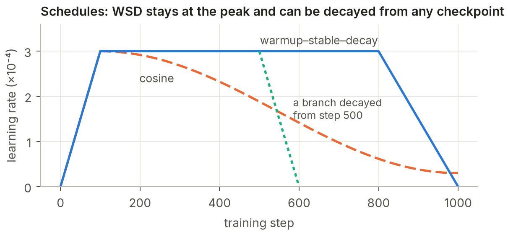
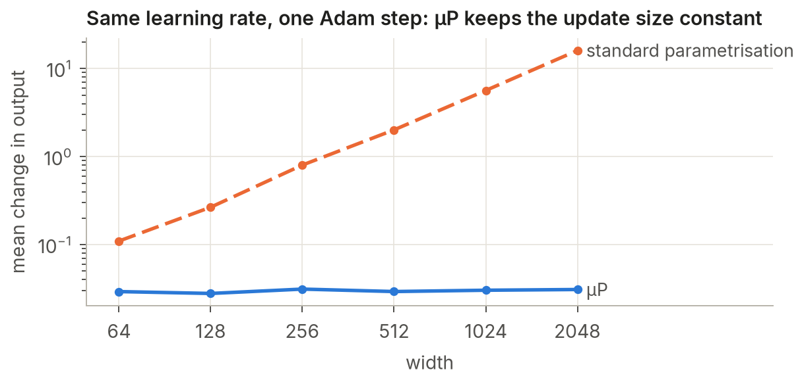

# 7 · Optimisation and training dynamics

Part II · Deep learning and training dynamics. Assumes Chapter 5 (backpropagation, initialisation, normalisation) and Chapter 6 (PyTorch training loops). Chapter 17 applies these ideas at the scale of a pretraining run; Chapter 13 uses them to explain why scaling laws can be fitted at all.

## Why it matters

A research scientist spends more time looking at loss curves than at anything else. Whether a run diverges at step 40,000, whether a new architecture "doesn't work" or was simply given the wrong learning rate, whether a 2× larger batch buys anything, whether fp8 is safe: these are optimisation questions, and they decide what is learned from every GPU-hour. Interviews for LLM roles probe them directly: "write AdamW", "why warm-up?", "what is µP for?", "the loss spiked, what do you do?". This chapter gives you the mechanics and the reasoning behind them, with numbers you can reproduce on a laptop.

Chapter 5 explained how a network learns; this chapter explains why learning at scale is fragile, and what keeps it on track. The sections follow the knobs of a training run. The optimiser decides how a gradient becomes an update (7.1, 7.4). The learning-rate schedule decides how large those updates are over time (7.2), and the batch size how noisy each gradient is (7.3). Initialisation and parametrisation decide whether settings found on a small model still work on a large one (7.5). Number formats decide how much of the arithmetic survives rounding (7.6). The last two sections are diagnostic: how large runs become unstable (7.7), and how to read the curves that warn you first (7.8).

A single idea connects most of them: an update should have the right *size* for every parameter, at every step, at every model width. Adam normalises the size per coordinate, warm-up limits it at the start, µP keeps it constant as models widen, clipping bounds it when a gradient goes wild, and QK-norm and z-loss stop the logits from growing until a fixed-size update becomes too large. Reading the chapter with that question in mind makes the individual tricks much easier to remember.

Numbers in this chapter come from `code/ch07_check.py` (CPU, about two seconds).

## Key concepts

- **AdamW**: Adam with decoupled weight decay; the default optimiser for transformers. [Loshchilov and Hutter](https://arxiv.org/abs/1711.05101).
- **Learning-rate schedules**: warm-up, cosine decay, and warmup-stable-decay (WSD), which keeps a constant rate and decays only at the end. [MiniCPM (WSD)](https://arxiv.org/abs/2404.06395).
- **Gradient noise scale and critical batch size**: the batch size beyond which larger batches stop saving steps. [McCandlish et al.](https://arxiv.org/abs/1812.06162).
- **Second-order-flavoured optimisers**: Adafactor, Lion, Shampoo, SOAP and Muon. [Adafactor](https://arxiv.org/abs/1804.04235), [Lion](https://arxiv.org/abs/2302.06675), [SOAP](https://arxiv.org/abs/2409.11321), [Muon is scalable (Moonlight)](https://arxiv.org/abs/2502.16982).
- **µP (maximal update parametrisation)**: scale initialisation and per-layer learning rates with width so the best hyperparameters transfer from small to large models. [Tensor Programs V](https://arxiv.org/abs/2203.03466).
- **Numerical formats**: fp32, bf16, fp16, fp8 (e4m3, e5m2) and microscaling (MX) formats. [FP8 formats for deep learning](https://arxiv.org/abs/2209.05433).
- **Stability tools**: gradient clipping, z-loss, QK-norm, logit soft-capping. [PaLM (z-loss)](https://arxiv.org/abs/2204.02311), [Scaling ViT to 22B (QK-norm)](https://arxiv.org/abs/2302.05442).
- **Muon at trillion-parameter scale**: [Kimi K2 (MuonClip, QK-Clip)](https://arxiv.org/abs/2507.20534).
- **Residual-stream design**: [Hyper-connections](https://arxiv.org/abs/2409.19606), [mHC](https://arxiv.org/abs/2512.24880).
- **Edge of stability**: full-batch training drives the loss sharpness up to about 2/η and holds it there. [Cohen et al.](https://arxiv.org/abs/2103.00065).

## 7.1 From SGD to AdamW

Almost every LLM is trained with AdamW, and the reasons are specific. A transformer contains parameters whose gradients differ by orders of magnitude, and one global learning rate cannot suit them all. Adam gives every parameter its own effective step size, and AdamW fixes a subtle interaction between that rescaling and weight decay. Both changes are small in code and large in effect.

SGD moves every parameter by the learning rate times its gradient. That is fragile for transformers: gradients for embeddings, attention projections and layer norms differ by orders of magnitude, so one learning rate is too large for some and too small for others.

**Adam** keeps two running averages per parameter: the mean of the gradient (momentum, β₁ ≈ 0.9) and the mean of its square (β₂ ≈ 0.95 for LLMs, 0.999 elsewhere). The update divides one by the square root of the other, so each coordinate moves by roughly the learning rate in units of its own typical gradient size. Bias correction undoes the zero initialisation of both averages in the first steps.

Written out, with gradient gₜ at step t, learning rate η and weight decay λ, one AdamW step is

$$
m_t = \beta_1 m_{t-1} + (1-\beta_1)\,g_t,\qquad v_t = \beta_2 v_{t-1} + (1-\beta_2)\,g_t^2
$$

$$
\hat m_t = \dfrac{m_t}{1-\beta_1^{\,t}},\qquad \hat v_t = \dfrac{v_t}{1-\beta_2^{\,t}},\qquad \theta_t = \theta_{t-1} - \eta\left(\dfrac{\hat m_t}{\sqrt{\hat v_t}+\epsilon} + \lambda\,\theta_{t-1}\right)
$$

The ratio m̂ / √v̂ is a gradient measured in units of its own recent size, so it is close to ±1 when the gradient is consistent and close to 0 when it keeps changing sign. The weight-decay term λθ sits outside that ratio, which is the whole difference between AdamW and Adam with L2.

**AdamW** applies weight decay directly to the weights instead of adding it to the gradient. With Adam, an L2 term added to the gradient is divided by √v like everything else, so heavily-updated weights are barely regularised; decoupling fixes that.

```python
def adamw_step(p, g, m, v, t, lr=1e-3, b1=0.9, b2=0.95, eps=1e-8, wd=0.1):
    p = p * (1 - lr * wd)                      # decoupled weight decay
    m = b1 * m + (1 - b1) * g
    v = b2 * v + (1 - b2) * g * g
    m_hat = m / (1 - b1 ** t)
    v_hat = v / (1 - b2 ** t)
    return p - lr * m_hat / (v_hat.sqrt() + eps), m, v
# matches torch.optim.AdamW to 1e-7 over three steps
# first step, gradients 1e-4 and 1e2: both coordinates move by ≈ 0.001
# (0.0009999 for the 1e-4 gradient, where ε = 1e-8 is no longer negligible)
```

The last line is the key property and the key risk. Adam's first step moves every coordinate by the learning rate, whatever its gradient. That is why Adam needs **warm-up**: at step one the second-moment estimate is built from a single gradient, so the normalised update is large and noisy in every direction at once.

Practical settings for LLM pretraining: β₁ = 0.9, β₂ = 0.95 (a shorter memory for v reacts faster to gradient spikes), ε = 1e-8 (some teams use smaller ε for very large models, because ε starts to dominate when gradients become tiny), weight decay 0.1 on matrices but not on norms, biases or often embeddings.

### Weight decay as a timescale, not only a regulariser

Weight decay is usually introduced as L2 regularisation, but in long LLM runs its more important role is to set how long the weights remember. Each AdamW step multiplies every weight by (1 − ηλ), so the contribution of an update made k steps ago has shrunk by (1 − ηλ)ᵏ ≈ exp(−kηλ). The weights are an exponential moving average of past updates with timescale

$$
\tau_{\mathrm{iter}} = \dfrac{1}{\eta \lambda}
$$

steps. With η = 3 × 10⁻⁴ and λ = 0.1, τ = 33,333 steps: updates older than a few times that have been forgotten. A useful rule that follows (Wang and Aitchison, 2024) is to keep τ a fixed *fraction* of the run: if you double the number of steps, halve λ (or η); if you raise η, lower λ in proportion. Tuning λ at one run length and reusing it for a run ten times longer silently changes how much of the run the final weights average over.

The same balance fixes the size of the weights. Suppose an update of RMS η·r per coordinate (Adam's normalised update has r of order 1) is roughly orthogonal to the weights, as it is for weights followed by a normalisation layer. Then each step shrinks ‖θ‖² by a factor (1 − ηλ)² ≈ 1 − 2ηλ and adds η²r² per coordinate, and the two balance when

$$
\mathrm{RMS}(\theta) \approx r\sqrt{\eta / (2\lambda)}
$$

For η = 3 × 10⁻⁴ and λ = 0.1 that is 0.0387 r; the check script's simulation of 60,000 such steps lands at 0.0383. For a layer followed by a normalisation, the output does not depend on the scale of the weights, only on their direction, so what matters is the angle each update turns them through: η r / RMS(θ) ≈ √(2ηλ) = 0.0077 radians per step at equilibrium. The *effective* learning rate of such layers is therefore set by the product ηλ, not by η alone, which is why changing λ can matter as much as changing η, and why turning weight decay off lets weight norms grow and the effective learning rate fall over the run.

Memory: Adam stores two fp32 states per parameter, 8 bytes, on top of weights and gradients. That is the 16 bytes per parameter of mixed-precision training (Chapter 6) and the reason optimiser-state sharding (ZeRO, Chapter 17) exists.

## 7.2 Learning-rate schedules

The learning rate is the most important hyperparameter of a training run, and its best value changes during training: small at the start while the optimiser's statistics settle, as large as stability allows in the middle to make fast progress, and small again at the end so the model can settle into a minimum. A schedule is a plan for that trajectory. The choice of schedule also has a practical side effect that has become important for research: whether a run can be stopped early, or extended, and still produce a good model.

Three phases appear in nearly every LLM run:

1. **Warm-up**: increase the rate linearly from near zero over the first few hundred to few thousand steps. It gives Adam's second moment time to settle and avoids a large, random first move.
2. **Stable or decaying phase**: most of the training.
3. **Final decay**: bring the rate down. The loss drops sharply when the rate falls, because the optimiser stops bouncing around the bottom of the valley.

**Cosine decay** (to about 10% of the peak) was the default for years and is still a common baseline, which is why the table below uses it. Its weakness is that the schedule depends on the total number of steps: you cannot extend a finished run or take a cheap intermediate checkpoint that is as good as a fully decayed one. The 10% floor is also no longer the recommended end point: studies from 2024–25 report that decaying to zero or near zero gives a lower final loss than stopping at 10% of the peak, and that a linear decay to zero is at least as good as cosine (for example Bergsma et al., 2025, "Straight to Zero"). The reason follows from the explanation below: the final loss is set by how far the noise has been annealed away at the end, and a 10% floor leaves some of it.

**Warmup-stable-decay (WSD)** keeps the peak rate for most of training and decays over the last 10–20% of steps. The shape of that cooldown matters a little: Hägele et al. (2024) found a "1 − sqrt" cooldown, η(s) = η_peak (1 − √s) for progress s from 0 to 1, slightly better than a linear one, because it drops the rate quickly at first and then spends longer at small rates. The constant phase can be branched: take any checkpoint, run a short decay, and you get a model nearly as good as a full cosine run of that length. That makes scaling-law sweeps (Chapter 13) and data-mixture experiments much cheaper, and is now common in open model reports.

| Step (of 1,000) | Cosine (peak 3e-4, floor 10%) | WSD (decay over last 20%) |
|---|---|---|
| 50 (warm-up) | 1.50e-04 | 1.50e-04 |
| 500 | 1.88e-04 | 3.00e-04 |
| 800 | 6.16e-05 | 3.00e-04 |
| 900 | 3.81e-05 | 1.50e-04 |
| 999 | 3.00e-05 | 1.50e-06 |



*The two schedules from the table, and a WSD branch decayed early from step 500 (dotted). A WSD run can produce a finished model from any checkpoint of its stable phase; a cosine run is only finished at its planned end.*

**Why the loss drops when the learning rate decays.** With a large learning rate, SGD and Adam do not settle at the bottom of the loss valley; the gradient noise keeps them bouncing around it at a height that grows with the learning rate. Lowering the rate shrinks the bounce, and the loss falls quickly to the valley floor that the stable phase had already found. The stable phase does the exploring; the decay collects the result. This is also why the final decay is the best moment to switch to the highest-quality data (annealing, Chapter 16).

WSD runs show a higher loss than cosine runs during the stable phase, then catch up and usually overtake during the decay. Comparing two runs mid-training with different schedules is therefore meaningless: compare at matched decayed checkpoints.

## 7.3 Batch size, gradient noise and the critical batch size

Larger batches use hardware better and need fewer optimiser steps, so it is tempting to make them as large as memory allows. But a step on a batch twice as large is not worth two steps on the smaller batch: past a point, the extra examples only refine a gradient that was already accurate enough. Knowing where that point is decides how many GPUs a run can use efficiently, and it moves as training progresses.

A mini-batch gradient is the true gradient plus noise whose variance falls as 1/B. Doubling the batch halves the noise. While noise dominates, doubling B lets you nearly double the learning rate and halve the number of steps: **perfect scaling**. Once the noise is small compared with the gradient itself, larger batches only waste compute.

McCandlish et al. (2018) made this quantitative. The **simple noise scale**

$$
B_{\mathrm{simple}} = \dfrac{\mathrm{tr}(\Sigma)}{\Vert G\Vert^2}
$$

(total per-example gradient variance divided by the squared norm of the mean gradient) predicts the **critical batch size**: below it, more batch saves steps almost one for one; above it, returns diminish.

### Why a variance ratio is a batch size

The derivation takes six lines. Near the current weights, write the loss as a quadratic with gradient G and Hessian H. A batch of B examples gives an estimate g_B whose mean is G and whose covariance is Σ/B, where Σ is the per-example gradient covariance. Take a step −ε g_B. The expected decrease in loss is

$$
\Delta L(\epsilon) = \epsilon \Vert G\Vert^2 - \dfrac{\epsilon^2}{2}\left(G^{\top} H G + \dfrac{\mathrm{tr}(H\Sigma)}{B}\right)
$$

The first term is the progress along the true gradient; the second is the curvature penalty, which the noise makes larger. Maximising over ε gives the best step size and the best improvement:

$$
\Delta L_{\max}(B) = \dfrac{\Delta L_{\max}(\infty)}{1 + B_{\mathrm{noise}}/B},\qquad B_{\mathrm{noise}} = \dfrac{\mathrm{tr}(H\Sigma)}{G^{\top} H G}
$$

So a step with batch B achieves a fraction B / (B + B_noise) of what an infinitely large batch would. When B ≪ B_noise, doubling B nearly doubles the progress per step (perfect scaling); when B ≫ B_noise, a larger batch adds almost nothing. If H is close to a multiple of the identity, H cancels and B_noise becomes B_simple = tr(Σ)/‖G‖², which needs no Hessian and can be measured from per-example gradients. The check script tests the law on a one-dimensional noisy quadratic with B_noise = 9: the measured gain per step is 0.050, 0.252 and 0.450 of the initial loss at B = 1, 9 and 81, against 0.050, 0.250 and 0.450 predicted.

Summed over a whole run, the same model gives McCandlish et al.'s trade-off between the number of optimiser steps S and the number of training examples E = B·S:

$$
\left(\dfrac{S}{S_{\min}} - 1\right)\left(\dfrac{E}{E_{\min}} - 1\right) = 1
$$

S_min is the number of steps with an infinite batch and E_min the number of examples with a tiny one; the critical batch size B_crit = E_min / S_min ≈ B_noise is where you pay 2× in both. Below it you save data and spend steps; above it, the reverse. At B = B_crit / 4 a run needs 5 S_min steps but only 1.25 E_min examples; at B = 4 B_crit it needs 1.25 S_min steps but 5 E_min examples. Training at B_crit balances wall-clock time (steps) against compute (examples).

```python
G = per_example_grads(w, all_indices)               # (N, D)
b_simple = G.var(0).sum() / G.mean(0).pow(2).sum()
# logistic regression, 20 features: 35.6 at initialisation, 145,118 after 300 full-batch steps
```

The noise scale **grows during training**: early on, every example agrees on the direction of improvement; near a minimum, the mean gradient shrinks while per-example disagreement remains. That is why LLM runs use batch-size warm-up (start smaller, grow to millions of tokens) and why the critical batch size grows as the loss falls. It also gives the scaling-law version: larger, better-trained models tolerate larger batches.

Rules of thumb:

- **SGD**: scale learning rate linearly with batch size (Goyal et al., 2017), with warm-up.
- **Adam**: closer to square-root scaling, and the effect saturates. Always re-tune the learning rate when you change the batch size by more than about 2×.
- **Tokens, not sequences**: LLM batch sizes are quoted in tokens (for example 4M tokens = 1,024 sequences of 4,096).

## 7.4 Beyond Adam: Adafactor, Lion, Shampoo, SOAP and Muon

Adam treats every parameter as an independent number. The weights of a transformer are not independent numbers; they are matrices, and the gradient of a matrix has structure, a few dominant directions and many weak ones. The optimisers in this section either cut Adam's memory cost or exploit that matrix structure to take better steps. Muon, the most important of them, has moved from a research curiosity to the optimiser of some frontier-scale open models in under two years.

**Adafactor** stores the second moment of a matrix as a row vector and a column vector (their outer product approximates it), so the optimiser state is O(m + n) instead of O(mn). Used for T5 and PaLM, useful when memory is tight.

**Lion** (found by program search) keeps only momentum and updates by its **sign**: every coordinate moves by exactly ±η. Half of Adam's state, needs a smaller learning rate (3–10×) and larger weight decay.

**Shampoo and SOAP** precondition each weight matrix with left and right covariance matrices of its gradient, an approximation to second-order methods. They take fewer steps than Adam for the same loss but cost matrix roots and more memory; SOAP runs Adam in Shampoo's eigenbasis and is simpler to tune.

**Muon** (Jordan et al., 2024; scaled up in Moonlight, 2025, and by later open models) treats each hidden weight matrix as a whole. It takes the momentum matrix and replaces it with the nearest orthogonal matrix, so every direction in the update has the same size. Exact orthogonalisation needs an SVD; Muon uses a few Newton–Schulz iterations, which only need matrix multiplications and run well in bf16:

```python
def newton_schulz(G, steps=5):
    a, b, c = 3.4445, -4.7750, 2.0315          # tuned quintic coefficients
    X = G / (G.norm() + 1e-7)
    transpose = X.shape[0] > X.shape[1]
    if transpose: X = X.T
    for _ in range(steps):
        A = X @ X.T
        X = a * X + (b * A + c * A @ A) @ X
    return X.T if transpose else X
# a 64x32 "gradient" with singular values spread 1,889:1 comes out with all of them in 0.17-1.13
```

The intuition: gradient matrices of transformers are dominated by a few directions. Adam follows them; Muon boosts the rare directions to the same size, which explores more of the space per step. Muon applies only to 2-D hidden matrices; embeddings, the output head and norm parameters still use AdamW. Reported gains are of order 1.3–2× fewer tokens for the same loss at small and medium scale; at large scale it needs care with update size (matching Adam's RMS) and with attention logits growing. Kimi K2 (2025, about 1T parameters, 32B active) added **QK-Clip**: after each update, if a head's largest attention logit exceeds a threshold, rescale that head's query and key weights so it cannot grow further. QK-norm, the usual fix, does not apply to MLA, whose keys are never fully materialised at inference. With this "MuonClip" the model pretrained on 15.5T tokens without a loss spike. Treat claimed speed-ups as hypotheses to reproduce on your own setup with tuned baselines: many optimiser papers compare against an under-tuned Adam.

## 7.5 Initialisation, residual scaling and µP

Large models are too expensive to tune: nobody sweeps learning rates on a 100-billion-parameter run. The practical hope is to tune a small model and reuse its settings. Whether that works depends on the parametrisation, the rules that set initial weight scales and per-layer learning rates as a function of width and depth. Get those rules right and the best settings stay put as the model grows; get them wrong and every size needs its own sweep.

**The variance argument** (Chapter 5): a linear layer with fan-in n and weights of variance σ² multiplies the variance of its input by nσ². σ² = 1/n (Xavier/LeCun, or 2/n for ReLU, He) keeps activations from exploding or vanishing through depth.

**Residual streams** add each block's output to a running sum. With L blocks of unit-variance outputs, the stream's variance grows like L. GPT-2 scaled the output projection of each block by 1/√(2L); many recipes initialise those projections smaller or to zero. Pre-norm (normalise the input of each block, not its output) keeps gradients well behaved at depth and is the standard.

**Widening the residual stream.** Hyper-connections (2024) keep several parallel residual streams and learn how each layer reads from and writes to them, which adds capacity at almost no compute. Unconstrained, the learned mixing matrices compound across layers and break the identity path that makes deep residual networks trainable, so signals and gradients can blow up. DeepSeek's **mHC** (manifold-constrained hyper-connections, 2025) projects the mixing matrices onto doubly stochastic matrices (rows and columns sum to one, computed with a few Sinkhorn iterations). Each layer's mixing is then a weighted average of the streams, and a product of doubly stochastic matrices is again doubly stochastic, so however deep the network the composite mixing can neither amplify nor shrink the signal. DeepSeek report stable training at 27B parameters for about 7% extra training time. The same lesson as for initialisation: a change that adds expressiveness must keep the residual path close to the identity.

**µP.** In the standard parametrisation (SP), the best learning rate drifts as the model widens: a rate tuned at width 256 makes width 8,192 diverge, so every size needs its own sweep. The **maximal update parametrisation** (Yang et al., 2022) changes the initialisation and the per-layer learning rates so that each layer's update has the same effect on its output at every width. For Adam the main rules are: hidden-matrix learning rates scale as 1/width, the output layer is initialised with variance 1/width² (not 1/width) and attention logits are scaled by 1/d instead of 1/√d.

The check script shows the core problem. One Adam step on a three-layer MLP, same learning rate, three widths:

| Width | Mean change in output, standard | Mean change in output, µP |
|---|---|---|
| 64 | 0.110 | 0.029 |
| 256 | 0.802 | 0.031 |
| 1,024 | 5.639 | 0.030 |



*The same experiment extended to width 2,048 (log scales). Under the standard parametrisation the effect of one step grows roughly in proportion to width, from 0.11 at width 64 to 16 at width 2,048; under µP it stays near 0.03.*

**Why the effect grows with width.** In a layer of width n, a weight update from Adam has roughly the same size for every weight, and each output unit sums n such contributions that all point the same way (they were computed from the same gradient signal). The change in the output therefore grows like n, while a random weight perturbation would only grow like √n. µP scales the learning rate by 1/n for these layers so that the summed change stays constant.

Under SP, the same step moves the output 50× more at width 1,024 than at 64: a learning rate that is safe for the small model blows up the large one. Under µP the effect is constant, so the best learning rate found on a small proxy model transfers. This is **µTransfer**: tune on a 40M-parameter proxy, train the 10B model once. Several labs use µP or close variants; others fit learning-rate scaling laws instead (Chapter 13). Either way, "we tuned hyperparameters at small scale and they transferred" is a claim to check, not assume.

## 7.6 Numerical precision

Every halving of the number of bits per value roughly doubles matrix-multiplication throughput and halves memory traffic, so the history of large-model training is a steady move to smaller formats: fp32, then fp16, bf16, and now fp8 and 4-bit block formats. Each step only works if the values that matter still fit. A number format has a fixed budget of bits split between the **exponent**, which sets the range (how large and how small a value can be), and the **mantissa**, which sets the precision (how finely values are spaced). Training needs range more than precision, and that single fact explains the choices below.

| Format | Exponent / mantissa bits | Largest value | Notes |
|---|---|---|---|
| fp32 | 8 / 23 | 3.4e38 | Master weights, optimiser states, reductions |
| bf16 | 8 / 7 | 3.39e38 | fp32's range, coarse precision (ε = 0.0078); default for training |
| fp16 | 5 / 10 | 65,504 | Finer precision, tiny range: needs loss scaling |
| fp8 e4m3 | 4 / 3 | 448 | Forward activations and weights |
| fp8 e5m2 | 5 / 2 | 57,344 | Gradients (need range more than precision) |
| MXFP8 / MXFP4 / NVFP4 | 8- or 4-bit elements + a shared scale per block of 16–32 values | – | Block scaling; native on recent GPUs |

**Why fp32 master weights.** bf16 has 8 bits of precision. Adding a small update to a weight of 1.0 loses it entirely:

```python
torch.tensor(1.0).bfloat16() + torch.tensor(1e-3).bfloat16()   # -> 1.0 (the update vanished)
torch.tensor(1.0) + 1e-3                                        # -> 1.001
```

So mixed-precision training computes in bf16 but keeps an fp32 copy of the weights and accumulates updates there. fp16's problem is the opposite: small gradients underflow to zero, hence dynamic **loss scaling** (multiply the loss by a large factor, unscale before the update, skip steps that overflow). bf16 removed the need for it, which is why bf16 won.

**fp8 needs scaling.** e4m3 represents 300 as 288 and anything below about 0.002 as zero:

```python
small = torch.tensor([1e-4, 3e-4, 5e-4])
small.to(torch.float8_e4m3fn)                     # -> all zeros
scale = 448 / small.abs().max()                   # per-tensor scale into the representable range
(small * scale).to(torch.float8_e4m3fn).float() / scale   # -> 9.8e-05, 2.86e-04, 5e-04
```

Production fp8 training (DeepSeek-V3 was the first widely documented frontier-scale example) uses fine-grained scales (per tile or block), keeps sensitive parts in higher precision (embeddings, the output head, normalisation, attention softmax, optimiser states, master weights) and accumulates matrix products in higher precision. MX formats build the block scale into the format itself. The payoff is roughly 2× matmul throughput and less memory; the cost is engineering and the risk of silent quality loss that only appears late in a run. Always validate a low-precision recipe against a bf16 baseline on the same data before trusting it.

## 7.7 Stability: spikes, logits and the edge of stability

A small model that trains badly wastes an afternoon; a large run that diverges after three weeks wastes millions. Instabilities become more common with scale, because larger models and longer runs give rare events (a bad batch, a slowly growing logit) more chances to happen, and because the learning rate is pushed as high as stability allows. Most failures have a handful of recognisable causes, each with a standard fix.

Large runs fail in a few recognisable ways.

**Loss spikes.** The loss jumps by a large amount, then either recovers or diverges. Common causes: a bad batch (corrupted or extremely repetitive data), attention logits growing until softmax saturates, the output logits drifting, or Adam's second moment going stale for a parameter that suddenly gets a large gradient. Standard responses, cheapest first: skip the offending batches and restart from the last good checkpoint; lower the learning rate; add the architectural fixes below.

**Gradient clipping** rescales the whole gradient vector when its norm exceeds a threshold (1.0 is standard):

```python
torch.nn.utils.clip_grad_norm_(params, max_norm=1.0)
# gradient pieces [3,0,0] and [0,4,0,0]: norm 5.0 before, 1.0 after (direction unchanged)
```

Log the pre-clip norm: a run where clipping fires on most steps has a learning rate or stability problem that clipping is hiding.

**z-loss** (PaLM) adds a small penalty on log Z, the log of the softmax normaliser, keeping output logits from drifting upwards:

```python
log_z = torch.logsumexp(logits, dim=-1)       # [12.17, 2.46] for two example rows
z_loss = 1e-4 * log_z.pow(2).mean()           # 0.0077, added to the cross-entropy
```

**QK-norm** normalises queries and keys (RMSNorm on each) before their dot product, so attention logits cannot grow without bound. **Logit soft-capping** (cap · tanh(x / cap)) bounds logits smoothly (used by Gemma 2). Both trade a little flexibility for much better stability at scale.

**Edge of stability.** Cohen et al. (2021) showed that full-batch gradient descent raises the sharpness (largest Hessian eigenvalue) of the loss until it reaches about 2/η, then oscillates there while the loss keeps falling non-monotonically. Classical theory says such a learning rate should diverge. Adam shows an analogous behaviour on its preconditioned sharpness. The practical lesson: the learning rate partly determines which regions of the loss landscape training can stay in, so "a larger learning rate finds flatter minima" has a mechanism, and instability at too high a rate is a sharpness problem, not bad luck.

## 7.8 Reading training curves

Training curves are the main instrument panel of a research scientist. Most problems leave a characteristic signature, in the loss, the gradient norm or the weight norms, well before the run fails outright. The table below maps common signatures to their usual causes and the first thing to try.

| What you see | Likely cause | First thing to try |
|---|---|---|
| Loss flat from step 0 | Learning rate far too small, frozen parameters, bug in labels or masking | Overfit one batch; check that gradients are non-zero everywhere |
| Loss NaN in the first few hundred steps | No or too short warm-up, learning rate too high, fp16 overflow | Longer warm-up, lower rate, bf16, check the data for empty or huge examples |
| Spikes that recover | Bad batches, Adam state going stale | Log the batch IDs at spikes; skip data; lower β₂ |
| Spikes that diverge late in training | Logit growth in attention or output | QK-norm, z-loss, lower rate; restart from before the spike |
| Train loss falls, validation loss rises | Overfitting or repeated data (epochs on a small corpus) | More data, deduplication, earlier stop |
| Loss drops sharply at the end | The schedule decaying (expected for WSD and cosine) | Compare runs only at matched points |
| Two seeds differ more than your ablation effect | The effect is noise | Report seed variance (Chapter 34) |
| Gradient norm rising steadily | Growing logits or weights; weight decay off | Check weight-decay groups; watch per-layer norms |

What to log on every run: loss (train and held-out), learning rate, gradient norm before clipping, per-layer weight and update norms, max attention logit, tokens seen, throughput and MFU (Chapter 17). Most stability problems are visible in these signals thousands of steps before the loss shows them.

## Pitfalls

- Comparing optimisers or architectures at one learning rate. Sweep the rate for each, or the comparison only shows which one likes your default.
- Applying weight decay to norms, biases and embeddings by accident (the default parameter group in many scripts).
- Changing the batch size without re-tuning the learning rate.
- Comparing a cosine run and a WSD run before both have decayed.
- Accumulating updates in bf16 without fp32 master weights.
- Trusting an fp8 or new-optimiser result without a matched baseline at the same token budget.
- Reading one seed as a result.

## Interview questions

**1. Write the AdamW update. Why is weight decay "decoupled"?** See 7.1: m and v are exponential averages of g and g², bias-corrected by 1 − βᵗ, and θ ← θ − η(m̂/(√v̂ + ε) + λθ). With Adam, an L2 term in the gradient is divided by √v, so parameters with large gradients get almost no regularisation; AdamW subtracts lr·wd·p directly, independent of the gradient statistics. A number to show you understand the normalisation: on the first step every coordinate moves by ≈ η whatever its gradient (0.001 for both a 1e-4 and a 1e2 gradient at η = 1e-3). Follow-up: "what does bias correction do?" Without it m₁ = 0.1g and v₁ = 0.05g² (β₂ = 0.95), so early updates would be the wrong size; dividing by 1 − βᵗ undoes the zero initialisation.

**2. Why do transformers need warm-up?** Three reasons, from the most mechanical to the deepest. First, Adam's first steps have a poorly estimated second moment, so every coordinate moves by about the full learning rate in a random-looking direction; with large rates this throws the model into a bad region or blows up attention logits. Second, in post-LN transformers the gradients of the last layers are large at initialisation (Xiong et al., 2020), so a full-size step there diverges. Third, the sharpness view: at initialisation the loss surface is sharp, and a learning rate above about 2/sharpness is unstable (the edge of stability, 7.7); a gradual ramp lets training move into flatter regions where the target rate is stable, so warm-up's real job is to make a high peak rate reachable (Kalra and Barkeshli, 2024). With a few thousand warm-up steps out of hundreds of thousands, the cost is negligible. When it matters less: pre-LN models at small learning rates, and fine-tuning from a trained checkpoint, which already sits in a flat region (a short warm-up is still cheap insurance). Follow-up: "how long?" Long enough that the loss curve has no early spike; typically 0.5–2% of steps, longer when the batch or peak rate is raised.

**3. What is the WSD schedule and why do teams like it?** Warm-up, a long constant phase, then a short decay over the last 10–20% of steps. Any checkpoint in the constant phase can be decayed into a good model, so you can extend runs, run cheap scaling-law and data experiments from branches, and avoid fixing the total length in advance. Number: with five model sizes and four token budgets, cosine needs 20 separate runs; WSD needs five constant-rate runs plus 20 short decays of about 20% each. Trade-off: during the stable phase the loss sits above a cosine run's, so mid-run comparisons are meaningless; compare decayed checkpoints. Follow-up: "what shape should the decay have?" Decay to (near) zero rather than to 10%, and a 1 − sqrt shape was reported slightly better than linear (7.2).

**4. What is the critical batch size?** The batch size beyond which larger batches give diminishing reductions in the number of steps. It is roughly the gradient noise scale tr(Σ)/|G|², grows as the loss falls, and is larger for bigger, better-trained models. The derivation: with batch B the best step achieves a fraction 1/(1 + B_noise/B) of the noiseless improvement, so steps scale as 1 + B_noise/B and examples as 1 + B/B_noise; at B = B_crit you pay 2× in both, at B = 4 B_crit you need 1.25× the minimum steps but 5× the minimum data. In the chapter's logistic regression the noise scale grows from 35.6 examples at initialisation to about 145,000 near the optimum, which is why LLM runs ramp the batch size up. Follow-up: "how would you measure it in a real run?" Compare gradient norms at two batch sizes (small and large) and solve for tr(Σ) and |G|², as McCandlish et al. do, instead of computing per-example gradients.

**5. How does Muon differ from Adam?** Adam normalises each coordinate separately. Muon orthogonalises the whole momentum matrix of a hidden layer (via five Newton–Schulz iterations, which map every singular value s through an odd polynomial and push it into a band near 1), equalising the size of the update in all directions; it is steepest descent under the spectral norm. Updates are scaled by 0.2√max(m, n) so their RMS matches AdamW's (an orthogonal 64 × 32 matrix has RMS 1/8). It applies to 2-D hidden matrices only; embeddings, heads and norm parameters stay on AdamW. Memory: one momentum buffer instead of two, so 4 rather than 8 bytes of state per parameter. Trade-off: extra matrix multiplications per step (a few percent of step time at scale) and the need to control attention-logit growth (Kimi K2's QK-Clip). Follow-up: "why not exact SVD?" Too slow and poorly suited to bf16 on GPUs; the approximate polar factor is good enough because the exact singular values do not matter.

**6. What problem does µP solve? State its main rules for Adam.** Hyperparameters, especially the learning rate, stop transferring across widths under the standard parametrisation. µP scales hidden learning rates as 1/width, initialises the output layer with variance 1/width² and scales attention by 1/d, so the per-step change in each layer's output is width-independent and tuned settings transfer from small proxies. In the chapter's experiment the output change from one Adam step grows from 0.110 to 5.64 as width goes from 64 to 1,024 under SP (about 50×) and stays at 0.03 under µP. Limits: µP covers width only; depth needs residual-branch scaling (depth-µP, CompleteP), and the best learning rate still moves with batch size and run length. Follow-up: "why does the change grow linearly, not with √width?" Adam's update has the same sign pattern as the gradient, so the n contributions to each output add coherently rather than as a random walk.

**7. Why bf16 rather than fp16 for training? Why keep fp32 master weights?** bf16 has fp32's exponent range (8 bits, up to 3.4 × 10³⁸), so gradients do not underflow and no loss scaling is needed; fp16 tops out at 65,504 and flushes values below about 6 × 10⁻⁸. Its 8-bit precision cannot represent small updates to weights of order 1 (1 + 1e-3 rounds to 1, since bf16's spacing near 1 is 0.0078), so updates are accumulated in an fp32 copy. Cost: 4 extra bytes per parameter of the 16 in mixed-precision training. Follow-up: "could you drop the master copy?" With stochastic rounding, which makes the expected rounded value equal the true one, some recipes do; with round-to-nearest, small updates systematically vanish.

**8. What makes fp8 training hard?** Tiny dynamic range: e4m3 tops out at 448 and flushes values below about 0.002 (without scaling, 1e-4 to 5e-4 all become 0), so tensors need fine-grained scaling factors per tile or block. Some operations and states must stay in higher precision (embeddings, output head, norms, softmax, optimiser state, master weights), and matmul accumulation must be in higher precision. Errors can accumulate silently and only show late in a run. The pay-off is roughly 2× matmul throughput over bf16. Follow-up: "which format for gradients?" e5m2 historically (more range); fine-grained scaling has made e4m3 usable for more tensors. Always compare against a bf16 baseline at the same token budget.

**9. Your loss spiked at step 60k and did not recover. Walk through what you do.** Triage, then localise, then fix, then record. Restart from a checkpoint well before the spike (a few hundred to a few thousand steps, since the cause usually builds up). Localise with logged signals: the global gradient norm before clipping; per-layer gradient and update norms to find where it started (embeddings, a particular attention block, the output layer); the update-to-weight ratio per layer (a jump from ~1e-3 to 1e-2 is the signature); the max attention logit and output log Z in the steps before. Check the data: replay the same batches after a restart and see whether the spike recurs at the same step (data-driven) or not (numerical, stochastic); inspect those batches for corrupted or extremely repetitive text. Fixes, cheapest first: skip the offending batches, lower the peak rate or β₂, then architectural guards (QK-norm, z-loss) for this or future runs. Decide whether to reset optimiser state: a reset re-creates the stale-moment problem, so keep the state unless it contains NaNs or the spike polluted v. Follow-up: "the spike recurs without the bad data": then it is logit or weight growth, and the per-layer norms will show which.

**10. What are z-loss and QK-norm for?** z-loss penalises log² of the softmax normaliser to stop output logits drifting; QK-norm normalises queries and keys so attention logits stay bounded. Both prevent the logit growth that causes late-training instability. The underlying reason is that softmax is shift-invariant, so the cross-entropy gradient (p − y) sums to zero and nothing restrains the mean logit; in bf16, logits near 300 are spaced 2 apart, so the differences that carry the probabilities are rounded away. With coefficient 1e-4 and log Z = 12 the z-loss adds only about 0.014 to the loss but provides the missing restoring force. Follow-up: "why can't Kimi K2 use QK-norm?" With MLA the keys are not fully materialised at inference, so they used QK-Clip, rescaling query and key weights after each step instead.

**11. What is the edge of stability?** Full-batch GD increases sharpness (the top Hessian eigenvalue) until it hovers at 2/η, where classical analysis of a quadratic predicts divergence, while the loss still falls non-monotonically. It shows that the learning rate shapes which minima are reachable: with η = 0.01, training is confined to regions of sharpness about 200 or less. Adam shows the same on its preconditioned sharpness. Implication: a higher learning rate biases training towards flatter regions, and warm-up is partly a way to reach them gradually. Follow-up: "does it hold with mini-batches?" Roughly, with a lower threshold because noise adds instability; it is a regime, not a precise law.

**12. A paper claims a new optimiser trains 2× faster. What do you check?** That the Adam baseline was tuned as hard (learning rate, β₂, warm-up, weight decay) at the same batch size and schedule; that the comparison is at matched tokens and final decayed loss, across several scales and seeds; and that the gain holds on downstream evaluation, not only on loss. Also check that "2× faster" means fewer tokens to a target loss and not just lower loss at one point mid-run, that wall-clock overhead per step is counted, and that the gain does not shrink with scale (many do). A quick sanity number: a 1.3× token-efficiency gain at 100M parameters that falls to 1.1× at 1B is a different claim from a constant 2×. Follow-up: "what single experiment would convince you?" A learning-rate sweep for both optimisers at two or three model sizes, reported as the loss of the best rate per size, with seed error bars.

**13. You double the length of a pretraining run. How should the weight decay change, and why?** View AdamW's weights as an exponential average of past updates with timescale τ = 1/(ηλ) steps (7.1). At η = 3e-4 and λ = 0.1 that is 33,333 steps. If the run length doubles and λ stays fixed, τ becomes a smaller fraction of the run, so the final weights average over a relatively shorter window; the rule that has worked in practice (Wang and Aitchison, 2024) is to keep τ a fixed fraction of the total steps, so halve λ (or η) when you double the steps. For layers followed by normalisation the equilibrium angular update is √(2ηλ), so ηλ, not η alone, sets their effective learning rate: raising η and lowering λ by the same factor keeps it constant. Trade-off: very small λ lets weight norms grow and effective learning rates decay; very large λ turns the weights into a short-memory average and raises the loss floor. Follow-up: "and if you change the batch size?" The number of steps changes, so τ as a fraction of the run changes too; recompute it.

**14. Derive why the gradient noise scale B = tr(Σ)/‖G‖² is a batch size.** For a step −εg_B on a locally quadratic loss with gradient G, Hessian H and per-example gradient covariance Σ, the expected decrease is ε‖G‖² − ½ε²(GᵀHG + tr(HΣ)/B). Optimising ε gives a best decrease of ΔL_max(∞)/(1 + B_noise/B) with B_noise = tr(HΣ)/(GᵀHG), which reduces to tr(Σ)/‖G‖² when H is proportional to the identity. So B_noise is exactly the batch at which noise halves the progress per step: below it, doubling the batch nearly doubles progress; above it, gains vanish. Check: on a noisy quadratic with B_noise = 9, measured gains are 0.050, 0.252 and 0.450 at B = 1, 9 and 81 against 0.050, 0.250 and 0.450 predicted. Caveat: the quadratic model and H ∝ I are approximations; in practice B_simple is a guide to the order of magnitude. Follow-up: "why does it grow during training?" ‖G‖ shrinks near a minimum while the per-example disagreement tr(Σ) does not.

## Practice

These exercises use Chapter 10's mini-GPT (10.10) where they mention a small transformer. If you have not reached Chapter 10 yet, a two-layer MLP on MNIST or the logistic regression in `code/ch07_check.py` is a stand-in for exercises 1, 3 and 5.

1. Implement AdamW, Lion and a Muon step from scratch for a small transformer (Chapter 10's mini-GPT); check AdamW against `torch.optim.AdamW`.

<details><summary>Hint and expected result</summary>

AdamW must match `torch.optim.AdamW` to about 1e-7 after a few steps (the check script's test); the usual bug is applying weight decay after the Adam update instead of before, or forgetting bias correction. Lion: update = sign(β₁m + (1 − β₁)g), then m ← β₂m + (1 − β₂)g; use a learning rate 3–10× smaller than AdamW's. Muon: apply Newton–Schulz only to 2-D hidden matrices and keep AdamW for embeddings, head and norms; check that the singular values of the orthogonalised update lie roughly in 0.5–1.2.

</details>

2. Train the mini-GPT with cosine and WSD schedules for the same number of tokens; decay a WSD branch from the middle of the stable phase and compare its loss with a full cosine run of that length.

<details><summary>Hint and expected result</summary>

Expect the WSD run's loss to sit above the cosine run's during the stable phase and to drop sharply during its decay, ending level with or slightly below cosine. The branch decayed from mid-run should land within a small margin of a cosine run planned for that length; the gap should be smaller than the seed-to-seed spread on a small model.

</details>

3. Measure the gradient noise scale at several points of training and plot it against the loss.

<details><summary>Hint and expected result</summary>

Use per-example gradients for a small model (`torch.func.vmap` over `grad`), or the two-batch-size estimator. The noise scale should rise by orders of magnitude as the loss falls; the logistic regression in the check script goes from 35.6 to about 145,000 examples.

</details>

4. **Research exercise.** Sweep the learning rate (7 values, 3 seeds each) for widths 128, 256 and 512, under the standard parametrisation and under µP. Plot loss against learning rate per width. Does the optimum move under SP and stay under µP? Report seed variance as error bars.

<details><summary>Hint and expected result</summary>

Use a factor-of-2 grid of learning rates and the same token budget for every run. Under SP the best learning rate should fall as width grows (roughly in proportion to 1/width for the hidden layers with Adam), so the U-shaped curves shift left; under µP their minima should line up within one grid step. If the seed error bars are wider than the gap between neighbouring learning rates, add seeds before drawing a conclusion.

</details>

5. Train in bf16 with and without fp32 master weights; plot the gap.

<details><summary>Hint and expected result</summary>

Without master weights, updates smaller than about 0.4% of a weight's magnitude round away (bf16 spacing near 1 is 0.0078), so the loss plateaus early, especially late in a decayed schedule when updates are smallest. Expect the bf16-only run to stall above the master-weight run, with the gap opening during the learning-rate decay.

</details>

6. Reproduce the stale-second-moment numbers of 7.7: feed Adam zero gradients for 1,000 steps and then a single gradient of 1, and plot the cumulative update for β₂ = 0.95 and 0.999.

<details><summary>Hint and expected result</summary>

Cumulative movement should reach about 5.8η for β₂ = 0.95 and about 31.8η for β₂ = 0.999 (ignore bias correction after 1,000 steps). The first-step update is 0.45η and 3.16η.

</details>

## Read next

- Loshchilov and Hutter, "Decoupled Weight Decay Regularization" (2019).
- McCandlish et al., "An Empirical Model of Large-Batch Training" (2018).
- Yang et al., "Tensor Programs V: Tuning Large Neural Networks via Zero-Shot Hyperparameter Transfer" (2022), and the companion µP practitioner notes.
- Keller Jordan's Muon write-up (2024) and Liu et al., "Muon is Scalable for LLM Training" (Moonlight, 2025).
- Micikevicius et al., "FP8 Formats for Deep Learning" (2022), and the DeepSeek-V3 technical report (2024), section on fp8 training.
- Cohen et al., "Gradient Descent on Neural Networks Typically Occurs at the Edge of Stability" (2021).
- Wortsman et al., "Small-scale proxies for large-scale Transformer training instabilities" (2023): reproduces spikes cheaply and tests the fixes.
- Links to these papers are in the Key concepts section at the top of this chapter.

## Done when

- Without notes, you write AdamW with bias correction in 3 minutes, and your code matches `torch.optim.AdamW` to 1e-7.
- You compute the weight-decay timescale for η = 3e-4, λ = 0.1 (answer: 33,333 steps) and say how λ should change when the run doubles in length.
- You derive ΔL_max(B) = ΔL_max(∞)/(1 + B_noise/B) on a whiteboard in 5 minutes, and use the steps–data trade-off to say what B = 4 B_crit costs (answer: 1.25× minimum steps, 5× minimum examples).
- You write Muon's full update, explain why 0.2√max(m, n) matches AdamW's RMS (an orthogonal 64 × 32 matrix has RMS 0.125), and explain why five Newton–Schulz steps leave singular values in a band rather than at exactly 1.
- You state µP's three Adam rules and what µP does not transfer (depth, batch size, run length).
- You compute Adam's response to one large gradient after a quiet period (first update 3.16η at β₂ = 0.999, 0.45η at β₂ = 0.95) and explain why lowering β₂ helps.
- Given a loss spike, you list the logged signals you would check, in order, and the fixes, cheapest first.

---

[← 6 · PyTorch for practitioners](06-pytorch-for-practitioners.md) · [Contents](../README.md#contents) · [8 · Embeddings and sequence models →](08-embeddings-and-sequence-models.md)
