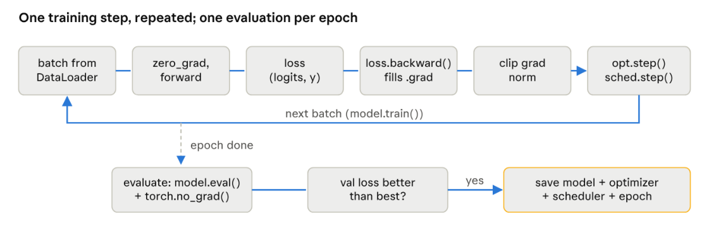

# 07 · PyTorch for practitioners

## Why it matters

Every deep-learning question in a senior loop eventually turns into "write the training loop" or "why is this loss not going down". PyTorch is the default language for that conversation: Hugging Face, sentence-transformers, PEFT and most research code sit on top of it. You do not need to know its internals, but you need to write a correct loop from memory, put tensors on the right device, save and resume training, and debug shapes calmly. Live coding is where many otherwise strong candidates stumble, so this chapter is about fluency, not theory: type every snippet yourself.

All code below was run on CPU with PyTorch 2.x; outputs quoted are from that run.

## Key concepts

- **Tensor**: an n-dimensional array with a data type and a device (CPU or GPU). Start with PyTorch's [Learn the Basics](https://docs.pytorch.org/tutorials/beginner/basics/intro.html) series.
- **Autograd**: PyTorch records operations on tensors and computes gradients automatically with `.backward()`.
- **nn.Module**: the class that holds a model's layers and parameters and defines `forward`.
- **Dataset and DataLoader**: how data is indexed, batched, shuffled and loaded in parallel. [torch.utils.data](https://docs.pytorch.org/docs/stable/data.html).
- **Training loop**: zero gradients, forward, loss, backward, optimiser step, repeated over batches; evaluation in `eval()` mode without gradients.
- **Mixed precision**: running in 16-bit for speed and memory with a 32-bit master copy. [Automatic mixed precision](https://docs.pytorch.org/docs/stable/amp.html).
- **Checkpointing and reproducibility**: saving model, optimiser and scheduler state; seeding every random source.
- **Distributed training (DDP, FSDP)**: copying the model across GPUs and splitting data, or sharding the model itself. [DDP tutorial](https://docs.pytorch.org/tutorials/intermediate/ddp_tutorial.html).
- **Debugging practice**: [A Recipe for Training Neural Networks](https://karpathy.github.io/2019/04/25/recipe/) (Karpathy).

## 7.1 Tensors and autograd

A tensor is an n-dimensional array with a `dtype`, a `device` and, optionally, a gradient. Autograd records the operations applied to tensors with `requires_grad=True` and, on `.backward()`, walks that graph in reverse to fill `.grad`.

```python
import torch
x = torch.tensor([2.0, 3.0], requires_grad=True)
y = (x ** 2).sum() + 3 * x[0]   # y = x0^2 + x1^2 + 3*x0
y.backward()
print(x.grad)                   # tensor([7., 6.])  -> dy/dx0 = 2*2+3, dy/dx1 = 2*3
```

Rules worth saying out loud in an interview:

- `.backward()` only works on a scalar (or needs a `gradient=` argument). Losses are reduced to a scalar for that reason.
- Gradients **accumulate** into `.grad`. That is why every step starts with `opt.zero_grad()`, and also why gradient accumulation works for free.
- `torch.no_grad()` (or `torch.inference_mode()`) stops graph recording: faster, less memory, needed for evaluation.
- `.detach()` gives a tensor that shares data but is cut from the graph; `.item()` gives a Python number (and forces a device sync).
- Shapes: learn `view` vs `reshape` (view needs contiguous memory), `unsqueeze` / `squeeze`, `permute`, broadcasting rules (align from the right; size-1 dims stretch). Most bugs are silent broadcasting, for example a `(B,)` target against a `(B,1)` prediction giving a `(B,B)` loss.

## 7.2 nn.Module

A module owns parameters and sub-modules, and defines `forward`. Registering layers as attributes is what makes `model.parameters()`, `.to(device)`, `state_dict()` and `train()/eval()` work.

```python
import torch.nn as nn

class ReorderModel(nn.Module):
    def __init__(self, d_in, d_hidden=64, p_drop=0.1):
        super().__init__()
        self.net = nn.Sequential(
            nn.Linear(d_in, d_hidden), nn.ReLU(), nn.Dropout(p_drop),
            nn.Linear(d_hidden, 1))
    def forward(self, x):
        return self.net(x).squeeze(-1)   # logits, shape (B,)
```

Return **logits**, not probabilities, and use `BCEWithLogitsLoss` / `CrossEntropyLoss`: they fuse the sigmoid/softmax with the log for numerical stability. A plain Python list of layers is invisible to PyTorch; use `nn.ModuleList` or `nn.ModuleDict`. Non-trainable state that must move with the model (a running mean, a fixed embedding) goes in `self.register_buffer`.

## 7.3 Dataset and DataLoader

`Dataset` answers two questions: how many items (`__len__`) and give me item i (`__getitem__`). `DataLoader` batches, shuffles and parallelises.

```python
from torch.utils.data import Dataset, DataLoader

class OrdersDataset(Dataset):
    def __init__(self, X, y):
        self.X = torch.as_tensor(X, dtype=torch.float32)
        self.y = torch.as_tensor(y, dtype=torch.float32)
    def __len__(self):
        return len(self.y)
    def __getitem__(self, i):
        return self.X[i], self.y[i]

g = torch.Generator().manual_seed(0)
train_dl = DataLoader(train_ds, batch_size=128, shuffle=True, generator=g, num_workers=0)
val_dl = DataLoader(val_ds, batch_size=512)   # no shuffle for evaluation
```

In practice: `num_workers>0` and `pin_memory=True` speed up GPU training when loading is the bottleneck; text batches of different lengths need a `collate_fn` that pads (Hugging Face's `DataCollatorWithPadding` does this); very large data uses an `IterableDataset` that streams.

## 7.4 The training loop



*The training loop. The inner row runs once per batch; the bottom row once per epoch.*

```python
import torch.nn.functional as F

device = torch.device("cuda" if torch.cuda.is_available() else "cpu")
model = ReorderModel(10).to(device)
opt = torch.optim.AdamW(model.parameters(), lr=3e-3, weight_decay=0.01)
sched = torch.optim.lr_scheduler.OneCycleLR(opt, max_lr=3e-3, total_steps=20 * len(train_dl))

def evaluate(model, dl):
    model.eval(); total, n = 0.0, 0
    with torch.no_grad():
        for xb, yb in dl:
            xb, yb = xb.to(device), yb.to(device)
            total += F.binary_cross_entropy_with_logits(model(xb), yb, reduction="sum").item()
            n += len(yb)
    return total / n

best = float("inf")
for epoch in range(20):
    model.train()
    for xb, yb in train_dl:
        xb, yb = xb.to(device), yb.to(device)
        opt.zero_grad(set_to_none=True)
        loss = F.binary_cross_entropy_with_logits(model(xb), yb)
        loss.backward()
        torch.nn.utils.clip_grad_norm_(model.parameters(), 1.0)
        opt.step(); sched.step()
    val = evaluate(model, val_dl)
    if val < best:
        best = val
        torch.save({"model": model.state_dict(), "opt": opt.state_dict(),
                    "sched": sched.state_dict(), "epoch": epoch, "val": val},
"best.pt")
# run on 4,000 synthetic rows: best val loss 0.3973, at epoch 9
```

The order inside the step is the part interviewers check: zero, forward, loss, backward, (clip), step. Forgetting `model.eval()` keeps dropout on and batchnorm updating during validation; forgetting `no_grad` wastes memory. Note the scheduler is stepped per batch here because OneCycle is defined in steps; epoch-based schedulers are stepped once per epoch.

## 7.5 Devices, mixed precision and memory

- Model and batch must be on the same device; move the model once and every batch inside the loop. `RuntimeError: Expected all tensors to be on the same device` is the most common error you will see.
- Mixed precision: run the forward pass in bf16 or fp16 for speed and memory, keep master weights in fp32.

```python
# GPU, fp16 needs a GradScaler; bf16 (A100/H100) does not
scaler = torch.amp.GradScaler("cuda")
with torch.autocast(device_type="cuda", dtype=torch.float16):
    loss = F.binary_cross_entropy_with_logits(model(xb), yb)
scaler.scale(loss).backward()
scaler.unscale_(opt); torch.nn.utils.clip_grad_norm_(model.parameters(), 1.0)
scaler.step(opt); scaler.update()

# the CPU version runs anywhere: output dtype is torch.bfloat16
with torch.autocast(device_type="cpu", dtype=torch.bfloat16):
    out = model(torch.randn(4, 10))
```

- Memory budget for training with AdamW in mixed precision is roughly 16 bytes per parameter (weights, gradients, two Adam moments, fp32 master copy) plus activations. A 1B model is about 16 GB before activations: this arithmetic is why LoRA and QLoRA (Chapter 12) exist.
- When memory runs out: smaller batch plus gradient accumulation, gradient checkpointing (recompute activations in backward), shorter sequences, 8-bit optimisers, or parameter-efficient fine-tuning.
- `torch.compile(model)` often gives a free speed-up on recent GPUs; check it does not change results before trusting it.

## 7.6 Checkpointing

Save `state_dict` s, not pickled models: they survive refactors of your class. Save the optimizer and scheduler too, or resumed training restarts Adam's moments from zero and the learning rate from the top.

```python
ckpt = torch.load("best.pt", map_location="cpu")
model = ReorderModel(10)
model.load_state_dict(ckpt["model"])
opt.load_state_dict(ckpt["opt"]); sched.load_state_dict(ckpt["sched"])
start_epoch = ckpt["epoch"] + 1
```

`map_location` lets a GPU checkpoint load on a CPU machine. Recent PyTorch versions default `torch.load` to `weights_only=True`, which refuses arbitrary pickled objects; that is a security feature, keep it on for files you did not create. For Hugging Face models use `save_pretrained` / `from_pretrained` and the safetensors format.

## 7.7 Reproducibility

```python
import random, numpy as np
def set_seed(seed=0):
    random.seed(seed); np.random.seed(seed); torch.manual_seed(seed)
    torch.cuda.manual_seed_all(seed)
```

Seeding makes runs repeatable on the same hardware and versions, not identical across GPUs. For full determinism add `torch.use_deterministic_algorithms(True)` (slower; some ops will raise) and give the DataLoader its own seeded `generator`. The senior point: report results as mean ± spread over 3–5 seeds, because one seed can move a metric more than the change you are testing.

## 7.8 Gradient accumulation and other tricks

To simulate a batch 4× larger than fits in memory, divide the loss by 4 and step every 4 batches:

```python
accum = 4
opt.zero_grad()
for i, (xb, yb) in enumerate(train_dl):
    loss = F.binary_cross_entropy_with_logits(model(xb), yb) / accum
    loss.backward()                 # gradients add up across the 4 batches
    if (i + 1) % accum == 0:
        opt.step(); opt.zero_grad()
```

Other tricks you should be able to name: learning-rate warm-up then cosine or linear decay (standard for transformers); early stopping on validation loss; freezing layers with `p.requires_grad_(False)` and giving the optimizer only trainable params; separate parameter groups so biases and norms get no weight decay; distributed data parallel (DDP) for several GPUs, FSDP or DeepSpeed ZeRO when the model itself does not fit on one.

## 7.9 Debugging a model that will not learn

1. Overfit one small batch first. If loss does not go near zero on 32 examples, the bug is in

the code, not the data.

2. Check the loss at step 0: for balanced binary classification it should be about ln 2 = 0.69; for C classes about ln C.
3. Print shapes at each stage; watch for silent broadcasting.
4. Check the labels reaching the loss (dtype, range, one-hot vs index).
5. Log the gradient norm; zero means a detached graph or frozen params, huge means a learning rate too high.
6. Try a learning-rate sweep (1e-5 to 1e-2) before anything clever.
7. Compare with a simple baseline (logistic regression, LightGBM). On tabular data a well-tuned GBM usually wins (Chapter 4).

## Pitfalls

- Calling `model(x)` with probabilities into `BCEWithLogitsLoss` (double sigmoid), or applying softmax before `CrossEntropyLoss`.
- Forgetting `zero_grad`, so gradients from every step add up.
- Validation in train mode: dropout on, batchnorm statistics drifting.
- Calling `.item()` or `print(tensor)` inside the hot loop on GPU: it forces a sync and slows training.
- Accumulating `loss` (a tensor) in a Python list across steps: it keeps every graph alive and leaks memory. Use `loss.item()`.
- Shuffling the validation set and then comparing per-row predictions to an unshuffled label file.
- Saving the whole model with `torch.save(model)` and then renaming the class.

## Interview questions

**Mid level**

1. Write a training loop for binary classification from memory. What does each line do?
2. Why do we call `zero_grad()` ? What happens if we don't?
3. What is the difference between `model.eval()` and `torch.no_grad()` ? Do you need both?
4. Why return logits and use `BCEWithLogitsLoss` rather than sigmoid + `BCELoss` ?

**Senior level**

5. Your fine-tuning run OOMs on a 24 GB GPU. Walk through the options in the order you would try them, with the trade-off of each.
6. Explain mixed precision. Why does fp16 need a loss scaler and bf16 not?
7. How would you resume a training job that crashed at epoch 7 so the result matches an uninterrupted run as closely as possible?
8. Training loss is flat from step 0. Give your debugging sequence.
9. When would you choose DDP vs FSDP?

Short answers: (5) halve the batch + accumulation, mixed precision, gradient checkpointing, shorter max length, 8-bit Adam, LoRA/QLoRA, then a bigger GPU or FSDP. (6) fp16 has a narrow exponent range, so small gradients underflow to zero; scaling the loss lifts them into range. bf16 keeps fp32's exponent range with less mantissa. (7) Save and restore model, optimizer, scheduler, scaler, epoch, RNG states and the DataLoader position. (9) DDP when the model fits on one GPU (replicate it, split data); FSDP when it does not (shard parameters, gradients and optimizer state).

## Practice

- Without looking, write the dataset, model, loop and evaluation above for a 3-class problem using `CrossEntropyLoss`. Time yourself; aim for under 15 minutes.
- Add early stopping with patience 3 and checkpoint resume. Kill the run at epoch 5 and resume it.
- Fine-tune a small text classifier (for example DistilBERT on a public sentiment dataset) with a plain PyTorch loop, not `Trainer`. Then redo it with `Trainer` and compare the code length.
- Reproduce the 16-bytes-per-parameter estimate for a 7B model and explain why full fine-tuning does not fit on one 80 GB card.

## Read next

- PyTorch documentation: "Learn the Basics" tutorial series and the "Automatic Mixed Precision" recipe.
- Andrej Karpathy, "A Recipe for Training Neural Networks" (blog post, 2019).
- Andrej Karpathy, "Neural Networks: Zero to Hero" video series (micrograd and makemore episodes).
- Hugging Face course, chapter on writing a custom training loop with Accelerate.
- Links to the tutorials and docs are in the Key concepts section at the top of this chapter.

## Done when

You can write dataset, model, loop and evaluation from a blank file in 15 minutes.

You can explain why each line of the training step is there and in that order.

You can save, load and resume a run, including optimizer and scheduler.

You can list five ways out of an OOM and say what each costs.

You have a debugging sequence for a loss that does not move.

---

[← 06 · Neural network fundamentals](06-neural-network-fundamentals.md) · [Contents](../README.md#contents) · [08 · Embeddings and sequence models →](08-embeddings-and-sequence-models.md)
