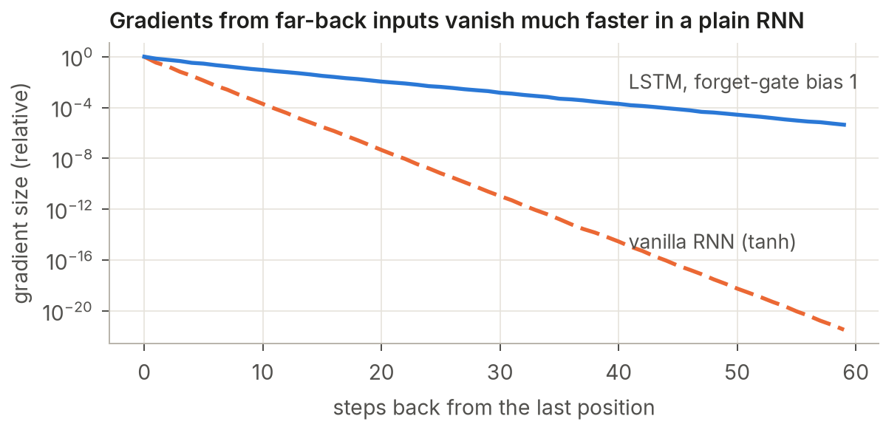
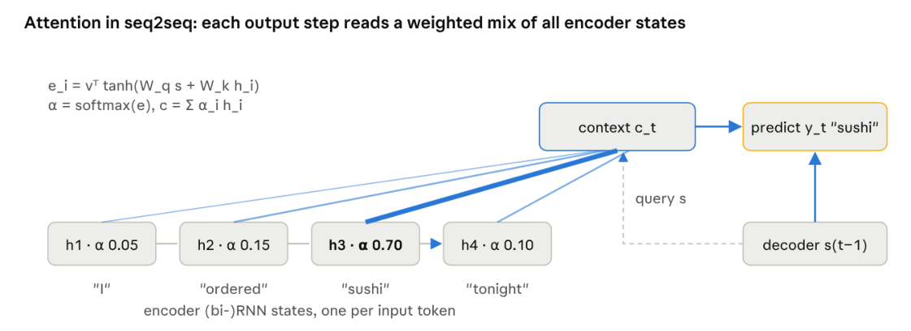

# 8 · Embeddings and sequence models

Part II · Deep learning and training dynamics. Assumes Chapter 5 (MLPs, backpropagation) and Chapter 1.1 (vectors and similarity). Chapter 10 builds the transformer on the attention mechanism introduced here; Chapter 29 covers modern embedding models.

## Why it matters

Transformers did not appear from nowhere. Word embeddings taught the field that meaning can live in dense vectors; RNNs and LSTMs taught it how to read sequences; and attention was invented to fix a weakness of RNN encoder-decoders. Interviewers still ask about these because they reveal whether you understand *why* the transformer looks the way it does. In practice you will also meet them: fastText and word2vec-style item embeddings ("item2vec") are still common in recommendation, including the order-history models in Chapter 43, and small GRUs still run on-device and in streaming systems.

The chapter tells one story in two steps. The first is representation: how to turn a discrete symbol, a word or a product id, into a vector whose geometry reflects meaning (8.1 to 8.3). The answer, learn it from the company the symbol keeps, is the idea behind every embedding model since, including the ones in Chapter 29. The second step is composition: how to read a whole sequence of such vectors. Recurrent networks do it one step at a time with a running memory (8.4), and their weakness, a single fixed-size memory that long inputs overwhelm, led directly to attention (8.5). Each section ends where the next one's motivation begins, and the chapter ends where the transformer starts.

What an interviewer is testing with this material is mechanism, not history. Can you write the skip-gram objective and say why negative sampling approximates it? Can you write the product of Jacobians that makes an RNN's gradient vanish, and point at the term an LSTM changes? Can you explain why dot-product attention needs a 1/√d scale and why teacher forcing creates exposure bias? Each of these reappears in a modern form: two embedding tables become weight tying, negative sampling becomes contrastive learning (Chapter 29), and exposure bias becomes one of the arguments for RL post-training (Chapters 18 and 19).

Code below was run with PyTorch on CPU; quoted outputs are from that run, and the new worked numbers are in `code/ch08_check.py`.

## Key concepts

- **Distributional hypothesis**: words that appear in similar contexts have similar meanings; every embedding method in this chapter builds on it.
- **word2vec (skip-gram, CBOW, negative sampling)**: learn word vectors by predicting context words. [word2vec paper](https://arxiv.org/abs/1310.4546), [The Illustrated Word2vec](https://jalammar.github.io/illustrated-word2vec/).
- **GloVe**: word vectors fitted to global co-occurrence counts. [GloVe project page](https://nlp.stanford.edu/projects/glove/).
- **fastText**: word vectors built from character n-grams, so unseen and misspelt words still get a vector. [fastText paper](https://arxiv.org/abs/1607.04606).
- **RNN, LSTM, GRU**: networks that read a sequence step by step with a hidden state; gates in LSTM and GRU let information survive long sequences. [Understanding LSTM Networks](https://colah.github.io/posts/2015-08-Understanding-LSTMs/), [GRU paper](https://arxiv.org/abs/1406.1078).
- **Seq2seq**: an encoder reads the input and a decoder generates the output. [Sequence to Sequence Learning](https://arxiv.org/abs/1409.3215).
- **Attention (Bahdanau)**: each decoder step looks at all encoder states, weighted by relevance; the bridge to the transformer. [Bahdanau et al.](https://arxiv.org/abs/1409.0473).
- **Item2vec**: word2vec applied to sessions or baskets to embed products and restaurants.

## 8.1 From one-hot to dense vectors

Models compute with numbers, but words, products and users are symbols. The simplest encoding gives each symbol its own dimension, which works mechanically but tells the model nothing: "pizza" is exactly as different from "pasta" as from "airport". Everything a model could learn about one word would then have to be learned again, separately, for every other. Dense embeddings solve this by placing symbols in a shared space where similar ones are close, so that what is learned about one transfers to its neighbours.

A one-hot vector for a 50k vocabulary is 50k long, sparse, and says every pair of words is equally different. A learned embedding maps each id to a dense vector of, say, 300 dimensions where similar words end up close. `nn.Embedding(V, d)` is just a lookup table of shape `(V, d)`, mathematically the same as a one-hot vector times a weight matrix, but without building the one-hot.

**One-hot times a matrix is a lookup.** Multiplying a one-hot row vector (all zeros except a 1 at position i) by a V × d matrix picks out row i. That is all an embedding layer does, and its gradient touches only the rows of the tokens in the batch, which is why embedding tables of millions of rows train efficiently with sparse updates.

The idea that makes them learnable is the **distributional hypothesis**: words that appear in similar contexts have similar meanings. Every method in this section is a different way to turn co-occurrence into vectors.

## 8.2 word2vec

The distributional hypothesis says what an embedding should capture, but not how to learn it. word2vec turned it into a simple prediction task: train a model to guess which words appear near a given word, and keep the vectors it learns along the way. The task itself is never used; it is an excuse to learn the vectors. That pattern, a cheap self-supervised task whose by-product is a useful representation, became the template for pretraining in general.

Two variants (Mikolov et al., 2013):

- **Skip-gram**: from a centre word, predict each word in a window around it. Better for rare words.
- **CBOW**: from the average of the context words, predict the centre word. Faster.

### The objective, and why negative sampling approximates it

Skip-gram gives every word two vectors: v_w when w is the centre word and u_w when it is a context word. The model's probability that word o appears in the window of centre word c is a softmax over the whole vocabulary V:

$$
p(o \mid c) = \dfrac{\exp(u_o^{\top} v_c)}{\sum_{w=1}^{V} \exp(u_w^{\top} v_c)}
$$

and training maximises Σ log p(o | c) over all (centre, context) pairs in the corpus. The numerator rewards a large dot product between the centre word and its true context; the denominator penalises large dot products with every other word. That denominator is the problem: with V = 50,000 and d = 300 it costs 15 million multiply-adds per training pair.

**Why two tables.** With a single table, the score of a word as its own context would be u_wᵀu_w = ‖u_w‖², which is large for every word with a large vector, so the model would predict that words keep appearing next to themselves, which they rarely do. Two tables let "dog" be close to the contexts it appears in without being forced to predict "dog" next to "dog". After training, most implementations keep v (or the average of u and v).

The full softmax over the vocabulary is expensive, so the practical version uses **negative sampling** (SGNS): for each real (centre, context) pair, push their dot product up; for k random "noise" words, push it down. Written out, the loss for one pair is

$$
\ell(c, o) = -\log \sigma(u_o^{\top} v_c) - \sum_{j=1}^{k} \log \sigma(-u_{n_j}^{\top} v_c)
$$

where σ is the logistic sigmoid and n₁, …, n_k are noise words drawn from a noise distribution q. Each term is a binary logistic regression: "is this a real context word (label 1) or noise (label 0)?" The V-way softmax becomes k + 1 binary decisions, about 8,000 times cheaper per pair for V = 50,000 and k = 5.

**A worked pair.** Suppose u_oᵀv_c = 2.0 and two noise words score 0.5 and −1.0. The loss is −log σ(2.0) − log σ(−0.5) − log σ(1.0) = 0.127 + 0.974 + 0.313 = 1.414. Most of it comes from the first noise word, which the model currently scores as if it were a real context. The gradient with respect to v_c is −(1 − σ(2.0))u_o + σ(0.5)u_{n1} + σ(−1.0)u_{n2} = −0.119u_o + 0.622u_{n1} + 0.269u_{n2}: each word pushes v_c in proportion to how wrong its current score is, so confidently correct terms contribute little (the check script verifies this gradient against autograd).

**SGNS is not quite NCE.** Noise-contrastive estimation (NCE) trains the same kind of binary classifier, but with logit u_oᵀv_c − log(k q(o)): subtracting the log of the noise probability makes the classifier's optimum recover the properly normalised softmax probabilities, so NCE is a consistent estimator of the language model. Negative sampling drops that correction term. It therefore does not learn p(o | c); at its optimum u_oᵀv_c equals PMI(o, c) − log k (Levy and Goldberg, 2014). For embeddings that is fine, even desirable; for a language model whose probabilities you need, it is not. The contrastive losses of Chapter 29 (InfoNCE) descend from this family.

Noise words are drawn from unigram frequency raised to the 0.75 power, which samples rare words a bit more often than their raw frequency. Frequent words such as "the" are also subsampled.

```python
import torch, torch.nn as nn, torch.nn.functional as F

class SGNS(nn.Module):
    def __init__(self, V, d=32):
        super().__init__()
        self.inp = nn.Embedding(V, d)    # centre-word vectors (the ones you keep)
        self.out = nn.Embedding(V, d)    # context-word vectors
        nn.init.uniform_(self.inp.weight, -0.5 / d, 0.5 / d); nn.init.zeros_(self.out.weight)

    def forward(self, c, o, k=5):        # c, o: (B,) ids of centre and true context
        neg = torch.multinomial(noise, c.size(0) * k, replacement=True).view(-1, k)
        vc = self.inp(c)                                            # (B, d)
        pos = F.logsigmoid((vc * self.out(o)).sum(-1))              # (B,)
        negs = F.logsigmoid(-(self.out(neg) @ vc.unsqueeze(-1)).squeeze(-1)).sum(-1)
        return -(pos + negs).mean()
# noise = counts ** 0.75, normalised. Trained 3 epochs on a toy corpus of
# "i ordered <food> and <food> tonight" / "we flew to <city> from <city>":
# nearest("sushi") -> ['salad', 'burger', 'shawarma', 'pizza']
# nearest("dubai") -> ['cairo', 'amman', 'kuwait', 'doha']
```

The famous analogy result (king − man + woman ≈ queen) is real but cherry-picked; do not oversell it in interviews. What matters more: SGNS was later shown to be implicitly factorising a shifted PMI (pointwise mutual information) matrix (Levy and Goldberg, 2014), which links it to the count-based methods below.

**PMI in a worked example.** Pointwise mutual information compares how often two words appear together with how often they would by chance: PMI(w, c) = log₂ [P(w, c) / (P(w) P(c))]. In a corpus of 10,000 (word, context) pairs where "sushi" appears 100 times, "fish" 200 times and "the" 2,000 times: "sushi" next to "fish" 30 times gives log₂(0.003 / (0.01 × 0.02)) = log₂ 15 = 3.91 bits, a strong association. "the" next to "fish" 40 times is *more* frequent in raw counts, but 0.004 / (0.2 × 0.02) = 1, so PMI = 0: exactly what chance predicts. Raw co-occurrence counts are dominated by frequent words; PMI removes that, and SGNS embeddings end up with dot products close to PMI (shifted by log k for k negative samples).

**Item2vec.** Replace sentences with sessions or baskets and words with items: you get item embeddings for "customers who ordered X also ordered Y" and as features for a ranker. This is a cheap, strong baseline for e-commerce, grocery and media catalogues. Two choices differ from text: a basket has no order, so the "window" is usually the whole basket; and the 0.75 noise exponent and frequent-item subsampling matter more, because item popularity is far more skewed than word frequency.

### From two tables to weight tying

word2vec's two tables have a direct descendant in every language model. A transformer LM has an input embedding E (V × d) that turns token ids into vectors and an output matrix W (V × d) whose rows are dotted with the final hidden state to give next-token logits; W plays exactly the role of word2vec's context vectors u. **Weight tying** (Press and Wolf, 2017; Inan et al., 2017) sets W = E. It removes V × d parameters, which is a large share of a small model: for a 128,256-token vocabulary at d = 2,048 it is 263M parameters, about a fifth of a 1.2B model, and small open models such as Llama 3.2 1B tie their embeddings for that reason. It also regularises: every gradient from the output layer also trains the input embedding, which helps rare tokens. Large models usually untie, because the parameters are a small fraction of the total and input and output roles benefit from separate vectors: the same argument as word2vec's two tables (Chapter 10 discusses the trade-off).

## 8.3 GloVe and fastText

word2vec left two gaps. It learns from local windows one at a time, while the same information is available as global co-occurrence statistics that could be fitted directly; and it gives no vector at all to a word it never saw in training, which is a real problem for typos, rare dishes and morphologically rich languages. GloVe addresses the first gap, fastText the second.

- **GloVe** (Pennington et al., 2014) builds the global co-occurrence matrix X once, then fits vectors so that `w_i · w_j + b_i + b_j ≈ log X_ij`, with a weighting that caps very frequent pairs. Count-based and global, where word2vec is predictive and local; results are similar in practice.
- **fastText** (Bojanowski et al., 2017) represents each word as the sum of its character n-gram vectors (3 to 6 characters, plus the whole word). It can build a vector for a word it never saw, and it handles typos and rich morphology well. That matters for morphologically rich languages (Finnish, Turkish, Arabic), for user-typed text full of misspellings, and for transliterated, code-switched text such as Arabizi, where one dish is written "shawarma", "shawerma" or "shwarma" (Chapter 9 has the case study). The fastText library also gives a very fast linear text classifier, still a good first baseline.

All three give **static** embeddings: one vector per word, whatever the context. "Bank" has the same vector in "river bank" and "bank account". Contextual embeddings from ELMo, then BERT (Chapter 12) fixed that.

## 8.4 Recurrent networks

An average of word vectors throws away order: "the order arrived before the driver" and "the driver arrived before the order" have the same average. To read a sequence, a model needs memory: a summary of what it has seen so far that is updated as each new token arrives. Recurrent networks implement exactly that, with the same small set of weights applied at every step, which lets them read sequences of any length.

An RNN reads a sequence one step at a time and keeps a hidden state:

$$
h_t = \tanh\left(W_x\,x_t + W_h\,h_{t-1} + b\right)
$$

The new state mixes the current input with the previous state. The same weights are used at every step, so it handles any length.

The problem is training. Backpropagation through time multiplies by `W_h` (and the tanh derivative) once per step, so gradients over long distances shrink towards zero (**vanishing**) or blow up (**exploding**). Exploding is fixed with gradient clipping; vanishing needs a different cell.

**The product, written out.** Differentiating h_k = tanh(W_x x_k + W_h h_{k−1} + b) with respect to h_{k−1} gives diag(1 − h_k²) W_h, where 1 − h_k² is the tanh derivative at step k. By the chain rule, the sensitivity of the last state to a state T − t steps earlier is a product of T − t such Jacobians:

$$
\dfrac{\partial h_T}{\partial h_t} = \prod_{k=t+1}^{T} \mathrm{diag}(1 - h_k^2)\, W_h
$$

The tanh derivative is at most 1, so the norm of this product is at most ‖W_h‖^(T−t), where ‖W_h‖ is the largest singular value. If it is below 1, the gradient shrinks geometrically with distance, whatever the data (Pascanu et al., 2013); if the largest eigenvalue is above 1, the product can grow geometrically and explode. There is no stable middle: a constant factor per step, raised to the power of the distance, either dies or blows up. The figure below measures it on randomly initialised layers: after 20 steps the vanilla RNN's gradient is 4.6 × 10⁻⁸ of its value at the last step, an average factor of 0.43 per step (0.43²⁰ ≈ 4.6 × 10⁻⁸).

**LSTM** (Hochreiter and Schmidhuber, 1997) adds a cell state c_t whose central update is additive rather than multiplicative:

$$
c_t = f_t \odot c_{t-1} + i_t \odot g_t,\qquad h_t = o_t \odot \tanh(c_t)
$$

Each gate is a sigmoid of the previous hidden state and the current input, so it lies between 0 and 1 and acts as a soft switch:

- forget gate `f_t = σ(W_f [h_{t-1}, x_t])`: how much of the old cell to keep;
- input gate `i_t` and candidate `g_t = tanh(…)`: what to write;
- output gate `o_t`, and `h_t = o_t ⊙ tanh(c_t)`.

The cell update is what changes the gradient. Differentiating c_t = f_t ⊙ c_{t−1} + i_t ⊙ g_t with respect to c_{t−1}, the direct path gives just diag(f_t): no weight matrix and no squashing derivative. Over many steps the gradient along the cell is multiplied by the product of the forget gates, which the network *learns* to keep near 1 for information worth remembering, instead of by a fixed matrix it cannot escape (the gates also depend on h_{t−1}, which adds smaller indirect terms).



*How much the final hidden state depends on the input k steps earlier (norm of the gradient, averaged over 20 random sequences, randomly initialised layers of width 32). After 20 steps the vanilla RNN's gradient has fallen to about 5 × 10⁻⁸ of its value at the last step; the LSTM's (forget-gate bias initialised to 1) to about 10⁻², roughly 200,000 times more signal.*

Because `c_t` is a sum rather than a repeated matrix product, gradients can flow across many steps when the forget gate stays near 1 (the same idea as residual connections, Chapter 10, 10.5).

**One LSTM step by hand.** Take a single cell with old cell state c = 2.0. Suppose the gates come out as forget f = 0.9, input i = 0.2, output o = 0.5, and the candidate g = −1.0. Then c_new = 0.9 × 2.0 + 0.2 × (−1.0) = 1.6, and h = 0.5 × tanh(1.6) = 0.46. Most of the old memory survived (the forget gate kept 90% of it), a little new information was written, and the output gate exposed about half of the squashed state. Over 20 steps with f around 0.9, the old content decays as 0.9²⁰ ≈ 0.12: a slow, controllable fade, instead of the repeated multiplication by a weight matrix and a tanh derivative that destroys an RNN's signal (see the figure above).

**Initialise the forget-gate bias to 1.** At initialisation the gate pre-activations are near 0, so every forget gate is near σ(0) = 0.5, and the direct path decays as 0.5²⁰ ≈ 10⁻⁶ over 20 steps: an untrained LSTM forgets almost as fast as an RNN, and has to learn to remember before it can learn anything long-range. Setting the forget-gate bias to 1 gives f ≈ σ(1) = 0.73 and 0.73²⁰ ≈ 2 × 10⁻³, a thousand times more; the figure's LSTM uses this initialisation. Gers et al. (2000) introduced the trick and Jozefowicz et al. (2015) found it one of the most important details for LSTM performance. PyTorch's `nn.LSTM` does *not* do it by default (its biases are small uniform values), so set the slice yourself: the gate order is input, forget, cell, output, so the forget bias is `bias_ih_l0[h:2*h]`.

**GRU** (Cho et al., 2014) merges the gates into two (update and reset) and drops the separate cell: fewer parameters, usually similar accuracy. With [a, b] denoting concatenation:

$$
z_t = \sigma(W_z [h_{t-1}, x_t]),\qquad r_t = \sigma(W_r [h_{t-1}, x_t])
$$

$$
\tilde h_t = \tanh(W [r_t \odot h_{t-1}, x_t]),\qquad h_t = (1 - z_t) \odot h_{t-1} + z_t \odot \tilde h_t
$$

The update gate z plays the role of the LSTM's forget and input gates at once (keep a fraction 1 − z of the old state, write a fraction z of the new one), which ties them so that what is forgotten is replaced. The reset gate r decides how much of the old state the candidate may look at. The hidden state is also the memory, so there is no separate cell and no output gate. Three weight blocks instead of four give 25% fewer parameters: for input and hidden size 256, PyTorch's `nn.LSTM` has 526,336 parameters and `nn.GRU` 394,752. (Papers and libraries differ on whether z multiplies the old or the new state; the equations are equivalent with z replaced by 1 − z.)

```python
class LSTMClassifier(nn.Module):
    def __init__(self, V, d=32, h=64, n_cls=2):
        super().__init__()
        self.emb = nn.Embedding(V, d, padding_idx=0)
        self.lstm = nn.LSTM(d, h, batch_first=True, bidirectional=True)
        self.head = nn.Linear(2 * h, n_cls)

    def forward(self, x, lengths):       # x: (B, T) padded ids, lengths: (B,)
        packed = nn.utils.rnn.pack_padded_sequence(
            self.emb(x), lengths.cpu(), batch_first=True, enforce_sorted=False)
        _, (h_n, _) = self.lstm(packed)  # h_n: (2 directions, B, h)
        return self.head(torch.cat([h_n[0], h_n[1]], dim=-1))
```

Packing stops the LSTM from reading padding. On a toy task where the label is "does token 5 appear before token 7", this model reached **0.918** test accuracy after 8 epochs, while a mean-of-embeddings model (`nn.EmbeddingBag`) stayed at **0.49**, chance level. Order-blind models cannot learn order: the point of sequence models in one experiment.

## 8.5 Seq2seq and attention

Many tasks map one sequence to another of a different length: translation, summarisation, a question to an answer. Recurrent networks can do this with an encoder that reads the input and a decoder that writes the output, but the first design forced the entire input through a single vector. Attention removed that bottleneck by letting the decoder look back at every input position whenever it needs to, and that one change is the direct ancestor of the transformer.

The encoder-decoder (Sutskever et al., 2014) reads the input with one RNN, squeezes it into the final hidden state, and a second RNN generates the output from that single vector. It worked for translation, but quality fell on long sentences: one fixed-size vector is a bottleneck.

**Bahdanau attention** (2014) removes the bottleneck. At each output step the decoder state is used as a query, scored against every encoder state, softmaxed into weights, and the weighted sum (the context vector) is fed into the decoder.



*Bahdanau attention. The decoder state is the query; the weights α decide how much of each encoder state goes into the context vector.*

```python
class AdditiveAttention(nn.Module):
    def __init__(self, d_dec, d_enc, d_att=64):
        super().__init__()
        self.W_q = nn.Linear(d_dec, d_att, bias=False)
        self.W_k = nn.Linear(d_enc, d_att, bias=False)
        self.v = nn.Linear(d_att, 1, bias=False)

    def forward(self, s, H, mask):   # s: (B, d_dec), H: (B, T, d_enc), mask: (B, T) True = real
        scores = self.v(torch.tanh(self.W_q(s).unsqueeze(1) + self.W_k(H))).squeeze(-1)  # (B, T)
        scores = scores.masked_fill(~mask, float("-inf"))
        alpha = scores.softmax(-1)
        return (alpha.unsqueeze(-1) * H).sum(1), alpha    # context (B, d_enc), weights (B, T)
# masked positions get weight 0.0; each row of alpha sums to 1.0
```

**Luong attention** (2015) replaced the small network with a dot product `s · h_i` (or `sᵀ W` `h_i`): cheaper and just as good. The dot product brings a problem the additive score did not have: if the entries of two d-dimensional vectors are independent with variance 1, their dot product is a sum of d unit-variance terms, so its variance is d. At d = 64 scores have a standard deviation of 8, the softmax puts almost all weight on one position, and its gradient nearly vanishes. Dividing by √d brings the standard deviation back to 1 (the check script measures a standard deviation of about 8.0 before and 1.00 after, over 100,000 random pairs); Chapter 10 (10.2) does the softmax Jacobian that shows why saturation kills the gradient. Scaled dot-product attention in the transformer is that idea plus the `1/√d` scale, many heads, and, crucially, self-attention: every token attends to every other token in the same sequence. Once attention could do the job of recurrence, Vaswani et al. (2017) dropped recurrence entirely, which made training parallel across positions. Chapter 10 picks up from here.

**Teacher forcing.** During training, the decoder is fed the true previous token rather than its own prediction. Fast and stable, but at inference the model sees its own mistakes, a mismatch called exposure bias. The cost compounds: if each token has a 1% chance of being an error the model never learned to recover from, a 100-token output is error-free only 0.99¹⁰⁰ = 37% of the time. Three families of fixes exist. **Scheduled sampling** (Bengio et al., 2015) feeds the model its own predictions with a probability that rises during training, so it practises recovering; it is simple but biased, because the target stays the original next token even after the prefix has drifted. **Sequence-level training** optimises a score of the whole generated sequence (BLEU, a task reward) with policy gradients, as in MIXER (Ranzato et al., 2016) or minimum-risk training, which trains on the model's own samples by construction. **Better decoding** (beam search, sampling settings, Chapter 21) reduces how often a bad prefix is entered. The second family is the ancestor of LLM post-training: RLHF and RL with verifiable rewards (Chapters 18 and 19) sample complete responses from the model itself and reward them, so the model is trained on its own distribution, which is one reason RL fixes failure modes that supervised fine-tuning (pure teacher forcing on demonstrations) cannot.

## 8.6 Where these models still earn their place

- **Static embeddings** as cheap features, for very low-latency lookups, and for search query expansion.
- **Item2vec / session embeddings** for recommendations and basket completion.
- **GRU/LSTM** for streaming signals (sensor, rider GPS traces, event sequences) where you process one step at a time with constant memory, and on-device models.
- **fastText classifiers** as a 10-minute baseline before any transformer. If a fine-tuned transformer only beats fastText by one point, ask whether the extra cost is worth it.

**From RNNs to today's recurrent models.** RNNs lost to transformers because they were hard to train in parallel and forgot long-range information. Linear recurrent models (state-space models such as Mamba, linear attention, gated DeltaNet) keep the recurrent, fixed-size state but make training parallel and memory far more effective, and they are back in frontier architectures as the bulk of layers in hybrid models (Chapter 11).

## Pitfalls

- Comparing embeddings with Euclidean distance when they were trained with dot products; normalise and use cosine unless you know otherwise. The exception is worth knowing: in SGNS and item2vec the vector *norm* tends to encode frequency or popularity, so normalising throws that signal away. For "similar items" use cosine; for ranking, where popularity is useful, the raw dot product can be better. Test both.
- Treating word2vec analogies as proof of quality. Evaluate on the downstream task.
- Feeding padded batches to an RNN without packing or masking, so the final hidden state is computed after reading padding.
- Using the last time step of a padded batch as "the sentence representation": for short sequences it is a padding step.
- Forgetting gradient clipping with RNNs.
- Assuming static embeddings handle polysemy or negation ("not good" vs "good").

## Interview questions

**Mid level**

**1. Explain skip-gram with negative sampling. Why sample noise words from frequency to the 0.75?** Skip-gram learns word vectors by predicting the words around each centre word; the exact objective is a V-way softmax p(o | c) ∝ exp(u_oᵀv_c), which costs a pass over the whole vocabulary per pair. SGNS replaces it with k + 1 binary classifications: maximise log σ(u_oᵀv_c) for the true context word and log σ(−u_nᵀv_c) for k sampled noise words, about 8,000 times cheaper for V = 50,000 and k = 5. The 0.75 power flattens the distribution so rare words appear as negatives more often than their raw frequency would allow: a word 100 times rarer than "the" is sampled only 100^0.75 ≈ 32 times less often. Follow-up: "what does SGNS actually learn?" At the optimum u_oᵀv_c ≈ PMI(o, c) − log k, an implicit factorisation of a shifted PMI matrix (Levy and Goldberg); unlike NCE, it does not recover normalised probabilities.

**2. What problem does fastText solve that word2vec does not?** Out-of-vocabulary and rare words. word2vec has one vector per word seen in training, so a typo, a new product name or an unseen inflection gets no vector at all, and rare words get poorly trained ones. fastText represents a word as the sum of vectors for its character n-grams (3 to 6 characters, with boundary markers, plus the whole word), so "shawerma" shares most of its n-grams with "shawarma" and lands near it, and morphological variants share sub-pieces. Trade-off: many more vectors to store (n-gram buckets are hashed, typically into about 2 million rows), and n-gram overlap can make words that look alike but differ in meaning look similar. Follow-up: fastText is also a fast linear text classifier over averaged n-gram embeddings, a strong 10-minute baseline.

**3. Why do vanilla RNNs struggle with long sequences? How do LSTMs help?** Backpropagation through time multiplies one Jacobian diag(1 − h²)W_h per step, so the gradient from T − t steps back is bounded by ‖W_h‖^(T−t): it vanishes geometrically if the largest singular value is below 1 and can explode if it is above. In the chapter's measurement, after 20 steps an RNN's gradient is 4.6 × 10⁻⁸ of its last-step value (a factor 0.43 per step). The LSTM adds a cell state updated additively, c_t = f_t ⊙ c_{t−1} + i_t ⊙ g_t, whose direct derivative is just the forget gate, so gradients along the cell are scaled by learned gates near 1 rather than a fixed matrix; with forget bias 1 the gradient after 20 steps is about 10⁻². Exploding gradients are handled separately, by clipping. Follow-up: "does the LSTM solve long-range dependencies?" It extends memory to hundreds of steps, not thousands; attention removed the distance problem entirely.

**4. What is the difference between an LSTM and a GRU?** The GRU has two gates instead of three and no separate cell state. Its update gate z interpolates between the old state and a candidate, h_t = (1 − z_t) ⊙ h_{t−1} + z_t ⊙ h̃_t, so one gate does the job of the LSTM's forget and input gates; its reset gate r controls how much of the old state the candidate h̃_t = tanh(W[r_t ⊙ h_{t−1}, x_t]) sees. With three weight blocks instead of four it has 25% fewer parameters (394,752 vs 526,336 at size 256 in PyTorch) and is a little faster. Accuracy is usually similar; LSTMs sometimes win on tasks needing precise counting or long memory because their output gate and separate cell decouple what is stored from what is exposed. Follow-up: "which would you pick?" GRU for small or on-device models, LSTM when you can afford to tune both.

**Senior level**

**5. Explain the seq2seq bottleneck and how attention fixes it. How does Bahdanau attention relate to transformer attention?** The encoder compresses everything into one vector; attention lets every decoder step look at all encoder states, weighted by relevance. The transformer keeps the query-key-value weighting, makes it multi-head and scaled dot-product, and applies it within the same sequence instead of recurrence. Concretely, Bahdanau scores each encoder state h_i with a small network vᵀtanh(W_q s + W_k h_i), softmaxes the scores into weights α and feeds Σα_i h_i to the decoder; the cost is O(T_in) per output step instead of a fixed-size bottleneck, and translation quality stopped falling with sentence length. Luong replaced the scoring network with a dot product; the transformer divides it by √d (at d = 64 the raw score's standard deviation is 8, which saturates the softmax), uses separate learned projections for queries, keys and values, runs many heads, and adds self-attention so the encoder and decoder need no recurrence at all, which makes training parallel over positions. Follow-up: "what did the transformer give up?" Recurrence's constant memory per step: attention's cost and KV cache grow with length, which is why linear-recurrent models are back (8.6).

**6. You have 2 million order sessions and need item embeddings for a "you may also like" carousel tomorrow. What do you build first and how do you evaluate it?** Item2vec on sessions (items as words, sessions as sentences), with popular items subsampled; evaluate offline with next-item hit rate@k against a co-occurrence baseline, then an A/B test on carousel CTR and orders. The details that make it work: treat the whole basket as the context window, since basket order is meaningless; keep the 0.75 noise exponent and subsample the head items, or every neighbour list becomes the bestsellers; handle cold-start items (new items have no sessions) with a fallback such as content embeddings or category popularity; and serve with an approximate nearest-neighbour index refreshed daily as the catalogue changes. Evaluation must beat a popularity baseline, not just random, because popularity alone often reaches a respectable hit rate; on 50,000 held-out sessions a hit rate near 10% has a standard error of about 0.13 points, so differences of half a point are real. Also report coverage (fraction of the catalogue ever recommended), since item2vec can collapse onto the head. Follow-up: "when would you move beyond item2vec?" When you need personalisation by user history or context, a two-tower or sequential recommender (Chapter 43).

**7. What is exposure bias and how would you reduce it?** With teacher forcing the decoder is always conditioned on true prefixes during training, but at inference it conditions on its own outputs, so an early mistake puts it in states it never saw and errors compound: at a 1% per-token error rate, a 100-token output is error-free only 37% of the time. Fixes: scheduled sampling (feed the model its own predictions with increasing probability during training; cheap but biased, since the target is not updated after the prefix drifts); sequence-level training that optimises a reward of whole sampled outputs with policy gradients (MIXER, minimum-risk training), which trains on the model's own distribution by construction; and decoding choices that avoid bad prefixes. The senior link is LLM post-training: SFT is pure teacher forcing on demonstrations and inherits exposure bias, while RLHF and RL with verifiable rewards sample whole responses from the policy and score them, so the model learns to recover from its own mistakes (Chapters 18 and 19). Follow-up: "why not just do RL from the start?" Without a teacher-forced warm start the samples are too poor for a reward to give any signal, and RL is far more expensive per token.

**8. When would you still choose an RNN over a transformer in production?** Streaming with constant memory per step, tiny on-device models, very long signals where quadratic attention is too costly (though state-space models now compete there). The reason is the state: an RNN's per-step cost and memory are independent of how much it has read, while a transformer's KV cache grows with every token. A GRU with hidden size 128 holds 128 numbers of state per sequence whatever the length; a transformer at the same position may hold thousands of cached keys and values. Typical cases: keyword spotting and sensor or event streams on a device, real-time anomaly detection over long telemetry, and low-latency features over user event sequences. Trade-off: RNNs train sequentially and are weaker at precise long-range recall. Follow-up: "what about Mamba or linear attention?" They keep the fixed-size state but train in parallel and recall better, so for new long-sequence work they are the first thing to try (Chapter 11).

**9. Why does word2vec keep two embedding tables, and how does that relate to weight tying in language models?** With one table, a word's score as its own context would be ‖u_w‖², large for every word with a large vector, so the model would predict words next to themselves; separate centre (v) and context (u) tables avoid that. In a transformer LM the input embedding plays the role of v and the output (unembedding) matrix the role of u. Weight tying shares them, saving V × d parameters (263M for a 128,256-token vocabulary at d = 2,048, about a fifth of a 1.2B model) and giving rare tokens' input vectors extra gradient from the output side. Small models usually tie; large models usually untie, because the saving is a small fraction of the total and input and output roles benefit from separate vectors. Follow-up: "what goes wrong if you tie and then add tokens?" The new rows serve as both input and output vectors, so their initialisation affects output probabilities immediately; initialise them near the mean embedding.

## Practice

- Implement SGNS from the code above on your own order data or a public dataset (for example Instacart baskets). Inspect nearest neighbours for 20 items.

<details><summary>Hint and expected result</summary>

Use whole baskets as context, k = 5 to 10 negatives from counts^0.75, and subsample items with frequency above about 10⁻³ of all occurrences. Neighbours of a specific product should be complements and substitutes in the same aisle (pasta near pasta sauces and other pastas); if every list is dominated by bananas and milk, increase subsampling. Compare with a popularity baseline on next-item hit rate@10 before trusting what you see.

</details>

- Train fastText on a product-title classification task and compare with a TF-IDF + logistic regression baseline.

<details><summary>Hint and expected result</summary>

Expect the two to land within a few points of each other on clean titles, with fastText ahead on misspelt or unseen words (because of its n-grams) and training in seconds. Test on a held-out set with injected typos to see the difference grow.

</details>

- Reproduce the order experiment: LSTM vs bag of embeddings vs a 1-layer transformer encoder. Plot accuracy against sequence length.

<details><summary>Hint and expected result</summary>

The bag of embeddings should stay at chance (about 0.5) at every length, since it cannot see order. The LSTM should be near the chapter's 0.92 at short lengths and degrade slowly as sequences grow; the transformer encoder (with positional encodings) should be at least as good and flatter with length. Without positional encodings the transformer is order-blind too and falls to chance, which is a useful bug to make on purpose.

</details>

- Write additive attention from a blank file, with masking, and test that padded positions get zero weight.

<details><summary>Hint and expected result</summary>

Mask scores with −inf before the softmax, not after. Tests: masked weights exactly 0.0, every row sums to 1.0, and a row whose mask is all False gives NaN, which your code should either prevent or handle.

</details>

- Measure the vanishing gradient yourself: for an `nn.RNN` and an `nn.LSTM` of width 32, plot the norm of ∂h_T/∂x_{T−k} against k, with the LSTM's forget-gate bias at PyTorch's default and at 1.

<details><summary>Hint and expected result</summary>

The RNN should fall to around 10⁻⁷–10⁻⁸ by k = 20 (the figure's 4.6 × 10⁻⁸). The LSTM with forget bias 1 should be near 10⁻² at k = 20; with the default bias it decays noticeably faster, since its forget gates start near 0.5 instead of 0.73.

</details>

- **Research exercise.** Measure how sensitive SGNS embeddings are to the noise exponent: train on a public corpus (for example text8) with exponents 0, 0.5, 0.75 and 1.0, three seeds each, and evaluate on a word-similarity benchmark (for example WordSim-353 or SimLex-999, Spearman correlation) and on analogy accuracy.

<details><summary>Hint and expected result</summary>

Expect 0.75 and 0.5 to be close to each other and better than 1.0 (raw frequency, which wastes negatives on stop words), with 0 (uniform) worst on similarity because rare words dominate the negatives. Seed-to-seed spread in Spearman correlation is typically around a point, so differences smaller than that are not findings; report mean ± standard deviation over seeds.

</details>

## Read next

- Mikolov et al., "Distributed Representations of Words and Phrases and their Compositionality" (2013).
- Pennington, Socher and Manning, "GloVe: Global Vectors for Word Representation" (2014).
- Bojanowski et al., "Enriching Word Vectors with Subword Information" (2017).
- Christopher Olah, "Understanding LSTM Networks" (blog post, 2015).
- Bahdanau, Cho and Bengio, "Neural Machine Translation by Jointly Learning to Align and Translate" (2014).
- Levy and Goldberg, "Neural Word Embedding as Implicit Matrix Factorization" (2014).
- Barkan and Koenigstein, "Item2Vec: Neural Item Embedding for Collaborative Filtering" (2016).
- Links to the papers and explainers are in the Key concepts section at the top of this chapter.

## Done when

- Without notes, you write the skip-gram softmax and the SGNS loss, explain why there are two tables, and compute the SGNS loss for a positive score of 2.0 and negative scores 0.5 and −1.0 (answer: 1.414).
- You explain the difference between NCE and negative sampling in two sentences (what the log k q(w) term buys).
- You write ∂h_T/∂h_t for a vanilla RNN, say why it vanishes or explodes, and say what an LSTM's forget gate changes; you compute 0.5²⁰ and 0.73²⁰ (≈ 10⁻⁶ and ≈ 2 × 10⁻³) to explain the forget-bias trick.
- You write the LSTM and GRU equations and count their parameters for size 256 (answer: 526,336 and 394,752 in PyTorch).
- You implement additive attention with masking from a blank file in 10 minutes, with tests for zero weight on padding and rows summing to 1.
- You tell the story from seq2seq to the transformer in two minutes, including why dot-product attention needs 1/√d and how exposure bias links to RL post-training.

---

[← 7 · Optimisation and training dynamics](07-optimisation-and-training-dynamics.md) · [Contents](../README.md#contents) · [9 · Text and tokenisation →](09-text-and-tokenisation.md)
