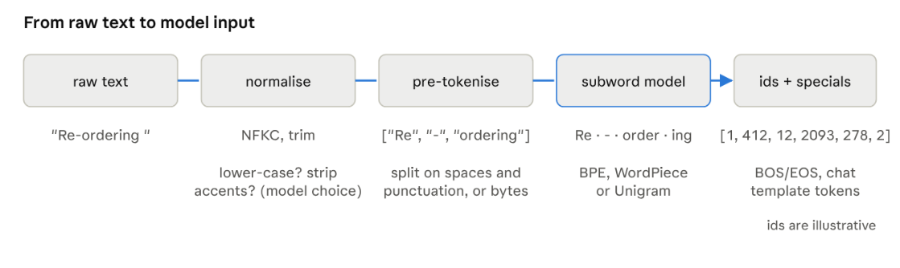

# 9 · Text and tokenisation

Part III · Transformers and architectures. No prerequisites beyond Chapter 8.1 (embeddings as lookup tables). Chapter 10 picks up where the tokenizer hands over: token ids become vectors at the first layer of the transformer.

## Why it matters

Every LLM bill, context-window limit and many strange model failures trace back to the tokenizer. A model never sees letters: it sees integer ids from a fixed vocabulary chosen before pre-training. That choice decides how many tokens your Arabic menu costs, why the model cannot count the r's in "strawberry", why prices like "12.50 AED" are split oddly, and why a fine-tuned model breaks if you change the chat template. In a region where users mix Arabic, English and Arabizi ("3al fa7m") in one query, tokenisation and normalisation are real product questions, not trivia.

The chapter starts with what a tokenizer is: a fixed pipeline of steps, every one of them frozen when the model was pretrained (9.1). It then explains why modern models split text into subwords rather than words or characters (9.2), builds the standard algorithm, byte-pair encoding, from scratch (9.3), and compares it with the alternatives (9.4). Sections 9.5 and 9.6 cover the consequences of tokenizer design: vocabulary size, and the unequal cost of different languages. Sections 9.7 to 9.10 are applied: what tokens cost, which model failures they cause, what pretraining teams choose and why, and worked cases where tokenisation explains a model's behaviour.

The recurring lesson is that the tokenizer is part of the model. It cannot be swapped after pretraining without retraining the embeddings, and its quirks show up downstream in cost, latency, multilingual quality, arithmetic and spelling. A good practitioner checks it as routinely as they check the data.

## Key concepts

- **Token and vocabulary**: models read integer ids from a fixed vocabulary of subword pieces, not characters or words. [Hugging Face course: the Tokenizers library](https://huggingface.co/learn/llm-course/chapter6/1).
- **Byte-pair encoding (BPE)**: build a vocabulary by repeatedly merging the most frequent adjacent pair. [BPE for NMT](https://arxiv.org/abs/1508.07909).
- **WordPiece and Unigram**: alternatives that choose merges by likelihood, or prune a large vocabulary. [Subword Regularization (Unigram)](https://arxiv.org/abs/1804.10959).
- **SentencePiece and byte-level BPE**: tokenisers that work on raw text or raw bytes, so any language and any character can be encoded. [SentencePiece](https://arxiv.org/abs/1808.06226).
- **Normalisation**: Unicode normalisation, case and accent handling, and script-specific cleaning before tokenisation.
- **Fertility**: tokens per word; higher for languages under-represented in the tokenizer's training data, which raises cost and lowers quality.
- **Token counting and cost**: always count with the model's own tokenizer. [tiktoken](https://github.com/openai/tiktoken) for OpenAI models; Hugging Face tokenizers for open models.
- **Build one**: Karpathy's "Let's build the GPT Tokenizer" in [Zero to Hero](https://karpathy.ai/zero-to-hero.html).

## 9.1 The pipeline

A model's first layer is an embedding table indexed by integers, so raw text has to become a sequence of integers before anything else can happen. Doing that well involves more than splitting on spaces: the same word can be written with different Unicode code points, chat models need special markers for roles and turns, and the split must be reversible so that the model's output can be turned back into text. A tokenizer is the pipeline of steps that handles all of this.



*A tokenizer is a pipeline. Each stage is a choice baked into the model at pre-training time.*

- **Normalisation**: Unicode normalisation (NFC/NFKC), optional lower-casing and accent stripping. A cased model must not get lower-cased input.
- **Pre-tokenisation**: split into rough words on spaces and punctuation, or treat the raw bytes as the base alphabet (GPT-2 style byte-level, where a space becomes the marker `Ġ`).
- **Subword model**: split each piece into vocabulary units.
- **Post-processing**: add special tokens (`[CLS]` / `[SEP]`, BOS/EOS) and, for chat models, the role markers of the chat template.

Always load the tokenizer that matches the model checkpoint. Mixing them gives no error, just garbage.

## 9.2 Why subwords

Any tokenizer has to choose the unit of text that becomes one id, and the two obvious choices both fail.

**Words** give short sequences, but the vocabulary has no natural end. Every new dish, brand name, inflection and typo is another entry, and anything not in the list at training time becomes an "unknown" token that the model cannot read at all. Rare words also appear too seldom for their embeddings to be learned well.

**Characters** (or bytes) solve the coverage problem completely, since every string is a sequence of a few hundred symbols. But sequences become several times longer, and attention's cost grows with the square of the length. A 1,000-character menu description is 1,000 character tokens; with the 32,000-entry tokenizer measured in 9.5 it is about 250, and the attention cost is about 16 times lower. The model would also have to spend capacity learning to assemble letters into words before it can learn anything about meaning.

**Subwords** sit between: frequent words stay whole, rare words split into reusable pieces ("re", "order", "ing"), and nothing is ever out of vocabulary if the base alphabet covers all bytes. The vocabulary size becomes a dial between sequence length and table size, which 9.5 examines.

## 9.3 BPE from scratch

Given that subwords are the right unit, which subwords? Choosing them by hand is impossible for a vocabulary of 100,000 entries across dozens of languages, so they are learned from a corpus. The most widely used method is also the simplest: start from single characters and repeatedly glue together the pair that occurs most often. Frequent words end up as single tokens because their pieces keep appearing together.

Byte-pair encoding (Sennrich et al., 2016) starts from characters and repeatedly merges the most frequent adjacent pair. The list of merges, in order, *is* the tokenizer.

```python
import collections

def train_bpe(words, num_merges):
    vocab = collections.Counter(tuple(w) + ("</w>",) for w in words)
    merges = []
    for _ in range(num_merges):
        pairs = collections.Counter()
        for sym, f in vocab.items():
            for a, b in zip(sym, sym[1:]):
                pairs[(a, b)] += f
        if not pairs:
            break
        best = max(pairs, key=pairs.get)
        merges.append(best)
        new = collections.Counter()
        for sym, f in vocab.items():       # apply the merge everywhere
            out, i = [], 0
            while i < len(sym):
                if i < len(sym) - 1 and (sym[i], sym[i + 1]) == best:
                    out.append(sym[i] + sym[i + 1]); i += 2
                else:
                    out.append(sym[i]); i += 1
            new[tuple(out)] += f
        vocab = new
    return merges

def encode(word, merges):                  # replay merges in training order
    sym = list(word) + ["</w>"]
    for a, b in merges:
        i, out = 0, []
        while i < len(sym):
            if i < len(sym) - 1 and sym[i] == a and sym[i + 1] == b:
                out.append(a + b); i += 2
            else:
                out.append(sym[i]); i += 1
        sym = out
    return sym

corpus = ("low lower lowest newer newest wider widest " * 5
          + "order ordered ordering reorder reordered " * 8).split()
merges = train_bpe(corpus, 20)
# merges[:6] -> [('e','r'), ('d','er'), ('o','r'), ('or','der'), ('order','</w>'), ('order','e')]
# encode("reordering") -> ['re', 'orderin', 'g', '</w>']   (never seen, still encoded)
# encode("lowered")    -> ['low', 'er', 'e', 'd', '</w>']
```

**The first merges, traced.** On that corpus, "e" followed by "r" occurs 55 times (in lower, newer, wider, order, reorder…), more than any other pair, so it becomes the first merge, "er". With "er" now a symbol, "d" + "er" occurs 45 times and wins next; then "o" + "r" (40) and "or" + "der" (40), which assembles "order", the most frequent word in the corpus, in four steps. The algorithm never sees words as units; it discovers them because their pieces keep co-occurring. Frequent words become single tokens, morphemes like "er" and "re" become reusable pieces, and rare strings fall back to characters, which is exactly the behaviour you want.

This naive version is O(merges × corpus); real implementations keep pair counts updated incrementally and are written in Rust. In an interview, writing this cleanly in 15 minutes is a realistic ask.

## 9.4 The other algorithms

BPE chooses merges by raw frequency, which is simple but not the only sensible criterion. The alternatives differ in how they score candidate pieces (frequency, likelihood gain, or pruning from a large set) and in what they treat as the base alphabet (characters, raw text with spaces, or bytes). In practice the base alphabet matters more than the scoring rule: byte-level tokenizers can encode any string, which is why they now dominate.

- **WordPiece** (BERT): like BPE, but picks the merge that most increases the likelihood of the training data, roughly `count(ab) / (count(a)·count(b))`, so it prefers pairs that are surprising together rather than just frequent. Continuation pieces carry a `##` prefix (`order ##ing`). Encoding is greedy longest-match.
- **Unigram LM** (Kudo, 2018): start from a big candidate vocabulary and prune pieces whose removal hurts the likelihood least. Encoding picks the most probable segmentation (Viterbi), and it can sample alternative segmentations during training (subword regularisation) for robustness to typos.
- **SentencePiece**: a library, not an algorithm. It runs BPE or Unigram on raw text with spaces kept as a symbol (`▁`), so no language-specific pre-tokeniser is needed and decoding is lossless. Used by T5, Llama 1–2 and many multilingual models.
- **Byte-level BPE** (GPT-2 onwards, tiktoken): the base alphabet is the 256 bytes, so any string, emoji or script is encodable without an unknown token.

Training your own with Hugging Face `tokenizers` takes a few lines:

```python
from tokenizers import Tokenizer, models, trainers, pre_tokenizers, normalizers

tok = Tokenizer(models.BPE(unk_token="[UNK]"))
tok.normalizer = normalizers.NFKC()
tok.pre_tokenizer = pre_tokenizers.ByteLevel(add_prefix_space=False)
trainer = trainers.BpeTrainer(vocab_size=400, special_tokens=["[UNK]", "[PAD]"],
                              initial_alphabet=pre_tokenizers.ByteLevel.alphabet())
tok.train_from_iterator(menu_texts, trainer)

tok.encode("chicken shawarma").tokens   # ['chicken', 'Ġshawarma']   2 tokens
tok.encode("shawerma 3al fa7m")          # 13 tokens: the misspelt Arabizi breaks into pieces
```

The toy vocabulary was trained on a few repeated English and Arabic menu lines, so both seen phrases became 2 tokens, while unseen Arabizi fell apart into 13. Byte-level tokens print as mojibake (`شا...`) for Arabic: that is the byte display, not corruption.

**Fertility.** The average number of tokens per word, a tokenizer's *fertility*, is the single number that predicts cost, context use and often quality for a language. English on English-heavy tokenizers is around 1.2–1.4 tokens per word; morphologically rich languages and non-Latin scripts are frequently 2–4 times higher on the same tokenizer. Measure it on your own text before choosing a model for a multilingual product (9.6).

## 9.5 Vocabulary size trade-offs

Every tokenizer is trained to a fixed vocabulary size, chosen before pretraining and permanent afterwards. A larger vocabulary packs more text into each token, which shortens sequences and lets more fit in the context window, but each entry costs a row in the embedding and output matrices and gets fewer training examples. The table lists the trade-offs; the figure shows how fast the gains diminish.

| Larger vocabulary | Smaller vocabulary |
|---|---|
| Shorter sequences: cheaper attention, more text per context window | Longer sequences |
| Bigger embedding and output matrices (V × d each) | Fewer parameters spent on the vocabulary |
| Rare tokens get few training updates | Each token is well trained |
| Better coverage of many languages | Non-dominant languages fragment more |


*Byte-level BPE tokenizers trained on 90% of this book's own text and evaluated on the rest (`tools/figures.py`). Characters per token rise from 1.32 at 300 entries to 3.21 at 4,000 and only 4.02 at 32,000, while the embedding and output matrices grow linearly with the vocabulary.*

The curve flattens because each new merge covers rarer and rarer strings: the first thousands of merges capture common words and affixes; later ones mostly add rare words that appear a handful of times. Larger corpora, more languages and bigger models move the sweet spot up, which is why vocabularies have grown from 32k (Llama 1–2) to 128k–256k in current multilingual models.

Typical sizes: BERT about 30k, GPT-2 about 50k, recent multilingual LLMs 100k to 250k. Bigger vocabularies became popular partly to treat non-English languages more fairly.

## 9.6 Multilingual text, Arabic and code-switching

A tokenizer learns its pieces from its training corpus, and most training corpora are dominated by English. Languages that are rarer in that corpus get fewer dedicated pieces and are split into more tokens per word. The consequences are not cosmetic: users of those languages pay more per request, fit less into the context window, and often get worse answers, because the model sees their text as longer sequences of less meaningful pieces.

A tokenizer trained mostly on English splits other scripts into more pieces. The same meaning then costs more tokens, fills the context faster, and is often modelled worse. In UTF-8 an Arabic letter takes 2 bytes against 1 for a Latin letter ("دجاج شاورما" is 21 bytes vs 16 for "chicken shawarma"), which hurts byte-level tokenizers with little Arabic in training. Measure your own token-per-word ratio per language before quoting costs.

Arabic-specific normalisation that helps search and classical NLP (be careful with generative models, which should usually see text as written):

```python
import re, unicodedata

def normalise_ar(s):
    s = unicodedata.normalize("NFKC", s)               # splits ligatures (U+FEFB -> lam + alef)
    s = re.sub(r"[\u064B-\u0652\u0640]", "", s)        # diacritics (harakat) and tatweel
    s = re.sub(r"[\u0622\u0623\u0625]", "\u0627", s)  # alef variants -> bare alef
    s = s.replace("\u0649", "\u064A")                  # alef maqsura -> ya
    s = s.replace("\u0629", "\u0647")                  # ta marbuta -> ha
    return s

normalise_ar("شَاوَرْمَا")   # gives "شاورما"
normalise_ar("أكلة")        # gives "اكله"
```

Code-switching and Arabizi (Arabic in Latin letters, with digits for sounds: 3 stands for ع (ayn), 7 for ح (ha) and 2 for ء (hamza)) are common in Gulf search queries and reviews. Options, in order of cost: character n-gram features (fastText, Chapter 8) that tolerate spelling variants; a transliteration step for the most frequent terms; a multilingual embedding model evaluated on your own query logs; or fine-tuning on labelled mixed-language data. Always split your evaluation set by language and script so a good English score cannot hide a poor Arabic one.

## 9.7 Tokens and money

Every cost and latency figure for an LLM product is ultimately a token count: input tokens, output tokens, and cached tokens, each priced and timed differently. Estimating them is everyday work for anyone designing an LLM feature, and a standard interview exercise. The arithmetic is simple, but only if you count with the right tokenizer and remember that output tokens are both pricier and slower than input tokens.

API prices are per token, usually different for input and output, so cost is arithmetic you should do on a whiteboard:

```text
cost = N_requests × (tokens_in × price_in + tokens_out × price_out) / 1e6

Example (prices are placeholders, check the provider's page):
2,000,000 merchant descriptions × (400 in, 20 out)
price_in = $0.50 / 1M, price_out = $1.50 / 1M
= 2e6 × (400×0.50 + 20×1.50) / 1e6 = 2 × (200 + 30) = $460
Batch API at 50% off -> $230; cache the shared system prompt -> lower still.
```

Levers, roughly in order of impact: a smaller model for the easy cases (cascade, Chapter 21), shorter prompts (move fixed instructions into a cached prefix), structured short outputs instead of prose, batch APIs for anything not latency-sensitive, and fewer calls (dedupe identical inputs). Combined, these levers often cut an offline LLM job's cost by 5–10×. If you have done this, have the before and after numbers ready and know which lever gave how much.

Count tokens with the model's own tokenizer (tiktoken for OpenAI models, the provider's token-count endpoint, or the Hugging Face tokenizer for open models). Character-based rules of thumb (about 4 English characters per token) do not hold for Arabic or code.

## 9.8 Tokenisation quirks behind model failures

Some famous LLM failures that look like failures of reasoning are really failures of perception: the model is asked about units it never sees. A model that reads "strawberry" as two or three opaque ids cannot look at its letters, and a model that reads "1234" as a single id cannot see its digits. Knowing these quirks helps you tell a capability gap from a representation problem, and often suggests a cheap fix such as spacing out characters or asking for digit-by-digit work.

- **Counting and spelling**: "strawberry" may be 2–3 tokens, so the model never sees individual letters.
- **Numbers**: digits group inconsistently ("1234" vs "12" + "34"), which hurts arithmetic; some newer tokenizers split numbers into single digits for this reason.
- **Leading spaces**: "Dubai" and " Dubai" are different tokens; prompt templates that add or drop a space change behaviour.
- **Trailing whitespace** at the end of a prompt can push the model into an unusual token and degrade output.
- **Glitch tokens**: tokens that were in the vocabulary but almost never in training data give erratic behaviour.
- **Chat templates**: fine-tuning with one template and serving with another is a silent quality killer. Use `tokenizer.apply_chat_template`.

## 9.9 Tokenizer research for model builders

For a team pretraining its own model, the tokenizer is one of the earliest and least reversible decisions. It fixes how efficiently every language and domain is represented for the life of the model, and changing it later means retraining at least the embeddings. The choices below are those that published reports discuss, with what is known about each.

Choices a pretraining team makes, and what is known about them:

- **Vocabulary size scales with the model.** Larger vocabularies shorten sequences (cheaper attention, more text per context) but spend more parameters on embeddings and give rare tokens few updates. Scaling-law studies of vocabulary size suggest the compute-optimal vocabulary grows with model size and that many models have been under-sized; vocabularies of 128k–256k tokens are now common for multilingual models.
- **Pre-tokenisation** (the regex that splits text before BPE) matters: splitting digits into single characters or groups of three, keeping or removing leading spaces, splitting on punctuation and case changes. Digit handling in particular changes arithmetic ability.
- **Fairness across languages.** The same content can cost several times more tokens in some languages than in English (Petrov et al., 2023), which means higher prices, shorter effective context and often worse quality. Balanced training data for the tokenizer and larger vocabularies reduce the gap.
- **Beyond whitespace-bounded tokens.** SuperBPE-style tokenizers allow tokens that span common multi-word expressions, cutting sequence length further.
- **Tokenizer-free models.** Byte-level models avoid a fixed vocabulary; the Byte Latent Transformer (2024) groups bytes into dynamically sized patches based on how predictable the next byte is, matching tokenized models at scale with better robustness to spelling and noise.
- **Changing a tokenizer after pretraining** (tokenizer transplantation) is possible: initialise new embeddings from combinations of old ones (for example the mean of the old tokens that make up each new token) and continue training. It is used to add languages or domains, at a cost in retraining.
- **Glitch and under-trained tokens**: tokens present in the vocabulary but nearly absent from the training data have untrained embeddings and cause erratic behaviour; they can be found automatically by looking for embeddings close to the initialisation distribution.

## 9.10 Worked cases: how tokenisation shapes behaviour

The cases below show tokenisation decisions turning into visible behaviour, in arithmetic, letter counting, code and cost. Each is a pattern you are likely to meet, with the reason behind it and the usual fix.

**Arithmetic.** If "1234" is one token and "1235" another, the model must memorise relationships between thousands of opaque symbols instead of learning digit-wise rules. Tokenizers that split numbers into single digits, or into groups of three aligned from the right, give the model a consistent positional structure to learn carry and place value; models trained this way are measurably better at multi-digit arithmetic. When you see an LLM fail at "what is 7,341 × 6?", part of the answer is that it may never have seen those digits as separate symbols.

**Counting letters.** "How many r's in strawberry?" is hard for a model that sees "str", "aw" and "berry" as three opaque tokens: the letters are not in its input at all, only learned associations about the tokens. Reasoning models get it right by spelling the word out first, turning it into one token per letter, which is a useful general trick: when a task depends on characters, ask the model to write the characters.

**Whitespace and code.** In code, indentation carries meaning. Tokenizers trained on code merge runs of spaces into single tokens (4 spaces, 8 spaces), which shortens sequences a lot; a tokenizer without such merges spends many tokens on indentation alone. The same applies to JSON and tables in prompts: a verbose format can double the token count compared with a compact one.

**A cost comparison you can reproduce.** Take 200 real sentences of your product's text in each language you serve, run them through two candidate tokenizers, and report tokens per word. Multiply by your traffic and price per token. Differences of 2–3× between languages on the same tokenizer are common, and the cheaper model per token can be the more expensive one per request if its tokenizer handles your languages poorly.

## Pitfalls

- Using a different tokenizer from the model's (for example a cased model with uncased input).
- Truncating at a character limit instead of a token limit, or truncating away the question at the end of a long RAG prompt.
- Estimating cost from English-only samples when traffic is half Arabic.
- Normalising away diacritics or case for a generation model that needs them.
- Adding new special tokens without resizing the embedding matrix (`model.resize_token_embeddings`).

## Interview questions

**Mid level**

1. Why do modern models use subword tokenisation?
2. Walk through how BPE is trained and how it encodes a new word.
3. What is the difference between BPE and WordPiece? What does SentencePiece add?
4. Why can LLMs struggle to count letters in a word?

**Senior level**

5. Your Arabic queries cost far more per request than English ones. Why, and what can you do?
6. You need to classify search queries that mix Arabic, English and Arabizi. Design the text-processing part.
7. Estimate the monthly cost of summarising every restaurant review with an LLM, and say how you would cut it in half.
8. What are the trade-offs of a larger vocabulary?

Short answers: (5) the tokenizer was trained on mostly English text, so Arabic splits into more tokens; measure it, prefer models with better multilingual tokenizers, shorten prompts, cache shared prefixes, consider a smaller fine-tuned model. (6) Unicode normalisation; script detection; light Arabic normalisation for retrieval features; character n-gram or multilingual embedding model; a transliteration dictionary for the top Arabizi terms from logs; evaluation split by script. (7) Reviews per month × average tokens in and out × prices; halve it with a batch API, a smaller model for short reviews, summarising only reviews that are shown, and caching instructions.

## Practice

- Write `train_bpe` and `encode` from a blank file. Then add a decoder that turns tokens back into the string.
- Take 200 real menu items or queries in Arabic and English and count tokens with two different model tokenizers. Report tokens per word by language.
- Train a 5k-vocab tokenizer on a public multilingual corpus with `tokenizers`, and compare fertility (tokens per word) with a pre-trained one.
- Redo the cost arithmetic for a project of your own (or the review-summary example above) with current prices.

## Read next

- Sennrich, Haddow and Birch, "Neural Machine Translation of Rare Words with Subword Units" (2016).
- Kudo, "Subword Regularization" (2018), and Kudo and Richardson, "SentencePiece" (2018).
- Andrej Karpathy, "Let's build the GPT Tokenizer" (video, 2024).
- Hugging Face course, the Tokenizers chapter.
- Rust et al., "How Good is Your Tokenizer? On the Monolingual Performance of Multilingual Language Models" (2021).
- Links to the papers, course and tools are in the Key concepts section at the top of this chapter.

## Done when

You can implement BPE training and encoding from scratch. You can explain BPE, WordPiece, Unigram and byte-level in one sentence each.

You can do LLM cost arithmetic out loud and name five ways to cut it. You can explain why Arabic and code-switched text need care, and what you would do about it.

You can list three model failures caused by tokenisation.

---

[← 8 · Embeddings and sequence models](08-embeddings-and-sequence-models.md) · [Contents](../README.md#contents) · [10 · The transformer in depth →](10-the-transformer-in-depth.md)
