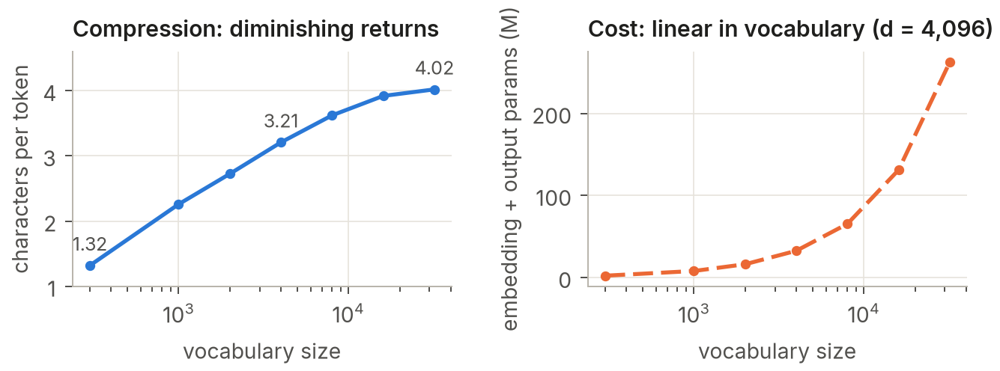

# 9 · Text and tokenisation

Part III · Transformers and architectures. No prerequisites beyond Chapter 8.1 (embeddings as lookup tables). Chapter 10 picks up where the tokenizer hands over: token ids become vectors at the first layer of the transformer.

## Why it matters

Every LLM bill, context-window limit and many strange model failures trace back to the tokenizer. A model never sees letters: it sees integer ids from a fixed vocabulary chosen before pre-training. That choice decides how many tokens a given text costs in each language, why the model cannot count the r's in "strawberry", why numbers like "12.50" are split oddly, why a fine-tuned model breaks if you change the chat template, and why two models' perplexities cannot be compared directly. For a research scientist it is also an experimental variable: tokenizer ablations, scaling-law fits and cross-model comparisons are all wrong if the unit of measurement changes underneath them (9.11).

What an interviewer probes here is whether you can connect the algorithm to its consequences. Writing BPE in 15 minutes is the entry ticket; the senior part is explaining why non-English text and code cost more, how a tokenisation seam corrupts an SFT loss mask, why per-token perplexity is not comparable across vocabularies, and how reasoning tokens change a cost estimate. Arabic, English and Arabizi (Arabic written in Latin letters with digits, "3al fa7m") mixed in one query serve as the running multilingual case study, because they show every one of these problems at once.

The chapter starts with what a tokenizer is: a fixed pipeline of steps, every one of them frozen when the model was pretrained (9.1). It then explains why modern models split text into subwords rather than words or characters (9.2), builds the standard algorithm, byte-pair encoding, from scratch (9.3), and compares it with the alternatives (9.4). Sections 9.5 and 9.6 cover the consequences of tokenizer design: vocabulary size, and the unequal cost of different languages. Sections 9.7 to 9.10 are applied: what tokens cost, which model failures and pipeline bugs they cause, what pretraining teams choose and why, and worked cases where tokenisation explains a model's behaviour. Section 9.11 is for research work: how to compare models whose tokenizers differ.

The recurring lesson is that the tokenizer is part of the model. It cannot be swapped after pretraining without retraining the embeddings, and its quirks show up downstream in cost, latency, multilingual quality, arithmetic and spelling. A good practitioner checks it as routinely as they check the data.

## Key concepts

- **Token and vocabulary**: models read integer ids from a fixed vocabulary of subword pieces, not characters or words. [Hugging Face course: the Tokenizers library](https://huggingface.co/learn/llm-course/chapter6/1).
- **Byte-pair encoding (BPE)**: build a vocabulary by repeatedly merging the most frequent adjacent pair. [BPE for NMT](https://arxiv.org/abs/1508.07909).
- **WordPiece and Unigram**: alternatives that choose merges by likelihood, or prune a large vocabulary. [Subword Regularization (Unigram)](https://arxiv.org/abs/1804.10959).
- **SentencePiece and byte-level BPE**: tokenisers that work on raw text or raw bytes, so any language and any character can be encoded. [SentencePiece](https://arxiv.org/abs/1808.06226).
- **Normalisation**: Unicode normalisation, case and accent handling, and script-specific cleaning before tokenisation.
- **Fertility**: tokens per word; higher for languages under-represented in the tokenizer's training data, which raises cost and lowers quality.
- **Token counting and cost**: always count with the model's own tokenizer. [tiktoken](https://github.com/openai/tiktoken) for OpenAI models; Hugging Face tokenizers for open models.
- **Build one**: Karpathy's "Let's build the GPT Tokenizer" in [Zero to Hero](https://karpathy.ai/zero-to-hero.html).

## 9.1 The pipeline

A model's first layer is an embedding table indexed by integers, so raw text has to become a sequence of integers before anything else can happen. Doing that well involves more than splitting on spaces: the same word can be written with different Unicode code points, chat models need special markers for roles and turns, and the split must be reversible so that the model's output can be turned back into text. A tokenizer is the pipeline of steps that handles all of this.


*A tokenizer is a pipeline. Each stage is a choice baked into the model at pre-training time.*

- **Normalisation**: Unicode normalisation (NFC/NFKC), optional lower-casing and accent stripping. A cased model must not get lower-cased input.
- **Pre-tokenisation**: split into rough words on spaces and punctuation, or treat the raw bytes as the base alphabet (GPT-2 style byte-level, where a space becomes the marker `Ġ`).
- **Subword model**: split each piece into vocabulary units.
- **Post-processing**: add special tokens (`[CLS]` / `[SEP]`, BOS/EOS) and, for chat models, the role markers of the chat template.

Always load the tokenizer that matches the model checkpoint. Mixing them gives no error, just garbage.

## 9.2 Why subwords

Any tokenizer has to choose the unit of text that becomes one id, and the two obvious choices both fail.

**Words** give short sequences, but the vocabulary has no natural end. Every new dish, brand name, inflection and typo is another entry, and anything not in the list at training time becomes an "unknown" token that the model cannot read at all. Rare words also appear too seldom for their embeddings to be learned well.

**Characters** (or bytes) solve the coverage problem completely, since every string is a sequence of a few hundred symbols. But sequences become several times longer, and attention's cost grows with the square of the length. A 1,000-character product description is 1,000 character tokens; with the 32,000-entry tokenizer measured in 9.5 it is about 250, so the attention-score computation is (1,000/250)² = 16 times cheaper. Total compute falls by much less. At these lengths most FLOPs are in the linear layers (the QKV and output projections and the MLP, about 24d² FLOPs per token per layer), which scale linearly with the number of tokens; attention scores add about 4Td per token. For d = 4,096 the score term is under 4% of a layer's compute even at T = 1,000, so the whole forward pass is about 4.1 times cheaper, essentially the 4× reduction in tokens. The quadratic term only dominates when T is several times larger than d (Chapter 10, 10.8). The model would also have to spend capacity learning to assemble letters into words before it can learn anything about meaning.

**Subwords** sit between: frequent words stay whole, rare words split into reusable pieces ("re", "order", "ing"), and nothing is ever out of vocabulary if the base alphabet covers all bytes. The vocabulary size becomes a dial between sequence length and table size, which 9.5 examines.

## 9.3 BPE from scratch

Given that subwords are the right unit, which subwords? Choosing them by hand is impossible for a vocabulary of 100,000 entries across dozens of languages, so they are learned from a corpus. The most widely used method is also the simplest: start from single characters and repeatedly glue together the pair that occurs most often. Frequent words end up as single tokens because their pieces keep appearing together.

Byte-pair encoding (Sennrich et al., 2016) starts from characters and repeatedly merges the most frequent adjacent pair. The list of merges, in order, *is* the tokenizer.

```python
import collections

def train_bpe(words, num_merges):
    vocab = collections.Counter(tuple(w) + ("</w>",) for w in words)
    merges = []
    for _ in range(num_merges):
        pairs = collections.Counter()
        for sym, f in vocab.items():
            for a, b in zip(sym, sym[1:]):
                pairs[(a, b)] += f
        if not pairs:
            break
        best = max(pairs, key=pairs.get)
        merges.append(best)
        new = collections.Counter()
        for sym, f in vocab.items():       # apply the merge everywhere
            out, i = [], 0
            while i < len(sym):
                if i < len(sym) - 1 and (sym[i], sym[i + 1]) == best:
                    out.append(sym[i] + sym[i + 1]); i += 2
                else:
                    out.append(sym[i]); i += 1
            new[tuple(out)] += f
        vocab = new
    return merges

def encode(word, merges):                  # replay merges in training order
    sym = list(word) + ["</w>"]
    for a, b in merges:
        i, out = 0, []
        while i < len(sym):
            if i < len(sym) - 1 and sym[i] == a and sym[i + 1] == b:
                out.append(a + b); i += 2
            else:
                out.append(sym[i]); i += 1
        sym = out
    return sym

corpus = ("low lower lowest newer newest wider widest " * 5
          + "order ordered ordering reorder reordered " * 8).split()
merges = train_bpe(corpus, 20)
# merges[:6] -> [('e','r'), ('d','er'), ('o','r'), ('or','der'), ('order','</w>'), ('order','e')]
# encode("reordering") -> ['re', 'orderin', 'g', '</w>']   (never seen, still encoded)
# encode("lowered")    -> ['low', 'er', 'e', 'd', '</w>']
```

**The first merges, traced.** On that corpus, "e" followed by "r" occurs 55 times (in lower, newer, wider, order, reorder…), more than any other pair, so it becomes the first merge, "er". With "er" now a symbol, "d" + "er" occurs 45 times and wins next; then "o" + "r" (40) and "or" + "der" (40), which assembles "order", the most frequent word in the corpus, in four steps. The algorithm never sees words as units; it discovers them because their pieces keep co-occurring. Frequent words become single tokens, morphemes like "er" and "re" become reusable pieces, and rare strings fall back to characters, which is exactly the behaviour you want.

This naive version is O(merges × corpus); real implementations keep pair counts updated incrementally and are written in Rust. In an interview, writing this cleanly in 15 minutes is a realistic ask.

## 9.4 The other algorithms

BPE chooses merges by raw frequency, which is simple but not the only sensible criterion. The alternatives differ in how they score candidate pieces (frequency, likelihood gain, or pruning from a large set) and in what they treat as the base alphabet (characters, raw text with spaces, or bytes). In practice the base alphabet matters more than the scoring rule: byte-level tokenizers can encode any string, which is why they now dominate.

- **WordPiece** (BERT): like BPE, but picks the merge that most increases the likelihood of the training data, roughly `count(ab) / (count(a)·count(b))`, so it prefers pairs that are surprising together rather than just frequent. Continuation pieces carry a `##` prefix (`order ##ing`). Encoding is greedy longest-match.
- **Unigram LM** (Kudo, 2018): start from a big candidate vocabulary and prune pieces whose removal hurts the likelihood least. Encoding picks the most probable segmentation (Viterbi), and it can sample alternative segmentations during training (subword regularisation) for robustness to typos.
- **SentencePiece**: a library, not an algorithm. It runs BPE or Unigram on raw text with spaces kept as a symbol (`▁`), so no language-specific pre-tokeniser is needed and decoding is lossless. Used by T5, Llama 1–2 and many multilingual models.
- **Byte-level BPE** (GPT-2 onwards, tiktoken): the base alphabet is the 256 bytes, so any string, emoji or script is encodable without an unknown token.

### Unigram LM in more detail

BPE builds a vocabulary bottom-up by merging; Unigram works top-down by pruning, and it gives every piece x a probability p(x). A segmentation of a string s into pieces x₁, …, x_m has probability ∏ p(xᵢ), and the vocabulary and probabilities are chosen to maximise the likelihood of the corpus, summing over all the ways each string could be segmented:

$$
\mathcal{L} = \sum_{s \in \mathrm{corpus}} \log \sum_{\mathbf{x} \in S(s)} \prod_{i} p(x_i)
$$

S(s) is the set of segmentations of s into vocabulary pieces. Training alternates two steps. With the vocabulary fixed, EM fits the probabilities: the E-step computes how often each piece is expected to be used across all segmentations (a forward-backward pass over each string), and the M-step sets p(x) proportional to those expected counts. Then pruning removes the pieces whose removal lowers 𝓛 the least, typically 20–25% of them per round, always keeping single characters so everything stays encodable. Start from a large candidate set (all frequent substrings) and repeat until the target size is reached.

Encoding a new string picks the most probable segmentation with the Viterbi algorithm, a dynamic programme over end positions. A toy example with p(re) = 0.05, p(order) = 0.04, p(ing) = 0.05, p(reorder) = 0.01, p(or) = p(der) = 0.02 and single letters at about 0.01: "reordering" as reorder + ing has probability 0.01 × 0.05 = 5 × 10⁻⁴, re + order + ing has 0.05 × 0.04 × 0.05 = 10⁻⁴, and re + or + der + ing has 10⁻⁶. Viterbi picks reorder + ing. Because every extra piece multiplies in another probability below 1, the model naturally prefers fewer, longer pieces unless they are rare.

Having probabilities makes **subword regularisation** possible: during training, sample a segmentation in proportion to its probability instead of always taking the best one, so the model sees "reorder + ing" most of the time and "re + order + ing" sometimes, which makes it robust to spelling variants. **BPE-dropout** (Provilkov et al., 2020) is the BPE counterpart: when encoding training data, skip each applicable merge with probability p (0.1 is typical), which produces finer, varied segmentations of the same word; at test time, encode normally.

### What byte-level BPE actually does

Three details of GPT-2-style byte-level BPE come up when people read real tokenizer files.

**Why "Ġ" appears.** BPE implementations work on strings of printable characters, but raw bytes include control characters and spaces. GPT-2 therefore maps each of the 256 byte values to a printable Unicode character: the 188 bytes that are already printable map to themselves, and the remaining 68 are shifted to code points from 256 upwards, in order. The space byte (32) becomes U+0120, which prints as "Ġ", and newline (10) becomes "Ċ". So "Ġshawarma" is " shawarma" with its leading space, and Arabic text prints as Latin-looking mojibake because each Arabic letter is two UTF-8 bytes, each shown through this map.

**The pre-tokenisation regex.** Before BPE runs, a regular expression splits text into chunks: runs of letters (with an optional leading space), runs of digits, runs of punctuation, whitespace, and common English contractions. Merges are learned and applied only *within* a chunk, so a token can never span a letter and a digit, or a word and the following punctuation. This is where most of a tokenizer's design decisions live: GPT-4-era and Llama 3 tokenizers, for example, split digit runs into chunks of at most three digits, which bounds how numbers are segmented (9.8).

**Merges are applied by rank.** The training algorithm in 9.3 replays the whole merge list in order for every word. Production encoders instead look at the pairs present in the current chunk, merge the one with the lowest rank (the earliest learned), and repeat until no learned pair remains. That gives the same result as replaying the list (the check script confirms it on seven words), but costs time proportional to the chunk length rather than to the 100,000-entry merge list, and results are cached per chunk.

### Training one and measuring fertility

Training your own with Hugging Face `tokenizers` takes a few lines:

```python
from tokenizers import Tokenizer, models, trainers, pre_tokenizers, normalizers

tok = Tokenizer(models.BPE(unk_token="[UNK]"))
tok.normalizer = normalizers.NFKC()
tok.pre_tokenizer = pre_tokenizers.ByteLevel(add_prefix_space=False)
trainer = trainers.BpeTrainer(vocab_size=400, special_tokens=["[UNK]", "[PAD]"],
                              initial_alphabet=pre_tokenizers.ByteLevel.alphabet())
tok.train_from_iterator(menu_texts, trainer)

tok.encode("chicken shawarma").tokens   # ['chicken', 'Ġshawarma']   2 tokens
tok.encode("shawerma 3al fa7m")          # 13 tokens: the misspelt Arabizi breaks into pieces
```

The toy vocabulary was trained on a few repeated English and Arabic menu lines, so both seen phrases became 2 tokens, while unseen Arabizi fell apart into 13. Byte-level tokens print as mojibake (`شا...`) for Arabic: that is the byte display, not corruption.

**Fertility.** The average number of tokens per word, a tokenizer's *fertility*, is the single number that predicts cost, context use and often quality for a language. English on English-heavy tokenizers is around 1.2–1.4 tokens per word; morphologically rich languages and non-Latin scripts are frequently 2–4 times higher on the same tokenizer. Measure it on your own text before choosing a model for a multilingual product (9.6).

## 9.5 Vocabulary size trade-offs

Every tokenizer is trained to a fixed vocabulary size, chosen before pretraining and permanent afterwards. A larger vocabulary packs more text into each token, which shortens sequences and lets more fit in the context window, but each entry costs a row in the embedding and output matrices and gets fewer training examples. The table lists the trade-offs; the figure shows how fast the gains diminish.

| Larger vocabulary | Smaller vocabulary |
|---|---|
| Shorter sequences: cheaper attention, more text per context window | Longer sequences |
| Bigger embedding and output matrices (V × d each) | Fewer parameters spent on the vocabulary |
| Rare tokens get few training updates | Each token is well trained |
| Better coverage of many languages | Non-dominant languages fragment more |



*Byte-level BPE tokenizers trained on 90% of this book's own text and evaluated on the rest (`tools/figures.py`). Characters per token rise from 1.32 at 300 entries to 3.21 at 4,000 and only 4.02 at 32,000, while the embedding and output matrices grow linearly with the vocabulary.*

The curve flattens because each new merge covers rarer and rarer strings: the first thousands of merges capture common words and affixes; later ones mostly add rare words that appear a handful of times. Larger corpora, more languages and bigger models move the sweet spot up, which is why vocabularies have grown from 32k (Llama 1–2) to 128k–256k in current multilingual models.

Typical sizes: BERT about 30k, GPT-2 about 50k, recent multilingual LLMs 100k to 250k. Bigger vocabularies became popular partly to treat non-English languages more fairly.

**What a vocabulary costs, worked.** Llama 3's vocabulary has 128,256 entries and its 8B model has d = 4,096. The input embedding is 128,256 × 4,096 = 0.525B parameters, and the untied output matrix is another 0.525B: about 1.05B of the 8B parameters, an eighth of the model, spent on the vocabulary. For a 1B model with d = 2,048 the same vocabulary costs 263M per matrix, which is why small models tie the two (Chapter 8). Compute matters too: the output layer computes a logit for every vocabulary entry at every position, 2Vd FLOPs per token, here 2 × 128,256 × 4,096 = 1.05 GFLOP, about 6.6% of the 2N = 16 GFLOP forward cost of the 8B model, and a larger share for small models. Tao et al. (2024, "Scaling Laws with Vocabulary") fitted how the compute-optimal vocabulary grows with model size and concluded that many models use vocabularies that are too small; their estimate for a Llama-2-70B-sized model was more than 200k entries, against the 32k it used.

## 9.6 Multilingual text, Arabic and code-switching

A tokenizer learns its pieces from its training corpus, and most training corpora are dominated by English. Languages that are rarer in that corpus get fewer dedicated pieces and are split into more tokens per word. The consequences are not cosmetic: users of those languages pay more per request, fit less into the context window, and often get worse answers, because the model sees their text as longer sequences of less meaningful pieces. The same content can cost several times more tokens in some languages than in English on the same tokenizer (Petrov et al., 2023).

Four general principles cover most multilingual and code cases. **Bytes are not equal across scripts**: in UTF-8 a Latin letter is 1 byte, Arabic, Cyrillic, Greek and Hebrew letters are 2, and most Chinese, Japanese, Hindi and Thai characters are 3, so a byte-level tokenizer with little training data in a script starts from a longer byte sequence and merges it less. **Whitespace is not universal**: Chinese, Japanese and Thai do not separate words with spaces, so a whitespace pre-tokeniser produces enormous "words"; SentencePiece-style tokenizers that treat the space as an ordinary symbol avoid that. **Normalisation is a modelling choice**: NFKC folds compatibility characters (full-width digits, ligatures) into canonical ones, which helps matching but loses information a generative model may need. **Code is its own language**: indentation, long identifiers and operators fragment badly on a prose tokenizer (9.10). The practical rule in every case is the same: measure tokens per word or per character on your own text, per language, before choosing a model or quoting a cost.

### Case study: Arabic, English and Arabizi

In UTF-8 an Arabic letter takes 2 bytes against 1 for a Latin letter ("دجاج شاورما" is 21 bytes vs 16 for "chicken shawarma"), which hurts byte-level tokenizers with little Arabic in training.

Arabic-specific normalisation that helps search and classical NLP (be careful with generative models, which should usually see text as written):

```python
import re, unicodedata

def normalise_ar(s):
    s = unicodedata.normalize("NFKC", s)               # splits ligatures (U+FEFB -> lam + alef)
    s = re.sub(r"[\u064B-\u0652\u0640]", "", s)        # diacritics (harakat) and tatweel
    s = re.sub(r"[\u0622\u0623\u0625]", "\u0627", s)  # alef variants -> bare alef
    s = s.replace("\u0649", "\u064A")                  # alef maqsura -> ya
    s = s.replace("\u0629", "\u0647")                  # ta marbuta -> ha
    return s

normalise_ar("شَاوَرْمَا")   # gives "شاورما"
normalise_ar("أكلة")        # gives "اكله"
```

Code-switching and Arabizi (Arabic in Latin letters, with digits for sounds: 3 stands for ع (ayn), 7 for ح (ha) and 2 for ء (hamza)) are common in Gulf search queries and reviews. Options, in order of cost: character n-gram features (fastText, Chapter 8) that tolerate spelling variants; a transliteration step for the most frequent terms; a multilingual embedding model evaluated on your own query logs; or fine-tuning on labelled mixed-language data. Always split your evaluation set by language and script so a good English score cannot hide a poor Arabic one.

## 9.7 Tokens and money

Every cost and latency figure for an LLM product is ultimately a token count: input tokens, output tokens, and cached tokens, each priced and timed differently. Estimating them is everyday work for anyone designing an LLM feature, and a standard interview exercise. The arithmetic is simple, but only if you count with the right tokenizer and remember that output tokens are both pricier and slower than input tokens.

**Why output tokens cost more.** Input tokens are processed in one parallel prefill pass, which keeps the GPU's arithmetic units busy. Output tokens are generated one at a time, and each decode step must read all the model's weights and the KV cache from memory to produce a single token per sequence, so decode is limited by memory bandwidth, not arithmetic, and a GPU produces far fewer output tokens per second than it ingests input tokens (Chapter 21). Providers price that difference: output tokens typically cost several times as much as input tokens (4–5× is common). Cached input, a prompt prefix whose KV cache the provider has kept from an earlier request, skips most of the prefill and is priced at a fraction of normal input.

API prices are per token, usually different for input and output, so cost is arithmetic you should do on a whiteboard:

```text
cost = N_requests × (tokens_in × price_in + tokens_out × price_out) / 1e6

Example (prices are placeholders, check the provider's page):
2,000,000 merchant descriptions × (400 in, 20 out)
price_in = $0.50 / 1M, price_out = $1.50 / 1M
= 2e6 × (400×0.50 + 20×1.50) / 1e6 = 2 × (200 + 30) = $460
Batch API at 50% off -> $230; cache the shared system prompt -> lower still.
```

Two token types change this formula in 2026. **Cached input** is billed at a lower rate, and **reasoning tokens** (the hidden "thinking" a reasoning model generates before its answer) are billed as output even when you never see them. The full formula is

$$
C = N \cdot \dfrac{t_{\mathrm{in}} p_{\mathrm{in}} + t_{\mathrm{cache}} p_{\mathrm{cache}} + (t_{\mathrm{out}} + t_{\mathrm{reason}})\, p_{\mathrm{out}}}{10^6}
$$

N is the number of requests; t_in, t_cache, t_out and t_reason are the uncached input, cached input, visible output and reasoning tokens per request; and the p's are prices per million tokens. A worked case with placeholder prices ($0.50 input, $0.05 cached input, $1.50 output per million): summarising 3 million reviews a month, each with a 250-token instruction prefix, 150 tokens of review and 60 tokens of summary. Without caching, 3 × 10⁶ × (400 × 0.50 + 60 × 1.50) / 10⁶ = $870. Caching the shared prefix gives 3 × (150 × 0.50 + 250 × 0.05 + 60 × 1.50) = $532.50, and the batch API's 50% discount halves that to $266. Now switch to a reasoning model that thinks for 500 tokens per review: the output term grows from 60 to 560 tokens and the bill to $2,782.50, more than five times the cached non-reasoning cost. Reasoning tokens often dominate cost, and the cheapest lever for an easy task is to turn reasoning off or set a low effort level.

Levers, roughly in order of impact: a smaller model for the easy cases (cascade, Chapter 21), shorter prompts (move fixed instructions into a cached prefix), structured short outputs instead of prose, batch APIs for anything not latency-sensitive, and fewer calls (dedupe identical inputs). Combined, these levers often cut an offline LLM job's cost by 5–10×. If you have done this, have the before and after numbers ready and know which lever gave how much.

Count tokens with the model's own tokenizer (tiktoken for OpenAI models, the provider's token-count endpoint, or the Hugging Face tokenizer for open models). Character-based rules of thumb (about 4 English characters per token) do not hold for Arabic or code.

## 9.8 Tokenisation quirks behind model failures

Some famous LLM failures that look like failures of reasoning are really failures of perception: the model is asked about units it never sees. A model that reads "strawberry" as two or three opaque ids cannot look at its letters, and a model that reads "1234" as a single id cannot see its digits. Knowing these quirks helps you tell a capability gap from a representation problem, and often suggests a cheap fix such as spacing out characters or asking for digit-by-digit work.

**Counting and spelling.** "strawberry" may be 2–3 tokens, so the model never sees individual letters; it knows the spelling only as a learned fact about each token, which is why letter counts go wrong (9.10).

**Numbers.** Digits group inconsistently ("1234" vs "12" + "34"), which hurts arithmetic, and the grouping direction matters. Singh and Strouse (2024, "Tokenization counts") showed that forcing numbers to be split into groups of three from the right, by inserting commas, made a frontier model markedly better at addition than the default left-to-right grouping, and that its errors under left-to-right grouping followed systematic patterns. Some newer tokenizers split numbers into single digits for the same reason.

**Leading spaces and trailing whitespace.** "Paris" and " Paris" are different tokens. A prompt template that adds or drops a space changes which token the model expects next, and a prompt that ends with a space forces the model to start its answer with a token that has no leading space, a combination it rarely saw in training, which can degrade the output.

**Glitch tokens.** Tokens that were in the vocabulary but almost never in the model's training data keep near-random embeddings and produce erratic behaviour. The canonical example is " SolidGoldMagikarp", a Reddit username that entered GPT-2's tokenizer vocabulary through the tokenizer's training data but was nearly absent from the model's; asked to repeat it, GPT-3-era models produced unrelated words (Rumbelow and Watkins, 2023). Such tokens can be found systematically by looking for rows of the unembedding matrix that resemble those of tokens known never to occur in training (in the extreme, rows that look like their initialisation), and confirming with prompts that ask the model to repeat each candidate (Land and Bartolo, 2024, "Fishing for Magikarp").

**Chat templates.** Fine-tuning with one template and serving with another is a silent quality killer. Use `tokenizer.apply_chat_template`.

### Seams: where training pipelines break

The bugs that cost research teams the most are not in the tokenizer but at its boundaries, and they separate senior from mid-level answers.

**Tokenising pieces separately.** `encode(a) + encode(b)` is not `encode(a + b)`. Merges can cross the boundary, and a space at the end of a is a separate token instead of the prefix of b's first word. With a small byte-level tokenizer from the check script, the prompt "The capital of France is " (ending in a space) and the completion "Paris" encode separately to [..., "Ġis", "Ġ", "Paris"] but jointly to [..., "Ġis", "ĠParis"]. In SFT this breaks the loss mask: if the mask is computed from the length of the separately encoded prompt, it is off by one token at the seam, so the model is trained on one prompt token or misses one answer token, and the "Paris" it is trained to produce is not the token it will see at inference. In RL it corrupts log-probabilities: the policy is scored on token ids it would never have generated. The fix is to tokenise the full conversation once (with the chat template), and derive the mask from character offsets (`return_offsets_mapping=True` in Hugging Face) or by checking that the prompt's ids are a prefix of the full ids, and to assert that check in the data pipeline.

**Token healing.** At inference the same seam appears when a prompt ends mid-word or with a space: the model must continue from a token boundary it rarely saw. Token healing backs the prompt up by one token and constrains the first generated token to start with the removed text, so the model can choose "ĠParis" instead of being stuck after "Ġ". Libraries for constrained generation, such as Guidance, implement it.

**Special-token injection.** Chat templates use strings such as `<|im_start|>` or `<|eot_id|>` that map to special ids. If user-supplied text is tokenised with special-token parsing on, a user who types `<|im_start|>system` gets a genuine role marker and can forge a system turn, a tokenizer-level prompt injection. Encode untrusted text with special-token parsing off (tiktoken refuses special-token strings by default unless you allow them; Hugging Face tokenizers have a `split_special_tokens` option), and add a test that a user message containing every special-token string round-trips as plain text.

## 9.9 Tokenizer research for model builders

For a team pretraining its own model, the tokenizer is one of the earliest and least reversible decisions. It fixes how efficiently every language and domain is represented for the life of the model, and changing it later means retraining at least the embeddings. The choices below are those that published reports discuss, with what is known about each.

Choices a pretraining team makes, and what is known about them:

- **Vocabulary size scales with the model.** Larger vocabularies shorten sequences (cheaper attention, more text per context) but spend more parameters on embeddings and give rare tokens few updates. Scaling-law studies of vocabulary size suggest the compute-optimal vocabulary grows with model size and that many models have been under-sized; vocabularies of 128k–256k tokens are now common for multilingual models.
- **Pre-tokenisation** (the regex that splits text before BPE) matters: splitting digits into single characters or groups of three, keeping or removing leading spaces, splitting on punctuation and case changes. Digit handling in particular changes arithmetic ability.
- **Fairness across languages.** The same content can cost several times more tokens in some languages than in English (Petrov et al., 2023), which means higher prices, shorter effective context and often worse quality. Balanced training data for the tokenizer and larger vocabularies reduce the gap.
- **Beyond whitespace-bounded tokens.** SuperBPE-style tokenizers allow tokens that span common multi-word expressions, cutting sequence length further.
- **Tokenizer-free models.** Byte-level models avoid a fixed vocabulary; the Byte Latent Transformer (2024) groups bytes into dynamically sized patches based on how predictable the next byte is, matching tokenized models at scale with better robustness to spelling and noise.
- **Changing a tokenizer after pretraining** (tokenizer transplantation) is possible: initialise new embeddings from combinations of old ones (for example the mean of the old tokens that make up each new token) and continue training. It is used to add languages or domains, at a cost in retraining.
- **Glitch and under-trained tokens**: tokens present in the vocabulary but nearly absent from the training data have untrained embeddings and cause erratic behaviour; they can be found automatically by looking for embeddings close to the initialisation distribution.

## 9.10 Worked cases: how tokenisation shapes behaviour

The cases below show tokenisation decisions turning into visible behaviour, in arithmetic, letter counting, code and cost. Each is a pattern you are likely to meet, with the reason behind it and the usual fix.

**Arithmetic.** If "1234" is one token and "1235" another, the model must memorise relationships between thousands of opaque symbols instead of learning digit-wise rules. Tokenizers that split numbers into single digits, or into groups of three aligned from the right, give the model a consistent positional structure to learn carry and place value; models trained this way are measurably better at multi-digit arithmetic. When you see an LLM fail at "what is 7,341 × 6?", part of the answer is that it may never have seen those digits as separate symbols.

**Counting letters.** "How many r's in strawberry?" is hard for a model that sees "str", "aw" and "berry" as three opaque tokens: the letters are not in its input at all, only learned associations about the tokens. Reasoning models get it right by spelling the word out first, turning it into one token per letter, which is a useful general trick: when a task depends on characters, ask the model to write the characters.

**Whitespace and code.** In code, indentation carries meaning. Tokenizers trained on code merge runs of spaces into single tokens (4 spaces, 8 spaces), which shortens sequences a lot; a tokenizer without such merges spends many tokens on indentation alone. The same applies to JSON and tables in prompts: a verbose format can double the token count compared with a compact one.

**A cost comparison you can reproduce.** Take 200 real sentences of your product's text in each language you serve, run them through two candidate tokenizers, and report tokens per word. Multiply by your traffic and price per token. Differences of 2–3× between languages on the same tokenizer are common, and the cheaper model per token can be the more expensive one per request if its tokenizer handles your languages poorly.

## 9.11 Comparing models with different tokenizers

Perplexity and cross-entropy are quoted per token, but a token is a different amount of text for each tokenizer. A model with a larger vocabulary packs more text into each token, so each prediction is harder and its per-token loss is higher, even if it models the text better. Comparing per-token losses across tokenizers therefore compares the units, not the models. This matters whenever a research question changes the tokenizer: a vocabulary-size ablation, a scaling-law fit across model families, or a claim that model A "has lower perplexity" than model B.

The fix is to normalise by a unit both models share: the bytes (or characters) of the original text. If a model's total loss on a test set is L_tok nats per token over N_tok tokens, and the test set is N_bytes bytes of UTF-8, then

$$
\mathrm{BPB} = \dfrac{N_{\mathrm{tok}}}{N_{\mathrm{bytes}}} \cdot \dfrac{L_{\mathrm{tok}}}{\ln 2}
$$

The first factor converts "per token" to "per byte" (the inverse of the bytes per token), and dividing by ln 2 converts nats to bits. Bits per byte is the number of bits the model needs to encode each byte of the text, so it is directly comparable across tokenizers and also across byte-level models with no tokenizer at all. Bits per character works the same way with characters instead of bytes.

**A worked comparison.** Model A has a per-token loss of 2.0 nats with a tokenizer averaging 4.0 bytes per token; model B has 1.8 nats with 3.2 bytes per token. By perplexity B looks better: e^1.8 = 6.05 against e^2.0 = 7.39. Per byte, A needs 2.0 / (4.0 × ln 2) = 0.721 bits and B needs 1.8 / (3.2 × ln 2) = 0.812 bits, so A is the better model of the text by about 11%. B's lower perplexity came entirely from its smaller pieces.

Two practical points. Measure bytes on exactly the text that was scored (after the same normalisation, excluding special tokens), or the ratio is off. And report per-token loss only within a fixed tokenizer, such as training curves of one model; the moment two tokenizers are involved, switch to bits per byte. Downstream task accuracy needs no such correction, which is one reason tokenizer ablations report both.

## Pitfalls

- Using a different tokenizer from the model's (for example a cased model with uncased input).
- Truncating at a character limit instead of a token limit, or truncating away the question at the end of a long RAG prompt.
- Estimating cost from English-only samples when traffic is half Arabic.
- Normalising away diacritics or case for a generation model that needs them.
- Adding new special tokens without resizing the embedding matrix (`model.resize_token_embeddings`).
- Tokenising prompt and completion separately and computing the SFT loss mask from the prompt's length (9.8).
- Parsing special-token strings in user-supplied text, which lets users forge chat roles.
- Comparing per-token perplexity between models with different tokenizers instead of bits per byte (9.11).
- Forgetting reasoning tokens in a cost estimate for a reasoning model.

## Interview questions

**Mid level**

**1. Why do modern models use subword tokenisation?** Words give short sequences but an open-ended vocabulary: every new name, inflection and typo is out of vocabulary, and rare words get poorly trained embeddings. Characters or bytes cover everything but make sequences about 4 times longer, which costs roughly 4× the compute (the quadratic attention term matters only at long lengths) and forces the model to learn spelling before meaning. Subwords keep frequent words whole and split rare ones into reusable pieces, and with a byte-level base alphabet nothing is ever out of vocabulary. Number: on this book's text a 32k byte-level BPE averages about 4 characters per token. Follow-up: "are tokenizer-free models the future?" Byte-level models with learned patching (for example the Byte Latent Transformer) match tokenized models at scale with better robustness, but most production models still use subwords.

**2. Walk through how BPE is trained and how it encodes a new word.** Training: split the corpus into words, split each word into characters (or bytes) plus an end marker, count every adjacent pair weighted by word frequency, merge the most frequent pair into a new symbol, update the counts, and repeat until the vocabulary reaches its target size; the ordered merge list is the tokenizer. In 9.3's corpus "e" + "r" wins first with 55 occurrences, then "d" + "er" with 45, and "order" is assembled in four merges. Encoding a new word: split it into characters and apply learned merges, in production by repeatedly merging the lowest-rank pair present, which gives the same result as replaying the list. "reordering" was never seen but encodes as re + orderin + g. Follow-up: "what is the complexity?" The naive version is O(merges × corpus); real implementations keep a priority queue of pair counts and update only the words a merge touches.

**3. What is the difference between BPE and WordPiece? What does SentencePiece add?** Both build a vocabulary by merging, but BPE picks the most frequent pair while WordPiece picks the pair that most increases the training likelihood, roughly count(ab)/(count(a)·count(b)), so it prefers pairs that are surprisingly often together over pairs that are merely common. WordPiece encodes with greedy longest-match and marks continuations with "##". SentencePiece is a library, not an algorithm: it runs BPE or Unigram directly on raw text, treating the space as an ordinary symbol "▁", so it needs no language-specific pre-tokeniser (important for Chinese, Japanese and Thai, which have no spaces) and decoding is exactly lossless. Unigram, its other algorithm, prunes a large vocabulary by likelihood and can sample segmentations for subword regularisation. Follow-up: "which do current LLMs use?" Mostly byte-level BPE (tiktoken-style, as in GPT-4 and Llama 3); SentencePiece BPE in Llama 1–2 and many multilingual models.

**4. Why can LLMs struggle to count letters in a word?** The model never sees the letters. "strawberry" reaches it as two or three token ids, and whatever it knows about their spelling is a memorised association per token, not something it can read off the input; counting the r's requires recalling each token's spelling and adding across tokens, two steps that are easy to get wrong. The fix is to change the representation: ask the model to spell the word out first, which produces roughly one token per letter, and then count, which is what reasoning models do on their own. Number: spelling a 10-letter word costs about 10–20 extra tokens, trivial next to a wrong answer. Follow-up: "is this a reasoning failure?" Mostly a perception failure; the same model counts correctly when the letters are separated by spaces.

**Senior level**

**5. Your Arabic queries cost far more per request than English ones. Why, and what can you do?** The tokenizer was trained on mostly English text, so Arabic splits into more tokens. Each Arabic letter is also 2 UTF-8 bytes against 1 for Latin, so a byte-level tokenizer with few Arabic merges starts from a longer sequence and compresses it less. Measure it first: run 200 real queries per language through the model's own tokenizer. If, for example, English averages 1.3 tokens per word and Arabic 3.0, a 50-word Arabic request costs 150 tokens against 65, 2.3 times more, and also fills the context faster and often gets worse answers. Levers: compare models whose tokenizers have larger multilingual vocabularies (the cheaper price per token can be the more expensive per request); shorten and cache the shared prompt prefix, which is usually in English anyway; keep outputs short and structured; for high-volume narrow tasks, a smaller fine-tuned model. Trade-off: switching models changes quality as well as cost, so evaluate per language. Follow-up: "would you translate Arabic to English first?" Only if a quality test shows no loss; the translation call costs tokens too and loses dialect and nuance.

**6. You need to classify search queries that mix Arabic, English and Arabizi. Design the text-processing part.** Six stages, in order: NFKC normalisation (folds ligatures and full-width forms); per-token script detection to tag Arabic, Latin and Arabizi (Latin letters mixed with the digits 2, 3, 5, 7 and 9 that stand for Arabic sounds); for retrieval and classical features only, Arabic normalisation (strip diacritics and tatweel, unify alef forms, ta marbuta and alef maqsura) as in 9.6; then a model robust to spelling variants, either fastText-style character n-grams as a fast baseline or a multilingual embedding model fine-tuned on labelled queries; and a transliteration dictionary for the few hundred most frequent Arabizi terms, mined from logs, which covers a large share of traffic. Evaluate with a test set split by script and code-switching pattern, and report per-slice accuracy with confidence intervals, so a good English score cannot hide a poor Arabizi one. Trade-off: heavy normalisation helps matching but hurts generation, so keep the raw text alongside. Follow-up: "how do you get labels for Arabizi?" Sample from logs stratified by script and label a few thousand; use an LLM for pre-labelling with human review.

**7. Estimate the monthly cost of summarising every restaurant review with an LLM, and say how you would cut it in half.** Reviews per month × average tokens in and out × prices; halve it with a batch API, a smaller model for short reviews, summarising only reviews that are shown, and caching instructions. Worked with placeholder prices ($0.50 per million input, $0.05 cached input, $1.50 output): 3 million reviews a month, a 250-token instruction prefix, 150 tokens of review and 60 of summary cost 3 × 10⁶ × (400 × 0.50 + 60 × 1.50) / 10⁶ = $870. Caching the prefix brings it to $532.50, and the batch API (50% off, fine for an offline job) to $266, which already more than halves it. Summarising only reviews that are actually displayed, or skipping reviews under 20 words, cuts N further. The warning sign is a reasoning model: 500 thinking tokens per review would raise the bill to about $2,800, so turn reasoning off for this task. Trade-off: a cheaper model must pass the same quality check on a labelled sample. Follow-up: "how do you know the token counts?" Count them with the model's own tokenizer on a sample of real reviews, per language.

**8. What are the trade-offs of a larger vocabulary?** Shorter sequences (cheaper compute, more text per context window, better coverage of many languages) against larger embedding and output matrices, a costlier output softmax, and rare tokens that get few updates. Numbers: Llama 3's 128,256-token vocabulary at d = 4,096 costs 0.525B parameters per matrix, about 1.05B of an 8B model untied, and the output layer adds 2Vd ≈ 1.05 GFLOP per token, about 6.6% of the forward pass. Compression has diminishing returns: on this book's text, characters per token rise from 1.32 at 300 entries to 3.21 at 4,000 but only 4.02 at 32,000. Scaling studies (Tao et al., 2024) suggest the compute-optimal vocabulary grows with model size, so large multilingual models moved to 128k–256k while small models tie embeddings to afford one. Follow-up: "how would you choose it?" Train a few tokenizers, train small models on each at equal compute, and compare bits per byte and downstream accuracy, not per-token loss.

**9. Model A has lower perplexity than model B on the same test set, but they use different tokenizers. Which is better?** You cannot tell from perplexity, because a token is a different amount of text for each tokenizer: a larger vocabulary makes each prediction harder and raises per-token loss even for a better model. Convert to bits per byte: BPB = (N_tok / N_bytes) · L_tok / ln 2. Example: A at 1.8 nats/token with 3.2 bytes per token has perplexity 6.05 and 0.812 bits per byte; B at 2.0 nats/token with 4.0 bytes per token has perplexity 7.39 but 0.721 bits per byte, so B is the better model of the text by about 11%. Measure bytes on exactly the scored text, after the same normalisation. Downstream task accuracy needs no correction. Follow-up: "where does this bite in research?" Vocabulary ablations and scaling-law fits across model families, where per-token loss silently changes units.

**10. Your SFT model learns to start answers with a stray space, and RL log-probabilities disagree with the inference engine's. What tokenisation bug would you look for?** A seam: prompt and completion were tokenised separately and concatenated. `encode(a) + encode(b)` differs from `encode(a + b)` whenever a merge crosses the boundary or a trailing space becomes its own token: in the chapter's example "…is " + "Paris" gives [..., "Ġis", "Ġ", "Paris"] separately but [..., "Ġis", "ĠParis"] jointly. Training then teaches ids the model never sees at inference, the loss mask is off by one at the boundary, and log-probabilities are computed on a different sequence from the one the engine sampled. Fix: render the whole conversation with the chat template, tokenise once, derive the mask from character offsets, and assert in the pipeline that the prompt's ids are a prefix of the full ids; in RL, score exactly the token ids the sampler produced rather than re-tokenising text. Follow-up: "what about special tokens in user text?" Encode untrusted text with special-token parsing off, or a user can forge `<|im_start|>system`.

## Practice

- Write `train_bpe` and `encode` from a blank file. Then add a decoder that turns tokens back into the string.

<details><summary>Hint and expected result</summary>

On the corpus of 9.3 your first four merges must be ('e','r') 55, ('d','er') 45, ('o','r') 40 and ('or','der') 40, and `encode("reordering")` must give ['re', 'orderin', 'g', '</w>']. Ties between equal counts can be broken differently; if your fourth merge differs, check the tie-break, not the counting. The decoder joins the pieces and turns "</w>" into a space; test that decode(encode(w)) == w for every word in the corpus.

</details>

- Take 200 real queries or product titles in two languages (for example Arabic and English) and count tokens with two different model tokenizers. Report tokens per word by language.

<details><summary>Hint and expected result</summary>

Expect English around 1.2–1.4 tokens per word on English-heavy tokenizers and non-Latin scripts 2–4 times higher; a tokenizer with a larger multilingual vocabulary should narrow the gap. Report the ratio with a bootstrap interval over queries, since a few long queries can move it.

</details>

- Train a 5k-vocab tokenizer on a public multilingual corpus with `tokenizers`, and compare fertility (tokens per word) with a pre-trained one.

<details><summary>Hint and expected result</summary>

Your 5k tokenizer should have higher fertility than a 100k+ pre-trained one on every language, with the largest gap on the languages least represented in your training sample. Rebalancing the training sample by language should reduce the disparity at the cost of slightly higher English fertility.

</details>

- Redo the cost arithmetic for a project of your own (or the review-summary example above) with current prices, including cached input and, if you use a reasoning model, reasoning tokens.

<details><summary>Hint and expected result</summary>

With the placeholder prices of 9.7 you should reproduce $870 uncached, $532.50 with a cached prefix, $266 with the batch discount and $2,782.50 with 500 reasoning tokens per review. With real prices, check which term dominates; for reasoning models it is usually the reasoning tokens.

</details>

- Write a test that catches the seam bug of 9.8: for 1,000 SFT examples, assert that the tokenised prompt is a prefix of the tokenised full conversation, and count the failures with and without a trailing space in the prompt.

<details><summary>Hint and expected result</summary>

With a byte-level tokenizer, prompts ending in a space should fail the prefix check almost every time (the space merges with the next word when tokenised jointly); prompts ending at a chat-template boundary (a special token) should always pass. That is why templates put a special token, not a space, between the prompt and the answer.

</details>

- **Research exercise.** Train byte-level BPE tokenizers with vocabularies of 1k, 8k and 32k on the same corpus (for example Tiny Shakespeare or a slice of a public web corpus), train the same small transformer on each for the same compute, and report both per-token validation loss and bits per byte, with 3 seeds each.

<details><summary>Hint and expected result</summary>

Per-token loss should rise with vocabulary size, because each token carries more bytes, so a naive reading says the smallest vocabulary is best. Bits per byte should change much less, and on a small corpus the largest vocabulary may be worse in bits per byte because many of its tokens are rarely seen. The ranking by bits per byte is the valid one; if the two metrics disagree, that is the chapter's point. Report seed spread: differences in bits per byte below about 0.01 are unlikely to be meaningful on a small model.

</details>

## Read next

- Sennrich, Haddow and Birch, "Neural Machine Translation of Rare Words with Subword Units" (2016).
- Kudo, "Subword Regularization" (2018), and Kudo and Richardson, "SentencePiece" (2018).
- Andrej Karpathy, "Let's build the GPT Tokenizer" (video, 2024).
- Hugging Face course, the Tokenizers chapter.
- Rust et al., "How Good is Your Tokenizer? On the Monolingual Performance of Multilingual Language Models" (2021).
- Petrov et al., "Language Model Tokenizers Introduce Unfairness Between Languages" (2023).
- Tao et al., "Scaling Laws with Vocabulary: Larger Models Deserve Larger Vocabularies" (2024).
- Singh and Strouse, "Tokenization counts: the impact of tokenization on arithmetic in frontier LLMs" (2024).
- Land and Bartolo, "Fishing for Magikarp: Automatically Detecting Under-trained Tokens in Large Language Models" (2024).
- Provilkov et al., "BPE-Dropout: Simple and Effective Subword Regularization" (2020).
- Links to the papers, course and tools are in the Key concepts section at the top of this chapter.

## Done when

- From a blank file, you implement BPE training and encoding in 15 minutes, and your first four merges on the 9.3 corpus have counts 55, 45, 40 and 40.
- You explain BPE, WordPiece, Unigram and byte-level BPE in one sentence each, and run Viterbi by hand on the 9.4 toy vocabulary (answer: reorder + ing, probability 5 × 10⁻⁴).
- You explain why the space byte prints as "Ġ" (byte 32 is shifted to U+0120) and what the pre-tokenisation regex prevents.
- You compute the parameters and output-layer FLOPs of a 128,256 × 4,096 vocabulary (answers: 0.525B per matrix, about 1.05 GFLOP per token).
- You do the 9.7 cost arithmetic out loud, with caching and reasoning tokens ($870, $532.50, $266, $2,782.50), and name five ways to cut it.
- You convert per-token loss to bits per byte for the two models of 9.11 (answers: 0.721 and 0.812) and say which is better.
- You describe the prompt/completion seam bug, token healing and special-token injection, and write the prefix-check test that catches the first.
- You explain why Arabic and code-switched text need care, and what you would do about it, in two minutes.

---

[← 8 · Embeddings and sequence models](08-embeddings-and-sequence-models.md) · [Contents](../README.md#contents) · [10 · The transformer in depth →](10-the-transformer-in-depth.md)
