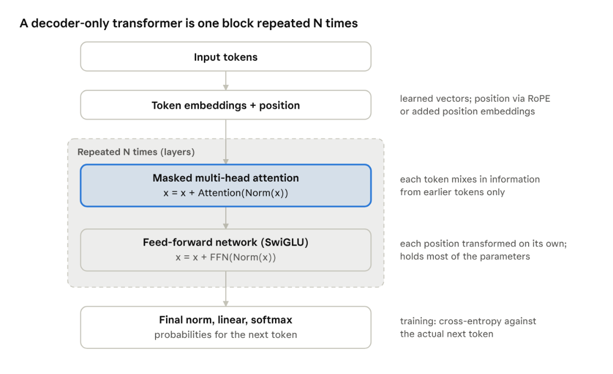
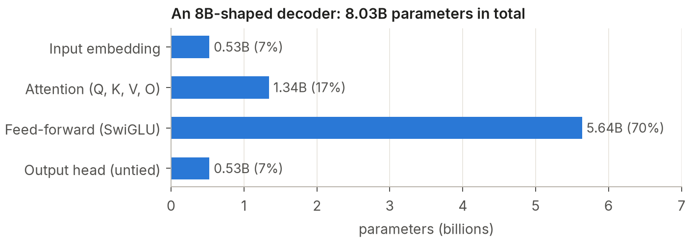
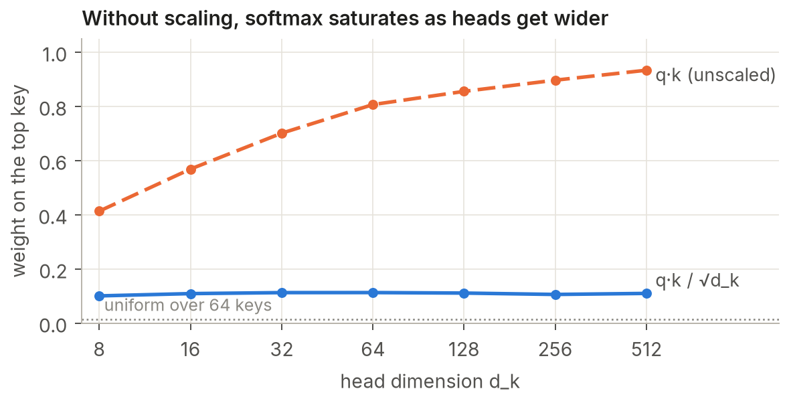
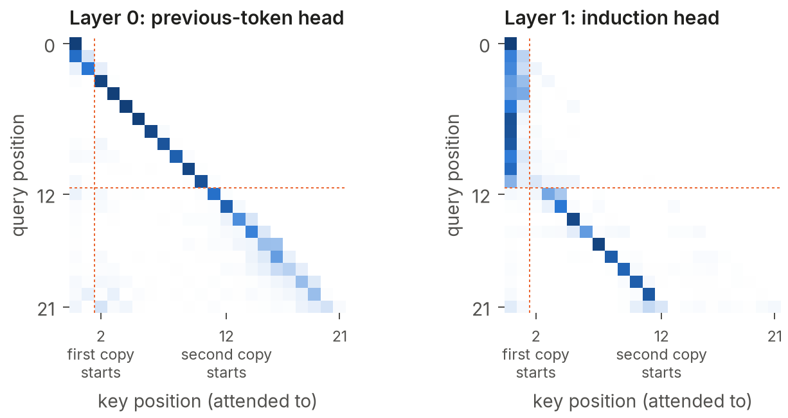
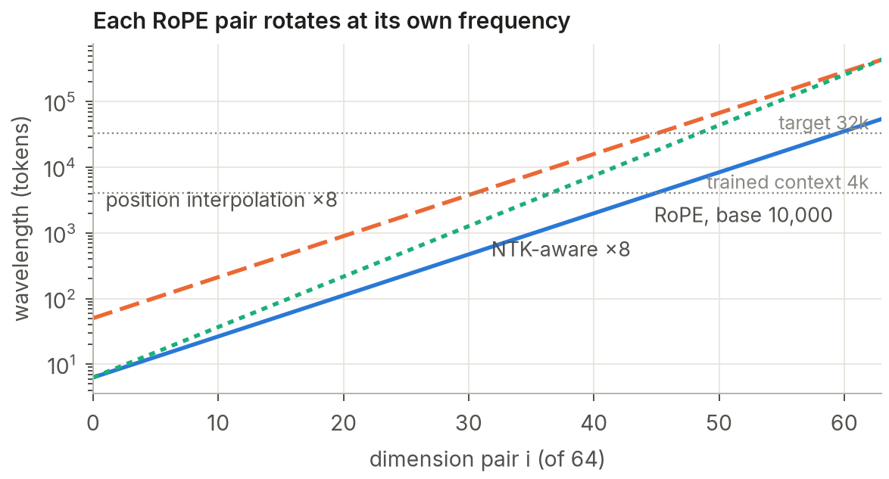
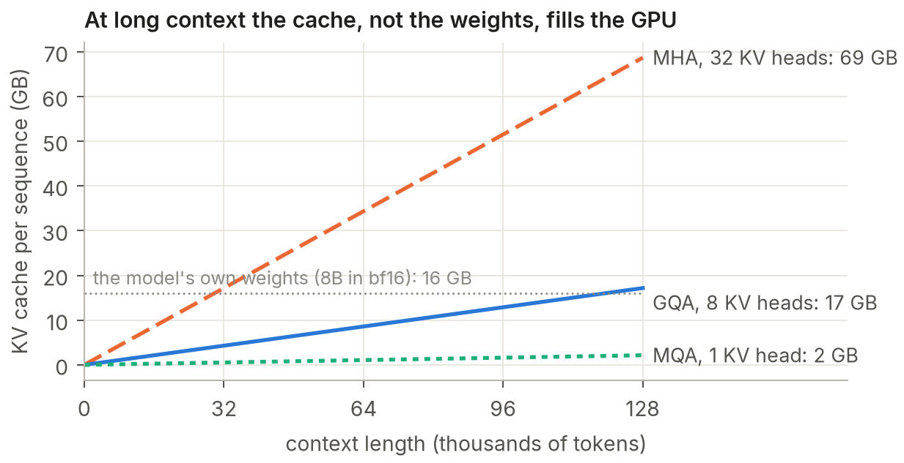

# 10 · The transformer in depth

Part III · Transformers and architectures. Assumes Chapter 5 (neural network basics) and Chapter 6 (PyTorch); Chapter 8 explains the attention mechanism that came before. Chapter 12 covers model families built on this architecture, Chapter 21 how they are served.

## Why it matters

Every LLM, embedding model and modern re-ranker you will use is a transformer. For an LLM-focused senior role, interviewers expect you to explain attention precisely, write it from scratch, and reason about its costs: why context length is expensive, what the KV cache is, why GQA and FlashAttention exist. These details also explain practical behaviour you meet daily: latency, memory limits, cost per token, and why long prompts degrade.

The transformer is a short list of parts, and the chapter takes them one at a time after an overview of how they fit together (10.1). Attention is the part that lets tokens exchange information (10.2), and multiple heads let it track several relationships at once (10.3). Because attention by itself ignores word order, positions have to be injected separately (10.4). Residual connections and normalisation keep a deep stack trainable (10.5), and the feed-forward block does most of the per-token computation and holds most of the parameters (10.6). Sections 10.7 to 10.9 step back: which arrangement of blocks suits which task, what the architecture costs in compute and memory, and the attention variants that exist to reduce those costs. Section 10.10 assembles a working mini-GPT, 10.11 shows how models are stretched to longer contexts than they were trained on, and 10.12 lists the smaller defaults (initialisation, tying, dropout, logit control) that changed between the 2017 design and today's models.

Each part is there to solve a specific problem, and the chapter names that problem before describing the part. If you can say, for each component, what would go wrong without it, you understand the architecture well enough for any interview and for reading new model papers, which are mostly variations on exactly these components.

## Key concepts

- **The transformer**: an architecture built from attention and feed-forward blocks with residual connections, which replaced recurrence and made training parallel. [Attention Is All You Need](https://arxiv.org/abs/1706.03762); the best visual walkthrough is [The Illustrated Transformer](https://jalammar.github.io/illustrated-transformer/).
- **Self-attention (queries, keys, values)**: each token builds its new representation as a weighted mix of all tokens, with weights from query–key similarity scaled by √d.
- **Multi-head attention**: several attention operations in parallel, each free to focus on a different kind of relationship.
- **Positional information (sinusoidal, learned, RoPE)**: attention has no notion of order, so position is injected. [RoPE paper](https://arxiv.org/abs/2104.09864).
- **Causal mask**: in decoders, each token may only attend to earlier tokens, which is what makes next-token training possible.
- **Feed-forward block, residual stream and layer norm (pre-norm)**: the per-token MLP, the additive path that carries information through the layers, and the normalisation that keeps training stable.
- **Efficient attention (FlashAttention)**: exact attention computed in tiles to save memory and time. [FlashAttention](https://arxiv.org/abs/2205.14135).
- **Build one**: [The Annotated Transformer](https://nlp.seas.harvard.edu/annotated-transformer/) (code with the paper) and Karpathy's "Let's build GPT" in [Zero to Hero](https://karpathy.ai/zero-to-hero.html).

## 10.1 The big picture

Before the details, it helps to see the whole machine. A decoder-only language model does one thing: given the tokens so far, it outputs a probability for every possible next token. Everything inside serves that function, and the same block is stacked dozens of times, so understanding one block and how blocks connect is most of the work.

A decoder-only language model (GPT, Llama, Claude-style models) turns a sequence of tokens into a probability distribution over the next token. It is built from one block repeated N times:



*decoder-only transformer · pre-norm block, repeated*

1. **Embed** each token as a vector and add information about its position.
2. **Attention:** each position gathers information from earlier positions, weighted by relevance.
3. **Feed-forward:** each position is transformed independently by an MLP.
4. Both sub-layers use **residual connections** (add the input back) and **normalisation**.
5. After N blocks, a final linear layer maps each position's vector to scores over the vocabulary; softmax gives next-token probabilities.

Training is next-token prediction with cross-entropy over trillions of tokens; generation samples one token at a time and feeds it back in (Chapter 21).

### Teacher forcing: why training is parallel and generation is not

A common confusion is how a model that generates one token at a time can be trained on whole sequences at once. The answer is that during training the true text is known in advance, so the model never has to wait for its own predictions. It is fed the real tokens as inputs (**teacher forcing**) and asked, at every position simultaneously, for the next one. The causal mask is what keeps this honest: position t can see tokens 1 to t but not t + 1, so its prediction of t + 1 is a genuine prediction even though t + 1 is sitting in the same batch.

Take the 4-token text "the cat sat down". The inputs are the first three tokens and the targets are the same text shifted left by one:

| Position | Input token | May attend to | Target | Model's p(target) | Loss −ln p |
|---|---|---|---|---|---|
| 1 | the | the | cat | 0.2 | 1.609 |
| 2 | cat | the, cat | sat | 0.5 | 0.693 |
| 3 | sat | the, cat, sat | down | 0.4 | 0.916 |

The 3 × 3 score matrix has −∞ above the diagonal, so one forward pass gives all three predictions, and the training loss is their mean, 1.073. A sequence of T tokens therefore yields T − 1 training examples for the price of one pass, which is the main reason decoders train so efficiently. Generation is different because the input at step t + 1 is the model's own sample at step t, which does not exist until step t has finished. Prefill (processing the prompt) is parallel like training; only the new tokens are sequential (10.8). The same structure explains **exposure bias**: in training the model only ever conditions on correct prefixes, and at generation time it conditions on its own, possibly wrong, ones.

**Following one token through a real-sized model.** Abstract boxes hide the numbers that matter, so take an 8B-parameter model shaped like Llama 3 8B: a vocabulary of 128,256 tokens, model width d = 4,096, 32 layers, 32 query heads and 8 key–value heads of dimension 128, and a SwiGLU feed-forward block of width 14,336.

1. The token id (say 9,821 for " order") selects row 9,821 of the embedding matrix: a vector of 4,096 numbers. Nothing else happens at the input; the embedding matrix is a lookup table.
2. In each of the 32 layers, that vector is normalised, projected to a query (32 heads × 128 = 4,096 numbers), a key and a value (8 heads × 128 = 1,024 numbers each), rotated by RoPE, and compared with the keys of every earlier token. The weighted mix of values is projected back to 4,096 numbers and **added** to the token's vector.
3. The vector is normalised again, expanded to 14,336 numbers by two projections, gated, projected back to 4,096 and added again.
4. After layer 32, a final normalisation and the output matrix (4,096 × 128,256) give one score per vocabulary token.

The vector that flows through this process, and that every sub-layer reads from and adds to, is called the **residual stream**. It is the single most useful mental model of a transformer: layers do not replace the representation, they write increments into it, and later layers can read anything earlier layers wrote (Chapter 26 builds interpretability on this view).



*Parameter count by component, computed in `code/ch10_check.py`. The feed-forward blocks hold 70% of the parameters; attention holds 17%.*

Two rules of thumb fall out of this count. A forward pass costs about **2 FLOPs per parameter per token** (one multiply and one add for each weight), so about 16 GFLOPs per generated token for this model, plus attention over the context. And the weights alone take **2 bytes per parameter in bf16**: 16 GB, before any memory for the context (10.8).

## 10.2 Scaled dot-product attention

**Intuition.** Each position asks a question (its **query**), every position advertises what it contains (its **key**), and carries content to share (its **value**). A position's output is a weighted average of all values, with weights from how well its query matches each key. "it" in "the order arrived late because it was stuck" can attend strongly to "order".

A useful analogy is a **soft dictionary lookup**. A Python dictionary returns the value whose key matches the query exactly. Attention returns a blend of *all* values, weighted by how well each key matches, and the matching is learned: the model chooses, through its projection matrices, what "matching" means in each head. Because the blend is differentiable, gradient descent can learn which questions to ask and which content to advertise.

**A worked example.** Take a two-dimensional head and three earlier tokens, "the", "order" and "late", with keys (1, 0), (0, 2) and (1, 1) and values (1, 0), (0, 1) and (0.5, 0.5). The token "it" produces the query (0, 1.5).

| Step | "the" | "order" | "late" |
|---|---|---|---|
| Score q·k | 0.000 | 3.000 | 1.500 |
| Scaled by 1/√2 | 0.000 | 2.121 | 1.061 |
| Softmax weight | 0.082 | 0.682 | 0.236 |

The output is 0.082 × (1, 0) + 0.682 × (0, 1) + 0.236 × (0.5, 0.5) = (0.2, 0.8): mostly the value of "order", with a little of the others. Nothing in the mechanism knows about grammar; the projections that produced these queries and keys were learned because routing information this way reduced the training loss.

**Maths.** With Q, K, V matrices (one row per position, created by learned linear projections of the input):

$$
\mathrm{Attention}(Q,K,V) = \mathrm{softmax}\!\left(\dfrac{QK^{\top}}{\sqrt{d_k}} + M\right)V
$$

- Q Kᵀ gives every pair's similarity: a T × T matrix.
- **Dividing by √dₖ:** if the entries of q and k have unit variance, their dot product is a sum of dₖ terms of unit variance, so it has variance dₖ and standard deviation √dₖ. Without scaling, wider heads produce larger scores, softmax saturates (nearly all weight on one key), and its gradients vanish. Dividing by √dₖ keeps the scores at unit scale whatever the head size. The figure below measures it with random vectors and 64 keys.
- **M is the mask:** −∞ above the diagonal in a decoder (causal mask), so position t cannot see future positions; padding positions are masked too.
- Softmax turns each row into weights summing to 1; multiplying by V mixes the values.



*Average weight on the single best-matching key among 64, for random queries and keys. Unscaled, a 128-dimensional head puts 86% of its attention on one key; scaled, about 11% at every width.*

**Why saturation kills the gradient.** The claim that gradients vanish follows from the softmax Jacobian. For weights p = softmax(s), the derivative of pᵢ with respect to score sⱼ is pᵢ(δᵢⱼ − pⱼ), which in matrix form is

$$
\dfrac{\partial p}{\partial s} = \mathrm{diag}(p) - p\,p^{\top}
$$

where δᵢⱼ is 1 when i = j and 0 otherwise. Every entry is a product of a weight with something at most 1, and the diagonal entries are pᵢ(1 − pᵢ). With three keys and uniform weights (1/3 each), the largest entry is 0.222. With saturated weights (0.98, 0.01, 0.01), it is 0.0196, more than ten times smaller, and the entries for the losing keys are about 0.0099. As p approaches one-hot, every pᵢ(1 − pᵢ) approaches 0, so almost no gradient reaches the scores, the queries or the keys: the head stops learning which key to attend to. Scaling by √dₖ keeps the softmax away from that regime at initialisation.

**Masks in practice.** The causal mask sets every score above the diagonal to −∞ before the softmax, so exp(−∞) = 0 weight. Batches of different-length sequences also need a **padding mask** so real tokens never attend to padding. Two implementation details cause real bugs: use −∞ (or a very large negative number), never 0, since a score of 0 still gets weight; and a row whose positions are *all* masked produces 0/0 = NaN, which appears with left-padding at the start of a sequence and must be handled explicitly.

```python
import numpy as np

def attention(Q, K, V, mask=None):
    d = Q.shape[-1]
    scores = Q @ K.T / np.sqrt(d)                      # (T, T) similarities
    if mask is not None:
        scores = np.where(mask, scores, -1e9)          # block future (or padded) positions
    w = np.exp(scores - scores.max(-1, keepdims=True)) # numerically stable softmax
    w /= w.sum(-1, keepdims=True)
    return w @ V, w

T, d = 4, 8
Q, K, V = (np.random.randn(T, d) for _ in range(3))
causal = np.tril(np.ones((T, T), dtype=bool))
out, weights = attention(Q, K, V, causal)              # row 1 has weights only on positions 0 and 1
```

**Self-attention vs cross-attention:** in self-attention Q, K and V come from the same sequence; in cross-attention (encoder-decoder models) queries come from the decoder and keys and values from the encoder output.

## 10.3 Multi-head attention

A single attention operation produces one set of weights per position: each token can attend mostly to one place, or blend a few. But a token often needs several kinds of information at once, the subject of its verb, the noun a pronoun refers to, the previous token. Multi-head attention runs several smaller attention operations side by side, each free to learn a different relationship, for the same total cost.

One attention pattern cannot capture everything (syntax, coreference, position, topic). Multi-head attention runs h attention operations in parallel on smaller projections (d_model / h dimensions each), concatenates the results, and mixes them with an output projection. Same cost as one big head; much more expressive.

**The shapes.** For a batch of B sequences of T tokens with width d and h heads: the input is (B, T, d); the query projection produces (B, T, d), reshaped to (B, h, T, d/h) so each head works on its own slice; scores are (B, h, T, T); the weighted values are (B, h, T, d/h), reshaped back to (B, T, d) and mixed by the output projection Wₒ. The four projection matrices hold 4d² parameters per layer (fewer with grouped-query attention, which shrinks Wₖ and Wᵥ).

**What heads learn.** Trained heads specialise, and some patterns recur across models. The figure shows two heads from a tiny two-layer model trained in `code/ch26_check.py` to continue repeated random sequences. A **previous-token head** in layer 0 attends to the position just before each query: it copies "what came before me" into each token's residual stream. An **induction head** in layer 1 uses that information: when the current token appeared earlier, it attends to the token that *followed* the earlier occurrence and predicts it again. Together they implement in-context copying, [A][B] … [A] → [B], and circuits like this appear in large models too, where their formation coincides with a jump in in-context learning (Chapter 26).



*Attention weights on a sequence whose positions 2–11 are repeated at 12–21 (darker = more weight). Left: each query attends to the position before it. Right: in the second copy, each query attends to the position after its earlier occurrence; before the repeat, the head parks its attention on the first token, an "attention sink" (10.11).*

The module below also supports **grouped-query attention** (fewer key/value heads than query heads, 10.9) and a **KV cache** for generation (10.8):

```python
import math, torch
import torch.nn as nn
import torch.nn.functional as F

class MultiHeadAttention(nn.Module):
    def __init__(self, d_model, n_heads, n_kv_heads=None, dropout=0.0):
        super().__init__()
        self.h, self.kv = n_heads, n_kv_heads or n_heads
        self.dh = d_model // n_heads
        self.q = nn.Linear(d_model, n_heads * self.dh, bias=False)
        self.k = nn.Linear(d_model, self.kv * self.dh, bias=False)
        self.v = nn.Linear(d_model, self.kv * self.dh, bias=False)
        self.o = nn.Linear(n_heads * self.dh, d_model, bias=False)
        self.dropout = dropout

    def forward(self, x, kv_cache=None):
        B, T, _ = x.shape
        q = self.q(x).view(B, T, self.h, self.dh).transpose(1, 2)          # (B, h, T, dh)
        k = self.k(x).view(B, T, self.kv, self.dh).transpose(1, 2)
        v = self.v(x).view(B, T, self.kv, self.dh).transpose(1, 2)
        if kv_cache is not None:                                           # generation: reuse past keys/values
            if "k" in kv_cache:
                k = torch.cat([kv_cache["k"], k], dim=2)
                v = torch.cat([kv_cache["v"], v], dim=2)
            kv_cache["k"], kv_cache["v"] = k, v
        if self.kv != self.h:                                              # GQA: share each K/V head
            k = k.repeat_interleave(self.h // self.kv, dim=1)
            v = v.repeat_interleave(self.h // self.kv, dim=1)
        Tk = k.shape[2]
        scores = q @ k.transpose(-2, -1) / math.sqrt(self.dh)
        mask = torch.ones(T, Tk, dtype=torch.bool, device=x.device).tril(diagonal=Tk - T)  # causal, offset for the cache
        scores = scores.masked_fill(~mask, float("-inf"))
        att = F.dropout(F.softmax(scores, dim=-1), self.dropout, self.training)
        y = (att @ v).transpose(1, 2).reshape(B, T, self.h * self.dh)
        return self.o(y)
```

In practice you call `F.scaled_dot_product_attention`, which dispatches to fused kernels such as FlashAttention; writing it by hand is for understanding and interviews.

## 10.4 Positional encodings

Attention compares every token with every other by content alone, which is what makes it powerful and parallel, and also what makes it blind to order. Word order carries meaning, so position has to be added to the model explicitly. The choice of how affects more than accuracy: it decides whether a model can be used on texts longer than those it was trained on, which is why the field moved from absolute positions to rotary encodings.

Attention is permutation-invariant: without position information, "dog bites man" and "man bites dog" look the same. Options:

| Method | How | Notes |
|---|---|---|
| Sinusoidal (original transformer) | Add fixed sin/cos waves of different frequencies to embeddings | No parameters; extrapolates poorly in practice |
| Learned absolute (GPT-2, BERT) | Add a learned vector per position | Simple; cannot go beyond the trained length |
| RoPE (rotary, RoFormer; Llama and most current LLMs) | Rotate query and key vectors by an angle proportional to position | Attention scores depend on relative position; extended to longer contexts with scaling tricks (position interpolation, NTK-aware scaling, YaRN) |
| ALiBi | Add a penalty to attention scores proportional to distance | No embeddings; loss stays stable beyond the training length, though distant context is used weakly |

**RoPE in code,** and its key property: the dot product between a rotated query at position m and a rotated key at position n depends only on m − n.

```python
def rope(x, base=10000.0):
    """x: (B, heads, T, D). Rotate pairs of dimensions by position-dependent angles."""
    B, H, T, D = x.shape
    half = D // 2
    freqs = base ** (-torch.arange(half, dtype=torch.float32) / half)       # one frequency per pair
    angles = torch.arange(T, dtype=torch.float32)[:, None] * freqs[None]    # (T, half)
    cos, sin = angles.cos(), angles.sin()
    x1, x2 = x[..., :half], x[..., half:]
    return torch.cat([x1 * cos - x2 * sin, x1 * sin + x2 * cos], dim=-1)

# Same q and k vectors placed at every position:
# score(q at 3, k at 1) == score(q at 5, k at 3)   -> both 1.4613 in a test run: only the distance matters
```

(This uses the "half split" pairing used by Llama-style code; the original paper pairs adjacent dimensions. Both are equivalent up to a permutation.)

**Why rotation encodes relative position.** Take one pair of dimensions and treat it as a 2-D vector. RoPE rotates the query at position m by angle mθ and the key at position n by nθ. A rotation by angle a is a matrix R(a) with R(a)ᵀ = R(−a) and R(a)R(b) = R(a + b), so

(R(mθ) q) · (R(nθ) k) = qᵀ R(mθ)ᵀ R(nθ) k = qᵀ R((n − m)θ) k.

The score depends on the positions only through n − m. Each pair uses a different frequency θᵢ = base^(−2i/d), like the hands of a clock: the first pairs spin fast and distinguish neighbouring tokens; the last pairs turn so slowly that they separate only very distant positions. The figure shows the resulting wavelengths, which is also the key to extending context (10.11).



*Wavelength (tokens per full turn) of each of the 64 rotation pairs of a 128-dimensional head. With base 10,000 the slowest pairs complete less than a turn within 4k tokens; position interpolation stretches every pair by 8×, NTK-aware scaling stretches mostly the slow ones.*

## 10.5 Residual connections and normalisation

Modern LLMs stack 30 to over 100 blocks. Chapter 5 showed that signals and gradients passing through many layers tend to vanish or explode; two components keep a transformer this deep trainable. Residual connections give every block a shortcut, so each one only adds a correction to a running representation (the **residual stream**) instead of replacing it. Normalisation keeps the scale of the inputs each block sees under control.

**Residuals** (x + sublayer(x)) give gradients a direct path through deep stacks and let each layer learn a small correction instead of a whole transformation. Without them, deep transformers do not train.

**Layer normalisation** normalises each position's vector to zero mean and unit variance across features (unlike batch norm, which normalises across the batch, a bad fit for variable-length sequences). Two placements:

- **Post-norm** (original transformer): Norm(x + sublayer(x)). Can reach good quality but needs careful learning-rate warm-up; unstable when deep.
- **Pre-norm** (GPT-2 onwards, nearly all modern LLMs): x + sublayer(Norm(x)). The residual path stays clean, training is far more stable, at some cost in final quality that other tricks recover.

**RMSNorm** (Llama and most current models) drops the mean-centring and bias, dividing only by the root mean square: cheaper, and works as well. For a vector x of width d with a learned gain g,

$$
\mathrm{RMSNorm}(x) = \dfrac{x}{\sqrt{\frac{1}{d}\sum_{i=1}^{d} x_i^2 + \epsilon}}\odot g
$$

```python
def rms_norm(x, weight, eps=1e-6):
    return x * torch.rsqrt(x.pow(2).mean(-1, keepdim=True) + eps) * weight
```

**Why pre-norm is more stable.** With pre-norm, the output of layer L is x₀ + f₁(·) + f₂(·) + … + f_L(·): the input reaches the top through a chain of additions, and the gradient reaches the bottom the same way, untouched by any normalisation. With post-norm, every layer's output passes through a normalisation, so the gradient to early layers passes through L normalisation Jacobians, each of which rescales it by the inverse of that layer's output scale; the product makes deep post-norm models sensitive to the learning rate early in training (hence their long warm-ups). Xiong et al. (2020) made this precise: at initialisation, a post-norm transformer has large expected gradients for the parameters near the output, so a large learning rate without warm-up diverges, whereas pre-norm gradients are well behaved and the warm-up can be shortened or dropped.

The price of pre-norm is that the residual stream grows with depth, so later layers' contributions are relatively smaller and the last layers can become less useful. The "tricks that recover it" are concrete:

- **A final normalisation** before the output head, which every pre-norm model has.
- **Scaled residual initialisation:** initialise each block's output projection with standard deviation divided by √(2L), as GPT-2 did, so that the 2L residual additions do not blow up the stream at initialisation (Chapter 7 covers µP, the systematic version).
- **Extra norms on the output of each sublayer.** "Sandwich" or peri-norm, x + Norm(f(Norm(x))), is used by Gemma 2 and 3; OLMo 2 moves the norm to the sublayer output only, x + Norm(f(x)). Both bound what each block can add to the stream.
- **DeepNorm** keeps post-norm but up-weights the residual, Norm(α·x + f(x)) with α > 1, and scales down the initialisation, which trained post-norm models with hundreds of layers.
- **QK-norm**, normalising queries and keys before the dot product, which prevents the attention-logit growth behind many loss spikes (Chapter 7).

## 10.6 The feed-forward block and SwiGLU

Attention moves information between positions but does little computation on it: it is essentially a weighted average. The feed-forward block is where each token's representation is transformed, one position at a time, by a wide two-layer network. It holds most of the model's parameters, and most of its compute for ordinary context lengths.

Each block's MLP is applied to every position independently, usually expanding to about 4× the model width and back. It holds roughly two-thirds of a model's parameters (70% in the 8B example above) and is thought to store much of its factual knowledge.

**A key–value memory view.** Write the FFN as W₂ · σ(W₁ x). Each row of W₁ is a pattern ("key") that the input is compared with; σ turns the match into an activation; each column of W₂ is a vector ("value") added to the residual stream in proportion to that activation. Attention moves information *between* positions; the FFN looks up and writes information *at* each position. Experiments that edit individual FFN weights to change a stored fact (Chapter 26) rely on this picture.

Modern LLMs use **gated** variants:

$$
\mathrm{SwiGLU}(x) = W_2\left(\mathrm{SiLU}(W_1 x)\odot W_3 x\right),\qquad \mathrm{SiLU}(z) = z\,\sigma(z)
$$

SwiGLU multiplies a SiLU-activated projection by a second linear projection, element-wise, before projecting back. The gate lets each hidden unit's output depend on the product of two learned features of the input, a richer function than a single activation, and it consistently gives lower loss at equal compute. It has three matrices instead of two, so the hidden size is reduced to about 8/3 × d to keep the parameter count equal: 3 × d × (8/3)d = 8d², the same as 2 × d × 4d. (Llama 3 8B rounds 8/3 × 4,096 ≈ 10,923 up to 14,336, a slightly larger FFN than the matched size.)

```python
class SwiGLU(nn.Module):
    def __init__(self, d, hidden):
        super().__init__()
        self.w1 = nn.Linear(d, hidden, bias=False)   # gate
        self.w3 = nn.Linear(d, hidden, bias=False)   # value
        self.w2 = nn.Linear(hidden, d, bias=False)   # back to model width

    def forward(self, x):
        return self.w2(F.silu(self.w1(x)) * self.w3(x))
```

**Mixture of experts (MoE)** replaces the single FFN with many expert FFNs and a router that sends each token to a few of them, so total parameters grow while compute per token stays modest (Chapter 11, 11.2, covers the mechanism; Chapter 12 the model families that use it).

## 10.7 Encoder, decoder and encoder-decoder

The same blocks can be wired in three ways, which differ in one setting, which positions each token may attend to, and in the training objective that goes with it. Letting every token see the whole input gives the best representations for understanding a fixed text; letting each token see only the past is what makes generation possible. The choice follows from the task.

| Architecture | Attention | Training objective | Examples | Best for |
|---|---|---|---|---|
| Encoder-only | Bidirectional (sees left and right) | Masked language modelling | BERT, RoBERTa, modern embedding models | Classification, extraction, embeddings, re-rankers |
| Decoder-only | Causal (sees left only) | Next-token prediction | GPT family, Llama, Claude-style LLMs | Generation, chat, general-purpose LLMs |
| Encoder-decoder | Encoder bidirectional, decoder causal with cross-attention | Span corruption, seq2seq | T5, BART, many translation models | Translation, summarisation, structured transformation |

Decoder-only models won for general LLMs because one simple objective scales smoothly with data and compute, and every task can be phrased as text continuation. Encoders remain the efficient choice for classification and embeddings at high volume (Chapter 41). The win is narrower than it looks: at equal training FLOPs, encoder-decoders trained with mixed objectives (UL2) are competitive, a **prefix LM** (bidirectional attention over the prompt, causal over the output) is a middle ground, and Google's T5Gemma (2025) showed that a pretrained decoder can be adapted into a strong encoder-decoder. Q12 lists the arguments on both sides.

## 10.8 Complexity and the KV cache

The practical constraints of LLMs (context-length limits, memory per user, latency per token, price per request) all follow from how the transformer's compute and memory grow with sequence length. Two facts explain most of them: attention compares every pair of positions, and generation produces one token at a time, reusing the keys and values of every earlier token.

**Cost per layer** for a sequence of T tokens with width d: attention is O(T²·d) (every pair of positions) and the feed-forward block O(T·d²). For short sequences the FFN dominates; for long ones attention does, and attention memory grows with T² unless computed in tiles (FlashAttention).

### Where the crossover is

The big-O statement hides two things: the Q, K, V and output projections are ordinary matrix multiplications that belong with the FFN on the "d²" side, and the constants decide where attention takes over. Count forward FLOPs for one token at one layer, with a multiply-add counted as 2 FLOPs.

- **Weight matmuls.** Every weight is used once per token, so the projections and the FFN together cost 2 × (parameters per layer). For a standard layer that is 4d² attention-projection weights plus 8d² FFN weights, so 24d² FLOPs.
- **Attention itself.** The token's query is compared with T keys (T·d multiply-adds) and the weights mix T values (another T·d), so 4·T·d FLOPs, summed over heads.

Attention's share therefore equals the matmul share when

$$
4\,T\,d = 24\,d^{2} \quad\Longrightarrow\quad T = 6d
$$

where T is the number of keys the token attends to and d the model width. For d = 4,096 that is about 24,600 tokens. The exact 8B shape (GQA shrinks Wₖ and Wᵥ, and the SwiGLU FFN is 14,336 wide) has 218M weights per layer, so the crossover is 2 × 218M / (4 × 4,096) ≈ 26,600 tokens (`code/ch10_check.py`). Two consequences: at the 4k–8k lengths of most pretraining, attention is a minority of the FLOPs, and "attention is quadratic" only becomes the dominant cost in long-context work. In causal training a token at position t attends to t keys, so the average is T/2 and the crossover in sequence length is at about 12d.

### Training FLOPs: where 6ND comes from

Training cost is usually quoted as C ≈ 6ND for N parameters and D tokens. The 6 is 2 for the forward pass and 4 for the backward pass, and the 4 follows from one linear layer. If Y = XW with X of shape (n tokens × d_in) and W of shape (d_in × d_out), the forward pass costs 2·n·d_in·d_out FLOPs. The backward pass needs two products of the same size: the gradient with respect to the input, ∂L/∂X = (∂L/∂Y)Wᵀ, to continue backpropagation to earlier layers, and the gradient with respect to the weights, ∂L/∂W = Xᵀ(∂L/∂Y), to update W. Each costs 2·n·d_in·d_out, so the backward pass is twice the forward. Summing over all layers, 2 + 4 = 6 FLOPs per parameter per token:

$$
C \approx 6\,N\,D
$$

where C is total training FLOPs. An 8B model on 15T tokens needs 6 × 8 × 10⁹ × 1.5 × 10¹³ = 7.2 × 10²³ FLOPs. What 6ND leaves out:

- **Attention FLOPs**, 3 × 4 × (T/2) × d per token per layer for causal training (forward plus backward), which is 6·T·d per layer. For the 8B shape at T = 8,192 that adds 6.4 GFLOPs per token to 48 GFLOPs, about 13%.
- **Activation recomputation.** If activations are discarded and recomputed during the backward pass to save memory (Chapter 17), there is an extra forward pass, so about 8ND of hardware FLOPs for the same 6ND of useful work. MFU is conventionally computed from the 6ND figure.
- **Embedding lookups**, which cost nothing (a lookup is not a matmul), although the output projection does count.
- **MoE models**, where N must be the *active* parameters per token, not the total (Chapter 11).

**Prefill versus decode, with numbers.** For the 8B model, processing a 2,000-token prompt (prefill) costs about 2 × 8 × 10⁹ × 2,000 = 3.2 × 10¹³ FLOPs of matrix multiplication, done in large parallel matmuls that keep a GPU's arithmetic units busy. Generating each following token costs only about 1.6 × 10¹⁰ FLOPs, but it must read all 16 GB of weights (and the cache) from memory to do so: about one FLOP per byte read. A GPU that performs around 1,000 TFLOP/s but reads memory at around 3 TB/s needs roughly 300 FLOPs per byte to stay busy, so single-sequence decoding uses a fraction of a percent of its arithmetic. Decoding is **memory-bound**; this is why batching many sequences together (each weight read then serves every sequence in the batch), quantisation and speculative decoding matter so much (Chapter 21).

**How big a batch makes decoding compute-bound?** Arithmetic intensity is FLOPs per byte read. One decode step for a batch of B sequences reads the weights once (2N bytes in bf16) and does 2N FLOPs per sequence, so the intensity of the weight matmuls is 2NB / 2N = B FLOPs per byte. A GPU with about 989 dense bf16 TFLOP/s and 3.35 TB/s of bandwidth balances at 989 / 3.35 ≈ 295 FLOPs per byte, so B ≈ 300 sequences are needed before the weight matmuls become compute-bound. The KV cache behaves differently, and this is the senior point. Each sequence reads its *own* cache, so batching does not amortise it. Per layer and per token, attention does about 4·T·h·d_h FLOPs and reads 2·T·kv·d_h values (2 bytes each), where h is the number of query heads, kv the number of KV heads and d_h the head dimension. The intensity is h / kv, the GQA group size: 4 FLOPs per byte for the 8B model, whatever the batch. Long-context decoding therefore stays memory-bound however many users you batch, which is why GQA, MLA, cache quantisation and sparse attention (Chapter 11) all target the cache.

**Generation and the KV cache.** A model generates one token at a time. Without caching, each new token would recompute keys and values for the whole prefix. The KV cache stores every layer's past keys and values, so each step only computes the new token's query, key and value and attends over the cache. In the mini-GPT below, logits from a cached incremental step match a full forward pass exactly.

The cache's memory is often the bottleneck of LLM serving:

`KV bytes = 2 (K and V) × layers × kv_heads × head_dim × sequence length ×` `batch × bytes per value`

```python
def kv_cache_gb(layers, kv_heads, head_dim, seq_len, batch=1, bytes_per_value=2):
    return 2 * layers * kv_heads * head_dim * seq_len * batch * bytes_per_value / 1e9

kv_cache_gb(32, 32, 128, 8192)   # ~4.3 GB per sequence with full multi-head attention (fp16)
kv_cache_gb(32, 8, 128, 8192)    # ~1.1 GB with 8 KV heads (GQA): 4x more sequences per GPU
```

That is why serving engines manage the cache in pages (vLLM's PagedAttention), quantise it, and why architectures cut KV heads (Chapter 21).



*KV-cache memory for one sequence of an 8B-shaped model (32 layers, head dimension 128, bf16). With full multi-head attention a 128k-token context needs 69 GB, four times the model's own weights; grouped-query attention with 8 KV heads cuts it to 17 GB.*

## 10.9 Attention variants

Section 10.8 identified two bottlenecks: attention's compute and memory grow with the square of the sequence length, and during generation the KV cache grows with every token and every user. Most attention variants attack one of these, either by sharing keys and values across heads, by limiting which positions each token attends to, or by computing exactly the same attention with far less memory traffic.

| Variant | Idea | Why |
|---|---|---|
| Multi-query attention (MQA) | All query heads share one K/V head | Smallest KV cache, fastest decoding; some quality loss |
| Grouped-query attention (GQA) | Query heads share K/V heads in groups (for example 32 query, 8 KV) | Most of MQA's savings with near-full quality; standard in current open LLMs |
| FlashAttention | Exact attention computed in tiles in fast on-chip memory, never materialising the T×T matrix | Much faster and memory-linear in T; same result |
| Sliding-window attention | Each token attends only to the last w tokens | Linear cost; information still flows across layers; often mixed with some global layers |
| Sparse and linear attention, state-space models | Restrict or approximate attention, or replace it with recurrent state (Mamba-style) | Very long sequences; hybrids are an active research area |
| Multi-head latent attention (MLA) | Compress keys and values into a small latent vector cached per token (DeepSeek) | Very small KV cache |

**How FlashAttention can be exact.** Attention seems to need the whole row of scores before the softmax, because the normaliser Σ exp(sⱼ) runs over every key. The trick is an **online softmax**: process keys in tiles, keep for each query a running maximum m, a running normaliser l and a running weighted sum of values, and whenever a new tile raises the maximum, rescale what has been accumulated by exp(m_old − m_new). At the end, dividing by l gives exactly the same result as the full softmax, but the T × T matrix never exists in slow GPU memory: each tile is computed, used and discarded in fast on-chip memory. The algorithm does slightly more arithmetic and far less memory traffic, which is the scarce resource.

**What FlashAttention does not change: the FLOPs.** This is the classic follow-up trap. FlashAttention computes exactly the same T × T scores, so its FLOPs are still O(T²·d); it is *memory*-linear in T, not compute-linear. What it reduces is traffic to high-bandwidth memory (HBM). Standard attention writes the score matrix S to HBM, reads it back for the softmax, writes P and reads it again for P·V, so it makes Θ(T·d + T²) HBM accesses, and the T² term dominates at long context. FlashAttention loads blocks of Q, K and V into on-chip SRAM of size M and never writes S or P. Dao et al. show it needs Θ(T²·d²/M) HBM accesses. With d = 128 and about 100 KB of SRAM (50,000 bf16 values), d²/M ≈ 0.33, against a standard implementation that touches the T² matrix about four times in the forward pass alone.

**The backward pass** needs P to compute gradients, and storing it would bring back the T² memory. FlashAttention stores only the output and the per-row softmax statistics (m and l, or their log-sum-exp) and *recomputes* each tile of S and P during the backward pass. That means extra FLOPs, but it is faster overall because recomputing from SRAM is cheaper than reading a T² matrix from HBM.

**Later versions change the work partitioning, not the maths.** FlashAttention-2 (2023) reduced the non-matmul FLOPs (the rescaling), parallelised over the sequence dimension as well as batch and heads (so long sequences with small batches still fill the GPU), and split work between warps to avoid shared-memory traffic. FlashAttention-3 (2024) targets Hopper GPUs: warp specialisation, so that some warps load data asynchronously while others compute, overlap of the softmax with the matmuls, and fp8 support.

```python
def tiled_attention(Q, K, V, tile=4):
    T, d = Q.shape
    out = np.zeros_like(Q); m = np.full(T, -np.inf); l = np.zeros(T)
    for s in range(0, K.shape[0], tile):
        S = Q @ K[s:s + tile].T / np.sqrt(d)          # scores for this tile only
        m_new = np.maximum(m, S.max(1))
        scale = np.exp(m - m_new)                     # rescale the running sums
        P = np.exp(S - m_new[:, None])
        l = l * scale + P.sum(1)
        out = out * scale[:, None] + P @ V[s:s + tile]
        m = m_new
    return out / l[:, None]
# equals softmax(QKᵀ/√d)V to floating-point precision (checked in code/ch10_check.py)
```

## 10.10 A mini-GPT from scratch

The best test of understanding is to assemble the parts into a model that trains and generates. The code below is deliberately small, but every component of a production decoder is present in recognisable form, and writing it from memory is a realistic interview exercise.

Putting it together: a pre-norm decoder with learned positions, weight tying between the embedding and output layers, and cached generation with top-k sampling. Trained for 300 steps on a tiny repeated sentence at character level, it reaches a training loss below 0.1. That shows the machinery works end to end, and nothing more: a repeated sentence is memorised, so a low loss there says nothing about learning language. The real test is Practice 4. On Tiny Shakespeare (about 1M characters) at character level, with a held-out 10% for validation, a model of this size should reach a validation loss of about 1.5–1.7 nats per character within a few thousand steps. nanoGPT's slightly larger character model (6 layers, width 384) reports about 1.47. A training loss well below the validation loss means it has started to memorise.

```python
class Block(nn.Module):
    def __init__(self, d, n_heads, dropout=0.1):
        super().__init__()
        self.ln1, self.ln2 = nn.LayerNorm(d), nn.LayerNorm(d)
        self.attn = MultiHeadAttention(d, n_heads, dropout=dropout)
        self.ff = nn.Sequential(nn.Linear(d, 4 * d), nn.GELU(), nn.Linear(4 * d, d), nn.Dropout(dropout))

    def forward(self, x, cache=None):
        x = x + self.attn(self.ln1(x), cache)      # pre-norm residual
        return x + self.ff(self.ln2(x))

class MiniGPT(nn.Module):
    def __init__(self, vocab, d=128, n_heads=4, n_layers=4, max_len=128):
        super().__init__()
        self.tok, self.pos = nn.Embedding(vocab, d), nn.Embedding(max_len, d)
        self.blocks = nn.ModuleList([Block(d, n_heads) for _ in range(n_layers)])
        self.ln, self.head = nn.LayerNorm(d), nn.Linear(d, vocab, bias=False)
        self.head.weight = self.tok.weight             # weight tying

    def forward(self, idx, caches=None, start=0):
        B, T = idx.shape
        x = self.tok(idx) + self.pos(torch.arange(start, start + T, device=idx.device))
        for i, blk in enumerate(self.blocks):
            x = blk(x, None if caches is None else caches[i])
        return self.head(self.ln(x))                   # logits (B, T, vocab)

    @torch.no_grad()
    def generate(self, idx, n_new, temperature=1.0, top_k=None):
        caches = [{} for _ in self.blocks]
        logits, out = self(idx, caches), idx            # prefill: process the prompt once
        for _ in range(n_new):                          # decode: one token per step
            last = logits[:, -1, :] / temperature
            if top_k:
                v, _ = torch.topk(last, top_k)
                last[last < v[:, [-1]]] = float("-inf")
            nxt = torch.multinomial(F.softmax(last, -1), 1)
            out = torch.cat([out, nxt], 1)
            logits = self(nxt, caches, start=out.shape[1] - 1)
        return out

# Training step (xb, yb are input and next-token targets, shifted by one):
# loss = F.cross_entropy(model(xb).reshape(-1, vocab), yb.reshape(-1))
```

The two phases in `generate`, **prefill** (process the whole prompt in parallel) and **decode** (one token at a time, memory-bound on reading weights and the cache), are the two phases you optimise when serving (Chapter 21).

## 10.11 Long context: extending RoPE

Training on long sequences is expensive, so models are usually pretrained on a few thousand tokens and extended to long contexts afterwards. A model asked to read positions it never saw in training usually fails abruptly, because its position signal takes values it has never seen. The methods below rescale rotary positions so that long contexts look familiar to the model, and they make extension cheap enough to be a standard final stage of training.

RoPE rotates pairs of dimensions by angles θ_i · position, with frequencies θ_i = base^(−2i/d), so dimension pairs have wavelengths from about 6 tokens up to nearly 2π · base. For a head of dimension 128 and base 10,000, the slowest pair has wavelength 2π · 10,000^(126/128) ≈ 54,000 tokens (2π · base itself would be about 63,000). A model trained on 4k tokens has never seen the rotation angles of positions beyond 4k in its low-frequency dimensions. Ways to extend context:

- **Position interpolation (PI)**: divide all positions by the extension factor s, so a 32k context maps onto the trained 4k range. Simple, but it compresses the high-frequency dimensions too, blurring local word order; it needs fine-tuning.
- **NTK-aware scaling**: increase the base instead (base' = base · s^(d/(d−2))), which stretches low frequencies a lot and high frequencies hardly at all. Works partly without fine-tuning.
- **YaRN**: interpolate only the low-frequency dimensions, leave high-frequency ones untouched, ramp between them, and add a small temperature correction to attention logits. With brief fine-tuning it extends context 16–32× efficiently; it is a common choice in open models.
- **Raising the base during training**: many recipes simply train the long-context phase (mid-training, Chapter 16) with a much larger RoPE base (for example 500,000 or more) on long documents.

Context extension also needs data (real long documents, not just concatenated short ones), memory techniques (context parallelism, Chapter 17) and evaluation that checks the model *uses* the context: RULER-style tasks (multi-needle retrieval, variable tracking, aggregation) rather than only a single needle in a haystack.

**Attention sinks.** Trained transformers put large attention weight on the first token (or a few special tokens) regardless of content: a place to "park" attention when no other token is relevant. Streaming and sliding-window inference must keep those first tokens in the cache, or quality collapses (StreamingLLM, Xiao et al., 2023).

*Why they arise.* Softmax weights must sum to 1, so a head has no way to say "nothing here is relevant, add nothing". The cheapest learned workaround is to dump the weight on a token whose value vector is small or harmless. The first token is the natural choice because every position can see it under the causal mask. To make that token win the softmax everywhere, the model builds very large activations in a few dimensions of its residual stream, the **massive activations** that complicate quantisation (Chapter 21).

*The fixes all give the head a way to output nothing:*

- **Softmax with an extra 1 in the denominator** ("off-by-one" softmax), equivalent to a sink token with logit 0 and value 0.
- **A learned sink logit per head**, as in gpt-oss. With four real tokens all scoring 0 and a sink logit of 2, the sink takes e²/(e² + 4) = 0.65 of the weight, so the head's output shrinks to a third of the uniform average without any special token.
- **Gated attention**: a sigmoid gate on each head's output, as in Qwen3-Next, lets the head switch itself off directly and removes most of the sink and the massive activations.

**Stability additions** now common in recipes: QK-norm (normalise queries and keys before the dot product) and logit soft-capping; see Chapter 7. For compressed and sparse attention (MLA, sliding windows, sparse attention) and linear-time alternatives, see Chapter 11.

## 10.12 What changed since 2017: initialisation, tying, dropout and logit control

The block in 10.1 to 10.6 is the 2017 design with three substitutions (pre-norm RMSNorm, RoPE, SwiGLU). Several smaller defaults also changed, and "what is different in a modern LLM from the original transformer?" is a standard question. Each change has a reason you can state.

**Dropout is gone from pretraining.** Dropout fights overfitting, and a model trained for one epoch on trillions of tokens hardly sees any example twice, so there is little to overfit. Dropout would only slow learning per token. Llama-style recipes set it to 0 for pretraining; it can still help when fine-tuning on small datasets.

**Initialisation is scaled by depth.** Weights start with a small standard deviation (0.02 in GPT-2-style code), and the output projections of each block are further divided by √(2L), so the 2L residual additions keep the stream's variance roughly constant at initialisation (10.5). µP-style parameterisations (Chapter 7) make the scale a function of width so that hyperparameters transfer across model sizes.

**Weight tying depends on size.** Tying the input embedding and the output projection saves vocabulary × d parameters and acts as a regulariser. In a small model that matters: for a 1B-class model with width 2,048 and a 128k vocabulary, one matrix is 263M parameters, about a fifth of the model, and such models usually tie (as the mini-GPT in 10.10 does). For the 8B shape it is 525M, about 6.5%, so the saving is small. Untied matrices let the input side learn "what this token means" and the output side "when to predict this token", which are different jobs. Most large models untie.

**Logits are controlled explicitly.** Large models suffer loss spikes when logits grow without bound, either the attention scores or the output logits. Three tools are common:

- **z-loss**, which adds 10⁻⁴ · (log Z)² to the loss, where Z is the softmax normaliser of the output logits (used in PaLM). It pulls log Z towards 0 without changing the predicted distribution; at log Z = 30 the penalty is 0.09.
- **Soft-capping**, which replaces a logit x by c · tanh(x/c), so logits never exceed c. Gemma 2 capped attention logits at 50 and final logits at 30; with c = 30, a logit of 60 becomes 28.9.
- **QK-norm** (10.5), which bounds the attention scores directly. Gemma 3 replaced soft-capping with it.

**Biases are removed** from linear layers and norms in most recipes. They add little at scale and complicate some parallelism and quantisation schemes.

## Pitfalls

- **Forgetting the √dₖ scaling** or the causal mask when implementing attention.
- **Masking with 0 instead of −∞** before softmax (masked positions still get weight).
- **Mixing up which dimension softmax runs over** (over keys, the last dimension).
- **Assuming a model handles any context length** because RoPE is relative: quality degrades beyond the trained length without scaling and fine-tuning.
- **Ignoring KV-cache memory** when estimating serving capacity.
- **Thinking attention weights are explanations:** they show where information flowed in one layer, not why the model decided.
- **Treating encoder and decoder models as interchangeable** for embeddings or classification.
- **Loss spikes from attention-logit growth:** add QK-norm or soft-capping, lower the learning rate, and check for a few huge activations before blaming the data.
- **NaNs from fully masked rows:** left padding plus a causal mask can leave a query with no visible key, and softmax over all −∞ gives 0/0. Make sure every row has at least one valid key, or zero those rows after the softmax.
- **Softmax and normalisation in bf16:** compute softmax, norms and the loss in fp32 (fused kernels do this). bf16 has only 8 bits of mantissa, so long sums lose precision.
- **Creating masks or position indices on the CPU** (`torch.arange(T)` without `device=`): the code runs on CPU tests and fails on GPU.
- **Quoting "attention is quadratic" as the dominant cost at 4k tokens:** below about 6d keys, the matmuls dominate (10.8).

## Interview questions

Questions 1–5 basic, 6–11 intermediate, 12–21 senior.

**1. Explain self-attention.** Each position computes a query, key and value by linear projections; attention weights are the softmax of scaled query-key dot products; each output is the weighted sum of values. It lets every token gather information from relevant tokens anywhere in the (allowed) context, with routing that is learned and differentiable: a soft dictionary lookup. For T tokens it builds a T × T weight matrix per head, which is where the quadratic cost comes from. The follow-up is usually "what do Q, K and V each do?": the query says what a token is looking for, the key what it offers to be matched on, and the value what it hands over once matched.

**2. Why divide by √dₖ?** Dot products of dₖ-dimensional vectors with unit-variance entries have variance dₖ, so for dₖ = 128 their standard deviation is about 11. Scores that large saturate the softmax: nearly all weight goes to one key, and the Jacobian diag(p) − ppᵀ goes to zero, so gradients vanish. Dividing by √dₖ brings the scores back to unit scale whatever the head size; in 10-fig-1, an unscaled 128-dimensional head puts 86% of its weight on one key, against 11% when scaled. The follow-up is "is √dₖ sacred?": no. QK-norm and µP-style parameterisations use other scales, and what matters is controlling the score scale at initialisation and during training.

**3. Why multiple heads?** Each head can attend to different relations (syntax, coreference, position) in its own subspace. Concatenating them is more expressive than one head of the same total size, at the same cost, because one softmax yields one weighting per position, while h heads yield h independent weightings. Trained models show specialised heads, such as previous-token and induction heads (10.3). The follow-up is "can you remove heads?": often yes. Many heads can be pruned with little loss, which is part of why MQA and GQA lose so little quality.

**4. What is the causal mask?** A mask setting scores for future positions to −∞ before the softmax, so each token only attends to itself and earlier tokens; exp(−∞) = 0 gives them zero weight. It is what makes teacher forcing honest: one forward pass yields a valid next-token prediction at every position, so a T-token sequence gives T − 1 training examples at once. It is required for next-token training and for generation with a KV cache. The follow-up is the bug question: mask with −∞ or a large negative number, never 0, and handle rows where every position is masked, which give NaN.

**5. BERT vs GPT?** BERT is an encoder with bidirectional attention and a masked-token objective, best for understanding tasks and embeddings. GPT is a decoder with causal attention and a next-token objective, best for generation. BERT learns from the 15% of positions it masks; GPT gets a training signal at every position. The follow-up is "which would you use for classification at 20k requests per second?": a fine-tuned encoder, since BERT-base at 110M parameters costs about 70 times fewer FLOPs per request than an 8B decoder (Chapter 12).

**6. Why do transformers need positional encodings, and how does RoPE work?** Attention is permutation-invariant, so without position information "dog bites man" and "man bites dog" look the same. RoPE rotates each 2-D pair of query and key dimensions by an angle proportional to position, with a different frequency per pair. Because R(a)ᵀR(b) = R(b − a), the score depends only on the distance n − m, and it works naturally with caching, since a key's rotation never changes once computed. With base 10,000 and head dimension 128, wavelengths run from about 6 to about 54,000 tokens. Running beyond the trained length still needs scaling tricks (position interpolation, NTK, YaRN) and some long-context fine-tuning, because the slow pairs reach angles never seen in training. The follow-up is "why not ALiBi?": it extrapolates stably but uses distant context weakly, and RoPE plus YaRN won in practice.

**7. Pre-norm vs post-norm?** Pre-norm, x + f(Norm(x)), keeps the residual path an identity, so signals and gradients pass through a chain of additions untouched, and deep models train stably with short warm-ups. Post-norm, Norm(x + f(x)), normalises the stream after each block; Xiong et al. (2020) showed its gradients near the output are large at initialisation, so it needs long warm-ups and careful learning rates. The trade-off is that pre-norm's residual stream grows with depth, which weakens the later layers. Modern recipes add sandwich or output norms (Gemma 2/3, OLMo 2), scaled residual initialisation and QK-norm. The follow-up is "is post-norm ever better?": at moderate depth with careful tuning it can reach slightly better quality, and DeepNorm makes it trainable at great depth.

**8. What is the KV cache and how big is it?** It stores the keys and values of past tokens for every layer, so each decoding step computes only the new token's projections and attends over the cache instead of recomputing the prefix. Size = 2 × layers × KV heads × head dim × tokens × bytes per value. For a 32-layer model with 32 KV heads of 128 at 8k tokens in fp16 that is 4.3 GB per sequence; with GQA-8 it is 1.1 GB, and at 128k tokens 17 GB, more than the 8B model's 16 GB of weights. The trade-off is memory for compute: the cache turns quadratic recomputation into linear reads, but it caps batch size and context. The follow-up is "how do you shrink it?": GQA or MLA, 8-bit or 4-bit cache quantisation, sliding windows, paging (vLLM) and prefix sharing.

**9. What do MQA and GQA change?** They share key/value heads across query heads: one KV head for all queries in MQA, groups (for example 32 queries on 8 KV heads) in GQA. That shrinks the KV cache and the memory read per decoding step by the sharing factor (4× for 32/8), allowing larger batches and longer contexts. GQA keeps quality close to full multi-head attention, while MQA loses a little more. The follow-up is "can you convert an existing model?": yes. Ainslie et al. mean-pool the K and V heads of each group and "uptrain" for about 5% of the original pretraining compute.

**10. What does FlashAttention do?** It computes exact attention in tiles that fit in on-chip SRAM, with an online softmax, never materialising the T × T matrix in HBM. The trap: its FLOPs are still O(T²d), the same as standard attention. What falls is HBM traffic, from Θ(Td + T²) to Θ(T²d²/M) for SRAM size M, so it is faster and memory-linear in T. The backward pass recomputes the score tiles from the saved softmax statistics instead of storing the T² matrix, which costs extra FLOPs but saves time. FlashAttention-2 improved parallelism over the sequence and the split of work between warps; FlashAttention-3 uses Hopper features (asynchronous loads, warp specialisation, fp8). The follow-up is "does it help decode?": less, because decode has one query per sequence. Its value is in training and prefill, and decode uses split-KV variants.

**11. What is the computational complexity of a transformer layer?** Per token per layer, the weight matmuls (QKV/O projections plus FFN) cost about 24d² FLOPs and attention over T keys costs 4Td. So a layer over T tokens is O(T·d²) for the matmuls and O(T²·d) for attention. The two are equal at T = 6d, about 24.6k keys for d = 4,096, or about 26.6k for the exact Llama-3-8B shape. Below that the FFN and projections dominate, which covers most pretraining lengths; above it attention does. In causal training the average key count is T/2, so the crossover in sequence length is about 12d. The follow-up is "so is long context expensive because of FLOPs or memory?": at inference mostly memory, because the KV cache must be read every step.

**12. Why did decoder-only models win for general-purpose LLMs?** One self-supervised objective works on any text, and every position is a training example. Scaling with data and compute is smooth, every task can be expressed as continuation, inference is simple and efficient with KV caching, and instruction tuning goes on top. A strong answer adds the counter-arguments. At equal training FLOPs, encoder-decoders with mixed denoising objectives (UL2, and T5Gemma's adaptation of a decoder into an encoder-decoder) are competitive or better on input-heavy tasks such as summarisation. A prefix LM gets bidirectional attention over the prompt at little cost. Bidirectional encoders still win per FLOP for embeddings and classification. Decoder-only also won on engineering: one stack, one cache and one serving path, which the whole tooling ecosystem now assumes. The follow-up is "would you train an encoder-decoder today?": for a narrow input-to-output task at small scale, possibly; for a general assistant, no, because the ecosystem advantage outweighs the modest efficiency gain.

**13. How do you extend a model's context length?** Use RoPE scaling (position interpolation, NTK-aware, or YaRN, which stretches only the low-frequency pairs), then fine-tune on genuinely long documents for a few billion tokens with a larger RoPE base. Context parallelism (Chapter 17) handles training memory. For inference memory, use GQA or MLA and cache quantisation: an 8B GQA-8 model needs 17 GB of KV cache per 128k-token sequence in bf16. Then evaluate on realistic long-context tasks (RULER-style multi-needle, variable tracking, aggregation) and not only single needles, which models pass long before they can use the context. The trade-off is that over-stretching hurts short-context quality, so mix short data into the long-context phase. The follow-up is "why YaRN over plain interpolation?": interpolation also compresses the high-frequency pairs that encode local order, so short-range quality drops.

**14. Why is decoding memory-bound while prefill is compute-bound?** Prefill processes many tokens per weight load (large matrix multiplications); decode processes one token per sequence per step, so each step reads all weights and the cache for little compute. Concretely, the weight matmuls have arithmetic intensity of about B FLOPs per byte for a batch of B sequences in bf16. A GPU with 989 TFLOP/s and 3.35 TB/s balances at about 295 FLOPs per byte, so you need about 300 concurrent sequences to become compute-bound. The senior point is that the KV-cache read does *not* amortise across the batch, because each sequence has its own cache. Its intensity is the GQA group size (4 for 32 query heads on 8 KV heads), whatever the batch, so long-context decode stays memory-bound. Batching more sequences raises intensity for the weights, which is why continuous batching matters, and cache compression is the lever for long contexts. The follow-up is "what does speculative decoding do to this?": it verifies several draft tokens per weight read, raising intensity without more users.

**15. Walk me through what happens when an LLM generates one token.** The new token's id selects a row of the embedding matrix. In each layer, the vector is normalised and projected to Q, K and V; RoPE rotates Q and K; K and V are appended to the cache; attention is computed over the cache and added to the residual stream; then the FFN output is added. After the last layer, a final norm and the output projection give logits over the vocabulary, and sampling (temperature, top-p) picks the token. For an 8B model that is about 16 GFLOPs plus attention, and about 16 GB of weights read, so at 3.35 TB/s a single sequence needs about 5 ms per token at best. The follow-up is "where does the time go?": reading weights at small batch, reading the cache at long context, and the sampling step and kernel launches at very small models.

**16. How many parameters does a decoder have, roughly, and where are they?** Per layer about 4d² for attention (less with GQA) and 8d² for a SwiGLU FFN of matched size, so about 12d² per layer, plus 2 × vocabulary × d for untied embeddings. For d = 4,096, 32 layers and a 128k vocabulary: about 8B, 70% in the FFNs and about 13% in the two embedding matrices. The follow-up is "why does the FFN get the parameters?": attention moves information, while the FFN stores and transforms it, acting as a key-value memory (10.6). Widening the FFN is the cheapest way to add capacity per FLOP.

**17. Explain the online softmax behind FlashAttention.** Keep a running maximum m, normaliser l and weighted value sum per query. When a tile raises the maximum, rescale the accumulated sums by exp(m_old − m_new), then add the new tile's contributions, and divide by l at the end. The result is exact, because rescaling by exp(m_old − m_new) is just changing the reference point of a softmax, and only one tile of scores exists at a time. The trade-off is a little extra arithmetic for the rescaling, against far less memory traffic. The follow-up is "how is the backward pass done?": store the per-row log-sum-exp, and recompute the score and probability tiles during the backward pass.

**18. Why is training parallel but generation sequential?** In training the whole target text is known, so the model is fed the true tokens (teacher forcing) and the causal mask lets one forward pass compute the next-token prediction at every position simultaneously. A 4,096-token sequence gives 4,095 losses from one pass. In generation, the input at step t + 1 is the model's own sample from step t, which does not exist until step t finishes, so the tokens must come one at a time. Prefill of the prompt is parallel like training; only new tokens are sequential. The trade-off of teacher forcing is exposure bias: the model never trained on its own errors, which RL-style post-training partly addresses. The follow-up is "how do you generate faster, then?": speculative decoding or multi-token prediction, which guess several tokens and verify them in one parallel pass (Chapter 21).

**19. Where does C ≈ 6ND come from, and what does it leave out?** For a linear layer Y = XW, the forward pass costs 2 FLOPs per weight per token. The backward pass computes both ∂L/∂X = (∂L/∂Y)Wᵀ and ∂L/∂W = Xᵀ(∂L/∂Y), each the same size, so it costs 4. Six in total. An 8B model on 15T tokens needs about 7.2 × 10²³ FLOPs. It omits attention FLOPs, about 6·T·d per layer per token in causal training (13% extra for the 8B shape at 8k context), activation recomputation, which adds a forward pass (8ND of hardware FLOPs), and for MoE the fact that N is the active, not total, count. The follow-up is "how do you turn this into days?": divide by number of GPUs × peak FLOP/s × MFU. At 40% MFU on 1,000 GPUs of 989 TFLOP/s, 7.2 × 10²³ FLOPs takes about 21 days.

**20. Why do trained models put so much attention on the first token, and what do you do about it?** Softmax weights must sum to 1, so a head that finds nothing relevant must still put its weight somewhere. Models learn to dump it on the first token, which every position can see, and build massive activations to make that token win. These "attention sinks" matter in practice: streaming or sliding-window inference that evicts the first tokens collapses, and the massive activations make quantisation harder. Fixes give heads a way to output nothing: an extra 1 in the softmax denominator, a learned sink logit per head (gpt-oss), or an output gate per head (Qwen3-Next). With four zero-score tokens and a sink logit of 2, the sink takes 65% of the weight. The follow-up is "is the sink a bug?": no, it is a learned no-op. The fixes help because they provide the no-op explicitly instead of through a side effect.

**21. What would you change in the 2017 transformer if you trained an LLM today?** Pre-norm with RMSNorm instead of post-LayerNorm, for stability. RoPE instead of sinusoidal or learned absolute positions, for relative positions and context extension. SwiGLU instead of ReLU, for lower loss at equal compute. GQA, or MLA at large scale, to shrink the KV cache. No biases and no dropout in pretraining. QK-norm or soft-capping and z-loss against logit growth. Depth-scaled or µP initialisation. Untied embeddings at large scale. At large scale, also MoE FFNs (Chapter 11). Each is a measured improvement at fixed compute, and together they are the "modern baseline" any new architecture must beat (Chapter 11, 11.8). The follow-up is "which matters most?": for stability, the normalisation choices; for serving cost, GQA or MLA; for quality per FLOP, SwiGLU and MoE.

## Practice

1. **Attention from scratch** in NumPy with a causal mask, then in PyTorch; compare with `F.scaled_dot_product_attention` (`is_causal=True`).

<details><summary>Hint and expected result</summary>

Outputs should match to about 1e-6 in fp32. If they do not, check the scaling (√d of the head, not of the model), that the mask is lower-triangular including the diagonal, and that the softmax runs over the last (key) dimension. Row 0 of the weights must be (1, 0, 0, …).

</details>

2. **Multi-head and GQA:** implement the module above and verify output shapes and that GQA with kv = h equals standard attention.

<details><summary>Hint and expected result</summary>

Shapes are (B, T, d) in and out. With kv = h, `repeat_interleave` is a no-op, so outputs equal standard MHA exactly. `code/ch10_check.py` checks the GQA module against the fused kernel to 1e-5; reuse that test.

</details>

3. **RoPE:** implement it and verify the relative-position property numerically.

<details><summary>Hint and expected result</summary>

Place the same q and k at positions (3, 1) and (5, 3): the scores must be equal to float precision (the check script prints 1.4613 twice for its seed). Also check that the norm of each vector is unchanged by the rotation.

</details>

4. **Mini-GPT:** train it on a small text corpus (Tiny Shakespeare) at character level; plot training and validation loss; generate samples with different temperatures.

<details><summary>Hint and expected result</summary>

Hold out the last 10% as validation. With d = 128, 4 layers and a context of 128, expect validation loss of about 1.5–1.7 nats per character after a few thousand steps at a learning rate of about 1e-3 (nanoGPT's larger character model reaches about 1.47). Samples at temperature 0.8 should show word-like strings and speaker names; at 1.5 they become noise. If the training loss keeps falling while validation rises, add dropout or stop early.

</details>

5. **KV cache:** confirm cached and uncached generation give identical logits; time both for 200 tokens.

<details><summary>Hint and expected result</summary>

Logits should agree to about 1e-5 (the check script prints `cache match True`). Uncached generation recomputes the whole prefix every step, so its time grows roughly quadratically with length, and at 200 tokens it should be several times slower than cached generation, even on CPU.

</details>

6. **Karpathy's "Let's build GPT"** video and nanoGPT repository: follow along, then rebuild without looking.

<details><summary>Hint and expected result</summary>

The test of success is rebuilding the model and training loop from a blank file in under an hour and reaching the validation loss from item 4.

</details>

7. **Memory maths:** compute KV-cache and weight memory for three open models from their config files.

<details><summary>Hint and expected result</summary>

Read `num_hidden_layers`, `num_key_value_heads`, `head_dim` (or hidden size / heads) and `torch_dtype`. For a Llama-3-8B-shaped config at 8k tokens in bf16 the answer is 1.07 GB of cache per sequence and about 16 GB of weights. For MLA models, the cache is per layer (latent + RoPE dimensions) × 2 bytes (Chapter 11, 11.3).

</details>

8. **Online softmax:** implement `tiled_attention` for a causal mask (skip tiles entirely above the diagonal) and check it against `F.scaled_dot_product_attention`.

<details><summary>Hint and expected result</summary>

For tiles on the diagonal, apply the mask inside the tile; for tiles fully above it, skip them, which halves the work for long sequences. Initialise m to −∞ and guard against exp(−∞ − (−∞)) on the first tile. The result should match to about 1e-6.

</details>

9. **Research exercise:** train the mini-GPT with and without the 1/√d scaling at head dimensions 16, 64 and 256 (three seeds each) and plot the training loss after 500 steps. Does the unscaled version fail more as heads get wider, as 10-fig-1 predicts?

<details><summary>Hint and expected result</summary>

Keep the learning rate fixed across arms, and report mean and spread over seeds. Expect little difference at head dimension 16, a visible gap at 64 and a clear one at 256, where unscaled attention saturates early and trains more slowly or less stably. If the unscaled runs match, check whether LayerNorm or a small initialisation is keeping q·k small. That is itself a finding: the scale problem is about the scores' variance, not the formula.

</details>

## Read next

- Vaswani et al., *Attention Is All You Need* (2017).
- Jay Alammar, *The Illustrated Transformer* (blog).
- Andrej Karpathy, *Neural Networks: Zero to Hero*, especially "Let's build GPT: from scratch, in code, spelled out", and the nanoGPT repository.
- *Dive into Deep Learning*: the chapters on attention mechanisms and transformers.
- *Build a Large Language Model (From Scratch)* (Raschka): chapters on attention and implementing a GPT model.
- Su et al., *RoFormer: Enhanced Transformer with Rotary Position Embedding* (2021); Press et al., *ALiBi* (2021).
- Ainslie et al., *GQA* (2023); Shazeer, *Fast Transformer Decoding: One Write-Head Is All* *You Need* (MQA, 2019).
- Dao et al., *FlashAttention* (2022) and *FlashAttention-2* (2023).
- Xiong et al., *On Layer Normalization in the Transformer Architecture* (2020).

**Links:** [Attention Is All You Need](https://arxiv.org/abs/1706.03762) · [The Illustrated Transformer](https://jalammar.github.io/illustrated-transformer/) · [The Annotated Transformer](https://nlp.seas.harvard.edu/annotated-transformer/) · [Neural Networks: Zero to Hero](https://karpathy.ai/zero-to-hero.html). Other titles above can be found by searching their title.

## Done when

- Without notes, write scaled dot-product attention with a causal mask in NumPy in 5 minutes, and make it pass a comparison with `F.scaled_dot_product_attention(is_causal=True)` to 1e-5.
- Write multi-head attention with GQA and a KV cache in 15 minutes; cached and uncached logits agree to 1e-5.
- Prove the RoPE relative-position property for one 2-D pair in three lines, and explain why the slowest wavelength for d = 128 is about 54k tokens.
- Write the softmax Jacobian diag(p) − ppᵀ and explain in one minute why saturation kills the gradient.
- Derive 6ND from one linear layer's forward and backward pass in 3 minutes, and list three things it leaves out.
- Compute the attention/matmul crossover for d = 4,096 (T = 6d ≈ 24.6k keys) and the KV cache of an 8B GQA-8 model at 128k tokens in bf16 (≈17 GB).
- Compute the batch at which decoding becomes compute-bound on a 989 TFLOP/s, 3.35 TB/s GPU (≈295), and explain why the KV-cache read stays memory-bound (intensity = GQA group size).
- Explain why FlashAttention is exact and why its FLOPs are still O(T²d).
- Name three ways to fix attention sinks and two ways to control logit growth.
- Train the mini-GPT on Tiny Shakespeare to a character-level validation loss below about 1.7.

---

[← 9 · Text and tokenisation](09-text-and-tokenisation.md) · [Contents](../README.md#contents) · [11 · Architectures beyond the vanilla transformer →](11-architectures-beyond-the-transformer.md)
