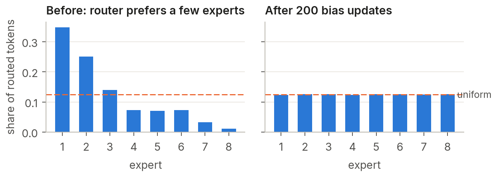
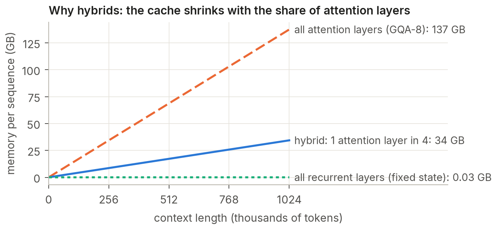

# 11 · Architectures beyond the vanilla transformer

Part III · Transformers and architectures. Assumes Chapter 10 (attention, GQA, the KV cache, RoPE). Chapter 17 covers how mixture-of-experts models are trained across many GPUs; Chapter 21 covers how these choices change serving.

## Why it matters

The 2017 transformer is still the backbone, but almost no frontier model uses it unchanged. The open models that set the pace in 2025–2026 are mixtures of experts with compressed or sparse attention, and a growing share mix attention with linear-time recurrent layers. These choices decide what a model costs to train, how long a context it can serve and how fast it generates. A research scientist is expected to know what each change buys, what it costs, and how to evaluate the claim that a new architecture "matches the transformer": which is where most such claims fail.

Numbers in this chapter come from `code/ch11_check.py` (CPU, seconds).

The chapter is built around a single observation: almost every architectural innovation since 2017 attacks one of three costs, and knowing which one tells you what a new design is for. Section 11.1 names the three costs: compute per token, memory for the KV cache, and the quadratic price of long contexts. Mixture of experts (11.2) decouples the number of parameters from compute per token. Attention variants (11.3) shrink the cache. Linear attention and state-space models (11.4) replace the growing cache with a fixed-size state, and hybrids (11.5) combine them with a few full-attention layers to keep precise recall. Multi-token prediction and diffusion models (11.6, 11.7) change the training objective and the decoding order rather than the block.

The last two sections are about judgement. New architectures are announced constantly, and most do not hold up; 11.8 lists the checks that separate a real improvement from an unfair comparison, and 11.9 works through an architecture decision under a fixed serving budget, the way a design review would.

## Key concepts

- **Mixture of experts (MoE)**: replace the feed-forward block with many expert FFNs and a router that sends each token to a few of them. [Switch Transformer](https://arxiv.org/abs/2101.03961), [GShard](https://arxiv.org/abs/2006.16668), [DeepSeekMoE](https://arxiv.org/abs/2401.06066).
- **Load balancing**: auxiliary losses or bias adjustments that stop the router from collapsing onto a few experts. [Auxiliary-loss-free balancing](https://arxiv.org/abs/2408.15664).
- **Multi-head latent attention (MLA)**: cache a small latent vector per token instead of full keys and values. [DeepSeek-V2](https://arxiv.org/abs/2405.04434), [DeepSeek-V3](https://arxiv.org/abs/2412.19437).
- **Linear attention and state-space models (SSMs)**: sequence mixers with a fixed-size recurrent state and linear cost in length. [Mamba](https://arxiv.org/abs/2312.00752), [Mamba-2](https://arxiv.org/abs/2405.21060), [Gated DeltaNet](https://arxiv.org/abs/2412.06464).
- **Sparse attention**: a cheap selection step picks which earlier tokens each query attends to. [Native Sparse Attention](https://arxiv.org/abs/2502.11089), [DeepSeek-V3.2 (DSA)](https://arxiv.org/abs/2512.02556).
- **Hybrid models**: mostly linear-time layers with a few full-attention layers. [Jamba](https://arxiv.org/abs/2403.19887), [MiniMax-M1 (lightning attention)](https://arxiv.org/abs/2506.13585).
- **Multi-token prediction (MTP)**: predict several future tokens per position. [Gloeckle et al.](https://arxiv.org/abs/2404.19737).
- **Diffusion language models**: generate by iteratively unmasking tokens in parallel. [LLaDA](https://arxiv.org/abs/2502.09992).

## 11.1 Three costs that drive architecture research

A transformer's cost has three separate sources, and they bind in different situations: training a larger model, serving many users at once, or reading very long documents. Architecture research is easiest to follow once each proposal is filed under the cost it reduces, and the trade-off it accepts in return.

1. **Compute per token.** A dense transformer spends about 2 FLOPs per parameter per token in the forward pass. Bigger models know more but cost proportionally more for every token, in training and inference.
2. **Attention's quadratic cost.** Self-attention compares every token with every earlier one: O(T²) compute in training and prefill. At 128k tokens this dominates.
3. **KV-cache memory.** At generation time each layer stores keys and values for every past token. The cache grows linearly with context and batch size, and decode speed is limited by reading it from memory (Chapter 21).

MoE attacks the first, sparse and linear attention the second, and GQA, MLA and recurrent layers the third. Most current designs combine several.

## 11.2 Mixture of experts

Larger models know more, but in a dense transformer every parameter is used for every token, so knowledge and compute per token grow together. Mixture of experts breaks that link. Each token is processed by only a few of many feed-forward "experts", so the model can hold far more parameters than it uses on any one token. Most frontier models now use it, and its difficulties are practical rather than conceptual: keeping the experts evenly used, and moving tokens between GPUs.

**The idea.** Replace the single FFN in a block with E expert FFNs and a small router. For each token, the router produces a score per expert; the token goes to the top k experts and their outputs are mixed with the (renormalised) router weights. Total parameters grow with E, but compute per token grows only with k.

```python
class MoE(nn.Module):
    def forward(self, x):                          # x: (tokens, d)
        probs = F.softmax(self.router(x), dim=-1)  # (tokens, n_experts)
        topv, topi = probs.topk(self.k, dim=-1)
        topv = topv / topv.sum(-1, keepdim=True)   # renormalise the chosen gates
        out = torch.zeros_like(x)
        for e in range(self.n):
            rows, slot = (topi == e).nonzero(as_tuple=True)
            if rows.numel():
                out[rows] += topv[rows, slot, None] * self.experts[e](x[rows])
        f = torch.bincount(topi.flatten(), minlength=self.n).float() / topi.numel()
        P = probs.mean(0)
        aux = self.n * (f * P).sum()               # load-balancing loss
        return out, aux
```

**Load balancing.** Without pressure, the router collapses: a few experts get most tokens, train faster, get chosen more. The Switch/GShard auxiliary loss multiplies, for each expert, the fraction of tokens it receives (f) by its mean router probability (P), times E. It equals 1.0 for perfectly uniform routing and grows with imbalance: 2.52 for the skewed load in the check script. It is added to the language-model loss with a small weight (around 0.01). Too large a weight hurts quality, because it forces routing to ignore content.

$$
\mathcal{L}_{\mathrm{aux}} = E \sum_{e=1}^{E} f_e\, P_e
$$

Here E is the number of experts, f_e the fraction of routed token slots that went to expert e in the batch, and P_e the router's softmax probability for expert e averaged over the batch's tokens. **Why a product of f and P, rather than f² or P²?** The fraction f_e comes from a top-k selection, a count of discrete choices. It is piecewise constant in the router's weights, so its gradient is zero almost everywhere, and a loss of Σ f_e² would never move the router. P_e is a smooth function of the router logits. In f·P, f acts as a constant weight on a differentiable term: the gradient with respect to P_e is E·f_e, so the loss pushes down the probability of each expert in proportion to how overloaded it actually is. A loss on P alone (Σ P_e²) would be differentiable but would balance the soft probabilities, which can be uniform on average while the hard top-k assignments are still skewed. The product uses the real load to decide the direction and the probability to carry the gradient.

**The router z-loss** (ST-MoE, Zoph et al., 2022) controls a different failure: router logits growing large, which makes routing brittle and causes round-off errors in the softmax. For a batch of B tokens with router logits x_{i,j},

$$
\mathcal{L}_{z} = \dfrac{1}{B}\sum_{i=1}^{B}\left(\log \sum_{j=1}^{E} e^{x_{i,j}}\right)^{2}
$$

added with a weight of about 10⁻³. For one token with logits (2, 1, 0, −1), the log-sum-exp is 2.44 and the penalty 5.96 before weighting; shrinking all logits towards 0 lowers it without necessarily changing which experts win.

**Auxiliary-loss-free balancing** (used in DeepSeek-V3) adds a per-expert bias to the router scores *only for choosing* the top k, not for weighting outputs. After each step, overloaded experts' biases go down and underloaded ones go up. In the check script, a router with a built-in preference starts with expert loads between 0.009 and 0.350 and ends, after 200 updates, between 0.123 and 0.127, with no gradient interference in the main loss.



*Share of routed tokens per expert (top 2 of 8) for a router with built-in preferences, before and after 200 bias updates. The dashed line is perfectly uniform load.*

**Why balance matters for systems as well as quality.** With expert parallelism (Chapter 17), each expert lives on a different GPU, and every MoE layer waits for the slowest GPU. If one expert receives 35% of the tokens while the average is 12.5%, its GPU does almost three times the work and the other seven GPUs wait: the layer runs at the speed of the hottest expert. Balancing is therefore a throughput requirement as much as a training-quality one.

**Capacity factor and dropped tokens.** To keep buffers static and bound the hottest GPU's work, many implementations give each expert a fixed capacity, the capacity factor times its fair share:

$$
\mathrm{capacity} = \mathrm{CF}\cdot\dfrac{k \cdot \mathrm{tokens}}{E}
$$

Tokens routed to a full expert are dropped from that expert (they pass through on the residual connection only). The share dropped is the sum over experts of max(0, load_e − CF/E). For the skewed router above, with loads from 0.349 down to 0.010, a capacity factor of 1.0 drops 36.6% of routed tokens, 1.25 drops 28.1% and 2.0 still drops 9.9%. After bias balancing (loads 0.123 to 0.127), at most 4 × 0.002 = 0.8% are dropped at CF = 1.0 (`code/ch11_check.py`). Training typically uses a CF of 1.0–1.25, and evaluation a larger one or none. Drops make a token's output depend on which other tokens share its batch, a source of non-determinism at inference. Dropless implementations (MegaBlocks-style grouped matmuls) avoid it at the cost of variable-size work.

**Token choice vs expert choice.** Everything above is *token choice*: each token picks its top k experts, and balance must be encouraged. *Expert choice* (Zhou et al., 2022) inverts it: each expert picks its top-capacity tokens from the batch, so load is balanced by construction. The cost is that some tokens get no expert and others several, and that it breaks causality for autoregressive decoding, because an expert's choice depends on tokens later in the batch. That is why decoder LLMs use token choice.

**Upcycling.** Instead of training an MoE from scratch, initialise every expert as a copy of a trained dense model's FFN, add a freshly initialised router and continue training ("sparse upcycling", Komatsuzaki et al., 2022). This reuses the dense compute, but the identical experts must first diverge, and with enough budget training from scratch usually overtakes it. A common variant splits the dense FFN into fine-grained slices to create many small experts.

**Fine-tuning and RL instability.** MoE models are harder to fine-tune than dense ones. Small fine-tuning datasets shift routing, overloading some experts and overfitting others. Routers can also flip choices between the inference engine and the training engine because of tiny numerical differences, which in RL makes the sampled policy differ from the trained one. Common mitigations: freeze the router or lower its learning rate, keep the load-balancing term on, use larger batches, and in RL record the routing decisions made during sampling and replay them in training.

**The modern design space** (DeepSeekMoE onwards, and most large open models since):

- **Fine-grained experts**: many small experts (64–384) rather than 8 large ones, with more of them active (top 6–8). More combinations of specialists per token.
- **Shared experts**: one or two experts every token uses, holding common knowledge so routed experts can specialise.
- **Sparsity ratio**: total-to-active parameter ratios of 10–30× are common. For one layer with 128 routed experts of width 1,024, one shared expert, top 8 and d_model 4,096, the check script gives 1,623M total and 113M active parameters, less compute than a dense FFN of the usual size (134M).

**What MoE costs.** All experts must sit in memory, so serving needs the total parameter count's memory, spread across GPUs with **expert parallelism** (Chapter 17), and all-to-all communication to send tokens to their experts. The bandwidth advantage also depends on batch size. At batch 1, a decode step reads only the 8 active experts of each layer, so a 7%-active model reads about 7% of its expert weights. Tokens route independently, so with 128 routed experts and top 8, a batch of 16 tokens touches about 82 experts in expectation, and a batch of 64 touches about 126 (`code/ch11_check.py`). At serving batch sizes nearly every expert is read every step, so decode reads close to the *total* weights, and the MoE's advantage is in FLOPs and in spreading memory over GPUs, not in bytes read per step. The binding constraint then becomes the all-to-all latency of expert parallelism, which is why large MoE deployments use many GPUs with fast interconnect and overlap communication with computation. Training is less stable (router logits grow; a router z-loss helps), batches must be large enough that each expert sees enough tokens, and fine-tuning can be tricky. Capacity limits (a maximum number of tokens per expert) drop overflow tokens in some implementations, which makes outputs depend on what else is in the batch.

**Why it wins.** At a fixed training compute budget, a well-balanced MoE reaches a lower loss than a dense model with the same active parameters, because it stores more knowledge per FLOP. Early evidence was large: the Switch Transformer paper reported up to 7× faster pre-training than a dense T5 baseline with the same FLOPs per token. How the advantage scales is debated. Clark et al. (2022, "Unified Scaling Laws for Routed Language Models") found the benefit of routing shrinking as the dense base model grows. Krajewski et al. (2024, "Scaling Laws for Fine-Grained Mixture of Experts") argued that this came from fixed expert sizes and training lengths: with expert granularity tuned, MoE stays ahead at every scale they extrapolated to. Abnar et al. (2025) found the optimal sparsity *rises* with compute. Chapter 13 (13.7) takes the same view: with granularity tuned, the MoE advantage need not shrink with scale. What practice shows is that every leading open model above about 100B parameters is an MoE (Chapter 12, 12.9).

## 11.3 Attention variants for memory and length

During generation, the dominant memory cost is the KV cache: keys and values for every previous token, in every layer, for every user. It often limits how many users a GPU can serve and how long their contexts can be. The variants in this section keep full softmax attention but store less: fewer key and value heads, compressed keys and values, or a window of recent tokens only.

**MQA and GQA** (Chapter 10) share key and value heads across query heads: 8 KV heads instead of 128 shrink the cache 16×.

**Multi-head latent attention (MLA)**, from DeepSeek-V2, goes further. Each token's keys and values are produced from a single low-dimensional latent vector (512 dimensions in DeepSeek-V3), and only that latent is cached; per-head keys and values are reconstructed on the fly, and the up-projections can be folded into the query and output projections. RoPE does not commute with that folding, so a small separate set of "decoupled" rotary dimensions (64) carries position. Per token per layer in bf16:

| Scheme (128 heads of 128 dims) | Cache bytes per token per layer |
|---|---|
| Multi-head attention | 65,536 |
| GQA with 8 KV heads | 4,096 |
| MLA, latent 512 + RoPE 64 | 1,152 |

For a 61-layer model at a 128k-token context that is 524 GB per sequence with full MHA against 9.2 GB with MLA: the difference between impossible and routine.

**Sliding-window and local/global attention.** Each token attends only to the last W tokens (for example 4k) in most layers, with full attention every few layers. Cache and compute for the local layers are bounded by W. Mistral 7B used sliding windows; Gemma 2 and 3 interleave local and global layers.

**Sparse attention.** Each query attends to a selected subset of earlier tokens, chosen by a cheap scoring step: compressed blocks plus top-k selected blocks plus a local window (Native Sparse Attention, 2025), or a lightweight indexer choosing the top-k tokens (DeepSeek Sparse Attention, 2025). The goal is full-attention quality at a fraction of long-context cost, with kernels designed for the hardware from the start.

DeepSeek-V3.2 (2025) put fine-grained sparse attention into a frontier-scale open model, and its recipe shows how to retrofit it rather than pretrain from scratch:

1. **Add a small indexer** to a trained dense model (MLA). The indexer has few heads, runs in fp8 and scores every earlier token for each query.
2. **Warm up the indexer alone** with the dense model frozen, training it to match the dense attention distribution with a KL loss (about 2B tokens).
3. **Switch to sparse attention** (each query attends to its top 2,048 tokens) and continue training all weights on about 100B tokens.

The main attention becomes roughly O(L·k) instead of O(L²); the indexer is still quadratic, but cheap. The report shows long-context inference costs falling sharply at 128k tokens with benchmark scores close to the dense model. Distilling a cheap selector from the dense model's own attention is a reusable pattern: the dense model already knows which tokens matter.

## 11.4 Linear attention and state-space models

Softmax attention has to look back at every earlier token, so its cost per generated token grows with the length of the context. Recurrent models have a fixed-size memory and a constant cost per token, but Chapter 8 showed why classic RNNs lost: they trained slowly and forgot. The models in this section are recurrent in how they run, with a fixed-size state, but they are designed to train in parallel like a transformer and to remember far better than an LSTM.

**Linear attention.** Softmax attention needs all past keys. Replace exp(q·k) with a product of feature maps φ(q)·φ(k) and the sum over the past can be accumulated in a d × d state. Causal softmax-free attention for query t is Σ_{s≤t} φ(q_t)ᵀφ(k_s) v_s / Σ_{s≤t} φ(q_t)ᵀφ(k_s). Because φ(q_t) does not depend on s, it can be pulled out of both sums, which leaves two running sums that do not involve the query:

$$
S_t = S_{t-1} + \phi(k_t)\, v_t^{\top},\qquad z_t = z_{t-1} + \phi(k_t)
$$

$$
o_t = \dfrac{S_t^{\top}\, \phi(q_t)}{z_t^{\top}\, \phi(q_t)}
$$

Here S_t (d_k × d_v) accumulates key–value outer products, z_t (d_k) accumulates the keys alone and serves as the softmax-like normaliser, and φ is a feature map that keeps scores positive. Katharopoulos et al. (2020) used φ(x) = elu(x) + 1, the version in the check script. That is an RNN with a matrix-valued state: constant memory per token at inference, and a parallel form for training. The check script confirms the two forms give identical outputs. Modern variants (GLA, Mamba-2, Gated DeltaNet) mostly drop the denominator z_t and φ's positivity constraint, and stabilise the output with a normalisation layer instead, because the normaliser can become tiny and cause numerical problems.

**The problem: a fixed state is a fixed-size memory.** The additive update only ever adds; old associations blur together. In the check script, writing key 0 → value 2, then key 1 → value 3, then key 0 → value 1, and querying key 0, returns a mixture of the old and new values ([0, 3, 3, 0]).

**The fixes, in the order they appeared:**

- **Gates / decay.** Multiply the state by a forget factor each step (RetNet, GLA, Mamba's selective decay). Old information fades instead of piling up.
- **Selective state spaces (Mamba).** A structured SSM whose transition and input matrices depend on the current token, so the model chooses what to keep. Mamba-2 showed that a restricted form is a kind of linear attention with a decaying mask ("state-space duality"), which allows matmul-based training kernels. The derivation is in the next subsection.
- **The delta rule (DeltaNet, Gated DeltaNet).** Before writing value v for key k, subtract what the state currently returns for k: S ← S + β k (v − kᵀS)ᵀ. It overwrites rather than accumulates; with a gate it can also forget. In the same test it returns exactly the newest value ([0, 3, 0, 0]). The reason is derived below.
- **RWKV and xLSTM** are recurrent architectures in the same family with their own gating designs.

**A worked recall example.** Write three associations into the state: key 0 → value 2, key 1 → value 3, then key 0 → value 1 (an update). With the additive rule the state for key 0 holds both values: querying it returns [0, 3, 3, 0] (scaled one-hot codes for "2" and "1" mixed). With the delta rule, the second write first subtracts what the state already returned for key 0, so the query returns [0, 3, 0, 0]: only the newest value, as a key–value store should. This is the single most important idea in modern linear recurrences: a fixed-size memory is only useful if it can overwrite.

### The delta rule is online gradient descent

Treat the state S as a linear key–value memory that should return v when queried with k, and measure its error on the current pair by

$$
\ell(S) = \dfrac{1}{2}\,\Vert S^{\top}k - v \Vert^{2}
$$

The gradient with respect to S is k(Sᵀk − v)ᵀ. One gradient step with learning rate β gives S ← S − β k(Sᵀk − v)ᵀ = S + β k(v − Sᵀk)ᵀ, which is exactly the delta rule. So each token performs one step of online regression that fits the memory to the newest association. With a unit-norm key and β = 1, the step makes Sᵀk = v exactly (the check script verifies both facts), which is why the old value for that key disappears. The additive rule of plain linear attention is the same step with the "current prediction" term removed, so it can only accumulate. The gate α in Gated DeltaNet multiplies S by α before the step, which is weight decay on the memory. This view links linear recurrences to **test-time training**: TTT layers (Sun et al., 2024) and Titans (Behrouz et al., 2025) replace the linear memory and squared loss with a small MLP and richer updates, but the principle is the same: the state is a model trained online, one token at a time, on the sequence it is reading.

### State-space models and Mamba, step by step

**Continuous state space.** A state-space model maps an input signal x(t) to an output y(t) through a hidden state h(t):

$$
h'(t) = A\,h(t) + B\,x(t),\qquad y(t) = C\,h(t)
$$

A sets how the state evolves (in a 1-D example with A = −1 the state decays towards 0), B how the input enters, and C how the state is read out. In S4 and Mamba the state has N dimensions (16 to 128) per channel, and A is diagonal.

**Discretisation.** Tokens arrive at discrete steps, so the model integrates the equation over a step of length Δ. Holding x constant over the step (zero-order hold) gives h_t = Ā h_{t−1} + B̄ x_t with

$$
\bar{A} = e^{\Delta A},\qquad \bar{B} = (\Delta A)^{-1}\left(e^{\Delta A} - I\right)\Delta B
$$

and y_t = C h_t. In 1-D with A = −1 and B = 1, Ā = e^{−Δ} and B̄ = 1 − e^{−Δ}. Δ is a dial: a large Δ makes Ā ≈ 0 and B̄ ≈ 1 (forget the past, write the current input), and a small Δ makes Ā ≈ 1 and B̄ ≈ 0 (keep the state, ignore the input).

**Selective: let the token set the dial.** In S4, A, B, C and Δ are fixed, so the model is a linear time-invariant filter and cannot decide based on content what to remember. Mamba makes Δ, B and C functions of the current token: Δ_t = softplus(w·x_t + b), and B_t, C_t are linear projections of x_t. A worked 1-D example from the check script, with inputs x = (2.0, 0.3, −0.5, 0.4):

| Setting | Δ per token | h₁ | h₂ | h₃ | h₄ |
|---|---|---|---|---|---|
| Fixed Δ = 0.5 (Ā = 0.607, B̄ = 0.393) | 0.5, 0.5, 0.5, 0.5 | 0.787 | 0.595 | 0.164 | 0.257 |
| Selective | 3, 0.01, 0.01, 0.01 | 1.900 | 1.885 | 1.861 | 1.846 |

With a fixed step, the important first value fades and is overwritten by the noise that follows. With a selective step, the model opens the gate for the first token (Δ = 3, Ā = 0.05) and nearly closes it for the rest, so the state still holds about 1.85 four tokens later. That content-dependent choice is what "selective" means. It is also what breaks the convolution trick S4 used for fast training, since the filter now changes at every step.

**Training in parallel: the scan.** The recurrence h_t = a_t h_{t−1} + b_t looks sequential, but combining two steps gives another step of the same form. Applying (a₁, b₁) then (a₂, b₂) equals the single step (a₁a₂, a₂b₁ + b₂). This combination is associative, so a parallel prefix scan computes all T states in O(log T) depth, the same trick as a parallel cumulative sum. Mamba implements it in a hardware-aware kernel that keeps the expanded state in SRAM, much as FlashAttention does (Chapter 10, 10.9).

**State-space duality (Mamba-2).** If Ā_t is a scalar a_t times the identity, unroll the recurrence: y_t = Σ_{s≤t} C_tᵀ (a_{s+1} ⋯ a_t) B_s x_s. In matrix form,

$$
y = \left(L \circ C B^{\top}\right) x
$$

where row t of C is C_t, row s of B is B_s, ∘ is the element-wise product, and L is a lower-triangular decay mask with L_{ts} = a_{s+1} ⋯ a_t for s ≤ t (1 on the diagonal) and 0 above it. This is causal linear attention with C as the query, B as the key, x as the value and a decay mask. The check script confirms the recurrent and matrix forms agree. The duality lets Mamba-2 train with chunked matmuls on tensor cores (quadratic within a chunk, recurrent between chunks), and it shows that Mamba, gated linear attention and RetNet are one family differing in how the decay and the update are parameterised.

### Where they stand

**Where they stand.** Recurrent layers match transformers on perplexity at moderate scale and are far cheaper at long context: the recurrent state below is 0.03 GB regardless of length, against an attention KV cache that reaches 137 GB at a million tokens for an 8B-shaped model. Their weakness is **exact recall from long context**: copying, retrieving a specific fact from far back, multi-hop lookups. Benchmarks for associative recall and needle retrieval separate them clearly from attention. That weakness is why the field converged on hybrids.



*Memory per sequence for a 32-layer, 8B-shaped model in bf16. Full attention grows linearly to 137 GB at a million tokens; a hybrid with one attention layer in four needs a quarter of that; pure recurrent layers stay at 0.03 GB.*

## 11.5 Hybrid models

Fixed-size memories are efficient but lossy: a state of a few megabytes cannot hold every detail of a million-token document, and pure linear models are measurably worse at exact recall, such as copying a phone number from far back. Hybrid models accept a small amount of quadratic attention to fix this. Most layers are linear-time, and a few full-attention layers give the model a way to look up exact details when it needs to.

Keep a minority of full-attention layers for precise retrieval and make the rest linear-time:

- **Jamba** (2024): Mamba layers with one attention layer in eight, plus MoE.
- **Nemotron-H** (2025): mostly Mamba-2 layers with a few attention layers, aimed at inference throughput.
- **Qwen3-Next** (2025): Gated DeltaNet layers interleaved 3:1 with gated full attention, plus a high-sparsity MoE.
- Others interleave "lightning" or other linear attention with softmax attention at similar ratios.

The design questions are the ratio (1:3 to 1:8 is typical), where the attention layers go (not all at the start), whether attention layers use positional encodings at all, and how to evaluate. Perplexity alone hides the recall weakness; evaluate on long-context retrieval (RULER, needle-in-a-haystack variants), in-context learning and real long-document tasks, at matched training tokens.

**Placement.** Attention layers are usually spread evenly through the depth (every fourth or eighth layer) rather than stacked at the start or end. Retrieval needs representations that are already contextualised, so a lone attention layer at the bottom sees too little, and one at the very top leaves no layers to use what it retrieved. Ablations in hybrid papers generally find evenly interleaved or middle-heavy placements best, but the effect is smaller than the ratio's.

**Positional encodings in the global layers.** A growing pattern is to give the local or recurrent layers the job of encoding order and to use **no positional encoding (NoPE)** in the few global attention layers. Recurrent layers and sliding-window RoPE layers already encode order, and a causal decoder can infer position even without any encoding, because the mask itself breaks the symmetry (Kazemnejad et al., 2023). A NoPE layer has no rotation angles to go out of distribution, so it degrades more gracefully beyond the training length, which is what the global layers are for. Llama 4 interleaves RoPE layers with NoPE global layers in this way, and several hybrids do the same. The evidence is mostly from length-generalisation ablations rather than large controlled studies, so treat it as a sensible default to test, not a settled result.

## 11.6 Multi-token prediction

Next-token prediction gives the model one learning signal per position, about the immediate next token, and decoding produces one token per forward pass. Predicting several future tokens at once attacks both limitations: it gives a richer training signal that encourages planning ahead, and it provides draft tokens that can speed up generation.

Standard training predicts only the next token. **Multi-token prediction** adds heads (or small extra transformer modules, as in DeepSeek-V3) that predict tokens t+2, t+3, ... from the same trunk. Two motivations:

- **Training signal.** Planning a few tokens ahead may improve representations, especially for code; reported gains are mixed and scale-dependent.
- **Faster inference.** The extra heads are a built-in draft model for **speculative decoding** (Chapter 21): propose several tokens, verify them in one forward pass. This is often the bigger practical win.

**Parallel heads vs sequential modules.** Gloeckle et al. (2024) attach k independent output heads to the trunk's final hidden state. Head i predicts token t + i, but it does so without knowing what was predicted for t + 1, …, t + i − 1, so the predictions are not a coherent chain. DeepSeek-V3 makes the extra predictions **sequential**. MTP module k takes the previous depth's hidden state at position i, normalises it, concatenates it with the (normalised) embedding of the true token at position i + k, projects back to the model width and passes the result through one transformer block. The shared output head then predicts token i + k + 1. Each depth thus conditions on the actual earlier tokens, keeping the causal chain. The embedding layer and output head are shared with the main model, so each module adds only one block and a projection. DeepSeek-V3 uses one extra depth. Its MTP loss, the average cross-entropy over the extra predictions, is added with weight λ = 0.3 for the first 10T training tokens and 0.1 for the remaining 4.8T.

**As a draft model.** At inference the module can be discarded, leaving a standard model, or kept as a one-token draft. DeepSeek reports that the second token is accepted 85–90% of the time. With one draft token accepted with probability a, each forward pass yields 1 + a tokens on average, 1.85–1.90, and after the cost of the extra block the report gives about 1.8× more tokens per second. This is close to the best case for speculative decoding, because the draft shares the main model's representations and needs no separate draft model.

## 11.7 Diffusion language models

Every model so far writes left to right, one token at a time, and can never revise what it has written. Diffusion language models generate a whole block of text in parallel and refine it over several steps, as image diffusion models refine pixels. Whether that can match autoregressive quality is an open research question, but the approach is now competitive enough at small and medium scale to be worth understanding.

Autoregressive models generate one token at a time, left to right. **Masked diffusion models** start from a fully masked sequence and, over a number of steps, predict all masked positions in parallel, keep the most confident predictions and re-mask the rest.

Training is masked-token prediction with a random mask rate t per sequence and a 1/t weight, which makes the loss a bound on the log-likelihood:

```python
t = torch.rand(batch, 1).clamp(min=0.05)          # mask rate per sequence
masked = torch.rand(batch, L) < t
inp = tokens.masked_fill(masked, MASK)
ce = F.cross_entropy(model(inp).transpose(1, 2), tokens, reduction="none")
loss = ((ce * masked) / t).sum() / (batch * L)
```

**Sampling: how the text appears.** Generation starts with L masked positions and runs a fixed number of steps S. At each step the model predicts a distribution at every masked position; the sampler commits the L/S most confident predictions and leaves the rest masked (confidence-based remasking). An illustrative 8-token trace with 4 steps, committing two tokens per step (confidences are made up for the illustration):

| Step | Sequence after the step | Committed (confidence) |
|---|---|---|
| 0 | `_ _ _ _ _ _ _ _` | none |
| 1 | `the _ _ _ _ _ _ mat` | "the" (0.97), "mat" (0.91) |
| 2 | `the cat _ _ _ the _ mat` | "cat" (0.88), "the" (0.86) |
| 3 | `the cat sat on _ the _ mat` | "sat" (0.83), "on" (0.80) |
| 4 | `the cat sat on to the red mat` | "to" (0.41), "red" (0.38) |

The trace shows both strengths and failure modes. Easy tokens anywhere in the sequence are fixed first, including the end, which an autoregressive model cannot do. But the last step had to commit two low-confidence tokens at once. Each was predicted without knowing the other, which is how incoherent pairs such as "on to" appear: tokens decoded in the same step are conditionally independent given the rest. Fewer steps means more tokens per step and more such errors, so quality falls as the step count drops, and a diffusion model's speed advantage is a quality trade-off.

**Why the KV cache breaks, and block diffusion.** Attention is bidirectional, so committing any token changes the representation of every other position, and nothing computed at step s can be reused at step s + 1: each step is a full forward pass over the whole sequence. **Block (semi-autoregressive) diffusion** generates blocks of, say, 32 tokens left to right and runs diffusion only inside the current block, attending causally to finished blocks. Finished blocks can then be cached as in an autoregressive model, and output length becomes flexible.

LLaDA (2025) trained an 8B diffusion LM that was competitive with autoregressive models of similar size on many benchmarks, and commercial diffusion models for code have shown very high generation speeds. Open questions: they need many denoising steps for quality, KV caching does not apply directly, and variable-length generation and reasoning-style long outputs are awkward. Worth knowing; not yet the default.

## 11.8 Evaluating a new architecture

Claims that a new architecture "matches or beats the transformer" appear every few weeks, and few survive independent replication. The usual problems are not fraud but unfair comparisons: a weak baseline, a small scale, or benchmarks that do not test what the new design gives up. Knowing the standard checks lets you read such claims critically, and design your own comparisons so that they convince others.

Most "X beats the transformer" claims dissolve under these checks:

| Check | Why |
|---|---|
| Matched training tokens and data | More or better data explains most wins |
| A strong, tuned transformer baseline (modern recipe: RMSNorm, SwiGLU, RoPE, GQA, tuned learning rate) | The 2017 baseline is easy to beat |
| Several scales, with a scaling-law fit (Chapter 13) | Advantages at 125M often vanish at 1B+ |
| Recall and long-context tasks, not only perplexity | Recurrent models hide their weakness in perplexity |
| Wall-clock and memory on real hardware | Linear in theory is not fast without kernels |
| Seeds and confidence intervals (Chapter 23) | Small differences are often noise |

## 11.9 A worked design: a long-context model on a fixed budget

Architecture choices are ultimately made against a budget. This worked case shows the reasoning a design review expects: compute the memory each option needs, see which constraint binds, and choose the cheapest change that relieves it.

Suppose you must serve an 8B-scale assistant with 256k-token contexts on GPUs with 80 GB of memory, at 16 concurrent sequences per GPU. Work through the options with the numbers from this chapter and Chapter 10.

- **Dense transformer with GQA-8.** Weights take 16 GB in bf16. The KV cache is 2 × 32 layers × 8 heads × 128 × 2 bytes = 131 KB per token, so 256k tokens is 34 GB per sequence. Sixteen sequences need 550 GB: impossible on one GPU; even one sequence leaves little room. You would need cache quantisation, multi-GPU serving, or far fewer concurrent users.
- **MLA instead of GQA.** With a 512 + 64 latent per token per layer, the cache is 32 × 576 × 2 bytes = 37 KB per token, about 9.7 GB per 256k-token sequence. Two to six sequences fit next to the weights, depending on the activation headroom you keep. (The 512 + 64 sizes are DeepSeek-V3's, chosen for a model of width 7,168. Carrying them over to a width-4,096 model is an assumption; a model this size would probably use a smaller latent, which would shrink the cache further, at some quality cost that must be measured.)
- **Hybrid 1:3 (one attention layer in four, the rest Gated DeltaNet).** Only 8 layers keep a KV cache: 33 KB per token with GQA-8, 8.6 GB per sequence, plus a fixed recurrent state of a few megabytes per layer. Combined with MLA in the attention layers the cache falls to about 2.4 GB per sequence, and sixteen sequences fit.
- **Sliding-window attention (4k window) in most layers** bounds those layers' cache at 4k tokens regardless of context, at the price of relying on the few global layers for long-range retrieval.

The arithmetic narrows the space; it does not decide it. The hybrid and sliding-window designs must then pass the recall and long-context evaluations of 11.8 at the target length, because the memory they save comes precisely from the information they no longer store exactly. A responsible recommendation states both: "the hybrid fits sixteen users per GPU; it loses 3 points on multi-needle retrieval at 256k against the dense baseline; here is whether that matters for our use case".

## Pitfalls

- Quoting an MoE's total parameters as if it were a dense model of that size, or its active parameters when discussing memory.
- Forgetting that every expert must be loaded for serving, even though each token uses few.
- Concluding that a recurrent model "handles 1M tokens" because it runs at that length; check whether it retrieves from that length.
- Comparing architectures at one learning rate (Chapter 7).
- Treating the 1/t weighting in masked diffusion as optional: without it the loss is not a likelihood bound.
- Assuming an MoE reads only its active experts at serving batch sizes: a batch of 64 tokens touches nearly all of them (11.2).
- Training a recurrent or hybrid model and reporting only perplexity: the recall weakness does not show there.
- Using a capacity factor during evaluation and getting results that change with batch composition.

## Interview questions

**Mid level**

**1. How does a top-k MoE layer work, and what does it change in compute and memory?** A router scores experts per token; the token goes through the top k experts and their outputs are mixed with the (renormalised) router weights. Compute per token scales with k, memory with the total number of experts; training and serving need expert parallelism and all-to-all communication. For the fine-grained layer in 11.2 (128 experts of width 1,024 plus one shared, top 8, d = 4,096), that is 1,623M parameters in memory but only 113M (7%) used per token. The follow-up is "so is it 15× cheaper to serve?": in FLOPs yes, but at serving batch sizes almost every expert is read each step, so the memory and communication costs follow the total.

**2. Why do MoE models need load balancing? Give two approaches.** Routers collapse onto a few experts: an expert that gets more tokens trains faster and gets chosen more. The Switch/GShard auxiliary loss E·Σ f_e P_e pushes towards uniform load. It is 1.0 when balanced, and it uses f (the hard, non-differentiable load) as a weight on P (the differentiable mean probability). Auxiliary-loss-free balancing adjusts a per-expert selection bias up or down by load, avoiding gradient interference; in the check script it takes loads from 0.009–0.350 to 0.123–0.127. The trade-off: too large an auxiliary weight forces routing to ignore content and costs quality. The follow-up is "why not just a capacity limit?": capacity drops tokens (37% at CF 1.0 for the skewed router in 11.2) rather than fixing the router.

**3. What are fine-grained and shared experts?** Many small experts with more of them active, giving more combinations, and one or more always-on experts holding common knowledge so routed ones specialise. Introduced in DeepSeekMoE and now standard: DeepSeek-V3 has 256 routed experts plus 1 shared, with 8 routed active. Splitting each of 16 experts into 4 smaller ones and activating 4× as many keeps FLOPs constant but raises the number of possible expert combinations enormously, from C(16, 2) = 120 to C(64, 8) ≈ 4.4 × 10⁹. The cost is more routing overhead and smaller matmuls, which are less efficient on GPUs. The follow-up is "how small can experts get?": until the matmuls become too small to run efficiently and routing communication dominates.

**4. Explain MLA. Why does it need decoupled RoPE?** Keys and values are reconstructed from a cached low-rank latent per token, cutting the cache by tens of times: 1,152 bytes per token per layer against 65,536 for full MHA with 128 heads of 128, 57× smaller. The up-projections are absorbed into the query and output matrices at inference, which only works if no position-dependent rotation sits between them. RoPE's rotation depends on the position, so it cannot be folded into a fixed matrix, and position goes through a small extra set of 64 rotary dimensions shared across heads. The follow-up is "MLA vs GQA at equal cache size?": DeepSeek reports MLA matching or beating MHA quality, while GQA at the same cache size loses some; the price is more complex kernels.

**5. Show that causal linear attention is an RNN.** With φ(q)·φ(k) instead of exp(q·k), the output for query t is φ(q_t)ᵀ Σ_{s≤t} φ(k_s)v_sᵀ divided by φ(q_t)ᵀ Σ_{s≤t} φ(k_s). The two sums, S_t and z_t, do not depend on the query, so they can be accumulated step by step: S_t = S_{t−1} + φ(k_t)v_tᵀ, z_t = z_{t−1} + φ(k_t). Each output then needs only the current state. Memory is d_k × d_v per head regardless of length, against a KV cache that grows linearly. The follow-up is "how do you train it fast?": the chunked form, quadratic inside chunks of 64–256 tokens and recurrent between them, which uses tensor cores.

**6. What is the main weakness of SSMs and linear attention? How do hybrids address it?** A fixed-size state cannot store everything, so precise recall from long context degrades: copying, retrieving one fact, multi-hop lookups. Perplexity hides it, and associative-recall benchmarks expose it. Hybrids keep a few full-attention layers for retrieval and make the rest linear-time. With one attention layer in four, an 8B-shaped model's cache at a million tokens falls from 137 GB to about 34 GB. The follow-up is "how do you choose the ratio?": sweep it at small scale and evaluate recall at the target length, at matched training tokens.

**7. What does the delta rule add to linear attention?** It subtracts the state's current prediction for a key before writing the new value, so it overwrites associations instead of summing them; combined with a gate it can forget. It is one step of online gradient descent on ½‖Sᵀk − v‖² with learning rate β: the gradient is k(Sᵀk − v)ᵀ, so S ← S + βk(v − Sᵀk)ᵀ. With a unit key and β = 1, the state returns v exactly afterwards. In the check script's recall test, the additive rule returns a mixture of old and new values ([0, 3, 3, 0]), and the delta rule returns only the new one ([0, 3, 0, 0]). The follow-up is "what is test-time training, then?": replacing the linear memory with a small network trained the same way, as in TTT and Titans.

**8. What is multi-token prediction good for?** Extra training signal from predicting several tokens ahead, and built-in draft heads for speculative decoding. DeepSeek-V3's sequential MTP module keeps the causal chain by feeding the true next token's embedding into each depth, and its second-token prediction is accepted 85–90% of the time, giving about 1.8× decode throughput. The training-signal benefit is mixed and scale-dependent, so the inference speedup is the reliable win. The follow-up is "why not parallel heads?": independent heads predict t + 2 without knowing t + 1, so their drafts are less coherent and accepted less often.

**Senior level**

**9. A paper says its linear-time model beats a transformer at 350M parameters. What do you ask?** Same data and tokens? A modern, tuned baseline (RMSNorm, SwiGLU, RoPE, GQA, a tuned learning rate), not the 2017 recipe? Does it hold at larger scale, with a scaling-law fit across three or more sizes? Recall and long-context evaluations, not only perplexity? Real throughput and memory with optimised kernels? Seeds and confidence intervals? A strong answer prioritises: matched tokens and a tuned baseline first, because they explain most claimed wins, then recall, because that is where linear models hide their weakness. One number: at 350M parameters the seed-to-seed spread of downstream accuracy can be a point or more on small benchmarks, so a 1-point win with one seed is not evidence. The follow-up is "what experiment would convince you?": a sweep at three or more sizes with matched data, both arms tuned, recall and long-context evaluations at the target length, and wall-clock measurements.

**10. When would you choose a dense model over an MoE?** Small deployments where memory, not compute, is the constraint; on-device; heavy fine-tuning by teams without MoE expertise; very low or bursty traffic where experts are under-used. The numbers: memory follows total parameters, so a 30B-A3B MoE needs about 60 GB in bf16, like a 30B dense model, while computing like a 3B one. At batch 1, decode reads only the active experts, but tokens route independently, so a batch of 64 touches about 126 of 128 experts, and at serving batch sizes the step reads nearly all weights. Expert parallelism adds all-to-all communication on every MoE layer, which needs fast interconnect, and fine-tuning or RL is less stable because routing shifts. The follow-up is "so when is MoE clearly better?": large-scale serving with high, steady traffic over many GPUs, and training, where a fixed FLOP budget buys a lower loss.

**11. Compare Native Sparse Attention and DeepSeek Sparse Attention. Why is the DSA indexer trained by distillation?** Both make each query attend to a selected subset of earlier tokens. NSA, trained from scratch, combines three branches with learned gates: attention over compressed block summaries, attention over the top-scoring blocks chosen with the compressed scores, and a sliding window. Selection is per block so that memory accesses are contiguous and the kernels are fast. DSA, as used in DeepSeek-V3.2, adds a small fp8 "lightning indexer" to an already trained MLA model. The indexer scores every earlier token, and each query attends to its top 2,048 tokens individually. The main attention becomes O(L·k), while the indexer stays O(L²) but is cheap. The indexer is distilled because top-k selection gives it no useful gradient from the language-model loss, and the dense model's own attention distribution is a ready-made target: a KL loss trains the indexer to predict where the dense model would look, before switching to sparse training. The trade-off: NSA pays a full pretraining run, while DSA retrofits an existing model for about 100B tokens. The follow-up is "what can go wrong?": on tasks needing more than k relevant tokens spread across the context, any fixed top-k loses information.

**12. You are designing a hybrid model. How do you choose the ratio and placement of attention layers, and how do you evaluate it?** Start from the cost target: with one attention layer in four, the KV cache is a quarter of a dense model's, and with one in eight an eighth. Then sweep the ratio at small scale (1:3, 1:7, and pure recurrent as a control) with matched data, and evaluate associative recall, multi-needle retrieval and real long-document tasks at the target length, not only perplexity. Spread the attention layers evenly through the depth rather than stacking them at the bottom or top, and test NoPE in the global layers against RoPE for length generalisation. One number: an 8B-shaped model at 256k tokens needs 34 GB of KV cache per sequence with GQA-8, and a 1:3 hybrid about 8.6 GB. That decides whether sixteen users fit on a GPU (11.9). The follow-up is "how do you know the result transfers to scale?": fit the gap between hybrid and dense across sizes and check that it is not growing, and re-check recall at the largest size before committing.

**13. Explain Mamba in five minutes.** Start from a continuous state space, h' = Ah + Bx, y = Ch, discretised with a step Δ into h_t = Āh_{t−1} + B̄x_t with Ā = exp(ΔA). A large Δ means forget and write; a small Δ means keep and ignore. Mamba makes Δ, B and C functions of the current token ("selective"), so the model decides per token what to store. In the 1-D example in 11.4, a selective step keeps a key value at about 1.85 four tokens later, while a fixed step lets it fade to 0.26. Selectivity breaks the convolution trick of S4, so training uses a parallel associative scan in a fused kernel. Mamba-2 restricts A to a scalar times the identity, which turns the model into linear attention with a decay mask, y = (L ∘ CBᵀ)x, and allows matmul-based training. The weakness is the same as any fixed state: exact recall from long context. The follow-up is "how is that different from an LSTM?": the recurrence is linear in h, so it can be trained in parallel, and the gating is input-dependent but has no nonlinearity between steps.

## Practice

1. Add the MoE layer above to the mini-GPT of Chapter 10 (8 experts, top 2). Train with and without the auxiliary loss and plot expert loads over time.

<details><summary>Hint and expected result</summary>

Log f_e every 50 steps. Without the auxiliary loss, expect one to three experts to take most tokens within a few hundred steps (max load often above 0.3 against a fair 0.125); with weight 0.01 the loads should stay within a few points of 0.125, and the validation loss should be equal or slightly better.

</details>

2. Implement auxiliary-loss-free balancing and compare its final loss and load balance with the auxiliary loss at three loss weights.

<details><summary>Hint and expected result</summary>

Use the bias update from `code/ch11_check.py` (step 0.001–0.01 on the sign of the load error). Expect the bias method to balance about as well as an auxiliary weight of 0.01 and better than 0.001, and the auxiliary weight of 0.1 to balance best but give the worst language-model loss. Differences in loss will be small at this scale, so use three seeds.

</details>

3. Implement chunked causal linear attention (parallel within chunks, recurrent between them) and check it against the recurrent form.

<details><summary>Hint and expected result</summary>

Within a chunk, compute the masked (φ(Q)φ(K)ᵀ ∘ M)V term; between chunks, add φ(Q)S_prev, then update S with the chunk's φ(K)ᵀV. Outputs should match the recurrent version to about 1e-5 for any chunk size, including chunk size 1 (pure recurrence) and chunk size T (pure parallel).

</details>

4. **Research exercise.** Build a synthetic associative-recall task (sequences of key–value pairs, then a query key). Compare softmax attention, additive linear attention and the delta rule at sequence lengths 64, 256 and 1,024, three seeds each. Plot accuracy against length.

<details><summary>Hint and expected result</summary>

Use one-layer or two-layer models of equal width and train each to convergence. Expect softmax attention near 100% at every length; additive linear attention to degrade as the number of pairs exceeds the state's capacity (roughly the key dimension), falling towards chance at 1,024; and the delta rule between them, close to attention while the number of distinct keys stays below the key dimension and degrading after. Report the mean and range over seeds. The interesting result is where the curves cross the key dimension, which is the capacity argument of 11.4 made visible.

</details>

5. Compute the KV cache per sequence for a model you use, under MHA, GQA and MLA, at 8k and 128k tokens.

<details><summary>Hint and expected result</summary>

Bytes per token = layers × (2 × KV heads × head dim × 2) for MHA/GQA and layers × (latent + RoPE dims) × 2 for MLA. For a 32-layer, 32-head, 128-dimension model: 4.3 GB (MHA) and 1.1 GB (GQA-8) at 8k; 69 GB and 17 GB at 128k. With a 512 + 64 MLA latent: 0.30 GB at 8k and 4.8 GB at 128k.

</details>

6. Implement the 1-D selective SSM from 11.4 and reproduce the table; then make Δ a learned function of the input and train it to remember the first token of a sequence of noise.

<details><summary>Hint and expected result</summary>

The fixed-Δ run must give 0.787, 0.595, 0.164, 0.257 and the selective one 1.900, 1.885, 1.861, 1.846. With Δ_t = softplus(w·x_t + b) and a marker feature on the first token, the model should learn a large Δ on the marker and a small one elsewhere, and recall error should fall to near zero; with a fixed Δ it cannot.

</details>

## Read next

- Fedus, Zoph and Shazeer, "Switch Transformers" (2021); Dai et al., "DeepSeekMoE" (2024).
- DeepSeek-AI, "DeepSeek-V2" (2024) for MLA and "DeepSeek-V3 Technical Report" (2024) for auxiliary-loss-free balancing, MTP and fp8.
- Gu and Dao, "Mamba" (2023); Dao and Gu, "Transformers are SSMs" (Mamba-2, 2024).
- Yang et al., "Gated Delta Networks" (2024).
- Lieber et al., "Jamba" (2024).
- Arora et al., "Zoology: Measuring and Improving Recall in Efficient Language Models" (2023): why recall is the right test.
- Nie et al., "Large Language Diffusion Models" (LLaDA, 2025).
- Links to these papers are in the Key concepts section at the top of this chapter.

## Done when

- Without notes, write a top-k MoE layer with the auxiliary loss in 10 minutes, and explain in one minute why the loss is f·P and not f² or P².
- Compute total and active parameters for 128 experts of width 1,024 plus one shared, top 8, d = 4,096 (≈1,623M and 113M), and the experts touched by a batch of 64 tokens (≈126 of 128).
- Compute dropped tokens at a capacity factor of 1.0 from a list of expert loads.
- Compute MLA's cache per token per layer (1,152 bytes) and compare it with MHA and GQA-8 for 128 heads of 128.
- Derive the recurrent form of causal linear attention, including z_t, in 3 minutes.
- Derive the delta rule as a gradient step on ½‖Sᵀk − v‖² in 2 minutes.
- Write h' = Ah + Bx, discretise it with zero-order hold, and say what Δ does when it is large and when it is small; reproduce the selective 1-D example.
- Write SSD as y = (L ∘ CBᵀ)x and say what L is.
- Explain how DeepSeek-V3's MTP module differs from parallel heads, and compute its draft speedup from an acceptance rate (0.85 → 1.85 tokens per pass).
- Trace masked-diffusion sampling for 8 tokens and explain why the KV cache does not apply.
- List the six checks of 11.8 and say which two you would run first.

---

[← 10 · The transformer in depth](10-the-transformer-in-depth.md) · [Contents](../README.md#contents) · [12 · Model families and scaling →](12-model-families-and-scaling.md)
