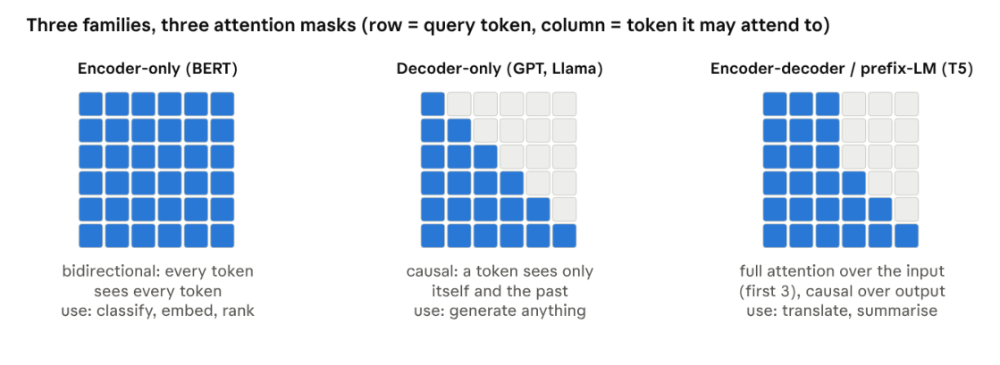
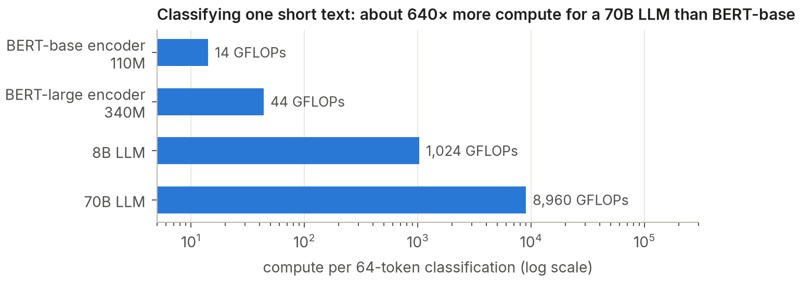

# 12 · Model families and scaling

Part III · Transformers and architectures. Assumes Chapter 10 (the transformer block). Chapter 11 goes deeper on architecture research, Chapter 13 on scaling laws, Chapter 14 on multimodal models.

## Why it matters

"Which model would you use and why?" comes up in every LLM interview and every design review. A senior answer does not name the newest frontier model; it names the right *family* for the task (an encoder for classification at 20k requests per second, a decoder for generation, a bi-encoder for retrieval, a VLM for menu photos), sizes it with scaling arithmetic, and justifies the cost. This chapter gives you the map. Chapter 10 covers the transformer block itself; Chapter 15 covers how these models are trained.

The chapter is a map of the model landscape, organised by the questions you face when choosing a model. Which family fits the task (12.1)? How do you get good sentence embeddings for search and clustering (12.2)? What does mixture of experts change about cost (12.3)? How do models connect images and text (12.4)? How do size, data and compute trade off (12.5), and how do you pick between a small and a large model for a concrete workload (12.6)? Each topic has its own in-depth chapter later; 12.7 points to them, and 12.8 explains how to read the model cards and technical reports that come with every release.

The aim is fluency in the vocabulary and the arithmetic, so that you can place any new model in the landscape quickly: what family it is, roughly what it costs to run, and what it is likely to be good at.

## Key concepts

- **Encoder-only (BERT family)**: bidirectional models pre-trained by masked language modelling; best for classification, extraction, embeddings and reranking. [BERT](https://arxiv.org/abs/1810.04805), [The Illustrated BERT](https://jalammar.github.io/illustrated-bert/).
- **Decoder-only (GPT family)**: causal models trained to predict the next token; nearly all LLMs. [GPT-3: Language Models are Few-Shot Learners](https://arxiv.org/abs/2005.14165).
- **Encoder–decoder (T5 family)**: an encoder reads, a decoder writes; every task framed as text-to-text. [T5](https://arxiv.org/abs/1910.10683).
- **Sentence transformers**: encoders fine-tuned so pooled vectors work as sentence embeddings. [Sentence-BERT](https://arxiv.org/abs/1908.10084).
- **Mixture of experts (MoE)**: a router sends each token to a few expert networks; more parameters at the same compute. [Switch Transformers](https://arxiv.org/abs/2101.03961), [Mixtral](https://arxiv.org/abs/2401.04088).
- **CLIP and vision-language models**: images and text in a shared space; LLMs that accept images. [CLIP](https://arxiv.org/abs/2103.00020), [LLaVA](https://arxiv.org/abs/2304.08485).
- **Scaling laws and Chinchilla**: loss falls predictably with parameters, data and compute; compute-optimal training uses about 20 tokens per parameter. [Kaplan et al.](https://arxiv.org/abs/2001.08361), [Chinchilla](https://arxiv.org/abs/2203.15556).
- **Emergent abilities, debated**: [Are Emergent Abilities a Mirage?](https://arxiv.org/abs/2304.15004)

## 12.1 Three families

Every transformer model belongs to one of three families, and the difference between them is surprisingly small: which tokens each position is allowed to attend to, and what the model is trained to predict. That single choice decides whether a model is best at understanding text, generating it, or transforming one text into another.



*The architecture family is mostly a choice of attention mask plus a training objective.*

**Encoder-only: BERT and descendants** (RoBERTa, DeBERTa, XLM-R, ModernBERT). Pre-trained with *masked language modelling*: hide about 15% of tokens and predict them from both sides. BERT also used next-sentence prediction, which RoBERTa showed was unnecessary; RoBERTa's lesson was that more data, bigger batches and longer training mattered more than the objective tweaks. The output is a contextual vector per token, plus a `[CLS]` vector for the whole input. Best for classification, NER, extraction, cross-encoder reranking and embeddings. They are small (100M–400M parameters), fast, and still often the best choice for a high-volume, fixed-label task. XLM-R and multilingual BERT cover Arabic; Arabic-specific models (for example AraBERT, CAMeLBERT, MARBERT for dialects) are worth testing for Gulf text.

**Decoder-only: GPT and descendants** (Llama, Mistral, Qwen, Gemma, Claude, GPT-4-class models). Pre-trained to predict the next token with a causal mask. Generation, few-shot learning and instruction following come from this one objective at scale, which is why nearly all LLMs are decoders. Weakness: they only read left to right, so as raw embedders they are worse than encoders unless adapted.

**Encoder-decoder: T5, BART, mT5, Flan-T5.** The encoder reads the input bidirectionally; the decoder generates with causal self-attention plus cross-attention to the encoder. T5 framed every task as text-to-text ("translate English to German: …", "sst2 sentence: …") and used span corruption as the objective. Strong for translation and summarisation at small sizes; less common now at the frontier.

**What each objective teaches.** Masked language modelling gives every position information from both sides, so its representations are excellent for understanding a fixed text, but the model never learns to produce text left to right. In BERT, 15% of tokens are selected; of those, 80% are replaced by `[MASK]`, 10% by a random token and 10% left unchanged, so the model cannot learn that only `[MASK]` positions matter (the mask token never appears at fine-tuning time). Next-token prediction uses only the left context, which makes every position a training example (no 85% of positions wasted) and makes generation the native operation. Span corruption (T5) hides whole spans and asks the decoder to write them out, a middle ground suited to input-to-output tasks.

## 12.2 Sentence transformers

Search, clustering, deduplication and retrieval-augmented generation all need one vector per text, with similar texts close together. A pretrained encoder gives one vector per token, and the obvious ways of combining them work poorly. Sentence transformers fine-tune the encoder so that a single pooled vector captures the meaning of the whole text, which is what made dense retrieval practical.

A vanilla BERT `[CLS]` vector is a poor sentence embedding. Sentence-BERT (Reimers and Gurevych, 2019) fixed this by fine-tuning a siamese encoder so that cosine similarity of pooled outputs matches semantic similarity, later with contrastive losses on large pair datasets (E5, GTE, BGE and the multilingual variants). Pooling is usually the masked mean:

```python
def mean_pool(h, mask):              # h: (B, T, d) last hidden states, mask: (B, T)
    m = mask.unsqueeze(-1).float()
    return (h * m).sum(1) / m.sum(1).clamp(min=1e-9)
```

**Why `[CLS]` is a poor sentence vector out of the box.** Pretraining never asked the `[CLS]` position to summarise meaning in a way that makes cosine similarity meaningful (next-sentence prediction was a weak signal, and RoBERTa dropped it). Raw BERT representations are also strongly anisotropic: all sentences point in similar directions, so cosines cluster near the top of the range and say little. Mean pooling over tokens is more robust, and contrastive fine-tuning (Chapter 29) is what turns any of them into a usable similarity space.

Bi-encoder (embed separately, compare with a dot product, indexable) vs cross-encoder (feed both texts together, much more accurate, not indexable) is the key retrieval trade-off; Chapters 29–30 go deep.

## 12.3 Mixture of experts

Mixture of experts is the main way frontier models grow their parameter count without growing their cost per token. This section is the overview needed to read model cards: what the "total" and "active" parameter counts mean, and what they imply for serving. Chapter 11.2 covers the design space in depth.

An MoE layer replaces the single feed-forward block with E experts and a router that sends each token to the top k of them (k = 1 or 2 usually). Parameters grow with E, but compute per token only with k: you get a bigger model's capacity at a smaller model's FLOPs. Mixtral 8×7B, for instance, has about 47B total parameters and about 13B active per token, and several frontier models are reported to be MoE.

```python
class MoE(nn.Module):
    def __init__(self, d, n_exp=8, k=2, d_ff=64):
        super().__init__()
        self.router = nn.Linear(d, n_exp, bias=False); self.k = k
        self.experts = nn.ModuleList(
            [nn.Sequential(nn.Linear(d, d_ff), nn.GELU(), nn.Linear(d_ff, d)) for _ in range(n_exp)])

    def forward(self, x):                        # x: (T, d)
        logits = self.router(x)                  # (T, E)
        w, idx = logits.topk(self.k, dim=-1)     # chosen experts per token
        w = w.softmax(-1)
        out = torch.zeros_like(x)
        for e, expert in enumerate(self.experts):
            tok, slot = (idx == e).nonzero(as_tuple=True)
            if tok.numel():
                out[tok] += w[tok, slot, None] * expert(x[tok])
        # load-balancing loss (Switch Transformer style): fraction routed x mean prob
        probs = logits.softmax(-1)
        frac = F.one_hot(idx[:, 0], len(self.experts)).float().mean(0)
        aux = len(self.experts) * (frac * probs.mean(0)).sum()
        return out, aux
# toy: 17,152 parameters in total, 4,384 used per token; aux = 1.02 (1.0 = perfectly balanced)
```

Things to say in an interview: without the auxiliary load-balancing loss the router collapses onto a few experts; experts need a capacity limit, and overflowing tokens are dropped or passed through; MoE saves FLOPs, not memory, because every expert must sit in GPU memory; and serving needs expert parallelism across GPUs.

## 12.4 Multimodal: CLIP and vision-language models

Text-only models cannot read a menu photo, a screenshot or a chart. The step that made multimodal models possible was learning a shared space in which an image and its description land close together. CLIP did that at scale, and its image encoders became the eyes of most vision-language models. Chapter 14 covers the full design space.

**CLIP** (Radford et al., 2021) trains an image encoder and a text encoder together on hundreds of millions of image-caption pairs with a symmetric contrastive loss: in a batch of N pairs, the N true pairs should score higher than the N²−N mismatched ones.

```python
def clip_loss(img, txt, t=0.07):
    img, txt = F.normalize(img, dim=-1), F.normalize(txt, dim=-1)
    logits = img @ txt.T / t                      # (N, N) similarity matrix
    labels = torch.arange(len(img))               # true pairs on the diagonal
    return (F.cross_entropy(logits, labels) + F.cross_entropy(logits.T, labels)) / 2
# aligned toy batch: 0.0001; random pairs: 4.73
```

The result is a shared embedding space: zero-shot classification by comparing an image with "a photo of a {label}", and text-to-image search. The same InfoNCE loss trains text embedders.

**VLMs** (LLaVA, Qwen-VL, GPT-4o, Claude, Gemini) bolt a vision encoder (often CLIP-like or SigLIP) onto an LLM through a projection layer, so image patches become "visual tokens" in the LLM's input. Uses relevant to a delivery business: reading menu photos and price lists, checking that a dish photo matches its description, detecting low-quality or unsafe images, and extracting dish attributes (cuisine, dietary tags) from images and text together.

## 12.5 Scaling laws

Training a frontier model costs too much to proceed by trial and error, so labs need to predict the result of a run before paying for it. Scaling laws make that possible: across many orders of magnitude, loss falls as a smooth, predictable function of model size, data and compute. This section gives the two landmark results; Chapter 13 derives and applies them.

**Kaplan et al. (2020)** found that loss falls as a smooth power law in parameters N, data D and compute C, over many orders of magnitude, and concluded that for a fixed compute budget you should mostly grow the model.

**Chinchilla (Hoffmann et al., 2022)** redid the analysis with learning-rate schedules matched to each run's length and found that N and D should grow in equal proportion: about **20 training tokens per parameter**. (A 2024 replication by Besiroglu et al. found problems with one of the paper's three fits; the ~20 tokens per parameter rule survived, the exact constants should be treated as approximate.) With training compute C ≈ 6·N·D FLOPs:

```python
import math
def chinchilla(C):
    N = math.sqrt(C / (6 * 20)); D = 20 * N
    return N, D
# C = 1e21 -> N = 2.9B params,  D = 58B tokens
# C = 1e23 -> N = 28.9B params, D = 577B tokens
# C = 1e24 -> N = 91.3B params, D = 1,826B tokens

# Their fitted loss L(N, D) = E + A/N^a + B/D^b (E=1.69, A=406.4, B=410.7, a=0.34, b=0.28):
# Chinchilla 70B on 1.4T tokens -> 1.937;  Gopher 280B on 300B tokens -> 1.993
```

Same compute, four times fewer parameters, lower loss: Gopher was undertrained. The fitted constants are approximate and specific to that setup; quote the 20 tokens per parameter rule and C ≈ 6ND, not the decimals.

**Beyond Chinchilla.** Chinchilla-optimal minimises *training* compute. If the model will serve billions of requests, inference cost dominates, so it pays to train a smaller model on far more data than 20 tokens per parameter: Llama 3 8B was trained on about 15T tokens, close to 2,000 per parameter. The newer axis is **test-time compute**: reasoning models spend more tokens thinking at inference, and accuracy on hard problems keeps rising with that budget (Chapter 15).

**Emergent abilities.** Some abilities seem to appear suddenly with scale. Later work (Schaeffer et al., 2023) argued much of this is an artefact of discontinuous metrics like exact match; with smooth metrics, progress looks gradual. A good answer mentions both views.

## 12.6 Small vs large: choosing a model

The best model on a leaderboard is rarely the right model for a product. A classifier that handles 20,000 requests per second, an assistant that must answer in under a second, and an offline batch job that labels a million documents each have different constraints. The decision starts with arithmetic: what each candidate costs per request, and whether the quality gap justifies the cost.

**The arithmetic first.** A forward pass costs about 2 FLOPs per parameter per token. Classifying a 64-token text costs about 14 GFLOPs with BERT-base (110M parameters), 1,024 GFLOPs with an 8B LLM and 8,960 GFLOPs with a 70B model:



*Forward-pass compute per 64-token request, 2 × parameters × tokens (the LLMs would also generate at least one output token).*

At 20,000 requests per second, the BERT-base option needs about 0.3 PFLOP/s of sustained compute, a handful of GPUs; the 70B option needs about 180 PFLOP/s, hundreds of GPUs. The right question is never "which model is best?" but "which is the smallest model that meets the quality bar on my evaluation set, at my volume and latency?". The usual pattern is to prototype with a large model, measure, then distil or fine-tune a small one for the volume path (Chapters 19 and 41).

| Situation | Usually the right first choice |
|---|---|
| Fixed labels, high volume, tight latency (query intent, review tagging) | Fine-tuned encoder (DeBERTa, XLM-R) or a small LLM distilled from a large one |
| Retrieval and semantic search | Bi-encoder embedding model + cross-encoder reranker |
| Open-ended generation, reasoning, tool use | Large LLM via API |
| Many tasks, few labels, need it next week | Large LLM with good prompts; collect its outputs as labels |
| Same task at scale, after the prototype works | Distil into a small model; keep the large one as teacher and fallback |
| Data must stay in-house or cost per call must be near zero | Open-weight model self-hosted (Chapter 21) |

The path most teams follow: prototype with a large API model, measure on a labelled set, then cut cost with batch APIs, smaller models, cascades (small model first, large model only when unsure) or distillation. A merchant classifier or a review-moderation pipeline usually follows exactly this shape.

## 12.7 Where to go deeper

This chapter is the overview. For the modern mixture-of-experts design space (many fine-grained experts with top-8 routing, shared experts, auxiliary-loss-free balancing) and other architecture changes, see Chapter 11; most leading open-weight models released since 2024 are MoEs, and the "top-1 or top-2 of 8 experts" design described in 12.3 is the earlier, Mixtral-era version. For scaling laws in depth (derivations, fitting, inference-aware over-training, data constraints, test-time compute), see Chapter 13. For multimodal models beyond CLIP, see Chapter 14.

## 12.8 Reading a model card

New models arrive weekly, each with a model card or technical report full of benchmark tables. The benchmark tables are the least informative part. Reading the cards systematically, in a fixed order, tells you within minutes what a model is, what it was trained on, and how much its numbers can be trusted.

Every model release comes with a card or report. Read it for these facts, in this order, before you read any benchmark table:

| Item | Why it matters | Where it bites |
|---|---|---|
| Architecture and size: dense or MoE, total and active parameters | Memory comes from total, speed from active | A "30B" MoE may need the memory of a 30B dense model and run like a 3B one |
| Context length, and how it was reached (native vs extended) | Extended contexts often degrade before the advertised limit | Long-document products |
| Tokenizer and vocabulary size | Cost and quality per language (Chapter 9) | Multilingual products |
| Training tokens and data description | Indicates over-training, knowledge cut-off, domain coverage | Freshness, niche domains |
| Post-training: instruction-tuned, reasoning, safety tuning | Decides default behaviour and refusal patterns | Agents, sensitive domains |
| Licence and acceptable-use terms | Whether you can ship it, and fine-tune or distil from it | Every commercial use |
| Evaluation setup: prompts, shots, decoding, contamination checks | Without it, numbers are not comparable (Chapter 23) | Model selection |

Then run the candidate on 100–300 of your own examples. Public benchmarks rank models on average tasks; your evaluation set ranks them on yours, and the two orders often differ.

## Pitfalls

- Using raw BERT `[CLS]` or raw LLM hidden states as sentence embeddings without contrastive training.
- Comparing models on public leaderboards instead of your own labelled data and languages.
- Assuming MoE saves memory.
- Quoting Kaplan's conclusion (grow the model) as current practice.
- Picking a model by parameter count alone, ignoring context length, licence, latency and Arabic quality.

## Interview questions

**Mid level**

1. Compare BERT, GPT and T5: architecture, objective and best use.
2. Why is a vanilla BERT `[CLS]` vector a poor sentence embedding, and what fixes it?
3. What is a mixture of experts and why is it attractive?
4. How does CLIP learn a shared image-text space?

**Senior level**

5. State the Chinchilla result. Why do labs now train small models far beyond it?
6. You have a budget of 1e23 FLOPs. How big a model and how many tokens? What if it will serve 1B requests a month?
7. Design the model choice for tagging 50M menu items with 300 cuisine and dietary attributes, in Arabic and English.
8. Are emergent abilities real?

Short answers: (5) For fixed compute, scale parameters and tokens equally, about 20 tokens per parameter. Inference cost favours smaller models trained longer. (6) About 29B parameters on about 580B tokens, from C = 6ND and D = 20N; for heavy serving, choose a smaller model (say 7–13B) and train on several trillion tokens. (7) Label a few thousand items with a large LLM plus human review, fine-tune a multilingual encoder (multi-label head) or a small LLM on them, use a VLM for items with images only, route low-confidence items to the large model and humans, and evaluate per language and per attribute.

## Practice

- Fine-tune XLM-R or a multilingual DeBERTa on a public Arabic sentiment dataset, then compare with a few-shot LLM on cost per 1,000 items and accuracy.
- Run CLIP zero-shot on 50 food photos with labels like "a photo of shawarma". Where does it fail?
- Redo the Chinchilla arithmetic for three budgets without a calculator.
- Extend the MoE code with a capacity factor that drops overflow tokens; measure how many are dropped with and without the aux loss.

## Read next

- Devlin et al., "BERT" (2019); Liu et al., "RoBERTa" (2019).
- Raffel et al., "Exploring the Limits of Transfer Learning with a Unified Text-to-Text Transformer" (T5, 2020).
- Radford et al., "Language Models are Unsupervised Multitask Learners" (GPT-2, 2019); Brown et al., "Language Models are Few-Shot Learners" (GPT-3, 2020).
- Reimers and Gurevych, "Sentence-BERT" (2019).
- Fedus, Zoph and Shazeer, "Switch Transformers" (2021); Jiang et al., "Mixtral of Experts" (2024).
- Radford et al., "Learning Transferable Visual Models From Natural Language Supervision" (CLIP, 2021); Liu et al., "Visual Instruction Tuning" (LLaVA, 2023).
- Kaplan et al., "Scaling Laws for Neural Language Models" (2020); Hoffmann et al., "Training Compute-Optimal Large Language Models" (2022).
- Schaeffer, Miranda and Koyejo, "Are Emergent Abilities of Large Language Models a Mirage?" (2023).
- Links to every paper above are in the Key concepts section at the top of this chapter.

## Done when

You can draw the three attention masks and say which family fits which task.

You can explain MoE routing, the load-balancing loss, and why MoE saves FLOPs but not memory. You can write the CLIP loss from memory.

You can do Chinchilla arithmetic with C = 6ND and D = 20N, and explain why practice now overtrains small models. You can justify a model choice for a food-delivery task in terms of quality, latency, cost and language.

---

[← 11 · Architectures beyond the vanilla transformer](11-architectures-beyond-the-transformer.md) · [Contents](../README.md#contents) · [13 · Scaling laws →](13-scaling-laws.md)
