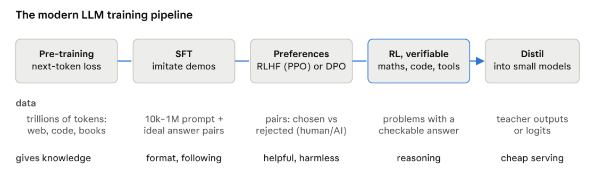

# 13 · How LLMs are trained

## Why it matters

Few applied teams pre-train an LLM. You will, however, choose between models whose behaviour comes from these stages, fine-tune open models (Chapter 16), build preference data from human reviews, and explain why a model is sycophantic, verbose or refuses too much. Interviewers ask "explain RLHF" and "how does DPO differ from PPO" to see whether you understand the levers. Parameter-efficient methods such as prompt and prefix tuning (Chapter 16) are the lightweight end of the same post-training story.



*Each stage changes behaviour more than knowledge, except the first. Labs differ in order and mix, but this is the common shape.*

## Key concepts

- **Pre-training**: next-token prediction on trillions of tokens; gives knowledge and general ability.
- **Supervised fine-tuning (SFT)**: training on prompt–answer pairs so the model follows instructions. [LIMA: Less Is More for Alignment](https://arxiv.org/abs/2305.11206).
- **RLHF**: train a reward model on human preferences, then optimise the policy with PPO and a KL penalty. [InstructGPT](https://arxiv.org/abs/2203.02155), [Hugging Face: Illustrating RLHF](https://huggingface.co/blog/rlhf).
- **DPO and variants (IPO, KTO, ORPO)**: learn from preference data directly, without a reward model or RL loop. [DPO](https://arxiv.org/abs/2305.18290), [KTO](https://arxiv.org/abs/2402.01306).
- **RLAIF and Constitutional AI**: AI-generated feedback guided by written principles. [Constitutional AI](https://arxiv.org/abs/2212.08073).
- **Reasoning models and RL with verifiable rewards (GRPO)**: reinforcement learning on tasks with checkable answers produces long, self-correcting reasoning. [DeepSeekMath (GRPO)](https://arxiv.org/abs/2402.03300), [DeepSeek-R1](https://arxiv.org/abs/2501.12948).
- **Distillation**: training a small model to imitate a large one. [Hinton et al.](https://arxiv.org/abs/1503.02531).
- **Practical tools and reference**: [TRL library](https://huggingface.co/docs/trl/index), [RLHF Book](https://rlhfbook.com/) (Nathan Lambert).

## 13.1 Pre-training

**Objective.** Next-token prediction with cross-entropy over trillions of tokens: minimise −Σ log p(x_t | x_<t). Nothing else. Knowledge, grammar, some reasoning and in-context learning all come from compressing this data well.

**Data** is the main lever and the main secret:

- Sources: filtered web crawl (Common Crawl), code, books, papers, Wikipedia, maths, multilingual text.
- Cleaning: language ID, heuristic quality filters, model-based quality classifiers ("is this like Wikipedia?"), toxicity and PII filtering.
- Deduplication: exact and near-duplicate (MinHash) removal; duplicates waste compute and increase memorisation.
- Mixture: the proportion of code, maths and each language is tuned, often with small proxy runs. Annealing on high-quality data at the end of training is common.
- Decontamination: remove benchmark test sets, or the evaluation numbers lie.

**Mechanics.** AdamW, warm-up then cosine decay, bf16, batch sizes of millions of tokens, and 3D parallelism (data, tensor, pipeline) across thousands of GPUs. Loss spikes are handled by restarting from a checkpoint and skipping data. The output is a **base model**: it continues text well but does not follow instructions reliably.

## 13.2 Supervised fine-tuning (SFT)

Train on (prompt, ideal response) pairs, usually in a chat template, with the loss computed only on the response tokens:

```python
prompt_ids = torch.tensor([5, 6, 7]); answer_ids = torch.tensor([8, 9, 2])
# 2 = EOS
input_ids = torch.cat([prompt_ids, answer_ids])
labels = input_ids.clone()
labels[:len(prompt_ids)] = -100            # ignore prompt tokens in the loss

# logits: (1, T, V). Position t predicts token t+1, so shift by one.
loss = F.cross_entropy(logits[:, :-1].reshape(-1, V), labels[1:].reshape(-1), ignore_index=-100)
# only the 3 answer tokens are scored
```

SFT teaches format and style: answer the question, follow the template, stop. A few thousand very high-quality examples can matter more than a million noisy ones (the LIMA paper's point). SFT's weakness: it only shows good answers, never contrasts them with bad ones, and it can teach the model to imitate confident answers it does not actually know, which feeds hallucination.

## 13.3 RLHF with a reward model and PPO

The InstructGPT recipe (Ouyang et al., 2022):

1. **Collect comparisons.** For a prompt, sample several responses; humans rank them.
2. **Train a reward model** (usually the SFT model with a scalar head) with the Bradley-Terry loss: the chosen response should score higher than the rejected one.

```python
# r_chosen, r_rejected: scalar rewards for each pair
rm_loss = -F.logsigmoid(r_chosen - r_rejected).mean()
# rewards (1.2 vs 0.2) and (0.3 vs 0.5) -> loss 0.556; the second pair is ranked wrongly
```

3. **Optimise the policy with PPO** to maximise the reward, with a KL penalty that keeps it close to the SFT reference model:

```python
def shaped_reward(rm_score, logp_policy, logp_ref, beta=0.05):
    return rm_score - beta * (logp_policy - logp_ref).sum()   # per-sequence KL estimate
# rm 2.0, policy 1 nat more confident than the reference on each of 2 tokens -> 1.9
```

Without the KL term the policy finds **reward hacking**: outputs that score well on the reward model but are not good (very long answers, flattering the user, repeated phrases). PPO itself needs four models in memory (policy, reference, reward model, value model), is unstable and sensitive to hyper-parameters. That cost is why DPO took off.

## 13.4 DPO and friends

**Direct Preference Optimization** (Rafailov et al., 2023) shows that the KL-constrained RLHF objective has a closed-form optimal policy, and rewrites the reward in terms of the policy itself. The result is a classification-style loss on preference pairs, no reward model and, in its offline form, no sampling during training:

```python
def dpo_loss(pc, pr, rc, rr, beta=0.1):
    # pc/pr: policy log-prob of chosen/rejected response (summed over tokens)
    # rc/rr: same under the frozen reference (SFT) model
    logits = beta * ((pc - rc) - (pr - rr))
    return -F.logsigmoid(logits).mean()

# at the start policy == reference, so loss = ln 2 = 0.693
# policy raised chosen by 1 nat and lowered rejected by 1 nat: logits = 0.1*2 = 0.2 -> loss 0.598
```

The implicit reward is `beta * (log π(y|x) − log π_ref(y|x))`; tracking the chosen and rejected implicit rewards during training is the standard diagnostic. `beta` plays the role of the KL weight: small beta lets the policy move further.

Variants you may be asked about: **IPO** (fixes DPO's tendency to overfit when preferences are near-deterministic), **KTO** (learns from single thumbs-up/down labels instead of pairs, which fits product feedback well), **ORPO** and **SimPO** (no reference model). Practical point: DPO works best on pairs sampled from the model being trained (on-policy); pairs from another model work less well. Online or iterative DPO regenerates pairs each round.

**Where product data fits.** Customer reviews, agent corrections of LLM outputs, and A/B choices are natural preference data. A merchant-description generator could be tuned with KTO on accept/edit/reject signals from content teams.

## 13.5 RLAIF and Constitutional AI

Human labels are slow and expensive. **RLAIF** uses an LLM to produce the preference labels. **Constitutional AI** (Anthropic, Bai et al., 2022) has the model critique and revise its own outputs against a written list of principles, then trains on AI-labelled preferences for harmlessness. The benefits are scale and consistency; the risk is copying the labelling model's biases, so teams still audit samples with humans. LLM-as-judge in evaluation (Chapter 22) is the same idea, with the same caveats.

## 13.6 Reasoning models and RL with verifiable rewards

Since late 2024 the biggest gains have come from RL on tasks whose answers can be checked automatically: maths with a known answer, code with unit tests, tool-use tasks with a checkable end state. The reward is a programmatic check, "correct or not" (plus format), so there is no learned reward model to over-optimise. Verifiers can still be gamed, though: models learn to special-case unit tests, exploit lenient answer-matchers or satisfy the format without the substance, so the checker needs as much care as the policy. The model learns to produce long chains of thought, check its work and backtrack. Examples: OpenAI o1/o3, DeepSeek-R1, and the extended-thinking modes of Claude and Gemini.

**GRPO** (Group Relative Policy Optimization, from DeepSeekMath, used for R1) drops PPO's value model: sample a group of answers per prompt and use each answer's reward relative to its group as the advantage.

```python
rewards = torch.tensor([1., 0., 0., 1., 1., 0., 0., 0.])     # 8 samples, 3 correct
adv = (rewards - rewards.mean()) / (rewards.std() + 1e-6)
# correct answers -> +1.21, wrong -> -0.72; the policy-gradient step weights each
# sample's token log-probs by its advantage, with a clipped ratio and a KL term as in PPO
```

Key ideas to mention: **test-time compute** scales accuracy (more thinking tokens, better answers on hard problems); a group where all answers are right or all wrong gives zero signal, so prompt difficulty is curated; and reasoning RL helps most where verification is cheap. For ambiguous tasks like ranking or writing, reward models and preferences still dominate.

## 13.7 Distillation

Train a small student to imitate a large teacher.

- **Logit distillation** (Hinton et al., 2015): match the teacher's softened distribution. Needs teacher logits, so only possible with open models or your own.

```python
def distill_loss(student_logits, teacher_logits, y, T=2.0, alpha=0.5):
    kd = F.kl_div(F.log_softmax(student_logits / T, -1),
                  F.softmax(teacher_logits / T, -1), reduction="batchmean") * T * T
    return alpha * kd + (1 - alpha) * F.cross_entropy(student_logits, y)
# the T*T factor keeps gradient size comparable across temperatures
```

- **Sequence-level distillation**: generate outputs with the teacher (often with reasoning traces) and SFT the student on them. This is how most small "reasoning" models are made, and it is the practical route for you: label 50k menu items with a large API model, check a sample by hand, fine-tune a small model on the rest. Check the provider's terms of service before training on API outputs.

## 13.8 What each stage explains

| Symptom | Likely origin |
|---|---|
| Knows facts up to a date, not after | Pre-training data cut-off |
| Weak in Gulf Arabic dialects | Pre-training mixture |
| Follows formats, uses the chat template | SFT |
| Verbose, flattering, over-agrees with the user | Reward hacking in RLHF / preference data biased towards long answers |
| Refuses harmless requests | Over-weighted harmlessness data |
| Long, careful reasoning on maths and code | RL with verifiable rewards |
| Small model nearly as good on a narrow task | Distillation |

## Pitfalls

- Computing SFT loss on the prompt tokens as well as the answer.
- Forgetting the one-token shift between logits and labels.
- Running DPO on off-policy pairs from a much stronger model and wondering why gains are small.
- Too small a beta (or KL weight): the model drifts, gets verbose, forgets skills.
- Assuming RLHF adds knowledge. It mostly changes style and what the model chooses to say.
- Training on benchmark-contaminated data and trusting the scores.

## Interview questions

**Mid level**

1. What is the pre-training objective of a GPT-style model?
2. What does SFT change, and why mask the prompt tokens in the loss?
3. Explain the three steps of RLHF.
4. What is reward hacking? Give an example.

**Senior level**

5. Derive or explain the intuition behind DPO. What does beta do?
6. Compare PPO-based RLHF, DPO and KTO. Which would you use with thumbs-up/down data from content moderators?
7. How do reasoning models like DeepSeek-R1 get trained? Why does RL work so well for maths and code?
8. You need a cheap model to tag 50M menu items. Describe a distillation plan and how you would check it.
9. A fine-tuned assistant became sycophantic. Which stage do you suspect and how would you fix it?

Short answers: (5) The optimal policy of KL-constrained reward maximisation is the reference reweighted by exp(reward/beta); invert it to express reward through log-probability ratios, plug into Bradley-Terry, and the reward model disappears. Beta controls how far the policy may move from the reference. (6) PPO is flexible but costly and unstable; DPO is simple and stable for pairwise data; KTO handles unpaired binary feedback, so it fits moderator thumbs. (7) SFT on some reasoning traces, then RL (GRPO) with a correctness reward; answers can be checked automatically, so there is no learned reward model to exploit and training scales; the verifiers still need hardening against reward hacking (tests special-cased, lenient answer-matching). (9) The preference stage: labellers or reward models preferred agreeable answers. Add pairs where the correct answer disagrees with the user, raise beta or KL, and evaluate on a sycophancy set.

## Practice

- Implement `seq_logprob(logits, labels)` (sum of token log-probs with masking), then DPO on a tiny GPT-2 with 200 synthetic preference pairs using TRL. Plot implicit rewards for chosen and rejected.
- Train a Bradley-Terry reward model on 1,000 pairs of review summaries (better vs worse) and check its pairwise accuracy.
- Run GRPO-style sampling on simple arithmetic with a small model and a correctness reward; watch the fraction correct over steps.
- Explain the whole pipeline in five minutes on a whiteboard, with one sentence on what each stage adds.

## Read next

- Ouyang et al., "Training language models to follow instructions with human feedback" (InstructGPT, 2022).
- Rafailov et al., "Direct Preference Optimization: Your Language Model is Secretly a Reward Model" (2023).
- Bai et al., "Constitutional AI: Harmlessness from AI Feedback" (2022).
- Zhou et al., "LIMA: Less Is More for Alignment" (2023).
- Ethayarajh et al., "KTO: Model Alignment as Prospect Theoretic Optimization" (2024).
- Shao et al., "DeepSeekMath" (2024), for GRPO; DeepSeek-AI, "DeepSeek-R1" (2025).
- Hinton, Vinyals and Dean, "Distilling the Knowledge in a Neural Network" (2015).
- Nathan Lambert, "RLHF Book" (online, ongoing), and the Hugging Face TRL documentation.
- Links to these papers and tools are in the Key concepts section at the top of this chapter.

## Done when

You can draw the pipeline and say what each stage adds and what data it needs. You can write the SFT loss with masking, the Bradley-Terry loss and the DPO loss from memory.

You can explain the KL penalty and reward hacking with an example. You can explain how reasoning models are trained and what GRPO changes. You can propose a distillation plan for a real product task.

---

[← 12 · NLP tasks with modern tools](12-nlp-tasks-with-modern-tools.md) · [Contents](../README.md#contents) · [13a · Infrastructure primer →](13a-infrastructure-primer.md)
