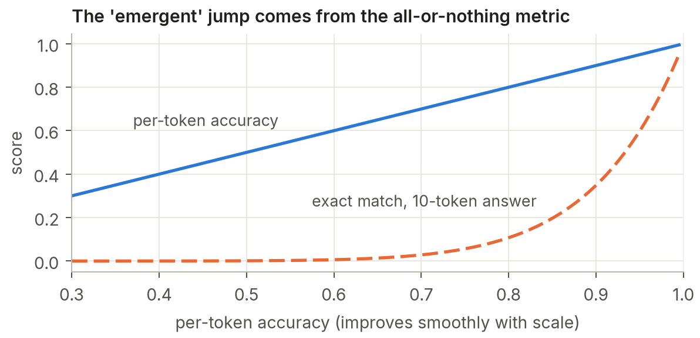

# 13 · Scaling laws

Part III · Transformers and architectures. Assumes Chapter 12 (the Kaplan and Chinchilla results in brief) and Chapter 7 (learning-rate schedules, batch size). Chapter 16 applies scaling arguments to data, Chapter 17 to the cost of a training run, and Chapter 19 to test-time compute.

## Why it matters

Scaling laws are how a lab decides what to train before spending the money. They turn "how big a model, on how much data, for this budget?" into arithmetic, and they make small experiments informative about large ones: if a change improves the loss at five small scales along a clean power law, you can bet on it at the sixth. For a research scientist they are also a method: the standard way to compare architectures, data mixtures or optimisers fairly is to compare their scaling curves, not single runs. Interviews test the derivation of the compute-optimal allocation, the reasons practice over-trains small models, how to fit a law without fooling yourself, and whether "emergent abilities" are real.

Numbers in this chapter come from `code/ch13_check.py` (NumPy and SciPy, seconds).

## Key concepts

- **Power law**: loss falls as a power of model size, data or compute, a straight line on log-log axes. [Kaplan et al.](https://arxiv.org/abs/2001.08361).
- **Compute-optimal (Chinchilla) training**: for a fixed compute budget, grow parameters and tokens together. [Hoffmann et al.](https://arxiv.org/abs/2203.15556), [Besiroglu et al. replication](https://arxiv.org/abs/2404.10102).
- **IsoFLOP curves**: for several fixed budgets, train models of different sizes and locate the best size per budget.
- **Inference-aware scaling**: if a model will serve many tokens, train a smaller one for longer. [Sardana et al.](https://arxiv.org/abs/2401.00448).
- **Data-constrained scaling**: the value of repeating data. [Muennighoff et al.](https://arxiv.org/abs/2305.16264).
- **Emergence and its measurement**: sharp jumps in a metric versus smooth gains in the loss. [Wei et al.](https://arxiv.org/abs/2206.07682), [Schaeffer et al.](https://arxiv.org/abs/2304.15004).
- **Test-time compute scaling**: accuracy as a function of inference compute. [Snell et al.](https://arxiv.org/abs/2408.03314).

## 13.1 What a scaling law is

Train a family of models that differ only in size, data or compute, and plot the final loss against that quantity on log-log axes. Over many orders of magnitude the points fall on a line: loss ≈ a · x^(−b), plus an **irreducible** term E that no amount of scale removes (the entropy of the text itself, at least for that tokenizer and data).

Three things make these laws useful and three make them dangerous:

- **Useful**: they are smooth enough to extrapolate one or two orders of magnitude; they hold for loss on held-out data from the training distribution; they let you compare interventions by their effect on the curve (a better recipe shifts the line down or changes its slope).
- **Dangerous**: they describe loss, not capabilities; they are specific to a data distribution, tokenizer, architecture and training recipe; and a badly-tuned hyperparameter at some scales bends the curve and produces a wrong exponent.

## 13.2 Kaplan versus Chinchilla

Kaplan et al. (OpenAI, 2020) found L(N) ∝ N^(−0.076) and L(D) ∝ D^(−0.095) and concluded that, as compute grows, most of it should go into parameters: N_opt ∝ C^0.73. GPT-3 (175B parameters, 300B tokens) followed that advice.

Hoffmann et al. (DeepMind, 2022) redid the study with three changes: the cosine schedule length matched to each run (Kaplan used one long schedule and read off intermediate checkpoints, which under-states what short runs can achieve), more and larger runs, and counting all parameters. They found N_opt ∝ C^0.5 and D_opt ∝ C^0.5: parameters and tokens should grow together, at about **20 tokens per parameter**. Chinchilla (70B, 1.4T tokens) beat Gopher (280B, 300B tokens) at the same compute.

The lesson for method is as important as the result: **the learning-rate schedule and what you count change the exponents**. Scaling laws are measurements of a recipe.

## 13.3 Deriving the compute-optimal allocation

The Chinchilla parametric form is

L(N, D) = E + A / N^α + B / D^β

where N is parameters and D is training tokens, and training compute is C ≈ 6ND FLOPs (2 for the forward pass, 4 for the backward pass, per parameter per token).

Minimise L subject to C = 6ND. Substitute D = C/(6N) and set the derivative with respect to N to zero:

α A / N^(α+1) = β B (6/C)^β N^(β−1)  ⇒  N_opt = G · (C/6)^(β/(α+β)),  with G = (αA / βB)^(1/(α+β))

and D_opt = C / (6 N_opt) ∝ C^(α/(α+β)). The exponents depend only on α and β: if they are equal, N and D grow equally.

With the constants published for the paper's third approach (E = 1.69, A = 406.4, B = 410.7, α = 0.34, β = 0.28):

| Compute (FLOPs) | N_opt | D_opt | Tokens per parameter | Predicted loss |
|---|---|---|---|---|
| 1e21 | 1.8B | 91B | 50 | 2.329 |
| 1e23 | 14.6B | 1.14T | 78 | 2.005 |
| 1e25 | 117B | 14.3T | 122 | 1.845 |

These constants give exponents of 0.45 and 0.55 and tokens-per-parameter ratios well above 20 that drift with scale, which disagrees with the paper's other two approaches. Besiroglu et al. (2024) reconstructed the data and found the third approach's fit was flawed (the reported confidence intervals were implausibly narrow and the optimiser had stopped early); their re-fit agrees with about 20 tokens per parameter. The formula still reproduces the headline comparison (Chinchilla 1.937 against Gopher 1.993). Two lessons: **check a fit by deriving its implications**, and treat published constants as approximate.

## 13.4 Fitting scaling laws in practice

*IsoFLOP curves from the parametric fit: for each compute budget, loss against model size, with tokens set by D = C/6N. Each curve has a minimum (the dots); the dotted line through them is the compute-optimal frontier.*

**Why the curves are U-shaped.** At fixed compute, a model that is too small runs out of capacity: it has seen plenty of data but cannot represent more. A model that is too large is starved of data: with D = C/6N, every extra parameter means fewer training tokens, and it stops before learning what its size allows. The minimum balances the two error terms A/N^α and B/D^β, and because both are power laws, the location of the minimum moves along a straight line on log–log axes as compute grows.

**Method 1: IsoFLOP profiles.** Pick 5–10 compute budgets. At each, train 5–10 model sizes, choosing tokens so that 6ND equals the budget. Each budget gives a U-shaped curve of loss against log N; fit a parabola and take its minimum. Then fit a line through (log C, log N_opt). On synthetic runs generated from the formula with 0.3% noise, the check script recovers the exponent (0.45) and extrapolates N_opt at 1e23 FLOPs to 14.1B against a true 14.6B: two orders of magnitude beyond the largest budget, about 4% off.

**Method 2: fit the parametric form directly** on all runs, minimising a robust (Huber) loss between predicted and observed log-loss, from several initialisations. The check script recovers E = 1.70, α = 0.34, β = 0.28 from 36 noisy runs.

**What goes wrong:**

- **Untuned hyperparameters.** If the learning rate is tuned at small scale and reused, large runs are sub-optimal and the curve bends. Use µP (Chapter 7) or fit learning-rate and batch-size laws too.
- **Schedules.** Each point must be a fully decayed run of its own length (or a WSD branch decayed at that point), not an intermediate checkpoint.
- **What counts as N.** Including or excluding embedding parameters changes the exponents at small scale.
- **Too narrow a range.** Fit over at least two orders of magnitude, and validate by holding out the largest runs.
- **Noise.** Run several seeds at the smallest scales, where variance is largest.
- **Extrapolating the irreducible term.** E is poorly identified from small runs; predictions far beyond the data are sensitive to it.

## 13.5 Beyond Chinchilla-optimal: paying for inference

Chinchilla-optimal minimises *training* compute for a given loss. A model that serves trillions of tokens costs far more in inference (about 2N FLOPs per token) than in training. Minimise training plus lifetime inference cost instead: for a target loss, a smaller model trained on more tokens costs more to train but less to run.

Target: the loss of the compute-optimal 1e23 model (2.005).

| Lifetime inference tokens | Best N | Training tokens | Tokens per parameter |
|---|---|---|---|
| 0 (Chinchilla-optimal) | 14.6B | 1.14T | 78 |
| 1e12 | 10.9B | 1.58T | 145 |
| 1e13 | 6.1B | 3.77T | 617 |
| 1e14 | 3.6B | 14.3T | 4,014 |

*The best model size for a fixed target loss (that of the compute-optimal 1e23-FLOP model) as expected lifetime inference grows. Each annotation gives the size and the tokens per parameter of the cheapest option at that volume.*

This is why current small open models are trained on 15–40T tokens, hundreds to thousands of tokens per parameter. Their loss keeps improving with more data, just more slowly than a compute-optimal allocation would give, and the extra training cost is repaid in serving. Data supply, not compute, becomes the limit.

## 13.6 Data-constrained scaling

High-quality text is finite. What is repeated data worth? Muennighoff et al. (2023) trained hundreds of models with repeated data and fitted an "effective data" model in which each repetition is worth less, with a characteristic scale of about 15 repetitions:

| Epochs over 100B unique tokens | Tokens seen | Effective tokens |
|---|---|---|
| 1 | 100B | 100B |
| 2 | 200B | 197B |
| 4 | 400B | 373B |
| 8 | 800B | 663B |
| 16 | 1,600B | 1,059B |
| 40 | 4,000B | 1,518B |

Up to about 4 epochs, repetition is nearly as good as new data; beyond about 16 it adds little; much further and the loss can get worse. Practical consequences: repeat the highest-quality sources more than the rest (Chapter 16), and treat synthetic data, code and multilingual data as ways to extend the supply.

## 13.7 Other axes

Scaling-law thinking applies to every major design choice. Results to know, with the caveat that each depends on its setup:

- **Learning rate and batch size**: the optimal learning rate falls and the optimal batch size rises with model size and compute; several open model reports fit laws for both, instead of using µP.
- **MoE**: at fixed compute, an MoE behaves like a dense model with more parameters; the advantage depends on the number of experts and the active fraction, and narrows at very large scale (Chapter 11).
- **Precision**: lower training precision behaves like fewer effective parameters; quantising after training hurts more the more over-trained the model is.
- **Vocabulary**: the optimal vocabulary grows with model size; many models have been under-sized here (Chapter 9).
- **Fine-tuning and transfer**: fine-tuning gains follow laws in pretraining size and fine-tuning data, with pretraining data counted at an "effective" discount.
- **Architectures**: compare candidates by their curves. A change that helps at 100M but has a shallower slope will lose at scale.

## 13.8 From loss to capabilities

Loss scales smoothly; benchmark accuracy often does not. Wei et al. (2022) documented "emergent abilities": tasks where accuracy stays near chance and then jumps at some scale. Schaeffer et al. (2023) showed that many such jumps come from the **metric**. If an answer needs 10 tokens all correct, exact-match accuracy is roughly p^10 for per-token accuracy p:

| Per-token accuracy | 0.50 | 0.64 | 0.78 | 0.85 | 0.92 | 0.99 |
|---|---|---|---|---|---|---|
| Exact match, 10-token answer | 0.001 | 0.012 | 0.083 | 0.197 | 0.434 | 0.904 |

A smooth improvement looks like a sudden jump.

*If per-token accuracy improves linearly with scale, a 10-token exact-match score stays near zero until per-token accuracy passes about 0.8, then shoots up.* With continuous metrics (per-token log-likelihood of the correct answer, Brier score) the same tasks usually improve smoothly.

Practical ways to **predict downstream performance**: fit task accuracy as a sigmoid of the pretraining loss (or of the loss on the task's correct answers) across a ladder of small models, then extrapolate along the loss law. Several labs use such "model ladders" to forecast benchmark scores before a large run, with errors of a few points on stable benchmarks. Some abilities still arrive abruptly (multi-step tasks, tasks needing a capability that only exists above some loss), so forecasts come with wide intervals.

## 13.9 Test-time compute scaling

Accuracy also scales with compute spent at inference: sampling many answers and choosing one, searching against a verifier, or thinking longer (Chapter 19).

**Repeated sampling.** If a single sample is correct with probability p, at least one of k samples is correct with probability 1 − (1 − p)^k:

| p | pass@1 | pass@8 | pass@64 |
|---|---|---|---|
| 0.05 | 0.05 | 0.34 | 0.96 |
| 0.30 | 0.30 | 0.94 | 1.00 |

Coverage grows fast, but turning coverage into accuracy needs a way to pick the right answer: a verifier (unit tests, a checker) or a reward model, and imperfect verifiers cap the gain. Estimate pass@k without bias from n ≥ k samples with c correct: 1 − C(n−c, k)/C(n, k). With 200 samples and 13 correct, pass@10 is 0.498.

**Compute-optimal inference.** Snell et al. (2024) showed that for some problems, spending more inference compute on a smaller model beats a model 10× larger; the best strategy (parallel sampling, sequential revision, search) depends on problem difficulty. Reasoning models trained with RL (Chapter 19) learn to spend inference compute themselves, and their accuracy rises roughly linearly in the logarithm of the thinking budget over a wide range.

The full cost picture now has three terms: pretraining, post-training (increasingly large RL runs) and inference. Deciding where the next unit of compute goes is the scaling question of this period.

## 13.10 A worked scaling study

Suppose you want to know whether a new data mixture improves models at the scale you will train next (about 1e23 FLOPs), and you can spend about 6% of that budget on the study.

1. **Choose the ladder.** Four model sizes spaced roughly 2.5× apart (150M, 400M, 1B, 2.5B) and, for each, three token budgets around the compute-optimal point (half, equal and double). That is 12 runs per mixture, 24 for the comparison.
2. **Cost it.** At 6ND FLOPs with about 20 tokens per parameter, the largest runs dominate: a 2.5B model on 50B tokens is 7.5e20 FLOPs, about 530 GPU-hours at 40% MFU on a 989-TFLOP/s GPU. With the half, equal and double token budgets, the ladder costs about 3e21 FLOPs per mixture, 6e21 for both: about 6% of the target run.
3. **Control the recipe.** Same tokenizer, architecture, schedule shape (WSD, decayed at each budget, Chapter 7) and learning rates tuned or transferred with µP. Fully decay every point.
4. **Fit and compare.** Fit L(N, D) separately for each mixture. A mixture that is genuinely better shifts the whole surface down; a mixture that only helps small models shows a shallower slope and crosses the baseline before 1e23. Report the predicted loss at the target scale with an interval from bootstrapping over runs.
5. **Validate.** Hold out the largest runs from the fit and check that the fit predicts them; if it does not, do not extrapolate further.
6. **Check downstream.** Fit task accuracy against loss on the same ladder (13.8) for the two or three benchmarks that matter, to see whether the loss gain translates.

The output is a sentence a lab can act on: "mixture B lowers predicted loss at 1e23 FLOPs by 0.02 ± 0.006, equivalent to about 1.3× compute; downstream gains are significant on maths and flat on knowledge".

## Pitfalls

- Using intermediate checkpoints of one long run as the points of a data-scaling law.
- Fitting over one order of magnitude and extrapolating four.
- Reading "20 tokens per parameter" as a rule for deployed models; it minimises training compute only.
- Reporting an architecture win from one scale.
- Concluding that an ability is emergent from an exact-match metric alone.
- Comparing pass@k numbers computed with different n, or with the biased estimator 1 − (1 − c/n)^k.

## Interview questions

**1. Derive the compute-optimal model size from L = E + A/N^α + B/D^β and C = 6ND.** Substitute D = C/6N, differentiate, set to zero: N_opt ∝ C^(β/(α+β)), D_opt ∝ C^(α/(α+β)). Equal exponents mean equal growth.

**2. Why did Kaplan and Chinchilla disagree?** Kaplan read intermediate checkpoints of runs with a fixed long schedule, which under-estimates short, fully-decayed runs and biases towards bigger models; they also excluded embedding parameters and used smaller models. Chinchilla matched schedules to run length.

**3. Why do labs train 8B models on 15T tokens?** Inference cost. Minimising training plus lifetime serving cost favours smaller models trained much longer than Chinchilla-optimal.

**4. How would you fit a scaling law for a new architecture?** IsoFLOP profiles over 5+ budgets spanning two orders of magnitude, fully decayed runs, tuned or µP-transferred learning rates, several seeds at small scale, fit the optimum's power law, validate on held-out larger runs, compare slopes and offsets with a tuned transformer baseline.

**5. What is the value of repeating data?** Roughly as good as new data up to about 4 epochs, rapidly diminishing beyond about 16 (Muennighoff et al.); repeat high-quality sources preferentially.

**6. Are emergent abilities real?** Many apparent jumps come from discontinuous metrics like exact match; with continuous metrics the same tasks improve smoothly. Some multi-step abilities still appear abruptly, so treat forecasts with wide intervals.

**7. How can you predict a benchmark score before a big run?** Train a ladder of small models, fit accuracy as a function of loss (sigmoid), fit loss as a function of compute, chain the two.

**8. Explain the unbiased pass@k estimator and why you need it.** With n samples and c correct, pass@k = 1 − C(n−c,k)/C(n,k). Plugging the sample rate into 1 − (1−p)^k is biased for small n.

**9. What is test-time compute scaling?** Accuracy improving with inference compute (more samples, search, longer reasoning). For hard problems it can substitute for model size, if there is a good way to verify or select answers.

**10. A colleague's scaling curve bends at the largest size. Possible causes?** The learning rate or batch size not re-tuned for that size, a schedule mismatch, data running out (repetition), numerical instability, approaching the irreducible loss, or a bug in that run. Check hyperparameters first.

## Practice

1. Derive N_opt and D_opt by hand, then check the table above with the code.
2. Recompute the over-training table with your own inference volume and target loss.
3. **Research exercise.** Train a ladder of the Chapter 10 mini-GPT at 4 sizes × 3 token budgets on a fixed corpus (CPU or one GPU), each with its own decayed schedule. Fit the parametric form, predict the loss of a larger held-out run, then train it and report the error.
4. Take a benchmark with exact-match scoring and re-score it with the log-likelihood of the gold answer for a family of open models of different sizes. Does the "emergence" disappear?
5. For a code model, sample 100 solutions per problem and plot unbiased pass@k for k = 1…50.

## Read next

- Kaplan et al., "Scaling Laws for Neural Language Models" (2020).
- Hoffmann et al., "Training Compute-Optimal Large Language Models" (Chinchilla, 2022), and Besiroglu et al., "Chinchilla Scaling: A replication attempt" (2024).
- Sardana et al., "Beyond Chinchilla-Optimal: Accounting for Inference in Language Model Scaling Laws" (2024).
- Muennighoff et al., "Scaling Data-Constrained Language Models" (2023).
- Schaeffer, Miranda and Koyejo, "Are Emergent Abilities of Large Language Models a Mirage?" (2023).
- Snell et al., "Scaling LLM Test-Time Compute Optimally can be More Effective than Scaling Model Parameters" (2024).
- Chen et al., "Evaluating Large Language Models Trained on Code" (Codex, 2021), for the unbiased pass@k estimator.
- Links to these papers are in the Key concepts section at the top of this chapter.

## Done when

You can derive the compute-optimal allocation and explain why Kaplan and Chinchilla differed. You can run the IsoFLOP method and a parametric fit, and list what makes fits wrong. You can explain inference-aware over-training with numbers, and the value of repeated data.

You can explain the emergence debate with the exact-match example and describe how to forecast benchmark scores. You can compute pass@k correctly and explain test-time compute scaling and where verification limits it.

---

[← 12 · Model families and scaling](12-model-families-and-scaling.md) · [Contents](../README.md#contents) · [14 · Multimodal models →](14-multimodal-models.md)
