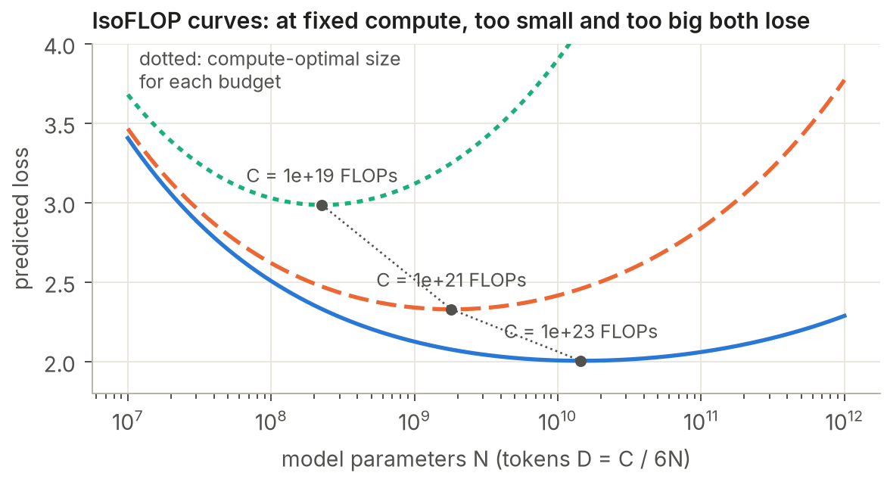
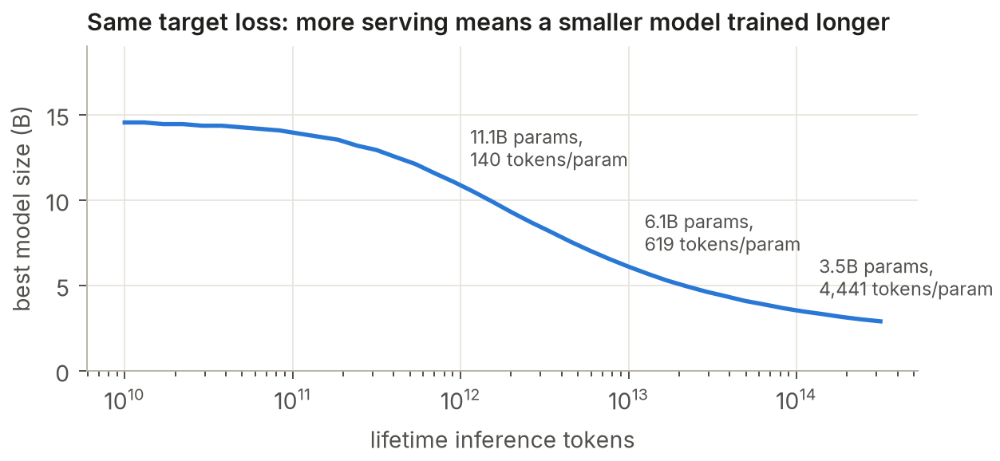

# 13 · Scaling laws

Part III · Transformers and architectures. Assumes Chapter 12 (the Kaplan and Chinchilla results in brief) and Chapter 7 (learning-rate schedules, batch size). Chapter 16 applies scaling arguments to data, Chapter 17 to the cost of a training run, and Chapter 19 to test-time compute.

## Why it matters

Scaling laws are how a lab decides what to train before spending the money. They turn "how big a model, on how much data, for this budget?" into arithmetic, and they make small experiments informative about large ones: if a change improves the loss at five small scales along a clean power law, you can bet on it at the sixth. For a research scientist they are also a method: the standard way to compare architectures, data mixtures or optimisers fairly is to compare their scaling curves, not single runs. Interviews test the derivation of the compute-optimal allocation, the reasons practice over-trains small models, how to fit a law without fooling yourself, and whether "emergent abilities" are real.

Numbers in this chapter come from `code/ch13_check.py` (NumPy and SciPy, seconds).

The chapter starts with what a scaling law is and why such clean regularities exist at all (13.1). It then follows the most consequential disagreement in the field's recent history, Kaplan versus Chinchilla, and why the two groups reached different conclusions from similar experiments (13.2). Section 13.3 derives the compute-optimal allocation from the Chinchilla formula, including where the 6ND rule comes from and what it leaves out, and 13.4 covers fitting laws to your own runs without fooling yourself. Sections 13.5 to 13.7 relax the assumptions: models are deliberately trained past the Chinchilla point because inference is expensive, high-quality data is running out, and the same thinking applies to other design choices. The chapter ends with how smooth loss curves relate to the sudden "emergence" of abilities (13.8), scaling at test time (13.9), and a worked study of the kind a research team runs before a large training run (13.10).

The thread through all of it is prediction. A scaling law is useful because it lets a team spend a small fraction of a budget on small runs and predict, with an error bar, what the large run will achieve. What an interviewer is really testing is whether you can do that arithmetic live (an optimum, a FLOP count, a loss gain converted into a compute multiplier) and whether you know which assumptions make the answer wrong.

## Key concepts

- **Power law**: loss falls as a power of model size, data or compute, a straight line on log-log axes. [Kaplan et al.](https://arxiv.org/abs/2001.08361).
- **Compute-optimal (Chinchilla) training**: for a fixed compute budget, grow parameters and tokens together. [Hoffmann et al.](https://arxiv.org/abs/2203.15556), [Besiroglu et al. replication](https://arxiv.org/abs/2404.10102).
- **IsoFLOP curves**: for several fixed budgets, train models of different sizes and locate the best size per budget.
- **Inference-aware scaling**: if a model will serve many tokens, train a smaller one for longer. [Sardana et al.](https://arxiv.org/abs/2401.00448).
- **Data-constrained scaling**: the value of repeating data. [Muennighoff et al.](https://arxiv.org/abs/2305.16264).
- **Emergence and its measurement**: sharp jumps in a metric versus smooth gains in the loss. [Wei et al.](https://arxiv.org/abs/2206.07682), [Schaeffer et al.](https://arxiv.org/abs/2304.15004).
- **Test-time compute scaling**: accuracy as a function of inference compute. [Snell et al.](https://arxiv.org/abs/2408.03314).

## 13.1 What a scaling law is

Deep-learning results usually look erratic: change one setting and the outcome moves unpredictably. Loss as a function of scale is a striking exception. Plotted on logarithmic axes, it follows a straight line over many orders of magnitude, and that regularity is what turns model training from expensive trial and error into engineering.

Train a family of models that differ only in size, data or compute, and plot the final loss against that quantity on log-log axes. Over many orders of magnitude the points fall on a line: loss ≈ a · x^(−b), plus an **irreducible** term E that no amount of scale removes (the entropy of the text itself, at least for that tokenizer and data).

Three things make these laws useful and three make them dangerous:

- **Useful**: they are smooth enough to extrapolate one or two orders of magnitude; they hold for loss on held-out data from the training distribution; they let you compare interventions by their effect on the curve (a better recipe shifts the line down or changes its slope).
- **Dangerous**: they describe loss, not capabilities; they are specific to a data distribution, tokenizer, architecture and training recipe; and a badly-tuned hyperparameter at some scales bends the curve and produces a wrong exponent.

### Why power laws at all?

Nothing in the training objective asks for a power law, so "why?" is a fair interview question. There is no proof, but two explanations each predict the shape and are worth being able to sketch.

**Quantised skills** (Michaud et al., 2023). Suppose the text requires many discrete pieces of knowledge or skill, and the k-th most useful one is needed with frequency p_k ∝ k^(−(a+1)), a Zipf-like distribution of the kind that word frequencies follow. A model of a given size learns the n most frequent skills; every token that needs a skill beyond n is predicted poorly. The loss above the floor is then proportional to the probability mass in the tail, Σ_{k>n} p_k, and the tail of a power law is itself a power law: it shrinks as n^(−a). If the number of skills learned grows in proportion to parameters or data, loss falls as a power of N or D. With a = 0.5, the unexplained mass after 10, 100, 1,000 and 10,000 skills is 0.236, 0.076, 0.023 and 0.007: each 10× more skills divides it by about 10^0.5 ≈ 3.2. In this picture, smooth loss curves are averages over many small, individually abrupt steps, which is also the bridge to "emergence" (13.8).

**The data manifold** (Sharma and Kaplan, 2020). Treat the network as a function approximator on data that lies on a manifold of intrinsic dimension d. A piecewise approximator with N pieces covers that manifold with cells of side ∝ N^(−1/d); the error of a smooth fit inside each cell falls as a power of the cell size, so the loss falls as N^(−c/d) for some small constant c (their argument gives exponents of about 4/d). A small exponent therefore signals a high intrinsic dimension: Kaplan's α_N = 0.076 corresponds to d ≈ 53 under this rule.

Both pictures make the same practical prediction: exponents are properties of the data distribution more than of the architecture, which is why architectural changes usually shift the line rather than change its slope (13.7).

## 13.2 Kaplan versus Chinchilla

Kaplan et al. (OpenAI, 2020) found L(N) ∝ N^(−0.076) and L(D) ∝ D^(−0.095) and concluded that, as compute grows, most of it should go into parameters: N_opt ∝ C^0.73. GPT-3 (175B parameters, 300B tokens) followed that advice.

Hoffmann et al. (DeepMind, 2022) redid the study with three changes: the cosine schedule length matched to each run (Kaplan used one long schedule and read off intermediate checkpoints, which under-states what short runs can achieve), more and larger runs, and counting all parameters. They found N_opt ∝ C^0.5 and D_opt ∝ C^0.5: parameters and tokens should grow together, at about **20 tokens per parameter**. Chinchilla (70B, 1.4T tokens) beat Gopher (280B, 300B tokens) at the same compute.

The lesson for method is as important as the result: **the learning-rate schedule and what you count change the exponents**. Scaling laws are measurements of a recipe.

### The current explanation of the discrepancy

Two 2024 analyses (Pearce and Song, "Reconciling Kaplan and Chinchilla Scaling Laws"; Porian et al., "Resolving Discrepancies in Compute-Optimal Scaling of Language Models") traced most of the gap to details that matter most at small scale. Kaplan counted **non-embedding parameters** and compute; at the small sizes they trained, embeddings and the output layer are a large share of the total, and excluding them bends the fitted exponent towards larger models. Porian et al. add the **last-layer FLOPs** that a non-embedding count leaves out, a **warm-up** that was too long for the smallest runs, and **optimiser settings that were not tuned per scale** (AdamW β₂ and batch size matter at small batches). Correcting these factors one by one moves the Kaplan-style exponent to Chinchilla's. The answer interviewers want: the disagreement was not about the world but about the measurement, and small-scale runs are where a measurement error has most leverage on an extrapolated exponent.

## 13.3 Deriving the compute-optimal allocation

For a fixed compute budget you can train a larger model on fewer tokens or a smaller model on more. The Chinchilla analysis answers how to split the budget, and the answer follows from a short calculation that is worth being able to reproduce: write the loss as a function of model size and data, fix the compute, and minimise.

The Chinchilla parametric form is

$$
L(N, D) = E + \dfrac{A}{N^{\alpha}} + \dfrac{B}{D^{\beta}}
$$

where N is parameters and D is training tokens, and training compute is C ≈ 6ND FLOPs (2 for the forward pass, 4 for the backward pass, per parameter per token).

### Where 6ND comes from

Almost all of a transformer's parameters sit in matrix multiplications. For one token, a layer y = Wx with W of size m × n does mn multiplications and mn additions, so the **forward** pass costs 2mn FLOPs: 2 per parameter. The **backward** pass computes two products of the same size. The gradient with respect to the input, ∂L/∂x = Wᵀ(∂L/∂y), is needed to keep back-propagating to earlier layers; the gradient with respect to the weights, ∂L/∂W = (∂L/∂y)xᵀ, is needed for the update. Each is another 2mn FLOPs, so backward costs 4 per parameter and the total is 6 per parameter per token:

$$
C \approx 6ND
$$

For a 4096 × 4096 projection and one token: forward 33.6M FLOPs, backward 67.1M, total 100.7M = 6 × 16.8M. Summed over all layers and all D training tokens this gives 6ND.

**What 6ND leaves out**, each a common follow-up:

- **Attention scores.** QKᵀ and the attention-weighted sum of V have no parameters, yet cost about 2·n_layers·T·d FLOPs per token in the forward pass with a causal mask (T is the context length, d the model width), so about 6·n_layers·T·d per trained token. Relative to 6N that is n_layers·T·d / N: for an 8B model with 32 layers and d = 4096 it is 3.4% at T = 2,048, 13.4% at 8,192 and 53.7% at 32,768. Long-context training is not free in this accounting.
- **Activation recomputation.** With full activation checkpointing (Chapter 17), the forward pass runs twice, so the hardware does about 8ND. MFU (model FLOPs utilisation) is defined with 6ND precisely so that recomputation does not count as useful work.
- **Mixture of experts.** N means *active* parameters per token. DeepSeek-V3 (671B total, 37B active, 14.8T tokens) costs 6 × 37e9 × 14.8e12 ≈ 3.3e24 FLOPs, not the 6e25 that its total size would suggest.
- **Embeddings.** The input embedding is a lookup and costs nothing; the output projection to the vocabulary is a real matrix multiplication and does count. Whether the embedding parameters are included in N is one of the counting choices behind 13.2.

### The optimum

Minimise L subject to C = 6ND. Substitute D = C/(6N), so the data term becomes B(6N/C)^β, and set the derivative with respect to N to zero:

α A / N^(α+1) = β B (6/C)^β N^(β−1)  ⇒  N_opt = G · (C/6)^(β/(α+β)),  with G = (αA / βB)^(1/(α+β))

$$
N_{\mathrm{opt}} = G \left(\dfrac{C}{6}\right)^{\beta/(\alpha+\beta)}
$$

and D_opt = C / (6 N_opt) ∝ C^(α/(α+β)). The exponents depend only on α and β: if they are equal, N and D grow equally. At the optimum both reducible terms scale as the same power of compute, so the loss along the compute-optimal frontier is

$$
L_{\mathrm{opt}}(C) = E + K\,C^{-\gamma}, \qquad \gamma = \dfrac{\alpha\beta}{\alpha+\beta}
$$

with K a constant that collects A, B, α and β. This frontier form is the tool for converting a loss gain into a compute multiplier, below.

With the constants published for the paper's third approach (E = 1.69, A = 406.4, B = 410.7, α = 0.34, β = 0.28):

| Compute (FLOPs) | N_opt | D_opt | Tokens per parameter | Predicted loss |
|---|---|---|---|---|
| 1e21 | 1.8B | 91B | 50 | 2.329 |
| 1e23 | 14.6B | 1.14T | 78 | 2.005 |
| 1e25 | 117B | 14.3T | 122 | 1.845 |

These constants give exponents of 0.45 and 0.55 and tokens-per-parameter ratios well above 20 that drift with scale, which disagrees with the paper's other two approaches. Besiroglu et al. (2024) reconstructed the data and found the third approach's fit was flawed (the reported confidence intervals were implausibly narrow and the optimiser had stopped early); their re-fit agrees with about 20 tokens per parameter. The formula still reproduces the headline comparison (Chinchilla 1.937 against Gopher 1.993). Two lessons: **check a fit by deriving its implications**, and treat published constants as approximate.

With the Besiroglu et al. re-fit (E = 1.82, A = 482.0, B = 2085.4, α = 0.348, β = 0.366) the same calculation gives exponents of 0.51 and 0.49 and a nearly constant ratio:

| Compute (FLOPs) | N_opt | D_opt | Tokens per parameter | Predicted loss |
|---|---|---|---|---|
| 1e21 | 2.8B | 60B | 22 | 2.308 |
| 1e23 | 29.4B | 566B | 19 | 2.035 |
| 1e25 | 312B | 5.3T | 17 | 1.915 |

**Three answers for one budget.** For 1e23 FLOPs you will meet three numbers. The 20-tokens rule gives N = √(C/120) = 28.9B on 577B tokens (from C = 6N·20N); the re-fit gives 29.4B on 566B, in agreement; the flawed approach-3 constants give 14.6B on 1.14T. Chapter 12's "about 29B" and this chapter's 14.6B therefore differ because of the fit, not the arithmetic. Neither is what a lab would train for deployment; that is the subject of 13.5.

### From a loss gain to a compute multiplier

Research results are often stated as "worth 1.5× compute". The conversion inverts the frontier: a change that lowers the loss at budget C by ΔL achieves what the baseline would need m·C to achieve, where

$$
m = \left(\dfrac{L(C) - E}{L(C) - E - \Delta L}\right)^{1/\gamma}
$$

With the re-fit constants, γ = 0.178 and L(1e23) − E = 0.215, so a gain of 0.02 is worth (0.215/0.195)^(1/0.178) ≈ 1.73× compute; 0.01 is worth 1.31×, and 0.05 is worth 4.4×. With the approach-3 constants (γ = 0.154) the same 0.02 is worth 1.53×. Two features matter in practice. The multiplier depends on the reducible loss L − E, so the same ΔL is worth more at larger scale, where less reducible loss remains. And because E is poorly identified (13.4), the multiplier carries that uncertainty too; quote it with an interval.

## 13.4 Fitting scaling laws in practice

*IsoFLOP curves from the parametric fit: for each compute budget, loss against model size, with tokens set by D = C/6N. Each curve has a minimum (the dots); the dotted line through them is the compute-optimal frontier.*

**Why the curves are U-shaped.** At fixed compute, a model that is too small runs out of capacity: it has seen plenty of data but cannot represent more. A model that is too large is starved of data: with D = C/6N, every extra parameter means fewer training tokens, and it stops before learning what its size allows. The minimum balances the two error terms A/N^α and B/D^β, and because both are power laws, the location of the minimum moves along a straight line on log–log axes as compute grows.

**Method 1: IsoFLOP profiles.** Pick 5–10 compute budgets. At each, train 5–10 model sizes, choosing tokens so that 6ND equals the budget. Each budget gives a U-shaped curve of loss against log N; fit a parabola and take its minimum. Then fit a line through (log C, log N_opt). On synthetic runs generated from the formula with 0.3% noise, the check script recovers the exponent (0.45) and extrapolates N_opt at 1e23 FLOPs to 14.1B against a true 14.6B: two orders of magnitude beyond the largest budget, about 4% off.

**Method 2: fit the parametric form directly** on all runs, minimising a robust (Huber) loss between predicted and observed log-loss, from several initialisations. The check script recovers E = 1.70, α = 0.34, β = 0.28 from 36 noisy runs.

The details of Method 2 are where fits go wrong, so it helps to know the exact recipe Hoffmann et al. and Besiroglu et al. used. Parameterise A = eᵃ, B = eᵇ, E = eᵉ so that all three stay positive, and write the predicted log-loss as a log-sum-exp, which is numerically stable:

$$
\log \hat{L}(N, D) = \mathrm{LSE}\left(a - \alpha \log N,\; b - \beta \log D,\; e\right)
$$

LSE(u, v, w) = log(eᵘ + eᵛ + eʷ), so the expression is exactly the log of E + A/N^α + B/D^β. Minimise the Huber loss of log L̂ − log L_observed with a small δ (10⁻³ in the paper), which behaves like squared error for typical residuals and like absolute error for the few outlier runs, so one diverged run cannot drag the fit. The objective has many shallow local minima, so start L-BFGS from a grid of initial values (the paper used a grid over all five parameters) and keep the best. Besiroglu et al.'s critique was partly about this step: an optimiser stopped early produces confident, wrong constants.

**An interval on the answer.** A fit without an error bar is not a forecast. The simplest interval is a bootstrap: resample the runs (with replacement) within each budget, refit, recompute N_opt at the target budget, and repeat a few hundred times. On a fresh noisy draw of the synthetic IsoFLOP runs, the check script gets a point estimate of 16.3B for N_opt at 1e23 FLOPs with a 90% bootstrap interval of 15.4B to 19.5B, which **excludes** the true 14.6B. The bootstrap measures noise in the runs; it does not measure the bias from approximating each U-curve by a parabola, or from extrapolating 1,000× beyond the data. Treat a bootstrap interval as a lower bound on the real uncertainty and validate on held-out large runs.

**What goes wrong:**

- **Untuned hyperparameters.** If the learning rate is tuned at small scale and reused, large runs are sub-optimal and the curve bends. Use µP (Chapter 7) or fit learning-rate and batch-size laws too.
- **Schedules.** Each point must be a fully decayed run of its own length (or a WSD branch decayed at that point), not an intermediate checkpoint.
- **What counts as N.** Including or excluding embedding parameters changes the exponents at small scale.
- **Too narrow a range.** Fit over at least two orders of magnitude, and validate by holding out the largest runs.
- **Noise.** Run several seeds at the smallest scales, where variance is largest.
- **Extrapolating the irreducible term.** E is poorly identified from small runs; predictions far beyond the data are sensitive to it.

## 13.5 Beyond Chinchilla-optimal: paying for inference

Chinchilla answers the question "what is the best model for this training budget?", but a model that will serve billions of requests should be judged on total cost, including inference. That changes the answer, and it explains why most current open models are trained on far more tokens per parameter than Chinchilla recommends.

Chinchilla-optimal minimises *training* compute for a given loss. A model that serves trillions of tokens costs far more in inference (about 2N FLOPs per token) than in training. Minimise training plus lifetime inference cost instead: for a target loss, a smaller model trained on more tokens costs more to train but less to run.

The calculation (Sardana et al.) fixes a target loss L*, and for each candidate size N solves the loss formula for the tokens needed, D(N) = (B / (L* − E − A/N^α))^(1/β). It then minimises 6N·D(N) + 2N·I, where I is the number of tokens served over the model's life. Using the Besiroglu re-fit (the defensible constants), with the target set at the loss of the compute-optimal 1e23 model (2.035):

| Lifetime inference tokens | Best N | Training tokens | Tokens per parameter | Training FLOPs | Total FLOPs |
|---|---|---|---|---|---|
| 0 (Chinchilla-optimal) | 29.5B | 0.57T | 19 | 1.0e23 | 1.0e23 |
| 1e12 | 19.7B | 0.91T | 46 | 1.07e23 | 1.46e23 |
| 1e13 | 11.4B | 2.43T | 214 | 1.66e23 | 3.93e23 |
| 1e14 | 7.5B | 9.45T | 1,265 | 4.24e23 | 1.92e24 |

At 1e14 lifetime tokens, the cheapest model is a quarter of the Chinchilla size and costs 4.2× as much to train, but its total of 1.9e24 FLOPs is about a third of the 6.0e24 that the compute-optimal 29.5B model would cost over the same lifetime (1e23 + 2 × 29.5e9 × 1e14). The figure and the first edition of this table used the approach-3 constants, which give the same qualitative answer from a different starting point:

| Lifetime inference tokens (approach-3 constants) | Best N | Training tokens | Tokens per parameter |
|---|---|---|---|
| 0 (Chinchilla-optimal) | 14.6B | 1.14T | 78 |
| 1e12 | 10.9B | 1.58T | 145 |
| 1e13 | 6.1B | 3.77T | 617 |
| 1e14 | 3.6B | 14.3T | 4,014 |

*The best model size for a fixed target loss (that of the compute-optimal 1e23-FLOP model) as expected lifetime inference grows, computed with the approach-3 constants. Each annotation gives the size and the tokens per parameter of the cheapest option at that volume.*

This is why current small open models are trained on 15–40T tokens, hundreds to thousands of tokens per parameter. Their loss keeps improving with more data, just more slowly than a compute-optimal allocation would give, and the extra training cost is repaid in serving. Data supply, not compute, becomes the limit.

**Counter-pressures.** Over-training is not free beyond its FLOPs. Unique high-quality data runs out, so the extra tokens are repeats or synthetic (13.6). Over-trained models lose more quality when quantised after training (13.7), which eats into the serving saving. Each extra token buys less loss, so past some point a larger model is cheaper per unit of quality even at high volume. And **distillation** from a larger teacher (Chapter 15, §15.7) is the main alternative route to a small, strong model; most small open models now combine heavy over-training with distillation.

## 13.6 Data-constrained scaling

Scaling laws assume an unlimited supply of fresh data. In practice the stock of high-quality text is finite, and frontier runs are approaching it. The question becomes what repeating data is worth, and how to trade more epochs against more parameters when new data runs out.

Muennighoff et al. (2023) trained hundreds of models with repeated data and fitted an "effective data" model in which each repetition is worth less than the one before. With U unique tokens seen for R repetitions beyond the first (R = epochs − 1), the effective number of tokens is

$$
D' = U + U R^{*} \left(1 - e^{-R/R^{*}}\right)
$$

with a fitted R* ≈ 15.4. The intuition: the k-th repetition is worth a fraction e^(−k/R*) of a fresh pass, and summing that geometric decay gives the bracket. For small R, 1 − e^(−R/R*) ≈ R/R*, so D′ ≈ U(1 + R): repeats are nearly as good as new data. For large R the bracket tends to 1, so D′ can never exceed U(1 + R*) ≈ 16.4U, however many epochs you run. Worked example for 2 epochs over 100B unique tokens: R = 1, D′ = 100 + 100 × 15.4 × (1 − e^(−1/15.4)) = 100 + 1540 × 0.0629 = 196.8B.

| Epochs over 100B unique tokens | Tokens seen | Effective tokens |
|---|---|---|
| 1 | 100B | 100B |
| 2 | 200B | 197B |
| 4 | 400B | 373B |
| 8 | 800B | 663B |
| 16 | 1,600B | 1,059B |
| 40 | 4,000B | 1,518B |

The same paper fits a parallel term for parameters: when data is the constraint, parameters beyond what the unique data can support are also worth less, with an effective size N′ = U_N + U_N R_N*(1 − e^(−R_N/R_N*)), where U_N is the compute-optimal size for the unique data, R_N counts the "excess" multiples of it and R_N* ≈ 5.3. Because R_N* is smaller than R*, excess parameters lose value faster than repeated data does. The practical conclusion is that, when data is limited, extra compute is better spent on more epochs (up to a few) than on a larger model.

Up to about 4 epochs, repetition is nearly as good as new data; beyond about 16 it adds little; much further and the loss can get worse. Practical consequences: repeat the highest-quality sources more than the rest (Chapter 16), and treat synthetic data, code and multilingual data as ways to extend the supply.

## 13.7 Other axes

Scaling-law thinking applies to every major design choice: if a choice matters, fit how its optimum moves with scale instead of tuning it once. Each result below depends on its setup, so the finding and the caveat belong together.

**Learning rate and batch size.** The optimal learning rate falls and the optimal batch size rises with compute. The DeepSeek LLM report ([DeepSeek-AI, 2024](https://arxiv.org/abs/2401.02954)) fitted both as power laws of compute from small runs and used them instead of µP for its large models. The batch-size side has an older theory: the **critical batch size** ([McCandlish et al., 2018](https://arxiv.org/abs/1812.06162)), the batch beyond which doubling the batch no longer halves the number of steps, grows as the loss falls (Chapter 7). The caveat is that these fits are specific to the optimiser and schedule.

**Mixture of experts.** At fixed compute, an MoE behaves like a dense model with more parameters. Clark et al. (2022) fitted unified laws for routed models; Krajewski et al. (2024) added granularity (many small experts) and argued that, with the right granularity, the MoE advantage does not shrink with scale, contrary to earlier fits that suggested it narrows. Treat the size of the multiplier as setup-dependent and measure it on your own ladder (Chapter 11). What is not in doubt: MoE moves cost from FLOPs to memory and communication.

**Precision.** Kumar et al. (2024, "Scaling Laws for Precision") modelled lower training precision as a reduction in effective parameter count, and found that post-training quantisation hurts more the more tokens a model has been trained on. That is a direct counterweight to 13.5: an over-trained small model is more fragile when compressed for serving.

**Vocabulary.** Tao et al. (2024, "Scaling Laws with Vocabulary") found the optimal vocabulary grows with model size, and that many models had vocabularies smaller than their compute warranted. Part of the move to 128k–256k vocabularies follows from this (Chapter 9).

**Fine-tuning and transfer.** Fine-tuning gains follow laws in pretraining size and fine-tuning data, with pretraining counted as "effective" extra fine-tuning data (Hernandez et al., 2021). The practical use is deciding whether to buy more fine-tuning data or a bigger base model.

**Distillation.** Busbridge et al. (2025) fitted distillation scaling laws: given a teacher, the student's loss is predictable from its size, the distillation tokens and the teacher's loss, and distillation beats training from scratch mainly when a suitable teacher already exists or will be reused for many students.

**Data mixtures.** Mixing laws (Ye et al., 2024) and RegMix (Liu et al., 2024) fit per-domain loss as a function of the mixture weights from many small runs, then optimise the mixture by prediction (Chapter 16).

**RL compute.** Large 2025 studies of RL post-training (for example the ScaleRL work from Meta) reported that accuracy rises along a saturating (sigmoid-shaped) curve in RL compute rather than a pure power law, so the fitted ceiling and the efficiency are reported separately (Chapter 19). This is a young area; fits extrapolate less reliably than pretraining laws.

**Architectures.** Compare candidates by their curves. A change that helps at 100M but has a shallower slope will lose at scale.

## 13.8 From loss to capabilities

Scaling laws predict loss, but users care about what a model can do. The link between the two is not straightforward: a smoothly falling loss can coincide with benchmark scores that sit at chance and then jump. Whether such jumps reflect real "emergence" or an artefact of how they are measured matters for forecasting what larger models will be able to do.

Loss scales smoothly; benchmark accuracy often does not. Wei et al. (2022) documented "emergent abilities": tasks where accuracy stays near chance and then jumps at some scale. Schaeffer et al. (2023) showed that many such jumps come from the **metric**. If an answer needs 10 tokens all correct, exact-match accuracy is roughly p^10 for per-token accuracy p:

| Per-token accuracy | 0.50 | 0.64 | 0.78 | 0.85 | 0.92 | 0.99 |
|---|---|---|---|---|---|---|
| Exact match, 10-token answer | 0.001 | 0.012 | 0.083 | 0.197 | 0.434 | 0.904 |

A smooth improvement looks like a sudden jump.

*If per-token accuracy improves linearly with scale, a 10-token exact-match score stays near zero until per-token accuracy passes about 0.8, then shoots up.* With continuous metrics (per-token log-likelihood of the correct answer, Brier score) the same tasks usually improve smoothly.

Practical ways to **predict downstream performance**: fit task accuracy as a sigmoid of the pretraining loss (or of the loss on the task's correct answers) across a ladder of small models, then extrapolate along the loss law. Several labs use such "model ladders" to forecast benchmark scores before a large run, with errors of a few points on stable benchmarks (Gadre et al., 2024, "Language models scale reliably with over-training and on downstream tasks"; Bhagia et al., 2024, the OLMo ladder). Some abilities still arrive abruptly (multi-step tasks, tasks needing a capability that only exists above some loss), so forecasts come with wide intervals.

**A worked two-step forecast.** Step 1 maps compute to loss with the frontier law (13.3); step 2 maps loss to accuracy with a sigmoid fitted on the ladder. Suppose the ladder gives, for a four-choice benchmark, accuracy = 0.25 + 0.75 · σ(−(L − 2.10)/0.05), where σ is the logistic function. Ladder models at losses 2.30 and 2.20 score 0.263 and 0.339: barely above chance, the regime where an exact-match plot would say "nothing is happening". The target run's predicted loss of 2.035 (the re-fit at 1e23) maps to 0.839, and a mixture that lowers the loss by a further 0.02 maps to 0.884. Two lessons follow. A loss gain that is small and steady can be worth 4–5 benchmark points where the sigmoid is steep. And the forecast is only as good as the sigmoid's midpoint, which the ladder pins down only if some ladder models already sit on the steep part; if all of them are near chance, the forecast is extrapolation from a flat line.

## 13.9 Test-time compute scaling

Accuracy also scales with compute spent at inference: sampling many answers and choosing one, searching against a verifier, or thinking longer (Chapter 19).

**Repeated sampling.** If a single sample is correct with probability p, at least one of k samples is correct with probability 1 − (1 − p)^k:

| p | pass@1 | pass@8 | pass@64 |
|---|---|---|---|
| 0.05 | 0.05 | 0.34 | 0.96 |
| 0.30 | 0.30 | 0.94 | 1.00 |

Coverage grows fast, but turning coverage into accuracy needs a way to pick the right answer: a verifier (unit tests, a checker) or a reward model, and imperfect verifiers cap the gain. Estimate pass@k without bias from n ≥ k samples with c correct: 1 − C(n−c, k)/C(n, k). With 200 samples and 13 correct, pass@10 is 0.498.

**Compute-optimal inference.** Snell et al. (2024) showed that for some problems, spending more inference compute on a smaller model beats a model 10× larger; the best strategy (parallel sampling, sequential revision, search) depends on problem difficulty. Reasoning models trained with RL (Chapter 19) learn to spend inference compute themselves, and their accuracy rises roughly linearly in the logarithm of the thinking budget over a wide range.

The full cost picture now has three terms: pretraining, post-training (increasingly large RL runs) and inference. Deciding where the next unit of compute goes is the scaling question of this period.

## 13.10 A worked scaling study

Suppose you want to know whether a new data mixture improves models at the scale you will train next (about 1e23 FLOPs), and you can spend about 6% of that budget on the study.

1. **Choose the ladder.** Four model sizes spaced roughly 2.5× apart (150M, 400M, 1B, 2.5B) and, for each, three token budgets around the compute-optimal point (half, equal and double). That is 12 runs per mixture, 24 for the comparison.
2. **Cost it.** At 6ND FLOPs with about 20 tokens per parameter, the largest runs dominate: a 2.5B model on 50B tokens is 7.5e20 FLOPs, about 530 GPU-hours at 40% MFU on a 989-TFLOP/s GPU. With the half, equal and double token budgets, the ladder costs about 3e21 FLOPs per mixture, 6e21 for both: about 6% of the target run.
3. **Control the recipe.** Same tokenizer, architecture, schedule shape (WSD, decayed at each budget, Chapter 7) and learning rates tuned or transferred with µP. Fully decay every point.
4. **Fit and compare.** Fit L(N, D) separately for each mixture. A mixture that is genuinely better shifts the whole surface down; a mixture that only helps small models shows a shallower slope and crosses the baseline before 1e23. Report the predicted loss at the target scale with an interval from bootstrapping over runs.
5. **Validate.** Hold out the largest runs from the fit and check that the fit predicts them; if it does not, do not extrapolate further.
6. **Check downstream.** Fit task accuracy against loss on the same ladder (13.8) for the two or three benchmarks that matter, to see whether the loss gain translates.

**The tension with 13.4's range rule.** This ladder spans only 1.2 orders of magnitude in N (150M to 2.5B), although it spans 3.0 orders in compute (1.4e18 for the smallest run to 1.5e21 for the largest), and the target is 67× beyond its largest run. That is less than the "two orders in N" that 13.4 recommends. Widening it is expensive: one more rung at 6B with the same three token budgets would cost about 1.5e22 FLOPs per mixture, 15% of the target run on its own. The honest response is to accept the narrower range, validate by refitting without the 2.5B runs and predicting them, and widen the interval reported for the target. A study that cannot afford range should say so in its conclusion.

The output is a sentence a lab can act on: "mixture B lowers predicted loss at 1e23 FLOPs by 0.02 ± 0.006, equivalent to about 1.7× compute (1.5–2.0× across the interval); downstream gains are significant on maths and flat on knowledge". The multiplier comes from 13.3's inversion of the frontier with the re-fit constants: (0.215/0.195)^(1/0.178) ≈ 1.73.

## Pitfalls

- Using intermediate checkpoints of one long run as the points of a data-scaling law.
- Fitting over one order of magnitude and extrapolating four.
- Reading "20 tokens per parameter" as a rule for deployed models; it minimises training compute only.
- Reporting an architecture win from one scale.
- Concluding that an ability is emergent from an exact-match metric alone.
- Comparing pass@k numbers computed with different n, or with the biased estimator 1 − (1 − c/n)^k.
- Using total instead of active parameters in 6ND for an MoE, or ignoring attention FLOPs at long context.
- Quoting a bootstrap interval as the full uncertainty of an extrapolation.

## Interview questions

**Mid level**

**1. Derive the compute-optimal model size from L = E + A/N^α + B/D^β and C = 6ND.** Substitute D = C/6N so the data term becomes B(6N/C)^β, differentiate with respect to N and set to zero: αA/N^(α+1) = βB(6/C)^β N^(β−1), which gives N_opt = G(C/6)^(β/(α+β)) with G = (αA/βB)^(1/(α+β)), and D_opt ∝ C^(α/(α+β)). Equal exponents mean equal growth; with the Besiroglu re-fit (α = 0.348, β = 0.366) the exponents are 0.51 and 0.49, so at 1e23 FLOPs you get about 29B parameters on 570B tokens, 19 tokens per parameter. The follow-up is "so should we train 29B?": no, that minimises training compute only; if the model will serve many tokens, the inference-aware optimum (13.5) is several times smaller and trained much longer.

**2. Why did Kaplan and Chinchilla disagree?** Kaplan read intermediate checkpoints of runs with a fixed long schedule, which under-estimates short, fully-decayed runs and biases towards bigger models; they also excluded embedding parameters and used smaller models. Chinchilla matched schedules to run length. The current answer (Pearce and Song 2024; Porian et al. 2024) is that the non-embedding parameter count, the uncounted last-layer FLOPs, an over-long warm-up and untuned AdamW β₂ and batch size at small scale together explain most of the gap: correct them and Kaplan's exponent of 0.73 moves to Chinchilla's 0.5. The trade-off to mention is that small runs are cheap but are where measurement errors have most leverage on an extrapolated exponent. Follow-up: "what does this mean for your own fits?" Count parameters and FLOPs consistently, tune per scale or use µP, and fully decay every run.

**3. Why do labs train 8B models on 15T tokens?** Inference cost: minimising training plus lifetime serving cost favours smaller models trained much longer than Chinchilla-optimal. With the re-fit constants and a target equal to the compute-optimal 1e23 loss, 1e14 lifetime tokens moves the best size from 29.5B to 7.5B on 9.5T tokens (1,265 tokens per parameter): 4.2× the training compute, but about a third of the total (1.9e24 against 6.0e24 FLOPs). The counter-pressures are that unique data runs out (13.6), over-trained models degrade more when quantised (Kumar et al. 2024), each extra token buys less loss, and distillation from a larger teacher is an alternative route to a strong small model. Follow-up: "when would you not over-train?" When the model is a research artefact or a teacher that will serve few tokens itself, or when you cannot get more unique data without many repeats.

**4. How would you fit a scaling law for a new architecture?** IsoFLOP profiles over 5+ budgets spanning two orders of magnitude, fully decayed runs, tuned or µP-transferred learning rates, several seeds at small scale, fit the optimum's power law, validate on held-out larger runs, compare slopes and offsets with a tuned transformer baseline. Fit the parametric form with the LSE parameterisation and a Huber loss from a grid of starts, and bootstrap over runs for an interval on N_opt and on the predicted loss. Cost check: five budgets with seven sizes each is 35 runs per architecture; if the largest budget is 1e20 FLOPs and the budgets are spaced 3× apart, the whole sweep is about 7 × (1 + 1/3 + 1/9 + …) × 1e20 ≈ 1e21. The trade-off: equal effort on the baseline's hyperparameters, or you measure tuning, not architecture. Follow-up: "the new architecture wins at small scale but has a shallower slope": report the crossover compute, and do not adopt it above that.

**5. What is the value of repeating data?** Roughly as good as new data up to about 4 epochs, rapidly diminishing beyond about 16 (Muennighoff et al.); repeat high-quality sources preferentially. The formula is D′ = U + U·R*(1 − e^(−R/R*)) with R = epochs − 1 and R* ≈ 15.4: 4 epochs over 100B tokens is worth 373B, 16 epochs 1,059B, and the ceiling is about 16.4U. When NOT to rely on it: the fit is for natural web text at moderate scales; highly duplicated or tiny high-quality sources can over-fit sooner, so watch held-out loss on that domain. Follow-up: "data runs out, more epochs or bigger model?" More epochs first, up to a few, because the fitted decay for excess parameters (R_N* ≈ 5.3) is faster than for repeated data.

**6. Are emergent abilities real?** Many apparent jumps come from discontinuous metrics like exact match; with continuous metrics the same tasks improve smoothly. A 10-token exact-match answer scores p^10: 0.20 at per-token accuracy 0.85 and 0.43 at 0.92, a "jump" from a smooth per-token gain. Some multi-step abilities still appear abruptly, because a task can need a capability that only appears below some loss, so treat forecasts with wide intervals. The quantised-skills view (13.1) reconciles both: smooth average loss, individually abrupt skills. Follow-up: "how would you test it on a new task?" Re-score with log-likelihood of the gold answer across a model family; if that is smooth, the jump is the metric.

**7. How can you predict a benchmark score before a big run?** Train a ladder of small models, fit accuracy as a function of loss (sigmoid), fit loss as a function of compute, chain the two. With a sigmoid of midpoint 2.10 and width 0.05, ladder models at loss 2.30 and 2.20 score 0.26 and 0.34, and the target's predicted loss of 2.035 maps to 0.84. The weakness is that the sigmoid's midpoint is only identified if some ladder models are already on the steep part; otherwise you are extrapolating from chance. Follow-up: "which benchmarks forecast well?" Ones with many items, continuous or cloze formats, and low seed variance; multi-step agentic tasks forecast badly.

**8. Explain the unbiased pass@k estimator and why you need it.** With n samples and c correct, pass@k = 1 − C(n−c,k)/C(n,k): the probability that a random subset of k of the n samples contains no correct one, subtracted from 1. Plugging the sample rate into 1 − (1−p)^k is biased for small n, because it is a convex function of the estimated p and Jensen's inequality pushes its expectation away from the truth. With 200 samples and 13 correct, pass@10 = 0.498. Follow-up: "how large should n be?" Several times k, and report n with the number.

**9. What is test-time compute scaling?** Accuracy improving with inference compute (more samples, search, longer reasoning). For hard problems it can substitute for model size, if there is a good way to verify or select answers. With per-sample accuracy 0.05, pass@64 is 0.96, but majority voting or a reward model will select the right answer far less often than that unless the verifier is good. Follow-up: "when is a bigger model better than more samples?" When the base accuracy is near zero (sampling cannot find what the model cannot produce) or when no reliable selector exists (Snell et al.).

**Senior level**

**10. A colleague's scaling curve bends at the largest size. Possible causes?** The learning rate or batch size not re-tuned for that size, a schedule mismatch, data running out (repetition), numerical instability, approaching the irreducible loss, or a bug in that run. Check hyperparameters first: a curve that bends because the LR is now too high usually shows loss spikes or a worse early curve, which you can see in the logs in minutes. A useful number: if the fitted exponent drops from 0.30 to 0.20 over the last half-decade, the predicted loss at 10× more compute moves by about 10^(−0.2) versus 10^(−0.3) of the reducible part, a 26% difference in the remaining gap, enough to change a go/no-go. When NOT to "fix" it: if E is close, bending is expected and the parametric form already captures it. Follow-up: "how do you decide?" Rerun the largest point with a short LR sweep; if one setting rejoins the line, it was tuning.

**11. What does 6ND leave out, and when does it matter?** 6ND counts 2 FLOPs per parameter per token forward and 4 backward (the input gradient and the weight gradient, each the same size as the forward matmul). It omits attention-score FLOPs, about 6·n_layers·T·d per trained token, which is 13% of 6N for an 8B model at 8k context and 54% at 32k; activation recomputation, which raises hardware FLOPs to about 8ND; and for MoE you must use active parameters (DeepSeek-V3: 6 × 37B × 14.8T ≈ 3.3e24, not 6e25). It matters for long-context runs, for MFU accounting (MFU uses 6ND by convention so recomputation does not count as useful work) and for comparing dense and sparse models. Follow-up: "why is backward 2× forward?" Because for every weight matrix you need both ∂L/∂x (to keep back-propagating) and ∂L/∂W (to update), each a matmul of the same size as the forward one.

**12. A new method lowers the loss at 1e23 FLOPs by 0.02. How much compute is that worth?** Invert the compute-optimal frontier L(C) = E + K·C^(−γ) with γ = αβ/(α+β): the multiplier is ((L − E)/(L − E − ΔL))^(1/γ). With the re-fit constants, L − E = 0.215 and γ = 0.178, so 0.02 is worth (0.215/0.195)^5.6 ≈ 1.73× compute; with the approach-3 constants it is 1.53×. The trade-off is that the answer depends on E, which is the least well identified constant, so give an interval, and that the multiplier for a fixed ΔL grows with scale as the reducible loss shrinks. Follow-up: "is a 1.7× compute gain worth adopting?" Only if it holds at more than one scale on the ladder, survives held-out validation, and costs less than 70% extra in engineering or inference.

**13. Why should loss follow a power law at all?** No theorem says it must, but two models predict it. Quantised skills: if needed skills have Zipf-distributed frequencies p_k ∝ k^(−(a+1)) and a model learns the n most common, the remaining loss is the tail mass, which shrinks as n^(−a) (with a = 0.5, each 10× more skills divides it by 3.2). The data manifold: approximating a function on a manifold of intrinsic dimension d with N pieces gives error ∝ N^(−c/d), so small exponents mean high intrinsic dimension. Both say exponents belong to the data, which is why architectures usually shift the line rather than tilt it. Follow-up: "what would break the power law?" Running out of distinct data, hitting the entropy floor E, or a recipe change partway up the ladder.

## Practice

1. Derive N_opt and D_opt by hand, then check the table above with the code.

Hint and expected result

Substitute D = C/6N, differentiate, set to zero, and you should get N_opt = G(C/6)^(β/(α+β)). With the approach-3 constants at 1e23 FLOPs: 14.6B and 1.14T; with the Besiroglu re-fit: 29.4B and 566B. `code/ch13_check.py` prints both tables.

2. Recompute the over-training table with your own inference volume and target loss.

Hint and expected result

For each N, solve L* = E + A/N^α + B/D^β for D, then minimise 6ND + 2N·I over a fine grid in log N. Sanity checks: at I = 0 you recover the compute-optimal size; the best N falls monotonically with I; with the re-fit constants and I = 1e13 you should get about 11.4B on 2.4T tokens.

3. **Research exercise.** Train a ladder of the Chapter 10 mini-GPT at 4 sizes × 3 token budgets on a fixed corpus (CPU or one GPU), each with its own decayed schedule. Fit the parametric form, predict the loss of a larger held-out run, then train it and report the error. Then measure variance: retrain the smallest two sizes with three seeds each and bootstrap the fit.

Hint and expected result

Use sizes around 0.2M, 0.8M, 3M and 10M parameters on a character-level corpus such as Tiny Shakespeare, with token budgets of 10, 20 and 40 tokens per parameter. Expect the parametric fit to predict a 2–4× larger held-out run to within a few hundredths of a nat if every run is fully decayed and the learning rate is re-tuned per size. If you reuse one learning rate for all sizes, expect the largest runs to sit above the fitted curve: that is 13.4's "untuned hyperparameters" bend. With a corpus of about 1M characters, the largest budgets repeat data several times, so expect the data term to flatten (13.6). Seed-to-seed spread at the smallest size should be visibly larger than at the largest.

4. Take a benchmark with exact-match scoring and re-score it with the log-likelihood of the gold answer for a family of open models of different sizes. Does the "emergence" disappear?

Hint and expected result

Use one model family at 4–6 sizes (for example 0.5B to 14B). Expect exact match to sit near zero for the smaller models and then rise steeply, while the mean log-likelihood of the gold answer improves roughly linearly in log size. If log-likelihood also jumps, you have a candidate for a genuine threshold effect; check it is not a formatting failure at small sizes.

5. For a code model, sample 100 solutions per problem and plot unbiased pass@k for k = 1…50.

Hint and expected result

Use the estimator 1 − C(n−c, k)/C(n, k) per problem and average over problems. The curve should be concave in log k and well above pass@1 by k = 10. Compare with the biased 1 − (1 − c/n)^k: the two agree closely at n = 100, k = 1 and diverge as k approaches n.

## Read next

- Kaplan et al., "Scaling Laws for Neural Language Models" (2020).
- Hoffmann et al., "Training Compute-Optimal Large Language Models" (Chinchilla, 2022), and Besiroglu et al., "Chinchilla Scaling: A replication attempt" (2024).
- Pearce and Song, "Reconciling Kaplan and Chinchilla Scaling Laws" (2024); Porian et al., "Resolving Discrepancies in Compute-Optimal Scaling of Language Models" (2024).
- Sardana et al., "Beyond Chinchilla-Optimal: Accounting for Inference in Language Model Scaling Laws" (2024).
- Muennighoff et al., "Scaling Data-Constrained Language Models" (2023).
- Michaud et al., "The Quantization Model of Neural Scaling" (2023); Sharma and Kaplan, "Scaling Laws from the Data Manifold Dimension" (2020).
- Schaeffer, Miranda and Koyejo, "Are Emergent Abilities of Large Language Models a Mirage?" (2023).
- Gadre et al., "Language models scale reliably with over-training and on downstream tasks" (2024).
- Snell et al., "Scaling LLM Test-Time Compute Optimally can be More Effective than Scaling Model Parameters" (2024).
- Chen et al., "Evaluating Large Language Models Trained on Code" (Codex, 2021), for the unbiased pass@k estimator.
- Links to the core papers are in the Key concepts section at the top of this chapter.

## Done when

- Without notes, you derive N_opt ∝ C^(β/(α+β)) from L(N, D) and C = 6ND in 5 minutes, and compute N_opt at 1e23 FLOPs with the re-fit constants: answer ≈ 29B on ≈ 570B tokens.
- You explain in two minutes why backward costs 2× forward, and compute the attention share of training FLOPs for a 32-layer, d = 4096, 8B model at 32k context: answer ≈ 54%.
- You state the three answers for a 1e23 budget (20-tokens rule 28.9B, re-fit 29.4B, approach 3 14.6B) and say which to trust and why.
- You convert a loss gain of 0.02 at 1e23 into a compute multiplier with the re-fit constants: answer ≈ 1.7×.
- You compute the effective tokens of 4 epochs over 100B unique tokens: answer ≈ 373B.
- You write the LSE + Huber parametric fit from memory and explain why a bootstrap interval under-states extrapolation error.
- You compute exact match for a 10-token answer at per-token accuracy 0.85 (≈ 0.20) and unbiased pass@10 from 200 samples with 13 correct (≈ 0.498).
- You list four things that make a fitted exponent wrong, and four counter-pressures on over-training.

---

[← 12 · Model families and scaling](12-model-families-and-scaling.md) · [Contents](../README.md#contents) · [14 · Multimodal models →](14-multimodal-models.md)
