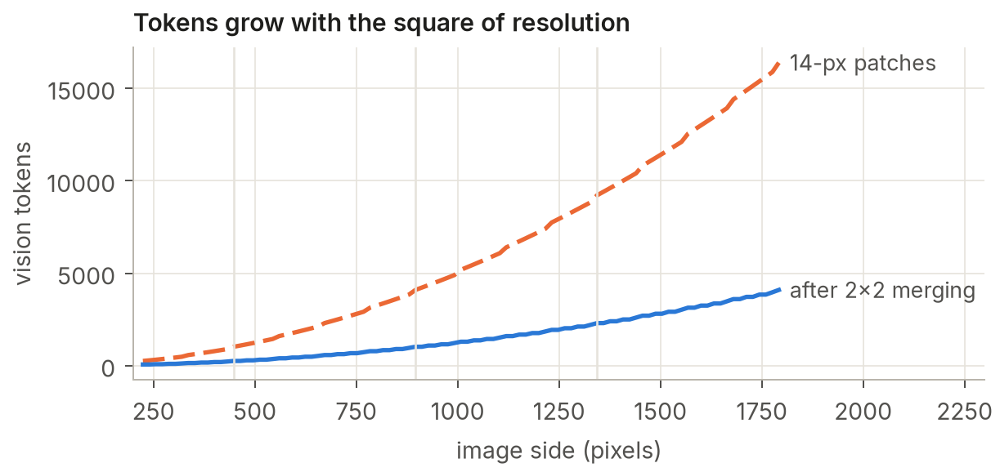
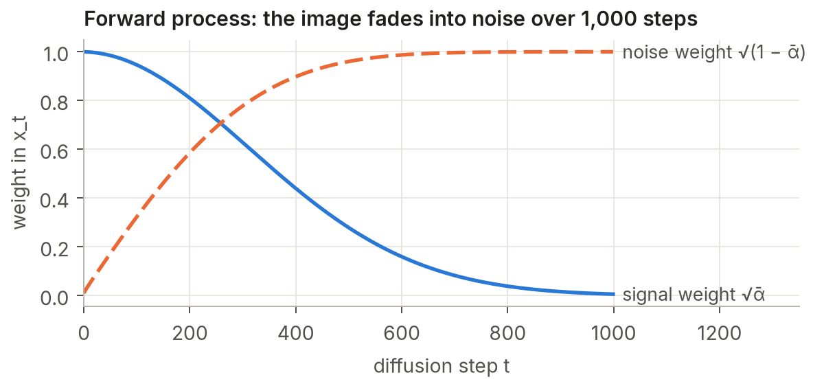

# 14 · Multimodal models

Part III · Transformers and architectures. Assumes Chapter 10 (transformers, RoPE) and Chapter 12 (CLIP and contrastive learning). Chapter 29 covers embeddings for retrieval, including image–text embeddings; Chapter 23 covers how to evaluate models in general.

## Why it matters

Frontier models read images, documents, screenshots, audio and video, and increasingly produce images and speech. For a research scientist, multimodality is mostly a question of **interfaces**: how a non-text signal becomes a sequence of vectors a transformer can use, how many of those vectors it costs, what data teaches the model to ground language in pixels or sound, and how to tell real visual understanding from a strong language prior. Those are the questions interviews ask, and the ones this chapter answers.

Numbers in this chapter come from `code/ch14_check.py` (CPU, seconds).

The chapter starts with the basic design question: how information from another modality enters a language model (14.1). It then follows the most common path, images, step by step: how a vision encoder turns pixels into tokens (14.2), how those tokens are connected to an LLM (14.3), and how the combined model is trained (14.4). Sections 14.5 to 14.7 extend the same ideas to audio, image generation and video, each with its own cost problem. The chapter then covers how to evaluate multimodal models without being fooled by a strong language prior (14.8), a worked cost estimate for a common product request (14.9), and the frontier topics senior interviews now probe: grounding, screen understanding for agents and native multimodal pretraining (14.10).

The recurring theme is tokens. An image, a second of audio or a frame of video becomes some number of tokens, and that number drives cost, latency and how much fits in the context. Being able to estimate it quickly is the most practical skill in this chapter. The second theme is generation, where diffusion and flow matching are the mechanisms you are expected to derive at a whiteboard; 14.6 builds both from the forward noising equation.

## Key concepts

- **Vision Transformer (ViT)**: split an image into patches, embed each patch as a token. [Dosovitskiy et al.](https://arxiv.org/abs/2010.11929).
- **Contrastive image–text pretraining**: CLIP (softmax) and SigLIP (sigmoid) losses. [CLIP](https://arxiv.org/abs/2103.00020), [SigLIP](https://arxiv.org/abs/2303.15343).
- **Vision–language models (VLMs)**: a vision encoder, a projector and an LLM. [LLaVA](https://arxiv.org/abs/2304.08485), [Flamingo](https://arxiv.org/abs/2204.14198).
- **Native-resolution vision and 2-D positions**: variable image sizes with two-dimensional rotary positions. [Qwen2-VL](https://arxiv.org/abs/2409.12191).
- **Early fusion**: images as discrete tokens in one shared vocabulary. [Chameleon](https://arxiv.org/abs/2405.09818), [Transfusion](https://arxiv.org/abs/2408.11039).
- **Speech**: encoder–decoder recognition and audio tokens. [Whisper](https://arxiv.org/abs/2212.04356).
- **Diffusion and flow matching** for image generation. [DDPM](https://arxiv.org/abs/2006.11239), [Latent diffusion](https://arxiv.org/abs/2112.10752), [Classifier-free guidance](https://arxiv.org/abs/2207.12598), [Flow matching](https://arxiv.org/abs/2210.02747).

## 14.1 Four ways to combine modalities

A language model reads tokens, so any other modality has to be turned into something the model can attend to. The four designs in the table differ in where and how that conversion happens: for example, whether images become tokens in the same sequence as text, are read through separate cross-attention layers, or are trained jointly with text from the start. Each choice trades quality against cost and against how much of an existing language model can be reused.

| Design | How images enter | Examples | Trade-off |
|---|---|---|---|
| Encoder + projector ("late fusion") | A pretrained vision encoder's patch features, mapped into the LLM's embedding space and placed in the token sequence | LLaVA family, most open VLMs | Simple and data-efficient; understanding only, unless a separate generator is added |
| Cross-attention | The LLM attends to vision features through extra cross-attention layers | Flamingo, Llama 3.2 Vision | Text path unchanged; more parameters; harder to interleave many images |
| Early fusion, discrete | Images tokenised into codes from a learned codebook, in the same vocabulary as text | Chameleon | One model reads and writes images; tokenisation loses detail |
| Unified, continuous | Text by next-token prediction, images by diffusion, in one transformer | Transfusion and successors | Strong generation and understanding; complex training |

Most open understanding models use the first design, and the rest of this chapter starts there.

## 14.2 Vision encoders

Before a language model can reason about an image, something has to turn pixels into a sequence of vectors. Vision transformers do it by treating an image as a grid of patches, each patch becoming one token, so that the same architecture as for text can be used. The resolution and patch size decide how many tokens an image costs, which is the main lever on the cost of vision-language models.

**Patches as tokens.** A ViT cuts an image into p × p patches, flattens each and maps it linearly to the model width. A 224 × 224 image with 16-pixel patches becomes 196 tokens of 768 raw values each. Positions are added (learned or 2-D sinusoidal), then a standard transformer encoder runs over the patches.

**Contrastive pretraining.** CLIP trains an image encoder and a text encoder so that matching image–caption pairs have high cosine similarity and mismatched pairs low, with a softmax over the batch in both directions (Chapter 12). The temperature is learned, not fixed: CLIP initialises the logit scale at 1/0.07 and clips it at 100, so the toy check script's fixed 0.07 is a simplification. **SigLIP** replaces the softmax with an independent sigmoid per pair:

```python
logits = t * img @ txt.T + b                    # learnable temperature t and bias b
labels = 2 * torch.eye(B) - 1                   # +1 for matched pairs, -1 for all others
loss = -F.logsigmoid(labels * logits).sum() / B
```

Each pair is a separate binary decision, so no batch-wide normalisation is needed, which makes very large batches cheaper and smaller batches work better. SigLIP-family encoders are now the most common vision towers in open VLMs. (The two losses are on different scales, 0.039 and 5.02 on the toy batch in the check script; compare them only within one method.)

Why contrastive encoders for VLMs: their features are already aligned with language, which makes the projector's job easy. Their weakness: trained to match whole captions, they under-represent fine detail (small text, counting, spatial relations), which VLM training then has to recover.

### Encoders for detail: beyond caption matching

Because a caption rarely mentions the position of every object, contrastive training gives no incentive to encode it. Three families address that, and interviewers increasingly ask which encoder you would pick and why.

- **Self-supervised encoders** (DINOv2) learn from images alone, by matching the representations of different crops of the same image. Their patch features are strong on spatial structure (segmentation, depth, correspondence) but are not aligned with language, so the projector has more work to do. Some VLMs concatenate DINOv2 and SigLIP features to get both.
- **SigLIP 2** (2025) adds captioning, self-distillation and masked-prediction objectives to the sigmoid loss, improving localisation and dense features while keeping language alignment, and offers variants that accept native aspect ratios.
- **Autoregressive encoders** (AIMv2) pretrain the vision encoder jointly with a small decoder that generates the image patches and then the caption, which is closer to how the encoder will be used inside a generative VLM.

The practical rule: for photos and general questions, a SigLIP-class encoder is the default; for documents, charts, GUIs and anything spatial, choose an encoder trained with dense objectives and run it at high resolution.

### The modality gap

In a trained CLIP, image embeddings and text embeddings occupy two separate cones on the unit sphere: matched pairs are closer to each other than mismatched ones, but every image is closer to every other image than to any text (Liang et al., 2022, "Mind the Gap"). The cause is partly initialisation (each encoder starts in its own narrow cone) and partly the contrastive loss with a low temperature, which only needs relative order and does not pull the two cones together. It matters in practice: mixing image and text embeddings in one retrieval index ranks all images above all texts, and thresholds tuned on text–text similarity do not transfer to image–text similarity (Chapter 29).

## 14.3 Connecting vision to an LLM

Strong vision encoders and strong language models already exist, trained separately. The cheapest way to build a vision-language model is to connect them: map the image features into the language model's input space so that they look like a few hundred extra tokens. The design of that connector, and how many tokens it produces, matters more than one would expect.

**The LLaVA recipe.** Run the vision encoder, take its patch features (576 tokens from a 336-pixel image with 14-pixel patches), map them with a small MLP projector to the LLM's width, and splice them into the text sequence where the image appears. The LLM then trains with the usual next-token loss on the answer tokens only:

```python
img_emb = projector(vision_encoder(image))      # (1, 576, d_llm); projector: 6.3M params here
seq = torch.cat([text_before, img_emb, text_after], dim=1)
labels[...] = -100                              # no loss on the prompt or the image tokens
labels[answer_positions] = answer_ids
```

**The token budget is the central constraint.** Detail needs resolution, and tokens grow with the square of the side:

| Image side (14-px patches) | Vision tokens | After 2 × 2 merging |
|---|---|---|
| 224 | 256 | 64 |
| 448 | 1,024 | 256 |
| 896 | 4,096 | 1,024 |
| 1,344 | 9,216 | 2,304 |



*Vision tokens against image side for 14-pixel patches, with and without 2 × 2 token merging. A 1,344-pixel page costs 9,216 tokens unmerged, more than many text prompts.*

A document page needs high resolution to read small print; a photo of a cat does not. Three techniques manage this:

- **Tiling**: cut a large image into encoder-sized tiles plus a downscaled overview (LLaVA-NeXT and others).
- **Native resolution**: encode the image at its own aspect ratio and size, with **2-D rotary positions** (half the rotary dimensions encode the row, half the column), so the encoder handles any shape (Qwen2-VL and later). The check script confirms that two patch pairs with the same (row, column) offset get the same attention score.
- **Token compression**: merge each 2 × 2 block of neighbouring tokens into one with 4× the channels (pixel shuffle), cutting 576 tokens to 144, or use a small cross-attention "resampler" with a fixed number of learned queries.

### Resamplers: Q-Former and the Perceiver resampler

A resampler decouples the number of visual tokens from the image size. It holds a fixed set of K learned query vectors; each layer lets the queries cross-attend to the encoder's patch features (and, in some designs, to each other), and the K outputs are what the LLM sees. Flamingo's **Perceiver resampler** produces 64 visual tokens per image whatever its resolution; BLIP-2's **Q-Former** uses 32 queries and is pretrained with its own image–text objectives before being connected to a frozen LLM. The appeal is a fixed, small cost per image, which matters for many-image and video inputs. The weakness is that K learned queries are a bottleneck chosen before seeing the image: a page of small print and a photo of a cat get the same budget. That is why most recent open VLMs went back to MLP projectors over all patches, with pixel-shuffle merging for cost control, and why resamplers survive mainly where many images must fit in context.

## 14.4 Training a VLM

Connecting an encoder to an LLM does not by itself make the model understand images: the connector has to be trained to translate between the two spaces, and the combined model has to learn to follow instructions about images. Open recipes do this in stages, each with its own data and its own set of trainable parameters.

A typical open recipe has three or four stages:

1. **Alignment**: freeze the vision encoder and LLM, train only the projector on image–caption pairs. Cheap; teaches the LLM to read the projected features.
2. **Pretraining on mixed data** (increasingly common): unfreeze more, train on large interleaved image–text documents, OCR data, charts, diagrams and captions, mixed with text-only data so language ability does not degrade.
3. **Instruction tuning**: visual question answering, document and chart questions, grounding (point to or box an object), multi-image and video conversations, with the LLM unfrozen.
4. **Preference and RL training**: reduce hallucinated objects and improve reasoning on visual maths and charts, with verifiable rewards where possible (Chapter 19).

**Data matters more than architecture.** Most gains in open VLMs have come from better data: dense, accurate re-captioning of images by strong models, synthetic charts and documents with known answers, large OCR corpora, and careful mixing. Keep text-only data in every stage, or the LLM's language and reasoning skills degrade.

### What to freeze, and at what learning rate

LLaVA-1.5 is the minimal recipe: the CLIP encoder stays frozen throughout, the projector is trained on about 558k caption pairs, and then the projector and LLM are trained on a 665k-example instruction mixture. It works because the frozen encoder's features are already good for photos. Later recipes (the Qwen2-VL and Qwen2.5-VL family, Molmo) unfreeze the vision encoder after alignment, add a large mid-training or multimodal pretraining stage of interleaved documents, OCR and grounding data, and train at native resolution. Unfreezing is what lets the encoder learn the small text and layout that caption matching never asked for.

The cost of unfreezing is that a randomly initialised projector sends large, noisy gradients into a good encoder at the start, which can destroy its features. The standard protections are to align the projector first with everything else frozen, and then to train the encoder at a lower learning rate than the LLM (a factor of a few to ten lower is typical) with warm-up. A useful check is to evaluate the encoder alone (for example zero-shot retrieval or a linear probe) before and after: if its standalone quality falls sharply, the learning rate was too high.

### Keeping the language model intact

Every image token trained with the LLM unfrozen moves weights that also serve text. Recipes therefore keep text-only data in the mixture, often a substantial share of the tokens, and track text benchmarks (knowledge, maths, instruction following) at every checkpoint against the original LLM. Degradation shows up first on the abilities that the multimodal data does not exercise: long-form writing, multilingual text and maths word problems. Cross-attention designs such as Llama 3.2 Vision avoid the problem by construction: the text weights stay frozen and the image enters only through new layers, so text-only behaviour is unchanged, at the cost of extra parameters.

## 14.5 Audio and speech

Speech is the most natural interface for many products, and audio is just another signal that can be cut into frames and turned into tokens. The two directions, recognising speech and generating it, use different models today, and end-to-end speech-to-speech models are starting to merge them.

**Recognition.** Whisper converts 30 seconds of 16 kHz audio into a log-mel spectrogram with a 10 ms hop (3,000 frames), downsamples by 2 with a convolution (1,500 encoder positions) and decodes text with a transformer decoder trained on 680k hours of weakly labelled audio. Audio LLMs reuse the same pattern as VLMs: an audio encoder, a projector, an LLM.

**Audio as tokens.** Neural audio codecs compress audio into discrete codes from several codebooks per frame (residual vector quantisation). At 12.5 frames per second with 8 codebooks, 30 seconds is 3,000 tokens. An LLM that reads and writes these tokens can listen and speak directly ("speech-to-speech"), which preserves tone and allows low-latency spoken conversation. The design problems are interleaving text and audio streams, latency (the model must start speaking before it has "thought"), and keeping reasoning quality close to the text model's.

### Speech-to-speech in more detail

**Residual codebooks.** In residual vector quantisation, the first codebook quantises the frame's vector, the second quantises what the first got wrong, and so on, so later codebooks add finer detail. Many codecs now distil a speech model's features into the **first** codebook, making it a "semantic" token that carries what was said, while the remaining codebooks are "acoustic" tokens that carry voice, prosody and recording conditions.

**Predicting several codebooks per frame.** Flattening 8 codebooks into one sequence would make every second of audio 8× longer. Two tricks avoid it. The **delay pattern** (used in MusicGen) offsets codebook k by k steps so that, at each step, the model predicts one token for each codebook in parallel, each conditioned on the coarser codes of the same frame emitted earlier. A **depth transformer** (the RQ-Transformer idea, used in Moshi) runs a large temporal transformer once per frame and a small transformer across the codebooks within the frame.

**Full duplex.** A real conversation has overlaps and interruptions, so Moshi (Défossez et al., 2024) models two audio streams at once, the user's and its own, and adds an **inner monologue**: at each frame it first predicts a text token for what it is saying, then its audio tokens. The text stream keeps the language model's reasoning in play while the audio streams handle timing. One frame of the layout, at 12.5 frames per second:

| Stream | Content at each 80 ms frame |
|---|---|
| Model text | One text token (or padding) for the words being spoken |
| Model audio | 8 codec tokens: 1 semantic + 7 acoustic, predicted by the depth transformer |
| User audio | 8 codec tokens from the microphone, read but not predicted at inference |

### Vector quantisation, done properly

**Vector quantisation** (images and audio): map each continuous vector to its nearest codebook entry; pass gradients through the non-differentiable lookup with the straight-through trick and add a commitment loss so the encoder output stays near its code:

```python
idx = torch.cdist(z, codebook).argmin(-1)
zq = codebook[idx]
z_st = z + (zq - z).detach()          # forward: zq; backward: gradient flows to z
commit = F.mse_loss(z, zq.detach())
```

That snippet trains only the encoder side. The straight-through copy sends the decoder's gradient to z, not to the codebook, and the commitment term is stopped at the code, so with these lines alone **the codebook never moves**. The full VQ-VAE objective adds a codebook term that pulls each chosen code towards the encoder outputs assigned to it:

$$
\mathcal{L}_{\mathrm{VQ}} = \Vert \mathrm{sg}[z] - e \Vert^{2} + \beta\,\Vert z - \mathrm{sg}[e] \Vert^{2}
$$

Here z is the encoder output, e the selected codebook vector, sg[·] the stop-gradient (`.detach()`), and β ≈ 0.25 weights the commitment term; the reconstruction loss is added on top. In code, `codebook_loss = F.mse_loss(zq, z.detach())`. The check script confirms that with this term every selected code receives a gradient. Many implementations replace the codebook loss with an exponential moving average: each code is set to the running mean of the encoder outputs assigned to it.

The common failure is **codebook collapse**: a few codes win every assignment early, the rest never receive gradient and die, and the effective vocabulary shrinks. Remedies are re-initialising dead codes from recent encoder outputs, lower-dimensional or normalised codes, and, more radically, **finite scalar quantisation** (FSQ) or lookup-free quantisation (LFQ), which drop the learned codebook altogether: each dimension is rounded to a few fixed levels (FSQ) or to ±1 (LFQ), so every code exists by construction and nothing can collapse.

## 14.6 Generating images

Understanding images and generating them are different problems. Generation needs a model of the whole distribution of images, and the dominant approach, diffusion, learns it indirectly by training a network to remove noise. The mechanism is worth knowing because it also appears in diffusion language models (Chapter 11.7).

**Diffusion.** Train a network to undo noise. The forward process mixes an image x₀ with Gaussian noise: x_t = √ᾱ_t x₀ + √(1 − ᾱ_t) ε. With the standard linear schedule over 1,000 steps, the signal weight is 1.000 at t = 0, 0.722 at t = 250, 0.279 at t = 500 and 0.006 at t = 999. The network predicts ε from (x_t, t); sampling starts from pure noise and removes predicted noise step by step. **Latent diffusion** runs the process in the compressed latent space of an autoencoder, which is far cheaper. **Flow matching** learns a velocity field along straight paths from noise to data and samples in fewer steps; most recent image and video generators use it with transformer backbones (diffusion transformers).



*The weights of the original image and of the noise in x_t over the 1,000-step linear schedule. By step 600 the image contributes less than 10% of x_t; generation runs this curve backwards.*

**Why predicting the noise is enough.** If the network predicts the noise ε in x_t, the clean image follows by rearranging the forward equation: x₀ = (x_t − √(1 − ᾱ_t) ε) / √ᾱ_t. Each sampling step uses this estimate to take a small step from x_t towards a slightly less noisy x_(t−1), adding a little fresh noise to keep the samples diverse. Early steps decide the layout and composition; late steps fill in fine detail. Training only ever asks one question, "what noise was added to this image at this noise level?", which is a simple regression with a stable loss, one reason diffusion training is far more stable than earlier generative adversarial networks.

### The DDPM sampling step

Write α_t = 1 − β_t for the per-step signal factor (β_t is the noise added at step t) and ᾱ_t for their product up to t. The DDPM sampler moves from x_t to x_(t−1) with

$$
x_{t-1} = \dfrac{1}{\sqrt{\alpha_t}}\left(x_t - \dfrac{\beta_t}{\sqrt{1-\bar{\alpha}_t}}\,\hat{\epsilon}_{\theta}(x_t, t)\right) + \sigma_t z
$$

where ε̂_θ is the network's noise prediction, z is fresh standard normal noise and σ_t² = β_t is the usual choice. The bracket is not arbitrary: it is exactly the mean of the true reverse step q(x_(t−1) | x_t, x₀) with x₀ replaced by the estimate above. **Worked example** in one dimension, at t = 500 of the linear schedule: β_t = 0.01006 and ᾱ_t = 0.0778. Take x₀ = 1 and ε = 0.5, so x_t = 0.279 × 1 + 0.960 × 0.5 = 0.759. With a perfect noise prediction, the DDPM mean is 0.7577, identical to the true posterior mean, and the rearranged estimate recovers x₀ = 1.000 exactly. The sampler then adds σ_t z with σ_t = √0.01006 ≈ 0.10.

**The link to scores.** The gradient of the log-density of the noised data, the **score**, points towards higher-probability images. For the forward process,

$$
\nabla_{x_t} \log q(x_t \mid x_0) = -\dfrac{\epsilon}{\sqrt{1-\bar{\alpha}_t}}
$$

because x_t given x₀ is Gaussian with mean √ᾱ_t x₀ and variance 1 − ᾱ_t, so its log-density gradient is −(x_t − √ᾱ_t x₀)/(1 − ᾱ_t) = −ε/√(1 − ᾱ_t). In the example the score is −0.5/0.960 = −0.521. Predicting the noise and estimating the score are therefore the same task up to a known scale, which is why diffusion models are also called score-based models, and why classifier-free guidance (below) can be read as adding score directions.

### Flow matching

Flow matching (Lipman et al., 2022; rectified flow, Liu et al., 2022) keeps the "corrupt, then learn to undo" idea but chooses the simplest possible path between data and noise: a straight line. With t from 0 (data) to 1 (noise),

$$
x_t = (1 - t)\,x_0 + t\,\epsilon
$$

The velocity along this path is dx_t/dt = ε − x₀, and the network v_θ(x_t, t) is trained to predict it by regression:

$$
\mathcal{L}_{\mathrm{FM}} = \Vert v_{\theta}(x_t, t) - (\epsilon - x_0) \Vert^{2}
$$

averaged over data x₀, noise ε and a random t. Sampling starts from noise at t = 1 and integrates the learned velocity backwards with Euler steps, x_(t−Δ) = x_t − Δ · v_θ(x_t, t). (Conventions differ: some papers put the noise at t = 0; the algebra is the same with the sign of v flipped.)

**Why straight paths need fewer steps.** If the learned velocity field were exactly straight for every sample, one Euler step would land on the data. It is not, because many data points share the same noise region: the best prediction at t = 1 is the *average* velocity, which points towards the mean of the data. The check script shows this on one-dimensional data with two modes at −2 and +2. One Euler step sends every sample to near the middle (fraction within 0.6 of a mode: 0.00, mean |x| 0.18); 4 steps get 89% of samples near a mode; 32 steps get 94% with mean |x| 1.98 against the data's 2.0. The paths bend where the two modes separate, and more steps follow the bend. **Rectified flow** straightens the paths by retraining on pairs (noise, generated sample) from the first model, so each noise point is coupled to one data point; **distillation** into a one-step or few-step student goes further. These are why current generators produce images in a few to a few tens of steps rather than the 1,000 of the original DDPM.

**Classifier-free guidance.** Train the same network with and without the text condition (by randomly dropping it), then at sampling time extrapolate: ε̂ = ε_uncond + w (ε_cond − ε_uncond), with w around 3–7. Higher w follows the prompt more closely at the cost of diversity. In score terms, guidance adds w − 1 times the direction that makes the condition more likely, an implicit classifier.

### Autoregressive and unified image generation

**Autoregressive image generation.** Generate image tokens from a VQ tokenizer one by one, like text (Chameleon). Raster order (left to right, top to bottom) is a poor fit for images, because the first tokens commit to details before the layout is known. **VAR** (Tian et al., 2024, "next-scale prediction") instead predicts a whole token map at each of a sequence of increasing resolutions, 1 × 1, then 2 × 2, up to the final grid, each conditioned on all coarser maps; within a scale all tokens are predicted in parallel, so the number of sequential steps is the number of scales, not the number of tokens. The image generation built into recent chat models is reported to be autoregressive and native to the language model, which lets one model use its world knowledge and conversation history when drawing. Unified models that use next-token prediction for text and diffusion for images in one transformer (Transfusion) are an active line of work, because one model that both understands and generates can use the same knowledge for both.

## 14.7 Video

Video combines the costs of images with the length of long documents: every frame is an image, and a few minutes contain thousands of frames. Every practical video model is therefore built around reducing the number of tokens, by sampling frames, compressing them, or both.

Video is images over time, and the token count explodes: 10 minutes at 2 frames per second with 256 tokens per frame is 307,200 tokens. Standard tools: sample frames sparsely (and adaptively, more where the scene changes), merge tokens across time as well as space, use 3-D (time, row, column) rotary positions, and process long videos with memory or retrieval over clips. Evaluate on questions that need the whole video, not a single frame, or the model will learn to answer from one lucky frame.

**Video generation.** Generators apply the ideas of 14.6 to a compressed video latent. A video autoencoder compresses in time as well as space, then the latent is cut into **spacetime patches** (a small block of frames × rows × columns becomes one token), and a diffusion transformer trained with diffusion or flow matching denoises all of them jointly; OpenAI's Sora report described this design. Joint denoising across frames is what keeps objects consistent over time, and it is also the cost problem: a few seconds of high-resolution video is tens of thousands of tokens with full attention among them, so the temporal compression ratio of the autoencoder is the main lever on cost.

## 14.8 Evaluating multimodal models

A vision-language model can often answer questions about an image without looking at it, because its language prior guesses well: a picture of a kitchen probably contains a fridge. Good multimodal evaluation therefore checks not only whether answers are right, but whether they depend on the image at all.

| What to test | Examples | Watch for |
|---|---|---|
| General visual reasoning | MMMU, MMBench | Many questions answerable from text alone |
| Documents, charts, OCR | DocVQA, ChartQA, OCRBench | Resolution and tiling settings change scores a lot |
| Maths in images | MathVista, MathVerse | Leakage of popular problems |
| Hallucination | POPE, object-presence probes | "Yes" bias; rate the model on images where the object is absent |
| Video | Video-MME, long-video QA | Answerable from a single frame |
| Speech | Word error rate by accent and noise | Text normalisation differences between systems |
| Screens and GUI agents | ScreenSpot-style grounding, OSWorld-style tasks | Coordinate conventions and screen resolution differ between harnesses |

Two checks a research scientist should always run:

- **Blind baseline**: run the benchmark with the image removed or replaced by noise. If accuracy stays well above chance, the benchmark (or the model) is relying on language priors, and the gap to the blind score is the real visual contribution.
- **Resolution sweep**: evaluate at several image resolutions and token budgets. A model "better at charts" may simply be using four times the tokens.

## 14.9 A worked budget: question answering over a 20-page PDF

A user uploads a 20-page report and asks questions about its charts and tables. What does one request cost with an 8B-scale VLM?

- **Tokens.** At 896 pixels per page side with 2 × 2 merging, each page is 1,024 vision tokens: 20,480 tokens for the document, plus the question. At 1,344 pixels (needed for small footnotes) it is 2,304 per page: 46,080 tokens.
- **Prefill compute.** About 2 × 8 × 10⁹ × 20,480 ≈ 3.3 × 10¹⁴ FLOPs at the lower resolution: under a second on one modern GPU at realistic utilisation, but far more than a typical text question.
- **Vision encoder.** The encoder runs before the merge, on 4,096 patches per page, 81,920 in all. For a 400M-parameter SigLIP-class encoder (27 layers, width 1,152), the matrix multiplications cost 2 × 0.4 × 10⁹ × 81,920 ≈ 6.6 × 10¹³ FLOPs, and full attention within each page adds 4 × 27 × 1,152 × 4,096² × 20 ≈ 4.2 × 10¹³. The encoder is about a third of the LLM's matmul cost: not negligible.
- **LLM attention.** At 20k tokens of context, causal attention adds about 2 × 32 × 4,096 × 20,480² ≈ 1.1 × 10¹⁴ FLOPs for a 32-layer, d = 4,096 model (13.3 explains the count).
- **Time to first token.** The total is about 5.4 × 10¹⁴ FLOPs. At 40% of a 989-TFLOP/s GPU that is about 1.4 s of compute before the first answer token, before adding the CPU work of rendering 20 PDF pages to pixels and resizing them, which should be measured and can be overlapped with encoding. At 1,344 pixels every term grows (the LLM terms by 2.25× and more), and time to first token passes several seconds.
- **KV cache.** With GQA-8 at 131 KB per token (Chapter 10), 20k tokens hold 2.7 GB; 46k tokens hold 6 GB, per conversation, for as long as the user keeps asking follow-ups.
- **Design levers.** Cache the document's prefix across follow-up questions (prefix caching, Chapter 22); render text-heavy pages through OCR into text tokens, which are far fewer than vision tokens, and reserve vision tokens for pages with charts; retrieve only the relevant pages for each question (Chapter 31) instead of sending all 20; and choose resolution per page.

The design target to test is answer quality within a point or two of "send every page at full resolution", at a fifth of the tokens. That target is a hypothesis, not a published result; whether a given design meets it depends on the documents. The way to know is an evaluation set of questions over real documents, scored at each configuration, with confidence intervals (Chapter 23).

## 14.10 Grounding, screens and native multimodal models

The topics in this section are where VLM research moved in 2024–26, driven by agents that must act on what they see, and they are where senior interviews now go after the basics.

### Grounding: boxes and points as text

A grounded answer points at the evidence: a bounding box around the object, or a point on it. The simplest and now dominant design writes coordinates **as text tokens** in the model's output, for example a box as four integers, so no special detection head is needed and the same next-token loss trains it. The design choices are the coordinate system and its resolution. Some models normalise coordinates to a fixed grid (for example 0–1000) so the output is independent of image size; others (Qwen2.5-VL) use absolute pixel coordinates of the resized input, which ties the model to its native-resolution encoder. Molmo trains on points rather than boxes, collected at scale from human annotators (PixMo), which makes counting ("point to each person") a natural by-product. Training data comes from detection datasets converted to text, referring-expression datasets, and increasingly synthetic data from rendered documents and screens where the ground-truth positions are known exactly.

### Screens and GUI agents

A computer-use agent sees screenshots and must output actions: click at (x, y), type, scroll. Three constraints shape the model. **Resolution**: a 1,920 × 1,080 screen at 14-pixel patches is about 10,600 patches, 2,600 tokens after 2 × 2 merging, per step, and small icons and text need near-native resolution. **Grounding precision**: a click that misses a 16-pixel button by 10 pixels fails, so pointing accuracy is measured directly (ScreenSpot-style benchmarks) and trained on synthetic screens and accessibility-tree labels. **Latency and context**: a 30-step task with one screenshot per step accumulates tens of thousands of image tokens, so agents keep only the last few screenshots in full and summarise or drop older ones (Chapter 33). The evaluation trap is the harness: coordinate conventions, screen size and allowed actions differ between benchmarks, so scores are comparable only within one harness.

### Native multimodal pretraining versus late fusion

Late fusion bolts a separately trained encoder onto a finished LLM; **native** (or early-fusion) models train on interleaved text and images from the start of pretraining, either with discrete image tokens in a shared vocabulary (Chameleon) or with continuous patches through a light encoder. The argument for native training is that visual and textual knowledge are learned together, so the model does not have to translate between two representations learned for different objectives. The argument for late fusion is cost and reuse: a strong LLM and a strong encoder already exist, and connecting them takes a small fraction of the compute. Scaling-law comparisons published in 2025 found that, at equal compute, early fusion is at least competitive with late fusion and simpler to scale, which is consistent with frontier labs training multimodal models natively; open recipes still mostly use late fusion because it is affordable. The interview answer is the trade-off, not a winner: native training for a lab with a pretraining budget, late fusion for everyone who starts from an existing LLM.

## Pitfalls

- Comparing VLMs evaluated at different resolutions or token budgets.
- Training only on caption data: the model learns to describe, not to answer questions about details.
- Dropping text-only data during multimodal training and losing language ability.
- Trusting a benchmark without a blind baseline.
- Forgetting that every image costs hundreds to thousands of tokens of context and prefill compute.
- Using a contrastive encoder at low resolution and expecting it to read small text.
- Training a VQ tokenizer with only the straight-through and commitment terms: the codebook never learns.
- Unfreezing the vision encoder at the LLM's learning rate before the projector is aligned.

## Interview questions

**Mid level**

**1. How does an image become tokens in a ViT?** Cut it into p × p patches, flatten and linearly project each, add positions. 224² with 16-pixel patches gives 196 tokens. Each patch is 16 × 16 × 3 = 768 raw values, and the linear projection to the model width is equivalent to a convolution with kernel and stride p. Tokens grow with the square of the side: with 14-pixel patches a 448 image is 1,024 tokens and an 896 image 4,096, which is why resolution is the main cost lever. Follow-up: "how do you handle a different resolution at inference?" Interpolate learned position embeddings, or use 2-D RoPE, which extends naturally.

**2. Compare CLIP and SigLIP losses.** CLIP: softmax cross-entropy over the batch in both directions. SigLIP: an independent sigmoid per image–text pair with a learned bias. SigLIP needs no batch-wide normalisation, so it scales to large batches cheaply and works better at small ones. In CLIP every logit's gradient depends on the whole row through the softmax, and the loss needs all-gathered embeddings across devices; in SigLIP each of the B² pairs is a separate binary decision, and because B − 1 of every B pairs are negatives, the learned bias starts strongly negative (−10 in the original) to avoid a large initial loss. Both learn the temperature. Follow-up: "what do both fail at?" Fine detail and spatial relations, because captions rarely mention them.

**3. Describe the LLaVA architecture and training.** Frozen vision encoder, MLP projector into the LLM's embedding space, image tokens spliced into the sequence. Stage 1 trains the projector on captions; stage 2 instruction-tunes with the LLM unfrozen. In LLaVA-1.5 that is about 558k caption pairs and then a 665k-example instruction mixture, with 576 image tokens per 336-pixel image. Modern recipes (Qwen2.5-VL, Molmo) differ in three ways: they unfreeze the vision encoder after alignment, at a lower learning rate than the LLM; they add a large multimodal pretraining or mid-training stage with interleaved documents, OCR and grounding; and they use native resolution. Follow-up: "why not unfreeze everything from the start?" A random projector sends noisy gradients into a good encoder and can destroy its features; align first.

**4. How do VLMs handle high-resolution documents?** Tiling with an overview image, or native-resolution encoding with 2-D RoPE; then token merging (pixel shuffle) or a resampler to fit the token budget. A 1,344-pixel page is 9,216 patches, 2,304 tokens after 2 × 2 merging, so a 20-page document is 46k tokens and 6 GB of KV cache on an 8B GQA model. Trade-off: merging loses detail that small print needs; OCR into text tokens is far cheaper for text-only pages. Follow-up: "how do you choose resolution?" Per page, by content type, validated with a resolution sweep on real documents.

**5. Cross-attention versus projector-in-sequence designs?** Cross-attention leaves the LLM's text path untouched and keeps image features out of the context; projector designs are simpler, reuse the LLM fully and handle interleaving naturally, at the cost of context length. In numbers: a 1,024-token image in sequence costs 1,024 positions of context, 134 MB of KV cache on an 8B GQA-8 model and 1.6 × 10¹³ prefill FLOPs, every time it is attended. With cross-attention the image features are keys and values only for the cross-attention layers, so if one layer in four is a cross-attention layer the cache cost is about a quarter and no context positions are used. Llama 3.2 Vision chose cross-attention with frozen text weights so its text-only behaviour is exactly that of the text model. Follow-up: "why is in-sequence more common?" Simpler training, interleaving of many images, and the LLM's full attention over image tokens is better for fine-grained reasoning.

**6. What is early fusion, and why is it attractive?** Images become discrete tokens in the same vocabulary, so one model reads and generates both. Costs: the tokenizer loses detail and training is harder to stabilise. Chameleon reported needing QK-norm and other changes to keep mixed-modal training stable, because image and text tokens have very different statistics. Scaling comparisons find early fusion at least competitive with late fusion at equal compute, so the trade-off is mainly cost of training from scratch versus reuse of an existing LLM. Follow-up: "continuous or discrete?" Continuous patches keep more detail for understanding; discrete tokens make generation a next-token problem.

**7. How would you detect that a VLM relies on language priors?** Blind baselines (image removed), counterfactual images that contradict the prior, hallucination probes for absent objects. The number to report is the visual contribution, real-image accuracy minus blind accuracy, with a paired confidence interval: on 1,000 questions, a difference of 5 points with 30% of answers changing between the two conditions has a standard error of about 1.7 points. Follow-up: "the blind score is 60% on a four-choice benchmark, what now?" The benchmark mostly measures language priors; report the image-dependent subset separately.

**8. Explain classifier-free guidance.** Train with the condition randomly dropped; at sampling, push the prediction away from the unconditional one: ε_u + w(ε_c − ε_u). Because predicted noise is a scaled score, this adds (w − 1) times the gradient of log p(condition | x), an implicit classifier trained for free. w around 3–7 is typical; higher w follows the prompt more closely and loses diversity and, at extremes, saturates colours. It doubles the network evaluations per step unless distilled. Follow-up: "why not train a separate classifier?" Classifier guidance needs a classifier robust to noisy inputs; CFG needs only condition dropout.

**9. How does Whisper process audio?** Log-mel spectrogram (10 ms hop), conv downsampling, transformer encoder; a decoder generates text with special tokens for language, task and timestamps. Thirty seconds at 16 kHz gives 3,000 frames and 1,500 encoder positions after the stride-2 convolution. It was trained on 680k hours of weakly labelled web audio, which is why it is robust to accents and noise but can hallucinate text on silence. Follow-up: "how would you stream it?" Chunked inference with overlap, or a model trained for streaming; Whisper's 30-second window is not causal.

**10. What limits video understanding?** Token count. Sparse and adaptive frame sampling, spatio-temporal token merging, 3-D positions, and memory or retrieval for long videos. Ten minutes at 2 fps and 256 tokens per frame is 307,200 tokens, beyond most context windows. Benchmarks are a second limit: many questions can be answered from one frame. Follow-up: "how do you test temporal understanding?" Questions about order, counts over time and causality, with a shuffled-frames baseline.

**Senior level**

**11. Your VLM hallucinates objects that are not in the image. How do you debug it?** First measure it properly: a POPE-style probe asks about present and absent objects in balanced proportions, and a "yes" bias shows as a high false-positive rate on absent objects. Then localise: run the same questions with the image removed; if the model still names the object at a similar rate, the language prior dominates (a kitchen implies a fridge), which points at training data whose captions mention unseen objects. Check resolution: small objects missed at 336 pixels may be confabulated from context. Fixes, in order of cost: higher resolution or a dense-feature encoder; re-captioning training data so captions mention only visible objects; adding negative questions ("is there a dog?" with answer no) to instruction data; and preference or RL training with pairs that penalise invented objects. Report the false-positive rate on absent objects with a confidence interval before and after. Follow-up: "the hallucinations are about text in images": that is an OCR resolution problem, so test tiling first.

**12. Freeze or unfreeze the vision encoder, and at what learning rate?** Freeze during projector alignment, always; a random projector's gradients can wreck a good encoder. Afterwards, unfreeze when the target domain needs what caption matching did not teach: documents, charts, screens, spatial reasoning. Use a learning rate a few to ten times lower than the LLM's, with warm-up, and monitor the encoder's standalone quality (zero-shot retrieval or a linear probe) at checkpoints. When not to unfreeze: small instruction datasets in the photo domain, where the encoder can only over-fit, and multi-task models that must keep the encoder's general features. The number to watch is the text-only and encoder-only benchmark delta; if the encoder probe drops by more than a point or two while VLM scores rise, lower its learning rate. Follow-up: "LoRA on the encoder?" A reasonable middle ground when data is small.

**13. Design a VLM for GUI and computer-use agents.** Input: screenshots at near-native resolution, since icons and small text need it; a 1,920 × 1,080 screen is about 10,600 patches at 14 pixels, 2,600 tokens after 2 × 2 merging per step, so a 30-step episode holds about 79k image tokens unless older screenshots are dropped or summarised. Output: actions as text, with click targets as coordinates in a documented convention (normalised or absolute) that the harness and the training data share. Training: grounding data from synthetic and real screens with accessibility-tree labels, then trajectories, then RL on tasks with checkable end states (Chapter 19). Latency: each step pays prefill for a new screenshot; prefix-cache the conversation and keep only the last two or three screenshots at full resolution. Evaluate pointing accuracy separately from task success, so you know whether failures are perception or planning. Follow-up: "why not use the accessibility tree alone?" It is cheaper and exact where available, and many apps and canvases do not expose one; strong agents use both.

**14. How much text-only data should you mix into VLM training, and how do you detect degradation?** Enough that text benchmarks stay within noise of the original LLM; recipes report substantial text-only shares, and the right number is found by ablation, not by rule. Detect degradation by evaluating the original LLM and every VLM checkpoint on the same text suite (knowledge, maths, instruction following, long-form writing, multilingual), with confidence intervals; degradation appears first on skills the multimodal data never exercises. A worked threshold: on a 1,000-question text benchmark at 70% accuracy, each score has a standard error of 1.4 points, so the difference of two unpaired scores has a standard error of about 2.0 and a drop of 4 points or more is beyond noise; a paired comparison on the same questions detects smaller drops. Fixes are more or better text data, a lower LLM learning rate, freezing the LLM for early stages, or a cross-attention design that keeps the text weights frozen. Follow-up: "can model merging help?" Interpolating the VLM's LLM weights back towards the original can recover text ability at some cost in visual skill; measure both.

## Practice

1. Build a tiny VLM: a frozen small ViT or SigLIP encoder, an MLP projector, a small LLM. Train the projector on a caption dataset, then instruction-tune on a VQA subset.

<details><summary>Hint and expected result</summary>

A concrete setup: SigLIP-B/16 at 224 pixels (196 tokens), a two-layer MLP projector, SmolLM-135M as the LLM, COCO captions for stage 1 and a VQAv2 subset for stage 2, about one GPU-hour in total. Expect captions that name the main objects after stage 1, and VQA accuracy after stage 2 clearly above the blind baseline of the same model with the image removed. On yes/no questions that blind baseline is itself above 50%, because answer priors are skewed, so always compute it rather than assuming chance: the gap is what the image contributes.

</details>

2. Implement pixel-shuffle merging and measure accuracy against tokens on a document-QA subset.

<details><summary>Hint and expected result</summary>

Check the shapes first: a 24 × 24 grid of 1,024-wide tokens must become 144 tokens of 4,096 (the check script prints both). On document QA, expect accuracy to hold at 2 × 2 merging when the input resolution is high and to fall steeply at 4 × 4, and expect questions about small print to fail first.

</details>

3. **Research exercise.** Take two open VLMs and a benchmark. Score each with the real image, with no image, and with a mismatched image. Report the visual contribution (real minus blind) with confidence intervals (Chapter 23), and discuss what the benchmark measures.

<details><summary>Hint and expected result</summary>

Use paired confidence intervals, since the same questions are scored in each condition. Expect general multiple-choice benchmarks to show blind accuracy well above chance, often a large fraction of the real-image score, and document and chart benchmarks to fall close to chance without the image. A mismatched image usually scores below the blind condition, because the model trusts the wrong visual evidence; that gap is a measure of how much it uses the image.

</details>

4. Implement the DDPM forward process and a small denoiser on MNIST; add classifier-free guidance and vary w. Then train a flow-matching model on the same data and compare sample quality at 4, 16 and 64 Euler steps.

<details><summary>Hint and expected result</summary>

Check the schedule first: the signal weight must be 0.722 at t = 250 and 0.279 at t = 500, and with a perfect noise prediction the DDPM mean at t = 500 must match the true posterior mean (0.7577 for x₀ = 1, ε = 0.5). Expect recognisable digits from DDPM only with hundreds of steps, and from flow matching with a few tens. As w increases from 0 to about 5, class adherence rises and diversity falls; very large w gives saturated, distorted digits. The one-dimensional flow-matching check in the script shows the few-step failure mode: one step collapses to the mean.

</details>

5. Compute the token cost of a 20-page PDF at three resolutions for a model you use.

<details><summary>Hint and expected result</summary>

Use the model's patch size and merge factor. With 14-pixel patches and 2 × 2 merging, 448, 896 and 1,344 pixels give 256, 1,024 and 2,304 tokens per page: 5,120, 20,480 and 46,080 for the document. Add the vision-encoder FLOPs on the pre-merge patches; at 896 pixels they are about a third of the LLM's matmul FLOPs.

</details>

## Read next

- Dosovitskiy et al., "An Image is Worth 16x16 Words" (ViT, 2020); Radford et al., CLIP (2021); Zhai et al., SigLIP (2023).
- Liu et al., "Visual Instruction Tuning" (LLaVA, 2023), and the LLaVA-NeXT notes.
- Alayrac et al., "Flamingo" (2022); Li et al., "BLIP-2" (2023), for the Q-Former.
- Wang et al., "Qwen2-VL" (2024), for native resolution and M-RoPE.
- Chameleon Team, "Chameleon: Mixed-Modal Early-Fusion Foundation Models" (2024); Zhou et al., "Transfusion" (2024).
- Radford et al., "Robust Speech Recognition via Large-Scale Weak Supervision" (Whisper, 2022); Défossez et al., "Moshi" (2024).
- Ho, Jain and Abbeel, "Denoising Diffusion Probabilistic Models" (2020); Rombach et al., "Latent Diffusion" (2022); Ho and Salimans, "Classifier-Free Diffusion Guidance" (2022).
- Lipman et al., "Flow Matching for Generative Modeling" (2022); Liu et al., "Flow Straight and Fast" (rectified flow, 2022).
- van den Oord et al., "Neural Discrete Representation Learning" (VQ-VAE, 2017); Mentzer et al., "Finite Scalar Quantization" (2023).
- Tian et al., "Visual Autoregressive Modeling: Scalable Image Generation via Next-Scale Prediction" (VAR, 2024).
- Liang et al., "Mind the Gap: Understanding the Modality Gap in Multi-modal Contrastive Representation Learning" (2022).
- Links to the core papers are in the Key concepts section at the top of this chapter.

## Done when

- You compute token counts on the spot: a 896-pixel image with 14-pixel patches and 2 × 2 merging (1,024), 30 s of 16 kHz audio through Whisper (1,500 encoder positions), 10 minutes of video at 2 fps and 256 tokens per frame (307,200).
- Without notes, in 5 minutes, you write the SigLIP loss and explain why it needs no batch-wide normalisation.
- You write the full VQ-VAE loss, say which term moves the codebook and which the encoder, and name two remedies for codebook collapse.
- At a whiteboard you derive x₀ from the noise prediction, write the DDPM sampling step, show that the score is −ε/√(1 − ᾱ_t), and compute it for ε = 0.5 at t = 500 (≈ −0.52).
- You write the flow-matching path, target and loss, and explain why one Euler step collapses to the data mean.
- You estimate time to first token for a 20-page PDF on an 8B VLM, including the vision encoder: answer ≈ 5.4 × 10¹⁴ FLOPs, ≈ 1.4 s at 40% utilisation of a 989-TFLOP/s GPU.
- You design a multimodal evaluation with blind baselines, resolution controls and paired confidence intervals, and a GUI-agent evaluation that separates grounding from planning.

---

[← 13 · Scaling laws](13-scaling-laws.md) · [Contents](../README.md#contents) · [15 · How LLMs are trained →](15-how-llms-are-trained.md)
