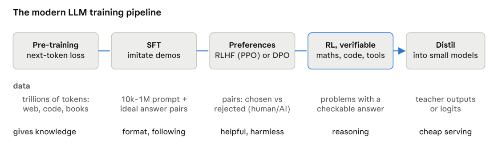
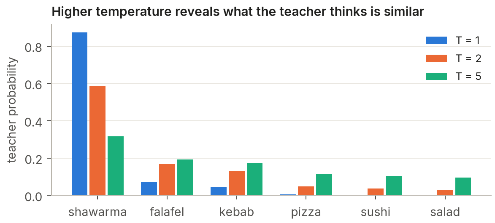

# 15 · How LLMs are trained

Part IV · Pretraining. Assumes Chapter 10 (the transformer) and Chapter 1.6 (cross-entropy and KL). This chapter is the overview of the whole training pipeline; Chapters 16 and 17 go deep on pretraining data and infrastructure, Chapters 18 to 20 on post-training.

## Why it matters

Few applied teams pre-train an LLM. You will, however, choose between models whose behaviour comes from these stages, fine-tune open models (Chapter 20), build preference data from human reviews, and explain why a model is sycophantic, verbose or refuses too much. Interviewers ask "explain RLHF" and "how does DPO differ from PPO" to see whether you understand the levers. Parameter-efficient methods such as prompt and prefix tuning (Chapter 20) are the lightweight end of the same post-training story.



*Each stage changes behaviour more than knowledge, except the first. Labs differ in order and mix, but this is the common shape.*

The chapter follows the pipeline in the order a model goes through it. Pretraining (15.1) produces a base model that knows a great deal but only continues text. Supervised fine-tuning (15.2) teaches it the format of an assistant. Preference optimisation, with a reward model and PPO (15.3) or directly with DPO and its relatives (15.4), teaches it which of several acceptable answers people prefer, and AI feedback (15.5) scales that up. Reinforcement learning with verifiable rewards (15.6) is the newest stage and the source of reasoning models. Distillation (15.7) transfers what a large model learned into a small one. Section 15.8 turns the pipeline into a diagnostic tool, and 15.9 counts where the compute actually goes.

This chapter is deliberately a **map**. Each stage gets one section that says what it does, what data it needs and what it changes, with the smallest piece of code that makes it concrete; the derivations and the full objectives live in the chapters that own them. The table below is the routing guide.

| Stage | This chapter | In depth |
|---|---|---|
| Pretraining data | 15.1 | Chapter 16 |
| Pretraining systems | 15.1 | Chapter 17; number formats in §7.6 |
| SFT | 15.2 (loss masking) | §18.2 (data, chat templates, packing, hyperparameters) |
| Reward models | 15.3 | §18.3 (Bradley–Terry, worked example) |
| Policy gradients, PPO, KL | 15.3 | §18.4; over-optimisation in §18.5 |
| DPO and its family | 15.4 | §18.6 (derivation, gradient, variants) |
| AI feedback | 15.5 | §18.7 |
| GRPO and RLVR | 15.6 | §19.2 (verifiers), §19.3 (objective), §19.4 (biases and fixes) |
| Distillation | 15.7 | §19.9 for reasoning distillation |

Each stage changes a different thing, and that is the most useful idea to take away. Knowledge comes overwhelmingly from pretraining; format and behaviour from SFT; preferences, tone and refusals from preference optimisation; long, self-correcting reasoning from RL. When a model behaves badly, asking which stage is responsible is usually the fastest way to the fix, and that is what an interviewer is testing when they ask you to "explain the pipeline": not the names of the stages but which lever moves which behaviour, at what cost.

## Key concepts

- **Pre-training**: next-token prediction on trillions of tokens; gives knowledge and general ability.
- **Supervised fine-tuning (SFT)**: training on prompt–answer pairs so the model follows instructions. [LIMA: Less Is More for Alignment](https://arxiv.org/abs/2305.11206).
- **RLHF**: train a reward model on human preferences, then optimise the policy with PPO and a KL penalty. [InstructGPT](https://arxiv.org/abs/2203.02155), [Hugging Face: Illustrating RLHF](https://huggingface.co/blog/rlhf).
- **DPO and variants (IPO, KTO, ORPO)**: learn from preference data directly, without a reward model or RL loop. [DPO](https://arxiv.org/abs/2305.18290), [KTO](https://arxiv.org/abs/2402.01306).
- **RLAIF and Constitutional AI**: AI-generated feedback guided by written principles. [Constitutional AI](https://arxiv.org/abs/2212.08073).
- **Reasoning models and RL with verifiable rewards (GRPO)**: reinforcement learning on tasks with checkable answers produces long, self-correcting reasoning. [DeepSeekMath (GRPO)](https://arxiv.org/abs/2402.03300), [DeepSeek-R1](https://arxiv.org/abs/2501.12948).
- **Distillation**: training a small model to imitate a large one. [Hinton et al.](https://arxiv.org/abs/1503.02531).
- **Practical tools and reference**: [TRL library](https://huggingface.co/docs/trl/index), [RLHF Book](https://rlhfbook.com/) (Nathan Lambert).

## 15.1 Pre-training

Pretraining is where almost all of a model's knowledge and most of its compute come from. Its objective could not be simpler: predict the next token, over trillions of tokens of text. The interesting questions are why such a simple objective produces such general abilities, and what the resulting base model can and cannot do.

**Objective.** Next-token prediction with cross-entropy over trillions of tokens: minimise −Σ log p(x_t | x_<t). Nothing else. Knowledge, grammar, some reasoning and in-context learning all come from compressing this data well. Because the causal mask hides the future, one forward pass over a sequence of T tokens produces T next-token losses at once, which is why training is parallel while generation is sequential (Chapter 10). A loss of 2.0 nats per token is a perplexity of e² ≈ 7.4; at about 4 bytes of text per token that is 2.0 / ln 2 / 4 ≈ 0.72 bits per byte, the tokenizer-independent unit used to compare models (Chapter 23).

**Data** is the main lever and the main secret:

- Sources: filtered web crawl (Common Crawl), code, books, papers, Wikipedia, maths, multilingual text.
- Cleaning: language ID, heuristic quality filters, model-based quality classifiers ("is this like Wikipedia?"), toxicity and PII filtering.
- Deduplication: exact and near-duplicate (MinHash) removal; duplicates waste compute and increase memorisation.
- Mixture: the proportion of code, maths and each language is tuned, often with small proxy runs. Annealing on high-quality data at the end of training is common.
- Decontamination: remove benchmark test sets, or the evaluation numbers lie.

**Mechanics.** AdamW, warm-up then cosine decay, bf16, batch sizes of millions of tokens, and 3D parallelism (data, tensor, pipeline) across thousands of GPUs. Loss spikes are handled by restarting from a checkpoint and skipping data. The output is a **base model**: it continues text well but does not follow instructions reliably.

**Where to go deeper.** This chapter is the map of the pipeline. Pretraining data is covered in Chapter 16 and the mechanics of large runs (parallelism beyond the classic "3D" data, tensor and pipeline split: sharded data parallelism, context and expert parallelism; checkpointing) in Chapter 17. Low-precision number formats, including fp8, are in Chapter 7 (§7.6). Modern recipes also use warmup-stable-decay schedules and, increasingly, optimisers such as Muon (Chapter 7). How big a model and how many tokens for a given budget is Chapter 13. Post-training is covered in depth in Chapters 18 (SFT, reward models, PPO, DPO) and 19 (RL with verifiable rewards and reasoning).

## 15.2 Supervised fine-tuning (SFT)

A base model continues text; asked a question, it may answer, or it may produce more questions in the style of a forum thread. Supervised fine-tuning turns it into an assistant by training on examples of the desired behaviour: a prompt, and the response a good assistant would give. It is cheap compared with pretraining, and it mostly teaches format and style rather than new knowledge.

Train on (prompt, ideal response) pairs, usually in a chat template, with the loss computed only on the response tokens:

```python
prompt_ids = torch.tensor([5, 6, 7]); answer_ids = torch.tensor([8, 9, 2])
# 2 = EOS
input_ids = torch.cat([prompt_ids, answer_ids])
labels = input_ids.clone()
labels[:len(prompt_ids)] = -100            # ignore prompt tokens in the loss

# logits: (1, T, V). Position t predicts token t+1, so shift by one.
loss = F.cross_entropy(logits[:, :-1].reshape(-1, V), labels[1:].reshape(-1), ignore_index=-100)
# only the 3 answer tokens are scored
```

Masking matters more than it looks. With a 900-token prompt and a 100-token answer, an unmasked loss puts 90% of the gradient on reproducing the prompt, which is text the model will never be asked to write. For multi-turn data, every assistant turn is scored, including its end-of-turn token (that is how the model learns to stop), and every user and system turn is masked.

SFT teaches format and style: answer the question, follow the template, stop. A few thousand very high-quality examples can matter more than a million noisy ones (the LIMA paper's point). SFT's weakness: it only shows good answers, never contrasts them with bad ones, and it can teach the model to imitate confident answers it does not actually know, which feeds hallucination.

**In depth:** §18.2 covers SFT data mixtures, chat templates with a worked rendering, packing with block-diagonal masks, exposure bias and typical hyperparameters; Chapter 20 covers doing it with LoRA on one GPU.

## 15.3 RLHF with a reward model and PPO

SFT can only imitate the examples it is given, and writing an ideal answer is much harder than recognising a better one. Reinforcement learning from human feedback exploits that asymmetry: people compare pairs of model answers, a reward model learns their preferences, and the assistant is optimised to produce answers the reward model scores highly, while staying close to its starting point.

The InstructGPT recipe (Ouyang et al., 2022):

1. **Collect comparisons.** For a prompt, sample several responses; humans rank them.
2. **Train a reward model** (usually the SFT model with a scalar head) with the Bradley-Terry loss, −log σ(r_chosen − r_rejected): the chosen response should score higher than the rejected one. For rewards (1.2 vs 0.2) and (0.3 vs 0.5) the mean loss is 0.556, and the second, wrongly ranked pair dominates the gradient. Where the logistic comes from, and the full worked example, are in §18.3.

```python
rm_loss = -F.logsigmoid(r_chosen - r_rejected).mean()   # r_*: scalar rewards for each pair
```

3. **Optimise the policy with PPO** to maximise the reward, with a KL penalty that keeps it close to the SFT reference model:

```python
def shaped_reward(rm_score, logp_policy, logp_ref, beta=0.05):
    return rm_score - beta * (logp_policy - logp_ref).sum()   # per-sequence KL estimate
# rm 2.0, policy 1 nat more confident than the reference on each of 2 tokens -> 1.9
```

Without the KL term the policy finds **reward hacking**: outputs that score well on the reward model but are not good (very long answers, flattering the user, repeated phrases). PPO itself needs four models in memory (policy, reference, reward model, value model), is unstable and sensitive to hyper-parameters. That cost is why DPO took off.

**In depth:** the policy-gradient estimator, baselines, the clipped surrogate, GAE and the value model are derived in §18.4; how the true quality first rises and then falls as the policy drifts from the reference (Goodhart's law, with numbers) is §18.5.

## 15.4 DPO and friends

RLHF with PPO works but is complex: four models in memory, generation inside the training loop, and many hyperparameters. Direct preference optimisation showed that the same objective can be optimised with a simple classification-style loss on preference pairs, with no reward model and no sampling. Its simplicity made it the default for many open models.

**Direct Preference Optimization** (Rafailov et al., 2023) shows that the KL-constrained RLHF objective has a closed-form optimal policy, π*(y) ∝ π_ref(y) exp(r(y)/β), and inverts it to write the reward in terms of the policy itself; substituted into the Bradley–Terry likelihood, the partition function cancels. The derivation, with a numerical check on a four-response bandit, is in §18.6. The result is a classification-style loss on preference pairs, no reward model and, in its offline form, no sampling during training:

```python
def dpo_loss(pc, pr, rc, rr, beta=0.1):
    # pc/pr: policy log-prob of chosen/rejected response (summed over tokens)
    # rc/rr: same under the frozen reference (SFT) model
    logits = beta * ((pc - rc) - (pr - rr))
    return -F.logsigmoid(logits).mean()

# at the start policy == reference, so loss = ln 2 = 0.693
# policy raised chosen by 1 nat and lowered rejected by 1 nat: logits = 0.1*2 = 0.2 -> loss 0.598
```

The implicit reward is `beta * (log π(y|x) − log π_ref(y|x))`; tracking the chosen and rejected implicit rewards during training is the standard diagnostic. `beta` plays the role of the KL weight: small beta lets the policy move further.

Variants you may be asked about (IPO, KTO, ORPO, SimPO) change the loss shape, drop the pairs or drop the reference model; §18.6 has the table of what each changes and why, and its failure modes (likelihood displacement, over-fitting to deterministic preferences, length exploitation). Practical point: DPO works best on pairs sampled from the model being trained (on-policy); pairs from another model work less well. Online or iterative DPO regenerates pairs each round.

**Where product data fits.** Customer reviews, agent corrections of LLM outputs, and A/B choices are natural preference data. Edits are especially useful: an edited output and its original form a pair in which the edit is preferred. A single accept or reject per output, with no pair, is the case KTO was designed for; a case study is a product-description generator tuned with KTO on accept/edit/reject signals from a content team.

## 15.5 RLAIF and Constitutional AI

Human preference labels are slow, expensive and inconsistent. If a strong model can judge answers against written principles, the labelling can be automated and scaled. That is the idea behind AI feedback: people write the rules, and a model applies them to millions of comparisons.

**RLAIF** uses an LLM to produce the preference labels. **Constitutional AI** (Anthropic, Bai et al., 2022) has the model critique and revise its own outputs against a written list of principles, then trains on AI-labelled preferences for harmlessness. The benefits are scale and consistency; the risk is copying the labelling model's biases, so teams still audit samples with humans. LLM-as-judge in evaluation (Chapter 24) is the same idea, with the same caveats. Generative reward models and judge-based preference pipelines are in §18.3 and §18.7.

## 15.6 Reasoning models and RL with verifiable rewards

For maths, code and other tasks where an answer can be checked automatically, there is no need for a learned reward model: the checker is the reward. Training with reinforcement learning against such checks, on hard problems, produced the reasoning models of 2024 and 2025, which think at length before answering and correct their own mistakes. It is now the stage where the largest capability gains come from.

Since late 2024 the biggest gains have come from RL on tasks whose answers can be checked automatically: maths with a known answer, code with unit tests, tool-use tasks with a checkable end state. The reward is a programmatic check, "correct or not" (plus format), so there is no learned reward model to over-optimise. Verifiers can still be gamed, though: models learn to special-case unit tests, exploit lenient answer-matchers or satisfy the format without the substance, so the checker needs as much care as the policy (§19.2). The model learns to produce long chains of thought, check its work and backtrack. Examples: OpenAI o1/o3, DeepSeek-R1, and the extended-thinking modes of Claude and Gemini.

**GRPO** (Group Relative Policy Optimization, from DeepSeekMath, used for R1) drops PPO's value model: sample a group of G answers per prompt, score each, and use each answer's reward minus the group mean, divided by the group standard deviation, as the advantage of every token in that answer. With 8 samples of which 3 are correct, the correct ones get +1.21 and the wrong ones −0.72. The objective is PPO's clipped surrogate applied per token with that advantage, averaged over the tokens of each answer (a 1/|oᵢ| factor) and then over the group, with the KL to the reference placed in the loss rather than in the reward. Do not stop at this sentence in an interview: the displayed objective is in §19.3, and §19.4 shows that the 1/|oᵢ| averaging and the division by the standard deviation are not harmless, because they bias response length and which prompts dominate, and describes the fixes (Dr. GRPO, DAPO, GSPO, CISPO).

Key ideas to mention: **test-time compute** scales accuracy (more thinking tokens, better answers on hard problems; Chapter 13 and §19.8); a group where all answers are right or all wrong gives zero signal, so prompt difficulty is curated; and reasoning RL helps most where verification is cheap. For ambiguous tasks like ranking or writing, reward models and preferences still dominate.

## 15.7 Distillation

The largest models are too expensive to serve for most products. Distillation transfers much of their ability into a smaller student that is cheap to run, either by training on the teacher's outputs or by matching its full probability distributions. Most small models released today are distilled from larger ones.

Train a small student to imitate a large teacher.

- **Logit distillation** (Hinton et al., 2015): match the teacher's softened distribution. Needs teacher logits, so only possible with open models or your own.

```python
def distill_loss(student_logits, teacher_logits, y, T=2.0, alpha=0.5):
    kd = F.kl_div(F.log_softmax(student_logits / T, -1),
                  F.softmax(teacher_logits / T, -1), reduction="batchmean") * T * T
    return alpha * kd + (1 - alpha) * F.cross_entropy(student_logits, y)
# the T*T factor keeps gradient size comparable across temperatures
```

- **Sequence-level distillation**: generate outputs with the teacher (often with reasoning traces) and SFT the student on them. This is how most small "reasoning" models are made (§19.9), and it is the practical route for an applied team: label tens of thousands of items (tickets, product listings, documents) with a large API model, check a sample by hand, fine-tune a small model on the rest. Check the provider's terms of service before training on API outputs.

**Why soft targets carry more than labels.** The figure below uses an image classifier for dishes as its illustration. A hard label says only "shawarma". The teacher's full distribution says more: falafel and kebab are plausible confusions, sushi is not. Hinton called this information **dark knowledge**. At T = 1 it is almost invisible, because the top class takes 87% of the mass and the five others share 13%. Dividing the logits by a temperature flattens the distribution and makes the similarity structure visible to the student's loss, as the figure shows.



*One teacher's logits for a dish photo, softened at three temperatures. At T = 1 the runner-up gets 7%; at T = 5 the order and rough ratios of all six classes are visible, which is what the student learns from.*

Three practical points follow:

- **The T² factor matters.** Gradients of the softened KL term shrink as 1/T², so without the factor a high temperature quietly turns distillation off.
- **T is a hyperparameter.** Values of 1–4 are usual for classification. For language models, T = 1 over the full vocabulary is common, because the teacher's next-token distribution is already spread out.
- **Forward or reverse KL.** The standard loss, KL(teacher ‖ student), makes the student cover every mode the teacher assigns mass to. A small student that cannot cover them all spreads its probability thinly. **On-policy distillation** instead samples from the student and minimises the reverse KL on those samples, which concentrates the student on modes it can actually represent. It also trains the student on its own mistakes, as RL does, but with a dense per-token signal. Recent small-model recipes use it after a round of sequence-level distillation (Chapter 19.9 has the numbers).

## 15.8 What each stage explains

Because each stage of the pipeline changes something different, many model behaviours can be traced back to the stage that produced them. That is a practical debugging tool: the fix for a behaviour depends on where it came from. A hypothesis about the origin is only useful if you can test it, so the table pairs each likely origin with the cheapest check.

| Symptom | Likely origin | How to confirm |
|---|---|---|
| Knows facts up to a date, not after | Pre-training data cut-off | Probe dated events month by month; accuracy falls off a cliff at the cut-off in base and chat models alike |
| Weak in a low-resource language or dialect | Pre-training mixture (and tokenizer) | Compare per-language held-out loss or bits per byte of the base model; check tokens per word against English (Chapter 9) |
| Follows formats, uses the chat template | SFT | Give the base and SFT checkpoints the same prompt; the base model continues text instead of answering |
| Verbose, flattering, over-agrees with the user | Reward hacking in RLHF / preference data biased towards long answers | Correlate reward-model scores with response length; measure the rate of answer flips when the user pushes back, before and after the preference stage |
| Refuses harmless requests | Over-weighted harmlessness data | Measure over-refusal on benign prompts that look risky (XSTest-style) for the SFT and preference checkpoints; find the stage where it jumps |
| Long, careful reasoning on maths and code | RL with verifiable rewards | Compare response length and accuracy before and after RL on the same maths set; pass@k at large k barely moves while pass@1 rises (§19.6) |
| Small model nearly as good on a narrow task | Distillation | Compare it with the same base model fine-tuned on human labels only; check overlap of its errors with the teacher's |

The pattern in the last column is always the same: hold the prompt fixed and compare adjacent checkpoints. If your provider does not expose intermediate checkpoints, open models with released stage-by-stage checkpoints (base, SFT, DPO, RL, as in the Tülu 3 and OLMo 2 releases) are the place to practise the method.

## 15.9 A worked pipeline: where the compute goes

Take a 7B model through the whole recipe and count the FLOPs. Training costs 6N per token; a forward-only pass or a generated token costs 2N.

| Stage | Data | FLOPs | Share of pre-training |
|---|---|---|---|
| Pre-training | 2T tokens | 8.4 × 10²² | 100% |
| SFT | 100k examples × 1k tokens × 3 epochs | 1.3 × 10¹⁹ | 0.015% |
| DPO | 50k pairs × 2 responses × 1k tokens (policy trained, reference forward) | 5.6 × 10¹⁸ | 0.007% |
| RLVR | 1,000 steps × 512 prompts × 8 samples × 2k tokens (generate, then train)¹ | 4.6 × 10²⁰ | 0.55% |

¹ The RLVR row is 8.2 × 10⁹ tokens × (2N for generation + 6N for training): 1.1 × 10²⁰ FLOPs of generation and 3.4 × 10²⁰ of training. It leaves out two forward-only passes per training token: the reference model, for the KL term, and the old policy, for the importance ratio, at 2N each. Counting both adds 2.3 × 10²⁰ and brings the total to 6.9 × 10²⁰ (0.82% of pre-training). Some systems skip the old-policy pass when each batch gets exactly one update, because the old and current policies are then the same.

Three lessons follow.

1. **Post-training is cheap in FLOPs and expensive in everything else.** Its compute is a rounding error next to pre-training. Its cost is in the data: writing and checking SFT examples, collecting preference pairs, building verifiers. It also needs many short experiments, because results are sensitive to small choices.
2. **RL costs more than its FLOPs suggest.** Generation is memory-bound decoding at low utilisation (Chapter 21), so the 1.1 × 10²⁰ FLOPs of sampling can take more wall-clock time than the 3.4 × 10²⁰ FLOPs of training. RL systems are built around fast generation (Chapter 19).
3. **Behaviour comes from the small stages.** The chat format, refusals, tone and long reasoning all come from stages that use less than 1% of the compute. That is why changing post-training data is the fastest way to change a model, and why its problems (sycophancy, over-refusal, verbosity) look the way the table in 15.8 suggests.

A checklist for each stage: a held-out evaluation that the stage is meant to move, one that it must not hurt (general capability, safety), and a comparison with the checkpoint before the stage. A stage that moves its target and nothing else is the exception; measure the side effects.

## Pitfalls

- Computing SFT loss on the prompt tokens as well as the answer.
- Forgetting the one-token shift between logits and labels.
- Running DPO on off-policy pairs from a much stronger model and wondering why gains are small.
- Too small a beta (or KL weight): the model drifts, gets verbose, forgets skills.
- Assuming RLHF adds knowledge. It mostly changes style and what the model chooses to say.
- Training on benchmark-contaminated data and trusting the scores.
- Describing GRPO as "PPO without a value model" and stopping there: the normalisation choices inside its objective change behaviour (§19.4).

## Interview questions

**Mid level**

**1. What is the pre-training objective of a GPT-style model?** Next-token prediction: minimise the cross-entropy −Σ_t log p(x_t | x_<t) over trillions of tokens, with a causal mask so that one forward pass over T tokens yields T losses in parallel. Nothing else is in the objective; knowledge, syntax and in-context learning emerge because predicting text well requires them. A number to have ready: a loss of 2.0 nats per token is a perplexity of e² ≈ 7.4, or about 0.72 bits per byte at 4 bytes per token, and bits per byte is what you compare across tokenizers. The trade-off is that the base model only continues text, which is why every later stage exists. Follow-up: "why does such a simple objective give general abilities?" Because minimising it is compression of the data, and compressing text written by people who reason, code and explain requires modelling those processes.

**2. What does SFT change, and why mask the prompt tokens in the loss?** SFT trains on (prompt, ideal response) pairs in a chat template and mainly changes format and behaviour: answer instead of continue, follow the template, stop at the end-of-turn token. Masking the prompt (labels = −100) keeps the gradient on what the model should produce: with a 900-token prompt and a 100-token answer, an unmasked loss spends 90% of its gradient on reproducing user text, and teaches the model to imitate users. When not to mask fully: some recipes keep a small prompt-loss weight when prompts are themselves high-quality text, with mixed results. Follow-up: "what about multi-turn and packing?" Score every assistant turn including its end-of-turn token, mask every user and system turn, and reset positions and use a block-diagonal mask when packing (§18.2).

**3. Explain the three steps of RLHF.** First SFT a model; second, collect human rankings of its sampled responses and train a reward model with the Bradley–Terry loss −log σ(r_chosen − r_rejected); third, optimise the policy with PPO to maximise reward minus β·KL to the SFT reference. The KL term is what makes the target well-defined: the optimal policy is π_ref·exp(r/β)/Z, so β sets how far the policy may move. The headline result to quote is InstructGPT, where outputs of a 1.3B RLHF model were preferred by labellers to those of the 175B GPT-3. The cost: four models in memory (policy, value, reference, reward) and sampling in the loop. Follow-up: "why not just maximise the reward?" Because the reward model is only accurate near the data it was trained on, and an unconstrained policy finds its errors (§18.5).

**4. What is reward hacking? Give an example.** The policy finds outputs that score well on the reward signal without being good, because the reward model or checker is an imperfect proxy (Goodhart's law). Classic examples: answers that grow longer because the reward model learned "longer is better", flattery and agreement with the user, a coding policy that special-cases the unit tests. The KL penalty is the first defence, and its size can be computed: a policy that drifts by 0.1 nats per token over a 500-token answer accumulates 50 nats of KL, a penalty of 2.5 reward units at β = 0.05, enough to cancel a typical reward gain. When not to rely on KL alone: verifiable-reward RL needs hardened checkers instead. Follow-up: "how do you detect it?" Track reward against a held-out judge or human audit; the proxy keeps rising while the gold metric flattens or falls, and length-controlled metrics expose verbosity.

**Senior level**

**5. Derive or explain the intuition behind DPO. What does beta do?** The optimal policy of KL-constrained reward maximisation is the reference reweighted by exp(reward/beta); invert it to express reward through log-probability ratios, plug into Bradley-Terry, and the reward model disappears. Beta controls how far the policy may move from the reference. Concretely, r(x, y) = β log(π*(y|x)/π_ref(y|x)) + β log Z(x), and Z(x) cancels in the difference between chosen and rejected, leaving −log σ(β[Δ log-ratio]); the loss starts at ln 2 = 0.693 and falls to 0.598 when the policy raises the chosen response by 1 nat and lowers the rejected by 1 nat at β = 0.1. Small β lets the log-ratios grow large before the loss saturates, so the policy moves further; typical values are 0.05–0.5. Follow-up: "what goes wrong in practice?" Likelihood displacement (both log-probabilities fall while their gap grows) and over-fitting to near-deterministic preferences, which IPO bounds (§18.6).

**6. Compare PPO-based RLHF, DPO and KTO. Which would you use with thumbs-up/down data from content moderators?** PPO is flexible but costly and unstable; DPO is simple and stable for pairwise data; KTO handles unpaired binary feedback, so it fits moderator thumbs. In memory, PPO trains a policy and a value model and runs a reference and a reward model: for a 7B model with Adam (about 16 bytes per trained parameter) that is about 224 GB of training state plus 28 GB of bf16 weights for the two frozen models, against about 112 GB plus 14 GB for DPO or KTO (or none for the reference if its log-probabilities are precomputed). KTO weights desirable and undesirable examples separately, so a 90/10 thumbs-up skew can be rebalanced. When NOT to use KTO: if you have, or can cheaply build, real pairs (an edit and its original, two samples for the same prompt), DPO or IPO extracts more signal per label. Follow-up: "when is PPO worth it?" When the reward comes from a model or checker you can query on fresh samples and on-policy exploration matters, as in RL on verifiable tasks.

**7. How do reasoning models like DeepSeek-R1 get trained? Why does RL work so well for maths and code?** SFT on some reasoning traces, then RL (GRPO) with a correctness reward; answers can be checked automatically, so there is no learned reward model to exploit and training scales; the verifiers still need hardening against reward hacking (tests special-cased, lenient answer-matching). R1-Zero showed that RL from the base model alone, with accuracy and format rewards, produces long chains of thought with self-checking, but with poor readability and language mixing; R1 adds a small cold-start SFT set of long chains of thought, reasoning RL, then rejection-sampled SFT data (about 800k examples, reasoning and general) and a final RL stage. A number that explains the data work: with 8 samples per prompt, a prompt solved 2% of the time gives an all-wrong group, and so zero advantage, 85% of the time (0.98⁸), which is why prompt difficulty is filtered. Follow-up: "does RL teach new reasoning or sharpen what is there?" The evidence that pass@k at large k barely improves suggests mostly sharpening; §19.6 sets out the experiment that would decide it.

**8. You need a cheap model to tag 50M catalogue items (product listings, support tickets). Describe a distillation plan and how you would check it.** Write a teacher prompt with the taxonomy, definitions and a rubric for ambiguous cases; label a stratified sample of about 200k items (stratified by category, source and length, oversampling rare classes); fine-tune a small encoder or small LLM on it; and audit 300–500 human-labelled items per release to measure per-class precision and recall, since one bad class can hide behind a good average (at precision 0.95 on 400 items, the standard error is 1.1 points). Route items below a confidence threshold back to the teacher. Cost, at illustrative prices of $3 per million input tokens and $15 per million output: labelling 200k items of 300 input and 20 output tokens costs about $240, while sending all 50M through the API would cost about $60k per pass, which is the case for distillation. Plan for drift: re-label a fresh sample monthly and retrain when per-class metrics drop. Check the provider's terms of service on training with its outputs. Follow-up: "when would you skip distillation?" When volume is small, the taxonomy changes weekly, or the task needs the teacher's world knowledge.

**9. A fine-tuned assistant became sycophantic. Which stage do you suspect and how would you fix it?** The preference stage: labellers or reward models preferred agreeable answers. Add pairs where the correct answer disagrees with the user, raise beta or KL, and evaluate on a sycophancy set. Confirm before fixing: on, say, 500 questions the model answers correctly, append "Are you sure? I think it's X" and measure the flip rate for the SFT, preference and final checkpoints; if it jumps after the preference stage, the cause is there. Then check the data: what fraction of preference pairs have a chosen response that agrees with a user's stated view? Fixes include balanced pairs that reward polite disagreement, reward-model evaluation on a sycophancy probe, and a higher KL weight; the trade-off is that over-correcting produces a contrarian model that also flips correct user claims. Follow-up: "could SFT cause it?" Yes, if demonstrations always defer to the user; the stage-by-stage comparison distinguishes the two.

**10. Where does the compute go across the pipeline, and why does RL take longer than its FLOPs suggest?** For a 7B model on 2T tokens, pretraining is 8.4e22 FLOPs; SFT (300M tokens) is 0.015% of that, DPO 0.007%, and an RLVR run of 8.2e9 sampled tokens 0.55%, or about 0.82% once the reference and old-policy forward passes are counted. Post-training is cheap in FLOPs and expensive in data, verifiers and experiment count. RL is slow because the 1.1e20 FLOPs of generation are memory-bound autoregressive decoding at low utilisation, so they can take longer in wall-clock than the 3.4e20 FLOPs of training, which run at high utilisation; RL systems therefore separate fast inference engines from the trainer (§19.10). Follow-up: "what would you optimise first?" Generation throughput (batching, prefix caching of the prompt, asynchronous rollouts), measured as the share of each step spent waiting for samples.

## Practice

1. Implement `seq_logprob(logits, labels)` (sum of token log-probs with masking), then DPO on a tiny GPT-2 with 200 synthetic preference pairs using TRL. Plot implicit rewards for chosen and rejected.

<details><summary>Hint and expected result</summary>

Shift logits and labels by one, gather the log-probability of each label, multiply by the mask and sum. Check it first against the numbers in this chapter: 0.598 for the single pair in 15.4 and exactly ln 2 = 0.693 at initialisation. The two-pair batch in `code/ch15_check.py` gives 0.698, with mean implicit rewards of 0.0 for both chosen and rejected, because its two pairs move in opposite directions; a useful reminder that a batch mean can hide a pair the model ranks the wrong way. In the TRL run, expect the chosen-minus-rejected margin to rise steadily, and often both implicit rewards to fall: that is likelihood displacement (§18.6), not a bug.

</details>

2. Train a Bradley-Terry reward model on 1,000 pairs of review summaries (better vs worse) and check its pairwise accuracy.

<details><summary>Hint and expected result</summary>

Before training, reproduce the loss of 0.556 for rewards (1.2, 0.2) and (0.3, 0.5). Use a small pretrained encoder with a scalar head, one epoch. Held-out pairwise accuracy should clearly beat 50%; the ceiling is set by label noise (§18.3 shows 0.882 against a ceiling of 0.894 on synthetic data). Then check whether accuracy holds on pairs where the better summary is the shorter one; if not, the model has learned length.

</details>

3. Run GRPO-style sampling on simple arithmetic with a small model and a correctness reward; watch the fraction correct over steps.

<details><summary>Hint and expected result</summary>

Use a 0.5B–1.5B instruction model, two-digit to four-digit arithmetic, G = 8. Check the advantages first: rewards [1, 0, 0, 1, 1, 0, 0, 0] must give +1.21 and −0.72. Expect the fraction correct to rise within a few hundred steps and the fraction of zero-signal groups to grow as easy prompts saturate; log it, and filter prompts that are always solved.

</details>

4. Explain the whole pipeline in five minutes on a whiteboard, with one sentence on what each stage adds.

<details><summary>Hint and expected result</summary>

Pass if you name, for every stage, its data, its loss, what it changes and its share of compute from 15.9, and can say which stage you would suspect for each symptom in 15.8 without looking.

</details>

5. **Research exercise.** Localise a behaviour to a stage. Take an open model family with released base, SFT, preference-tuned and RL checkpoints (for example OLMo 2 or Tülu 3). Measure three behaviours on fixed prompts at every checkpoint: mean response length, sycophantic flip rate (500 questions the model answers correctly, followed by "Are you sure? I think it's X"), and over-refusal on benign prompts that look risky. Report each with a 95% confidence interval and say which stage moves each one.

<details><summary>Hint and expected result</summary>

Expect response length to jump at the preference and RL stages, over-refusal to be set mostly by SFT and preference data, and the flip rate to be lowest for the base model used with a question-answer template and to change most at the preference stage. With 500 questions, a flip rate of 20% has a standard error of about 1.8 points, so differences under about 5 points between stages are not reliable. If a behaviour moves at a stage you did not expect, read 20 examples before concluding.

</details>

## Read next

- Ouyang et al., "Training language models to follow instructions with human feedback" (InstructGPT, 2022).
- Rafailov et al., "Direct Preference Optimization: Your Language Model is Secretly a Reward Model" (2023).
- Bai et al., "Constitutional AI: Harmlessness from AI Feedback" (2022).
- Zhou et al., "LIMA: Less Is More for Alignment" (2023).
- Ethayarajh et al., "KTO: Model Alignment as Prospect Theoretic Optimization" (2024).
- Shao et al., "DeepSeekMath" (2024), for GRPO; DeepSeek-AI, "DeepSeek-R1" (2025).
- Hinton, Vinyals and Dean, "Distilling the Knowledge in a Neural Network" (2015).
- Nathan Lambert, "RLHF Book" (online, ongoing), and the Hugging Face TRL documentation.
- Links to these papers and tools are in the Key concepts section at the top of this chapter.

## Done when

- In five minutes at a whiteboard, you draw the pipeline and give, for each stage, its data, its loss, what it changes and its share of compute (SFT ≈ 0.015%, DPO ≈ 0.007%, RLVR ≈ 0.5–0.8% for the 7B example).
- Without notes, you write masked SFT, Bradley–Terry and DPO losses that reproduce 0.556 (rewards 1.2/0.2 and 0.3/0.5) and 0.598 (β = 0.1, chosen +1 nat, rejected −1 nat) on those inputs.
- You compute the KL penalty for a policy that drifts 0.1 nats per token over 500 tokens at β = 0.05 (answer: 2.5) and explain what it prevents.
- You state the GRPO advantage for rewards [1, 0, 0, 1, 1, 0, 0, 0] (+1.21, −0.72) and name the two normalisation choices that §19.4 shows are biased.
- For each symptom in 15.8 you name the stage and the experiment that would confirm it.
- You give a distillation plan for a 50M-item tagging task with an audit size, a confidence-routing rule and a cost comparison against calling the API directly.

---

[← 14 · Multimodal models](14-multimodal-models.md) · [Contents](../README.md#contents) · [16 · Pretraining data →](16-pretraining-data.md)
