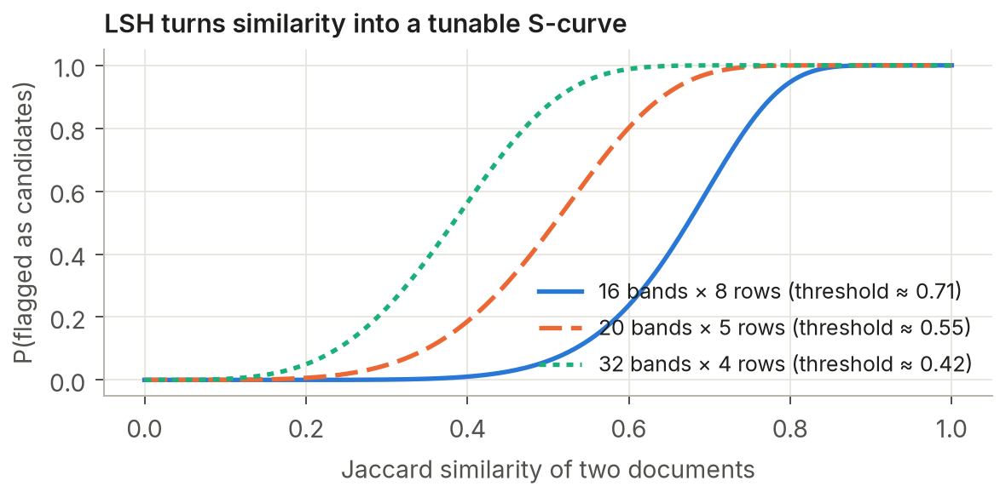

# 16 · Pretraining data

Part IV · Pretraining. Assumes Chapter 15 (the training pipeline in outline) and Chapter 13 (scaling laws, repeated data). Chapter 17 covers the training run that consumes this data; Chapter 23 covers contamination from the evaluation side.

## Why it matters

Architectures converge; data does not. Model reports from the last few years agree that the largest differences between models of the same size come from what they were trained on: how the web was filtered, how duplicates were removed, how much code and maths went in, and what was saved for the end of training. Data work is also where a research scientist's methodology is tested hardest, because every choice has to be justified by small-scale ablations that predict large-scale behaviour. This chapter covers the pipeline from raw crawl to training mixture, the techniques behind it, and how to run data experiments that mean something.

Numbers in this chapter come from `code/ch16_check.py` (seconds on a laptop).

## Key concepts

- **Common Crawl**: the public web crawl most open pretraining corpora start from. [Common Crawl](https://commoncrawl.org/).
- **Heuristic filtering**: rules on length, symbols, repetition and stopwords. [Gopher (MassiveText rules)](https://arxiv.org/abs/2112.11446), [C4](https://arxiv.org/abs/1910.10683).
- **Model-based quality filtering**: classifiers trained to prefer high-quality or educational text. [FineWeb and FineWeb-Edu](https://arxiv.org/abs/2406.17557), [DCLM](https://arxiv.org/abs/2406.11794).
- **Deduplication**: exact, MinHash-based near-duplicate and substring deduplication. [Lee et al.](https://arxiv.org/abs/2107.06499).
- **Decontamination**: removing evaluation data from training data.
- **Data mixtures**: how much of each domain, and how to choose. [DoReMi](https://arxiv.org/abs/2305.10429).
- **Annealing and mid-training**: high-quality data concentrated in the final learning-rate decay. [OLMo 2](https://arxiv.org/abs/2501.00656).
- **Synthetic data**: rephrased, generated or distilled text. [Rephrasing the Web (WRAP)](https://arxiv.org/abs/2401.16380), [Textbooks are all you need](https://arxiv.org/abs/2306.11644).
- **Open corpora and tooling**: [Dolma](https://arxiv.org/abs/2402.00159), [datatrove](https://github.com/huggingface/datatrove).

## 16.1 Where the tokens come from

| Source | Role | Issues |
|---|---|---|
| Web crawl (Common Crawl snapshots) | Bulk of tokens; breadth | Boilerplate, spam, duplicates, toxicity, PII; uneven language coverage |
| Code (public repositories) | Code ability; also helps reasoning | Licences, generated and duplicated files, secrets in code |
| Maths and science (papers, textbooks, maths web pages) | Reasoning, notation | LaTeX extraction quality; small volume |
| Books | Long-range coherence, knowledge | Copyright; limited open supply |
| Encyclopedic and reference | Factual density | Small; easy to over-weight |
| Multilingual web | Non-English ability | Low-resource languages are scarce and noisy |
| Synthetic data | Targeted skills, rephrased quality | Distribution narrowing, inherited errors |

**Volumes.** Open, filtered English web corpora are in the 1–15 trillion token range: FineWeb is about 15T tokens from 96 Common Crawl snapshots, and its educational subset, FineWeb-Edu, is about 1.3T. Frontier models are reported to train on 15–40T tokens or more, which already means repeating the best sources (Chapter 13) and adding synthetic data.

**Storage.** 15T tokens as token IDs is 60 TB as 32-bit integers, 30 TB as 16-bit (if the vocabulary has under 65,536 entries). Data is pre-tokenised, shuffled and sharded so thousands of GPUs can read it at full speed.

## 16.2 The pipeline

A typical web pipeline, cheapest steps first so expensive steps see less data:

1. **URL filtering**: block lists for adult, spam and malware domains.
2. **Text extraction** from HTML (trafilatura-style extractors). Extraction quality alone changes downstream results noticeably; extracting from raw HTML beats using the crawl's pre-extracted text.
3. **Language identification** (a fastText language classifier), keep documents above a confidence threshold.
4. **Heuristic filters** (16.3).
5. **Deduplication** (16.5).
6. **Model-based quality filtering** (16.4).
7. **PII removal** (emails, phone numbers, IP addresses) and toxicity filtering.
8. **Decontamination** against evaluation sets (16.6).
9. **Tokenisation, shuffling and sharding**, with per-source metadata kept so mixtures can be re-weighted later.

Every step is an experiment: change one, train a small model, compare. Open pipelines (FineWeb's datatrove code, Dolma's toolkit, DCLM's baselines) document their ablations, and reading them is the fastest way to learn which steps matter.

## 16.3 Heuristic filters

Simple statistics remove most junk. Rules in the spirit of Gopher and C4: minimum length, mean word length within a range, low symbol ratio, at least a few common stopwords (real prose has them), and a low fraction of repeated n-grams.

```python
def keep(h):
    return h["words"] >= 30 and 3 <= h["mean_word_len"] <= 10 and h["symbol_ratio"] < 0.1 \
        and h["stopwords"] >= 2 and h["dup_3gram_frac"] < 0.3
```

On five toy documents the rules keep the news paragraph and its near-duplicate, drop the navigation boilerplate (symbol ratio 0.68, no stopwords) and the keyword spam (38% of trigrams repeated), and also drop a short Python function: prose rules are wrong for code. Every domain needs its own filters, and every rule removes some good data along with the bad. Measure what each rule removes by sampling and reading, not only by its effect on benchmarks.

## 16.4 Model-based quality filtering

Heuristics catch junk; classifiers rank the rest. Two well-documented designs:

- **DCLM**: a fastText classifier on word n-grams, trained to separate a high-quality reference set (instruction-style data and well-upvoted explanatory answers) from random web text. Keeping roughly the top 10% of documents by score gave a large improvement over heuristic filtering alone at equal tokens.
- **FineWeb-Edu**: a large LLM rated the educational value of a few hundred thousand web pages on a 0–5 scale; a small classifier trained on those ratings scored all of FineWeb, and keeping pages scoring 3 or more gave a 1.3T-token subset with much better knowledge and reasoning benchmarks for its size.

```python
vec = HashingVectorizer(ngram_range=(1, 2), n_features=2**16, alternate_sign=False)
clf = LogisticRegression(C=10).fit(vec.transform(good + bad), [1] * len(good) + [0] * len(bad))
# "The report describes how rainfall and groundwater use changed..."  -> 0.58
# "free deals click here subscribe now best price"                     -> 0.20
```

**Costs and risks.** A classifier trained on one notion of quality narrows the distribution: aggressive educational filtering improves knowledge benchmarks but can hurt conversational, creative or dialect-rich text, and it can encode biases (some topics, regions or registers score lower). Common practice: keep several quality buckets, mix the top buckets with some of the middle, and check performance by domain and language, not just averages.

## 16.5 Deduplication

Duplicates waste compute, encourage memorisation (including of personal data) and inflate benchmark scores when test items are duplicated in the data. Three levels:

- **Exact**: hash each document (or each line or paragraph) and keep one copy.
- **Near-duplicate (MinHash + LSH)**: documents that differ by a few words (templates, scraped copies with ads).
- **Substring**: remove long repeated spans (for example 50+ tokens) across documents with suffix arrays (Lee et al., 2021), catching licence text, boilerplate and quoted passages.

**MinHash** estimates the Jaccard similarity of two documents' sets of word n-grams ("shingles") without comparing the sets. Hash every shingle with n different hash functions and keep the minimum per function; the fraction of positions where two signatures agree estimates the Jaccard similarity. For the article and its one-word variant, the true Jaccard similarity of 5-word shingles is 0.818 and a 128-hash signature estimates 0.852; against the spam page it is 0.000.

**Locality-sensitive hashing** avoids comparing all pairs. Split each signature into b bands of r values; two documents become candidates if any band matches exactly. The probability is 1 − (1 − sʳ)ᵇ, an S-curve whose threshold you set with b and r:

| Jaccard similarity | 16 bands × 8 rows | 20 bands × 5 rows |
|---|---|---|
| 0.5 | 0.061 | 0.470 |
| 0.7 | 0.613 | 0.975 |
| 0.8 | 0.947 | 1.000 |
| 0.9 | 1.000 | 1.000 |

16 × 8 targets near-duplicates above about 0.75; 20 × 5 is looser and catches more pairs (and more false positives). The article pair matched in 5 of 16 bands, so it became a candidate. Candidates are then clustered (connected components) and one document per cluster is kept.



*Probability that two documents become LSH candidates as a function of their Jaccard similarity, for three band/row settings with 128 or 100 hashes. More rows per band push the threshold right and make the curve steeper; more bands pull it left.*

**Choosing b and r.** The threshold sits near (1/b)^(1/r). Pick it slightly below the similarity you want to catch, because pairs just under the threshold are still sometimes caught and pairs just over it are sometimes missed. False positives cost only a verification step (compute the actual Jaccard similarity of each candidate pair); false negatives leave duplicates in the data. FineWeb, for example, used 112 hashes split into 14 bands of 8 rows (threshold about 0.72) on 5-gram shingles, aiming at pairs at least 75% similar. At this scale the bottleneck is no longer the hashing but the connected-components step over billions of candidate edges, which needs a distributed union-find.

**How much to deduplicate** is itself an empirical question. FineWeb found that deduplicating each crawl snapshot separately worked better than deduplicating globally across all snapshots: global deduplication removed many good documents that recur across years and left a higher share of low-quality unique pages. Deduplication interacts with quality filtering and with how much repetition the run can afford.

## 16.6 Decontamination

If benchmark questions are in the training data, benchmark scores measure memory. Standard practice is n-gram overlap: flag training documents that share any long n-gram (often 13 words) with a test item, then remove them or the overlapping span.

```python
len(ngrams(benchmark_item) & ngrams(copied_web_page))   # 16 shared 13-grams -> flagged
len(ngrams(benchmark_item) & ngrams(paraphrase))        # 0 -> missed
```

N-gram matching misses paraphrases, translations and solutions posted in a different format. Stronger checks use embedding similarity or an LLM judge on candidate pairs. Contamination can also arrive later, through synthetic data generated by a model that saw the test set. Chapter 23 covers how to detect contamination in a trained model when you cannot inspect its data.

## 16.7 Data mixtures

A mixture assigns a sampling weight to each source. Natural proportions (by size) let the web dominate; small, valuable sources (maths, books, low-resource languages) would barely appear. **Temperature sampling** with p_i ∝ n_i^(1/T) flattens the distribution:

| Domain (billions of tokens) | T = 1 | T = 2 | T = 5 |
|---|---|---|---|
| English web (10,000) | 75.8% | 49.9% | 31.0% |
| Other-language web (2,000) | 15.2% | 22.3% | 22.5% |
| Code (800) | 6.1% | 14.1% | 18.7% |
| Maths (100) | 0.8% | 5.0% | 12.4% |
| Books (300) | 2.3% | 8.6% | 15.4% |

Upsampling has a price: at T = 2 a 15T-token run would see the maths data 7.5 times, past the point where repetition stops helping (Chapter 13). Mixtures are designed against both targets: enough of each skill, not too many epochs of any source.


*Effective tokens from repeating 100B unique tokens, using the data-constrained scaling fit of Muennighoff et al. (2023), where repeated tokens decay in value with a characteristic scale of about 15 epochs. Four epochs are worth nearly as much as fresh data; 16 epochs are worth about two-thirds of what they cost.*

The fit gives a usable rule. Up to about four epochs, repeating good data costs almost nothing. Beyond that, each extra epoch adds less, and past roughly 40 epochs it adds almost nothing. The maths data in the T = 2 mixture, seen 7.5 times in a 15T run, gives about 630B effective tokens for the 750B it costs: acceptable. At T = 5 it would be seen 18.6 times and the waste would be large. This is why labs extend scarce domains with rephrased and synthetic data (16.9) rather than repeating them.

**Choosing weights.**

- **Ablations at small scale**: train proxy models (hundreds of millions to a few billion parameters, tens of billions of tokens) on candidate mixtures and compare on a broad evaluation suite.
- **Learned weights (DoReMi)**: train a small reference model, then a small proxy that up-weights domains where it lags the reference most; use the proxy's average weights for the large run.
- **Mixing laws**: fit how the loss on each domain depends on the mixture from a few small runs, then optimise the mixture by prediction.
- **Targets matter**: a mixture optimised for average benchmark score may hurt long-tail abilities. Track per-domain held-out loss as well as benchmarks.

## 16.8 Annealing and mid-training

The end of training has outsized influence: as the learning rate decays, the model consolidates whatever it is seeing. Current recipes exploit this:

- **Annealing**: in the final decay (the last few percent of tokens, often the decay phase of a WSD schedule, Chapter 7), switch to a higher-quality mixture: filtered maths, code, curated web, instruction-like data, textbooks. Small anneal experiments are also a cheap way to measure the value of a new data source: anneal a checkpoint with and without it and compare.
- **Mid-training**: a distinct phase between pretraining and post-training, with its own mixture and objectives: long-context extension (training on long documents while raising the RoPE base, Chapter 10), reasoning traces, tool-use formats, domain data. It blurs the line with post-training, deliberately: post-training (Chapters 18–19) works better when mid-training has already made the target behaviours likely.

## 16.9 Synthetic data

Synthetic data now enters at every stage.

- **Rephrasing**: rewrite web pages in a cleaner style (encyclopedic, question–answer) with a smaller model. Mixing rephrased and real text trains faster at equal tokens than real text alone, and stretches limited high-quality data.
- **Generated textbooks and exercises**: the phi series showed small models trained heavily on synthetic "textbook" data can be strong on reasoning benchmarks; how well this transfers to broad, real-world use is debated.
- **Targeted data**: maths problems with verified solutions, code with tests, translations for low-resource languages.

Risks: **narrowing** (generators are less diverse than the web), **error inheritance** (the generator's mistakes become facts), **contamination** (generators that saw test sets reproduce them), and, when models are trained repeatedly on their own outputs without fresh data, **model collapse**: the tails of the distribution disappear. Practical rules: keep real data in the mix, filter synthetic data as strictly as web data, verify whatever can be verified, and generate from diverse prompts and seeds.

## 16.10 Running data experiments

Data decisions are only as good as the experiments behind them.

- **Proxy scale**: small models can rank data choices reliably if trained on enough tokens; DCLM showed rankings at around 400M–1B parameters mostly held at 7B. Check rank agreement between two small scales before trusting either.
- **Evaluations that move at small scale**: many benchmarks sit at chance for small models. Use evaluations with continuous scores (log-likelihood of the correct answer, cloze-style formats) and per-domain held-out loss.
- **Noise floor**: train the same configuration with 2–3 seeds (or data orders) to know which differences are real.
- **One change at a time**, matched tokens, matched schedule.
- **Read the data**: sample 100 documents from what a filter keeps and from what it removes. Many filter bugs are obvious to a human in five minutes.

**Legal and ethical constraints** shape what can be used: licences, website terms and robots.txt opt-outs (increasingly restrictive for AI crawlers), copyright litigation over books and news, personal data regulation. Research scientists are not lawyers, but they should keep provenance metadata for every source so data can be removed or re-weighted when policy changes.

## 16.11 A worked data budget

You are planning the data for two runs that share a mixture: a 2T-token run for a 7B model and a later 15T-token run for a 70B model. The sources are those in 16.7 and you start from T = 2.

**Step 1: tokens and epochs per domain.**

| Domain (unique tokens) | Share at T = 2 | 2T run: tokens (epochs) | 15T run: tokens (epochs) |
|---|---|---|---|
| English web (10,000B) | 49.9% | 998B (0.10) | 7,488B (0.75) |
| Other-language web (2,000B) | 22.3% | 446B (0.22) | 3,349B (1.67) |
| Code (800B) | 14.1% | 282B (0.35) | 2,118B (2.65) |
| Maths (100B) | 5.0% | 100B (1.00) | 749B (7.49) |
| Books (300B) | 8.6% | 173B (0.58) | 1,297B (4.32) |

The small run repeats nothing. The large run repeats maths 7.5 times and books 4.3 times.

**Step 2: decide what to do with the over-used domains.** You have three options.

- Accept the repetition. 7.5 epochs of maths is about 84% as valuable as fresh data by the curve above.
- Cap maths at about 4 epochs (400B tokens, 2.7% of the mixture) and give the rest to code and web.
- Grow the domain: rephrase maths web pages and generate verified problem–solution pairs until it holds 200–300B unique tokens.

The choice should come from an ablation, not from taste.

**Step 3: the ablation.** Train three 1B-parameter proxies for 50B tokens each, one per option. That is 6 × 10⁹ × 50 × 10⁹ = 3 × 10²⁰ FLOPs per proxy, about 210 GPU-hours at 40% MFU on a 989 TFLOP/s GPU. Compare per-domain held-out loss and a maths and reasoning benchmark suite.

Proxies cannot show the repetition effect directly, because at 50B tokens nothing repeats. So scale the repetition down with the run: subsample the maths source so it is seen 7.5 times within the proxy's budget. This is the standard trick for testing data-constrained regimes at small scale.

**Step 4: decontaminate and freeze.** Run 13-gram decontamination against every evaluation set you will report, including the new maths set. Record the removed counts per domain, then freeze the mixture with a version number. The same frozen mixture, subsampled, feeds the scaling ladder (Chapter 13), so the ladder predicts the run you will actually do.

## Pitfalls

- Applying prose filters to code, maths or non-English text.
- Judging a filter only by benchmark gains, without reading what it removes.
- Deduplicating so aggressively that the remaining data is skewed towards rare, low-quality pages.
- Assuming 13-gram decontamination catches paraphrased or translated test items.
- Up-weighting a small source until it is repeated dozens of times.
- Running data ablations on models too small or trained too briefly for the evaluations to move.
- Losing provenance: not knowing which source a document came from.

## Interview questions

**1. Walk through a web-data pipeline.** URL filtering, HTML extraction, language ID, heuristic filters, deduplication, quality classifier, PII and toxicity filtering, decontamination, tokenisation and sharding with metadata. Cheap steps first.

**2. How does MinHash LSH find near-duplicates?** Shingle documents; for each of n hash functions keep the minimum hash; agreement rate estimates Jaccard similarity. Split signatures into b bands of r rows; pairs matching on any band are candidates with probability 1 − (1 − sʳ)ᵇ, which sets the threshold.

**3. How would you build a quality classifier, and what can go wrong?** Positive examples from a trusted reference (or LLM ratings of samples), negatives from random web; a cheap model (fastText) scores everything; keep top buckets. Risks: narrowing style and topics, bias against dialects or regions, over-fitting to benchmark-like text.

**4. Why deduplicate, and can you overdo it?** Saves compute, reduces memorisation and contamination. Overdoing it (for example global deduplication across many snapshots) can remove good recurring documents and leave low-quality unique ones.

**5. How do you choose a data mixture?** Small-scale ablations on proxy models, learned weighting (DoReMi), or fitted mixing laws, constrained by how many epochs each source can afford; validate per domain.

**6. What is annealing on high-quality data, and how can you use it as a measurement tool?** Switching to curated data during the final learning-rate decay. Annealing a checkpoint with and without a candidate source is a cheap test of its value.

**7. How do you decontaminate, and what are the limits?** N-gram overlap (around 13-grams) with test sets, plus embedding or LLM checks for paraphrases. Misses translations, paraphrases and contamination via synthetic data.

**8. What are the risks of synthetic pretraining data?** Narrowing, inherited errors, contamination, and collapse if models train on their own outputs repeatedly without fresh data.

**9. How do you make data ablations trustworthy?** Proxy models large and long enough, evaluations with continuous signals, seeds for a noise floor, one change at a time, check that rankings agree across two proxy scales.

**10. How would you improve a model's performance in a low-resource language?** Better language ID and extraction for that language, language-specific quality filters, upsampling within epoch limits, translated and synthetic data with verification, tokenizer coverage (Chapter 9), and evaluation by native speakers.

## Practice

1. Download one Common Crawl WET file. Apply language ID and the heuristic filters above; read 50 kept and 50 removed documents and record the error rate of each rule.
2. Implement MinHash LSH with datasketch or your own code; deduplicate the file and plot the cluster-size distribution.
3. Train a fastText quality classifier on a small positive set of your choice; inspect the top and bottom 20 documents.
4. **Research exercise.** Train three small models (for example 125M parameters on 2B tokens) on: heuristic filtering only, plus deduplication, plus quality filtering. Evaluate with log-likelihood-based scores on three benchmarks, two seeds each. Which step matters most, and is the difference above the seed noise?
5. Run 13-gram decontamination of your sample against a public benchmark and inspect the hits.

## Read next

- Penedo et al., "The FineWeb Datasets" (2024).
- Li et al., "DataComp-LM: In search of the next generation of training sets" (DCLM, 2024).
- Soldaini et al., "Dolma" (2024).
- Rae et al., "Scaling Language Models: Methods, Analysis & Insights from Training Gopher" (2021), appendix on MassiveText filtering.
- Lee et al., "Deduplicating Training Data Makes Language Models Better" (2021).
- Xie et al., "DoReMi: Optimizing Data Mixtures Speeds Up Language Model Pretraining" (2023).
- OLMo Team, "2 OLMo 2 Furious" (2024), for annealing and mid-training.
- Maini et al., "Rephrasing the Web" (2024); Shumailov et al., "AI models collapse when trained on recursively generated data" (Nature, 2024).
- Links to these papers are in the Key concepts section at the top of this chapter.

## Done when

You can describe a full web-data pipeline and justify the order of its steps. You can implement heuristic filters, MinHash with LSH and a quality classifier, and explain what each removes wrongly. You can decontaminate against a benchmark and state the limits.

You can design a mixture with temperature sampling and epoch constraints, and explain DoReMi and mixing laws. You can explain annealing, mid-training and the uses and risks of synthetic data. You can design a data ablation whose result you would trust.

---

[← 15 · How LLMs are trained](15-how-llms-are-trained.md) · [Contents](../README.md#contents) · [17 · Pretraining at scale →](17-pretraining-at-scale.md)
