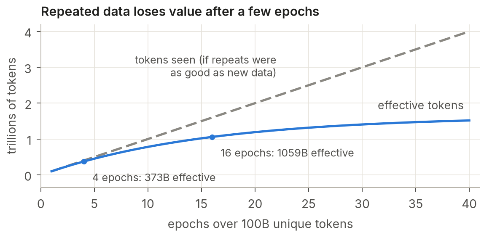

# 16 · Pretraining data

Part IV · Pretraining. Assumes Chapter 15 (the training pipeline in outline) and Chapter 13 (scaling laws, repeated data). Chapter 17 covers the training run that consumes this data; Chapter 23 covers contamination from the evaluation side.

## Why it matters

Architectures converge; data does not. Model reports from the last few years agree that the largest differences between models of the same size come from what they were trained on: how the web was filtered, how duplicates were removed, how much code and maths went in, and what was saved for the end of training. Data work is also where a research scientist's methodology is tested hardest, because every choice has to be justified by small-scale ablations that predict large-scale behaviour. This chapter covers the pipeline from raw crawl to training mixture, the techniques behind it, and how to run data experiments that mean something.

Numbers in this chapter come from `code/ch16_check.py` (seconds on a laptop).

The chapter follows a web document from the raw crawl to the training mixture. It starts with the sources (16.1) and the shape of a processing pipeline (16.2), then the three kinds of filtering: cheap heuristics (16.3), model-based quality classifiers (16.4) and deduplication (16.5). Decontamination (16.6) protects the evaluation. Sections 16.7 and 16.8 decide what the model actually sees: the proportions of each source, and the high-quality data reserved for the end of training. Synthetic data (16.9) is now part of every stage. The chapter ends with how to run data experiments that give trustworthy answers (16.10), a worked budget for a real pair of runs (16.11), and the two sources that need their own pipelines, code and non-English text (16.12).

Data work is mostly about trade-offs with no single right answer: stricter filters give cleaner data but less of it, and more of one source means less of another. The common thread is measurement. Every data decision should be tested on small proxy models before it is applied to a large run, and the chapter shows how.

In interviews, data questions separate people who have read a pipeline description from people who have run one. Expect to derive why MinHash estimates Jaccard similarity and how the band and row counts set the LSH threshold, to say how you would validate a quality classifier other than by its accuracy, to size an ablation so that its result is above the seed noise, and to plan a mixture under an epoch budget. Each of those has a worked number in this chapter.

## Key concepts

- **Common Crawl**: the public web crawl most open pretraining corpora start from. [Common Crawl](https://commoncrawl.org/).
- **Heuristic filtering**: rules on length, symbols, repetition and stopwords. [Gopher (MassiveText rules)](https://arxiv.org/abs/2112.11446), [C4](https://arxiv.org/abs/1910.10683).
- **Perplexity filtering**: score documents with a small language model trained on reference text. [CCNet](https://arxiv.org/abs/1911.00359).
- **Model-based quality filtering**: classifiers trained to prefer high-quality or educational text. [FineWeb and FineWeb-Edu](https://arxiv.org/abs/2406.17557), [DCLM](https://arxiv.org/abs/2406.11794).
- **Deduplication**: exact, MinHash-based near-duplicate and substring deduplication. [Lee et al.](https://arxiv.org/abs/2107.06499).
- **Decontamination**: removing evaluation data from training data.
- **Data mixtures**: how much of each domain, and how to choose. [DoReMi](https://arxiv.org/abs/2305.10429).
- **Annealing and mid-training**: high-quality data concentrated in the final learning-rate decay. [OLMo 2](https://arxiv.org/abs/2501.00656).
- **Synthetic data**: rephrased, generated or distilled text. [Rephrasing the Web (WRAP)](https://arxiv.org/abs/2401.16380), [Textbooks are all you need](https://arxiv.org/abs/2306.11644).
- **Open corpora and tooling**: [Dolma](https://arxiv.org/abs/2402.00159), [datatrove](https://github.com/huggingface/datatrove).

## 16.1 Where the tokens come from

A frontier pretraining run needs tens of trillions of tokens, and very few sources are that large. The open web is the only source at that scale, and it is mostly low quality; everything else (code, books, papers, curated reference text) is smaller but denser in useful information. A mixture balances the two.

| Source | Role | Issues |
|---|---|---|
| Web crawl (Common Crawl snapshots) | Bulk of tokens; breadth | Boilerplate, spam, duplicates, toxicity, PII; uneven language coverage |
| Code (public repositories) | Code ability; also helps reasoning | Licences, generated and duplicated files, secrets in code |
| Maths and science (papers, textbooks, maths web pages) | Reasoning, notation | LaTeX extraction quality; small volume |
| Books | Long-range coherence, knowledge | Copyright; limited open supply |
| Encyclopedic and reference | Factual density | Small; easy to over-weight |
| Multilingual web | Non-English ability | Low-resource languages are scarce and noisy |
| Synthetic data | Targeted skills, rephrased quality | Distribution narrowing, inherited errors |

**Volumes.** Open, filtered English web corpora are in the 1–15 trillion token range: FineWeb is about 15T tokens from 96 Common Crawl snapshots, and its educational subset, FineWeb-Edu, is about 1.3T. Frontier models are reported to train on 15–40T tokens or more, which already means repeating the best sources (Chapter 13) and adding synthetic data.

**Storage.** 15T tokens as token IDs is 60 TB as 32-bit integers, 30 TB as 16-bit (if the vocabulary has under 65,536 entries). Most 2025–26 vocabularies have 128k–256k entries, which need 17–18 bits per ID, so 16-bit storage no longer fits: in practice IDs are stored as 32-bit integers (60 TB), or bit-packed at 17–18 bits (about 32–34 TB) at the cost of unpacking in the data loader. Data is pre-tokenised, shuffled and sharded so thousands of GPUs can read it at full speed.

## 16.2 The pipeline

Raw web crawls are mostly boilerplate, spam, duplicates and broken text. Turning them into training data is a pipeline of filters, each removing a different kind of problem. The order matters for cost: cheap filters run first so that the expensive ones, such as model-based scoring, only see the documents that survived.

A typical web pipeline, cheapest steps first so expensive steps see less data:

1. **URL filtering**: block lists for adult, spam and malware domains.
2. **Text extraction** from HTML (trafilatura-style extractors). Extraction quality alone changes downstream results noticeably; extracting from raw HTML beats using the crawl's pre-extracted text.
3. **Language identification** (a fastText language classifier), keep documents above a confidence threshold.
4. **Heuristic filters** (16.3).
5. **Deduplication** (16.5).
6. **Model-based quality filtering** (16.4).
7. **PII removal** (emails, phone numbers, IP addresses) and toxicity filtering.
8. **Decontamination** against evaluation sets (16.6).
9. **Tokenisation, shuffling and sharding**, with per-source metadata kept so mixtures can be re-weighted later.

Every step is an experiment: change one, train a small model, compare. Open pipelines (FineWeb's datatrove code, Dolma's toolkit, DCLM's baselines) document their ablations, and reading them is the fastest way to learn which steps matter.

## 16.3 Heuristic filters

Much of the junk on the web can be recognised from simple statistics: the share of lines that end in punctuation, the ratio of symbols to words, how often lines repeat. Such rules cost almost nothing to run, and they remove most of the obviously bad text before anything more expensive sees it.

Rules in the spirit of Gopher and C4 cover minimum length, mean word length within a range, low symbol ratio, at least a few common stopwords (real prose has them), and a low fraction of repeated n-grams.

```python
def keep(h):
    return h["words"] >= 30 and 3 <= h["mean_word_len"] <= 10 and h["symbol_ratio"] < 0.1 \
        and h["stopwords"] >= 2 and h["dup_3gram_frac"] < 0.3
```

On five toy documents the rules keep the news paragraph and its near-duplicate, drop the navigation boilerplate (symbol ratio 0.68, no stopwords) and the keyword spam (38% of trigrams repeated), and also drop a short Python function: prose rules are wrong for code. Every domain needs its own filters, and every rule removes some good data along with the bad. Measure what each rule removes by sampling and reading, not only by its effect on benchmarks.

## 16.4 Model-based quality filtering

Heuristics remove junk but cannot tell a mediocre page from an excellent one. A small classifier trained to recognise text that resembles high-quality references, or that a strong model rates as educational, can rank the remaining documents. Since 2024 such classifiers have been the biggest single lever on pretraining data quality.

Two well-documented designs:

- **DCLM**: a fastText classifier on word n-grams, trained to separate a high-quality reference set (instruction-style data and well-upvoted explanatory answers) from random web text. Keeping roughly the top 10% of documents by score gave a large improvement over heuristic filtering alone at equal tokens.
- **FineWeb-Edu**: a large LLM rated the educational value of a few hundred thousand web pages on a 0–5 scale; a small classifier trained on those ratings scored all of FineWeb, and keeping pages scoring 3 or more gave a 1.3T-token subset with much better knowledge and reasoning benchmarks for its size.

```python
vec = HashingVectorizer(ngram_range=(1, 2), n_features=2**16, alternate_sign=False)
clf = LogisticRegression(C=10).fit(vec.transform(good + bad), [1] * len(good) + [0] * len(bad))
# "The report describes how rainfall and groundwater use changed..."  -> 0.58
# "free deals click here subscribe now best price"                     -> 0.20
```

**Costs and risks.** A classifier trained on one notion of quality narrows the distribution: aggressive educational filtering improves knowledge benchmarks but can hurt conversational, creative or dialect-rich text, and it can encode biases (some topics, regions or registers score lower). Common practice: keep several quality buckets, mix the top buckets with some of the middle, and check performance by domain and language, not just averages.

### Perplexity filtering

The older and still common model-based filter needs no labelled positives at all. CCNet (Wenzek et al., 2019) trained a small n-gram language model (KenLM) on Wikipedia in each language and scored every web document by its perplexity under that model. Documents that read like Wikipedia get low perplexity; spam, lists of keywords and machine-generated junk get high perplexity. CCNet split each language into head, middle and tail thirds by perplexity, and many later corpora keep the head and middle. It is cheap (an n-gram model scores millions of documents per CPU-hour) and works in any language with a reference corpus, which is why it survives in multilingual pipelines. Its bias is the same as a classifier's, made explicit: "good" means "like the reference", so informal registers and dialects are penalised.

### Validating a classifier: train on what it keeps

A quality classifier's accuracy on held-out positives and negatives says almost nothing about whether it selects better *training data*. The test that counts is downstream: train small proxy models on the top-k% of documents by each candidate classifier's score, at matched tokens, and compare them on a broad evaluation suite (16.10). DCLM chose its classifier this way, comparing many reference sets and model types by the proxies they produced, and found that the classifier's own accuracy was a poor predictor of the proxies' quality.

Two risks deserve a sentence each in an interview. **Circularity**: if the positives look like benchmark questions (instruction data, exam-style explanations), the classifier selects benchmark-like text and improves benchmark scores partly by resemblance, so check decontamination (16.6) and include held-out task types in the evaluation. **Token yield**: the threshold sets how much data survives. FineWeb-Edu's score ≥ 3 keeps about 1.3T of FineWeb's 15T tokens (8.7%), and DCLM keeps roughly the top 10%. That is fine for a run of a trillion or two tokens, and too few unique tokens for a 15T-token frontier run, which would have to repeat the selection 10 times or more (Chapter 13).

### At frontier scale: buckets, ensembles and rephrasing

The token-yield problem shaped the 2024–25 state of the art. **Nemotron-CC** (NVIDIA, 2024) scored Common Crawl with an ensemble of quality classifiers, sorted documents into many quality buckets rather than one keep/drop threshold, and used an LLM to **rephrase** lower-quality documents into cleaner text and to generate varied derived data (question–answer pairs, summaries) from high-quality ones. The result is a corpus of several trillion tokens that keeps much of the benefit of aggressive filtering while having enough unique tokens for long runs. **FineWeb2** (Hugging Face) extended the FineWeb pipeline to over a thousand languages, with filters, thresholds and deduplication settings chosen per language, because a threshold tuned on English removes far too much (or too little) of a language with different statistics. The general lessons: soft weighting by quality beats a hard cut at large scale, and every threshold is language-specific.

## 16.5 Deduplication

The web is full of copies: mirrored sites, templates, boilerplate, quoted text. Training on duplicates wastes compute, encourages memorisation (including of personal data), over-weights whatever happens to be copied most, and inflates benchmark scores when test items are among the copies. Exact duplicates are easy to remove; near-duplicates, which differ by a date or an advertisement, need approximate methods that scale to billions of documents.

Three levels of deduplication, from cheapest to most thorough:

- **Exact**: hash each document (or each line or paragraph) and keep one copy.
- **Near-duplicate (MinHash + LSH)**: documents that differ by a few words (templates, scraped copies with ads).
- **Substring**: remove long repeated spans (for example 50+ tokens) across documents with suffix arrays (Lee et al., 2021), catching licence text, boilerplate and quoted passages.

**MinHash** estimates the Jaccard similarity of two documents' sets of word n-grams ("shingles") without comparing the sets. Hash every shingle with n different hash functions and keep the minimum per function; the fraction of positions where two signatures agree estimates the Jaccard similarity. For the article and its one-word variant, the true Jaccard similarity of 5-word shingles is 0.818 and a 128-hash signature estimates 0.852; against the spam page it is 0.000.

**Why agreement estimates Jaccard.** The Jaccard similarity of shingle sets A and B is

$$
J(A, B) = \dfrac{|A \cap B|}{|A \cup B|}
$$

A good hash function behaves like a random permutation of all possible shingles. Under a random permutation, the element of A ∪ B that comes first is equally likely to be any of its |A ∪ B| elements. The minimum over A and the minimum over B are the same element exactly when that first element lies in A ∩ B; if it lies in only one of the sets, the other set's minimum is something else. So

$$
P\left(\min h(A) = \min h(B)\right) = \dfrac{|A \cap B|}{|A \cup B|} = J
$$

Each of the n hash functions gives an independent Bernoulli trial with success probability J, so the agreement fraction is an unbiased estimate with standard error √(J(1 − J)/n). For J = 0.818 and n = 128 that is 0.034, and the observed 0.852 is 1.0 standard error above the truth: an ordinary draw, not a bug. Halving the error needs four times as many hashes. The check script also verifies the identity directly: over 20,000 random permutations of two sets with J = 0.500, the minima agree 49.6% of the time.

**Locality-sensitive hashing** avoids comparing all pairs. Split each signature into b bands of r values; two documents become candidates if any band matches exactly. For a pair with similarity s, each of the r values in a band agrees with probability s, so the whole band matches with probability sʳ; it fails with probability 1 − sʳ; all b bands fail with probability (1 − sʳ)ᵇ; and the pair becomes a candidate if at least one band matches:

$$
P(\mathrm{candidate}) = 1 - \left(1 - s^{r}\right)^{b}
$$

This is an S-curve whose threshold you set with b and r:

| Jaccard similarity | 16 bands × 8 rows | 20 bands × 5 rows |
|---|---|---|
| 0.5 | 0.061 | 0.470 |
| 0.7 | 0.613 | 0.975 |
| 0.8 | 0.947 | 1.000 |
| 0.9 | 1.000 | 1.000 |

16 × 8 targets near-duplicates above about 0.71 by the rule below, and its curve crosses 50% at 0.67; 20 × 5 is looser (rule 0.55, 50% point 0.51) and catches more pairs (and more false positives). The article pair matched in 5 of 16 bands, so it became a candidate. Candidates are then clustered (connected components) and one document per cluster is kept.


*Probability that two documents become LSH candidates as a function of their Jaccard similarity, for three band/row settings with 128 or 100 hashes. More rows per band push the threshold right and make the curve steeper; more bands pull it left.*

**Choosing b and r.** The threshold sits near (1/b)^(1/r): that is the similarity at which a single band matches with probability 1/b, so the expected number of matching bands is one, the point where the S-curve is steepest. For 16 × 8 it is (1/16)^(1/8) = 0.707. Pick it slightly below the similarity you want to catch, because pairs just under the threshold are still sometimes caught and pairs just over it are sometimes missed. False positives cost only a verification step (compute the actual Jaccard similarity of each candidate pair); false negatives leave duplicates in the data. FineWeb, for example, used 112 hashes split into 14 bands of 8 rows (threshold about 0.72) on 5-gram shingles, aiming at pairs at least 75% similar. At this scale the bottleneck is no longer the hashing but the connected-components step over billions of candidate edges, which needs a distributed union-find.

**How much to deduplicate** is itself an empirical question. FineWeb found that deduplicating each crawl snapshot separately worked better than deduplicating globally across all snapshots: global deduplication removed many good documents that recur across years and left a higher share of low-quality unique pages. Deduplication interacts with quality filtering and with how much repetition the run can afford.

## 16.6 Decontamination

A benchmark only measures generalisation if the model has not seen its questions. Web crawls contain benchmark questions, answers and discussions of both, so evaluation data leaks into training unless it is removed deliberately. Decontamination is the step that protects every number reported later.

Standard practice is n-gram overlap: flag training documents that share any long n-gram (often 13 words) with a test item, then remove them or the overlapping span.

```python
len(ngrams(benchmark_item) & ngrams(copied_web_page))   # 16 shared 13-grams -> flagged
len(ngrams(benchmark_item) & ngrams(paraphrase))        # 0 -> missed
```

N-gram matching misses paraphrases, translations and solutions posted in a different format. Stronger checks use embedding similarity or an LLM judge on candidate pairs. Contamination can also arrive later, through synthetic data generated by a model that saw the test set. Chapter 23 covers how to detect contamination in a trained model when you cannot inspect its data.

## 16.7 Data mixtures

After filtering, the pipeline has many sources of different sizes and qualities. How often the model sees each one, the mixture, is one of the most consequential and least obvious decisions of a run: natural proportions over-weight the web, while over-sampling small sources risks repeating them too often.

A mixture assigns a sampling weight to each source. Natural proportions (by size) let the web dominate; small, valuable sources (maths, books, low-resource languages) would barely appear. **Temperature sampling** with p_i ∝ n_i^(1/T) flattens the distribution:

| Domain (billions of tokens) | T = 1 | T = 2 | T = 5 |
|---|---|---|---|
| English web (10,000) | 75.8% | 49.9% | 31.0% |
| Other-language web (2,000) | 15.2% | 22.3% | 22.5% |
| Code (800) | 6.1% | 14.1% | 18.7% |
| Maths (100) | 0.8% | 5.0% | 12.4% |
| Books (300) | 2.3% | 8.6% | 15.4% |

Upsampling has a price: at T = 2 a 15T-token run would see the maths data 7.5 times, past the point where repetition stops helping (Chapter 13). Mixtures are designed against both targets: enough of each skill, not too many epochs of any source.



*Effective tokens from repeating 100B unique tokens, using the data-constrained scaling fit of Muennighoff et al. (2023), where repeated tokens decay in value with a characteristic scale of about 15 epochs. Four epochs are worth nearly as much as fresh data; 16 epochs are worth about two-thirds of what they cost.*

The fit gives a usable rule. Up to about four epochs, repeating good data costs almost nothing. Beyond that, each extra epoch adds less, and past roughly 40 epochs it adds almost nothing. The maths data in the T = 2 mixture, seen 7.5 times in a 15T run, gives about 630B effective tokens for the 750B it costs: acceptable. At T = 5 it would be seen 18.6 times and the waste would be large. This is why labs extend scarce domains with rephrased and synthetic data (16.9) rather than repeating them.

**Choosing weights.** There are three families of method, and they trade cost against how much they assume.

- **Ablations at small scale**: train proxy models (hundreds of millions to a few billion parameters, tens of billions of tokens) on candidate mixtures and compare on a broad evaluation suite.
- **Learned weights (DoReMi)**: train a small reference model, then a small proxy that up-weights domains where it lags the reference most; use the proxy's average weights for the large run.
- **Mixing laws**: fit how the loss on each domain depends on the mixture from a few small runs, then optimise the mixture by prediction.
- **Targets matter**: a mixture optimised for average benchmark score may hurt long-tail abilities. Track per-domain held-out loss as well as benchmarks.

### DoReMi: robust optimisation on excess loss

DoReMi (Xie et al., 2023) frames the mixture as a game. A small **reference** model is trained on a default mixture. A small **proxy** model is then trained while an adversary re-weights the domains towards those where the proxy's loss most exceeds the reference's: the **excess loss**, proxy loss minus reference loss, clipped at zero. Excess loss is used instead of raw loss because some domains are intrinsically hard (high entropy) and would otherwise win every round without being learnable; subtracting the reference loss leaves only the part that more training could remove. This is group distributionally robust optimisation (group DRO), and the weights are updated multiplicatively, an exponentiated-gradient step:

$$
w_i \leftarrow \dfrac{w_i \exp(\eta\, e_i)}{\sum_j w_j \exp(\eta\, e_j)}
$$

where wᵢ is the weight of domain i, eᵢ its excess loss on the current batch and η a step size (the paper also mixes in a little of the uniform distribution for stability). Worked example: three domains start at equal weights with excess losses 0.30, 0.10 and 0.02, and η = 1. One step gives weights 0.388, 0.318 and 0.294; if the excess losses stayed the same, three steps would give 0.505, 0.277 and 0.218. In practice the excess losses shrink as the proxy learns the up-weighted domain, so the weights settle. The final mixture for the large run is the **average** of the weights over the proxy's training, not their last value. DoReMi's weakness is that it optimises loss, which is not always what you care about, and the weights it finds can depend on the proxy's size.

### Mixing laws and RegMix: regress, then optimise

The regression approach (Data Mixing Laws, Ye et al., 2024; RegMix, Liu et al., 2024) treats the mixture as an input and the proxy's validation loss as an output. Train many small, short proxies on random mixtures (RegMix used hundreds of 1M-parameter models), fit a regression from mixture weights to loss, then search the simplex of mixtures for the predicted minimum and train the large model on it. The bet is that the **ranking** of mixtures transfers from tiny proxies to large models even when absolute losses do not.

The check script runs a three-domain toy: the "true" loss of a mixture m is 2.0 + 0.02 m₁^(−0.5) + 0.05 m₂^(−0.5) + 0.10 m₃^(−0.5), observed with noise on 30 random mixtures. A linear regression on log m₁, log m₂, log m₃ predicts that the best mixture is (0.165, 0.297, 0.539), whose true loss 2.2773 is within 0.0004 of the true optimum (0.174, 0.318, 0.508; loss 2.2769) and 0.017 better than the uniform mixture (2.2944). Two honest caveats: the best of the 30 random runs was already as good, which is typical with only three domains, and the regression earns its keep with tens of domains, where random runs cover the simplex too sparsely to stumble on the optimum. And the target loss must be the one you care about; optimising validation loss on web text can starve maths and code.

## 16.8 Annealing and mid-training

Not all training tokens are equal. Data seen while the learning rate decays at the end of a run has an outsized effect on the final model, so teams save their highest-quality and most targeted data for that phase. The final stretch of pretraining has become a stage of its own.

**Why the end matters.** With a high learning rate, each update moves the weights a long way, so the model is always a noisy average of recent data and the loss sits above what its parameters could achieve, a "noise floor" set by the step size. As the learning rate decays, the steps shrink, the noise floor drops and the loss falls quickly (the sharp drop at the end of a WSD schedule, Chapter 7). Whatever data is being seen during that drop shapes where the weights settle, and with small steps there is no later high-learning-rate phase to wash it out. So the final few percent of tokens have an influence far out of proportion to their number.

**How big the effect is.** The Llama 3 report describes annealing on a small amount of high-quality code and maths data and reports that it raised its 8B model's scores on the GSM8K and MATH validation sets by 24.0% and 6.4% respectively, while the same treatment had a negligible effect on the 405B model. Both halves are worth remembering: annealing gives large gains on targeted skills for small models, and the gain shrinks for models that have already learned those skills in pretraining. OLMo 2 made the anneal a named stage with its own curated mixture (Dolmino) and reported large maths gains from it as well.

Current recipes exploit this:

- **Annealing**: in the final decay (the last few percent of tokens, often the decay phase of a WSD schedule, Chapter 7), switch to a higher-quality mixture: filtered maths, code, curated web, instruction-like data, textbooks. Small anneal experiments are also a cheap way to measure the value of a new data source: anneal a checkpoint with and without it and compare.
- **Mid-training**: a distinct phase between pretraining and post-training, with its own mixture and objectives: long-context extension (training on long documents while raising the RoPE base, Chapter 10), reasoning traces, tool-use formats, domain data. It blurs the line with post-training, deliberately: post-training (Chapters 18–19) works better when mid-training has already made the target behaviours likely.

## 16.9 Synthetic data

High-quality human text is finite, and some kinds of data (step-by-step solutions, long reasoning traces, instruction-following examples) are scarce on the web. Models can now generate useful training data themselves, and synthetic data appears at every stage of training. Its risks are real, especially loss of diversity, and so are the gains.

- **Rephrasing**: rewrite web pages in a cleaner style (encyclopedic, question–answer) with a smaller model. Mixing rephrased and real text trains faster at equal tokens than real text alone, and stretches limited high-quality data.
- **Generated textbooks and exercises**: the phi series showed small models trained heavily on synthetic "textbook" data can be strong on reasoning benchmarks; how well this transfers to broad, real-world use is debated.
- **Targeted data**: maths problems with verified solutions, code with tests, translations for low-resource languages.

Risks: **narrowing** (generators are less diverse than the web), **error inheritance** (the generator's mistakes become facts), **contamination** (generators that saw test sets reproduce them), and, when models are trained repeatedly on their own outputs without fresh data, **model collapse**: the tails of the distribution disappear. Practical rules: keep real data in the mix, filter synthetic data as strictly as web data, verify whatever can be verified, and generate from diverse prompts and seeds.

## 16.10 Running data experiments

Data decisions are made by experiment, and small experiments mislead easily: differences between mixtures are often smaller than the noise between seeds, and some data only helps at scale. A reliable data experiment needs the right proxy model, the right evaluations and enough repetitions to trust the difference.

- **Proxy scale**: small models can rank data choices reliably if trained on enough tokens; DCLM showed rankings at around 400M–1B parameters mostly held at 7B. Check rank agreement between two small scales before trusting either.
- **Evaluations that move at small scale**: many benchmarks sit at chance for small models. Use evaluations with continuous scores (log-likelihood of the correct answer, cloze-style formats) and per-domain held-out loss.
- **Noise floor**: train the same configuration with 2–3 seeds (or data orders) to know which differences are real.
- **One change at a time**, matched tokens, matched schedule.
- **Read the data**: sample 100 documents from what a filter keeps and from what it removes. Many filter bugs are obvious to a human in five minutes.

### A worked noise floor

"Train 2–3 seeds" only helps if you turn it into a threshold. Two sources of noise matter. **Question sampling**: a benchmark of n questions at accuracy p has a standard error of √(p(1 − p)/n), 0.40 points for a 14,042-question benchmark at 35% and 1.37 points for a 1,000-question one at 25%. Comparing two models on the *same* questions removes much of this (a paired comparison, Chapter 23). **Training noise**: seeds and data order change the score of a small proxy even with identical data. Suppose you measure a seed-to-seed standard deviation of σ = 0.5 points on your evaluation for a 1B proxy. With k seeds per arm, the difference of the two arms' means has standard error

$$
\mathrm{SE}_{\Delta} = \sigma \sqrt{2/k}
$$

so a difference must exceed 1.96 × SE_Δ to be called at the 95% level: 1.39 points with one seed per arm, 0.98 with two, 0.80 with three and 0.62 with five. Many published data interventions are worth well under a point at proxy scale, which is why one-seed ablations so often fail to replicate. The σ itself has to be measured on your setup; 0.5 is illustrative.

**When is a proxy too small?** When the evaluation sits at chance. A four-choice benchmark with 1,000 questions has a standard error of 1.37 points at 25%, so a proxy scoring below about 27.7% cannot be distinguished from guessing, and differences between mixtures on that benchmark are noise however many seeds you run. Either use a continuous metric (the log-likelihood of the correct answer, or a cloze formulation, which moves earlier, Chapter 13), switch to an easier benchmark, or use a larger proxy. Check also that the ranking of two candidates agrees at two proxy sizes before trusting either.

**Legal and ethical constraints** shape what can be used: licences, website terms and robots.txt opt-outs (increasingly restrictive for AI crawlers), copyright litigation over books and news, personal data regulation. Research scientists are not lawyers, but they should keep provenance metadata for every source so data can be removed or re-weighted when policy changes.

## 16.11 A worked data budget

You are planning the data for two runs that share a mixture: a 2T-token run for a 7B model and a later 15T-token run for a 70B model. The sources are those in 16.7 and you start from T = 2.

**Step 1: tokens and epochs per domain.**

| Domain (unique tokens) | Share at T = 2 | 2T run: tokens (epochs) | 15T run: tokens (epochs) |
|---|---|---|---|
| English web (10,000B) | 49.9% | 998B (0.10) | 7,488B (0.75) |
| Other-language web (2,000B) | 22.3% | 446B (0.22) | 3,349B (1.67) |
| Code (800B) | 14.1% | 282B (0.35) | 2,118B (2.65) |
| Maths (100B) | 5.0% | 100B (1.00) | 749B (7.49) |
| Books (300B) | 8.6% | 173B (0.58) | 1,297B (4.32) |

The small run repeats nothing. The large run repeats maths 7.5 times and books 4.3 times.

**Step 2: decide what to do with the over-used domains.** You have three options.

- Accept the repetition. 7.5 epochs of maths is about 84% as valuable as fresh data by the curve above.
- Cap maths at about 4 epochs (400B tokens, 2.7% of the mixture) and give the rest to code and web.
- Grow the domain: rephrase maths web pages and generate verified problem–solution pairs until it holds 200–300B unique tokens.

The choice should come from an ablation, not from taste.

**Step 3: the ablation.** Train three 1B-parameter proxies for 50B tokens each, one per option. That is 6 × 10⁹ × 50 × 10⁹ = 3 × 10²⁰ FLOPs per proxy, about 210 GPU-hours at 40% MFU on a 989 TFLOP/s GPU. Compare per-domain held-out loss and a maths and reasoning benchmark suite.

Proxies cannot show the repetition effect directly, because at 50B tokens nothing repeats. So scale the repetition down with the run: subsample the maths source so it is seen 7.5 times within the proxy's budget. This is the standard trick for testing data-constrained regimes at small scale.

**Step 4: decontaminate and freeze.** Run 13-gram decontamination against every evaluation set you will report, including the new maths set. Record the removed counts per domain, then freeze the mixture with a version number. The same frozen mixture, subsampled, feeds the scaling ladder (Chapter 13), so the ladder predicts the run you will actually do.

## 16.12 Code and multilingual data

Web text pipelines were designed for English prose, and two of the most valuable sources break their assumptions. Code has its own notion of duplication, quality and legality; non-English text needs every threshold re-tuned. Both appear in senior interviews as "how would you build the pipeline for X?", so this section gives the shape of each.

### Code

**Source and licences.** Open code corpora are built from public repositories; The Stack v2 (BigCode, 2024) starts from the Software Heritage archive and covers hundreds of programming languages. Licence handling is the first filter: detect each repository's licence, keep permissively licensed code (or code whose licence the project's policy allows), and honour opt-out requests from authors. Secrets (API keys, passwords) and personal data in code are redacted.

**Deduplication at file level.** Forks, vendored dependencies and copied snippets make code far more duplicated than prose. Pipelines run exact deduplication on file contents and then MinHash near-deduplication on files (not repositories), because two repositories that share a vendored library are otherwise different. Aggressive near-deduplication matters more for code than for web text, because duplicated files are long and verbatim memorisation of code is both a quality and a licensing risk.

**Quality filters for code.** Prose heuristics fail on code (16.3), so code has its own: remove auto-generated files (lockfiles, minified JavaScript, compiled output, protobuf stubs), data files disguised as code (huge JSON or CSV), files with extremely long lines or a very low fraction of alphanumeric characters, and files in rare or configuration-only languages unless wanted. Model-based quality classifiers for code exist too, trained on ratings of educational value, in the spirit of FineWeb-Edu. Repository-level context helps: ordering files by their dependency graph within a training sequence teaches cross-file reasoning.

### Multilingual

Every stage of 16.2 has to be redone per language. **Language identification** is less reliable for short texts, closely related languages and code-switched text, so thresholds are set per language. **Heuristic filters** use language-specific stopword lists and word-length ranges (a rule tuned on English word lengths removes most of a language written without spaces). **Quality classifiers** need reference data in that language, or a multilingual rater. **Deduplication** settings differ because some languages are dominated by a few heavily mirrored sources. FineWeb2 is the documented example of doing this at scale. The **mixture** then decides how much each language gets, usually with temperature sampling (16.7) and an epoch cap for small languages, and the **tokenizer** decides how expensive each language is per word (Chapter 9). Evaluate with native-language benchmarks, not translations of English ones, which carry translation artefacts and English-centric content.

## Pitfalls

- Applying prose filters to code, maths or non-English text.
- Judging a filter only by benchmark gains, without reading what it removes.
- Judging a quality classifier by its accuracy instead of by the models trained on what it keeps.
- Deduplicating so aggressively that the remaining data is skewed towards rare, low-quality pages.
- Assuming 13-gram decontamination catches paraphrased or translated test items.
- Up-weighting a small source until it is repeated dozens of times.
- Running data ablations on models too small or trained too briefly for the evaluations to move.
- Calling a difference real without a measured seed-to-seed noise floor.
- Losing provenance: not knowing which source a document came from.

## Interview questions

**Mid level**

**1. Walk through a web-data pipeline.** URL filtering, HTML extraction, language ID, heuristic filters, deduplication, quality classifier, PII and toxicity filtering, decontamination, tokenisation and sharding with metadata. Cheap steps first. The ordering is a cost argument: a URL block list costs microseconds per document, a fastText classifier milliseconds per thousand, an LLM rater orders of magnitude more, so each step should see only what survived the cheaper ones; FineWeb's 96 snapshots end up as about 15T tokens, and its educational subset as 1.3T. The trade-off is that early cheap filters make irreversible mistakes (for example prose rules dropping code), so keep per-step removal statistics and samples. Follow-up: "which step has the most impact?" Published ablations point to extraction quality and model-based quality filtering, with deduplication giving a smaller but reliable gain.

**2. How does MinHash LSH find near-duplicates?** Shingle documents; for each of n hash functions keep the minimum hash; agreement rate estimates Jaccard similarity. Split signatures into b bands of r rows; pairs matching on any band are candidates with probability 1 − (1 − sʳ)ᵇ, which sets the threshold. Why agreement estimates Jaccard: under a random permutation the first element of A ∪ B is equally likely to be any of them, and the two minima agree only if it lies in A ∩ B, so P(agree) = J; with n hashes the standard error is √(J(1 − J)/n), 0.034 at J = 0.82 and n = 128. The threshold is near (1/b)^(1/r), 0.71 for 16 × 8, where one band is expected to match. Follow-up: "what is the bottleneck at web scale?" Not hashing but connected components over billions of candidate edges, which needs distributed union-find; and false negatives are the costly error, because false positives are removed by an exact Jaccard check.

**3. How would you build a quality classifier, and what can go wrong?** Positive examples from a trusted reference (or LLM ratings of samples), negatives from random web; a cheap model (fastText) scores everything; keep top buckets. Risks: narrowing style and topics, bias against dialects or regions, over-fitting to benchmark-like text. Validate it by what it selects, not by its accuracy: train small proxies on the top-k% of each candidate classifier's picks at matched tokens and compare them on a broad suite, as DCLM did. Watch the circularity of positives that resemble benchmarks, and the token yield: FineWeb-Edu's threshold keeps 1.3T of 15T tokens (8.7%) and DCLM about 10%, which is too few unique tokens for a 15T-token run. At frontier scale, Nemotron-CC's answer is an ensemble of classifiers, many quality buckets weighted rather than cut, and rephrasing of lower-quality text. Follow-up: "how do you pick the threshold?" By the proxy results at several thresholds, constrained by how many epochs the selected data would need.

**4. Why deduplicate, and can you overdo it?** Saves compute, reduces memorisation and contamination. Overdoing it (for example global deduplication across many snapshots) can remove good recurring documents and leave low-quality unique ones. FineWeb found per-snapshot deduplication worked better than global deduplication for exactly that reason. Duplicates also distort the mixture: a page copied 1,000 times is effectively up-weighted 1,000×, which drives verbatim memorisation (Lee et al. 2021), and so extraction risk (Chapter 28). Follow-up: "how would you tell if you over-deduplicated?" Compare proxies trained on the two versions at matched tokens, and sample what the stricter setting removed.

**5. How do you choose a data mixture?** Small-scale ablations on proxy models, learned weighting (DoReMi), or fitted mixing laws, constrained by how many epochs each source can afford; validate per domain. DoReMi trains a reference model, then a proxy against an adversary that re-weights domains by excess loss (proxy minus reference) with multiplicative updates, and uses the averaged weights: from equal weights, excess losses of 0.30, 0.10 and 0.02 give 0.388, 0.318 and 0.294 after one step with η = 1. RegMix trains many tiny proxies on random mixtures, regresses loss on the weights and optimises the prediction; it pays off when there are many domains. The epoch constraint comes from Chapter 13: at temperature T = 2 a 15T-token run sees a 100B-token maths source 7.5 times. Follow-up: "what does a loss-optimal mixture miss?" Skills that loss on a generic validation set does not measure, so track per-domain loss and targeted benchmarks.

**6. What is annealing on high-quality data, and how can you use it as a measurement tool?** Switching to curated data during the final learning-rate decay. Annealing a checkpoint with and without a candidate source is a cheap test of its value. It works because as the learning rate falls, the noise floor drops and the data seen during the decay shapes where the weights settle. Llama 3 reports that annealing on high-quality code and maths raised its 8B model on GSM8K and MATH by 24.0% and 6.4%, with negligible effect on the 405B model, so the effect shrinks once pretraining has taught the skill. Follow-up: "what is the risk?" Benchmark-like anneal data inflates scores; decontaminate the anneal set with extra care and keep a held-out task family.

**7. How do you decontaminate, and what are the limits?** N-gram overlap (around 13-grams) with test sets, plus embedding or LLM checks for paraphrases. Misses translations, paraphrases and contamination via synthetic data. The check script's example: a copied homework page shares 16 13-grams with the benchmark item and is flagged; a paraphrase shares none and is missed. Report how many documents were removed per benchmark, and run membership-style checks on the trained model (Chapter 23). Follow-up: "what if a benchmark leaked anyway?" Report results on a fresh, post-cut-off or private set and say so.

**8. What are the risks of synthetic pretraining data?** Narrowing, inherited errors, contamination, and collapse if models train on their own outputs repeatedly without fresh data. Rephrasing real documents is the safest form because the facts come from real text; generating from scratch is riskier because the generator's errors and blind spots become training data. Mitigations: keep real data in the mix, verify what can be verified (maths answers, code tests), generate from diverse prompts and seeds, and decontaminate synthetic data as strictly as web data. Follow-up: "how would you measure narrowing?" Diversity metrics on the generated set (n-gram and embedding diversity) and per-domain held-out loss on real text.

**Senior level**

**9. How do you make data ablations trustworthy?** Proxy models large and long enough, evaluations with continuous signals, seeds for a noise floor, one change at a time, check that rankings agree across two proxy scales. Turn the seeds into a threshold: with a measured seed standard deviation of 0.5 points, the difference between two arms has standard error 0.5 × √(2/k), so it must exceed 1.39 points with one seed per arm, 0.98 with two and 0.80 with three. A proxy is too small when the evaluation sits at chance: on 1,000 four-choice questions anything below about 27.7% is indistinguishable from guessing, so switch to log-likelihood or cloze scoring or a larger proxy. Follow-up: "your intervention gives +0.6 points with one seed": rerun with at least three seeds per arm and a paired comparison before reporting it.

**10. How would you improve a model's performance in a low-resource language?** Better language ID and extraction for that language, language-specific quality filters, upsampling within epoch limits, translated and synthetic data with verification, tokenizer coverage (Chapter 9), and evaluation by native speakers. Quantify the epoch budget first: a language with 2B unique tokens given 1% of a 2T-token run is seen 10 times, past the point where repetition stops helping (Chapter 13), so the gain must come from more unique data (better extraction, more snapshots, translation, rephrasing) rather than a higher weight. Check the tokenizer: if a word costs three times the tokens it costs in English, the model sees a third of the text per token. Follow-up: "how do you know it worked?" Per-language held-out loss and native benchmarks, plus a check that English did not regress.

**11. Which evaluations would you use for a 1B-parameter data ablation, and why?** Ones that move above noise at that scale: per-domain held-out loss or bits per byte (continuous and cheap), and benchmarks in a cloze or log-likelihood formulation rather than multiple-choice letter answers, which small models cannot yet use. Drop any benchmark where the proxies sit within two standard errors of chance (27.7% on a 1,000-question four-choice set), and prefer benchmarks whose scores rise monotonically over training checkpoints, which is a sign of signal rather than noise. Measure the seed noise of each evaluation and weight decisions towards high signal-to-noise ones. Follow-up: "the loss improves but no benchmark moves": report both, and test whether the loss gain is concentrated in a domain that the benchmarks do not cover.

**12. Design the data pipeline for a code model.** Start from public repositories with licence detection and opt-outs, redact secrets and personal data, then deduplicate exactly and with MinHash at file level, because forks and vendored code make duplication far higher than on the web. Filter auto-generated and data files, extreme line lengths and low alphanumeric ratios; add a quality classifier for educational value; and decontaminate against coding benchmarks, including their solutions. Group files by repository and order them by dependencies so training sequences contain cross-file context. Mix in natural-language text about code (documentation, Q&A) and maths. The number to check is the epoch budget per language: popular languages have hundreds of billions of unique tokens, rare ones a few billion, so rare languages hit the repetition limit first. Follow-up: "how do you evaluate?" Execution-based benchmarks with the unbiased pass@k estimator (Chapter 13), after decontamination.

## Practice

1. Download one Common Crawl WET file. Apply language ID and the heuristic filters above; read 50 kept and 50 removed documents and record the error rate of each rule.

<details><summary>Hint and expected result</summary>

A WET file holds tens of thousands of documents and processes in minutes on a laptop. Expect English to be the largest language but well under all documents, and expect the filters to remove a large share of them. Reading the removed sample, expect most removals to be correct for prose, with errors concentrated in code, tables, lists and non-English text: that is the point of the exercise.

</details>

2. Implement MinHash LSH with datasketch or your own code; deduplicate the file and plot the cluster-size distribution.

<details><summary>Hint and expected result</summary>

Check your implementation on the chapter's pair first: Jaccard 0.818 for the article and its variant, a 128-hash estimate within about 0.07 (two standard errors), and P(candidate) of 0.613 at similarity 0.7 for 16 × 8. Expect a heavy-tailed cluster-size distribution: most documents unique, a few templates or boilerplate pages with hundreds of near-copies.

</details>

3. Train a fastText quality classifier on a small positive set of your choice; inspect the top and bottom 20 documents.

<details><summary>Hint and expected result</summary>

Expect the top 20 to look like the positives in style, not necessarily in quality: if your positives are encyclopedic, top-scored pages will be encyclopedic in tone, including some spam written in that tone. Expect the bottom 20 to be lists, navigation and spam. Then do the real test on a small scale if you can: train two tiny proxies on the top 10% and on a random 10%.

</details>

4. **Research exercise.** Train three small models (for example 125M parameters on 2B tokens) on: heuristic filtering only, plus deduplication, plus quality filtering. Evaluate with log-likelihood-based scores on three benchmarks, two seeds each. Which step matters most, and is the difference above the seed noise?

<details><summary>Hint and expected result</summary>

Published ablations (FineWeb, DCLM) suggest what a plausible result looks like: deduplication gives a modest gain, and model-based quality filtering gives the largest one, especially on knowledge and reasoning benchmarks. At 125M parameters and 2B tokens, expect the differences to be small, around a point or less on most benchmarks, so compute the noise floor from your two seeds (16.10) before ranking the steps. If the quality-filtered model is not better, check that the evaluations are above chance and that the classifier was not trained on text unlike your evaluations.

</details>

5. Run 13-gram decontamination of your sample against a public benchmark and inspect the hits.

<details><summary>Hint and expected result</summary>

Expect few or no hits in a random WET file for most benchmarks, and hits on homework-help, quiz and forum pages for popular ones. Inspect every hit: many will be shared boilerplate ("which of the following is true") rather than leaked items, which is why 13 words is the usual minimum length.

</details>

## Read next

- Penedo et al., "The FineWeb Datasets" (2024).
- Li et al., "DataComp-LM: In search of the next generation of training sets" (DCLM, 2024).
- Soldaini et al., "Dolma" (2024).
- Rae et al., "Scaling Language Models: Methods, Analysis & Insights from Training Gopher" (2021), appendix on MassiveText filtering.
- Wenzek et al., "CCNet: Extracting High Quality Monolingual Datasets from Web Crawl Data" (2019).
- Lee et al., "Deduplicating Training Data Makes Language Models Better" (2021).
- Xie et al., "DoReMi: Optimizing Data Mixtures Speeds Up Language Model Pretraining" (2023); Ye et al., "Data Mixing Laws" (2024); Liu et al., "RegMix" (2024).
- Su et al., "Nemotron-CC" (2024); Lozhkov et al., "StarCoder 2 and The Stack v2" (2024).
- OLMo Team, "2 OLMo 2 Furious" (2024), for annealing and mid-training; Llama Team, "The Llama 3 Herd of Models" (2024), for annealing results.
- Maini et al., "Rephrasing the Web" (2024); Shumailov et al., "AI models collapse when trained on recursively generated data" (Nature, 2024).
- Links to the core papers are in the Key concepts section at the top of this chapter.

## Done when

- Without notes, in 5 minutes, you derive P(min-hashes agree) = Jaccard, state the standard error √(J(1 − J)/n), and compute it for J = 0.818 and n = 128 (≈ 0.034).
- You derive 1 − (1 − sʳ)ᵇ step by step and compute the threshold for 16 bands × 8 rows (≈ 0.71) and its 50% point (≈ 0.67).
- You order the nine pipeline steps and justify the order by cost, and say what each one wrongly removes.
- You describe how to validate a quality classifier without using its accuracy, and state the token yield of FineWeb-Edu (≈ 1.3T of 15T, 8.7%).
- You compute temperature-sampling weights for the 16.7 sources at T = 2 and the epochs of maths in a 15T-token run (≈ 7.5), and its effective tokens (≈ 630B of 750B).
- You run one DoReMi step by hand: weights (1/3, 1/3, 1/3), excess losses (0.30, 0.10, 0.02), η = 1 → (0.388, 0.318, 0.294).
- Given a seed standard deviation of 0.5 points, you compute the gap needed at 95% with 2 seeds per arm (≈ 0.98 points) and the chance threshold for 1,000 four-choice questions (≈ 27.7%).
- You sketch a code-data pipeline and a low-resource-language plan, each with its epoch budget.

---

[← 15 · How LLMs are trained](15-how-llms-are-trained.md) · [Contents](../README.md#contents) · [17 · Pretraining at scale →](17-pretraining-at-scale.md)
