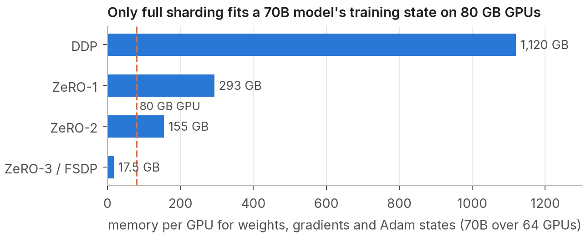

# 17 · Pretraining at scale

Part IV · Pretraining. Assumes Chapter 6 (PyTorch, mixed precision, the 16-bytes-per-parameter rule) and Chapter 7 (optimisers, schedules, stability). Chapter 11 introduces the mixture-of-experts layers that expert parallelism serves; Chapter 21 covers the same hardware from the inference side.

## Why it matters

A 70B-parameter model trained on 15 trillion tokens needs about 6 × 10²⁴ floating-point operations, months of a thousand GPUs, and a memory footprint no single GPU can hold. Getting there means splitting the model, the data and the sequence across machines, overlapping communication with computation, and surviving hardware failures every few hours. Research scientists do not all write parallelism code, but they choose model shapes, batch sizes and context lengths that the system must support, read MFU dashboards, and debug runs that slow down or diverge. Interviews ask for the memory arithmetic, the differences between ZeRO stages, what tensor and pipeline parallelism cost, and how to estimate a training run's time and cost.

Numbers in this chapter come from `code/ch17_check.py` (instant; hardware figures are round numbers for arithmetic, not vendor specifications).

The chapter starts with the budget: how much compute, memory and time a run needs (17.1, 17.2). Those numbers show that no single GPU can hold a large model, so the rest of the chapter is about splitting the work. Data parallelism and its sharded variants split the batch and the optimiser state (17.3); tensor parallelism splits each matrix multiplication (17.4); pipeline parallelism splits the layers (17.5); sequence and context parallelism split long sequences (17.6); expert parallelism splits the experts of an MoE model (17.7). Section 17.8 shows how real runs combine them. The last sections cover what keeps a run alive for months: reliability (17.9), monitoring (17.10), and a worked memory and time budget (17.11).

Every parallelism scheme trades memory for communication. Splitting a model saves memory on each GPU but forces GPUs to exchange data, and the art of distributed training is arranging the splits so that the heaviest communication happens over the fastest links. Keeping that trade-off in mind makes the combinations in 17.8 easy to follow.

## Key concepts

- **Data parallelism and all-reduce**: replicas process different batches and average gradients. [PyTorch DDP](https://docs.pytorch.org/docs/stable/notes/ddp.html).
- **ZeRO and FSDP**: shard optimiser states, gradients and weights across data-parallel ranks. [ZeRO](https://arxiv.org/abs/1910.02054), [PyTorch FSDP](https://arxiv.org/abs/2304.11277).
- **Tensor parallelism**: split each matrix multiplication across GPUs. [Megatron-LM](https://arxiv.org/abs/1909.08053).
- **Pipeline parallelism**: split the layers into stages. [GPipe](https://arxiv.org/abs/1811.06965), [Megatron interleaved schedule](https://arxiv.org/abs/2104.04473).
- **Sequence and context parallelism**: split the sequence dimension. [Reducing activation recomputation](https://arxiv.org/abs/2205.05198), [Ring Attention](https://arxiv.org/abs/2310.01889).
- **Expert parallelism**: place MoE experts on different GPUs. [GShard](https://arxiv.org/abs/2006.16668).
- **MFU (model FLOPs utilisation)**: achieved model FLOPs as a fraction of peak hardware FLOPs. [PaLM](https://arxiv.org/abs/2204.02311).
- **Reference implementations**: [torchtitan](https://github.com/pytorch/torchtitan), [Megatron-LM](https://github.com/NVIDIA/Megatron-LM), [The Ultra-Scale Playbook](https://huggingface.co/spaces/nanotron/ultrascale-playbook).

## 17.1 The budget

A large training run is planned like a construction project: before anything starts, you estimate how much compute it needs, how many GPUs for how long, and how much it will cost. The estimate rests on one formula and one efficiency number, and it is accurate enough to decide whether a run is feasible at all.

**Compute.** Training FLOPs ≈ 6ND (Chapter 13): for N parameters and D tokens,

$$
C \approx 6\,N\,D
$$

two FLOPs per parameter per token for the forward pass and four for the backward pass. For 70B parameters and 15T tokens: 6.3 × 10²⁴ FLOPs.

**Time.** Divide by the cluster's sustained throughput: number of GPUs × peak FLOP/s × MFU. With round numbers (989 TFLOP/s dense bf16 per GPU):

| GPUs | MFU | Days | GPU-hours |
|---|---|---|---|
| 1,024 | 40% | 180 | 4.4M |
| 4,096 | 40% | 45 | 4.4M |
| 16,384 | 38% | 12 | 4.7M |

GPU-hours barely change with cluster size; wall-clock time does. Larger clusters lose some efficiency (more communication, more failures), so MFU tends to fall slightly.

**MFU** = achieved model FLOPs per second / peak. Count the FLOPs the model needs (6N per token for the matmuls, plus about 12 · layers · d_model · sequence length for attention scores), not the FLOPs the hardware happens to execute (recomputation does not count). At 900 tokens per second per GPU, the 70B example runs at 44% MFU. Well-tuned dense training reaches 35–50%; MoE training is usually lower because of communication. MFU is the single most useful efficiency number on a training dashboard.

## 17.2 Where the memory goes

Before choosing how to split a model across GPUs, you need to know what has to be stored. The weights are the smallest part: gradients, optimiser states and activations add several times more, and each grows with different settings. Knowing the bytes per parameter and per token lets you see immediately which split a model needs.

Per parameter, bf16 mixed precision with Adam needs 16 bytes: 2 for bf16 weights, 2 for bf16 gradients, 12 for the fp32 master copy and the two Adam moments. A 70B model therefore needs 1.12 TB before a single activation is stored; a GPU has 80–192 GB.

**Activations** are the other big term. For a transformer layer with sequence length s, micro-batch b, width h and a attention heads, stored activations are roughly s·b·h·(34 + 5·a·s/h) bytes (Korthikanti et al., 2022). The second term is the attention score matrix, quadratic in s. For 80 layers at width 8,192, 64 heads and 8k tokens: 1,901 GB with everything stored, 183 GB if the attention scores are recomputed in the backward pass (which FlashAttention does automatically). Tensor and sequence parallelism divide this further by the parallel degree, and pipeline parallelism divides the layers among stages.

**Activation recomputation** (checkpointing): store only each layer's input and recompute the rest during the backward pass. Full recomputation costs about one extra forward pass (around 33% more compute); selective recomputation of the cheap-to-compute, memory-heavy parts (attention) gets most of the saving for a few percent.

## 17.3 Data parallelism, ZeRO and FSDP

The simplest way to use many GPUs is to give each a different slice of the batch. It requires every GPU to hold the whole model, which quickly becomes impossible. Sharded data parallelism keeps the simplicity of the batch split but spreads the model's states across GPUs, gathering them only when needed.

**Data parallelism (DP).** Every GPU holds a full model copy, processes a different slice of the batch, and the gradients are averaged with an **all-reduce** before each update.

**Ring all-reduce** makes the cost independent of the number of GPUs. Split each gradient into n chunks. In n − 1 steps of reduce-scatter, each GPU passes one chunk to its neighbour, which adds it to its own; afterwards each GPU owns one fully summed chunk. In n − 1 steps of all-gather, the summed chunks travel round the ring. Each GPU sends 2(n − 1) chunks of size 1/n: about twice the gradient size, whatever n is.

```python
out, sent = ring_allreduce([np.arange(4) * (g + 1.0) for g in range(4)])
# every GPU ends with [0, 10, 20, 30] = the sum; each sent 6 chunk-messages = 2(n-1)
```

Still, 140 GB of bf16 gradients for a 70B model across 64 GPUs at 50 GB/s effective bandwidth takes 5.5 seconds, longer than the compute of a step. Two remedies: overlap communication with the backward pass (reduce each layer's gradients as soon as they are ready, in buckets), and stop replicating everything.

**ZeRO** (Rajbhandari et al., 2020) shards the replicated state across the DP ranks:

| Scheme | What is sharded | Memory per GPU for 70B over 64 GPUs (no activations) |
|---|---|---|
| DDP | Nothing | 1,120 GB |
| ZeRO-1 | Optimiser states | 293 GB |
| ZeRO-2 | + gradients | 155 GB |
| ZeRO-3 / FSDP | + weights | 17.5 GB |



*Memory per GPU for the training state of a 70B model data-parallel over 64 GPUs, before activations. Each ZeRO stage shards one more piece of the replicated state; only full sharding fits under the 80 GB line with room for activations.*

ZeRO-1 and ZeRO-2 cost no extra communication (a reduce-scatter plus all-gather is an all-reduce). ZeRO-3 (PyTorch's **FSDP**) gathers each layer's weights just before it is used and frees them after, adding about 50% more communication, which is hidden by prefetching the next layer while the current one computes. FSDP is the default starting point for models up to tens of billions of parameters; beyond that, or across slower networks, it is combined with the parallelisms below.

## 17.4 Tensor parallelism

When a single layer's matrix multiplications are too large or too slow for one GPU, the matrices themselves can be split, with each GPU computing part of every product. It needs fast communication within every layer, so it is used inside a node, where GPUs are connected by the fastest links.

Split each weight matrix across GPUs so each computes part of every matmul (Megatron-LM). In an MLP, split the first matrix by columns and the second by rows: each GPU computes its slice of the hidden layer independently, and one all-reduce at the end sums the partial outputs. Attention splits naturally by heads. That is two all-reduces of the activations per layer in the forward pass and two in the backward.

Tensor parallelism (TP) communicates on every layer, so it needs the fastest links: it is used **within a node** (8 GPUs on NVLink), rarely across nodes. It cuts weights, gradients, optimiser states and (with **sequence parallelism**, which splits the layer-norm and dropout regions along the sequence) activations by the TP degree, and it reduces the per-GPU matmul size, which lowers efficiency if pushed too far.

## 17.5 Pipeline parallelism

Splitting a model by layers, with each group of layers on a different set of GPUs, needs communication only at the boundaries between stages, so it works across slower links between nodes. Its cost is idle time: a stage has to wait for the previous one, and keeping that "bubble" small is the main design problem.

Split the layers into p stages on different GPUs (or nodes); activations flow forward through the stages and gradients flow back. Only activations at stage boundaries cross the network, so pipeline parallelism (PP) tolerates slower links.

The cost is the **bubble**: at the start and end of each batch, some stages are idle. With m micro-batches per batch, the idle fraction is (p − 1)/(m + p − 1):

| Stages | Micro-batches | Bubble |
|---|---|---|
| 8 | 8 | 46.7% |
| 8 | 32 | 17.9% |
| 16 | 64 | 19.0% |


*Idle fraction (p − 1)/(m + p − 1) for 4, 8 and 16 pipeline stages. Each stage count needs roughly 4–6 times as many micro-batches as stages to get under the 15% line.*

More micro-batches shrink the bubble but need a large global batch. Schedules reduce it further: **1F1B** (alternate forward and backward passes to bound memory), **interleaved** stages (each GPU holds several non-adjacent chunks of layers), and **zero-bubble** schedules that split the backward pass into input-gradient and weight-gradient parts and fill idle slots with the latter.

## 17.6 Sequence and context parallelism

Long-context training makes the activations of a single sequence too large for one GPU, even when the model fits. The remedy is to split the sequence itself across GPUs, which requires care in attention, where every token must see the others.

Long-context training (32k to 1M tokens) makes activations per sequence too large for one GPU even with recomputation. **Context parallelism** splits each sequence across GPUs. Attention needs every query to see every earlier key, so keys and values circulate: in **ring attention** each GPU computes attention for its query block against one key–value block at a time while passing blocks round the ring, overlapping communication with computation. Causal masking makes the work uneven across positions; implementations reorder blocks so each GPU gets a balanced share. Long-context extension is usually done in a separate mid-training phase (Chapter 16), with context parallelism switched on only then.

## 17.7 Expert parallelism

A mixture-of-experts model has far more parameters than a dense model of the same compute, held in many separate experts. Placing different experts on different GPUs is natural, but each token must then travel to wherever its chosen experts live, which turns routing into a communication problem.

For MoE models (Chapter 11), place different experts on different GPUs. Each MoE layer then needs two **all-to-all** exchanges: send each token to the GPUs holding its chosen experts, and send the results back. All-to-all traffic is heavy and sensitive to load imbalance (one hot expert stalls everyone), which is why routing balance matters as much for systems as for quality. Common tricks: limit how many nodes a token's experts can span, overlap the all-to-all of one micro-batch with the computation of another, and use custom communication kernels.

## 17.8 Putting it together

Large runs combine these into "3D" (DP × TP × PP) or "4D/5D" layouts (adding context and expert parallelism). Rules of thumb:

1. **TP within a node** (up to 8), because it communicates every layer.
2. **PP across nodes** if the model does not fit with TP and FSDP alone; pick micro-batch counts that keep the bubble below about 15%.
3. **DP (with ZeRO-1 or FSDP) across everything else**, scaling the global batch up to the critical batch size (Chapter 7).
4. **CP for long sequences**, **EP for MoE**.
5. Change one dimension at a time and measure MFU.

A layout for the 70B example on 1,024 GPUs: TP = 8, PP = 4, DP = 32. Each GPU holds 2.19B parameters: 8.8 GB of bf16 weights and gradients, plus 0.82 GB of Adam state when the optimiser is sharded across the 32 DP ranks, leaving room for activations. A global batch of 4M tokens is 32 replicas × 1 sequence of 8,192 tokens × 16 gradient-accumulation micro-batches, which also gives the pipeline 16 micro-batches per step.

## 17.9 Reliability

A run on thousands of GPUs for several months will see hardware fail regularly: one failing GPU somewhere in the cluster every few hours is normal. Training at that scale is as much about recovering quickly as about running fast.

At scale, hardware failure is routine. With a per-GPU mean time between failures of 50,000 hours, a 1,024-GPU job fails about every 49 hours; a 16,384-GPU job every 3 hours. The Llama 3 report described roughly 400 unexpected interruptions in a 54-day period of its largest run, most from GPU and memory faults.

**Checkpointing.** A full checkpoint of the 70B example (weights, fp32 master copy, Adam states) is 1.12 TB. Write it sharded, in parallel from every rank, and asynchronously (copy to CPU memory, then write in the background) so training barely pauses. The best interval balances checkpoint cost C against lost work; the classical Young–Daly approximation is √(2·C·M) for mean time between failures M. With C = 1.2 minutes and M = 3 hours that is about 21 minutes.

**Other failure modes to plan for:**

- **Stragglers**: one slow GPU or link slows every synchronous step. Monitor per-rank step times and evict outliers.
- **Silent data corruption**: hardware that returns wrong numbers without crashing. It shows up as unexplained loss spikes or NaNs; detect with redundant computation checks and gradient-norm anomalies.
- **Hangs**: collective operations that never complete. Watchdog timeouts and automatic restart.
- **Data loader state**: a restart must resume at exactly the next unseen batch, or the run silently repeats or skips data.
- **Determinism**: bit-exact reproducibility at scale is expensive; aim for reproducible data order and configuration, and record everything.

## 17.10 What a research scientist should monitor

| Signal | What it tells you |
|---|---|
| MFU and tokens/s per GPU | Efficiency; sudden drops mean a straggler, a bad node or a data-loader stall |
| Loss, gradient norm, max attention logit, per-layer update norms (Chapter 7) | Stability, before the loss shows it |
| Per-domain held-out loss | Whether the mixture behaves as planned (Chapter 16) |
| Small benchmark suite on regular checkpoints | Capability trends; early warning of regressions |
| Restarts, lost hours, checkpoint durations | Effective throughput, which is what the budget sees |

## 17.11 A worked memory and time budget

Check the layout from 17.8 (70B parameters, 80 layers, width 8,192, 64 heads, 8k-token sequences, TP = 8, PP = 4, DP = 32 on 1,024 GPUs) before you launch it.

**Memory per GPU.**

| Item | Calculation | GB |
|---|---|---|
| bf16 weights and gradients | 70B / (8 × 4) = 2.19B parameters × 4 bytes | 8.8 |
| Adam state and fp32 master weights | 2.19B × 12 bytes, sharded over 32 DP ranks (ZeRO-1) | 0.8 |
| Activations per layer | s · h · 34 bytes / TP = 8,192 × 8,192 × 34 / 8 (attention scores recomputed, sequence parallel) | 0.29 |
| Activations on the first stage | 20 layers × 0.29 GB × 4 micro-batches in flight (1F1B holds up to p) | 22.8 |
| Total | | ≈ 32 |

There is plenty of headroom on an 80 GB GPU, even after 10–20% for communication buffers and allocator fragmentation. The headroom can buy a longer sequence or a micro-batch of 2. Full activation recomputation would cut the activations to about 1.3 GB but cost about 33% more compute, so it is not worth it here. Note that the first pipeline stage holds the most in-flight micro-batches, so it is the one that runs out of memory first.

**Time per step.** A 4M-token batch costs 6 × 70 × 10⁹ × 4.19 × 10⁶ = 1.76 × 10¹⁸ FLOPs. At 40% MFU on 1,024 GPUs that is 4.35 seconds per step, and 3.6M steps for 15T tokens: 180 days, as in the table of 17.1.

**Communication.**

- **Gradient sync.** Each GPU syncs 4.4 GB of bf16 gradients across its DP group. A ring sends about twice that: 0.17 s at 50 GB/s. That is 4% of the step, and it is hidden behind the backward pass when bucketed.
- **Pipeline traffic.** Each micro-batch crosses each stage boundary as a 17 MB activation tensor (s · h · 2 bytes / TP): negligible.
- **Tensor parallelism.** Its all-reduces stay on NVLink inside the node.

**The bubble is the biggest loss.** With 4 stages and 16 micro-batches, (4 − 1)/(16 + 4 − 1) = 15.8% of each step is idle. An interleaved schedule with two chunks of layers per GPU cuts it to about 8.6%, saving roughly two weeks of the 180 days. The alternative fixes are worse:

- A larger global batch to get more micro-batches risks passing the critical batch size.
- Fewer stages needs more memory per GPU.

The interleaved schedule is the right first change.

**What to verify in the first hour.**

- Measured step time within 10% of the estimate.
- Peak memory on the first stage close to the prediction.
- Loss in the first few hundred steps matching a smaller-scale run with the same recipe.

A large gap on any of these is cheaper to find now than at day 20.

## Pitfalls

- Planning memory for weights only and forgetting gradients, optimiser states and activations.
- Using tensor parallelism across nodes.
- Too few micro-batches for the number of pipeline stages.
- Changing the global batch size (by adding GPUs) without re-tuning the learning rate.
- Reporting hardware FLOPs (including recomputation) as MFU.
- Checkpointing synchronously every few minutes at large scale, or too rarely.
- Resuming without restoring the data loader's position.

## Interview questions

**1. Estimate the time to train a 70B model on 15T tokens on 4,096 GPUs.** 6 × 70e9 × 15e12 = 6.3e24 FLOPs; 4,096 × ~1e15 FLOP/s × 0.4 MFU ≈ 1.6e18 FLOP/s; about 45 days.

**2. How much memory does training a 7B model with Adam need?** 16 bytes per parameter = 112 GB, plus activations: more than one 80 GB GPU, hence ZeRO/FSDP or more GPUs.

**3. Explain ZeRO stages 1–3.** Shard optimiser states (1), plus gradients (2), plus weights (3). Stages 1 and 2 add no communication; stage 3 gathers weights per layer, about 1.5× DDP's traffic, hidden by prefetching.

**4. How does ring all-reduce work, and what does it cost?** Reduce-scatter then all-gather around a ring; each GPU sends about twice the data size, independent of the number of GPUs.

**5. How does Megatron split an MLP across GPUs?** First matrix by columns, second by rows; each GPU computes its hidden slice independently; one all-reduce sums the outputs. Attention splits by heads.

**6. Why keep tensor parallelism inside a node?** It needs an all-reduce of activations in every layer, forward and backward, so it needs NVLink-class bandwidth.

**7. What is the pipeline bubble, and how do you reduce it?** Idle time at the start and end of each batch, (p−1)/(m+p−1). More micro-batches, interleaved schedules, zero-bubble schedules.

**8. How does context parallelism handle attention?** Each GPU holds a block of the sequence; key–value blocks pass round a ring while each GPU computes attention for its queries, with load balancing for the causal mask.

**9. What is MFU, and what is a good value?** Model FLOPs achieved per second over peak; 35–50% for well-tuned dense training, lower for MoE.

**10. Your run's throughput dropped 20% overnight. What do you check?** Per-rank step times for stragglers, node health and network errors, data-loader stalls (I/O), checkpoint timing, recent configuration or data changes, thermal throttling.

**11. How often should you checkpoint?** Balance checkpoint cost against expected lost work: √(2·C·M); make checkpoints sharded and asynchronous to make C small.

## Practice

1. Train a small model with PyTorch FSDP on 2–8 GPUs (or simulated CPU processes with the gloo backend); compare memory per rank with DDP.
2. Implement column- and row-parallel linear layers with `torch.distributed` and check the output against a single-GPU MLP.
3. Write a calculator that, given model shape, sequence length, batch and parallel layout, outputs memory per GPU and step time; validate it against one real run.
4. **Research exercise.** On a fixed small model, measure tokens per second and MFU for 4 layouts (pure DP, FSDP, FSDP + activation checkpointing, TP = 2 + DP). Explain each difference with the arithmetic of this chapter.
5. Read the infrastructure sections of the Llama 3 and DeepSeek-V3 reports and list every reliability and efficiency technique they mention.

## Read next

- Rajbhandari et al., "ZeRO: Memory Optimizations Toward Training Trillion Parameter Models" (2020).
- Shoeybi et al., "Megatron-LM" (2019) and Narayanan et al., "Efficient Large-Scale Language Model Training on GPU Clusters Using Megatron-LM" (2021).
- Korthikanti et al., "Reducing Activation Recomputation in Large Transformer Models" (2022).
- Zhao et al., "PyTorch FSDP: Experiences on Scaling Fully Sharded Data Parallel" (2023).
- Liu et al., "Ring Attention with Blockwise Transformers for Near-Infinite Context" (2023).
- Llama Team, "The Llama 3 Herd of Models" (2024), infrastructure and reliability sections; DeepSeek-AI, "DeepSeek-V3 Technical Report" (2024).
- Hugging Face, "The Ultra-Scale Playbook" (2025): a hands-on guide to all of the above.
- Links to these papers are in the Key concepts section at the top of this chapter.

## Done when

You can estimate the FLOPs, time and GPU-hours of a run and compute MFU from throughput. You can break training memory into weights, gradients, optimiser states and activations, and explain recomputation. You can explain ring all-reduce, ZeRO stages and FSDP with their costs.

You can explain tensor, pipeline, context and expert parallelism, where each runs and what each communicates. You can propose a parallel layout for a given model and cluster. You can plan checkpointing and list the failure modes a large run must survive.

---

[← 16 · Pretraining data](16-pretraining-data.md) · [Contents](../README.md#contents) · [18 · Post-training I: SFT, reward models and preference optimisation →](18-post-training-sft-and-preferences.md)
