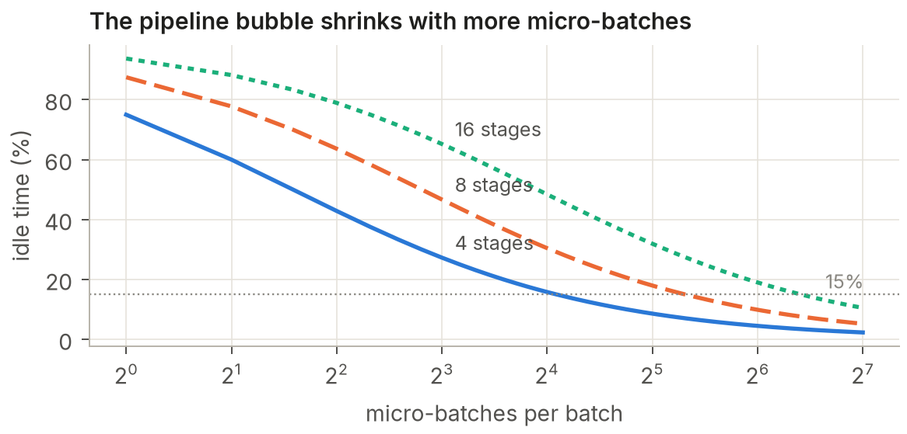

# 17 · Pretraining at scale

Part IV · Pretraining. Assumes Chapter 6 (PyTorch, mixed precision, the 16-bytes-per-parameter rule) and Chapter 7 (optimisers, schedules, stability). Chapter 11 introduces the mixture-of-experts layers that expert parallelism serves; Chapter 21 covers the same hardware from the inference side.

## Why it matters

A 70B-parameter model trained on 15 trillion tokens needs about 6 × 10²⁴ floating-point operations, months of a thousand GPUs, and a memory footprint no single GPU can hold. Getting there means splitting the model, the data and the sequence across machines, overlapping communication with computation, and surviving hardware failures every few hours. Research scientists do not all write parallelism code, but they choose model shapes, batch sizes and context lengths that the system must support, read MFU dashboards, and debug runs that slow down or diverge. Interviews ask for the memory arithmetic, the differences between ZeRO stages, what tensor and pipeline parallelism cost, and how to estimate a training run's time and cost.

Numbers in this chapter come from `code/ch17_check.py` (instant; hardware figures are round numbers for arithmetic, not vendor specifications).

The chapter starts with the budget: how much compute, memory and time a run needs (17.1, 17.2). Those numbers show that no single GPU can hold a large model, so the rest of the chapter is about splitting the work. Data parallelism and its sharded variants split the batch and the optimiser state (17.3); tensor parallelism splits each matrix multiplication (17.4); pipeline parallelism splits the layers (17.5); sequence and context parallelism split long sequences (17.6); expert parallelism splits the experts of an MoE model (17.7). Section 17.8 shows how real runs combine them. The last sections cover what keeps a run alive for months: reliability (17.9), monitoring (17.10), and a worked memory and time budget (17.11).

Every parallelism scheme trades memory for communication. Splitting a model saves memory on each GPU but forces GPUs to exchange data, and the art of distributed training is arranging the splits so that the heaviest communication happens over the fastest links. Keeping that trade-off in mind makes the combinations in 17.8 easy to follow.

The hardware moved under these rules between 2024 and 2026. The H100 numbers used for the arithmetic in most of this chapter are still the clearest teaching case, but Blackwell-class racks put 72 GPUs in one NVLink domain and make fp8 matrix multiplication the default for new runs. Section 17.8 redoes the worked layout for an NVL72-class cluster, and 17.12 covers fp8 training from the systems side.

What an interviewer is testing is whether you can turn a model and a cluster into numbers without notes: bytes per GPU, seconds per step, bytes on the wire per step, and the fraction of the step lost to bubbles or exposed communication. A strong answer derives each figure from a small set of formulas (6ND, 16 bytes per parameter, s·b·h·34, 2(n − 1)/n · M, (p − 1)/(m + p − 1)) and then says which term dominates and what you would change first. The collective-cost table in 17.3 and the debugging walkthrough in 17.10 are the parts a senior systems question usually reaches.

## Key concepts

- **Data parallelism and all-reduce**: replicas process different batches and average gradients. [PyTorch DDP](https://docs.pytorch.org/docs/stable/notes/ddp.html).
- **ZeRO and FSDP**: shard optimiser states, gradients and weights across data-parallel ranks. [ZeRO](https://arxiv.org/abs/1910.02054), [PyTorch FSDP](https://arxiv.org/abs/2304.11277).
- **Tensor parallelism**: split each matrix multiplication across GPUs. [Megatron-LM](https://arxiv.org/abs/1909.08053).
- **Pipeline parallelism**: split the layers into stages. [GPipe](https://arxiv.org/abs/1811.06965), [Megatron interleaved schedule](https://arxiv.org/abs/2104.04473).
- **Sequence and context parallelism**: split the sequence dimension. [Reducing activation recomputation](https://arxiv.org/abs/2205.05198), [Ring Attention](https://arxiv.org/abs/2310.01889).
- **Expert parallelism**: place MoE experts on different GPUs. [GShard](https://arxiv.org/abs/2006.16668).
- **MFU (model FLOPs utilisation)**: achieved model FLOPs as a fraction of peak hardware FLOPs. [PaLM](https://arxiv.org/abs/2204.02311).
- **Collective communication**: all-reduce, reduce-scatter, all-gather and all-to-all, with their α-β (latency–bandwidth) costs (17.3).
- **NVLink domain size**: how many GPUs share the fastest links; 8 on H100 and B200 servers, 72 on NVL72-class racks (17.8).
- **fp8 training**: 8-bit matrix multiplications with fine-grained scaling. [DeepSeek-V3](https://arxiv.org/abs/2412.19437), [FP8 formats](https://arxiv.org/abs/2209.05433); number formats are in Chapter 7.
- **Reference implementations**: [torchtitan](https://github.com/pytorch/torchtitan), [Megatron-LM](https://github.com/NVIDIA/Megatron-LM), [The Ultra-Scale Playbook](https://huggingface.co/spaces/nanotron/ultrascale-playbook).

## 17.1 The budget

A large training run is planned like a construction project: before anything starts, you estimate how much compute it needs, how many GPUs for how long, and how much it will cost. The estimate rests on one formula and one efficiency number, and it is accurate enough to decide whether a run is feasible at all.

**Compute.** Training FLOPs ≈ 6ND (Chapter 13): for N parameters and D tokens,

$$
C \approx 6\,N\,D
$$

two FLOPs per parameter per token for the forward pass and four for the backward pass. For 70B parameters and 15T tokens: 6.3 × 10²⁴ FLOPs.

**Where the 6 comes from.** Almost all the parameters sit in weight matrices, and a token passing through a d_in × d_out matrix costs d_in · d_out multiplications and as many additions: 2 FLOPs per parameter in the forward pass. The backward pass does two matrix products of the same size for every layer, one for the gradient with respect to the layer's input (needed to continue back-propagating) and one for the gradient with respect to the weights: 4 FLOPs per parameter. The rule leaves out three things. Attention scores cost about 12 · layers · d_model · s FLOPs per token over forward and backward, which for the 70B example at s = 8,192 is 6.4 × 10¹⁰, 15% on top of 6N; it matters more at long context. Full activation recomputation adds another forward pass (8N instead of 6N), which the hardware executes but MFU does not count. And for a mixture-of-experts model, N is the number of *active* parameters per token, not the total.

**Time.** Divide by the cluster's sustained throughput: number of GPUs × peak FLOP/s × MFU. With round numbers (989 TFLOP/s dense bf16 per GPU):

| GPUs | MFU | Days | GPU-hours |
|---|---|---|---|
| 1,024 | 40% | 180 | 4.4M |
| 4,096 | 40% | 45 | 4.4M |
| 16,384 | 38% | 12 | 4.7M |

GPU-hours barely change with cluster size; wall-clock time does. Larger clusters lose some efficiency (more communication, more failures), so MFU tends to fall slightly.

**MFU** = achieved model FLOPs per second / peak. Count the FLOPs the model needs (6N per token for the matmuls, plus about 12 · layers · d_model · sequence length for attention scores), not the FLOPs the hardware happens to execute (recomputation does not count). At 900 tokens per second per GPU, the 70B example runs at 44% MFU. Well-tuned dense training reaches 35–50%; MoE training is usually lower because of communication. MFU is the single most useful efficiency number on a training dashboard.

## 17.2 Where the memory goes

Before choosing how to split a model across GPUs, you need to know what has to be stored. The weights are the smallest part: gradients, optimiser states and activations add several times more, and each grows with different settings. Knowing the bytes per parameter and per token lets you see immediately which split a model needs.

Per parameter, bf16 mixed precision with Adam needs 16 bytes: 2 for bf16 weights, 2 for bf16 gradients, 12 for the fp32 master copy and the two Adam moments. A 70B model therefore needs 1.12 TB before a single activation is stored; a GPU has 80–192 GB.

**Activations** are the other big term. For a transformer layer with sequence length s, micro-batch b, width h and a attention heads, stored activations are roughly s·b·h·(34 + 5·a·s/h) bytes (Korthikanti et al., 2022). The second term is the attention score matrix, quadratic in s. For 80 layers at width 8,192, 64 heads and 8k tokens: 1,901 GB with everything stored, 183 GB if the attention scores are recomputed in the backward pass (which FlashAttention does automatically). Tensor and sequence parallelism divide this further by the parallel degree, and pipeline parallelism divides the layers among stages.

### Where the 34 and the 5 come from

The formula counts, in bytes, every tensor the backward pass needs from one layer (bf16 values take 2 bytes per element, dropout masks 1 byte). Per token, in units of h:

| Block | Tensors stored | Bytes (× s·b·h) |
|---|---|---|
| Attention | Layer-norm output feeding Q, K, V (2); Q and K for the score product (4); V (2); input to the output projection (2); output dropout mask (1) | 11 |
| Attention scores | Softmax output (2 per score), its dropout mask (1) and the dropped-out scores (2), for a·s scores per token | 5·a·s/h |
| MLP | Input (2); first linear output, width 4h (8); GeLU output, width 4h (8); dropout mask (1) | 19 |
| Layer norms | The inputs of the two layer norms | 4 |
| Total | | 34 + 5·a·s/h |

The table is the tool for adapting the formula. FlashAttention removes the score terms (it recomputes them). Without dropout, the two 1-byte masks go. A Llama-style block with grouped-query attention (8 key–value heads out of 64) and a SwiGLU MLP of width f = 3.5h stores roughly 2 + 2 + 0.25 + 0.25 + 2 = 6.5 for attention and 2 + 4 × 2 × 3.5 = 30 for the MLP (input, gate output, up output, activated gate and their product, each 2f bytes), plus 4 for the norms: about 40 rather than 34. Fused kernels and implementation details move these numbers by a few units, so measure peak memory once and calibrate.

### Recomputation

**Activation recomputation** (checkpointing): store only each layer's input and recompute the rest during the backward pass. Full recomputation costs about one extra forward pass (around 33% more compute); selective recomputation of the cheap-to-compute, memory-heavy parts (attention) gets most of the saving for a few percent.

## 17.3 Data parallelism, ZeRO and FSDP

The simplest way to use many GPUs is to give each a different slice of the batch. It requires every GPU to hold the whole model, which quickly becomes impossible. Sharded data parallelism keeps the simplicity of the batch split but spreads the model's states across GPUs, gathering them only when needed.

**Data parallelism (DP).** Every GPU holds a full model copy, processes a different slice of the batch, and the gradients are averaged with an **all-reduce** before each update.

**Ring all-reduce** makes the cost independent of the number of GPUs. Split each gradient into n chunks. In n − 1 steps of reduce-scatter, each GPU passes one chunk to its neighbour, which adds it to its own; afterwards each GPU owns one fully summed chunk. In n − 1 steps of all-gather, the summed chunks travel round the ring. Each GPU sends 2(n − 1) chunks of size 1/n: about twice the gradient size, whatever n is.

```python
out, sent = ring_allreduce([np.arange(4) * (g + 1.0) for g in range(4)])
# every GPU ends with [0, 10, 20, 30] = the sum; each sent 6 chunk-messages = 2(n-1)
```

Still, 140 GB of bf16 gradients for a 70B model across 64 GPUs at 50 GB/s effective bandwidth takes 5.5 seconds. Whether that matters depends on the compute it has to hide behind. With one 4,096-token sequence per GPU per step (a 262k-token global batch), the step's compute at 40% MFU takes 4.3 s, so an exposed all-reduce would more than double the step; at 8,192 tokens per GPU, compute takes 8.7 s and communication is still 63% of it. Two remedies: overlap communication with the backward pass (reduce each layer's gradients as soon as they are ready, in buckets), and stop replicating everything.

**ZeRO** (Rajbhandari et al., 2020) shards the replicated state across the DP ranks:

| Scheme | What is sharded | Memory per GPU for 70B over 64 GPUs (no activations) |
|---|---|---|
| DDP | Nothing | 1,120 GB |
| ZeRO-1 | Optimiser states | 293 GB |
| ZeRO-2 | + gradients | 155 GB |
| ZeRO-3 / FSDP | + weights | 17.5 GB |


*Memory per GPU for the training state of a 70B model data-parallel over 64 GPUs, before activations. Each ZeRO stage shards one more piece of the replicated state; only full sharding fits under the 80 GB line with room for activations.*

ZeRO-1 and ZeRO-2 cost no extra communication (a reduce-scatter plus all-gather is an all-reduce). ZeRO-3 (PyTorch's **FSDP**) gathers each layer's weights just before it is used and frees them after, adding about 50% more communication, which is hidden by prefetching the next layer while the current one computes. FSDP is the default starting point for models up to tens of billions of parameters; beyond that, or across slower networks, it is combined with the parallelisms below. The next subsection derives the 50%.

### The cost of collectives

Every parallelism in this chapter is built from four collective operations, and their costs follow from one model. Sending a message costs a fixed latency α (microseconds: kernel launch, network hops) plus its size divided by the bandwidth β. A collective that takes k steps and moves B bytes out of each GPU therefore takes

$$
T \approx k\,\alpha + \dfrac{B}{\beta}
$$

where B is counted per GPU because all GPUs send at the same time over their own links. For a buffer of M bytes on n GPUs, with ring algorithms:

| Collective | What it does | Bytes sent per GPU | Steps | Used by |
|---|---|---|---|---|
| All-reduce | Every GPU ends with the sum of all buffers | 2(n − 1)/n · M | 2(n − 1) | DDP gradients, TP outputs |
| Reduce-scatter | Every GPU ends with the sum of one 1/n shard | (n − 1)/n · M | n − 1 | ZeRO gradients, sequence parallelism |
| All-gather | Every GPU ends with all n shards (M is the gathered size) | (n − 1)/n · M | n − 1 | ZeRO-3 weights, sequence parallelism |
| All-to-all | GPU i sends a different 1/n of its buffer to each GPU j | (n − 1)/n · M | n − 1 (or one exchange) | Expert parallelism, Ulysses |

An all-reduce is a reduce-scatter followed by an all-gather, which is why its volume is the sum of the two. For large buffers the bandwidth term dominates and the volume is nearly independent of n, as the ring example above showed. For small buffers or very many GPUs the latency term takes over: a ring all-reduce over 1,024 GPUs has 2,046 steps, about 20 ms at 10 µs each, whatever the message size. That is why libraries such as NCCL switch to tree or hierarchical algorithms at scale, and why gradients are sent in buckets of tens of megabytes rather than tensor by tensor.

**ZeRO-3 is 3M, DDP is 2M.** Let M be the size of the bf16 weights (equal to the bf16 gradients). DDP does one all-reduce of the gradients: 2(n − 1)/n · M. ZeRO-1 and ZeRO-2 replace it with a reduce-scatter of the gradients (each rank needs only the gradient shard for the optimiser shard it owns) and, after the update, an all-gather of the updated weights: the same 2(n − 1)/n · M. ZeRO-3 keeps no full copy of the weights, so it must all-gather each layer's weights once for the forward pass and again for the backward pass, then reduce-scatter the gradients:

$$
V_{\mathrm{ZeRO3}} = 3\,\dfrac{n-1}{n}\,M = 1.5\,V_{\mathrm{DDP}}
$$

For the 70B model on 64 GPUs (M = 140 GB), that is 276 GB per GPU per step for DDP, ZeRO-1 and ZeRO-2 (5.5 s at 50 GB/s) against 413 GB for ZeRO-3 (8.3 s). Prefetching hides it only if the compute per layer is longer than the gather per layer, which is one more reason large global batches suit FSDP.

### HSDP, FSDP2 and 2D parallelism

Full sharding across thousands of GPUs puts the all-gathers on the slowest links. **Hybrid sharded data parallelism (HSDP)** shards the model within a group of GPUs on fast links (a node or a rack) and replicates it across groups, so the per-layer all-gathers stay inside the group and only a gradient all-reduce crosses the network. **FSDP2**, PyTorch's current implementation, shards each parameter individually as a distributed tensor (DTensor) rather than flattening a whole layer into one buffer, which lets it compose with tensor parallelism (**2D**: FSDP across groups, TP inside them) and with pipeline parallelism (**3D**); torchtitan's reference recipes are built this way. The everyday choice for a dense model of up to a few hundred billion parameters is FSDP or HSDP alone while the model and activations fit, then 2D (FSDP + TP) when a single layer's activations or matrix multiplications get too large.

## 17.4 Tensor parallelism

When a single layer's matrix multiplications are too large or too slow for one GPU, the matrices themselves can be split, with each GPU computing part of every product. It needs fast communication within every layer, so it is used inside a node, where GPUs are connected by the fastest links.

Split each weight matrix across GPUs so each computes part of every matmul (Megatron-LM). In an MLP, split the first matrix by columns and the second by rows: each GPU computes its slice of the hidden layer independently, and one all-reduce at the end sums the partial outputs. Attention splits naturally by heads. That is two all-reduces of the activations per layer in the forward pass and two in the backward.

**What it costs.** Each of the four all-reduces per layer (two forward, two backward) moves a tensor of b·s·h·2 bytes. For the 70B example with one 8,192-token sequence per micro-batch, that tensor is 134 MB, so each GPU sends 4 × 2 × 7/8 × 134 MB = 0.94 GB per layer per micro-batch. Over the 20 layers of a pipeline stage and 16 micro-batches it adds up to 301 GB per GPU per step: 0.67 s at 450 GB/s on NVLink (15% of the 4.35 s step from 17.11, partly overlapped in practice), but 6.0 s at 50 GB/s over the network, longer than the step itself.

Tensor parallelism (TP) communicates on every layer, so it needs the fastest links: it is used **within an NVLink domain** (8 GPUs in an H100 or B200 server, up to 72 in an NVL72 rack, 17.8), rarely across it. It cuts weights, gradients, optimiser states and (with **sequence parallelism**, which splits the layer-norm and dropout regions along the sequence) activations by the TP degree, and it reduces the per-GPU matmul size, which lowers efficiency if pushed too far.

## 17.5 Pipeline parallelism

Split the layers into p stages on different GPUs (or nodes); activations flow forward through the stages and gradients flow back. Only the activations at stage boundaries cross the network, so pipeline parallelism (PP) works across slower links between nodes. Its cost is idle time: a stage has to wait for the previous one, and keeping that "bubble" small is the main design problem.

The cost is the **bubble**: at the start and end of each batch, some stages are idle. With m micro-batches per batch, the idle fraction is (p − 1)/(m + p − 1):

| Stages | Micro-batches | Bubble |
|---|---|---|
| 8 | 8 | 46.7% |
| 8 | 32 | 17.9% |
| 16 | 64 | 19.0% |



*Idle fraction (p − 1)/(m + p − 1) for 4, 8 and 16 pipeline stages. Each stage count needs roughly 4–6 times as many micro-batches as stages to get under the 15% line.*

**Where the formula comes from.** With m micro-batches and p stages, the last stage cannot start until the first micro-batch has passed p − 1 stages, and the first stage sits idle for the same p − 1 slots at the end of the backward pass. A step therefore lasts m + p − 1 slots, of which p − 1 are idle on every stage. With p = 8 and m = 8, that is 7 idle slots out of 15: 46.7%.

More micro-batches shrink the bubble but need a large global batch. Schedules reduce it further: **1F1B** (alternate forward and backward passes to bound memory), **interleaved** stages (each GPU holds several non-adjacent chunks of layers), and **zero-bubble** schedules that split the backward pass into input-gradient and weight-gradient parts and fill idle slots with the latter.

## 17.6 Sequence and context parallelism

Long-context training (32k to 1M tokens) makes the activations of a single sequence too large for one GPU, even when the model fits and even with recomputation. The remedy is to split the sequence itself across GPUs, which requires care in attention, where every token must see the others. **Context parallelism** splits each sequence across GPUs. Attention needs every query to see every earlier key, so keys and values circulate: in **ring attention** each GPU computes attention for its query block against one key–value block at a time while passing blocks round the ring, overlapping communication with computation. Causal masking makes the work uneven across positions; implementations reorder blocks so each GPU gets a balanced share. Long-context extension is usually done in a separate mid-training phase (Chapter 16), with context parallelism switched on only then.

**When ring attention hides its communication.** With n GPUs, each holds s/n tokens. One step of the ring computes attention between a query block and a key–value block, about 4(s/n)²·h FLOPs, while the next key–value block, 4(s/n)·h_kv bytes in bf16, arrives (h_kv is the key–value width, smaller than h under grouped-query attention). The transfer is hidden when the compute takes longer:

$$
\dfrac{s}{n} \geq \dfrac{F}{B}\cdot\dfrac{h_{\mathrm{kv}}}{h}
$$

with F the GPU's FLOP/s and B the link bandwidth. For the 70B shape (h_kv/h = 1/8) on a 989 TFLOP/s GPU, that is at least 2,472 tokens per GPU over a 50 GB/s network and 275 over 450 GB/s NVLink. Ring attention is limited by this overlap ratio: shard a sequence too finely and it becomes communication-bound.

### Ulysses: all-to-all over heads

**DeepSpeed-Ulysses** takes the other route. Each GPU holds s/n tokens for all heads outside attention; before attention, one all-to-all re-partitions Q, K and V so that each GPU holds the *whole* sequence for a/n of the heads; it computes ordinary (Flash)attention for those heads, and a second all-to-all returns the outputs to the sequence split. Each all-to-all moves about (n − 1)/n of a tensor that is itself 1/n of the sequence, so the volume per GPU stays roughly constant when sequence length and GPU count grow together. Its limit is the number of heads: n cannot exceed the number of key–value heads without replicating them (8 for the 70B shape), whereas ring attention scales with the sequence. In practice the two are combined: Ulysses inside an NVLink domain, ring attention across domains.

## 17.7 Expert parallelism

A mixture-of-experts model has far more parameters than a dense model of the same compute, held in many separate experts. Placing different experts on different GPUs is natural, but each token must then travel to wherever its chosen experts live, which turns routing into a communication problem.

For MoE models (Chapter 11), place different experts on different GPUs. Each MoE layer then needs two **all-to-all** exchanges: send each token to the GPUs holding its chosen experts, and send the results back. All-to-all traffic is heavy and sensitive to load imbalance (one hot expert stalls everyone), which is why routing balance matters as much for systems as for quality. Common tricks: limit how many nodes a token's experts can span, overlap the all-to-all of one micro-batch with the computation of another, and use custom communication kernels.

**What it costs.** Each MoE layer sends every token's hidden vector (h × 2 bytes in bf16, or half that in fp8) to each of its k chosen experts and back, in the forward pass and again in the backward pass. Unlike tensor parallelism's all-reduce, the volume per GPU does not shrink with more GPUs, and with a fixed per-token budget it grows with k. DeepSeek-V3 is the documented example of engineering around this: 64-way expert parallelism across 8 nodes, each token's experts restricted to at most 4 nodes, the dispatch sent in fp8, and a pipeline schedule (DualPipe) that overlaps one micro-batch's all-to-all with another's computation. It used no tensor parallelism at all.

## 17.8 Putting it together

Large runs combine these into "3D" (DP × TP × PP) or "4D/5D" layouts (adding context and expert parallelism). Rules of thumb:

1. **TP within an NVLink domain** (up to 8 on H100 and B200 servers), because it communicates every layer.
2. **PP across nodes** if the model does not fit with TP and FSDP alone; pick micro-batch counts that keep the bubble below about 15%.
3. **DP (with ZeRO-1 or FSDP) across everything else**, scaling the global batch up to the critical batch size (Chapter 7).
4. **CP for long sequences**, **EP for MoE**.
5. Change one dimension at a time and measure MFU.

A layout for the 70B example on 1,024 GPUs: TP = 8, PP = 4, DP = 32. Each GPU holds 2.19B parameters: 8.8 GB of bf16 weights and gradients, plus 0.82 GB of Adam state when the optimiser is sharded across the 32 DP ranks, leaving room for activations. A global batch of 4M tokens is 32 replicas × 1 sequence of 8,192 tokens × 16 gradient-accumulation micro-batches, which also gives the pipeline 16 micro-batches per step.

### NVLink domain size: the NVL72 era

Rule 1 says "within a node" because, on H100 and B200 servers, the NVLink domain *is* the node: 8 GPUs on fast links, everything else over a network roughly ten times slower. Rack-scale systems change that number. Round figures for arithmetic (check current datasheets before quoting them):

| | H100 server | B200 server | GB200 / GB300 NVL72 rack |
|---|---|---|---|
| Dense bf16 per GPU | ≈ 1 PFLOP/s | ≈ 2.25 PFLOP/s | ≈ 2.5 PFLOP/s |
| Dense fp8 per GPU | ≈ 2 PFLOP/s | ≈ 4.5 PFLOP/s | ≈ 5 PFLOP/s |
| HBM per GPU | 80 GB | ≈ 180 GB | ≈ 186 GB (GB200), 288 GB (GB300) |
| NVLink per GPU | 900 GB/s | 1.8 TB/s | 1.8 TB/s |
| GPUs in one NVLink domain | 8 | 8 | 72 |
| Network per GPU, between domains | 400 Gb/s (50 GB/s) | 400–800 Gb/s | 400–800 Gb/s |

Google's TPU pods have had large fast domains for longer (thousands of chips on a 3D-torus interconnect), so the same reasoning applies there. Three things change when the domain holds 72 GPUs.

- **Expert parallelism moves onto NVLink.** The all-to-all of an MoE layer, the most painful collective across a network, can span 64 or 72 GPUs inside the rack. This is the main reason rack-scale systems matter for frontier MoE training.
- **Pipeline parallelism is often unnecessary.** With 180–290 GB per GPU and fast links for TP and FSDP, a dense model of this size fits without splitting the layers, and the pipeline bubble disappears.
- **TP rarely goes far beyond 8 anyway.** Larger TP shrinks each GPU's matrix multiplications until they run inefficiently, and the activation all-reduces grow. The extra domain size is spent on EP, context parallelism and sharding, not on wider TP.

**The 70B layout again, on 16 NVL72 racks (1,152 GPUs).** TP = 8 inside a rack, PP = 1, DP = 144 with ZeRO-1. Each GPU holds 8.75B parameters: 35 GB of bf16 weights and gradients, 0.73 GB of sharded Adam state, and 22.8 GB of activations for one 8,192-token micro-batch through all 80 layers (0.285 GB per layer, as in 17.11), about 59 GB in all on a GPU with about 186 GB. A global batch of 144 replicas × 4 accumulation steps × 8,192 tokens = 4.72M tokens takes 1.91 s at 40% of 2.25 PFLOP/s, so 15T tokens take 70 days and 1.94M GPU-hours, against 180 days and 4.4M GPU-hours on 1,024 H100s. There is no bubble, so the 15.8% loss that dominates 17.11 is gone. The gradient all-reduce now crosses racks: 34.8 GB per GPU per step, 0.35 s at 100 GB/s, which must be overlapped with the backward pass. The rack is also the new failure unit: one bad GPU or NVLink switch takes out a TP group, so keep spare racks and make restarts fast (17.9).

## 17.9 Reliability

A run on thousands of GPUs for several months will see hardware fail regularly: one failing GPU somewhere in the cluster every few hours is normal, and training at that scale is as much about recovering quickly as about running fast. With a per-GPU mean time between failures of 50,000 hours, a 1,024-GPU job fails about every 49 hours; a 16,384-GPU job every 3 hours. The Llama 3 report described roughly 400 unexpected interruptions in a 54-day period of its largest run, most from GPU and memory faults.

**Checkpointing.** A full checkpoint of the 70B example (weights, fp32 master copy, Adam states) is 1.12 TB. Write it sharded, in parallel from every rank, and asynchronously (copy to CPU memory, then write in the background) so training barely pauses. The best interval balances checkpoint cost C against lost work; the classical Young–Daly approximation is √(2·C·M) for mean time between failures M. With C = 1.2 minutes and M = 3 hours that is about 21 minutes.

**Deriving the interval.** Checkpoint every T minutes. Each checkpoint costs C, a fraction C/T of the time. Failures arrive every M minutes on average, and each loses on average half an interval of work, T/2, a fraction T/(2M). The total waste is

$$
w(T) = \dfrac{C}{T} + \dfrac{T}{2M}
$$

Setting the derivative −C/T² + 1/(2M) to zero gives T* = √(2CM). At C = 1.2 min and M = 180 min, T* = 20.8 min and the waste is 11.5% of the run, before the restart itself. A restart that takes R = 15 minutes adds R/M = 8.3% more, whatever the interval. Asynchronous checkpointing that stalls training for only 0.1 min gives T* = 6 min and 3.3% waste, so at large scale the restart time, not the checkpoint interval, becomes the number to attack: hot spares, fast job relaunch and loading checkpoints from peer memory rather than storage.

**Other failure modes to plan for:**

- **Stragglers**: one slow GPU or link slows every synchronous step. Monitor per-rank step times and evict outliers.
- **Silent data corruption**: hardware that returns wrong numbers without crashing. It shows up as unexplained loss spikes or NaNs; detect with redundant computation checks and gradient-norm anomalies.
- **Hangs**: collective operations that never complete. Watchdog timeouts and automatic restart.
- **Data loader state**: a restart must resume at exactly the next unseen batch, or the run silently repeats or skips data.
- **Determinism**: bit-exact reproducibility at scale is expensive; aim for reproducible data order and configuration, and record everything.

## 17.10 What a research scientist should monitor

| Signal | What it tells you |
|---|---|
| MFU and tokens/s per GPU | Efficiency; sudden drops mean a straggler, a bad node or a data-loader stall |
| Loss, gradient norm, max attention logit, per-layer update norms (Chapter 7) | Stability, before the loss shows it |
| Per-domain held-out loss | Whether the mixture behaves as planned (Chapter 16) |
| Small benchmark suite on regular checkpoints | Capability trends; early warning of regressions |
| Restarts, lost hours, checkpoint durations | Effective throughput, which is what the budget sees |

### Debugging low MFU: a walkthrough

The 70B layout of 17.11 was planned at 40% MFU (4.35 s per step). The first hour shows 25%. Model FLOPs per GPU per step are 1.72 × 10¹⁵, so 25% means 6.96 s per step: 2.6 s too slow. The method is to account for every second of one step on one GPU, using a profiler trace (PyTorch profiler or Nsight Systems), rather than guessing. Take the trace on the first pipeline stage, which holds the most work:

| Time in the step | Seconds | What it means |
|---|---|---|
| Large matrix multiplications (GEMMs) | 2.60 | 1.72 × 10¹⁵ FLOPs in 2.6 s is 67% of peak: healthy for TP = 8 shapes |
| Attention kernels | 0.70 | FlashAttention; expected at 8k context |
| Small kernels: norms, activations, rotary, copies, casts | 1.20 | Each launches and reads memory separately: memory-bound |
| Communication not overlapped with compute | 1.00 | Gaps where the GPU waits for NCCL |
| Data-loader wait | 0.36 | The GPU idles at the start of the step |
| Pipeline bubble | 1.10 | 15.8% of the step, as predicted |
| Total | 6.96 | 25% MFU |

Read the table from the largest fixable item down. The small kernels are fixed by fusion: `torch.compile` or hand-fused kernels for norm, activation and rotary embeddings (1.2 s → 0.5 s). Exposed communication is fixed by overlap: bucket sizes for the DP reduce-scatter, prefetching for FSDP gathers, and checking that NCCL is not contending with the data loader for the network (1.0 s → 0.3 s). The data-loader wait is fixed by more worker processes and prefetching (0.36 s → 0). The bubble is fixed by the interleaved schedule (15.8% → 8.6%). Together these give 4.1 s of work plus the smaller bubble, 4.48 s per step: 38.8% MFU, close to the plan.

Three habits make this fast. Compare GEMM time against the FLOPs it should take before blaming anything else: if the GEMMs alone run far below 60–70% of peak, the shapes are too small (too much TP, micro-batch too small). Look at *one* rank's trace, then at the distribution of step times across ranks: if one rank is consistently slower, it is a straggler, not a configuration problem. And change one thing at a time, re-measuring MFU after each change, because fixes interact (fusion can change memory, which changes the micro-batch you can afford).

## 17.11 A worked memory and time budget

Check the layout from 17.8 (70B parameters, 80 layers, width 8,192, 64 heads, 8k-token sequences, TP = 8, PP = 4, DP = 32 on 1,024 GPUs) before you launch it.

**Memory per GPU.**

| Item | Calculation | GB |
|---|---|---|
| bf16 weights and gradients | 70B / (8 × 4) = 2.19B parameters × 4 bytes | 8.8 |
| Adam state and fp32 master weights | 2.19B × 12 bytes, sharded over 32 DP ranks (ZeRO-1) | 0.8 |
| Activations per layer | s · h · 34 bytes / TP = 8,192 × 8,192 × 34 / 8 (attention scores recomputed, sequence parallel) | 0.29 |
| Activations on the first stage | 20 layers × 0.29 GB × 4 micro-batches in flight (1F1B holds up to p) | 22.8 |
| Total | | ≈ 32 |

There is plenty of headroom on an 80 GB GPU, even after 10–20% for communication buffers and allocator fragmentation. The headroom can buy a longer sequence or a micro-batch of 2. Full activation recomputation would cut the activations to about 1.3 GB but cost about 33% more compute, so it is not worth it here. Note that the first pipeline stage holds the most in-flight micro-batches, so it is the one that runs out of memory first.

**Time per step.** A 4M-token batch costs 6 × 70 × 10⁹ × 4.19 × 10⁶ = 1.76 × 10¹⁸ FLOPs. At 40% MFU on 1,024 GPUs that is 4.35 seconds per step, and 3.6M steps for 15T tokens: 180 days, as in the table of 17.1.

**Communication.**

- **Gradient sync.** Each GPU syncs 4.4 GB of bf16 gradients across its DP group. A ring sends about twice that: 0.17 s at 50 GB/s. That is 4% of the step, and it is hidden behind the backward pass when bucketed.
- **Pipeline traffic.** Each micro-batch crosses each stage boundary as a 17 MB activation tensor (s · h · 2 bytes / TP): negligible.
- **Tensor parallelism.** Its all-reduces stay on NVLink inside the node.

**The bubble is the biggest loss.** With 4 stages and 16 micro-batches, (4 − 1)/(16 + 4 − 1) = 15.8% of each step is idle. An interleaved schedule with two chunks of layers per GPU cuts it to about 8.6%, saving roughly two weeks of the 180 days. The alternative fixes are worse:

- A larger global batch to get more micro-batches risks passing the critical batch size.
- Fewer stages needs more memory per GPU.

The interleaved schedule is the right first change, with two caveats a reviewer will raise. First, it costs memory: Megatron's interleaved schedule keeps more micro-batches in flight on the first stage during warm-up, about 1 + (p − 1)/(p·v) times as many layer-activations as plain 1F1B for v chunks per GPU. With p = 4 and v = 2 that is 1.375×: 110 layer-activations instead of 80, 31.3 GB instead of 22.8 GB, which still fits. Second, the stages are not equal. The first stage also holds the token embedding and the last stage the output head and the loss; with a 128,256-token vocabulary the output projection alone has 1.05B parameters, the FLOPs of about 1.24 transformer layers, and the fp32 logits of one micro-batch take 0.53 GB per GPU even when split over TP = 8. Since every pipeline step runs at the pace of the slowest stage, the last stage's extra work slows everything; the usual fix is to give the first and last stages one fewer transformer layer each (the Llama 3 report describes doing this).

**What to verify in the first hour.**

- Measured step time within 10% of the estimate.
- Peak memory on the first stage close to the prediction.
- Loss in the first few hundred steps matching a smaller-scale run with the same recipe.

A large gap on any of these is cheaper to find now than at day 20.

## 17.12 Low-precision training: fp8 in practice

Matrix multiplications are most of a training run's FLOPs, and on Hopper and Blackwell GPUs the tensor cores run fp8 at twice their bf16 rate. Halving the bytes per value also halves the memory traffic for stored activations and for the communication of activations. The question for a run's owner is how much of that factor of two survives in practice, what it costs in numerical risk, and how to report it honestly. The number formats themselves (e4m3 with 3 mantissa bits and a maximum of 448, e5m2 with a maximum of 57,344, and the block-scaled MX formats) are covered in Chapter 7 (7.6); this section is the systems side.

### Scaling: why one scale per tensor is not enough

An fp8 value carries so few bits that each tensor is stored as fp8 numbers times a higher-precision scale: x ≈ s · q, with q in fp8. The scale is chosen so that the largest magnitude in the group maps to the top of the range:

$$
s = \dfrac{\max_{i}\,|x_i|}{448}
$$

for e4m3. The trouble is outliers. Take a block of 128 activations that are all about 0.01 except one of 1,000, a pattern LLM activations really show in a few channels. With one scale for the whole group, s = 1000/448 = 2.23, the value 0.01 maps to 0.0045, below e4m3's smallest normal number (2⁻⁶ ≈ 0.016), where only a few subnormal levels exist. It comes back as 0.0087, a 13% error, and every small value in the tensor suffers alike. Give the 127 ordinary values their own scale and the error is zero. On well-behaved Gaussian values with one scale per group, e4m3 has a relative RMS error of about 2.6%.

Hence the shift from per-tensor scaling (the first fp8 recipes, with scales predicted from a history of recent maxima, "delayed scaling") to **fine-grained scaling**. DeepSeek-V3 used one scale per 1 × 128 tile of activations and per 128 × 128 block of weights, and periodically promoted the partial sums of each matrix product to fp32 accumulators, because the tensor cores' own accumulation was not precise enough over long inner dimensions. Blackwell GPUs build block scaling into the hardware with **MXFP8**: blocks of 32 values sharing a power-of-two scale.

### What stays in higher precision

A production fp8 recipe runs the three matrix products of every linear layer (forward, input gradient, weight gradient) in fp8 and keeps the rest higher:

- **master weights and optimiser state** in fp32 (or the Adam moments in bf16, as DeepSeek-V3 did), because updates are tiny relative to the weights (Chapter 7);
- **accumulation** of matrix products and of gradients in fp32;
- **sensitive layers**: the embedding, the output head and loss, normalisation, the attention softmax and, in MoE models, the router;
- **communication** can drop to fp8 where the receiver immediately multiplies (DeepSeek-V3 dispatched MoE activations in fp8), but gradient reductions usually stay in bf16 or fp32.

So fp8 barely changes the 16 bytes per parameter of 17.2: the optimiser state dominates it. A recipe with fp32 master weights, bf16 gradients and bf16 Adam moments needs 10 bytes per parameter plus an fp8 weight copy that is often transient. The memory gain is in stored activations, which can be kept in fp8 where the backward pass only feeds them to a matrix product.

### What it buys, and how to report it

The factor of two applies only to the matrix products, and scaling, casting and the higher-precision parts take time, so end-to-end speed-ups are well below 2×. Suppose fp8 makes the 70B step of 17.11 1.3–1.5× faster. The 4.35 s step falls to 2.9–3.35 s and the 180-day run to 120–138 days. Now MFU becomes ambiguous:

| Same run, 1.5× faster in fp8 | Value |
|---|---|
| Model FLOPs ÷ bf16 peak (989 TFLOP/s) | 60% |
| Model FLOPs ÷ fp8 peak (1,979 TFLOP/s) | 30% |

Neither is wrong, but they answer different questions, so always say which peak you divide by. "60% MFU" against the bf16 peak describes a fast run; "30%" against the fp8 peak says how much of the hardware's fp8 capability is unused.

### The risks

fp8 failures are rarely immediate. A recipe that matches bf16 for 50,000 steps can drift late in a long run, when rare outlier channels grow (one 2024 study traced such outliers in long fp8 runs to the SwiGLU activation). The validation that matters is therefore long: train a small model in bf16 and fp8 on the same data for as many tokens as you can afford, compare loss curves and downstream evaluations, and keep comparing at intermediate scales. DeepSeek-V3 reported a relative loss difference below 0.25% against bf16 in its validation runs. Monitor the fraction of values that saturate or underflow per tensor, and keep a bf16 fallback path for the layers that misbehave. Four-bit training formats (MXFP4, NVFP4) are the next step; by late 2026 fp8 is widely used for new large runs, while 4-bit pretraining is still a research and early-adoption question.

## Pitfalls

- Planning memory for weights only and forgetting gradients, optimiser states and activations.
- Using tensor parallelism across nodes.
- Too few micro-batches for the number of pipeline stages.
- Changing the global batch size (by adding GPUs) without re-tuning the learning rate.
- Reporting hardware FLOPs (including recomputation) as MFU.
- Checkpointing synchronously every few minutes at large scale, or too rarely.
- Resuming without restoring the data loader's position.
- Quoting MFU for an fp8 run against the bf16 peak without saying so, or against the fp8 peak without saying so.
- Carrying "TP within a node" over to rack-scale systems without asking how large the NVLink domain is.
- Debugging slow steps by guessing instead of accounting for every second of one rank's profiler trace.

## Interview questions

**Mid level**

**1. Estimate the time to train a 70B model on 15T tokens on 4,096 GPUs.** 6 × 70e9 × 15e12 = 6.3e24 FLOPs; 4,096 × ~1e15 FLOP/s × 0.4 MFU ≈ 1.6e18 FLOP/s; about 45 days. That is 4.4M GPU-hours, roughly $9M at an assumed $2 per GPU-hour, and the GPU-hours barely change if you use 1,024 or 16,384 GPUs: only the wall-clock does. State the assumptions out loud (6ND ignores attention, about +15% at 8k context; 40% MFU is good, not guaranteed) and add the losses a plan must budget: restarts and lost work, which the arithmetic of 17.9 puts at several percent to over 10% at this scale. The follow-up is "and on Blackwell?": at roughly 2.25 PFLOP/s dense bf16 per GPU the same run takes about 20 days on 4,096 GPUs, or fewer with fp8.

**2. How much memory does training a 7B model with Adam need?** 16 bytes per parameter = 112 GB for weights, gradients, fp32 master copy and the two Adam moments, plus activations: at 4,096 tokens per sequence and micro-batch 1 with FlashAttention, about 32 layers × 4,096 × 4,096 × 34 bytes = 18 GB. So it does not fit on one 80 GB GPU. FSDP over 8 GPUs brings the state to 14 GB per GPU, which leaves room for activations; an 8-bit Adam (2 + 2 + 4 + 2 bytes) brings the total to 70 GB; activation checkpointing cuts activations to about one layer's input per layer. If the goal is fine-tuning rather than training, LoRA on a frozen bf16 base needs about 14 GB and QLoRA about 4 GB (Chapter 20). The follow-up: "what about a 192 GB GPU?" The 112 GB fits, but you still shard to use more GPUs at once.

**3. Explain ZeRO stages 1–3.** Shard optimiser states (1), plus gradients (2), plus weights (3). Stages 1 and 2 add no communication; stage 3 gathers weights per layer, about 1.5× DDP's traffic, hidden by prefetching. The 1.5× follows from counting collectives: DDP all-reduces the gradients (2M); ZeRO-1/2 reduce-scatter the gradients and all-gather the updated weights (also 2M); ZeRO-3 all-gathers the weights in the forward pass and again in the backward pass and reduce-scatters the gradients (3M). For 70B on 64 GPUs the state per GPU falls from 1,120 GB to 293, 155 and 17.5 GB. When not to use ZeRO-3: across slow links with small per-GPU batches, where the gathers cannot be hidden; HSDP (shard within a node or rack, replicate across) is the usual answer.

**4. How does ring all-reduce work, and what does it cost?** Reduce-scatter then all-gather around a ring; each GPU sends about twice the data size, independent of the number of GPUs. Precisely, each GPU sends 2(n − 1) chunks of M/n bytes, 2(n − 1)/n · M, so 140 GB of 70B gradients cost 276 GB per GPU, 5.5 s at 50 GB/s. The hidden cost is latency: 2(n − 1) sequential steps, about 20 ms on 1,024 GPUs at 10 µs each, which is why libraries switch to tree or hierarchical algorithms at scale and send gradients in large buckets. Follow-up: "why is the bandwidth term optimal?" Every GPU must receive the other n − 1 shards of the sum and contribute its own to each, so (n − 1)/n · M in each direction of the two phases is a lower bound.

**5. How does Megatron split an MLP across GPUs?** First matrix by columns, second by rows; each GPU computes its hidden slice independently; one all-reduce sums the outputs. Attention splits by heads. The trick is that the elementwise non-linearity sits between the two matrices: a column split of the first matrix gives each GPU complete hidden units, so GeLU or SwiGLU can be applied locally with no communication, and the row split of the second matrix produces partial sums that one all-reduce combines. That gives two all-reduces per layer forward and two backward, 0.94 GB per GPU per layer for the 70B example at 8k tokens. With sequence parallelism each all-reduce becomes a reduce-scatter and an all-gather, the same volume, but the norm and dropout regions are then split too.

**6. Why keep tensor parallelism inside a node?** It needs an all-reduce of activations in every layer, forward and backward, so it needs NVLink-class bandwidth. For the 70B example that is 301 GB per GPU per step: 0.67 s at 450 GB/s on NVLink, 6 s at 50 GB/s over the network, longer than the 4.35 s step. The precise rule is "inside an NVLink domain", which is 8 GPUs on H100 and B200 servers but 72 on NVL72 racks. Even there, TP rarely goes much beyond 8, because each GPU's matrix multiplications become too small to run efficiently; the bigger domain is spent on expert parallelism and sharding instead.

**7. What is the pipeline bubble, and how do you reduce it?** Idle time at the start and end of each batch, (p−1)/(m+p−1). More micro-batches, interleaved schedules, zero-bubble schedules. The formula comes from counting slots: a step lasts m + p − 1 micro-batch slots and each stage idles for p − 1 of them, so 4 stages and 16 micro-batches lose 15.8%, and interleaving two chunks per GPU cuts it to 8.6%. Each fix has a price: more micro-batches mean a larger global batch (risking the critical batch size), interleaving keeps about 1 + (p − 1)/(p·v) times more activations in flight and sends more boundary traffic, and zero-bubble schedules complicate the code. On rack-scale hardware the cheapest fix is often to drop PP altogether.

**8. How does context parallelism handle attention?** Each GPU holds a block of the sequence; key–value blocks pass round a ring while each GPU computes attention for its queries, with load balancing for the causal mask. The transfer is hidden when s/n ≥ (F/B)·(h_kv/h): for the 70B shape, about 2,500 tokens per GPU over a 50 GB/s network and under 300 over NVLink. The alternative is Ulysses: two all-to-alls switch from a sequence split to a head split, so each GPU runs ordinary attention on the full sequence for a/n heads; it is simple and fast inside an NVLink domain but limited by the number of key–value heads. Large runs combine them.

**9. What is MFU, and what is a good value?** Model FLOPs achieved per second over peak; 35–50% for well-tuned dense training, lower for MoE. Compute it from throughput: 900 tokens/s per GPU × (6 × 70e9 + 12 × 80 × 8,192 × 8,192) FLOPs per token ÷ 989 TFLOP/s = 44% for the 70B example. Count model FLOPs only: recomputation is real hardware work but does not count, which is why MFU is lower than "hardware FLOPs utilisation". For fp8 runs say which peak you divide by: a run 1.5× faster than a 40%-MFU bf16 run is at 60% of the bf16 peak but 30% of the fp8 peak.

**Senior level**

**10. Your run's throughput dropped 20% overnight. What do you check?** Triage in order of likelihood and cheapness. First, is it everywhere or one rank: per-rank step times show a straggler (one slow GPU, a degraded link, thermal throttling) as one outlier that every synchronous step waits for; evict or replace the node. Second, did anything change: a config push, a new data shard (longer documents, slower tokenisation), a library or driver update, a checkpoint interval or size change. Third, what the trace says on a slow step: data-loader waits point to storage or I/O contention; longer communication points to the network (error counters, a congested switch, a job sharing the fabric). A 20% drop on 1,024 GPUs at $2 an hour is about $10,000 a day, so the fix is worth hours, not days. Follow-up: "nothing changed and all ranks are equally slow" — check clocks and power capping across the cluster, and compare against a known-good micro-benchmark of the same kernels.

**11. How often should you checkpoint?** Balance checkpoint cost against expected lost work: √(2·C·M); make checkpoints sharded and asynchronous to make C small. The derivation is two lines: the waste is C/T for checkpointing plus T/(2M) for the half-interval lost per failure; the minimum is at T = √(2CM). At C = 1.2 min and a failure every 3 hours, T = 21 minutes and 11.5% of the run is wasted; cutting C to 0.1 min by writing asynchronously gives 6 minutes and 3.3%. The restart itself adds R/M regardless of T (15 minutes every 3 hours is 8.3%), so at large scale the follow-up answer is "make restarts fast": hot spares, automatic relaunch, and loading from peer memory.

**12. Derive ZeRO-3's communication cost and say when it is not worth it.** With M the bf16 weight size and n ranks: forward all-gather of every layer's weights, (n − 1)/n · M; a second all-gather in the backward pass, since the weights were freed after use; a reduce-scatter of the gradients, another (n − 1)/n · M. Total 3(n − 1)/n · M, against DDP's 2(n − 1)/n · M, so 1.5×. For 70B on 64 GPUs: 413 GB against 276 GB per GPU per step, 8.3 s against 5.5 s at 50 GB/s. It is hidden only if each layer's compute takes longer than gathering the next layer's weights, which needs enough tokens per GPU. When it is not worth it: small per-GPU batches over slow links, or a model that already fits with ZeRO-1. Then use HSDP or ZeRO-1 with TP.

**13. Where does the 34 in the activation formula come from, and how would you adapt it to a Llama-style block?** It is a byte count per token per layer, in units of the width h: 11 for attention (the QKV input, Q and K, V, the output-projection input, a dropout mask), 19 for the MLP (input, the 4h-wide first output and its GeLU, a mask), 4 for the two layer-norm inputs; the attention scores add 5·a·s/h, which FlashAttention removes. For a Llama-style block, drop the dropout masks, shrink K and V by the GQA factor (8 of 64 heads), and recount the SwiGLU MLP as about 2 + 8f/h bytes for width f = 3.5h: roughly 6.5 + 30 + 4 ≈ 40. Then measure once and calibrate, because fused kernels move these counts.

**14. Plan a layout for a 70B dense model on 1,152 GPUs in NVL72 racks. What changes from an H100 cluster?** On 8-GPU H100 servers the plan was TP = 8, PP = 4, DP = 32, with a 15.8% bubble. With 72 GPUs per NVLink domain and about 186 GB per GPU, keep TP = 8 inside the rack, drop PP and use ZeRO-1 across DP = 144: 35 GB of weights and gradients, 0.7 GB of optimiser state and about 23 GB of activations per GPU, no bubble, 1.9 s per 4.7M-token step at 40% MFU, about 70 days for 15T tokens. The gradient all-reduce, 35 GB per GPU per step, now crosses racks and must be overlapped. I would not widen TP to 72: per-GPU matrices get too small. The domain size matters most for MoE, where 64-way expert parallelism fits on NVLink. Follow-up: "what is the failure unit?" The rack; budget spares.

**15. What does fp8 training change, and how do you know it did not hurt quality?** The linear layers' matrix products run in fp8 at twice the bf16 tensor-core rate, with fine-grained scales (per 1 × 128 activation tile and 128 × 128 weight block in DeepSeek-V3, 32-value blocks in MXFP8) so that outliers do not crush small values; master weights, optimiser state, accumulation, embeddings, the output head, norms and softmax stay in higher precision. End-to-end gains are typically well under 2×, and memory per parameter barely changes because the optimiser state dominates. Validation is a long matched comparison against bf16 on the same data, at small and intermediate scale, on loss and downstream evaluations, because fp8 problems often appear late. Report MFU against a stated peak.

**16. MFU is 25% and the plan said 40%. Walk me through finding the gap.** Convert to time: 25% is 6.96 s per step against 4.35 s planned, so 2.6 s is missing. Take a profiler trace on one rank (the first pipeline stage) and account for every second: GEMMs 2.6 s (67% of peak on those FLOPs, so the shapes are fine), attention 0.7 s, small memory-bound kernels 1.2 s, exposed communication 1.0 s, data-loader wait 0.36 s, bubble 1.1 s. Fix the largest fixable items first: fusion with torch.compile (1.2 → 0.5 s), better overlap of collectives (1.0 → 0.3 s), loader prefetch (→ 0), interleaved pipeline (15.8% → 8.6%): 4.48 s, 38.8% MFU. Then compare step times across ranks for stragglers. The trap to avoid is changing several things at once.

## Practice

1. Train a small model with PyTorch FSDP on 2–8 GPUs (or simulated CPU processes with the gloo backend); compare memory per rank with DDP.

<details><summary>Hint and expected result</summary>

Use `torch.cuda.max_memory_allocated()` after a few steps, or count parameter and optimiser-state bytes per rank on CPU. The training state should fall from about 16N bytes per rank (DDP) towards 16N/n (FSDP): for a 125M-parameter model on 4 ranks, about 2.0 GB against 0.5 GB, plus activations and communication buffers that do not shrink. Losses of the two runs should agree to within floating-point noise for the same seed and data order.

</details>

2. Implement column- and row-parallel linear layers with `torch.distributed` and check the output against a single-GPU MLP.

<details><summary>Hint and expected result</summary>

Split W₁ by output columns and W₂ by input rows; apply the activation locally; sum the partial outputs with `all_reduce`. In fp32 the maximum absolute difference from the single-device MLP should be around 1e-6, not exactly zero, because the sum is reordered. Check the gradients too: the gradient of W₁'s shard must match the corresponding columns of the full gradient.

</details>

3. Write a calculator that, given model shape, sequence length, batch and parallel layout, outputs memory per GPU and step time; validate it against one real run.

<details><summary>Hint and expected result</summary>

It must reproduce 17.11 for the 70B layout (TP = 8, PP = 4, DP = 32): 2.19B parameters per GPU, 8.8 GB of weights and gradients, 0.82 GB of sharded Adam state, 0.285 GB of activations per layer, 22.8 GB on the first stage, 4.35 s per step, a 15.8% bubble (8.6% interleaved), and the NVL72 layout of 17.8 (about 59 GB per GPU, 1.91 s per step). `code/ch17_check.py` is the oracle. On a real run, expect measured peak memory 10–20% above the prediction (buffers, fragmentation).

</details>

4. **Research exercise.** On a fixed small model, measure tokens per second and MFU for 4 layouts (pure DP, FSDP, FSDP + activation checkpointing, TP = 2 + DP). Explain each difference with the arithmetic of this chapter.

<details><summary>Hint and expected result</summary>

Repeat each measurement three times and report the spread; run-to-run noise of 1–3% in throughput is common, so differences smaller than that are not findings. Expected pattern: FSDP is close to DP on fast links and slower on slow ones (1.5× the communication); full activation checkpointing costs roughly 20–33% of throughput, and MFU (which does not count recomputation) falls by the same factor; TP = 2 on a small model usually lowers MFU because each GPU's matrix products shrink and it adds per-layer all-reduces. If one result contradicts the arithmetic, take a profiler trace and account for the step time as in 17.10.

</details>

5. Read the infrastructure sections of the Llama 3 and DeepSeek-V3 reports and list every reliability and efficiency technique they mention.

<details><summary>Hint and expected result</summary>

Sort the list into memory, communication, pipeline schedule, precision and reliability. Expect to find, among others: uneven layer counts on the first and last pipeline stages and failure statistics (Llama 3); DualPipe, node-limited routing, fp8 with fine-grained scaling and no tensor parallelism (DeepSeek-V3). For each, write which formula in this chapter it improves.

</details>

6. Compute the fp8 outlier example of 17.12 yourself: quantise 127 values of 0.01 and one of 1,000 to e4m3 with one scale, then with a scale per block that excludes the outlier.

<details><summary>Hint and expected result</summary>

Implement e4m3 rounding (3 mantissa bits, normals from 2⁻⁶, subnormals in steps of 2⁻⁹, maximum 448) or use `torch.float8_e4m3fn`. With one scale (2.23) the small values come back as about 0.0087 (13% error); with their own scale they are exact. On Gaussian data with absmax scaling the relative RMS error is about 2.6%.

</details>

## Read next

- Rajbhandari et al., "ZeRO: Memory Optimizations Toward Training Trillion Parameter Models" (2020).
- Shoeybi et al., "Megatron-LM" (2019) and Narayanan et al., "Efficient Large-Scale Language Model Training on GPU Clusters Using Megatron-LM" (2021).
- Korthikanti et al., "Reducing Activation Recomputation in Large Transformer Models" (2022).
- Zhao et al., "PyTorch FSDP: Experiences on Scaling Fully Sharded Data Parallel" (2023).
- Liu et al., "Ring Attention with Blockwise Transformers for Near-Infinite Context" (2023); Jacobs et al., "DeepSpeed Ulysses" (2023).
- Llama Team, "The Llama 3 Herd of Models" (2024), infrastructure and reliability sections; DeepSeek-AI, "DeepSeek-V3 Technical Report" (2024), including its fp8 training and DualPipe sections.
- Micikevicius et al., "FP8 Formats for Deep Learning" (2022).
- Hugging Face, "The Ultra-Scale Playbook" (2025): a hands-on guide to all of the above.
- Links to these papers are in the Key concepts section at the top of this chapter.

## Done when

- Without notes, estimate the FLOPs, days and GPU-hours of a 70B, 15T-token run on 4,096 GPUs at 40% MFU in 3 minutes: 6.3 × 10²⁴ FLOPs, about 45 days, 4.4M GPU-hours.
- Compute MFU from 900 tokens/s per GPU for the 70B shape, including the attention term: 44%.
- Break a 7B Adam run into weights, gradients, optimiser state and activations at 4k tokens: 112 GB of state plus about 18 GB of activations; give two ways to make it fit.
- Write the collective-cost table from memory and derive ZeRO-3 = 3(n − 1)/n · M against DDP's 2(n − 1)/n · M; for 70B on 64 GPUs at 50 GB/s, answer 8.3 s against 5.5 s.
- Compute TP traffic per layer for the 70B example (0.94 GB per GPU per micro-batch) and say why it must stay on NVLink.
- Derive the bubble (p − 1)/(m + p − 1) and the Young–Daly interval √(2CM) from first principles; compute 15.8% and 21 minutes for the worked numbers.
- Propose layouts for the 70B model on 1,024 H100s and on 1,152 NVL72-class GPUs and defend each choice, with memory per GPU and step time.
- Explain fp8 scaling with the outlier example and say which tensors stay in higher precision and how you would report MFU.
- Given a profiler breakdown of a slow step, rank the fixes and estimate the resulting MFU.

---

[← 16 · Pretraining data](16-pretraining-data.md) · [Contents](../README.md#contents) · [18 · Post-training I: SFT, reward models and preference optimisation →](18-post-training-sft-and-preferences.md)
