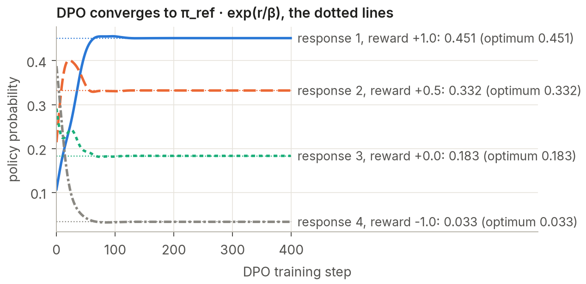

# 18 · Post-training I: SFT, reward models and preference optimisation

Part V · Post-training. Assumes Chapter 15 (the pipeline in outline: SFT, RLHF, DPO, GRPO in brief) and Chapter 1 (KL divergence). Chapter 19 continues with reinforcement learning from verifiable rewards and reasoning models; Chapter 20 covers parameter-efficient fine-tuning; Chapter 27 covers alignment failures such as sycophancy and reward hacking.

## Why it matters

A base model knows a great deal but behaves like the internet: it continues text, rambles, refuses nothing and helps with nothing in particular. Post-training turns it into an assistant, and since 2024 it has also become a major source of capability, not just style. Post-training budgets have grown from a rounding error to a substantial share of total compute. A research scientist in this area builds SFT mixtures, trains and audits reward models, runs PPO or DPO, and diagnoses over-optimisation. This chapter goes one level deeper than Chapter 15: the data, the objectives with their derivations, and the failure modes, with toy experiments whose answers are known.

Numbers in this chapter come from `code/ch18_check.py` (CPU, a few seconds).

The chapter follows the post-training stack in order (18.1). Supervised fine-tuning comes first and is mostly a data problem (18.2). Preference learning starts with reward models, which turn human comparisons into a number (18.3). Section 18.4 builds reinforcement learning from the ground up, from the policy-gradient estimator to PPO, because every RL method in the rest of the book is a variation on it. Section 18.5 explains the central danger of optimising against a learned reward, and 18.6 derives DPO, which removes the reward model and the sampling loop entirely. The chapter ends with AI feedback (18.7) and how to evaluate the result (18.8).

The unifying idea is a single objective: maximise a reward while staying close to a reference model, measured by KL divergence (Chapter 1.6). PPO optimises it by sampling, DPO in closed form, and the KL term is what keeps both from exploiting a reward that is only a proxy for what people want.

## Key concepts

- **Supervised fine-tuning (SFT)** on instruction–response data. [LIMA](https://arxiv.org/abs/2305.11206), [Tülu 3](https://arxiv.org/abs/2411.15124).
- **Reward models** trained on pairwise preferences with the Bradley–Terry model. [InstructGPT](https://arxiv.org/abs/2203.02155), [RewardBench](https://arxiv.org/abs/2403.13787).
- **Policy-gradient foundations**: the log-derivative trick, REINFORCE, baselines, actor–critic, importance sampling and trust regions. [Sutton and Barto, *Reinforcement Learning* (2nd ed.)](http://incompleteideas.net/book/the-book-2nd.html), [OpenAI Spinning Up](https://spinningup.openai.com/), [TRPO](https://arxiv.org/abs/1502.05477), [RLOO for LLMs](https://arxiv.org/abs/2402.14740).
- **PPO for language models**: policy gradient with a value function, generalised advantage estimation and clipping. [PPO](https://arxiv.org/abs/1707.06347), [GAE](https://arxiv.org/abs/1506.02438), [The N+ implementation details of RLHF with PPO](https://arxiv.org/abs/2403.17031).
- **Reward over-optimisation**: optimising a learned reward past the point where true quality improves. [Gao et al.](https://arxiv.org/abs/2210.10760).
- **Direct preference optimisation and variants**: DPO, IPO, KTO, ORPO, SimPO. [DPO](https://arxiv.org/abs/2305.18290), [IPO](https://arxiv.org/abs/2310.12036), [SimPO](https://arxiv.org/abs/2405.14734).
- **AI feedback**: preference labels or critiques from models. [Constitutional AI](https://arxiv.org/abs/2212.08073).
- **Reference text**: [Nathan Lambert's RLHF Book](https://rlhfbook.com/).

## 18.1 The post-training stack

Post-training is a sequence of stages, each with its own data and its own effect on the model. Seeing them side by side, with the data each needs and what each changes, is the map for the rest of the chapter.

| Stage | Data | Changes | Typical scale |
|---|---|---|---|
| SFT | Prompt–response demonstrations, mostly synthetic from strong models plus curated human data | Format, instruction following, skills shown in the data | 100k–a few million examples |
| Preference optimisation (DPO or RLHF) | Pairs or rankings of responses, from humans or AI judges | Helpfulness, tone, safety trade-offs, refusal calibration | 100k–1M pairs |
| RL with verifiable rewards (Chapter 19) | Prompts with checkable answers (maths, code, tool tasks) | Reasoning, precision, long chains of thought | Tens of thousands of prompts, many samples each |
| Iteration | New prompts where the model fails, new preferences on its own outputs | Everything above, on-policy | Several rounds |

**One prompt through the stages.** Consider the prompt "My dentist says I need a root canal but I'm scared. Is it really necessary?" and the kind of output each stage tends to produce (illustrative, not from a specific model):

- **Base model:** continues the text as the internet would: another forum post ("I had the same problem last year…"), a list of similar questions, or an advertisement. It knows a great deal about root canals but has no notion that it should answer.
- **After SFT:** answers in the assistant format, explains what a root canal treats and why it is recommended, and stops. Quality is bounded by the demonstrations it imitated.
- **After preference optimisation:** the answer becomes better calibrated and kinder: it acknowledges the fear, explains the risks of not treating an infected tooth, suggests asking the dentist specific questions, and avoids both overconfidence ("you definitely need it") and needless refusal ("I can't give medical advice"). These are judgements that are easy to compare and hard to demonstrate.
- **After RL on verifiable tasks:** little visible change on this prompt; the gains show up on maths, code and multi-step tool tasks (Chapter 19).

Open recipes (Tülu 3, OLMo 2, and the reports of open-weight labs) are the best documentation of how these fit together: SFT on a carefully decontaminated mixture, on-policy preference data scored by an LLM judge, then RL on verifiable tasks. Most of the effort is data: deciding which skills to cover, generating prompts, filtering responses and checking for contamination.

## 18.2 Supervised fine-tuning in depth

SFT is the simplest stage technically, ordinary next-token training on chosen examples, and the one where data choices matter most. A few thousand excellent examples can beat a million mediocre ones, and the details of what the loss covers and how conversations are formatted decide whether the model learns the intended behaviour.

**Data.** Diversity and quality matter more than volume. LIMA showed 1,000 very good examples go a long way for format; skill (maths, code, tool use) needs much more, mostly synthetic. Practical mixtures cover general chat, instruction following with constraints ("in under 50 words", "in JSON"), maths, code, safety (both refusing harmful requests and *not* refusing harmless ones), multilingual and multi-turn conversations. Responses are generated by strong models, then filtered: verify answers where possible, remove refusals that should not be refusals, deduplicate, decontaminate against evaluations (Chapter 16).

**Chat templates** wrap turns in special tokens (role markers, end-of-turn). The model learns the template; serving with a different template silently degrades quality (Chapter 9). A typical rendering of a two-turn conversation, with the tokens that receive loss marked:

```text
<|system|>You are a helpful assistant.<|end|>               no loss
<|user|>What is 17 × 24?<|end|>                             no loss
<|assistant|>17 × 24 = 408.<|end|>                          loss (including <|end|>)
<|user|>And divided by 8?<|end|>                            no loss
<|assistant|>408 ÷ 8 = 51.<|end|>                           loss
```

Training on the end-of-turn token matters: it is how the model learns to stop.

**SFT is behaviour cloning.** The loss rewards reproducing the demonstration token by token. Two consequences follow. First, the model only ever sees *good* prefixes during training, never its own mistakes, so at generation time one wrong token leads it into states it has never practised recovering from ("exposure bias"). Second, it learns the *style* of confident demonstrations even where it lacks the knowledge behind them. Both are reasons preference and RL training, which learn from the model's own samples, come next.

**Loss masking.** Compute the loss only on assistant tokens, not on the system prompt or user turns (Chapter 15). For multi-turn data, include every assistant turn.

**Packing.** Concatenate short examples into full-length rows to avoid padding waste. Reset position IDs at each example boundary and use a block-diagonal causal mask, or examples attend to each other:

```python
pos = torch.cat([torch.arange(n) for n in lens])            # lens [5, 3] -> 0 1 2 3 4 0 1 2
doc = torch.cat([torch.full((n,), i) for i, n in enumerate(lens)])
mask = (doc[:, None] == doc[None, :]) & causal               # token 6 sees only tokens 5 and 6
```

**Hyperparameters.** Small learning rates (around 1e-5 to 2e-5 for full fine-tuning of 7–70B models), 2–3 epochs, a large effective batch. SFT on a narrow set can **forget** general skills; keep a broad mixture and evaluate on held-out capabilities after every run.

**What SFT cannot do.** It shows only good answers. The model never sees what *not* to do, and imitating confident answers to questions it cannot answer teaches it to bluff. Preference optimisation and RL address both.

## 18.3 Reward models

People are much better at choosing between two answers than at scoring one on an absolute scale. A reward model turns those comparisons into a number that an optimiser can use: it learns a scalar score per response such that preferred responses score higher. Everything in RLHF depends on how good, and how exploitable, that score is.

**The Bradley–Terry model.** Assume each response y to prompt x has a scalar reward r(x, y), and a person prefers y₁ over y₂ with probability σ(r(x, y₁) − r(x, y₂)). Fit r by maximising the likelihood of observed preferences:

$$
\mathcal{L}_{\mathrm{RM}} = -\log\sigma\!\left(r(x,y_{c}) - r(x,y_{r})\right)
$$

The reward model is usually the SFT model with its output head replaced by a scalar head, trained for one epoch (more over-fits).

**Where the logistic comes from.** Suppose a rater's perceived quality of each response is its true reward plus independent noise drawn from a Gumbel distribution; the rater prefers whichever perceived quality is higher. The difference of two Gumbel variables is logistic, so P(y₁ ≻ y₂) = σ(r₁ − r₂) exactly. It is the same model as Elo ratings in chess (Chapter 23): only reward *differences* are identified, so the reward model's absolute scale and offset are arbitrary. In practice the rewards are normalised (zero mean, unit variance over a reference set) before RL, so that the KL coefficient means the same thing across runs.

**A worked example.** Two pairs with rewards (chosen, rejected) = (1.2, 0.2) and (0.3, 0.5): the first gives σ(1.0) = 0.731 probability to the observed preference, loss −log 0.731 = 0.313; the second ranks the pair the wrong way, σ(−0.2) = 0.450, loss 0.799. The mean loss is 0.556, and the gradient pushes the second pair's rewards apart in the right direction more strongly, because σ' is largest where the model is wrong or uncertain.

On synthetic preferences generated from a hidden linear reward with realistic label noise, a Bradley–Terry model trained on 1,500 pairs reaches 0.882 held-out pairwise accuracy against a ceiling of 0.894 set by the noise, and recovers the direction of the true reward almost exactly (cosine 0.998). Real reward models reach 65–75% agreement with human labels on hard pairs, because human preferences are noisy too: inter-annotator agreement on chat responses is often only 60–70%. The ceiling is set by the data.

**Data choices that matter:**

- **Response sources**: pairs sampled from the current policy (on-policy) teach the reward model about the outputs it will actually judge.
- **Margins**: asking annotators how strongly they prefer one response allows margin terms or filtering of near-ties.
- **Coverage**: if every chosen response is longer than its rejected partner, the reward model learns "longer is better". Balance or control for length.

**Evaluating reward models**: held-out preference accuracy, RewardBench-style suites with hard categories (chat, reasoning, safety), and, most important, how well the reward model's ranking predicts the downstream quality of a policy trained against it.

**Generative reward models** ask an LLM to judge (often with a rubric and a written rationale) instead of outputting a scalar. They are more interpretable, can use reasoning, and are now common for open-ended tasks; they inherit LLM-judge biases (Chapter 23).

## 18.4 Policy gradients and RLHF with PPO

Every RL method in Chapters 18, 19 and 33 is a variation on one estimator. Interviewers for post-training roles often start here ("derive the policy gradient", "why does a baseline not add bias?") before asking about PPO or GRPO, so this section builds it from the ground up.

**The setup.** Reinforcement learning is usually written as a Markov decision process: states s, actions a, a transition rule P(s′ | s, a), a reward r(s, a) and a discount γ. A policy π(a | s) chooses actions, and the goal is to maximise the expected return E[Σ_t γ^t r_t]. For a language model:

| RL term | In an LLM |
|---|---|
| State s_t | The prompt x plus the tokens generated so far, y_<t |
| Action a_t | The next token y_t |
| Policy π(a_t \| s_t) | The model's next-token distribution π_θ(y_t \| x, y_<t) |
| Transition | Deterministic: append the token |
| Reward | Usually one number at the end (reward model or verifier), plus a per-token KL penalty |
| Discount γ | 1: episodes are short and finite |

Two views are useful. The **token-level** view treats each token as an action, which is how PPO assigns credit within a response. The **sequence-level** (bandit) view treats the whole response y as one action with reward R(x, y), which is how DPO, RLOO and GRPO think about it. With deterministic transitions and a single terminal reward the two describe the same problem.

**Value functions.** V^π(s) is the expected return from state s when following π; Q^π(s, a) is the expected return after taking a in s and following π afterwards; the **advantage** A^π(s, a) = Q^π(s, a) − V^π(s) says how much better a is than the policy's average action. They satisfy the Bellman equation V^π(s) = E_(a∼π)[r(s, a) + γ V^π(s′)]. For an LLM, V(s_t) is "how likely is this partial answer to end up rewarded", which is exactly what PPO's value head tries to predict.

**The policy gradient.** We want ∇θ J(θ) with J(θ) = E_(y∼π_θ)[R(y)]. The **log-derivative trick** turns the gradient of an expectation into an expectation we can sample:

∇θ J = Σ_y ∇θ π_θ(y) R(y) = Σ_y π_θ(y) ∇θ log π_θ(y) R(y) = E_(y∼π_θ)[R(y) ∇θ log π_θ(y)]

The middle step uses ∇π = π ∇log π. For a sequence, log π_θ(y | x) = Σ_t log π_θ(y_t | x, y_<t), so the gradient is a sum over tokens of R times each token's log-probability gradient. Sampling responses and averaging gives **REINFORCE** (Williams, 1992): raise the log-probability of every token in high-reward responses, lower it in low-reward ones. Nothing about the reward needs to be differentiable, which is why a unit-test runner or a string match can serve as the reward.

**Baselines.** Subtracting any b that does not depend on the sampled action leaves the gradient unbiased, because E_(y∼π)[b ∇ log π(y)] = b Σ_y ∇π(y) = b ∇ Σ_y π(y) = b ∇1 = 0. A good baseline (close to the expected reward) removes most of the variance. The check script estimates the exact gradient of a four-response bandit from batches of 8 samples, 20,000 times:

| Rewards | Baseline | Total std of the gradient estimate | Mean estimate ÷ exact gradient |
|---|---|---|---|
| r | None | 0.174 | 1.00 |
| r + 10 | None | 3.146 | 0.93 (noise) |
| r + 10 | Group mean (includes the sample itself) | 0.093 | 0.88 |
| r + 10 | Leave-one-out mean | 0.106 | 1.00 |

Adding a constant 10 to every reward changes nothing in expectation but multiplies the noise by 18: without a baseline, every sampled response is pushed up, and only the small differences between the pushes carry signal. Both baselines cancel the shift. The leave-one-out baseline (**RLOO**) is exactly unbiased; the plain group mean, which includes the sample itself, shrinks the gradient by (N − 1)/N = 0.875 (a scale, not a direction, so in practice the learning rate absorbs it). GRPO's group mean (Chapter 19) is this baseline; PPO's value model is a learned, per-token version of it.

**Reward-to-go and actor–critic.** A token cannot affect rewards that came before it, so each token's gradient can be weighted by the return *from that token onwards* rather than the whole episode's, which removes more variance. Replacing that sampled return with a learned estimate gives **actor–critic** methods: the actor is the policy, the critic is V. The one-step **temporal-difference error** δ_t = r_t + γV(s_(t+1)) − V(s_t) is a low-variance but biased estimate of the advantage (biased wherever V is wrong); the full sampled return is unbiased but noisy. GAE, below, interpolates between them with λ.

**On-policy, off-policy and importance sampling.** The policy-gradient estimator needs samples from the current policy. Samples from an older or different policy μ can be reused through importance sampling: E_(y∼π)[f(y)] = E_(y∼μ)[(π(y)/μ(y)) f(y)]. For sequences the ratio is a product of per-token ratios, so its variance grows exponentially with length. With per-token log-ratios of standard deviation only 0.03 (a small policy change, or the numerical gap between an inference engine and a trainer):

| Response length | Variance of the sequence ratio | Effective sample size per sample |
|---|---|---|
| 100 tokens | 0.09 | 0.91 |
| 1,000 tokens | 1.46 | 0.41 |
| 4,000 tokens | 35.6 | 0.03 |

At reasoning-model lengths, full-sequence importance weights are useless. This is why PPO uses **per-token** ratios with clipping (a biased but stable approximation), why asynchronous RL bounds how stale samples may be, and why the training–inference mismatch in Chapter 19 matters.

**Trust regions.** A policy-gradient step that is too large changes the policy so much that the advantages estimated under the old policy no longer apply, and performance can collapse. TRPO constrains each update to a KL ball around the old policy; PPO approximates the same idea with the clipped ratio objective below, which needs only first-order optimisation.

**Why not Q-learning?** Value-based methods such as Q-learning (Q(s, a) ← Q(s, a) + α[r + γ max_a′ Q(s′, a′) − Q(s, a)]) and DQN learn action values and act greedily. They work well with small discrete action spaces and off-policy replay, but an LLM has a vocabulary of 100k+ actions at every step, a policy that already exists from pretraining, and a reward that arrives once at the end. Policy-gradient methods start from that pretrained policy and improve it directly, which is why essentially all LLM RL uses them. (DPO-style methods can be read as the closed-form solution of a KL-regularised version of the same problem, section 18.6.)

**RLHF: the objective.** Maximise expected reward while staying close to the reference (SFT) policy:

$$
\max_{\pi}\ \mathbb{E}_{x,\;y\sim\pi(\cdot\mid x)}\left[\,r(x,y)\,\right] - \beta\,\mathrm{KL}\!\left(\pi(\cdot\mid x)\,\Vert\,\pi_{\mathrm{ref}}(\cdot\mid x)\right)
$$

In practice the KL penalty is applied per token, and the reward model's score is added at the last token. Each generated token is an action; the "state" is the prompt plus tokens so far.

**PPO** needs a value model V (a scalar head predicting expected future reward from each position) to compute **advantages**: how much better the chosen token was than expected. **Generalised advantage estimation** mixes multi-step returns with a decay λ:

δ_t = r_t + γ V(s_(t+1)) − V(s_t),  A_t = δ_t + γλ A_(t+1)

With a reward of 1 at the last token, values [0.4, 0.5, 0.6, 0.8] and γ = 1, λ = 0.95, the advantages are [0.547, 0.470, 0.390, 0.200].

**One PPO iteration, step by step.** For a batch of 512 prompts:

1. **Roll out**: sample one response per prompt from the current policy (temperature 1), keeping each token's log-probability under the policy (log π_old).
2. **Score**: run the reward model on each full response (one scalar per response); run the frozen reference model to get log π_ref per token.
3. **Shape rewards**: per token, reward_t = −β (log π_old − log π_ref); add the reward-model score to the last token.
4. **Values and advantages**: the value head predicts V(s_t) at every token; compute advantages with GAE and returns = advantages + values; normalise advantages across the batch (zero mean, unit variance).
5. **Update**: for 1–4 epochs over mini-batches of these samples, recompute log π_new, form the ratio ρ = exp(log π_new − log π_old) per token, and minimise −min(ρA, clip(ρ)A) plus a value loss (V − return)².
6. **Repeat** with the updated policy as the new sampler.

Steps 1 and 2 (generation and three forward passes) usually dominate the time, which is why RLHF systems put a fast inference engine in the loop (Chapter 19).

**The clipped objective** prevents a single update from moving the policy too far from the one that sampled the data. With ε = 0.2, maximise per token:

$$
\min\!\left(\rho A,\ \mathrm{clip}(\rho,\,1-\epsilon,\,1+\epsilon)\,A\right),\qquad \rho = \dfrac{\pi_{\mathrm{new}}}{\pi_{\mathrm{old}}}
$$

where ρ is the probability ratio between the new and the sampling policy:

| Ratio | Advantage | Objective | Why |
|---|---|---|---|
| 1.5 | +1 | +1.20 | Gain capped at 1.2: no incentive to push further |
| 0.5 | +1 | +0.50 | Unclipped: the update should raise the probability |
| 1.5 | −1 | −1.50 | Unclipped: pessimistic, penalised fully |
| 0.5 | −1 | −0.80 | Capped: no incentive to push further down |


*The clipped objective as a function of the probability ratio (ε = 0.2, shaded band). For a good token the gain stops growing once the ratio exceeds 1.2; for a bad token the penalty stops growing once it falls below 0.8. Moves in the "wrong" direction are never capped.*

**Estimating the KL.** The KL term is estimated from samples. Schulman's three estimators, with r = π_ref/π on samples from π: k1 = −log r (unbiased, high variance, can be negative per sample), k2 = (log r)²/2 (biased, low variance), k3 = r − 1 − log r (unbiased, low variance, always non-negative). On a toy pair of distributions with true KL 0.0253, the sample standard deviations are 0.22, 0.014 and 0.016. Which estimator is used, and whether it is added to the reward or to the loss, measurably changes RL behaviour; implementations differ, so check before comparing results.

**Practicalities.** PPO for LLMs keeps four models (policy, reference, reward, value), alternates generation and training, and is sensitive to many details: reward normalisation, advantage whitening, value-function initialisation from the reward model, learning rates, the number of PPO epochs per batch, and the generation settings. "The N+ implementation details of RLHF with PPO" catalogues them; most failed replications trace back to one of them.

## 18.5 Over-optimisation and Goodhart's law

A reward model is a learned approximation of human preferences, accurate on the kinds of responses it was trained on and unreliable elsewhere. Optimise against it hard enough and the policy finds those unreliable regions. This is Goodhart's law for language models, and it is the main reason every RLHF objective includes a leash.

A reward model is a proxy. Optimise it hard enough and the policy finds what the proxy rewards but people do not: length, confident tone, flattery, formatting tricks. Gao et al. (2022) measured this with a large "gold" reward model standing in for people: as optimisation proceeds (measured by KL from the reference), gold reward first rises, then falls, while proxy reward keeps rising.

The check script reproduces the shape with best-of-n sampling. Each response has a quality and a length; people (gold) like quality and dislike lengths far from ideal; the proxy reward model likes quality and also rewards length. Best-of-n has a known KL from the base policy, log n − (n − 1)/n:

| Best-of-n | KL (nats) | Proxy reward | Gold reward |
|---|---|---|---|
| 1 | 0.00 | 0.00 | −0.50 |
| 4 | 0.64 | 1.46 | 0.09 |
| 16 | 1.84 | 2.50 | 0.16 |
| 64 | 3.17 | 3.34 | 0.00 |
| 256 | 4.55 | 4.01 | −0.29 |
| 1,024 | 5.93 | 4.65 | −0.56 |


*The same simulation over a finer range of n (400,000 samples). Proxy reward rises steadily with KL; gold reward peaks early and then falls below where it started.*

Gold peaks around n = 8–16 and ends worse than no optimisation at all. Defences: a KL penalty or early stopping by KL budget; larger and better reward models (over-optimisation sets in later); ensembles of reward models; explicit length control; regular human or gold-judge evaluation of checkpoints; and fresh preference data on the current policy's outputs.

## 18.6 Direct preference optimisation and its family

**Derivation.** Start from the KL-regularised objective for one prompt: maximise Σ_y π(y) r(y) − β Σ_y π(y) log(π(y)/π_ref(y)). Define the distribution π*(y) = π_ref(y) exp(r(y)/β) / Z with Z = Σ_y π_ref(y) exp(r(y)/β). A line of algebra shows the objective equals −β KL(π ‖ π*) + β log Z. The second term does not depend on π, and a KL divergence is smallest (zero) when the two distributions are equal, so the optimum is π = π*. In words: the best KL-regularised policy reweights the reference by exp(reward/β). A small β trusts the reward and moves far; a large β stays close to the reference.

The KL-regularised objective in 18.4 therefore has the closed-form optimal policy

$$
\pi^{*}(y\mid x) = \dfrac{\pi_{\mathrm{ref}}(y\mid x)\,\exp\!\left(r(x,y)/\beta\right)}{Z(x)}
$$

Invert it:

$$
r(x,y) = \beta\log\dfrac{\pi^{*}(y\mid x)}{\pi_{\mathrm{ref}}(y\mid x)} + \beta\log Z(x)
$$

Substitute into the Bradley–Terry likelihood; Z(x) cancels between the two responses, leaving a loss on the policy alone:

$$
\mathcal{L}_{\mathrm{DPO}} = -\log\sigma\!\left(\beta\left[\log\dfrac{\pi(y_c\mid x)}{\pi_{\mathrm{ref}}(y_c\mid x)} - \log\dfrac{\pi(y_r\mid x)}{\pi_{\mathrm{ref}}(y_r\mid x)}\right]\right)
$$

**Check it.** On a four-response bandit with rewards [1, 0.5, 0, −1], β = 0.5 and reference probabilities [0.1, 0.2, 0.3, 0.4], the closed-form optimum is [0.451, 0.332, 0.183, 0.033]. Training a softmax policy with the DPO loss on Bradley–Terry preferences between all pairs converges to exactly [0.451, 0.332, 0.183, 0.033]. With infinite, perfectly modelled preference data, DPO and KL-regularised RLHF have the same solution.



*Policy probabilities during DPO training on the four-response bandit. Each converges to its closed-form optimum (dotted), within about 100 steps here.*

**What the DPO gradient does.** Differentiating the loss gives, per pair, a weight σ(r̂_rejected − r̂_chosen) times [∇ log π(y_c) − ∇ log π(y_r)], where r̂ = β log(π/π_ref) is the implicit reward. Pairs the model already ranks correctly by a wide margin get almost no weight; pairs it ranks wrongly get nearly full weight. The update raises the chosen response's likelihood and lowers the rejected one's, but nothing in the loss requires the chosen likelihood itself to go up, which is the root of likelihood displacement below.

**In practice they differ.** DPO trains on a fixed dataset; RLHF samples from the current policy. Offline DPO cannot discover responses that are not in the data, and it is sensitive to the gap between the data distribution and the policy. Remedies: **on-policy or iterative DPO** (sample pairs from the current model, score them with a reward model or judge, train, repeat), which closes much of the gap to PPO.

**Known failure modes of DPO:**

- **Likelihood displacement**: the log-probabilities of both chosen and rejected responses often fall during training; only their difference rises. Probability mass moves to responses outside the data, sometimes worse ones. Monitor both.
- **Over-fitting to near-deterministic preferences**: if a pair is always preferred one way, the DPO optimum pushes the log-ratio to infinity, ignoring β.
- **Length exploitation**: summed log-probabilities favour longer chosen responses.

**Variants** (with the margin h = log-ratio of chosen minus log-ratio of rejected; for h = 1.5 the DPO loss with β = 0.1 is 0.621):

| Method | Change | Why |
|---|---|---|
| IPO | Squared loss (h − 1/(2β))² instead of log-sigmoid | Bounded target margin; no runaway on deterministic preferences |
| cDPO / label smoothing | Assume some labels are flipped | Robust to noisy preferences |
| KTO | Learns from single thumbs-up/down labels, prospect-theory loss | Fits product feedback with no pairs |
| ORPO | Adds an odds-ratio preference term to the SFT loss, no reference model | One stage instead of two |
| SimPO | Length-normalised average log-probability, a target margin, no reference model | Removes length bias and the reference model's memory |

None dominates. Published comparisons depend heavily on hyperparameters (β, learning rate) and on evaluation; tune each method before comparing, and report several benchmarks, including length-controlled ones.

## 18.7 AI feedback

Preference data from people is the bottleneck of RLHF. A strong model, given a clear rubric, can produce preference labels far faster and more consistently. The quality of those labels depends almost entirely on the rubric and on known biases of AI judges.

A rubric used by an AI judge for preference labels might read: "Prefer the response that (1) answers the question that was asked, (2) is factually correct, and says so when unsure, (3) is no longer than needed, (4) refuses only if the request is harmful, explaining briefly. If both are equal, answer TIE." Rubrics like this make judgements reproducible and auditable; their weakness is that the judge applies them through its own biases, so the rubric should be tested on cases with known answers before use.

Human preference labels are slow and expensive. Most current pipelines use **AI feedback** for a large share of labels: an LLM judge compares responses (often with a rubric or a written constitution), or writes critiques that are used for revision. Constitutional AI (Bai et al., 2022) used a list of principles to generate critiques, revisions and preference labels for harmlessness. The risks are those of LLM judges in general (Chapter 23): self-preference, position and length bias, and blind spots shared between judge and policy. Keep a human-labelled audit set, rotate or ensemble judges, and measure agreement with humans per category.

## 18.8 Evaluating post-training

Post-training changes many behaviours at once, some intended and some not. A model that becomes more helpful may also become more verbose, more sycophantic, or worse at maths. Evaluation has to cover the intended gains and the likely regressions together.

- **Instruction following** with verifiable constraints (IFEval-style).
- **Chat quality** judged pairwise against a baseline, with length control (length-controlled AlpacaEval, Arena-Hard).
- **Capabilities retained**: knowledge, maths, code, multilingual, compared with the base or previous model; post-training regressions are common and easy to miss.
- **Safety in both directions**: harmful compliance rate and over-refusal rate on benign prompts that look risky.
- **Calibration and honesty**: does the model say "I don't know" when it should?
- **Human evaluation** on a sample before any release decision.

## Pitfalls

- Training the SFT loss on user turns, or packing without resetting positions and masks.
- Reward models trained on pairs where the chosen response is usually longer.
- Optimising against a reward model without tracking KL and a gold or human evaluation.
- Comparing DPO variants each at a single, default β and learning rate.
- Watching only the DPO margin, not the chosen and rejected log-probabilities.
- Reporting chat-benchmark gains without length control or capability regressions.

## Interview questions

**1. What makes a good SFT dataset?** Diverse prompts covering target skills and formats, high-quality verified responses, both refusals and non-refusals done right, multi-turn data, deduplicated and decontaminated. Quality beats volume for format; skills need volume.

**2. Write the Bradley–Terry reward-model loss and explain its assumptions.** −log σ(r_c − r_r). Assumes preferences come from a single scalar reward per response plus logistic noise; ignores ties, intransitive and context-dependent preferences.

**3. Walk through PPO for LLMs.** Sample responses; score them with the reward model; add a per-token KL penalty to the reference; compute advantages with a value model and GAE; update with the clipped ratio objective for a few epochs; repeat.

**4. Why clip the probability ratio?** The data was sampled by the old policy; large policy changes make the advantage estimates invalid. Clipping removes the incentive to move the ratio beyond 1 ± ε.

**5. Derive DPO in a few lines.** The KL-regularised optimum is π_ref·exp(r/β)/Z. Solve for r, substitute into Bradley–Terry; Z cancels; the loss depends only on log-ratios of policy to reference.

**6. If DPO and RLHF share an optimum, why do they behave differently?** DPO fits a fixed offline dataset; PPO samples on-policy and can explore. Distribution shift, finite data and likelihood displacement make offline DPO weaker; iterative on-policy DPO narrows the gap.

**7. What is reward over-optimisation and how do you detect and limit it?** Proxy reward keeps rising while true quality falls. Detect with a gold judge or humans on checkpoints at increasing KL; limit with KL penalties, early stopping, better or ensembled reward models, length control.

**8. Your DPO run increases the margin but the chosen log-probability falls. Is that a problem?** It is likelihood displacement: mass moves to other responses. Check generation quality; add an SFT term on chosen responses, lower the learning rate, or use on-policy pairs.

**9. When would you choose KTO over DPO?** When feedback is binary per response (thumbs up/down, accept/reject) and pairs are not available.

**10. What are the risks of AI feedback?** Judge biases (self-preference, length, position), shared blind spots, and reward hacking against the judge. Audit against human labels, rotate judges, control for length.

**11. How would you evaluate a new post-trained checkpoint before release?** Instruction-following, length-controlled chat quality, capability regression suite, safety and over-refusal, calibration, plus a human evaluation sample; compare with the previous checkpoint with confidence intervals.

**12. Derive the policy gradient.** J = E_(y∼π)[R(y)]; ∇J = Σ_y ∇π(y) R(y) = Σ_y π(y) ∇log π(y) R(y) = E[R(y) ∇log π(y)]. For a sequence, ∇log π(y) is the sum of per-token log-probability gradients. No gradient of the reward is needed.

**13. Why does a baseline not bias the gradient, and which baseline is best?** E[b ∇log π(y)] = b ∇Σ_y π(y) = 0 for any b that does not depend on the sampled y. Variance is lowest near the expected reward: a learned value (PPO), a group mean (GRPO) or a leave-one-out mean (RLOO, exactly unbiased; the plain group mean shrinks the gradient by (N − 1)/N).

**14. On-policy versus off-policy: why can't PPO reuse old rollouts indefinitely?** Off-policy reuse needs importance weights; for a sequence they are products of per-token ratios whose variance grows exponentially with length. PPO uses per-token ratios, clips them, and runs only a few epochs per batch so the data stays nearly on-policy.

**15. Why do LLMs use policy-gradient methods rather than Q-learning?** Huge action space (the vocabulary) at every step, a strong pretrained policy to start from, and a sparse terminal reward. Policy gradients improve the existing policy directly; Q-learning would need to learn values for 100k+ actions per state from scratch.

## Practice

1. Fine-tune a 0.5–1B model with SFT on a small instruction set using TRL; implement packing with correct masks and check that loss on user tokens is zero.
2. Train a reward model on a public preference dataset; report held-out accuracy and the correlation between reward and response length.
3. Run DPO and SimPO from the same SFT checkpoint with a small sweep of β and learning rate; plot chosen and rejected log-probabilities during training.
4. **Research exercise.** Reproduce the over-optimisation curve with a real reward model: best-of-n sampling for n = 1 to 256 from a small policy, scored by a small (proxy) and a larger (gold) reward model. Plot both against log n − (n−1)/n, with bootstrap confidence intervals.
5. Re-derive the GAE recursion and implement it for a batch of variable-length responses.
6. Implement REINFORCE on a small bandit with no baseline, a group-mean baseline and a leave-one-out baseline. Shift all rewards by +10 and measure the variance of each gradient estimate against the exact gradient (the check script's experiment), then repeat with N = 2, 8 and 32 samples.

## Read next

- Ouyang et al., "Training language models to follow instructions with human feedback" (InstructGPT, 2022).
- Schulman et al., "Proximal Policy Optimization Algorithms" (2017) and "High-Dimensional Continuous Control Using Generalized Advantage Estimation" (2015).
- Huang et al., "The N+ Implementation Details of RLHF with PPO: A Case Study on TL;DR Summarization" (2024).
- Gao, Schulman and Hilton, "Scaling Laws for Reward Model Overoptimization" (2022).
- Rafailov et al., "Direct Preference Optimization" (2023); Azar et al., "A General Theoretical Paradigm to Understand Learning from Human Preferences" (IPO, 2023); Meng et al., "SimPO" (2024).
- Lambert et al., "Tülu 3: Pushing Frontiers in Open Language Model Post-Training" (2024).
- Nathan Lambert, "RLHF Book" (online).
- Links to these papers are in the Key concepts section at the top of this chapter.

## Done when

You can derive the policy gradient, show why a baseline leaves it unbiased, and explain why importance weights fail on long sequences. You can design an SFT mixture, implement masking and packing correctly and explain what SFT cannot teach. You can train and evaluate a Bradley–Terry reward model and explain its limits. You can walk through PPO for LLMs, compute GAE advantages and the clipped objective, and compare KL estimators.

You can explain reward over-optimisation with the best-of-n example and list defences. You can derive DPO, explain why it matches RLHF in theory but not in practice, and compare IPO, KTO, ORPO and SimPO. You can plan an evaluation of a post-trained model.

---

[← 17 · Pretraining at scale](17-pretraining-at-scale.md) · [Contents](../README.md#contents) · [19 · Post-training II: reinforcement learning and reasoning models →](19-post-training-rl-and-reasoning.md)
