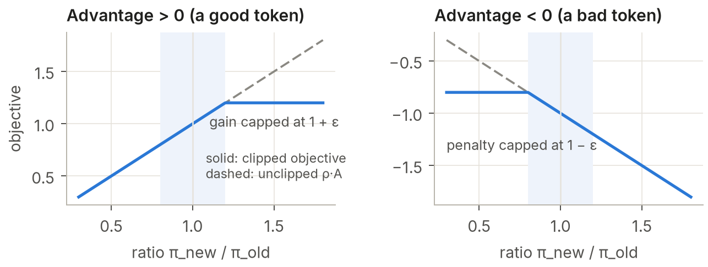
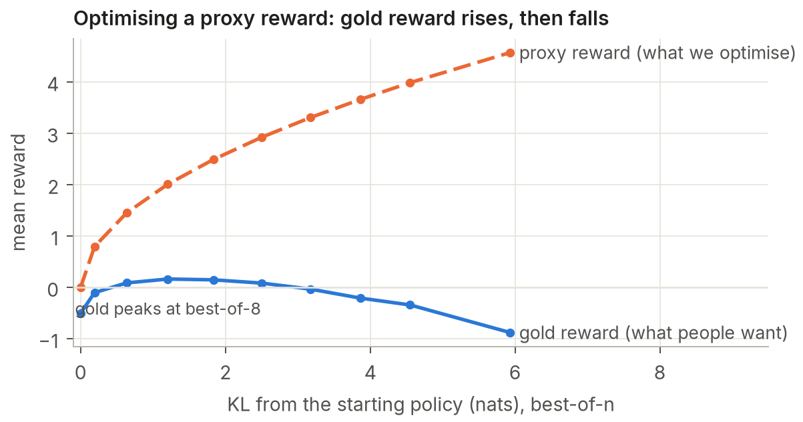

# 18 · Post-training I: SFT, reward models and preference optimisation

Part V · Post-training. Assumes Chapter 15 (the pipeline in outline: SFT, RLHF, DPO, GRPO in brief) and Chapter 1 (KL divergence). Chapter 19 continues with reinforcement learning from verifiable rewards and reasoning models; Chapter 20 covers parameter-efficient fine-tuning; Chapter 27 covers alignment failures such as sycophancy and reward hacking.

## Why it matters

A base model knows a great deal but behaves like the internet: it continues text, rambles, refuses nothing and helps with nothing in particular. Post-training turns it into an assistant, and since 2024 it has also become a major source of capability, not just style. Post-training budgets have grown from a rounding error to a substantial share of total compute. A research scientist in this area builds SFT mixtures, trains and audits reward models, runs PPO or DPO, and diagnoses over-optimisation. This chapter goes one level deeper than Chapter 15: the data, the objectives with their derivations, and the failure modes, with toy experiments whose answers are known.

Numbers in this chapter come from `code/ch18_check.py` (CPU, a few seconds).

The chapter follows the post-training stack in order (18.1). Supervised fine-tuning comes first and is mostly a data problem (18.2). Preference learning starts with reward models, which turn human comparisons into a number (18.3). Section 18.4 builds reinforcement learning from the ground up, from the policy-gradient estimator to PPO, because every RL method in the rest of the book is a variation on it. Section 18.5 explains the central danger of optimising against a learned reward, and 18.6 derives DPO, which removes the reward model and the sampling loop entirely. The chapter ends with AI feedback (18.7) and how to evaluate the result (18.8).

The unifying idea is a single objective: maximise a reward while staying close to a reference model, measured by KL divergence (Chapter 1.6). PPO optimises it by sampling, DPO in closed form, and the KL term is what keeps both from exploiting a reward that is only a proxy for what people want.

Interviews for post-training roles test this chapter at two depths. The first is derivation: the policy gradient and why a baseline does not bias it, GAE, the clipped objective, and DPO from the KL-regularised objective, each of which you should be able to write on a whiteboard in a few minutes. The second is judgement: why a DPO run's chosen log-probability falls, when PPO is worth its cost, why Llama 3 chose rejection sampling and DPO, how to collect preference data that does not teach "longer is better". The worked numbers in each section (0.556, [0.547, 0.470, 0.390, 0.200], [0.451, 0.332, 0.183, 0.033], 0.621) are there so you can check your own derivations.

## Key concepts

- **Supervised fine-tuning (SFT)** on instruction–response data. [LIMA](https://arxiv.org/abs/2305.11206), [Tülu 3](https://arxiv.org/abs/2411.15124).
- **Reward models** trained on pairwise preferences with the Bradley–Terry model. [InstructGPT](https://arxiv.org/abs/2203.02155), [RewardBench](https://arxiv.org/abs/2403.13787).
- **Policy-gradient foundations**: the log-derivative trick, REINFORCE, baselines, actor–critic, importance sampling and trust regions. [Sutton and Barto, *Reinforcement Learning* (2nd ed.)](http://incompleteideas.net/book/the-book-2nd.html), [OpenAI Spinning Up](https://spinningup.openai.com/), [TRPO](https://arxiv.org/abs/1502.05477), [RLOO for LLMs](https://arxiv.org/abs/2402.14740).
- **PPO for language models**: policy gradient with a value function, generalised advantage estimation and clipping. [PPO](https://arxiv.org/abs/1707.06347), [GAE](https://arxiv.org/abs/1506.02438), [The N+ implementation details of RLHF with PPO](https://arxiv.org/abs/2403.17031).
- **Reward over-optimisation**: optimising a learned reward past the point where true quality improves. [Gao et al.](https://arxiv.org/abs/2210.10760).
- **Direct preference optimisation and variants**: DPO, IPO, KTO, ORPO, SimPO. [DPO](https://arxiv.org/abs/2305.18290), [IPO](https://arxiv.org/abs/2310.12036), [KTO](https://arxiv.org/abs/2402.01306), [ORPO](https://arxiv.org/abs/2403.07691), [SimPO](https://arxiv.org/abs/2405.14734).
- **Rejection-sampling fine-tuning and iterative preference rounds**: [Llama 2](https://arxiv.org/abs/2307.09288), [Llama 3](https://arxiv.org/abs/2407.21783).
- **AI feedback**: preference labels or critiques from models. [Constitutional AI](https://arxiv.org/abs/2212.08073).
- **Reference text**: [Nathan Lambert's RLHF Book](https://rlhfbook.com/).

## 18.1 The post-training stack

Post-training is a sequence of stages, each with its own data and its own effect on the model. Seeing them side by side, with the data each needs and what each changes, is the map for the rest of the chapter.

| Stage | Data | Changes | Typical scale |
|---|---|---|---|
| SFT | Prompt–response demonstrations, mostly synthetic from strong models plus curated human data | Format, instruction following, skills shown in the data | 100k–a few million examples |
| Preference optimisation (DPO or RLHF) | Pairs or rankings of responses, from humans or AI judges | Helpfulness, tone, safety trade-offs, refusal calibration | 100k–1M pairs |
| RL with verifiable rewards (Chapter 19) | Prompts with checkable answers (maths, code, tool tasks) | Reasoning, precision, long chains of thought | Tens of thousands of prompts, many samples each |
| Iteration | New prompts where the model fails, new preferences on its own outputs | Everything above, on-policy | Several rounds |

**One prompt through the stages.** Consider the prompt "My dentist says I need a root canal but I'm scared. Is it really necessary?" and the kind of output each stage tends to produce (illustrative, not from a specific model):

- **Base model:** continues the text as the internet would: another forum post ("I had the same problem last year…"), a list of similar questions, or an advertisement. It knows a great deal about root canals but has no notion that it should answer.
- **After SFT:** answers in the assistant format, explains what a root canal treats and why it is recommended, and stops. Quality is bounded by the demonstrations it imitated.
- **After preference optimisation:** the answer becomes better calibrated and kinder: it acknowledges the fear, explains the risks of not treating an infected tooth, suggests asking the dentist specific questions, and avoids both overconfidence ("you definitely need it") and needless refusal ("I can't give medical advice"). These are judgements that are easy to compare and hard to demonstrate.
- **After RL on verifiable tasks:** little visible change on this prompt; the gains show up on maths, code and multi-step tool tasks (Chapter 19).

Open recipes (Tülu 3, OLMo 2, and the reports of open-weight labs) are the best documentation of how these fit together: SFT on a carefully decontaminated mixture, on-policy preference data scored by an LLM judge, then RL on verifiable tasks. Most of the effort is data: deciding which skills to cover, generating prompts, filtering responses and checking for contamination.

## 18.2 Supervised fine-tuning in depth

SFT is the simplest stage technically, ordinary next-token training on chosen examples, and the one where data choices matter most. A few thousand excellent examples can beat a million mediocre ones, and the details of what the loss covers and how conversations are formatted decide whether the model learns the intended behaviour.

**Data.** Diversity and quality matter more than volume. LIMA showed 1,000 very good examples go a long way for format; skill (maths, code, tool use) needs much more, mostly synthetic. Practical mixtures cover general chat, instruction following with constraints ("in under 50 words", "in JSON"), maths, code, safety (both refusing harmful requests and *not* refusing harmless ones), multilingual and multi-turn conversations. Responses are generated by strong models, then filtered: verify answers where possible, remove refusals that should not be refusals, deduplicate, decontaminate against evaluations (Chapter 16).

**Chat templates** wrap turns in special tokens (role markers, end-of-turn). The model learns the template; serving with a different template silently degrades quality (Chapter 9). A typical rendering of a two-turn conversation, with the tokens that receive loss marked:

```text
<|system|>You are a helpful assistant.<|end|>               no loss
<|user|>What is 17 × 24?<|end|>                             no loss
<|assistant|>17 × 24 = 408.<|end|>                          loss (including <|end|>)
<|user|>And divided by 8?<|end|>                            no loss
<|assistant|>408 ÷ 8 = 51.<|end|>                           loss
```

Training on the end-of-turn token matters: it is how the model learns to stop.

**SFT is behaviour cloning.** The loss rewards reproducing the demonstration token by token. Two consequences follow. First, the model only ever sees *good* prefixes during training, never its own mistakes, so at generation time one wrong token leads it into states it has never practised recovering from ("exposure bias"). Second, it learns the *style* of confident demonstrations even where it lacks the knowledge behind them. Both are reasons preference and RL training, which learn from the model's own samples, come next.

**Loss masking.** Compute the loss only on assistant tokens, not on the system prompt or user turns (Chapter 15). For multi-turn data, include every assistant turn.

**Packing.** Concatenate short examples into full-length rows to avoid padding waste. Reset position IDs at each example boundary and use a block-diagonal causal mask, or examples attend to each other:

```python
pos = torch.cat([torch.arange(n) for n in lens])            # lens [5, 3] -> 0 1 2 3 4 0 1 2
doc = torch.cat([torch.full((n,), i) for i, n in enumerate(lens)])
mask = (doc[:, None] == doc[None, :]) & causal               # token 6 sees only tokens 5 and 6
```

**Hyperparameters.** Small learning rates (around 1e-5 to 2e-5 for full fine-tuning of 7–70B models), 2–3 epochs, a large effective batch. SFT on a narrow set can **forget** general skills; keep a broad mixture and evaluate on held-out capabilities after every run.

**What SFT cannot do.** It shows only good answers. The model never sees what *not* to do, and imitating confident answers to questions it cannot answer teaches it to bluff. Preference optimisation and RL address both.

## 18.3 Reward models

People are much better at choosing between two answers than at scoring one on an absolute scale. A reward model turns those comparisons into a number that an optimiser can use: it learns a scalar score per response such that preferred responses score higher. Everything in RLHF depends on how good, and how exploitable, that score is.

**The Bradley–Terry model.** Assume each response y to prompt x has a scalar reward r(x, y), and a person prefers y₁ over y₂ with probability σ(r(x, y₁) − r(x, y₂)). Fit r by maximising the likelihood of observed preferences:

$$
\mathcal{L}_{\mathrm{RM}} = -\log\sigma\!\left(r(x,y_{c}) - r(x,y_{r})\right)
$$

The reward model is usually the SFT model with its output head replaced by a scalar head, trained for one epoch (more over-fits).

**Where the logistic comes from.** Suppose a rater's perceived quality of each response is its true reward plus independent noise drawn from a Gumbel distribution; the rater prefers whichever perceived quality is higher. The difference of two Gumbel variables is logistic, so P(y₁ ≻ y₂) = σ(r₁ − r₂) exactly. It is the same model as Elo ratings in chess (Chapter 23): only reward *differences* are identified, so the reward model's absolute scale and offset are arbitrary. In practice the rewards are normalised (zero mean, unit variance over a reference set) before RL, so that the KL coefficient means the same thing across runs.

**A worked example.** Two pairs with rewards (chosen, rejected) = (1.2, 0.2) and (0.3, 0.5): the first gives σ(1.0) = 0.731 probability to the observed preference, loss −log 0.731 = 0.313; the second ranks the pair the wrong way, σ(−0.2) = 0.450, loss 0.799. The mean loss is 0.556, and the gradient pushes the second pair's rewards apart in the right direction more strongly, because σ' is largest where the model is wrong or uncertain.

On synthetic preferences generated from a hidden linear reward with realistic label noise, a Bradley–Terry model trained on 1,500 pairs reaches 0.882 held-out pairwise accuracy against a ceiling of 0.894 set by the noise, and recovers the direction of the true reward almost exactly (cosine 0.998). Real reward models reach 65–75% agreement with human labels on hard pairs, because human preferences are noisy too: inter-annotator agreement on chat responses is often only 60–70%. The ceiling is set by the data.

**Data choices that matter:**

- **Response sources**: pairs sampled from the current policy (on-policy) teach the reward model about the outputs it will actually judge.
- **Margins**: asking annotators how strongly they prefer one response allows margin terms or filtering of near-ties.
- **Coverage**: if every chosen response is longer than its rejected partner, the reward model learns "longer is better". Balance or control for length.

### Collecting preference data

The data choices above assume someone has already decided what "better" means. In practice that decision is most of the work, and it is where reward models are won or lost.

**Guidelines.** Annotators need a written rubric with an order of priority, for example: harmlessness first, then correctness, then helpfulness, then concision and style. Without the order, two careful annotators resolve conflicts differently ("this answer is more helpful but slightly unsafe") and the disagreement becomes label noise. Good guidelines include worked examples of hard cases, explicitly including the cases where refusing is the wrong answer.

**Strength and ties.** Asking for a preference *strength* (Llama 2 used a four-level scale from "significantly better" to "negligibly better or unsure") lets you drop near-ties or weight pairs by margin. Ties carry information too. One option is to drop them; another is to keep them with a soft label of 0.5 on each side, −½ log σ(d) − ½ log σ(−d) for reward difference d, which is smallest (0.693) at d = 0 and grows to 0.813 at d = 1, so it pulls the two rewards together.

**Agreement and calibration.** Have a share of pairs (5–10%) labelled by two or more people and measure agreement per category. If annotators agree only 65% of the time on chat helpfulness, a reward model scoring 65% against single labels is at the ceiling of that data, and further "improvements" fit noise. Seed the queue with gold items whose answers are known, track each annotator's accuracy on them over time, and retrain or remove those who drift. Rater pools change, and so does what they prefer.

**Cost.** Budget from annotator time, not price lists: at four minutes per careful comparison, 100,000 pairs take about 6,700 annotator-hours, before quality control. That figure is the main reason AI feedback (18.7) took over most of the volume, with humans kept for the hard, high-stakes and audit slices.

**Several objectives.** Helpfulness and harmlessness pull in opposite directions on borderline prompts. Training one reward model on both mixes two scales and lets one swamp the other. Llama 2 trained separate helpfulness and safety reward models and used the safety score when a prompt was risky or the response scored as unsafe. Whatever the combination rule, evaluate both directions (harmful compliance and over-refusal, 18.8).

### Evaluating reward models

**Evaluating reward models**: held-out preference accuracy, RewardBench-style suites with hard categories (chat, reasoning, safety), and, most important, how well the reward model's ranking predicts the downstream quality of a policy trained against it.

**Generative reward models** ask an LLM to judge (often with a rubric and a written rationale) instead of outputting a scalar. They are more interpretable, can use reasoning, and are now common for open-ended tasks; they inherit LLM-judge biases (Chapter 23).

## 18.4 Policy gradients and RLHF with PPO

Every RL method in Chapters 18, 19 and 33 is a variation on one estimator. Interviewers for post-training roles often start here ("derive the policy gradient", "why does a baseline not add bias?") before asking about PPO or GRPO, so this section builds it from the ground up.

**The setup.** Reinforcement learning is usually written as a Markov decision process: states s, actions a, a transition rule P(s′ | s, a), a reward r(s, a) and a discount γ. A policy π(a | s) chooses actions, and the goal is to maximise the expected return E[Σ_t γ^t r_t]. For a language model:

| RL term | In an LLM |
|---|---|
| State s_t | The prompt x plus the tokens generated so far, y_<t |
| Action a_t | The next token y_t |
| Policy π(a_t \| s_t) | The model's next-token distribution π_θ(y_t \| x, y_<t) |
| Transition | Deterministic: append the token |
| Reward | Usually one number at the end (reward model or verifier), plus a per-token KL penalty |
| Discount γ | 1: episodes are short and finite |

Two views are useful. The **token-level** view treats each token as an action, which is how PPO assigns credit within a response. The **sequence-level** (bandit) view treats the whole response y as one action with reward R(x, y), which is how DPO, RLOO and GRPO think about it. With deterministic transitions and a single terminal reward the two describe the same problem.

**Value functions.** V^π(s) is the expected return from state s when following π; Q^π(s, a) is the expected return after taking a in s and following π afterwards; the **advantage** A^π(s, a) = Q^π(s, a) − V^π(s) says how much better a is than the policy's average action. They satisfy the Bellman equation V^π(s) = E_(a∼π)[r(s, a) + γ V^π(s′)]. For an LLM, V(s_t) is "how likely is this partial answer to end up rewarded", which is exactly what PPO's value head tries to predict.

**The policy gradient.** We want ∇θ J(θ) with J(θ) = E_(y∼π_θ)[R(y)]. The **log-derivative trick** turns the gradient of an expectation into an expectation we can sample:

∇θ J = Σ_y ∇θ π_θ(y) R(y) = Σ_y π_θ(y) ∇θ log π_θ(y) R(y) = E_(y∼π_θ)[R(y) ∇θ log π_θ(y)]

The middle step uses ∇π = π ∇log π. For a sequence, log π_θ(y | x) = Σ_t log π_θ(y_t | x, y_<t), so the gradient is a sum over tokens of R times each token's log-probability gradient. Sampling responses and averaging gives **REINFORCE** (Williams, 1992): raise the log-probability of every token in high-reward responses, lower it in low-reward ones. Nothing about the reward needs to be differentiable, which is why a unit-test runner or a string match can serve as the reward.

**Baselines.** Subtracting any b that does not depend on the sampled action leaves the gradient unbiased, because E_(y∼π)[b ∇ log π(y)] = b Σ_y ∇π(y) = b ∇ Σ_y π(y) = b ∇1 = 0. A good baseline (close to the expected reward) removes most of the variance. The check script estimates the exact gradient of a four-response bandit from batches of 8 samples, 20,000 times:

| Rewards | Baseline | Total std of the gradient estimate | Mean estimate ÷ exact gradient |
|---|---|---|---|
| r | None | 0.174 | 1.00 |
| r + 10 | None | 3.146 | 0.93 (noise) |
| r + 10 | Group mean (includes the sample itself) | 0.093 | 0.88 |
| r + 10 | Leave-one-out mean | 0.106 | 1.00 |

Adding a constant 10 to every reward changes nothing in expectation but multiplies the noise by 18: without a baseline, every sampled response is pushed up, and only the small differences between the pushes carry signal. Both baselines cancel the shift. The leave-one-out baseline (**RLOO**) is exactly unbiased; the plain group mean, which includes the sample itself, shrinks the gradient by (N − 1)/N = 0.875 (a scale, not a direction, so in practice the learning rate absorbs it). GRPO's group mean (Chapter 19) is this baseline; PPO's value model is a learned, per-token version of it.

**Reward-to-go and actor–critic.** A token cannot affect rewards that came before it, so each token's gradient can be weighted by the return *from that token onwards* rather than the whole episode's, which removes more variance. Replacing that sampled return with a learned estimate gives **actor–critic** methods: the actor is the policy, the critic is V. The one-step **temporal-difference error** δ_t = r_t + γV(s_(t+1)) − V(s_t) is a low-variance but biased estimate of the advantage (biased wherever V is wrong); the full sampled return is unbiased but noisy. GAE, below, interpolates between them with λ.

**On-policy, off-policy and importance sampling.** The policy-gradient estimator needs samples from the current policy. Samples from an older or different policy μ can be reused through importance sampling: E_(y∼π)[f(y)] = E_(y∼μ)[(π(y)/μ(y)) f(y)]. For sequences the ratio is a product of per-token ratios, so its variance grows exponentially with length. With per-token log-ratios of standard deviation only 0.03 (a small policy change, or the numerical gap between an inference engine and a trainer):

| Response length | Variance of the sequence ratio | Effective sample size per sample |
|---|---|---|
| 100 tokens | 0.09 | 0.91 |
| 1,000 tokens | 1.46 | 0.41 |
| 4,000 tokens | 35.6 | 0.03 |

At reasoning-model lengths, full-sequence importance weights are useless. This is why PPO uses **per-token** ratios with clipping (a biased but stable approximation), why asynchronous RL bounds how stale samples may be, and why the training–inference mismatch in Chapter 19 matters.

**Trust regions.** A policy-gradient step that is too large changes the policy so much that the advantages estimated under the old policy no longer apply, and performance can collapse. TRPO constrains each update to a KL ball around the old policy; PPO approximates the same idea with the clipped ratio objective below, which needs only first-order optimisation.

**Why not Q-learning?** Value-based methods such as Q-learning (Q(s, a) ← Q(s, a) + α[r + γ max_a′ Q(s′, a′) − Q(s, a)]) and DQN learn action values and act greedily. They work well with small discrete action spaces and off-policy replay, but an LLM has a vocabulary of 100k+ actions at every step, a policy that already exists from pretraining, and a reward that arrives once at the end. Policy-gradient methods start from that pretrained policy and improve it directly, which is why essentially all LLM RL uses them. (DPO-style methods can be read as the closed-form solution of a KL-regularised version of the same problem, section 18.6.)

**RLHF: the objective.** Maximise expected reward while staying close to the reference (SFT) policy:

$$
\max_{\pi}\ \mathbb{E}_{x,\;y\sim\pi(\cdot\mid x)}\left[\,r(x,y)\,\right] - \beta\,\mathrm{KL}\!\left(\pi(\cdot\mid x)\,\Vert\,\pi_{\mathrm{ref}}(\cdot\mid x)\right)
$$

In practice the KL penalty is applied per token, and the reward model's score is added at the last token. Each generated token is an action; the "state" is the prompt plus tokens so far.

**PPO** needs a value model V (a scalar head predicting expected future reward from each position) to compute **advantages**: how much better the chosen token was than expected. **Generalised advantage estimation** mixes multi-step returns with a decay λ:

δ_t = r_t + γ V(s_(t+1)) − V(s_t),  A_t = δ_t + γλ A_(t+1)

With a reward of 1 at the last token, values [0.4, 0.5, 0.6, 0.8] and γ = 1, λ = 0.95, the advantages are [0.547, 0.470, 0.390, 0.200].

### What λ does: a bias–variance dial

Unrolling the recursion shows what GAE averages:

$$
A_t = \sum_{l=0}^{T-t-1} (\gamma\lambda)^{l}\,\delta_{t+l}
$$

Each δ is a one-step correction: "the value after this token, minus the value before it". At **λ = 0**, only the first term survives: A_t = δ_t = r_t + γV(s_(t+1)) − V(s_t). It depends on one sampled token, so its variance is low, but it trusts the value model completely: if V is wrong, the advantage is wrong. At **λ = 1** the sum telescopes, because each V(s_(t+l+1)) added by one δ is subtracted by the next, leaving A_t = (sum of rewards from t on) − V(s_t): the Monte Carlo return minus a baseline. That is unbiased whatever V is (V only acts as a baseline), but it carries the noise of every later token and of the final reward. λ between the two weights the real reward by λ^(T−t−1) and fills the rest in from V.

The same trajectory at the three settings:

| λ | Advantages for the four tokens | Reading |
|---|---|---|
| 0 | [0.100, 0.100, 0.200, 0.200] | Each token gets credit only for the value change it caused |
| 0.95 | [0.547, 0.470, 0.390, 0.200] | Mostly the return, partly the value model |
| 1 | [0.600, 0.500, 0.400, 0.200] | Return (1) minus V(s_t): 1 − 0.4, 1 − 0.5, 1 − 0.6, 1 − 0.8 |

Check λ = 0 by hand: δ₀ = 0 + 0.5 − 0.4 = 0.1, δ₁ = 0.6 − 0.5 = 0.1, δ₂ = 0.8 − 0.6 = 0.2, δ₃ = 1 + 0 − 0.8 = 0.2. The last token's advantage is the same in all three rows, because for it there is no future to estimate.

The check script makes the trade-off measurable. In a 20-token episode, the first token is either good (raising the chance of a correct final answer from 0.5 to 0.65) or bad (lowering it to 0.35), so the true advantage gap between the two is 0.30. The value model is systematically under-confident, V̂(p) = 0.5 + 0.6(p − 0.5). The policy gradient for the first token depends on the gap between the average advantages it receives when good and when bad:

| λ | Gap E[A ∣ good] − E[A ∣ bad] (true 0.30) | Noise: std of A within one action |
|---|---|---|
| 0 | 0.180 | 0.000 |
| 0.9 | 0.198 | 0.139 |
| 0.95 | 0.227 | 0.234 |
| 1 | 0.298 | 0.477 |

At λ = 0 the gradient is noise-free but 40% too small, exactly the value model's under-confidence; at λ = 1 it is unbiased and noisy. Note how slowly the bias goes: the real reward reaches the first token with weight λ^19, which is 0.38 at λ = 0.95. For LLM responses of hundreds or thousands of tokens this matters a great deal. At λ = 0.95 a token 100 positions before the end sees the real reward with weight 0.95¹⁰⁰ ≈ 0.006, so it learns almost entirely through the value model, which for long reasoning is the weakest part of the system. That is one reason many LLM PPO setups use λ = 1 (or close to it), why some 2025 reasoning recipes set λ separately for the value and policy losses or adapt it to response length, and why GRPO (Chapter 19) drops the value model altogether.

**One PPO iteration, step by step.** For a batch of 512 prompts:

1. **Roll out**: sample one response per prompt from the current policy (temperature 1), keeping each token's log-probability under the policy (log π_old).
2. **Score**: run the reward model on each full response (one scalar per response); run the frozen reference model to get log π_ref per token.
3. **Shape rewards**: per token, reward_t = −β (log π_old − log π_ref); add the reward-model score to the last token.
4. **Values and advantages**: the value head predicts V(s_t) at every token; compute advantages with GAE and returns = advantages + values; normalise advantages across the batch (zero mean, unit variance).
5. **Update**: for 1–4 epochs over mini-batches of these samples, recompute log π_new, form the ratio ρ = exp(log π_new − log π_old) per token, and minimise −min(ρA, clip(ρ)A) plus a value loss (V − return)².
6. **Repeat** with the updated policy as the new sampler.

Steps 1 and 2 (generation and three forward passes) usually dominate the time, which is why RLHF systems put a fast inference engine in the loop (Chapter 19).

**The clipped objective** prevents a single update from moving the policy too far from the one that sampled the data. With ε = 0.2, maximise per token:

$$
\min\!\left(\rho A,\ \mathrm{clip}(\rho,\,1-\epsilon,\,1+\epsilon)\,A\right),\qquad \rho = \dfrac{\pi_{\mathrm{new}}}{\pi_{\mathrm{old}}}
$$

where ρ is the probability ratio between the new and the sampling policy:

| Ratio | Advantage | Objective | Why |
|---|---|---|---|
| 1.5 | +1 | +1.20 | Gain capped at 1.2: no incentive to push further |
| 0.5 | +1 | +0.50 | Unclipped: the update should raise the probability |
| 1.5 | −1 | −1.50 | Unclipped: pessimistic, penalised fully |
| 0.5 | −1 | −0.80 | Capped: no incentive to push further down |



*The clipped objective as a function of the probability ratio (ε = 0.2, shaded band). For a good token the gain stops growing once the ratio exceeds 1.2; for a bad token the penalty stops growing once it falls below 0.8. Moves in the "wrong" direction are never capped.*

**Estimating the KL.** The KL term is estimated from samples. Schulman's three estimators, with r = π_ref/π on samples from π: k1 = −log r (unbiased, high variance, can be negative per sample), k2 = (log r)²/2 (biased, low variance), k3 = r − 1 − log r (unbiased, low variance, always non-negative). On a toy pair of distributions with true KL 0.0253, the sample standard deviations are 0.22, 0.014 and 0.016. Which estimator is used, and whether it is added to the reward or to the loss, measurably changes RL behaviour; implementations differ, so check before comparing results.

**Practicalities.** PPO for LLMs keeps four models (policy, reference, reward, value), alternates generation and training, and is sensitive to many details: reward normalisation, advantage whitening, value-function initialisation from the reward model, learning rates, the number of PPO epochs per batch, and the generation settings. "The N+ implementation details of RLHF with PPO" catalogues them; most failed replications trace back to one of them.

## 18.5 Over-optimisation and Goodhart's law

A reward model is a learned approximation of human preferences, accurate on the kinds of responses it was trained on and unreliable elsewhere. Optimise against it hard enough and the policy finds those unreliable regions: what the proxy rewards but people do not, such as length, confident tone, flattery and formatting tricks. This is Goodhart's law for language models, and it is the main reason every RLHF objective includes a leash. Gao et al. (2022) measured this with a large "gold" reward model standing in for people: as optimisation proceeds (measured by KL from the reference), gold reward first rises, then falls, while proxy reward keeps rising.

The check script reproduces the shape with best-of-n sampling. Each response has a quality and a length; people (gold) like quality and dislike lengths far from ideal; the proxy reward model likes quality and also rewards length. Best-of-n has a known KL from the base policy, log n − (n − 1)/n.

**Where the formula comes from.** Let u = F(y) be a response's rank under the base policy's reward distribution, uniform on [0, 1]. The best of n samples has rank distributed as the maximum of n uniforms, with density n·u^(n−1), so the best-of-n policy reweights each response by exactly that factor and KL = E[log(n·u^(n−1))] = log n + (n − 1)·E[log u]. For the maximum of n uniforms, E[log u] = −1/n, which gives log n − (n − 1)/n. The argument assumes no two responses tie on reward; with ties (a discrete set of responses, many sharing a score) the formula is an upper bound on the true KL, not its exact value. The simulation below uses continuous rewards, so the table's KL column is exact.

| Best-of-n | KL (nats) | Proxy reward | Gold reward |
|---|---|---|---|
| 1 | 0.00 | 0.00 | −0.50 |
| 4 | 0.64 | 1.46 | 0.09 |
| 16 | 1.84 | 2.50 | 0.16 |
| 64 | 3.17 | 3.34 | 0.00 |
| 256 | 4.55 | 4.01 | −0.29 |
| 1,024 | 5.93 | 4.65 | −0.56 |



*The same simulation over a finer range of n (400,000 samples). Proxy reward rises steadily with KL; gold reward peaks early and then falls below where it started.*

Gold peaks around n = 8–16 and ends worse than no optimisation at all. Defences: a KL penalty or early stopping by KL budget; larger and better reward models (over-optimisation sets in later); ensembles of reward models; explicit length control; regular human or gold-judge evaluation of checkpoints; and fresh preference data on the current policy's outputs.

## 18.6 Direct preference optimisation and its family

RLHF with PPO is expensive and fragile: it trains a reward model, then runs an RL loop with four models in memory, online generation and a dozen sensitive details (18.4). Yet the objective it optimises, reward minus a KL leash, is simple enough to solve exactly on paper. DPO's insight is that once you know the form of the optimal policy, you can rewrite the reward in terms of that policy and fit the policy directly to the preference data, with an ordinary classification-style loss. What is lost is the sampling: DPO learns only from the pairs it is given, which is the source of both its convenience and its failure modes.

**Derivation.** Start from the KL-regularised objective for one prompt, with responses y, reward r(y), reference policy π_ref and leash strength β:

$$
J(\pi) = \sum_{y}\pi(y)\,r(y) - \beta\sum_{y}\pi(y)\log\dfrac{\pi(y)}{\pi_{\mathrm{ref}}(y)}
$$

Factor out −β and move the reward inside the logarithm, using r/β = log e^(r/β):

$$
J(\pi) = -\beta\sum_{y}\pi(y)\log\dfrac{\pi(y)}{\pi_{\mathrm{ref}}(y)\,e^{r(y)/\beta}}
$$

The denominator is not a distribution: it does not sum to one. Normalise it by Z = Σ_y π_ref(y) exp(r(y)/β) and call the result π*(y) = π_ref(y) exp(r(y)/β) / Z. Substituting π_ref·e^(r/β) = Z·π* splits the logarithm into two terms, and since Σ_y π(y) = 1 the second is a constant:

$$
J(\pi) = -\beta\sum_{y}\pi(y)\log\dfrac{\pi(y)}{\pi^{*}(y)} + \beta\log Z = -\beta\,\mathrm{KL}(\pi\,\Vert\,\pi^{*}) + \beta\log Z
$$

That is the "line of algebra". The second term does not depend on π, and a KL divergence is smallest (zero) when the two distributions are equal, so the optimum is π = π*, and the best achievable value is β log Z. In words: the best KL-regularised policy reweights the reference by exp(reward/β). A small β trusts the reward and moves far; a large β stays close to the reference.

**Check the identity by hand.** Take four responses with rewards [1, 0.5, 0, −1], β = 0.5 and π_ref = [0.1, 0.2, 0.3, 0.4]. Then Z = 0.1e² + 0.2e¹ + 0.3e⁰ + 0.4e⁻² = 1.637 and β log Z = 0.246. At π = π_ref the objective is the expected reward, 0.1 + 0.1 + 0 − 0.4 = −0.200, with no KL cost; the right-hand side, −β KL(π_ref ‖ π*) + 0.246, also gives −0.200. At π = π* = [0.451, 0.332, 0.183, 0.033] both sides give 0.246, the maximum. No other policy beats it: the uniform policy, for example, scores 0.064.

The KL-regularised objective in 18.4 therefore has the closed-form optimal policy

$$
\pi^{*}(y\mid x) = \dfrac{\pi_{\mathrm{ref}}(y\mid x)\,\exp\!\left(r(x,y)/\beta\right)}{Z(x)}
$$

Invert it:

$$
r(x,y) = \beta\log\dfrac{\pi^{*}(y\mid x)}{\pi_{\mathrm{ref}}(y\mid x)} + \beta\log Z(x)
$$

Plugging the numbers back in recovers the rewards: β log(π*/π_ref) + β log Z = [1.0, 0.5, 0.0, −1.0]. The reward is determined by the optimal policy up to the prompt-dependent constant β log Z(x), which no one can compute (it sums over all possible responses). Bradley–Terry needs only reward *differences* between two responses to the same prompt, so the constant cancels:

$$
r(x,y_c) - r(x,y_r) = \beta\log\dfrac{\pi^{*}(y_c\mid x)}{\pi_{\mathrm{ref}}(y_c\mid x)} - \beta\log\dfrac{\pi^{*}(y_r\mid x)}{\pi_{\mathrm{ref}}(y_r\mid x)}
$$

Substitute into the Bradley–Terry likelihood and replace π* by the policy being trained; Z(x) has cancelled between the two responses, leaving a loss on the policy alone:

$$
\mathcal{L}_{\mathrm{DPO}} = -\log\sigma\!\left(\beta\left[\log\dfrac{\pi(y_c\mid x)}{\pi_{\mathrm{ref}}(y_c\mid x)} - \log\dfrac{\pi(y_r\mid x)}{\pi_{\mathrm{ref}}(y_r\mid x)}\right]\right)
$$

**Check it.** On a four-response bandit with rewards [1, 0.5, 0, −1], β = 0.5 and reference probabilities [0.1, 0.2, 0.3, 0.4], the closed-form optimum is [0.451, 0.332, 0.183, 0.033]. Training a softmax policy with the DPO loss on Bradley–Terry preferences between all pairs converges to exactly [0.451, 0.332, 0.183, 0.033]. With infinite, perfectly modelled preference data, DPO and KL-regularised RLHF have the same solution.


*Policy probabilities during DPO training on the four-response bandit. Each converges to its closed-form optimum (dotted), within about 100 steps here.*

**What the DPO gradient does.** Differentiating the loss gives, per pair,

$$
\nabla_{\theta}\mathcal{L}_{\mathrm{DPO}} = -\beta\,\sigma(\hat{r}_r - \hat{r}_c)\left[\nabla_{\theta}\log\pi(y_c) - \nabla_{\theta}\log\pi(y_r)\right]
$$

a weight σ(r̂_rejected − r̂_chosen) times [∇ log π(y_c) − ∇ log π(y_r)], where r̂ = β log(π/π_ref) is the implicit reward. For the pair used in the variants table below (margin h = 1.5, β = 0.1), the loss is 0.621 and the weight is σ(−0.15) = 0.463: still nearly half of full strength, because a margin of 0.15 in implicit reward is small. Pairs the model already ranks correctly by a wide margin get almost no weight; pairs it ranks wrongly get nearly full weight. The update raises the chosen response's likelihood and lowers the rejected one's, but nothing in the loss requires the chosen likelihood itself to go up, which is the root of likelihood displacement below.

**In practice they differ.** DPO trains on a fixed dataset; RLHF samples from the current policy. Offline DPO cannot discover responses that are not in the data, and it is sensitive to the gap between the data distribution and the policy. Remedies: **on-policy or iterative DPO** (sample pairs from the current model, score them with a reward model or judge, train, repeat), which closes much of the gap to PPO.

### Rejection sampling and the online-versus-offline question

**Rejection-sampling fine-tuning** (also called best-of-n fine-tuning) is the simplest way to use a reward model without RL: for each prompt, sample n responses from the current model, score them with the reward model or a verifier, and run SFT on the best one. It is best-of-n (18.5) distilled into the weights. Llama 2 used it in several rounds before PPO; Llama 3's post-training replaced PPO altogether with rounds of reward modelling, rejection-sampled SFT data and DPO on fresh preference pairs from the latest model. The Llama 3 report gave the reasons as compute and stability: DPO needed far less compute at 405B scale and performed better in their setting, especially on instruction following. Because each round samples new pairs from the current model, the pipeline is close to on-policy at the level of rounds, which recovers much of what PPO's online sampling offers.

The evidence on online versus offline methods points one way when the comparison is careful. Xu et al. (2024, "Is DPO Superior to PPO for LLM Alignment?") found that a well-tuned PPO beat DPO across dialogue and code benchmarks, with the largest gap on competitive programming, and traced DPO's weakness to distribution shift between the preference data and the policy. Tajwar et al. (2024) found that methods that sample on-policy, and that push probability down on bad responses ("negative gradients"), learn faster when the good responses lie in low-probability regions of the reference. The practical reading: offline DPO is the cheap, robust baseline; iterative DPO with on-policy pairs recovers most of the gap; full online RL is worth its cost when the reward is reliable (a verifier, Chapter 19) and the target behaviour is far from what the reference already produces.

**Known failure modes of DPO:**

- **Likelihood displacement**: the log-probabilities of both chosen and rejected responses often fall during training; only their difference rises. Probability mass moves to responses outside the data, sometimes worse ones. It is a property of the margin objective, not only of offline data: the gradient above lowers the rejected response's log-probability, and when the chosen and rejected responses are similar (sharing most tokens, or close in the model's representation), pushing one down drags the other with it. Monitor both log-probabilities, filter near-identical pairs, and add an SFT term on the chosen response if quality falls.
- **Over-fitting to near-deterministic preferences**: if a pair is always preferred one way, the DPO optimum pushes the log-ratio to infinity, ignoring β.
- **Length exploitation**: summed log-probabilities favour longer chosen responses.

**Variants** (with the margin h = log-ratio of chosen minus log-ratio of rejected; for h = 1.5 the DPO loss with β = 0.1 is 0.621):

Each variant changes one thing in the DPO loss, and it is worth being able to write each one. Write h = log(π(y_c)/π_ref(y_c)) − log(π(y_r)/π_ref(y_r)) for the log-ratio margin, so that DPO is −log σ(βh).

**IPO** replaces the log-sigmoid by a squared loss with a finite target margin, set by a regularisation strength τ:

$$
\mathcal{L}_{\mathrm{IPO}} = \left(h - \dfrac{1}{2\tau}\right)^{2}
$$

DPO's loss keeps decreasing as h grows, so on a pair that is always preferred one way it pushes h to infinity; IPO stops at h = 1/(2τ).

**SimPO** drops the reference model, normalises by response length and adds a target margin γ:

$$
\mathcal{L}_{\mathrm{SimPO}} = -\log\sigma\!\left(\dfrac{\beta}{|y_c|}\log\pi(y_c) - \dfrac{\beta}{|y_r|}\log\pi(y_r) - \gamma\right)
$$

where |y| is the number of tokens. The implicit reward is the average log-probability per token, which is also what generation favours, so the training reward and the decoding behaviour agree and long responses gain nothing from length alone.

**KTO** needs no pairs. Each response is labelled desirable or undesirable, its implied reward ρ = log(π(y)/π_ref(y)) is compared with a reference point z₀ (a batch estimate of KL(π ‖ π_ref), treated as a constant), and the loss for a desirable response is

$$
\mathcal{L}_{\mathrm{KTO}} = \lambda_D\left(1 - \sigma\!\left(\beta\,(\rho - z_0)\right)\right)
$$

and λ_U(1 − σ(β(z₀ − ρ))) for an undesirable one. The weights λ_D and λ_U let you rebalance when one kind of label is far more common, and the bounded, saturating shape (from prospect theory) limits how much any one example can move the model.

**ORPO** has no reference model and no separate stage: it adds an odds-ratio term to the SFT loss on the chosen response, L_SFT − λ log σ(log odds(y_c) − log odds(y_r)), where odds(y) = P(y)/(1 − P(y)) and P(y) is the length-normalised likelihood exp(mean token log-probability). **cDPO** keeps DPO but assumes each label is flipped with probability ε: (1 − ε)·(−log σ(βh)) + ε·(−log σ(−βh)).

**All of them on one pair.** Chosen response: log π = −20 over 40 tokens, log π_ref = −21. Rejected: log π = −22 over 60 tokens, log π_ref = −21.5. So h = 1.0 − (−0.5) = 1.5.

| Loss | Setting | Value | What it says about this pair |
|---|---|---|---|
| DPO | β = 0.1 | 0.621 | Ranked correctly, small margin: keep pushing (gradient weight 0.463) |
| cDPO | β = 0.1, ε = 0.1 | 0.636 | Slightly higher: 10% of the weight argues for the opposite label |
| IPO | τ = 0.1 | 12.25 | Target margin is 5, current 1.5: a long way to go |
| SimPO | β = 2, γ = 0.5 | 1.148 | Per token, the chosen response is *less* likely (−0.500 against −0.367): mis-ranked |
| KTO | β = 0.1, z₀ = 0.2 | 0.480 (chosen as desirable), 0.483 (rejected as undesirable) | Each judged against the reference point, not against each other |
| ORPO | odds-ratio term | 0.902 | Length-normalised likelihoods 0.607 against 0.693: mis-ranked, as for SimPO |

The SimPO and ORPO rows show the point of length normalisation: the chosen response looked better to DPO only because it is shorter, so its summed log-probability is larger. Which reading is right depends on whether length differences in your data are signal or artefact.

| Method | Change | Why |
|---|---|---|
| IPO | Squared loss (h − 1/(2β))² instead of log-sigmoid | Bounded target margin; no runaway on deterministic preferences |
| cDPO / label smoothing | Assume some labels are flipped | Robust to noisy preferences |
| KTO | Learns from single thumbs-up/down labels, prospect-theory loss | Fits product feedback with no pairs |
| ORPO | Adds an odds-ratio preference term to the SFT loss, no reference model | One stage instead of two |
| SimPO | Length-normalised average log-probability, a target margin, no reference model | Removes length bias and the reference model's memory |

None dominates. Published comparisons depend heavily on hyperparameters (β, learning rate) and on evaluation; tune each method before comparing, and report several benchmarks, including length-controlled ones.

## 18.7 AI feedback

Preference data from people is the bottleneck of RLHF: slow, expensive (18.3) and inconsistent. A strong model, given a clear rubric, can produce preference labels far faster and more consistently, and most current pipelines use **AI feedback** for a large share of labels: an LLM judge compares responses (often with a rubric or a written constitution), or writes critiques that are used for revision. The quality of those labels depends almost entirely on the rubric and on known biases of AI judges.

A rubric used by an AI judge for preference labels might read: "Prefer the response that (1) answers the question that was asked, (2) is factually correct, and says so when unsure, (3) is no longer than needed, (4) refuses only if the request is harmful, explaining briefly. If both are equal, answer TIE." Rubrics like this make judgements reproducible and auditable; their weakness is that the judge applies them through its own biases, so the rubric should be tested on cases with known answers before use.

**Constitutional AI** (Bai et al., 2022) is the reference design, in two phases. In the supervised phase, the model answers harmful prompts, critiques its own answer against a principle drawn from a written list (the constitution) and revises it; SFT on the revisions gives a less harmful starting policy. In the RL phase, a model compares pairs of responses against the principles, those AI preference labels train a reward model, and RL proceeds as in 18.4 (**RLAIF**: RL from AI feedback). The constitution makes the target behaviour explicit and editable, which is its main advantage over thousands of implicit human judgements. Chapter 27 covers its descendants in alignment practice.

The risks are those of LLM judges in general (Chapter 23): self-preference, position and length bias, and blind spots shared between judge and policy. Keep a human-labelled audit set, rotate or ensemble judges, and measure agreement with humans per category.

## 18.8 Evaluating post-training

Post-training changes many behaviours at once, some intended and some not. A model that becomes more helpful may also become more verbose, more sycophantic, or worse at maths. Evaluation has to cover the intended gains and the likely regressions together.

- **Instruction following** with verifiable constraints (IFEval-style).
- **Chat quality** judged pairwise against a baseline, with length control (length-controlled AlpacaEval, Arena-Hard).
- **Capabilities retained**: knowledge, maths, code, multilingual, compared with the base or previous model; post-training regressions are common and easy to miss.
- **Safety in both directions**: harmful compliance rate and over-refusal rate on benign prompts that look risky.
- **Calibration and honesty**: does the model say "I don't know" when it should?
- **Human evaluation** on a sample before any release decision.

## Pitfalls

- Training the SFT loss on user turns, or packing without resetting positions and masks.
- Reward models trained on pairs where the chosen response is usually longer.
- Optimising against a reward model without tracking KL and a gold or human evaluation.
- Comparing DPO variants each at a single, default β and learning rate.
- Watching only the DPO margin, not the chosen and rejected log-probabilities.
- Running PPO with λ = 0.95 on responses of thousands of tokens and expecting early tokens to learn from the reward rather than from the value model.
- Quoting log n − (n − 1)/n as the exact KL of best-of-n when responses can tie.
- Collecting preference labels without a priority order in the guidelines, an agreement measurement or gold items.
- Reporting chat-benchmark gains without length control or capability regressions.

## Interview questions

**1. What makes a good SFT dataset?** Diverse prompts covering target skills and formats, high-quality verified responses, both refusals and non-refusals done right, multi-turn data, deduplicated and decontaminated. Quality beats volume for format; skills need volume. LIMA's 1,000 examples are enough to teach the assistant format to a strong base model, but maths, code and tool use need hundreds of thousands of verified, mostly synthetic examples. The trade-off to name is breadth against forgetting: a narrow mixture teaches its skill and erodes others, so keep general data in the mix and run a capability-regression suite after every SFT run. Follow-up: "how do you verify synthetic responses?" Execute code, check maths answers against references, and use a judge only where nothing checkable exists.

**2. Write the Bradley–Terry reward-model loss and explain its assumptions.** −log σ(r_c − r_r). Assumes preferences come from a single scalar reward per response plus logistic noise; ignores ties, intransitive and context-dependent preferences. The logistic is exact if each rater's perceived quality is the true reward plus Gumbel noise, and only differences are identified, so rewards are normalised before RL. A pair scored (1.2, 0.2) costs 0.313 and a mis-ranked pair (0.3, 0.5) costs 0.799, so the gradient concentrates on mistakes. Its weak spot is that one scalar must serve every annotator and every criterion, which is why teams train separate helpfulness and safety models or move to generative, rubric-based reward models.

**3. Walk through PPO for LLMs.** Sample responses; score them with the reward model; add a per-token KL penalty to the reference; compute advantages with a value model and GAE; update with the clipped ratio objective for a few epochs; repeat. In memory there are four models: policy, value (often initialised from the reward model), frozen reference and frozen reward model; the last two can be offloaded or share a base with adapters. Typical settings are ε = 0.2, 1–4 epochs per batch, a KL coefficient around 0.01–0.1, γ = 1 and λ close to 1. Monitor the KL to the reference, value loss, policy entropy, clip fraction, and the correlation of reward with response length, which is the first sign of hacking. Follow-up: "why is it slow?" Generation and three forward passes per batch dominate, so RLHF systems put an inference engine in the loop.

**4. Why clip the probability ratio?** The data was sampled by the old policy; large policy changes make the advantage estimates invalid. Clipping removes the incentive to move the ratio beyond 1 ± ε. Concretely, with ε = 0.2 and A = +1, a ratio of 1.5 earns only 1.2: the objective is flat beyond the clip, so there is no gradient pushing further. The clip is one-sided in the useful sense: moves in the wrong direction (ratio 1.5 on a negative advantage) are penalised in full. It is a cheap first-order stand-in for TRPO's KL trust region. Follow-up: "does clipping bound the KL?" Not strictly; many epochs on the same batch can still drift, so implementations also monitor approximate KL and stop early.

**5. Derive DPO in a few lines.** The KL-regularised optimum is π_ref·exp(r/β)/Z. Solve for r, substitute into Bradley–Terry; Z cancels; the loss depends only on log-ratios of policy to reference. The step people skip is the first: write J(π) = Σπr − βΣπ log(π/π_ref) = −βΣπ log(π/(π_ref e^(r/β))) = −β KL(π ‖ π*) + β log Z with π* = π_ref e^(r/β)/Z, so the optimum is π* because the KL is zero only there. Then r = β log(π*/π_ref) + β log Z, and the difference r_c − r_r loses the intractable Z. Check: on the four-response bandit the DPO solution matches [0.451, 0.332, 0.183, 0.033] exactly. Follow-up: "what assumption breaks in practice?" The derivation assumes the optimum over all policies with full data coverage; finite offline data and a parametric policy break it.

**6. If DPO and RLHF share an optimum, why do they behave differently?** DPO fits a fixed offline dataset; PPO samples on-policy and can explore. Distribution shift, finite data and likelihood displacement make offline DPO weaker; iterative on-policy DPO narrows the gap. The shared optimum holds only with infinite data covering every response; with finite pairs, DPO's loss says nothing about responses outside the data, and the policy can put mass there. Careful comparisons (Xu et al., 2024) found tuned PPO ahead, most clearly on code, while Llama 3 chose DPO with fresh pairs each round for compute and stability at 405B. My default: iterative DPO as the baseline, online RL where a reliable reward exists. Follow-up: "how do you tell distribution shift is the problem?" Measure the policy's log-likelihood of the preference data; if it is far below that of its own samples, the pairs are off-policy.

**7. What is reward over-optimisation and how do you detect and limit it?** Proxy reward keeps rising while true quality falls. Detect with a gold judge or humans on checkpoints at increasing KL; limit with KL penalties, early stopping, better or ensembled reward models, length control. In the chapter's best-of-n simulation the gold reward peaks around n = 8–16 (KL ≈ 1.2–1.8 nats) and is below the starting point by n = 1,024, while the proxy keeps climbing. The KL budget is the most transferable control: Gao et al. found gold reward follows a predictable curve in √KL, and larger reward models push the peak further out. Follow-up: "what does it look like in samples?" Longer, more confident, more flattering answers; read them.

**8. Your DPO run increases the margin but the chosen log-probability falls. Is that a problem?** It is likelihood displacement: mass moves to other responses. Check generation quality; add an SFT term on chosen responses, lower the learning rate, or use on-policy pairs. It is not automatically a problem: if held-out win rates improve, the mass may have moved to better responses outside the data. It becomes one when quality or format degrades, which is likelier when chosen and rejected responses are near-identical, because the push down on the rejected response drags the shared tokens with it. So filter near-duplicate pairs too, and compare the chosen log-probability with that of the model's own greedy outputs. Follow-up: "why doesn't the loss prevent it?" It depends only on the difference of log-ratios, which can rise while both fall.

**9. When would you choose KTO over DPO?** When feedback is binary per response (thumbs up/down, accept/reject) and pairs are not available. KTO scores each response's implied reward log(π/π_ref) against a reference point z₀ (a batch KL estimate) with a saturating loss, λ_D(1 − σ(β(ρ − z₀))) for desirable responses and λ_U(1 − σ(β(z₀ − ρ))) for undesirable ones, and the two weights correct for imbalance. When not to: if real pairs exist, DPO or IPO uses the comparison directly and is usually more sample-efficient, and with extreme imbalance (99% thumbs-up) the weights must be tuned carefully or the rare class is ignored. Product logs are also biased towards what users chose to rate.

**10. What are the risks of AI feedback?** Judge biases (self-preference, length, position), shared blind spots, and reward hacking against the judge. Audit against human labels, rotate judges, control for length. Concretely: swap the order of the two responses and keep only consistent verdicts, cap or normalise length in the comparison, use a judge from a different model family than the policy, and keep a human-labelled audit set of a few hundred pairs per category to measure judge–human agreement over time. The deeper risk is invisible: errors the judge and the policy share are never caught by agreement checks between them. Follow-up: "why does it work at all?" Comparing is easier than generating, and a written rubric makes the judgement explicit.

**11. How would you evaluate a new post-trained checkpoint before release?** Instruction-following, length-controlled chat quality, capability regression suite, safety and over-refusal, calibration, plus a human evaluation sample; compare with the previous checkpoint with confidence intervals. A number to have ready: a win rate measured on 500 prompts has a standard error of about 2.2 points near 50%, so differences under about 4–5 points need a bigger sample or a paired design. The ship decision is a set of gates, not one score: no regression beyond its interval on any capability, over-refusal not worse, and human preference not worse. Follow-up: "which regression is most often missed?" Maths, code and multilingual ability after preference tuning on chat data.

**12. Derive the policy gradient.** J = E_(y∼π)[R(y)]; ∇J = Σ_y ∇π(y) R(y) = Σ_y π(y) ∇log π(y) R(y) = E[R(y) ∇log π(y)]. For a sequence, ∇log π(y) is the sum of per-token log-probability gradients. No gradient of the reward is needed. The key step is ∇π = π ∇log π, which turns a sum weighted by π into an expectation you can sample. In the chapter's four-response bandit, batches of 8 samples estimate the gradient without bias but with a total standard deviation of 0.174, which rises to 3.15 when every reward is shifted by 10, and that is the motivation for baselines. Follow-up: "why can the reward be a unit-test runner?" Because only log π is differentiated.

**13. Why does a baseline not bias the gradient, and which baseline is best?** E[b ∇log π(y)] = b ∇Σ_y π(y) = 0 for any b that does not depend on the sampled y. Variance is lowest near the expected reward: a learned value (PPO), a group mean (GRPO) or a leave-one-out mean (RLOO, exactly unbiased; the plain group mean shrinks the gradient by (N − 1)/N). In the check script, rewards shifted by +10 give a gradient standard deviation of 3.15 without a baseline, 0.093 with the group mean and 0.106 leave-one-out; the group mean's estimate is 0.875 of the true gradient at N = 8, a scale the learning rate absorbs. Follow-up: "can the baseline depend on the prompt?" Yes; it must not depend on the sampled response.

**14. On-policy versus off-policy: why can't PPO reuse old rollouts indefinitely?** Off-policy reuse needs importance weights; for a sequence they are products of per-token ratios whose variance grows exponentially with length. PPO uses per-token ratios, clips them, and runs only a few epochs per batch so the data stays nearly on-policy. With a per-token log-ratio standard deviation of only 0.03, the sequence ratio's variance is exp(T·0.03²) − 1: 0.09 at 100 tokens, 1.46 at 1,000 and 35.6 at 4,000, where the effective sample size is 3% of the batch. Follow-up: "so is PPO biased?" Yes: per-token ratios with a sequence-level advantage are an approximation, which GSPO and CISPO revisit (Chapter 19).

**15. Why do LLMs use policy-gradient methods rather than Q-learning?** Huge action space (the vocabulary) at every step, a strong pretrained policy to start from, and a sparse terminal reward. Policy gradients improve the existing policy directly; Q-learning would need to learn values for 100k+ actions per state from scratch. The nuance a sharp interviewer may raise: the logits of a language model can be read as soft Q-values for a KL-regularised (maximum-entropy) problem, which is how Rafailov et al. (2024, "From r to Q*") reinterpret DPO as token-level credit assignment. So "from scratch" is the practical problem, not a theoretical one: the pretrained policy is a good initial Q-function only in that soft sense, and greedy max-Q acting would discard the sampling diversity RL needs.

**16. Derive DPO's loss from the RLHF objective on the whiteboard, including the step everyone skips.** Start from J(π) = Σ_y π(y)r(y) − βΣ_y π(y) log(π(y)/π_ref(y)). Factor out −β and put the reward in the logarithm: J = −βΣπ log(π/(π_ref e^(r/β))). Normalise the denominator with Z = Σπ_ref e^(r/β), defining π* = π_ref e^(r/β)/Z; since Σπ = 1, J = −β KL(π ‖ π*) + β log Z. The maximum is π = π*, with value β log Z: for rewards [1, 0.5, 0, −1], β = 0.5 and π_ref = [0.1, 0.2, 0.3, 0.4], Z = 1.637 and the maximum is 0.246, against −0.200 at π_ref. Invert to r = β log(π*/π_ref) + β log Z; in the Bradley–Terry difference Z cancels; replace π* by π_θ to get −log σ(β[log-ratio(y_c) − log-ratio(y_r)]). Follow-up: "where did the KL direction matter?" It is the reverse KL KL(π ‖ π_ref), which is what makes the optimum a reweighting of π_ref.

**17. Write the IPO, SimPO and KTO losses and say when you would use each.** With h the log-ratio margin: IPO is (h − 1/(2τ))², a squared loss with a finite target margin, for noisy or near-deterministic preferences where DPO's margin would run away (at h = 1.5 and τ = 0.1, the loss is 12.25, pulling towards h = 5). SimPO is −log σ((β/|y_c|) log π(y_c) − (β/|y_r|) log π(y_r) − γ): no reference model and length-normalised, for when length bias is the main problem and memory is tight. KTO is λ_D(1 − σ(β(ρ − z₀))) for good and λ_U(1 − σ(β(z₀ − ρ))) for bad responses, for unpaired thumbs-up/down data. On the chapter's example pair, DPO sees a correct ranking (0.621) while SimPO sees a mis-ranked pair (1.148) because the chosen response is shorter, a reminder to check what your margin is really measuring.

**18. What does λ in GAE control? Give numbers.** λ interpolates between one-step TD (λ = 0: A_t = δ_t, low variance, biased by the value model) and the Monte Carlo return minus a baseline (λ = 1: unbiased, noisy). On the chapter's trajectory (values [0.4, 0.5, 0.6, 0.8], reward 1 at the end) the advantages are [0.1, 0.1, 0.2, 0.2] at λ = 0, [0.547, 0.470, 0.390, 0.200] at 0.95 and [0.6, 0.5, 0.4, 0.2] at 1. With an under-confident value model, λ = 0 delivered 60% of the true advantage gap with no noise, λ = 1 all of it with a standard deviation of 0.48. The LLM-specific point: the real reward reaches a token k positions from the end with weight λ^k, 0.006 at k = 100 for λ = 0.95, so long responses push you to λ ≈ 1 or to dropping the value model (GRPO).

**19. Why did Llama 3 drop PPO for rejection sampling and DPO? Would you?** Its report cites compute and stability: at 405B parameters, PPO's four models and online generation are expensive, and DPO with fresh on-policy pairs each round performed better in their setting, especially on instruction following. Rejection-sampling SFT (sample n, keep the reward model's best, fine-tune) captures much of best-of-n's gain without RL, and running several rounds makes the whole pipeline close to on-policy. I would make the same choice for general chat and preference alignment, where the reward is a learned model that over-optimisation would exploit anyway. I would not for maths, code or agent tasks with verifiers: there online RL (Chapter 19) is clearly stronger. Follow-up: "what does rejection sampling cost?" n samples per prompt plus scoring: at n = 8 it is eight times the generation of plain SFT data.

**20. How would you collect 100,000 human preference pairs, and what would go wrong?** Write guidelines with a priority order (harmlessness, correctness, helpfulness, style) and hard worked examples, including over-refusal cases; ask for preference strength to filter near-ties; double-label 5–10% to measure agreement per category; seed gold items to track each annotator; sample responses from the current policy so the reward model learns about what it will judge. Budget: at four minutes a pair, about 6,700 annotator-hours. What goes wrong: length bias (chosen responses longer), drift in raters and guidelines, agreement of only 60–70% on chat that sets the reward model's ceiling, and helpfulness–harmlessness conflicts that one scalar cannot represent. Follow-up: "how do you treat ties?" Drop them, or keep them with a 0.5 soft label that pulls the rewards together.

## Practice

1. Fine-tune a 0.5–1B model with SFT on a small instruction set using TRL; implement packing with correct masks and check that loss on user tokens is zero.

<details><summary>Hint and expected result</summary>

Build the labels with −100 on every non-assistant token and assert that the number of positions contributing to the loss equals the number of assistant tokens plus end-of-turn tokens. With packing, print the position ids of one row (they should restart at 0 at each example, as in 18.2) and check that a token's attention row is zero outside its own example. If the loss starts suspiciously low, check whether prompt tokens leaked into it: prompts are easier to predict than responses when they repeat across examples.

</details>

2. Train a reward model on a public preference dataset; report held-out accuracy and the correlation between reward and response length.

<details><summary>Hint and expected result</summary>

Expect held-out pairwise accuracy in the 65–75% range on general chat preferences, near the annotator-agreement ceiling. A Spearman correlation between reward and length above about 0.3 on responses of matched quality is a warning that the model learned length; check it within pairs too (does the longer response win far more often than the labels say?).

</details>

3. Run DPO and SimPO from the same SFT checkpoint with a small sweep of β and learning rate; plot chosen and rejected log-probabilities during training.

<details><summary>Hint and expected result</summary>

Under DPO, expect the margin to rise steadily while both chosen and rejected log-probabilities fall, often by several nats over an epoch (likelihood displacement); higher learning rates make the fall larger. SimPO's average log-probabilities should move less in absolute terms and its outputs should not get longer. Verify your loss implementations first on the pair in 18.6: DPO 0.621, SimPO 1.148, IPO 12.25.

</details>

4. **Research exercise.** Reproduce the over-optimisation curve with a real reward model: best-of-n sampling for n = 1 to 256 from a small policy, scored by a small (proxy) and a larger (gold) reward model. Plot both against log n − (n−1)/n, with bootstrap confidence intervals.

<details><summary>Hint and expected result</summary>

Draw 256 samples per prompt once and compute every best-of-n by subsampling, which is much cheaper than resampling for each n. Expected outcome: proxy reward rises roughly linearly in √KL; gold reward rises, peaks somewhere between n = 4 and n = 64, then flattens or falls. Bootstrap over prompts, not over samples. If gold never turns down, the gold and proxy models are too similar (same family, same data) to show the effect.

</details>

5. Re-derive the GAE recursion and implement it for a batch of variable-length responses.

<details><summary>Hint and expected result</summary>

Work right to left with a mask so that padding positions get zero advantage and the recursion does not run across the end of a response (the value after the last real token is 0). Test on the chapter's trajectory: [0.547, 0.470, 0.390, 0.200] at λ = 0.95, [0.1, 0.1, 0.2, 0.2] at λ = 0 and [0.6, 0.5, 0.4, 0.2] at λ = 1; a second response of different length in the same batch must give the same values as when run alone.

</details>

6. Implement REINFORCE on a small bandit with no baseline, a group-mean baseline and a leave-one-out baseline. Shift all rewards by +10 and measure the variance of each gradient estimate against the exact gradient (the check script's experiment), then repeat with N = 2, 8 and 32 samples.

<details><summary>Hint and expected result</summary>

The exact gradient of a softmax bandit is π ⊙ (r − π·r). With N = 8, expect total standard deviations near 0.17 (no shift, no baseline), 3.1 (shift, no baseline), 0.09 (group mean) and 0.11 (leave-one-out), and a mean-to-exact ratio of 0.875 for the group mean. As N grows, the group-mean shrinkage (N − 1)/N disappears (0.5 at N = 2, 0.97 at N = 32).

</details>

7. Check the DPO identity numerically: for the four-response bandit, evaluate J(π) and −β KL(π ‖ π*) + β log Z for π_ref, the uniform policy and π*.

<details><summary>Hint and expected result</summary>

Both sides should agree for every π: −0.200 at π_ref, 0.064 for the uniform policy and 0.246 (= β log Z, the maximum) at π*. Then recover the rewards from π* as β log(π*/π_ref) + β log Z: [1, 0.5, 0, −1].

</details>

## Read next

- Ouyang et al., "Training language models to follow instructions with human feedback" (InstructGPT, 2022).
- Schulman et al., "Proximal Policy Optimization Algorithms" (2017) and "High-Dimensional Continuous Control Using Generalized Advantage Estimation" (2015).
- Huang et al., "The N+ Implementation Details of RLHF with PPO: A Case Study on TL;DR Summarization" (2024).
- Gao, Schulman and Hilton, "Scaling Laws for Reward Model Overoptimization" (2022).
- Rafailov et al., "Direct Preference Optimization" (2023); Azar et al., "A General Theoretical Paradigm to Understand Learning from Human Preferences" (IPO, 2023); Meng et al., "SimPO" (2024); Ethayarajh et al., "KTO: Model Alignment as Prospect Theoretic Optimization" (2024); Hong et al., "ORPO" (2024).
- Xu et al., "Is DPO Superior to PPO for LLM Alignment? A Comprehensive Study" (2024); Tajwar et al., "Preference Fine-Tuning of LLMs Should Leverage Suboptimal, On-Policy Data" (2024).
- Touvron et al., "Llama 2" (2023) and Llama Team, "The Llama 3 Herd of Models" (2024), post-training sections.
- Bai et al., "Constitutional AI: Harmlessness from AI Feedback" (2022).
- Lambert et al., "Tülu 3: Pushing Frontiers in Open Language Model Post-Training" (2024).
- Nathan Lambert, "RLHF Book" (online).
- Links to these papers are in the Key concepts section at the top of this chapter.

## Done when

- Without notes, derive the policy gradient and show in one line why a baseline adds no bias; state the group-mean shrinkage (N − 1)/N and compute it for N = 8 (0.875).
- Compute the Bradley–Terry loss for the pairs (1.2, 0.2) and (0.3, 0.5): mean 0.556.
- Compute GAE for values [0.4, 0.5, 0.6, 0.8] and a final reward of 1 at λ = 0, 0.95 and 1, by hand, in 3 minutes: [0.1, 0.1, 0.2, 0.2], [0.547, 0.470, 0.390, 0.200], [0.6, 0.5, 0.4, 0.2]; explain what each λ trusts.
- Fill in the clipped-objective table (ratios 1.5 and 0.5, advantages ±1) and explain each cell.
- Compute the sequence importance-ratio variance at 1,000 tokens with per-token log-ratio std 0.03 (1.46) and say what it implies for off-policy reuse.
- Derive best-of-n's KL, log n − (n − 1)/n, and say when it is only an upper bound.
- Without notes, derive DPO from the KL-regularised objective in 5 minutes, including J = −β KL(π ‖ π*) + β log Z; verify β log Z = 0.246 for the bandit.
- Write the IPO, SimPO, KTO and ORPO losses and compute DPO (0.621), IPO (12.25) and SimPO (1.148) for the chapter's pair.
- Design a preference-labelling project for 100k pairs: guidelines, agreement, gold items, ties, cost in annotator-hours.
- Plan the evaluation of a post-trained checkpoint, with the standard error of a 500-prompt win rate (about 2.2 points).

---

[← 17 · Pretraining at scale](17-pretraining-at-scale.md) · [Contents](../README.md#contents) · [19 · Post-training II: reinforcement learning and reasoning models →](19-post-training-rl-and-reasoning.md)
