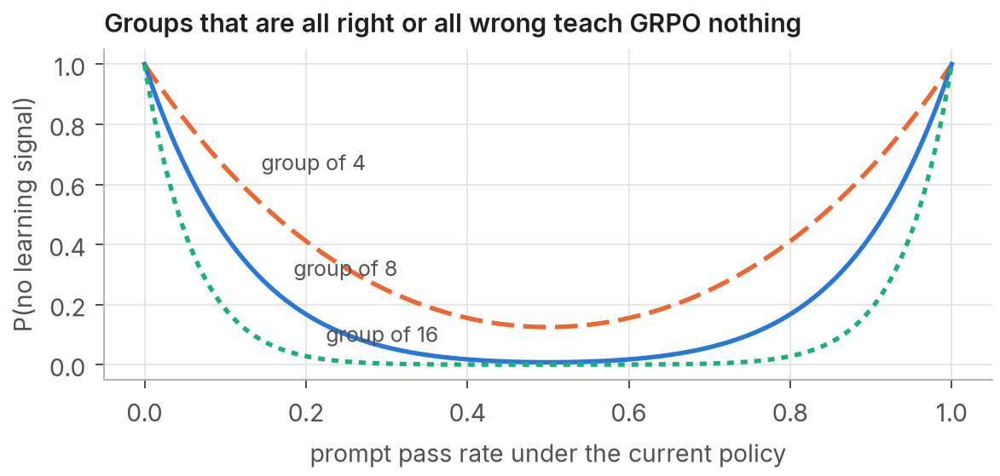
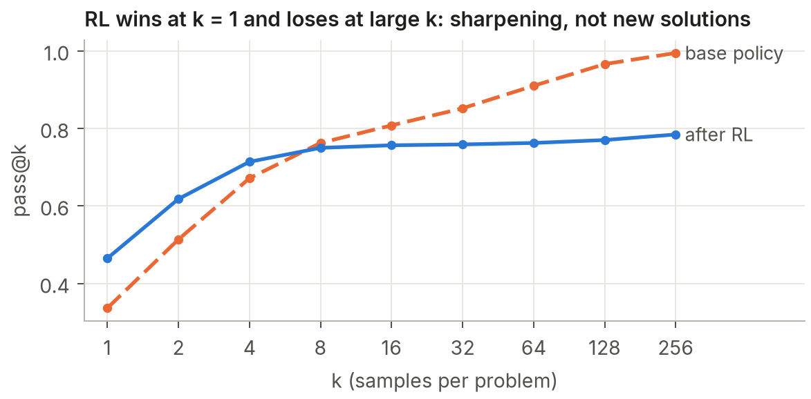
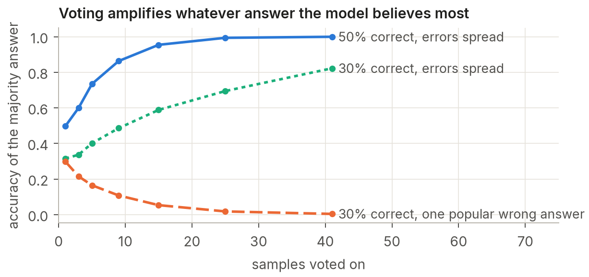

# 19 · Post-training II: reinforcement learning and reasoning models

Part V · Post-training. Assumes Chapter 18 (PPO, advantages, clipping, KL, reward over-optimisation) and Chapter 13 (test-time compute, pass@k). Chapter 33 extends the same methods to multi-step agents; Chapter 27 covers reward hacking as an alignment problem.

## Why it matters

From late 2024 the most important advances in LLMs came from reinforcement learning on tasks whose answers can be checked: maths with known answers, code with tests, puzzles and tool tasks with verifiable end states. Models trained this way think at length before answering, check and revise their work, and scale their accuracy with the inference compute they are given. DeepSeek-R1's open report (2025) showed the recipe could be reproduced; since then, RL has become a large and growing share of post-training compute. For a research scientist, this is the most active area of the field: the algorithms (GRPO and its fixes), reward design and verifiers, curricula, the debate about whether RL teaches new reasoning or sharpens what pretraining already gave, and how to spend inference compute well.

Numbers in this chapter come from `code/ch19_check.py` (NumPy, under a second).

## Key concepts

- **RL with verifiable rewards (RLVR)**: reward from a programmatic check of the final answer. [Tülu 3 (RLVR)](https://arxiv.org/abs/2411.15124), [DeepSeek-R1](https://arxiv.org/abs/2501.12948).
- **GRPO**: policy optimisation with group-relative advantages and no value model. [DeepSeekMath](https://arxiv.org/abs/2402.03300).
- **Fixes to GRPO**: [Dr. GRPO (Understanding R1-Zero-like training)](https://arxiv.org/abs/2503.20783), [DAPO](https://arxiv.org/abs/2503.14476).
- **Process reward models (PRMs)**: score each reasoning step, not only the answer. [Let's Verify Step by Step](https://arxiv.org/abs/2305.20050), [Math-Shepherd](https://arxiv.org/abs/2312.08935).
- **Test-time scaling**: self-consistency, best-of-n, search, longer thinking. [Self-consistency](https://arxiv.org/abs/2203.11171), [Snell et al.](https://arxiv.org/abs/2408.03314), [s1 (budget forcing)](https://arxiv.org/abs/2501.19393).
- **Does RL add new capability?** [Yue et al.](https://arxiv.org/abs/2504.13837).
- **Scaling RL in practice**: [Kimi k1.5](https://arxiv.org/abs/2501.12599), [ScaleRL (The Art of Scaling RL Compute)](https://arxiv.org/abs/2510.13786).
- **Sequence-level and clipped-weight objectives**: [GSPO](https://arxiv.org/abs/2507.18071), [CISPO (MiniMax-M1)](https://arxiv.org/abs/2506.13585).
- **Training–inference mismatch**: [truncated importance sampling (Yao et al.)](https://fengyao.notion.site/off-policy-rl), [Defeating nondeterminism in LLM inference](https://thinkingmachines.ai/blog/defeating-nondeterminism-in-llm-inference/).
- **Rewards beyond verifiable tasks**: [Rubrics as Rewards](https://arxiv.org/abs/2507.17746).
- **On-policy distillation**: [Thinking Machines (2025)](https://thinkingmachines.ai/blog/on-policy-distillation/), [GKD](https://arxiv.org/abs/2306.13649).

## 19.1 What changed

Earlier attempts to teach reasoning through supervised chains of thought or learned process rewards helped but did not scale cleanly. The recipe that worked is simple:

1. Start from a strong base model (pretraining and mid-training on maths and code matter a lot).
2. Optionally, a small SFT "cold start" on long, well-formatted reasoning traces.
3. Run RL on many prompts with checkable answers, rewarding correctness (and format), with a policy-gradient method such as GRPO.
4. Distil the resulting behaviour into smaller models, and mix reasoning data with general post-training (Chapter 18).

DeepSeek-R1-Zero went straight from base model to RL with no SFT and still learned long reasoning, self-verification and backtracking (the "aha moment" of the report), though with readability problems that the cold-start SFT fixed in R1. Response length grew steadily during training: the model learned to use more tokens because more thinking earned more reward.

## 19.2 Verifiers and reward design

The reward is the specification. Typical verifiers:

| Domain | Verifier | Ways it gets gamed |
|---|---|---|
| Maths with a final answer | Extract the answer (for example the last boxed expression), normalise, compare symbolically | Lenient matchers accept wrong forms; answers guessed without valid reasoning |
| Code | Run hidden unit tests in a sandbox | Special-casing tests, exiting early with success codes, editing the tests in agentic setups |
| Instruction constraints | Programmatic checks (word count, JSON validity, keywords) | Satisfying the letter, not the spirit |
| Tool and agent tasks | Check the final environment state (Chapter 25) | Shortcuts the environment allows but the task forbids |
| Open-ended tasks | LLM judge with a rubric | Judge biases (length, style), sycophancy towards the judge |

Practical rules:

- **Harden verifiers as carefully as the policy.** Sample rewarded outputs regularly and read them. Every verifier gets exploited eventually.
- **Format rewards are small and separate**: reward the expected thinking/answer structure lightly so it cannot dominate correctness.
- **Partial credit** (fraction of tests passed) gives denser signal but rewards partial hacks; binary rewards are harder to game.
- **Decontaminate prompts** against evaluation sets: RL on contaminated prompts inflates reasoning benchmarks fast.

**Beyond verifiable tasks: rubrics as rewards.** Most useful work (medical advice, research summaries, writing) has no single checkable answer. A practical middle ground between a verifier and an opaque reward model is a **rubric per prompt**: a checklist of weighted criteria ("mentions the drug interaction", "recommends seeing a doctor for symptom X", "does not invent a dosage"), written by experts or generated by a strong model from a reference answer, and scored by an LLM judge. The reward is the weighted share of criteria met. Gunjal et al. (2025) found rubric rewards beat a judge giving a single Likert score, and let smaller judges track human preferences more closely. RLVR is the special case with one criterion, "the answer matches". The risks are the judge's: verbosity, criteria satisfied in letter only, and rubric items the policy learns to recite. Audit high-reward samples as you would for any verifier.

## 19.3 GRPO in detail

For each prompt, sample a group of G responses (8 to 64), score each with the verifier, and use the score relative to the group as the advantage of every token in that response:

A_i = (r_i − mean(r)) / std(r)

No value model is needed: the group is the baseline. The objective is PPO's clipped surrogate (Chapter 18) applied per token with this advantage, often with a KL penalty to the reference model.

For rewards [1, 0, 0, 1, 1, 0, 0, 0], the advantages are +1.21 for correct and −0.72 for wrong responses.

**Why groups work.** A value model for long reasoning must predict, from a partial chain of thought, the chance of eventual success: hard to learn and memory-hungry. A group of samples estimates the prompt's baseline directly, at the price of more generation.

## 19.4 Known biases and the fixes

Careful analysis in 2025 found that the original GRPO objective has biases, and that several engineering choices matter as much as the algorithm.

**Length normalisation bias.** Original GRPO averages the loss over the tokens of each response, then over responses. Each token's weight is A_i / |o_i|. For a correct 200-token answer that is +6.04e-3 per token; for wrong answers of 1,500 and 2,000 tokens it is −0.48e-3 and −0.36e-3. Longer wrong answers are penalised less per token, so the model drifts towards longer outputs when it is wrong. Normalising by a constant (Dr. GRPO) or averaging over all tokens in the batch (DAPO's token-level loss) gives every token the same weight: +0.18e-3 for correct tokens and −0.11e-3 for wrong ones, whatever the length.

**Standard-deviation normalisation.** Dividing by the group's standard deviation up-weights prompts that are nearly always solved or nearly always failed (small std), which are not necessarily the most informative. Dr. GRPO drops the division; others keep it. The choice changes which prompts dominate learning.

**Zero-signal groups.** If every response in a group gets the same reward, all advantages are zero and the prompt contributes nothing. With 8 samples, a prompt with a 2% or 98% pass rate gives no signal 85% of the time; one at 50% almost never. **Dynamic sampling** (DAPO) keeps sampling until the batch is filled with groups that have mixed results.

*Probability that a group of G samples is all correct or all wrong (and so gives zero advantage) as a function of the prompt's pass rate. Larger groups shrink the dead zone at both ends but never remove it.*

Larger groups help at the edges. A prompt with a 5% pass rate gives no signal 66% of the time with G = 8 and 44% with G = 16. One at 20% drops from 17% to 3%. The cost is twice the generation per prompt, so in practice teams use G = 8–16 together with a difficulty filter and dynamic sampling.

**Entropy collapse and clip-higher.** RL quickly reduces the policy's entropy: it commits to the strategies that already work and stops exploring. Symmetric clipping at 1 ± 0.2 lets a token with probability 0.01 rise to only 0.012 per update, while confident tokens can be reinforced freely. DAPO's **clip-higher** raises the upper bound (to 1.28), which lets rare, useful tokens grow faster and keeps entropy up. Other tools: entropy bonuses, a higher sampling temperature, and removing the KL penalty (DAPO removes it, since the policy is supposed to move far from the reference in long-reasoning RL).

**Overlong responses.** Responses cut at the length limit get no reward though their reasoning may be fine, which adds noise. DAPO masks truncated samples from the loss or applies a soft penalty as responses approach the limit.

**Where the importance ratio lives.** GRPO and PPO apply the ratio π_new/π_old and the clip per *token*, while the reward and advantage belong to the whole *sequence*. Two 2025 objectives move them into line:

- **GSPO** (Qwen, 2025) uses one sequence-level ratio, the geometric mean of the per-token ratios (exp of the mean per-token log-ratio), and clips whole responses. The length normalisation keeps the ratio in a sane range, unlike the raw product of section 18.4. It was motivated by collapses in large mixture-of-experts RL, where about a tenth of the routed experts can change for the same tokens after one update, making per-token ratios very noisy. The Qwen team report it made MoE RL stable without "routing replay" (forcing the old routing during the update) and that it tolerates small numerical differences between the inference engine and the trainer.
- **CISPO** (MiniMax-M1, 2025) keeps a REINFORCE-style objective, (stop-gradient of the clipped weight) × advantage × ∇log π, and clips only the importance *weight*. Under PPO-style clipping, rare "fork" tokens ("wait", "recheck") whose ratio jumps above 1 + ε get no gradient at all; under CISPO they still learn, with a bounded weight.

Both are answers to the same question from section 18.4: how to keep importance correction stable when responses are thousands of tokens long.

Other algorithms in the same family: **RLOO** (leave-one-out baseline within the group), **REINFORCE++** and various "critic-free" PPO variants. Treat claims that one variant is better with care: reported differences often come from the implementation details above, from learning rates, or from the prompt set.

## 19.5 Data and curriculum

- **Difficulty**: keep prompts whose pass rate under the current policy is neither 0 nor 1 (often 10–90%). Re-estimate as the policy improves; prompts that become easy stop teaching.
- **Coverage**: maths of several levels, code in several languages, logic puzzles, STEM questions with short answers, instruction constraints. Narrow prompt sets give narrow gains.
- **Verifiability first**: drop prompts whose reference answers are wrong or ambiguous (a surprising fraction in scraped maths sets); these teach the model to fit noise.
- **Curricula**: increase difficulty or maximum response length in stages; long-context reasoning is expensive, so many runs grow the length limit over training.

## 19.6 Does RL teach new reasoning?

Yue et al. (2025) compared base and RL-trained models with pass@k for large k. RL models win clearly at k = 1, but base models often catch up or win at k = 256: RL mostly **sharpens** the distribution towards solutions the base model could already sample, and can **narrow** it, losing rare solutions. Others argue that longer RL, larger models or more diverse prompts do extend the frontier, and that distillation from a stronger model genuinely adds new capability to a small one. The debate is about evidence, so you should be able to produce some.

The check script builds a toy version: 200 problems, six solution strategies; one common strategy works on 75% of problems, and the remaining 25% need a rare strategy the base policy picks only 1% of the time. GRPO-style updates on a shared policy:

| | pass@1 | pass@64 | Entropy | pass@64 on the hard 25% |
|---|---|---|---|---|
| Base policy | 0.337 | 0.910 | 1.03 | 0.402 |
| After RL | 0.465 | 0.763 | 0.05 | 0.032 |

pass@1 rises; pass@64 falls, because the rare strategy, reinforced too seldom to compete, is squeezed out. This is entropy collapse in miniature. The lesson for practice: **report pass@k curves, not only pass@1**, monitor entropy, and keep exploration alive (clip-higher, temperature, diverse prompts) if you want RL to find new solutions rather than only sharpen old ones.

*pass@k against k for the base and RL-trained policies in the toy simulation. The curves cross: RL improves the first sample and loses the tail, because the rare strategy that solves the hard problems was squeezed out.*

**Reading a pass@k plot.**

- **The k = 1 end** measures how reliably the model finds a solution it knows.
- **The large-k end** measures what it can find at all.
- **Where the curves sit.** An RL run that only sharpens the policy lifts the left end and leaves the right end unchanged or lower. An RL run that genuinely extends the model's reach lifts both ends.

Compute pass@k with the unbiased estimator from n ≥ k samples (Chapter 13), on held-out problems, at the same temperature for both models. Comparing a base model at temperature 1.0 with an RL model at 0.6 is a common way to fool yourself.

## 19.7 Process supervision

An outcome reward model (ORM), or a verifier, judges the final answer. A **process reward model (PRM)** scores each step of the reasoning. Lightman et al. (2023) trained a PRM on 800k human step labels (PRM800K) and found that, for selecting the best of many solutions, process supervision beat outcome supervision on competition maths. Math-Shepherd labelled steps automatically: a step's label is the fraction of continuations from that step that reach the right answer (a Monte Carlo estimate of its value).

PRMs are used for: reranking samples, guiding search (beam search over steps, tree search), and dense rewards in RL. Their problems: human step labels are expensive; automatic labels are noisy; and PRMs used as RL rewards get hacked (the policy produces steps that look good to the PRM). R1-style training used outcome rewards only, and most RLVR pipelines still do; PRMs are more common at inference.

## 19.8 Spending inference compute

| Strategy | How | Needs |
|---|---|---|
| Self-consistency | Sample n reasoning paths; majority vote on the final answer | Answers that can be compared |
| Best-of-n | Sample n; pick the highest-scoring by a verifier or reward model | A good verifier |
| Search with a PRM | Beam or tree search over reasoning steps | A PRM; more engineering |
| Sequential revision | Answer, critique, revise | A model that can find its own errors |
| Longer thinking | Train the model to think longer; control the budget | RL-trained reasoning model |

**Self-consistency** works when the correct answer is the most common one. With a 30% single-sample accuracy and wrong answers spread over five options, majority voting over 25 samples reaches 70%; at 50% accuracy it reaches 99%. But if one wrong answer is more popular than the right one, voting makes things worse: with a single wrong answer that takes the other 70%, the majority over 25 votes is right only 2% of the time. Voting amplifies whatever the model believes most.

*Accuracy of the majority answer as more samples are voted on. When the right answer is the plurality, voting climbs towards 100%; when a single wrong answer is more popular, voting drives accuracy towards zero.*

The practical check before adding voting is cheap. Sample 20–40 answers on a few hundred dev problems and look at the answer histograms. If the right answer is usually the most common one, voting will help, and the curve tells you how many samples are worth paying for. If a wrong answer is often the plurality (a common misconception, an ambiguous question), use a verifier or reward model to pick instead.

**Budget forcing** (s1, 2025) controls the thinking length at inference: stop thinking early by forcing the end-of-thinking token, or extend it by suppressing that token and appending "Wait". With only 1,000 curated SFT examples, accuracy rose with the forced budget. Reasoning models also **overthink**: they spend thousands of tokens on easy questions. Length penalties and adaptive budgets are an active area.

## 19.9 Distilling reasoning

The cheapest way to give a small model reasoning ability is SFT on reasoning traces from a stronger model. DeepSeek released distilled models trained on about 800k samples from R1 that outperformed the same small models trained with RL directly. s1 and LIMO showed that around a thousand carefully chosen, hard, verified traces already elicit much of the behaviour from a strong base model. The emerging rule: **distil into small models, run RL on large ones**, then distil again. Quality filters on traces matter: verify final answers, remove repetitive or incoherent thinking, prefer diverse problems.

**On-policy distillation.** SFT on teacher traces is off-policy: the student learns from states the teacher visits, not the ones it reaches itself (the exposure-bias problem of Chapter 18). On-policy distillation samples responses from the *student* and asks the teacher to score every token, typically with the per-token reverse KL between student and teacher as a dense negative reward. It combines RL's on-policy sampling with SFT's dense signal: one bit of reward per episode becomes a target for every token. The Qwen3 report found it beat RL on the same student (74.4% against 67.6% on AIME'24) at about a tenth of the GPU hours, and Thinking Machines (2025) showed it also restores instruction-following lost after fine-tuning on new domain documents. It needs a teacher that shares the student's tokenizer, or a mapping between vocabularies, and access to the teacher's log-probabilities. The 2025–26 open-model recipes increasingly use it as the last post-training stage.

## 19.10 Systems for RL

RL for reasoning is dominated by **generation**: sampling long responses for many prompts takes most of the time. Practical consequences:

- Rollouts run in a fast inference engine (vLLM, SGLang), training in a training framework; weights are synced after each update.
- **Asynchronous RL** overlaps generation and training, which makes samples slightly off-policy; importance weights or bounded staleness keep this in check.
- **Training–inference mismatch**: the inference engine and the trainer compute slightly different token probabilities (different kernels, precision, batch composition), so "on-policy" RL is quietly off-policy. The PPO ratio then mixes real policy change with numerical noise, which can destabilise long runs; section 18.4 shows how fast small per-token differences compound over thousands of tokens. Fixes, roughly in order of adoption:
  - recompute the old log-probabilities in the trainer rather than trusting the engine's;
  - **truncated importance sampling** (Yao et al., 2025): weight each token's gradient by min(π_trainer/π_engine, C), a one-sided cap that trades a little bias for bounded variance, which also makes quantised (8-bit) rollouts usable;
  - keep the output head and its softmax in fp32 (ScaleRL found this raised the final reward);
  - **batch-invariant kernels**, which give identical numerics whatever the batch size (Thinking Machines, 2025), for bitwise on-policy RL at a throughput cost;
  - monitor the gap: log the per-token KL or ratio statistics between engine and trainer, because a growing gap often precedes a collapse.
- Long responses create imbalanced batches; pack and sort by length.
- Open frameworks: verl, OpenRLHF, TRL, and others (Chapter 32).

## 19.11 A worked RLVR run

Plan a run for a 30B-class model on maths and code with verifiable rewards.

**Prompt pool.** Start with 200k scraped maths problems and 50k coding tasks with tests.

1. **Clean the answers.** Drop maths items whose reference answer fails a parser or disagrees with a strong model's majority vote. Then check a sample of the disagreements by hand, because a surprising share of them are wrong references.
2. **Estimate pass rates.** Sample each prompt 8 times with the starting policy and record the pass rate.
3. **Filter by difficulty.** Keep prompts between 10% and 90%. The kept pool is often a third of the original or less.

**Group size and batch.** Use 512 prompts per step and G = 16 samples each, with a response limit of 8k tokens and an average near 4k.

- **Generation per step.** That is 32.8M tokens.
- **Where the time goes.** Generation dominates the wall-clock time, so the inference engine's throughput sets the pace of the run.
- **Zero-signal groups.** With G = 16, a prompt that has drifted to a 5% or 95% pass rate is still dead 44% of the time. Re-estimate pass rates every few hundred steps and refill the pool.

**Loss settings that most recent recipes converge on.**

- Token-level averaging over the batch (no per-response length normalisation).
- Clip-higher (0.8 to 1.28).
- No KL penalty or a very small one.
- Truncated samples masked from the loss.
- Dynamic sampling so each batch contains only groups with mixed rewards.
- An importance-sampling correction for the engine–trainer gap (truncated IS) and an fp32 output head.

Change one at a time against a baseline, at a fixed generation budget.

**Dashboard.**

| Signal | Healthy | Warning sign |
|---|---|---|
| Training reward | Rising steadily | Jumps suddenly: check for a verifier exploit |
| Response length | Rising slowly on hard prompts | Rising everywhere, including easy prompts: overthinking or a length bias |
| Policy entropy | Falling slowly | Collapsing in the first few hundred steps |
| Share of zero-signal groups | Stable | Rising: the pool has become too easy or too hard |
| Held-out pass@1 and pass@64 | Both rising | pass@1 up, pass@64 down: sharpening only |

**Reward-hacking audit.** Every few hundred steps, read 20 high-reward samples from the latest checkpoint. Exploits of the checker show up in the text long before they show up in the metrics:

- answers that print the expected output without computing it;
- code that special-cases the tests;
- maths answers that list several values hoping the matcher picks one.

## 19.12 Predicting RL at scale

Pretraining has scaling laws (Chapter 13); RL recipes were compared at one budget, which rewards whichever recipe climbs fastest early. Khatri et al. (2025) ran more than 400,000 GPU-hours of ablations and found that reward against RL compute C follows a **sigmoid**:

R(C) = R₀ + (A − R₀) / (1 + (C_mid / C)^B)

where A is the asymptote (the best reward the recipe can ever reach), B how steeply it gets there and C_mid the compute at the halfway point. Fitting the curve on the first part of a run predicted the rest of a 100,000 GPU-hour run. Two findings matter for practice:

- **Most details change efficiency, not the ceiling.** Loss aggregation, advantage normalisation, curriculum and the choice of off-policy algorithm mostly moved B and C_mid; a few choices (the loss type, fp32 at the output head, the model's size) moved A.
- **Fast early is not best late.** A recipe that wins at a small budget can plateau lower. Compare recipes by fitted asymptote and efficiency, not by a single point.

The resulting recipe (ScaleRL) combines several of the choices in this chapter: asynchronous off-policy generation, CISPO-style loss, prompt-level loss averaging, batch-level advantage normalisation, fp32 logits, zero-variance filtering and dropping prompts the policy already solves. Treat it, like any recipe, as a strong baseline to reproduce rather than a law.

## Pitfalls

- Trusting a verifier you have not tried to break.
- Reporting only pass@1, hiding a loss of diversity.
- Comparing GRPO variants with different loss normalisations, prompt sets or length limits.
- Training on prompts with wrong reference answers.
- Ignoring zero-signal groups and wasting most of the compute.
- Using majority voting where the model has a systematic wrong belief.
- Letting response length grow without checking whether it is reasoning or padding.
- Treating rollouts from a separate inference engine as exactly on-policy without measuring the engine–trainer gap.
- Choosing between RL recipes from a single short run: fit the curve and compare asymptotes.

## Interview questions

**1. How was DeepSeek-R1 trained?** Strong base model; R1-Zero: RL with GRPO and rule-based correctness and format rewards, no SFT; R1: a small cold-start SFT on readable long traces, reasoning RL, then rejection-sampled SFT and a general RL stage; then distillation into small models.

**2. Explain GRPO and why it has no value model.** Sample a group per prompt; the advantage is the reward relative to the group mean (often divided by its std); PPO-style clipped updates. The group mean is the baseline, so no learned critic.

**3. What is the length bias in the original GRPO loss?** Per-response averaging gives each token weight A/|o|, so long wrong answers are penalised less per token, encouraging length growth on failures. Fix: token-level averaging or a constant normaliser.

**4. What does DAPO change?** Clip-higher (asymmetric clipping), dynamic sampling (drop groups with no reward variance), token-level loss, overlong reward shaping, no KL penalty.

**5. Why do groups where all answers are right (or wrong) matter?** Zero advantage, zero gradient. At extreme pass rates most groups give no signal; filter by difficulty or resample.

**6. Does RL teach models new reasoning?** Evidence is mixed: RL raises pass@1 and often lowers pass@k at large k, suggesting sharpening of existing solutions; longer, more exploratory RL may extend the frontier; distillation from stronger models adds capability. Measure pass@k curves.

**7. PRM versus ORM?** ORMs (or verifiers) judge final answers; PRMs judge each step. PRMs give denser signal and better reranking and search but are expensive to label and easy to hack as RL rewards.

**8. When does self-consistency fail?** When a wrong answer is more probable than the right one: voting then amplifies the error. It also needs comparable final answers.

**9. How would you reduce overthinking on easy questions?** Length penalties relative to group or difficulty, adaptive budgets, training on mixed difficulty with rewards for efficiency, routing easy queries to a non-thinking mode.

**10. How do you make a 7B model reason well cheaply?** Distil verified long reasoning traces from a stronger model (SFT), then optionally a short RL stage on verifiable tasks at appropriate difficulty.

**11. Why is RL for reasoning expensive, and how do systems handle it?** Generation of long rollouts dominates; separate inference engines, asynchronous pipelines with bounded staleness, length-aware batching, careful handling of probability mismatches between engine and trainer.

**12. What is the training–inference mismatch in RL, and how do you handle it?** The rollout engine and the trainer give slightly different probabilities for the same tokens, so the data is off-policy. Recompute log-probabilities in the trainer, apply truncated importance weights, keep the output head in fp32, monitor the per-token gap, or use batch-invariant kernels.

**13. GRPO, GSPO and CISPO: what differs?** Same group-relative advantage. GRPO clips per-token ratios; GSPO uses one length-normalised sequence ratio and clips whole responses (more stable for MoE); CISPO clips the importance weight but keeps the gradient of every token, so rare high-ratio tokens still learn.

**14. How would you do RL where answers can't be checked?** Per-prompt rubrics scored by an LLM judge (weighted share of criteria met), generative reward models, or pairwise preferences; audit high-reward samples for judge exploitation and length bias, and validate the judge against expert labels.

**15. What is on-policy distillation and when would you use it?** Sample from the student, score each token by the teacher (reverse KL as a dense reward). Use it to make a small model match a strong teacher cheaply, or to recover skills lost after domain fine-tuning; it needs teacher log-probabilities on a shared vocabulary.

**16. How do you compare two RL recipes fairly?** Same model, prompts, verifier and generation budget; several runs if affordable; fit a saturating curve of reward against compute and compare asymptote and efficiency, not one checkpoint; report pass@k curves and held-out evaluations.

## Practice

1. Implement GRPO with token-level loss for a small model (0.5–1.5B) on grade-school maths with an exact-match verifier; log reward, response length and entropy.
2. Compare sequence-mean and token-mean normalisation on the same run; plot length over training.
3. Write a maths answer verifier, then try to break it with adversarial outputs; fix what you find.
4. **Research exercise.** For a base model and its RL-trained version (open pairs exist), estimate pass@k for k = 1 to 256 on 200 maths problems with the unbiased estimator (Chapter 13). Plot both curves with bootstrap confidence intervals. Where do they cross, and on which problems does the base model win?
5. Implement self-consistency and best-of-n with a small reward model; compare accuracy against n.

## Read next

- DeepSeek-AI, "DeepSeek-R1: Incentivizing Reasoning Capability in LLMs via Reinforcement Learning" (2025).
- Shao et al., "DeepSeekMath" (2024), for GRPO.
- Liu et al., "Understanding R1-Zero-Like Training: A Critical Perspective" (Dr. GRPO, 2025); Yu et al., "DAPO: An Open-Source LLM Reinforcement Learning System at Scale" (2025).
- Kimi Team, "Kimi k1.5: Scaling Reinforcement Learning with LLMs" (2025).
- Lightman et al., "Let's Verify Step by Step" (2023); Wang et al., "Math-Shepherd" (2023).
- Wang et al., "Self-Consistency Improves Chain of Thought Reasoning" (2022); Muennighoff et al., "s1: Simple test-time scaling" (2025).
- Yue et al., "Does Reinforcement Learning Really Incentivize Reasoning Capacity in LLMs Beyond the Base Model?" (2025).
- Zheng et al., "Group Sequence Policy Optimization" (2025); MiniMax, "MiniMax-M1" (2025), for CISPO.
- Khatri et al., "The Art of Scaling Reinforcement Learning Compute for LLMs" (2025).
- Yao et al., "Your Efficient RL Framework Secretly Brings You Off-Policy RL Training" (2025); He et al., "Defeating Nondeterminism in LLM Inference" (2025).
- Gunjal et al., "Rubrics as Rewards" (2025); Lu et al., "On-Policy Distillation" (2025).
- Links to these papers are in the Key concepts section at the top of this chapter.

## Done when

You can describe the R1 recipe and what each stage contributes. You can implement GRPO, explain its length and standard-deviation biases and the DAPO and Dr. GRPO fixes. You can design verifiers and a prompt curriculum, and explain how verifiers get gamed.

You can argue both sides of whether RL creates new reasoning, using pass@k curves. You can compare PRMs and ORMs, choose among self-consistency, best-of-n, search and longer thinking, and say when voting fails. You can explain why distillation (including on-policy distillation) is the cheap path for small models and what makes RL systems expensive. You can explain the engine–trainer mismatch and its fixes, compare GRPO, GSPO and CISPO, design rubric rewards for tasks without a verifier, and compare RL recipes by fitted scaling curves.

---

[← 18 · Post-training I: SFT, reward models and preference optimisation](18-post-training-sft-and-preferences.md) · [Contents](../README.md#contents) · [20 · Fine-tuning and parameter-efficient methods →](20-fine-tuning-and-lora.md)
