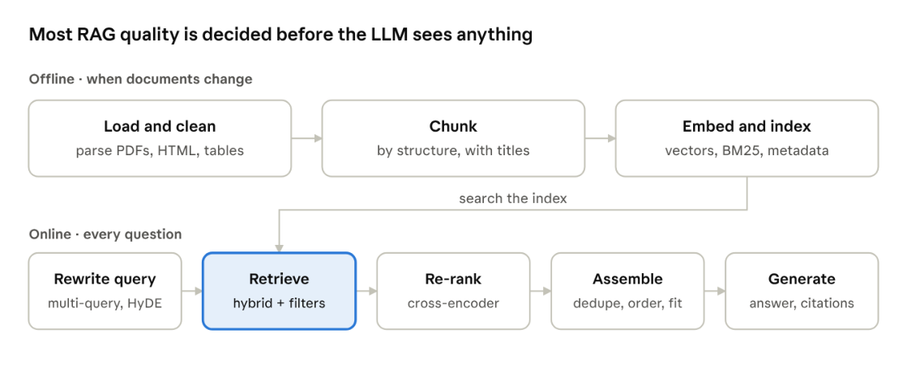

# 19 · Retrieval-augmented generation

Part V · Retrieval and RAG. Builds directly on Chapter 18 (retrieval) and Chapter 15 (prompting). Chapter 23 covers how to evaluate RAG systems. Worked design that builds on it: E.4 RAG support assistant.

## Why it matters

RAG (retrieval-augmented generation) is the most common way companies put LLMs to work on their own knowledge: help centres, internal wikis, policy assistants, catalogue Q&A. It lets an LLM answer from current, private, citable documents without retraining. It is also where most LLM projects first disappoint: a demo built in a day answers 70% of questions well, and getting to 95% takes months of retrieval, chunking and evaluation work.

A RAG design question (worked design E.4) is very likely in any applied-LLM system design round. Interviewers look for whether you see RAG as a retrieval system with an LLM at the end, can name where it fails, and can measure and fix each failure.

## Key concepts

- **Retrieval-augmented generation (RAG)**: retrieve relevant documents and give them to the LLM as context, so answers are grounded and knowledge can be updated without retraining. [RAG paper](https://arxiv.org/abs/2005.11401).
- **Chunking**: splitting documents into passages small enough to retrieve precisely but large enough to make sense alone.
- **Contextual retrieval**: adding a short document-level summary to each chunk before embedding, to fix chunks that lose meaning out of context. [Anthropic: contextual retrieval](https://www.anthropic.com/news/contextual-retrieval).
- **Query rewriting and HyDE**: reformulating the user's question, or generating a hypothetical answer and searching with it. [HyDE paper](https://arxiv.org/abs/2212.10496).
- **Hybrid retrieval and re-ranking**: Chapter 18's tools applied to RAG.
- **Grounding and citations**: instructing the model to answer only from the context and cite passages, then checking the citations (Chapter 24).
- **Failure modes**: missed retrieval, wrong chunk, ignored context, hallucinated answer; each needs its own metric (Chapter 23).
- **Design patterns overview**: [Eugene Yan: Patterns for Building LLM-based Systems](https://eugeneyan.com/writing/llm-patterns/).

## 19.1 The pipeline end to end



*the RAG pipeline · offline indexing and online answering*

**Offline (indexing):** load documents from their sources, clean and parse them (PDF tables and HTML layouts are a frequent source of silent errors), split them into chunks, embed and index the chunks with their metadata, and keep the index in sync as documents change.

**Online (answering):** rewrite the question if needed, retrieve candidates (hybrid search with filters, Chapter 18), re-rank, assemble the best passages into the context within a token budget, and generate an answer that cites its sources, or says it does not know.

When RAG answers are wrong, the cause is usually upstream of the LLM: the document was never indexed, the chunk split the answer in two, the retriever missed it, or the context was too noisy. That is why this chapter spends more time before generation than on it.

## 19.2 Ingestion and chunking

**Parsing comes first.** Garbage in the index means garbage answers. Check what your parser does to tables (rows flattened into nonsense), headers and footers repeated on every page, multi-column PDFs, and scanned documents (which need OCR). Look at a sample of parsed output by eye before anything else.

**Why chunk at all?** Embedding a whole long document into one vector blurs its meaning, and the LLM's context has a budget. Chunks are the unit of retrieval: small enough to be specific, large enough to be self-contained.

| Strategy | How | Good for | Watch out |
|---|---|---|---|
| Fixed size with overlap | Every N tokens, overlapping by M | Quick baseline | Splits sentences, tables and lists mid-way |
| Recursive, by structure | Split on headings, then paragraphs, then sentences, packing up to a size | Most documents: the sensible default | Needs reasonably structured input |
| Semantic | Split where embedding similarity between adjacent sentences drops | Long unstructured text | More compute; gains are often small |
| Small-to-big (parent-child) | Retrieve small chunks for precision, return their larger parent section to the LLM | Answers that need surrounding context | Bigger contexts, more tokens |
| Document-level | One chunk per short document (FAQ entry, product) | Short, self-contained items | Long items lose detail |

**Add context to every chunk.** A chunk saying "Requests must be made within 24 hours" is useless on its own: requests for what? Prepend the document title and heading path, so both the embedding and the LLM see it. Anthropic's "contextual retrieval" write-up (2024) takes this further: an LLM writes one or two sentences situating each chunk in its document, prepended before embedding and BM25 indexing, and they reported a large reduction in retrieval failures.

**A structure-aware chunker:**

```python
import re

def n_tokens(text):
    return len(text.split())          # stand-in; use the model's tokenizer in practice

def split_markdown_sections(doc):
    """Split on headings, keeping the heading path as context for each section."""
    sections, path, buf = [], [], []
    for line in doc.splitlines():
        m = re.match(r"^(#{1,6})\s+(.*)", line)
        if m:
            if buf:
                sections.append((" > ".join(path), "\n".join(buf).strip()))
                buf = []
            level = len(m.group(1))
            path = path[:level - 1] + [m.group(2).strip()]
        else:
            buf.append(line)
    if buf:
        sections.append((" > ".join(path), "\n".join(buf).strip()))
    return [(p, t) for p, t in sections if t]

def chunk_text(text, max_tokens=300, overlap=40):
    """Pack paragraphs (sentences for long paragraphs) into chunks up to max_tokens, with overlap."""
    units = []
    for para in [p for p in text.split("\n\n") if p.strip()]:
        if n_tokens(para) <= max_tokens:
            units.append(para.strip())
        else:
            units += [s.strip() for s in re.split(r"(?<=[.!?])\s+", para) if s.strip()]
    chunks, current = [], []
    for unit in units:
        if current and n_tokens(" ".join(current + [unit])) > max_tokens:
            chunks.append(" ".join(current))
            tail = " ".join(current).split()[-overlap:] if overlap else []
            current = [" ".join(tail)] if tail else []
        current.append(unit)
    if current:
        chunks.append(" ".join(current))
    return chunks

def chunk_document(doc, doc_id, title, max_tokens=300, overlap=40):
    out = []
    for path, body in split_markdown_sections(doc):
        for chunk in chunk_text(body, max_tokens, overlap):
            header = f"{title} > {path}" if path else title
            out.append({"id": f"{doc_id}#{len(out)}", "doc_id": doc_id, "section": path,
                        "text": f"[{header}]\n{chunk}"})
    return out
```

Run on a small refunds policy, this produces chunks such as `[Help centre > Refunds >`

`Late orders] Vouchers are worth 20% of the order value, up to 10 euros.` `Requests must be made within 24 hours.` Each chunk now carries what it is about.

**Choosing chunk size** is an empirical question: try two or three sizes (for example 200, 400 and 800 tokens) and compare retrieval recall and answer quality on your evaluation set (Chapter 23). Smaller chunks retrieve more precisely; larger ones keep more context.

**Keeping the index fresh.** Track a content hash per document; re-chunk and re-embed only changed documents; delete chunks of removed documents (stale policies are a classic RAG failure); record the indexing time so answers can say how current they are.

## 19.3 Metadata and filtering

Store metadata with each chunk: source, document id, section, language, country, audience (customer, rider, partner), product, effective date, version, and access permissions. Then:

- **Filter** on hard constraints before or during retrieval: country, audience, language, and above all **permissions** (Chapter 18.5: access control belongs in retrieval, never in the prompt).
- **Boost** on soft preferences: newer documents, official policy over community answers.
- **Show** metadata in the context so the model can say "according to the UAE refund policy updated in March".

Filters can come from the user's session (their country and role) or from the question itself, extracted by an LLM (self-query, Chapter 18.8).

## 19.4 Query transformation

The user's question is often not the best search query. Techniques, roughly in order of usefulness:

- **Conversational rewriting:** turn "and for riders?" into a standalone question using the chat history. Essential for any chat interface.
- **Multi-query:** generate three to five paraphrases, retrieve for each, fuse with reciprocal rank fusion. Improves recall when users and documents use different words.
- **Decomposition:** split "compare the late-order policy in Spain and the UAE" into one query per country.
- **Step-back prompting:** also search for the more general question ("refund policy overview") to retrieve background the specific question needs.
- **HyDE (hypothetical document embeddings,** Gao et al., 2022): ask the LLM to write a plausible answer, embed that answer, and search with it. A fake answer looks more like the real document than the question does. It helps when queries are short and documents are long; it can mislead when the LLM's guess is confidently wrong, so combine it with the original query.

```python
def hyde_search(question, llm, embed, index, k=20):
    draft = llm(f"Write a short help-centre paragraph that answers: {question}")
    q_vec = embed(question)
    d_vec = embed(draft)
    v = (q_vec + d_vec) / 2           # keep the original query in the search
    return index.search(v, k)
```

Each transformation adds an LLM call (latency and cost) and can drift from what the user meant. Add them one at a time and keep each only if retrieval recall on your evaluation set improves.

## 19.5 Context assembly and ordering

After re-ranking you have, say, 30 scored passages and a budget of a few thousand tokens. Assembly decides what the LLM actually reads:

- **Deduplicate** near-identical chunks (the same paragraph in two document versions, overlapping chunks).
- **Limit per document** so one long document does not crowd out others.
- **Fit a token budget**, leaving room for instructions, history and the answer.
- **Order** with the most relevant first (and possibly last), given position effects (Chapter 15.6).
- **Format** each passage with an id and its metadata, so the model can cite it.
- **Expand** small retrieved chunks to their parent section if the answer needs surrounding context (small-to-big).

```python
def assemble_context(passages, budget_tokens, max_per_doc=2):
    """passages: dicts with id, doc_id, text, score, sorted best first."""
    chosen, used, per_doc, seen = [], 0, {}, set()
    for p in passages:
        key = p["text"].strip().lower()
        if key in seen or per_doc.get(p["doc_id"], 0) >= max_per_doc:
            continue
        cost = n_tokens(p["text"])
        if used + cost > budget_tokens:
            continue
        chosen.append(p)
        used += cost
        seen.add(key)
        per_doc[p["doc_id"]] = per_doc.get(p["doc_id"], 0) + 1
    context = "\n\n".join(f'<doc id="{p["id"]}">\n{p["text"]}\n</doc>' for p in chosen)
    return context, [p["id"] for p in chosen]
```

More context is not better. Past a point, extra passages add distractors and cost. Tune the number of passages on your evaluation set just like chunk size.

## 19.6 Generation with citations and grounding

**The generation prompt** needs: the role and audience; an instruction to answer only from the provided documents; what to do when they do not contain the answer ("say you don't know and offer to connect to an agent"); how to cite (passage ids after each claim); tone and length; and the documents clearly marked as data. Then the question, last.

**Grounding checks after generation:**

- Every cited id must exist in the context (models sometimes invent ids).
- Each cited sentence should be supported by its source: a cheap word-overlap check catches gross errors; an entailment model or LLM judge checks properly (Chapter 23).
- Sentences with no citation in a policy answer are suspicious.

```python
import re

def check_citations(answer, allowed_ids, passages_by_id, min_overlap=0.5):
    problems = []
    for sentence in re.split(r"(?<=[.!?])\s+", answer.strip()):
        cited = re.findall(r"\[([^\]]+)\]", sentence)
        if not cited:
            problems.append(("uncited", sentence))
            continue
        for cid in cited:
            if cid not in allowed_ids:
                problems.append(("unknown id", cid))
                continue
            words = set(re.findall(r"\w+", re.sub(r"\[[^\]]+\]", "", sentence).lower()))
            src = set(re.findall(r"\w+", passages_by_id[cid].lower()))
            if words and len(words & src) / len(words) < min_overlap:
                problems.append(("weak support", sentence))
    return problems
```

What to do with a failed check depends on the stakes: regenerate, drop the unsupported sentence, show the answer with a warning, or hand over to a human. For customer-facing policy answers (refund amounts, legal terms), err towards handing over.

**"I don't know" is a feature.** Measure how often the system answers when it should abstain (and the reverse) as its own metric. A RAG system that always answers is a hallucination generator for every question outside its documents.

## 19.7 GraphRAG

Standard RAG retrieves passages similar to the question. It struggles with **global questions** that need the whole corpus ("what are the main themes in this year's complaints?") and with **multi-hop questions** across entities ("which partners affected by the March policy change also had late-delivery escalations?").

**GraphRAG** (Microsoft, 2024) builds a knowledge graph offline: an LLM extracts entities and relationships from every chunk, groups the graph into communities, and writes a summary per community. Global questions are answered from community summaries (map-reduce); local questions combine graph neighbours with text chunks.

**Trade-offs:** indexing is expensive (LLM calls over the whole corpus) and must be redone as documents change; extraction errors propagate; it pays off for analysis over a fixed corpus and for entity-heavy domains, rarely for a help centre answering specific questions. A lighter version: store extracted entities as metadata and filter or join on them.

## 19.8 Agentic RAG

Instead of one fixed retrieve-then-generate pass, an agent (Chapter 21) decides: whether to retrieve at all, which source or tool to use (vector index, SQL, an orders API), whether results are good enough, and whether to search again with a refined query. Research variants include Self-RAG (the model judges when to retrieve and whether passages support its output) and Corrective RAG (grade retrieved documents and fall back to other sources when they are poor).

**When it is worth it:** multi-part questions, questions mixing documents with live data ("why was my order refunded only 5 euros?" needs the policy and the order record), or research-style tasks. **Costs:** several LLM calls per question, higher latency, harder evaluation (trajectories, Chapter 23), and new failure modes such as loops. Start with a fixed pipeline and add agentic steps only where evaluation shows a single pass fails.

## 19.9 Common failure modes and fixes

| Symptom | Likely cause | Fix |
|---|---|---|
| Answer missing although the document exists | Not indexed, parsing broke it, or filtered out | Ingestion checks; index coverage report; test filters |
| Right document, wrong part retrieved | Chunks too big or split badly; no heading context | Structure-aware chunking with titles; contextual chunk headers |
| Retrieval misses paraphrased questions | Dense model weak in domain; vocabulary mismatch | Hybrid search; multi-query; fine-tune embeddings |
| Retrieval misses exact codes and names | Dense-only retrieval | Add BM25 |
| Correct passage retrieved but answer still wrong | Too many distractors; passage in the middle; model ignores it | Fewer, re-ranked passages; ordering; stronger instructions; better model |
| Confident answers to out-of-scope questions | No abstain path | Explicit "don't know" instruction; retrieval-score threshold; evaluation on out-of-scope questions |
| Outdated answers | Stale chunks kept after updates | Content hashing, deletes, effective dates in metadata |
| Answers mix rules from different countries | Missing metadata filters | Filter by country and audience from the session |
| Invented citations | Model fabricates ids | Validate ids; constrain citation format |

The debugging order is always the same: first check whether the right passage was retrieved (retrieval problem), then whether it reached the context (assembly problem), then whether the answer used it correctly (generation problem). Chapter 23 turns this into metrics.

## Pitfalls

- **Skipping the parsing check.** Broken tables and repeated footers poison the index silently.
- **Fixed-size chunks with no headings.** Chunks lose what they are about.
- **Tuning the prompt before measuring retrieval.** Most failures are upstream.
- **Stuffing the context.** More passages add distractors and cost.
- **No abstain path,** so the system answers everything, including questions outside its documents.
- **Access control in the prompt** instead of retrieval filters.
- **Stale or duplicated documents** from several versions of the same policy.
- **Query transformations added without measuring** their effect on recall, latency and cost.
- **Going agentic or GraphRAG first,** before a simple pipeline is measured.
- **No citations, or unverified citations.** Users and reviewers cannot check answers.

## Interview questions

Questions 1–4 basic, 5–9 intermediate, 10–13 senior.

**1. What problem does RAG solve compared with fine-tuning?** It gives the model current, private, citable knowledge at query time without retraining; updating knowledge means updating the index. Fine-tuning changes behaviour, style or format, and is a poor way to add facts that change.

**2. Walk through a RAG pipeline.** Offline: load, parse, chunk with context, embed and index with metadata, keep in sync. Online: rewrite the query, hybrid retrieval with filters, re-rank, assemble context in a budget, generate with citations and an abstain option, verify grounding.

**3. How do you choose a chunking strategy?** Start with structure-aware recursive chunking with headings prepended; try two or three sizes; compare retrieval recall and answer quality on an evaluation set; consider small-to-big when answers need surrounding context.

**4. What is HyDE?** Generate a hypothetical answer with an LLM and search with its embedding, because a fake answer resembles real documents more than a short question does. Combine with the original query; it can mislead when the guess is wrong.

**5. How do you make RAG answers trustworthy?** Answer only from retrieved documents, cite passage ids per claim, validate citations and support, abstain when documents do not answer, show sources to users, and monitor the share of unsupported claims.

**6. The right document is retrieved but answers are still wrong. What do you check?** Whether the relevant passage made it into the final context after assembly; its position; the number of distractors; whether the passage is self-contained; instruction clarity; whether a stronger model fixes it (a sign of reasoning difficulty rather than retrieval).

**7. How do you keep a RAG index up to date?** Incremental indexing by content hash; deletes for removed documents; effective dates and versions in metadata; re-embedding everything when the embedding model changes, built in parallel and switched after evaluation.

**8. When would you use GraphRAG?** For global or multi-hop questions over a relatively stable, entity-rich corpus, where the indexing cost is justified. Not for a help centre answering specific questions.

**9. What is agentic RAG and what does it cost?** The model decides whether, where and how often to retrieve, possibly combining documents with live tools. Better for complex or mixed questions; costs more calls, latency, and harder evaluation.

**10. Design a RAG assistant for rider policies in 10 countries and 3 languages.** Ingestion with country, language, audience and effective-date metadata; structure-aware chunks with headings; hybrid retrieval filtered by the rider's country and language from the session; multilingual embeddings and re-ranker; citations and abstain path; per-country, per-language evaluation sets; freshness checks when policies change; escalation to support for low-confidence answers.

**11. Your RAG demo scored well, but users complain after launch. What happened, and what do you do?** The demo questions were not real questions: users ask vaguer, multi-part, out-of-scope and follow-up questions. Collect real queries and failures, label them, build an evaluation set from them, and run error analysis by stage (retrieval, assembly, generation).

**12. How do you decide between a bigger context window and better retrieval?** Compare on the evaluation set: answer quality, cost per question and latency for "top 5 passages" vs "top 50" vs whole documents. Better retrieval usually wins on cost and often on quality, because distractors hurt.

**13. How would you reduce hallucinations in a customer-facing RAG system by half?** Measure first: classify hallucinations by cause (retrieval miss, ignored context, out-of-scope question, invented details). Then: abstain on low retrieval scores, stricter grounding instructions, citation verification with regeneration, better retrieval for the miss category, and human handover for high-stakes topics.

## Practice

1. **Build a RAG baseline end to end** on a public help centre or documentation site (a few hundred pages): parse, chunk with `chunk_document`, hybrid retrieval (Chapter 18), generation with citations. Keep it under 300 lines of plain Python.
2. **Evaluation set.** Write 60 real-sounding questions, including 10 out-of-scope and 10 follow-ups, with the passages that answer them. This set is reused in Chapter 23.
3. **Chunking experiment.** Compare fixed-size, structure-aware, and structure-aware with contextual headers at two sizes on retrieval recall@5.
4. **Query transformation.** Add multi-query and HyDE; measure recall gains, latency and cost.
5. **Grounding.** Implement `check_citations`, then replace the overlap check with an LLM judge, and compare with your own judgement on 50 answers.
6. **Failure analysis.** For 30 wrong answers, label the stage that failed using the table in 19.9.

## Read next

- *AI Engineering* (Chip Huyen): the RAG chapter.
- *Hands-On Large Language Models* (Alammar and Grootendorst): the chapter on semantic search and RAG.
- Lewis et al., *Retrieval-Augmented Generation for Knowledge-Intensive NLP Tasks* (2020), the original RAG paper.
- Gao et al., *Precise Zero-Shot Dense Retrieval without Relevance Labels* (HyDE, 2022).
- Anthropic, *Introducing Contextual Retrieval* (2024).
- Edge et al., *From Local to Global: A Graph RAG Approach to Query-Focused* *Summarization* (Microsoft, 2024).
- Asai et al., *Self-RAG* (2023); Yan et al., *Corrective Retrieval Augmented Generation* (2024).
- Barnett et al., *Seven Failure Points When Engineering a Retrieval Augmented* *Generation System* (2024).

**Links:** [RAG paper](https://arxiv.org/abs/2005.11401) · [Contextual retrieval](https://www.anthropic.com/news/contextual-retrieval) · [Patterns for LLM systems](https://eugeneyan.com/writing/llm-patterns/) · [Lost in the Middle](https://arxiv.org/abs/2307.03172). Other titles above can be found by searching their title.

## Done when

You can draw the RAG pipeline and say where most failures happen. You can write a structure-aware chunker and explain contextual chunk headers.

You can design metadata and filters, including permissions. You can choose query transformations and justify each with a measurement. You can assemble context within a budget and explain ordering choices. You can design citation, grounding checks and an abstain path. You can explain when GraphRAG and agentic RAG are worth their cost. You can debug a wrong answer by stage using the failure table.

---

[← 18 · Information retrieval](18-information-retrieval.md) · [Contents](../README.md#contents) · [20 · Frameworks and tooling →](20-frameworks-and-tooling.md)
