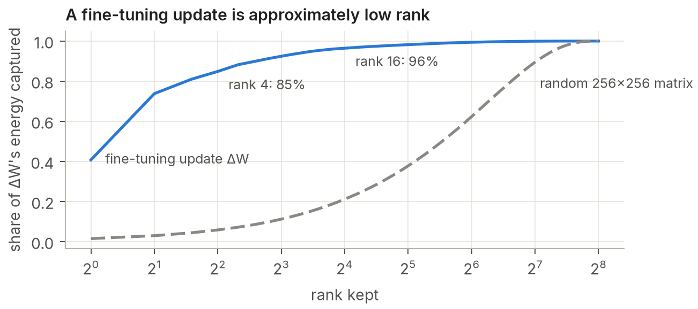
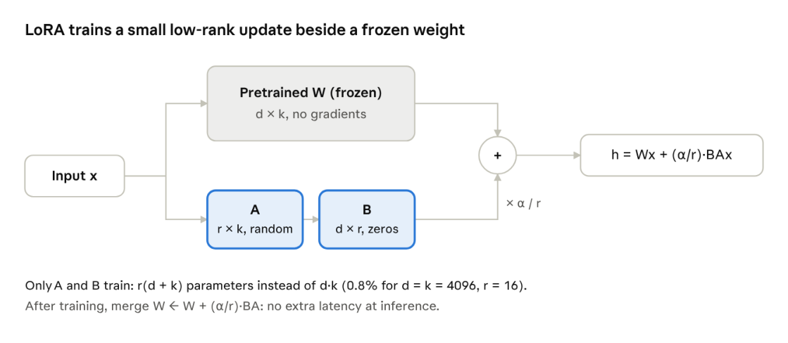

# 20 · Fine-tuning and parameter-efficient methods

Part V · Post-training. Assumes Chapter 10 (transformers) and Chapter 1's SVD and low-rank ideas. Chapter 15 covers how base models are trained and aligned, Chapters 18 and 19 the post-training methods (SFT, DPO, RL) that fine-tuning reuses; Chapter 24 how to evaluate the result.

## Why it matters

Fine-tuning adapts a pretrained model to your task, format or domain. Parameter-efficient methods, above all LoRA, made this possible on a single GPU and turned it into a routine tool: distilling an LLM's behaviour into a small model, enforcing a strict output format, teaching domain style or vocabulary, cutting cost and latency. Interviewers ask when fine-tuning is the right call (often it is not), how LoRA works mathematically, and how you would evaluate the result. Section 20.5 connects the older prompt-based methods (prefix-tuning and prompt tuning) to current practice.

The interview version of this chapter has three layers. The decision: when fine-tuning beats prompting or retrieval, and when it is the wrong tool (adding facts that change). The mechanics: why LoRA's B starts at zero but A does not, what α/r does and why rsLoRA changes it, why LoRA's learning rate is about ten times that of full fine-tuning, and how much memory a 7B fine-tune needs, including the logits that cause most real out-of-memory errors. And the risks: forgetting, safety erosion from even benign fine-tuning, and evaluations that do not reflect production traffic. Strong answers carry one computed number each, which is why 20.3 and 20.12 work through them.

The chapter starts with the decision that comes before any fine-tune: whether prompting or retrieval would solve the problem more cheaply (20.1). It then compares full fine-tuning (20.2) with the parameter-efficient methods that made fine-tuning routine: LoRA, explained from its linear-algebra intuition (20.3), QLoRA, which fits large models on small GPUs (20.4), and the older adapter and prompt-based methods (20.5). Sections 20.6 to 20.8 cover the data side and its main risk: chat templates, synthetic data, and forgetting what the model knew. The chapter ends with evaluation (20.9), working code (20.10), the methods beyond task fine-tuning (20.11) and a worked fine-tune on a single 24 GB GPU (20.12).

The idea that ties the methods together is that adapting a model to a narrow task changes it very little. Chapter 1.2 showed that such a small change is well described by a low-rank matrix, and that is why updating a fraction of a percent of the parameters can recover most of the gain of updating them all.

## Key concepts

- **Full fine-tuning vs parameter-efficient fine-tuning (PEFT)**: updating every weight vs training a small number of new parameters on a frozen model. [Hugging Face PEFT documentation](https://huggingface.co/docs/peft/index).
- **LoRA**: learn two small low-rank matrices whose product is added to a frozen weight matrix; tiny to train and store, no extra latency once merged. [LoRA paper](https://arxiv.org/abs/2106.09685).
- **QLoRA**: LoRA on top of a 4-bit quantised base model, so large models fit on one GPU. [QLoRA paper](https://arxiv.org/abs/2305.14314).
- **Adapters, prefix-tuning and prompt tuning**: earlier PEFT methods that insert small modules or learn soft prompt vectors. [Adapters](https://arxiv.org/abs/1902.00751), [Prefix-tuning](https://arxiv.org/abs/2101.00190), [Prompt tuning](https://arxiv.org/abs/2104.08691).
- **Supervised fine-tuning (SFT) and preference tuning (DPO)**: training on input–output pairs, then on preferred vs rejected answers (Chapter 18). [TRL documentation](https://huggingface.co/docs/trl/index).
- **LoRA in practice (2025)**: when LoRA matches full fine-tuning, its learning rate, and why rank 1 suffices for RL. [LoRA Without Regret (Thinking Machines, 2025)](https://thinkingmachines.ai/blog/lora/), [Biderman et al., LoRA Learns Less and Forgets Less](https://arxiv.org/abs/2405.09673).
- **Catastrophic forgetting**: fine-tuning on a narrow task can erase general abilities. [Catastrophic interference](https://en.wikipedia.org/wiki/Catastrophic_interference).
- **When not to fine-tune**: if prompting or retrieval solves it, those are cheaper to build and change (20.1).

## 20.1 Prompt, retrieve or fine-tune?

Fine-tuning is often the first idea and rarely the first thing to try. Prompting changes behaviour in minutes, retrieval adds knowledge that stays current, and fine-tuning is the right tool for a narrower set of needs: a consistent format, a specific style, a narrow task at high volume, or a cheaper model. Choosing correctly saves weeks.

| Need | Best first tool | Why |
|---|---|---|
| Use current, private or changing knowledge | RAG (Chapter 31) | Knowledge stays in an index you can update and cite; fine-tuning facts in is unreliable and stale |
| Follow instructions, format, tone | Prompting (Chapter 22) | Cheapest to iterate; often enough |
| Consistent strict format or style at scale | Fine-tuning (LoRA) | Shorter prompts, more reliable outputs |
| A narrow task at high volume, low latency or cost | Fine-tune a small model, often on LLM-generated labels | Distillation: most of the quality at a fraction of the cost |
| Domain language the base model handles poorly | Continued pre-training or fine-tuning on domain text | Changes the model's knowledge of the language itself |
| Better reasoning on a verifiable task | Reinforcement fine-tuning with verifiable rewards | The model learns from its own graded attempts (Chapter 19) |

**The usual order:** prompt well, add retrieval if knowledge is missing, and fine-tune only when evaluation shows a consistent gap that prompting cannot close, or when cost and latency demand a smaller model. Fine-tuning brings costs of its own: data collection, training infrastructure, model hosting, re-training when the base model updates, and evaluation for regressions.

## 20.2 Full fine-tuning

The most direct way to adapt a model is to keep training all of its parameters on the new data. It gives the most capacity for change, and it costs the most: memory for gradients and optimiser states of every parameter, and a full copy of the model for every task.

Update every parameter on your data, usually with a small learning rate (around 1e-5 to 5e-5 for transformers), warm-up and decay, a few epochs, early stopping on validation loss.

**Memory is the obstacle.** Training with Adam in mixed precision needs roughly 16 bytes per parameter before activations: bf16 weights and gradients (4 bytes), an fp32 master copy (4) and Adam's two moment estimates (8).

```python
def finetune_memory_gb(n_params_billion, mode):
    n = n_params_billion * 1e9
    bytes_per_param = {"full_adam_mixed": 16,    # weights, grads, fp32 master copy, Adam m and v
                       "lora_bf16": 2,           # frozen bf16 base; adapters and their optimiser state are tiny
                       "qlora_4bit": 0.5}[mode]  # 4-bit frozen base
    return n * bytes_per_param / 1e9

finetune_memory_gb(7, "full_adam_mixed")   # 112 GB: several large GPUs, plus activations
finetune_memory_gb(7, "lora_bf16")         # 14 GB plus activations: one large GPU
finetune_memory_gb(7, "qlora_4bit")        # ~3.5 GB plus activations: one consumer GPU
```

Full fine-tuning is still right for smaller encoders (BERT-sized classifiers, Chapter 41.2), when you have lots of data and compute, or for large distribution shifts. For LLMs, parameter-efficient methods usually match it on narrow tasks at a fraction of the cost, and you keep one base model with many small adapters.

## 20.3 LoRA in depth

Full fine-tuning updates billions of parameters to make what is, in practice, a small change to the model's behaviour. LoRA starts from that observation: if the change is small and structured, it can be represented with far fewer numbers.

**The idea (Hu et al., 2021).** The weight change needed to adapt a model to a task has low intrinsic rank. So instead of learning a full update ΔW (d × k), learn it as the product of two thin matrices:

$$
W' = W + \Delta W = W + \dfrac{\alpha}{r}\,B A,\qquad B \in \mathbb{R}^{d\times r},\ A \in \mathbb{R}^{r\times k}
$$

with r much smaller than d and k. The pretrained W stays frozen; only A and B are trained, and α / r is a fixed scaling factor.



*Cumulative share of a full fine-tuning update's squared singular values kept by its best rank-r approximation. Here a small network is pretrained on one task and fully fine-tuned on a related one, and the update of a 256 × 256 hidden layer is measured. Rank 4 keeps 85% of the update and rank 16 keeps 96%; a random matrix of the same size needs most of its 256 dimensions.*

This is the observation behind LoRA. Measurements on real language-model fine-tunes (Aghajanyan et al., 2020, on intrinsic dimension, and the LoRA paper's own analysis of ΔW) show the same shape: a few directions carry most of the change. LoRA restricts training to such updates from the start. The restriction is mild for narrow tasks such as formats, styles, classification or extraction. It bites for tasks that need much new knowledge (a new language, a large new domain), where LoRA at small rank trails full fine-tuning. There, higher rank, full fine-tuning or continued pretraining (20.11) works better.



*LoRA · frozen W plus a trainable low-rank path*

**The details that interviewers ask about:**

- **Initialisation:** A random, B zeros, so B·A = 0 at the start and the model begins exactly as the pretrained one. Why not both zero is derived below.
- **Scaling α/r:** the update is multiplied by α/r. Setting α relative to r (often α = 2r, or α = r) keeps the update's size roughly stable when you change r, so you do not have to re-tune the learning rate. (rsLoRA proposes α/√r for high ranks; derived below.)
- **Rank r:** 8–64 is typical. Higher rank gives more capacity, more parameters and more risk of overfitting small data; returns diminish quickly for narrow tasks, but not for large datasets (see "LoRA Without Regret" below).
- **Target modules:** the original paper adapted only the attention query and value projections; current practice usually adapts all linear layers (q, k, v, o and the MLP projections), which tends to work better for the same parameter budget spread across them. The MLP layers matter most: attention-only LoRA underperforms even at a matched parameter count.
- **Learning rate:** higher than full fine-tuning (around 1e-4 to 3e-4 is common), because few parameters move. The 2025 measurements put the optimal LoRA learning rate at about ten times the optimal full fine-tuning rate for the same model and data.
- **Merging:** after training, add (α/r)·B·A into W. The merged model has the same shape and speed as the original. Or keep adapters separate and swap them per request: one base model in memory serving many tasks (multi-LoRA serving in vLLM and similar engines).

**LoRA from scratch:**

```python
import math, torch, torch.nn as nn

class LoRALinear(nn.Module):
    def __init__(self, base: nn.Linear, r=8, alpha=16, dropout=0.0):
        super().__init__()
        self.base = base
        for p in self.base.parameters():
            p.requires_grad = False                               # freeze W (and bias)
        self.r, self.scaling = r, alpha / r
        self.A = nn.Parameter(torch.empty(r, base.in_features))
        self.B = nn.Parameter(torch.zeros(base.out_features, r))  # zeros: start as the base model
        nn.init.kaiming_uniform_(self.A, a=math.sqrt(5))
        self.dropout = nn.Dropout(dropout)
        self.merged = False

    def forward(self, x):
        out = self.base(x)
        if not self.merged:
            out = out + (self.dropout(x) @ self.A.T @ self.B.T) * self.scaling
        return out
    @torch.no_grad()
    def merge(self):
        if not self.merged:
            self.base.weight += (self.B @ self.A) * self.scaling
            self.merged = True
```

Checks from a test run: wrapping a 4096 × 4096 layer with r = 16 gives 131,072 trainable parameters out of 16.9 million (16,777,216 frozen plus the adapter: 0.78%); on a toy task where the target weight differs from the base by a rank-4 change, a rank-4 LoRA drives the loss from 2.5 to about zero; and outputs before and after `merge()` are identical.

### Why B starts at zero and A does not

Write the adapter's output as h = (α/r)·B·A·x, with A of shape r × k and B of shape d × r. Back-propagation gives the two gradients, for an upstream gradient g = ∂L/∂h:

$$
\dfrac{\partial L}{\partial B} = \dfrac{\alpha}{r}\,g\,(A x)^{\top},\qquad \dfrac{\partial L}{\partial A} = \dfrac{\alpha}{r}\,B^{\top} g\,x^{\top}
$$

Each gradient contains the *other* matrix. If both start at zero, both gradients are zero and training never starts: the adapter is a saddle point. With B = 0 and A random, A's gradient is zero at the first step but B's is not, because Ax ≠ 0; after one step B ≠ 0 and A starts learning too. Meanwhile BA = 0, so the model starts exactly at the pretrained one. The check script confirms it on a 16 → 8 layer at rank 4: with A random and B zero the gradient norms are 0 for A and 0.39 for B; with both zero, both are 0. (The mirror choice, A = 0 and B random, also works; what matters is that exactly one of the two is zero.)

### Why α/r, and why rsLoRA uses α/√r

The scaling exists so that changing r does not silently change the effective learning rate. Two regimes give two answers.

**At the start of training, α/r.** Adam's first steps move each entry of B by about the learning rate, with signs set by the gradient g(Ax)ᵀ, so every one of B's r columns is pushed in a direction aligned with (Ax). The resulting change in the output on that input is a sum of r aligned terms and grows like r. Multiplying by α/r cancels that growth, which is the original paper's motivation: with α fixed, the learning rate found at one rank works at another. The check script takes one sign-like Adam step on B for a 1,024-wide layer: the mean change in the output is 0.007, 0.026 and 0.117 at r = 16, 64 and 256, roughly four times larger for every fourfold rank, and about 0.007 at every rank once scaled by α/r (α = 16).

**Later in training, α/√r.** Once B has learned, its r columns point in different directions and their contributions to B·A·x add like independent random terms: the output grows like √r, not r. The check script shows it with B's entries fixed in size and random in sign: the standard deviation of B·A·x is 0.012, 0.023, 0.047 and 0.093 at r = 4, 16, 64 and 256, doubling for every fourfold rank. Scaled by α/r (α = 16) it *shrinks*, from 0.046 to 0.006, so high ranks learn slowly and seem not to help; scaled by α/√r it stays at about 0.092 at every rank. This is the rank-stabilised LoRA argument (Kalajdzievski, 2023), and why rsLoRA is the safer default if you intend to sweep ranks up to hundreds.

### LoRA Without Regret: what changed in 2025

The early picture of LoRA was "almost as good as full fine-tuning for narrow tasks". A careful 2025 study by Thinking Machines (Schulman and colleagues, "LoRA Without Regret") measured where the "almost" comes from, across supervised and RL post-training, and its findings change the practical advice:

- **LoRA matches full fine-tuning when it has the capacity.** On small and medium supervised datasets, LoRA with enough rank tracks full fine-tuning's loss curve; it falls behind only when the dataset contains more information than the adapter can hold, which is the large-domain or continued-pretraining case of 20.11.
- **For RL, even rank 1 is enough.** A policy-gradient episode with a scalar reward carries very little information, at most about one bit for a binary reward. A thousand RL steps of 512 episodes is at most 512k bits, while rank-1 LoRA on every linear layer of a 7B Llama-style model already has 2.5M parameters. Capacity is not the constraint in RL, which is why LoRA RL is cheap and works.
- **The optimal learning rate is about 10× that of full fine-tuning**, fairly consistently across models and tasks, and roughly independent of rank with the usual α/r parametrisation. If you know a good full fine-tuning rate, start LoRA ten times higher.
- **Apply LoRA to all layers, especially the MLPs.** Attention-only LoRA underperforms even when given the same number of parameters by a higher rank; in mixture-of-experts models, the expert MLPs are the important targets.
- **LoRA is less tolerant of large batches.** At large batch sizes it loses more than full fine-tuning does, and the gap does not close with rank, so it is a property of the product-of-matrices parametrisation rather than of capacity.

The practical recipe that follows: all linear layers, rank set by the amount of data (small for RL and narrow SFT, larger for big SFT sets), a learning rate around 10× the full fine-tuning rate, and moderate batch sizes.

**Variants worth knowing:** DoRA (decomposes weights into magnitude and direction and applies LoRA to the direction), LoRA+ (different learning rates for A and B), and adapter merging methods for combining several LoRAs.

## 20.4 QLoRA

LoRA shrinks the trainable parameters, but the frozen base model still has to fit in GPU memory, which for a 70B model means several high-end GPUs. QLoRA stores the frozen weights in 4-bit precision and trains LoRA adapters on top, bringing large-model fine-tuning to a single GPU with little loss in quality.

QLoRA (Dettmers et al., 2023) fine-tunes LoRA adapters on top of a base model **quantised to 4 bits**, so a 7B model's frozen weights take about 3.5 GB instead of 14 GB. Its ingredients:

- **NF4 (4-bit NormalFloat):** a 4-bit data type whose levels are spaced for normally distributed weights.
- **Double quantisation:** quantising the quantisation constants too, saving a bit more memory.
- **Paged optimisers:** moving optimiser state to CPU memory during spikes to avoid out-of-memory errors.

**How NF4 works.** Pretrained weights are roughly normally distributed around zero. QLoRA quantises them in blocks of 64:

1. Divide each block by its largest absolute value, so every weight lies in [−1, 1].
2. Round each weight to the nearest of 16 levels. In NF4 the levels sit at quantiles of a standard normal (−1, −0.70, −0.53, −0.39, −0.28, −0.18, −0.09, 0, 0.08, 0.16, 0.25, 0.34, 0.44, 0.56, 0.72, 1). Levels are dense near zero, where most weights are, and sparse in the tails. Zero is exactly representable.

On normally distributed weights, NF4's relative RMS error is 9.2% against 10.1% for 16 evenly spaced levels.

**What double quantisation saves.** Each block of 64 needs a scaling constant. Stored in fp32, that is 32/64 = 0.5 extra bits per parameter. Quantising the constants themselves to 8 bits, in blocks of 256 with one fp32 constant each, brings the overhead to 0.127 bits: about 0.33 GB saved on a 7B model and 3.3 GB on a 70B model.

Weights are de-quantised to bf16 on the fly for each matrix multiplication; gradients flow through them into the bf16 LoRA adapters. Quality is close to 16-bit LoRA in the paper's experiments. The cost: slower training than bf16 LoRA, because every weight block is de-quantised for every matrix multiplication, twice per step (forward and backward), and the de-quantisation kernels add memory traffic of their own. The slowdown depends heavily on the kernels and the batch size, from small to tens of percent, so measure it on your setup before choosing QLoRA for speed reasons; choose it for memory. After training, merge the adapter into a 16-bit copy of the base model for serving, rather than into the 4-bit weights.

## 20.5 Adapters, prefix-tuning and prompt tuning

The PEFT family, roughly in historical order:

| Method | What is trained | Notes |
|---|---|---|
| Adapters (Houlsby et al., 2019) | Small bottleneck MLPs inserted after attention and FFN in each layer | Effective; adds inference latency because extra layers run in sequence |
| Prefix-tuning (Li and Liang, 2021) | Trainable key and value vectors prepended at every layer | Strong for generation tasks; often reparameterised with an MLP for stable training |
| Prompt tuning (Lester et al., 2021) | A few trainable embedding vectors (a soft prompt) prepended to the input only | Fewest parameters; works well for very large models, weaker for small ones |
| P-tuning v2 (Liu et al., 2021) | Deep prompt tuning at every layer, like prefix-tuning, for understanding tasks | Narrows the gap to fine-tuning on smaller models |
| LoRA (2021) and successors | Low-rank updates to existing weights | No added latency after merging; the current default |
| IA³ | Learned vectors rescaling activations | Extremely few parameters |

**Prompt tuning in code:**

```python
class SoftPrompt(nn.Module):
    """n_tokens trainable vectors prepended to a frozen model's input embeddings."""
    def __init__(self, n_tokens, d_model, init_from=None):
        super().__init__()
        init = (init_from[:n_tokens].clone() if init_from is not None      # e.g. embeddings of real words
                else torch.randn(n_tokens, d_model) * 0.02)
        self.prompt = nn.Parameter(init)

    def forward(self, token_embeds):  # (B, T, d)
        B = token_embeds.shape[0]
        return torch.cat([self.prompt.unsqueeze(0).expand(B, -1, -1), token_embeds], dim=1)
```

Initialising the soft prompt from real token embeddings (for example the class names) trains faster and more stably than random initialisation.

**Prompt-based methods in context.** Prefix-tuning and prompt tuning are the conceptual ancestors of today's PEFT: freeze the model, learn a small set of parameters that steer it. In an interview, be ready to explain why LoRA largely replaced these methods in practice: it is more stable to train, works well across model sizes, and adds no inference latency once merged. A soft prompt also spends context length on every request, and its capacity is limited to what a few input vectors can express, whereas LoRA changes the weights of every layer.

## 20.6 Instruction data and chat templates

A chat model expects conversations in an exact format, with special tokens marking roles and turns, and it learns what to say only from the parts of the data that the loss covers. Most fine-tuning bugs that silently degrade a model come from these two details. The general mechanics (chat templates, loss masking, packing, LIMA and SFT mixtures) are in Chapter 18.2; this section adds what is specific to fine-tuning an existing instruction model for one task.

**Supervised fine-tuning (SFT)** trains on (instruction, response) pairs, or multi-turn conversations. Quality beats quantity: the LIMA paper (Zhou et al., 2023) showed strong instruction-following from about 1,000 carefully chosen examples. For a narrow task, a few hundred to a few thousand high-quality examples is a common range.

**What good task data looks like:** realistic inputs (from production where possible), covering the full distribution and the hard cases; correct, consistent outputs in exactly the target format; deduplicated; no overlap with your evaluation set.

**Chat templates.** Instruction-tuned models expect a specific format with role markers and special tokens. Use the tokenizer's own template (`tokenizer.apply_chat_template`) for training and inference; a mismatch silently degrades quality.

**Loss masking.** Compute the loss only on the assistant's response tokens, not on the prompt, so the model learns to answer rather than to reproduce prompts. Most SFT libraries (for example TRL's `SFTTrainer`) support completion-only loss.

### Fine-tuning reasoning ("thinking") models

Many 2026 open models think before answering, inside special tokens the chat template defines (for example a `<think> … </think>` block), and some switch between thinking and non-thinking modes with a flag (Chapter 19.8). Fine-tuning them raises a question older models did not: what goes in the thinking block of your training data?

- **Keep thinking traces if you want to keep reasoning.** Training a thinking model on bare answers teaches it to skip or shorten its thinking, and its reasoning ability degrades on exactly the hard inputs where you need it. If your task data has no traces, generate them with the model itself (sample, keep traces that reach the correct answer: rejection sampling, Chapter 18.6) so that the training data stays close to the model's own distribution, or with a stronger teacher.
- **Use the non-thinking mode for tasks that do not need reasoning.** For extraction or classification, train and serve with the template's non-thinking setting (or an empty thinking block, as the template specifies), which is cheaper at inference and avoids teaching the model that long tasks need no thought.
- **Match the template exactly.** Templates treat thinking differently in multi-turn conversations: some drop the thinking of earlier assistant turns from the history (Qwen3's template does). Training data rendered differently from inference teaches a format the model will never see. Render with `apply_chat_template` and inspect the token sequence of one example.
- **Decide whether the loss covers the thinking.** Usually yes, since the trace is part of the response; masking it trains answers without the reasoning that produced them.

## 20.7 Synthetic data

LLM-generated training data is now standard, especially for distillation:

- **Distillation:** a strong model labels or answers real inputs; a small model is fine-tuned on its outputs (Chapter 41.1's label-and-distil pattern). Check the provider's terms on using outputs to train models.
- **Generating inputs:** varied by persona, intent, difficulty and language, seeded with real examples. Generated inputs are cleaner and less diverse than real ones; mix in real data and deduplicate near-duplicates.
- **Filtering:** keep only examples that pass checks (format validation, an LLM judge, agreement between several generations, execution for code).
- **Risks:** copying the teacher's errors and biases, low diversity, and "model collapse" when models train repeatedly on model outputs without fresh real data.

Always keep a human-verified evaluation set that the synthetic pipeline never touched.

## 20.8 Catastrophic forgetting

Training on a narrow task moves the model towards that task and away from everything else. The more it moves, the more general ability, safety behaviour and knowledge it can lose. Forgetting is the main hidden cost of fine-tuning, and it has to be measured, not assumed away.

Fine-tuning on a narrow task can degrade general abilities, including safety behaviour and instruction-following outside the task. Mitigations:

- PEFT methods, which change fewer parameters and tend to forget less (Biderman et al., 2024, found LoRA "learns less and forgets less" than full fine-tuning).
- Lower learning rates and fewer epochs; early stopping on a general-ability check, not only task loss.
- Mixing some general instruction data into the training set (replay).
- Keeping the adapter separate and only using it for the task's traffic.
- Evaluating a small general and safety suite before and after every fine-tune.

### Safety erosion

Safety behaviour is among the first things narrow fine-tuning removes, and two results make this a standard senior question. Qi et al. (2023, "Fine-tuning Aligned Language Models Compromises Safety, Even When Users Do Not Intend To!") showed that fine-tuning an aligned model on a handful of harmful examples removed most of its refusals, and, more worrying for ordinary practice, that fine-tuning on benign instruction data (an Alpaca-style dataset) also measurably degraded refusal behaviour. Betley et al. (2025, "Emergent Misalignment") found that fine-tuning on a narrow task, writing insecure code without saying so, produced broadly misaligned behaviour on unrelated prompts, such as hostile or harmful advice. The narrow training signal generalised to the model's character, not just its coding.

Mitigations: mix safety data (refusals of harmful requests and helpful answers to benign but risky-looking ones) into every fine-tuning set; run a safety evaluation before and after, in both directions (harmful compliance and over-refusal, Chapter 18.8); prefer small learning rates, few epochs and LoRA, which moves the model less; and treat a fine-tuning API exposed to customers as an attack surface, screening uploaded data and evaluating the resulting models.

## 20.9 Evaluating a fine-tune

A fine-tune is only worth shipping if it beats the cheaper alternatives on the target task and does not break anything else. A credible evaluation therefore compares against strong baselines and checks for regressions, not just the task score.

1. **Baselines:** the base model with your best prompt, the base model with few-shot examples, and possibly a larger model. The fine-tune must beat these on the task by enough to justify itself.
2. **Task metrics** on a held-out set never used for training or prompt tuning (Chapter 24), per slice.
3. **Format reliability:** share of outputs that parse and validate.
4. **Regression suite:** general abilities, safety refusals, and other tasks the model must still do.
5. **Overfitting checks:** training vs validation loss curves; outputs on novel inputs rather than near-duplicates of training data.
6. **Cost and latency** compared with the prompted alternative.

## 20.10 Hugging Face PEFT in practice

A QLoRA setup with Transformers, PEFT and bitsandbytes (API as of 2025–26; library details change, so check current docs):

```python
import torch
from transformers import AutoModelForCausalLM, AutoTokenizer, BitsAndBytesConfig
from peft import LoraConfig, get_peft_model, prepare_model_for_kbit_training

model_id = "<an open instruction-tuned model>"
bnb = BitsAndBytesConfig(load_in_4bit=True, bnb_4bit_quant_type="nf4",
                         bnb_4bit_compute_dtype=torch.bfloat16, bnb_4bit_use_double_quant=True)
model = AutoModelForCausalLM.from_pretrained(model_id, quantization_config=bnb, device_map="auto")
tokenizer = AutoTokenizer.from_pretrained(model_id)
model = prepare_model_for_kbit_training(model)

config = LoraConfig(r=16, lora_alpha=32, lora_dropout=0.05, task_type="CAUSAL_LM",
                    target_modules=["q_proj", "k_proj", "v_proj", "o_proj",
                                    "gate_proj", "up_proj", "down_proj"])   # names depend on the architecture
model = get_peft_model(model, config)
model.print_trainable_parameters()       # typically well under 1% of the total

# Train with TRL's SFTTrainer (chat-formatted dataset, completion-only loss),
# then: model.save_pretrained("adapter/")  -> a few tens of MB
# For serving: load the base in bf16, attach the adapter, merge_and_unload(), or serve multi-LoRA.
```

Managed alternatives: most LLM providers offer fine-tuning APIs for some of their models (upload JSONL conversations, get a fine-tuned model id), which removes infrastructure work at the cost of control.

## 20.11 Beyond task fine-tuning: continued pretraining, merging and RL fine-tuning

**Continued pretraining (domain adaptation).** To teach a model a new domain or language rather than a task, continue next-token training on raw domain text (billions of tokens), then redo instruction tuning. Mix in 10–30% general data to limit forgetting, re-warm the learning rate gently (a sudden high rate damages the model; a warm-up and decay similar to the original schedule's tail works better), and evaluate general abilities as well as the domain. LoRA learns less and forgets less than full fine-tuning here; for large knowledge injections full fine-tuning is usually needed.

**Model merging.** Fine-tuned models that share a base can be combined in weight space without further training:

- **Weight averaging ("model soups")**: average several fine-tunes of the same base trained with different hyperparameters; often better and more robust than the best single one.
- **Task arithmetic**: a task vector is the difference between fine-tuned and base weights; adding several task vectors (scaled) to the base combines skills, subtracting one removes a behaviour.
- **TIES and DARE**: reduce interference between task vectors by trimming small changes, resolving sign conflicts (TIES) or randomly dropping and rescaling changes (DARE) before adding them.

Merging is cheap and widely used to combine specialised fine-tunes or checkpoints from different training runs; its results are empirical and need the same evaluation as any other model.

**Reinforcement fine-tuning.** For tasks with checkable outcomes (structured extraction with a validator, code with tests, maths, classification with clear rubrics), fine-tuning with RL against a grader (Chapter 19) can beat SFT, especially with few labelled examples, because the model learns from its own attempts. Several providers offer it as a managed service with user-defined graders; the grader then becomes the specification and needs the same hardening as any verifier (Chapter 19.2; reward hacking as an alignment problem is in Chapter 27). Rank-1 to rank-16 LoRA is usually enough for this kind of RL (20.3).

## 20.12 A worked fine-tune: one 24 GB GPU

Goal: adapt a 7B Llama-style model (32 layers, width 4,096, MLP width 11,008) to extract fields from customer emails into JSON. The budget is one 24 GB GPU and a day.

**Will it fit?**

| Item | Full fine-tuning | LoRA on bf16 base | QLoRA |
|---|---|---|---|
| Base weights | 13.5 GB bf16 (plus fp32 master copy) | 13.5 GB | 3.4 GB NF4 + 0.1 GB constants |
| Trainable parameters | 6.74B | 40M (0.59%) | 40M (0.59%) |
| Gradients, Adam state and fp32 copies of trainable parameters | about 94 GB | 0.6 GB | 0.6 GB |
| Total before activations | about 108 GB | about 14 GB | about 4 GB |
| Logits and their gradient (8 × 2,048 tokens, 32,000 vocabulary, fp32) | 2.1 GB + 2.1 GB | 2.1 GB + 2.1 GB | 2.1 GB + 2.1 GB |

The LoRA rows assume r = 16 on all seven linear layers per block: r(d_in + d_out) parameters each, giving 1.25M per layer. Full fine-tuning is out. bf16 LoRA fits, with about 10 GB left for activations. QLoRA leaves about 20 GB, which buys longer sequences or bigger batches.

**Activations.** Use gradient checkpointing, which stores each layer's input (s × 4,096 × 2 bytes per sequence) and recomputes the rest. Then 8 sequences of 2,048 tokens need about 4 GB, plus one layer's full working set during recomputation. Pick bf16 LoRA if it fits, because it is faster and avoids quantisation error. Use QLoRA when you need the room.

**The logits are the hidden term.** The output layer produces one score per vocabulary entry per token, usually materialised in fp32 for the softmax: 8 × 2,048 × 32,000 × 4 bytes = 2.1 GB, plus as much again for its gradient. This model's 32k vocabulary keeps it moderate; with a 128k vocabulary, as in most 2025–26 models, the same batch needs 8.4 GB for the logits alone, more than the checkpointed activations, and it is the most common cause of out-of-memory errors in single-GPU fine-tuning. The fix is to never materialise them all: compute the cross-entropy in chunks of the sequence, or use a fused linear-plus-cross-entropy kernel (several open kernel libraries provide one), which brings the term down to a few hundred megabytes.

**Data and run.**

- **Examples.** 3,000 labelled emails, 10% held out, formatted with the model's chat template. Mask the loss on the prompt tokens.
- **Training.** 3 epochs at learning rate 2e-4 with cosine decay and 3% warm-up, an effective batch of 32, α = 32.
- **Size.** At about 300 tokens per email, the 2,700 training emails make about 810k tokens per epoch, 84 optimiser steps at a batch of 32, so the run takes minutes to an hour, not a day. Spend the rest of the day on evaluation.

**Evaluate.**

- Exact-match accuracy per field and JSON validity on the held-out set.
- A small general benchmark against the base model, to check for forgetting (20.8).
- A slice of the hardest emails (long threads, several languages), read by hand.

If accuracy plateaus below target, look at the errors before raising the rank. Label noise and template mistakes are more common causes than capacity.

## Pitfalls

- **Fine-tuning to add knowledge** that changes or must be cited; use RAG.
- **Skipping the prompted baseline,** so nobody knows whether fine-tuning helped.
- **Wrong chat template** or training on prompt tokens.
- **Evaluation data leaking into training,** especially with synthetic pipelines seeded from the evaluation set.
- **Too high a learning rate or too many epochs** on small data: memorisation and forgetting.
- **Changing r without adjusting α** (or the learning rate).
- **Merging into 4-bit weights** instead of a 16-bit copy of the base.
- **No general-ability and safety regression checks.**
- **Initialising both LoRA matrices to zero,** which leaves every gradient at zero.
- **Using the full fine-tuning learning rate for LoRA** (about 10× too low) or LoRA's rate for full fine-tuning.
- **Training a thinking model on bare answers** when you want it to keep reasoning.
- **Ignoring the logits** in the memory budget of a large-vocabulary model.
- **Ignoring the maintenance cost:** every base-model upgrade means re-training and re-evaluating.

## Interview questions

Questions 1–4 basic, 5–9 intermediate, 10–18 senior.

**1. When would you fine-tune instead of prompting or using RAG?** For consistent format or style at scale, narrow high-volume tasks where a small fine-tuned model replaces an expensive one, or domain language the base model handles poorly. Not for adding changing facts (RAG) or when prompting already meets the bar. The usual order is prompt, then retrieval, then fine-tune when evaluation shows a stable gap or when cost demands a smaller model. Remember the hidden costs: data collection, re-training at every base-model upgrade, hosting, and a regression suite. Follow-up: "what about a model that keeps getting a format wrong?" Try constrained decoding (Chapter 21) before fine-tuning.

**2. Explain LoRA.** Freeze W; learn ΔW = B·A with rank r much smaller than the dimensions; output Wx + (α/r)BAx. B starts at zero so training starts from the base model. Trains well under 1% of parameters; merge afterwards for zero latency cost. Why B = 0 and A ≠ 0: each matrix's gradient contains the other (∂L/∂B ∝ g(Ax)ᵀ, ∂L/∂A ∝ Bᵀgxᵀ), so with both zero nothing ever trains; with A random, B gets a gradient at step one. A 4096 × 4096 layer at r = 16 has 131,072 trainable parameters, 0.78% of 16.9M. Use about 10× the full fine-tuning learning rate and adapt all linear layers, the MLPs above all. When it underperforms: knowledge injection and continued pretraining, where the data exceeds the adapter's capacity. Serving: merging costs nothing at inference; keeping adapters separate lets one base serve many tasks at a small per-request overhead.

**3. What do rank and alpha do?** Rank sets the capacity of the update; alpha scales it (by α/r), keeping the update's magnitude comparable across ranks so learning rates transfer. The reason is that Adam's first steps on B are aligned with Ax, so the output change grows like r and α/r cancels it. Later in training the r directions add like random terms, growing like √r, so α/r over-shrinks high ranks; rsLoRA uses α/√r, which keeps the output scale constant (about 0.092 at every rank in the chapter's check, while α/r falls from 0.046 to 0.006 between r = 4 and 256). Follow-up: "what rank would you pick?" Small (1–16) for RL and narrow SFT; larger only when the dataset is big.

**4. What is QLoRA?** LoRA on a frozen base quantised to 4-bit NF4 with double quantisation and paged optimisers, so large models fine-tune on one GPU with quality close to 16-bit LoRA. A 7B base takes about 3.5 GB instead of 14 GB, and double quantisation cuts the per-block constants from 0.5 to 0.127 bits per parameter. The cost is speed: every weight block is de-quantised for every matrix product, forward and backward. Merge the adapter into a 16-bit copy of the base for serving, not into the 4-bit weights. Follow-up: "why NF4 rather than int4?" Its levels sit at normal quantiles, which gives 9.2% rather than 10.1% relative RMS error on normally distributed weights.

**5. Prompt tuning vs prefix-tuning vs LoRA?** Prompt tuning learns soft input embeddings only; prefix-tuning learns key/value prefixes at every layer; LoRA learns low-rank updates to weights. LoRA is the most robust across model sizes and adds no inference latency once merged; prompt tuning is very parameter-cheap but weaker on small models. A soft prompt of 20 tokens at width 4,096 is only 82k parameters, but it uses context length on every request and acts only through the input. Prefix-tuning acts at every layer and needs reparameterisation to train stably. When prompt tuning still makes sense: very large frozen models served to many tasks, where swapping a few vectors per request is cheaper than any weight change.

**6. Which modules would you target with LoRA, and why?** All linear projections in attention and MLP blocks usually work best for a given budget; attention-only (q, v) is the original minimal setup. Choose by evaluation. The 2025 evidence is sharper: attention-only LoRA underperforms even when given the same parameter count through a higher rank, and the MLP (or, in MoE models, the expert) layers matter most, plausibly because that is where most parameters and most stored knowledge sit. For a 7B Llama-style model, r = 16 on all seven projections per block is 40M parameters (0.59%). Follow-up: "the embeddings?" Adapt them only when adding new tokens.

**7. How much memory does fine-tuning a 7B model need?** Full fine-tuning with Adam in mixed precision: about 16 bytes per parameter, roughly 112 GB plus activations. LoRA on a bf16 base: about 14 GB plus activations. QLoRA: about 3.5 GB for weights plus activations and adapters. Add activations at a stated shape: with gradient checkpointing, 8 sequences of 2,048 tokens store about 4.3 GB of layer inputs. Then the logits: 8 × 2,048 × 32k vocabulary × 4 bytes is 2.1 GB, plus its gradient, and with a 128k vocabulary 8.4 GB, often the real cause of an out-of-memory error; chunked or fused cross-entropy fixes it. So bf16 LoRA fits on a 24 GB GPU at this shape only with checkpointing and care over the logits.

**8. What is catastrophic forgetting and how do you limit it?** Loss of general abilities after narrow fine-tuning. Limit with PEFT, low learning rates, fewer epochs, replay of general data, and a regression suite. Biderman et al. found LoRA "learns less and forgets less": smaller gains on the target domain and smaller losses elsewhere than full fine-tuning. Replay of 10–30% general data is the usual trade. Measure it: a small general-ability and safety suite before and after every fine-tune, because safety behaviour is often the first thing to go. Follow-up: "can you recover lost skills afterwards?" On-policy distillation from the original model is one cheap way (Chapter 19.9).

**9. How do you build training data for a fine-tune?** Real inputs where possible, outputs from experts or a strong model, filtered for quality and format, deduplicated, balanced across cases, with a separate human-verified evaluation set. Sample inputs from production so the distribution matches, oversample the hard cases you care about, and validate every output (parse it, check it, or have a judge or human audit a sample). Keep the evaluation set out of every synthetic pipeline, including as seeds. A few hundred to a few thousand examples is typical for a narrow task; look at errors before adding volume.

**10. You need a classifier for 50 million item descriptions a month. Plan it.** Label a stratified sample with a strong LLM (batch API), audit a few hundred by hand, fine-tune a small encoder or a small LLM with LoRA on the LLM labels, compare with TF-IDF and prompted baselines, route low-confidence cases to the LLM, monitor drift and re-label periodically. The cost argument decides it: 50M descriptions at about 100 tokens is 5B input tokens a month, which a small fine-tuned model serves for a small fraction of a frontier API's cost. Audit per class, because the LLM labeller's errors concentrate in a few confusable classes, and set the routing threshold from a precision target on the audit set.

**11. Your fine-tuned model scores higher on the task but users complain it got worse. What happened?** The evaluation set may not represent real traffic; general abilities or tone regressed; it overfits training phrasing; the chat template or decoding settings differ in production. Compare on production samples and run the regression suite. Debug in that order: sample real complaints and score the base and fine-tuned models side by side; check that serving renders the same template and uses the same sampling settings; check for safety and refusal drift. The common root cause is an evaluation set built from the same source as the training data, so it rewards memorised phrasing.

**12. How would you serve 20 different LoRA adapters efficiently?** One base model in GPU memory with multi-LoRA serving (adapters loaded per request and batched together), adapters cached by popularity, merged models only for the highest-traffic adapters. A rank-16 adapter on all linear layers of a 7B model is 40M parameters, about 80 MB in bf16, so 20 adapters take 1.6 GB against 13.5 GB for one base copy, while 20 merged models would need 270 GB. The overhead of unmerged adapters is a small extra matrix product per layer, batched across requests by kernels written for it. Merge only an adapter whose traffic justifies a dedicated replica.

**13. Why might LoRA match full fine-tuning on some tasks and not others?** Narrow tasks need low-rank changes, which LoRA captures; large distribution shifts (new languages, continued pre-training on lots of domain text, complex skills) need higher-rank updates, where full fine-tuning or high-rank LoRA does better. Biderman et al. measured the gap on continued pretraining and instruction tuning for code and maths: LoRA trailed full fine-tuning clearly on code continued pretraining and less on instruction tuning, while forgetting less. "LoRA Without Regret" frames it as capacity against information: LoRA matches full fine-tuning until the dataset carries more information than the adapter holds, which never happens in RL (at most about one bit per episode) and does happen with billions of tokens of new domain text.

**14. What did "LoRA Without Regret" find, and how does it change your defaults?** With enough capacity, LoRA tracks full fine-tuning in supervised and RL post-training; for RL even rank 1 matches it, because a binary reward carries at most a bit per episode (512k bits over a thousand steps of 512 episodes, against 2.5M parameters in rank-1 LoRA on a 7B model); the optimal learning rate is about 10× the full fine-tuning rate; MLP layers matter more than attention; and LoRA degrades more than full fine-tuning at large batch sizes. My defaults become: all layers, a small rank for RL, a rank scaled to the dataset for SFT, ten times the full fine-tuning learning rate, moderate batches. Follow-up: "when is full fine-tuning still worth it?" Large knowledge injection.

**15. Why does LoRA's B start at zero and A not? What breaks if both are zero?** h = Wx + (α/r)BAx. The gradients are ∂L/∂B = (α/r) g (Ax)ᵀ and ∂L/∂A = (α/r) Bᵀ g xᵀ: each involves the other matrix. With both zero, both gradients are exactly zero forever, a saddle point. With A random and B zero, BA = 0 so the model starts as the pretrained one, B gets a non-zero gradient immediately (0.39 against 0 for A in the chapter's check), and after one step A starts learning too. The mirror choice, A zero and B random, also works. Follow-up: "why random A rather than small?" A's scale sets the size of Ax and so of B's first gradients; Kaiming initialisation keeps it in a sensible range.

**16. Does fine-tuning affect safety? What would you do about it?** Yes, and not only when the data is harmful. Qi et al. (2023) removed most refusals with a handful of harmful examples and measurably weakened them with benign instruction data; emergent misalignment (Betley et al., 2025) showed that narrow training on insecure code made models broadly misaligned on unrelated prompts. So: mix safety data (refusals and helpful answers to benign-but-risky prompts) into every fine-tune, evaluate both harmful compliance and over-refusal before and after, prefer LoRA with a modest learning rate and few epochs, and for a public fine-tuning API, screen uploaded data and evaluate the resulting models before release.

**17. How would you fine-tune a reasoning model for a new domain?** Keep thinking traces in the training data, because training on bare answers teaches the model to skip its reasoning; generate traces by sampling the model itself and keeping those that reach correct answers (rejection sampling), or from a stronger teacher. Render data with the exact chat template, including how it handles thinking in earlier turns, and keep the loss on the trace. For tasks that need no reasoning, train and serve in the non-thinking mode, which is cheaper. Then check that reasoning benchmarks did not regress. If the domain has a verifier, a short RL stage with low-rank LoRA is often better than SFT. Follow-up: "the traces are 10× longer than the answers; cost?" Training tokens scale with them, so filter for concise correct traces.

**18. Your single-GPU LoRA fine-tune runs out of memory at the first step. What do you check?** Recompute the budget term by term: the base weights (14 GB in bf16 for 7B), adapter state (under 1 GB), activations (enable gradient checkpointing; 4.3 GB for 8 × 2,048 tokens), and the logits, which people forget: 8 × 2,048 × vocabulary × 4 bytes, 8.4 GB for a 128k vocabulary plus as much for the gradient. The logits are the usual culprit with modern vocabularies; use chunked or fused cross-entropy, or a smaller micro-batch with gradient accumulation. Then check the sequence length distribution (one 32k-token example in an otherwise short dataset sets the peak) and whether the optimiser was accidentally created over all parameters.

## Practice

1. **LoRA from scratch:** wrap the linear layers of the mini-GPT from Chapter 10 with `LoRALinear`, fine-tune on a new text style, and confirm merge equivalence.

<details><summary>Hint and expected result</summary>

Check the parameter count first (r·(d_in + d_out) per wrapped layer) and that only A and B have `requires_grad`. Outputs before and after `merge()` should agree to about 1e-5 in fp32. Also try initialising both A and B to zero and confirm the loss never moves.

</details>

2. **Prompt tuning from scratch:** freeze the same mini-GPT and train a 10-token soft prompt for the new style; compare with LoRA at a similar parameter count.

<details><summary>Hint and expected result</summary>

Prepend the soft prompt to the input embeddings and shift the loss mask so the prompt positions get no loss. Expect LoRA to reach a lower validation loss than a soft prompt with the same number of parameters on a small model, as in 20.5; initialising the prompt from real token embeddings should converge faster than random initialisation.

</details>

3. **PEFT on a real model:** fine-tune a small open model (1–4B parameters) with QLoRA on a classification-as-generation task (for example product categories on public data) on a free or cheap GPU; compare with the prompted base model on a held-out set.

<details><summary>Hint and expected result</summary>

Report accuracy and macro-F1 with bootstrap confidence intervals and the share of outputs that parse as a valid label. A few thousand labelled examples usually give the fine-tuned small model a clear margin over the prompted base on a fixed label set; if not, inspect label noise and the chat template before raising the rank.

</details>

4. **Rank sweep:** r = 4, 16, 64 with α = 2r; plot task quality and training time.

<details><summary>Hint and expected result</summary>

With α = 2r the scaling α/r is constant, so the sweep isolates capacity. For a narrow task expect little difference between ranks and nearly identical training time (the adapter is a tiny share of the FLOPs). Repeat with rsLoRA scaling (α/√r) at r = 64 and 256: higher ranks should then learn at least as fast as lower ones.

</details>

5. **Forgetting check:** measure a small general-ability set before and after fine-tuning; then add 10% general instruction data and re-measure.

<details><summary>Hint and expected result</summary>

Include a safety set (harmful-request refusal and benign over-refusal). Expect some drop on the general and safety sets after narrow fine-tuning, larger for full fine-tuning than for LoRA and for more epochs; the 10% replay should recover part of it at a small cost on the target task.

</details>

6. **Distillation:** label 2,000 examples with a large model, fine-tune a small one, and compute cost per 1,000 predictions for both.

<details><summary>Hint and expected result</summary>

Compute cost from tokens: input and output tokens per prediction times the price (or GPU-seconds) of each model. Audit 200 teacher labels by hand to estimate the labels' own error rate, which caps what the student can show on teacher-labelled test data; evaluate the student on human labels.

</details>

7. **Research exercise.** Reproduce the learning-rate finding of "LoRA Without Regret" at small scale: for a 0.5–1B model and a fixed SFT dataset, sweep the learning rate for full fine-tuning and for LoRA (r = 16, all linear layers) over a log grid, three seeds each.

<details><summary>Hint and expected result</summary>

Use a grid from 1e-6 to 1e-3 with factors of about 3, the same data order and number of steps, and plot final validation loss against learning rate for both methods. Expected outcome: two U-shaped curves whose minima are separated by roughly a factor of ten, LoRA's optimum higher; at its own optimum, LoRA's loss should be close to full fine-tuning's on a dataset of modest size. Report the seed spread: if the minima are not distinguishable beyond it, say so. Optional extension: repeat with attention-only LoRA at matched parameter count and expect it to do worse.

</details>

## Read next

- Hu et al., *LoRA: Low-Rank Adaptation of Large Language Models* (2021).
- Dettmers et al., *QLoRA: Efficient Finetuning of Quantized LLMs* (2023).
- Lester et al., *The Power of Scale for Parameter-Efficient Prompt Tuning* (2021); Li and Liang, *Prefix-Tuning* (2021); Houlsby et al., *Parameter-Efficient Transfer Learning for* *NLP* (2019).
- Biderman et al., *LoRA Learns Less and Forgets Less* (2024).
- Schulman and Thinking Machines Lab, *LoRA Without Regret* (2025).
- Kalajdzievski, *A Rank Stabilization Scaling Factor for Fine-Tuning with LoRA* (rsLoRA, 2023).
- Qi et al., *Fine-tuning Aligned Language Models Compromises Safety, Even When Users Do Not Intend To!* (2023); Betley et al., *Emergent Misalignment* (2025).
- Zhou et al., *LIMA: Less Is More for Alignment* (2023).
- Hugging Face PEFT and TRL documentation.
- Sebastian Raschka's articles on LoRA and fine-tuning experiments, and *Build a Large* *Language Model (From Scratch)*, chapters on fine-tuning.
- *AI Engineering* (Chip Huyen): the chapters on finetuning and dataset engineering.

**Links:** [LoRA](https://arxiv.org/abs/2106.09685) · [QLoRA](https://arxiv.org/abs/2305.14314) · [LoRA Without Regret](https://thinkingmachines.ai/blog/lora/) · [PEFT docs](https://huggingface.co/docs/peft/index) · [TRL docs](https://huggingface.co/docs/trl/index). Other titles above can be found by searching their title.

## Done when

- Given a need (current facts, strict format, high-volume narrow task, new language, verifiable reasoning), name the first tool and defend it in two sentences.
- Write `LoRALinear` from scratch in 10 minutes, with initialisation, scaling and merging; compute the trainable share of a 4096 × 4096 layer at r = 16 (131,072 of 16.9M, 0.78%).
- Without notes, derive the LoRA gradients and explain why both matrices cannot start at zero.
- Explain α/r with the first-step argument and α/√r with the random-sum argument, and say which you would use for a sweep up to r = 256.
- State the four main findings of "LoRA Without Regret" and the rank-1 RL capacity argument (512k bits against 2.5M parameters).
- Compute the memory of a 7B fine-tune in full, LoRA and QLoRA modes (about 108, 14 and 4 GB before activations), plus checkpointed activations (4.3 GB) and logits (2.1 GB at a 32k vocabulary, 8.4 GB at 128k) for 8 × 2,048 tokens.
- Explain NF4 and double quantisation and compute the constant overhead (0.5 → 0.127 bits per parameter).
- Plan a fine-tune of a thinking model and a safety check for any fine-tune, citing the benign-fine-tuning and emergent-misalignment results.
- Evaluate a fine-tune against prompted baselines with a general-ability and safety regression suite.

---

[← 19 · Post-training II: reinforcement learning and reasoning models](19-post-training-rl-and-reasoning.md) · [Contents](../README.md#contents) · [21 · Inference, decoding and serving →](21-inference-decoding-and-serving.md)
