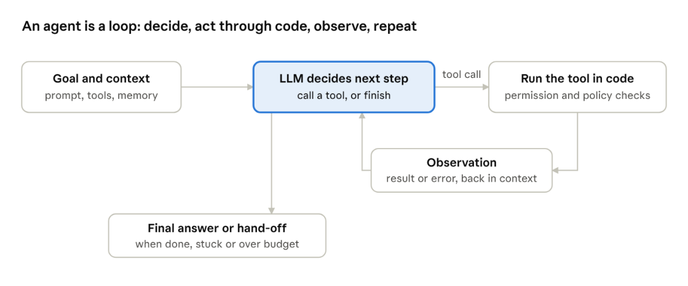

# 21 · Agents and tool use

Part VI · Agents. Assumes Chapter 15 (prompting, structured output, injection). Chapter 23 covers agent evaluation in depth; Chapter 20 the frameworks (LangGraph and others). Worked design that builds on it: E.10 Agentic customer-service flow.

## Why it matters

Agents, LLMs that call tools in a loop to complete tasks, are where much of the industry's investment is going: customer-service automation, coding assistants, operations copilots, research tools. They are also where LLM systems most often fail in production, through compounding errors, runaway costs and security holes. A senior answer shows you can build one, and also that you know when not to: most business problems are better served by a fixed workflow with an LLM in specific steps. Any role with a GenAI component will probe it; worked design E.10 shows the shape of a typical question.

## Key concepts

- **Workflow vs agent**: a workflow runs LLM calls in a fixed sequence you designed; an agent lets the model decide the next step. Most production systems should be workflows. [Anthropic: Building effective agents](https://www.anthropic.com/engineering/building-effective-agents).
- **Tool (function) calling**: the model outputs a structured request to call a function; your code runs it and returns the result.
- **ReAct loop**: reason, act (call a tool), observe, repeat until done. [ReAct paper](https://arxiv.org/abs/2210.03629).
- **Planning, memory and reflection**: the components that make agents handle longer tasks. Survey: [LLM Powered Autonomous Agents](https://lilianweng.github.io/posts/2023-06-23-agent/) (Lilian Weng).
- **Model Context Protocol (MCP)**: an open standard for connecting models to tools and data sources. [modelcontextprotocol.io](https://modelcontextprotocol.io/).
- **Guardrails for agents**: step and cost limits, least-privilege tools, human approval for consequential actions (Chapter 24).
- **Agent evaluation**: judged on task success, cost and trajectory, not just the final text (Chapter 23).

## 21.1 Workflows vs agents

Anthropic's "Building Effective Agents" (2024) draws a useful line:

- **Workflows:** LLM calls orchestrated through **predefined code paths**. Predictable, testable, cheaper.
- **Agents:** the LLM **dynamically decides** its own steps and tool use, in a loop, until the task is done.



*the agent loop · with code between the model and the world*

Common workflow patterns, in increasing complexity:

| Pattern | How | Example |
|---|---|---|
| Prompt chaining | Fixed sequence of LLM steps, with checks between | Extract order details → classify issue → draft reply |
| Routing | Classify the input, send it to a specialised prompt or model | Refund questions to one flow, account questions to another |
| Parallelisation | Run sub-tasks at once (sectioning) or the same task several times (voting) | Check a review for toxicity, PII and spam in parallel |
| Orchestrator-workers | An LLM splits the task and delegates sub-tasks dynamically | Research a question across several sources |
| Evaluator-optimiser | One LLM generates, another critiques, loop until good | Draft and refine a restaurant description |
| Autonomous agent | LLM chooses tools step by step with environment feedback | Resolve a ticket end to end with lookups and actions |

**The senior default:** start with the simplest pattern that works, and move towards autonomy only where the task genuinely needs flexible, multi-step decisions and evaluation shows a fixed flow fails. E.10 deliberately uses a state machine with LLM decisions inside steps, not a free-roaming agent.

## 21.2 Function calling

Models with tool use receive tool definitions (name, description, JSON schema of arguments) and can respond with a structured tool call instead of text. Your code executes the call and returns the result; the model continues. The model never executes anything itself: that boundary is where you put every check.

**Designing good tools** matters as much as prompting:

- **Clear names and descriptions,** written for a new colleague: what it does, when to use it, what it returns, units, limits.
- **Few, well-scoped tools** rather than many overlapping ones; models choose badly among near-duplicates.
- **Strict argument schemas:** enums for closed sets, required fields, no free-form "query" strings where structured fields work.
- **Helpful errors** the model can act on ("amount above policy cap of 10 euros; escalate instead"), not stack traces.
- **Idempotent and reversible where possible;** irreversible actions behind confirmation.
- **Concise outputs:** return what the model needs, not whole database rows that flood the context.

**Tool specs from Python functions, and an agent loop from scratch:**

```python
import inspect, json, time
from typing import get_type_hints, Literal, get_origin, get_args

PY_TO_JSON = {str: "string", int: "integer", float: "number", bool: "boolean"}

def tool(fn):
    """Attach a JSON-schema spec built from the signature and docstring."""
    hints, props, required = get_type_hints(fn), {}, []
    for name, param in inspect.signature(fn).parameters.items():
        t = hints[name]
        props[name] = ({"type": "string", "enum": list(get_args(t))} if get_origin(t) is Literal
                       else {"type": PY_TO_JSON[t]})
        if param.default is inspect.Parameter.empty:
            required.append(name)
    fn.spec = {"name": fn.__name__, "description": inspect.getdoc(fn),
               "input_schema": {"type": "object", "properties": props, "required": required}}
    return fn

@tool
def get_order(order_id: str) -> dict:
    """Look up an order by id. Returns status, items and total in euros."""
    return ORDERS.get(order_id, {"error": f"order {order_id} not found"})

@tool
def issue_voucher(order_id: str, amount: float, reason: Literal["missing_item", "late", "quality"]) -> dict:
    """Issue a voucher for an order. Amount in euros, at most 10. Requires a reason."""
    if amount > 10:                                         # the policy lives in code, not in the prompt
        return {"error": "amount above policy cap of 10 euros; escalate instead"}
    return {"ok": True, "voucher": amount}

def run_agent(llm, tools, user_message, max_steps=8, max_seconds=60):
    registry = {t.__name__: t for t in tools}
    messages = [{"role": "user", "content": user_message}]
    start = time.time()
    for step in range(max_steps):                            # hard step budget
        if time.time() - start > max_seconds:                # hard time budget
            return {"status": "timeout", "messages": messages}
        reply = llm(messages, [t.spec for t in tools])       # provider call in practice
        messages.append({"role": "assistant", "content": reply})
        if reply.get("tool_call") is None:
            return {"status": "done", "answer": reply["text"], "steps": step + 1, "messages": messages}
        call = reply["tool_call"]
        fn = registry.get(call["name"])
        try:
            result = fn(**call["arguments"]) if fn else {"error": f"unknown tool {call['name']}"}
        except Exception as e:
            result = {"error": str(e)}                       # errors go back to the model, not up the stack
        messages.append({"role": "tool", "name": call["name"], "content": json.dumps(result)})
    return {"status": "max_steps", "messages": messages}
```

With a scripted model that looks up order A1, issues a 2.50 euro voucher and replies, the loop finishes in 3 steps. Provider APIs differ in message formats (tool-use blocks, tool-call ids), but every agent framework is a version of this loop.

## 21.3 ReAct

**ReAct** (Yao et al., 2022) interleaves **reasoning** ("I need the order details first") with **acting** (a tool call) and **observing** (the result), repeating until done. Reasoning helps the model plan its next action and recover from surprises; actions ground the reasoning in real data. Native tool calling plus reasoning models now implement this pattern without the original text-parsing format, but the loop is the same.

## 21.4 Planning and reflection

- **Plan-then-execute:** the model writes a plan (a list of steps), code executes steps (possibly with smaller models), and the planner re-plans when a step fails. More predictable than step-by-step improvisation; cheaper when executors are small.
- **Reflection:** after a failure, the model writes a critique of what went wrong and retries with it in context (Reflexion, Shinn et al., 2023). Works best when there is a real signal (a failing test, a tool error, a judge verdict), not just "think again".
- **Verification steps:** check results before acting on them (does the voucher amount match policy? does the generated SQL return plausible numbers?).

## 21.5 Memory

| Kind | What | How |
|---|---|---|
| Working memory | The current task's messages, tool results, scratchpad | The context window; trim or summarise old steps |
| Episodic memory | Past interactions with this user or task | Stored summaries retrieved when relevant |
| Semantic memory | Durable facts and preferences ("customer prefers refunds as vouchers") | A key-value or vector store, written deliberately, retrieved per task |
| Procedural memory | How to do things | The system prompt, tool descriptions, few-shot examples, skills files |

Memory needs the same care as RAG: what gets written (only confirmed facts, not guesses), how it expires, who can see it (privacy), and how it is retrieved. A model writing wrong "facts" into long-term memory poisons every later conversation.

## 21.6 Multi-agent patterns

Several LLM "agents" with different prompts, tools or models working together:

- **Supervisor / orchestrator with workers:** one agent delegates sub-tasks to specialised agents (search, analysis, writing) and combines results.
- **Hand-offs:** an agent passes the conversation to another specialised agent (billing to refunds), as in OpenAI's Swarm-style designs.
- **Debate or critic:** one agent proposes, another critiques.
- **Parallel research:** several agents explore different sources at once, then a lead agent synthesises; Anthropic described this for its research feature, noting it uses many more tokens than a single agent.

**When it helps:** tasks that split cleanly into independent parts, need different tools or permissions per part, or exceed one context window. **Costs:** more tokens, more latency, harder debugging and evaluation, and errors that pass between agents. Many "multi-agent" designs work just as well as one agent with good tools; start with one.

## 21.7 The Model Context Protocol (MCP)

MCP, introduced by Anthropic in late 2024 and since adopted widely across the industry, is an open protocol for connecting AI applications to tools and data. An **MCP server** exposes tools (functions), resources (readable data) and prompts; an **MCP client** inside the AI application (a chat app, an IDE, an agent) discovers and calls them over a standard transport.

Why it matters: instead of writing a custom integration for every model and every data source, a company writes one MCP server for, say, its order system, and any MCP-capable application can use it. In interviews, know what it is, what problem it solves (the integration matrix), and its security implications: an MCP server is code with access to your systems, tool descriptions from third-party servers are untrusted input (tool poisoning), and permissions and authentication must be explicit.

## 21.8 Guardrails and permissions

Agents act, so mistakes have consequences. Layers, from Chapter 15.8 and worked design E.10:

- **Least privilege:** tools scoped to the task and the user; read-only by default; separate credentials per user.
- **Policy in code:** caps, eligibility rules and rate limits enforced by the tool implementation, never only by the prompt.
- **Human in the loop** for irreversible, costly or unusual actions; shadow mode before automation.
- **Input and output checks:** injection detection on tool outputs, PII filters, schema validation on every call.
- **Budgets:** maximum steps, tokens, time and money per task; stop and hand off when exceeded.
- **Audit trail:** every step, tool call, argument and result logged and traceable.

## 21.9 Reliability, cost and latency budgets

**Errors compound.** If each step succeeds independently with probability p, a task of n steps succeeds with roughly pⁿ:

| Per-step success | 5 steps | 10 steps | 20 steps |
|---|---|---|---|
| 99% | 95% | 90% | 82% |
| 95% | 77% | 60% | 36% |
| 90% | 59% | 35% | 12% |

This is the strongest argument for short, structured flows, verification steps that catch errors early, and recovery paths. It also explains why demos look great (one lucky run) and production disappoints (thousands of runs).

**Cost and latency** grow with steps: each step resends a growing context. A 10-step agent with 8,000 tokens of context per step processes 80,000+ input tokens per task. Control it with prompt caching of the stable prefix (Chapter 15.7), trimming tool outputs, small models for simple steps, parallel tool calls where independent, and hard budgets. Set the budget from the business value of the task: an agent resolving a 15-euro support ticket cannot spend 2 euros of tokens on it.

## 21.10 Evaluating agents

Covered in Chapter 23.5: task success on the environment's end state, trajectory checks (right tools, right order, no forbidden calls), efficiency (steps, tokens, latency), robustness to tool failures, repeated runs for reliability, and safety tests including injection through tool outputs. Before automation, run in **shadow mode**: the agent proposes, people decide, and you measure agreement.

## Pitfalls

- **Building an autonomous agent for a task a workflow solves.**
- **Policy enforced only in the prompt.**
- **Vague, overlapping tools** with loose schemas.
- **No step, token, time or money budget.**
- **Tool outputs dumped into context** in full, every step.
- **Trusting tool outputs and third-party tool descriptions** as instructions (injection).
- **Writing unverified guesses into long-term memory.**
- **Multi-agent designs by default.**
- **Evaluating on a handful of happy-path demos;** reliability only shows over many runs.
- **No shadow mode** before giving an agent write access.

## Interview questions

Questions 1–4 basic, 5–9 intermediate, 10–13 senior.

**1. What is an LLM agent?** A system where an LLM chooses actions (tool calls) in a loop, observes results, and decides the next step until the task is complete, rather than following a fixed code path.

**2. How does function calling work?** The model receives tool schemas, outputs a structured call (name and JSON arguments), the application executes it and returns the result as a message, and the model continues. The model never executes code itself.

**3. What is ReAct?** Interleaving reasoning, actions and observations in a loop so the model plans, acts, and adjusts based on real results.

**4. Workflow or agent: how do you choose?** Workflow when steps are known and stable (cheaper, predictable, testable); agent when the path depends on what is found and cannot be enumerated. Start simple; add autonomy only where evaluation shows the need.

**5. How do you design good tools for an agent?** Few, distinct tools; clear descriptions with units and limits; strict schemas with enums; concise outputs; actionable errors; idempotency; confirmation for irreversible actions; policy checks inside the tool.

**6. What types of memory do agents use?** Working (context), episodic (past interactions), semantic (durable facts) and procedural (instructions, tools). Each needs rules for writing, expiry, privacy and retrieval.

**7. What is MCP?** An open protocol for exposing tools, resources and prompts from servers to AI applications through a standard interface, replacing per-application integrations; it requires explicit trust, authentication and permission management.

**8. Why do agents fail more in production than in demos?** Errors compound over steps (pⁿ), real inputs are messier, tools fail, contexts grow, and demos are single lucky runs. Reliability needs many-run evaluation, verification steps and recovery paths.

**9. How do you control an agent's cost?** Budgets per task, caching the stable prefix, trimming tool outputs and history, smaller models for simple steps, parallel calls, fewer steps through better tools, and a hand-off when the budget is reached.

**10. Design an agent that handles "where is my order?" and refund requests.** Routing first: "where is my order" is a workflow (lookup, format answer); refunds use a state machine with LLM decisions inside steps: gather evidence with read-only tools, propose an action, validate it with a policy engine, auto-approve small amounts, human approval above a threshold, idempotent payment calls, full audit log, shadow mode before automation, evaluation on replayed tickets (E.10).

**11. A user's message contains instructions to call the refund tool. What stops it?** Refund eligibility and amounts are decided in code against order data, not by the model's reading of the message; caps and human approval for higher amounts; the message is treated as data; monitoring and injection tests.

**12. When would you use multiple agents?** When sub-tasks are independent and benefit from parallelism, need different tools or permissions, or exceed a single context. Otherwise one agent with good tools is simpler, cheaper and easier to evaluate.

**13. How do you take an agent from prototype to production?** Define success and budgets; build a sandbox and evaluation set from real cases; measure task success over repeated runs; add guardrails and audit logs; shadow mode against humans; gradual automation by risk tier; monitoring of success, cost, escalations and overrides; a rollback path.

## Practice

1. **Agent loop from scratch:** implement `run_agent` against a real provider's tool-use API with the two tools above and a fake order database; add a third tool and test that the model picks correctly.
2. **Budgets and failures:** make a tool fail 20% of the time; add retries and a hand-off; measure success over 50 runs.
3. **Workflow vs agent:** solve the same support task as a fixed chain and as an agent; compare success, cost and latency.
4. **MCP:** write a tiny MCP server exposing `get_order` with an official SDK and connect it to an MCP-capable client.
5. **LangGraph:** rebuild the refund flow from E.10 as a state graph with a human-approval node (Chapter 20).
6. **Injection test:** put an instruction inside an order note returned by `get_order` and check whether your agent follows it; then fix the design.

## Read next

- Anthropic, *Building Effective Agents* (2024), and Anthropic's engineering posts on writing tools for agents and on their multi-agent research system.
- Yao et al., *ReAct: Synergizing Reasoning and Acting in Language Models* (2022).
- Shinn et al., *Reflexion: Language Agents with Verbal Reinforcement Learning* (2023).
- Schick et al., *Toolformer* (2023).
- The Model Context Protocol specification and documentation (modelcontextprotocol.io).
- Lilian Weng, *LLM Powered Autonomous Agents* (2023).
- *AI Engineering* (Chip Huyen): the chapter on agents.
- Yao et al., τ*-bench* (2024), for how agents are evaluated.

**Links:** [Building effective agents](https://www.anthropic.com/engineering/building-effective-agents) · [LLM Powered Autonomous Agents](https://lilianweng.github.io/posts/2023-06-23-agent/) · [ReAct](https://arxiv.org/abs/2210.03629) · [Toolformer](https://arxiv.org/abs/2302.04761) · [MCP](https://modelcontextprotocol.io/). Other titles above can be found by searching their title.

## Done when

You can explain workflows vs agents and the common workflow patterns. You can write an agent loop with tool schemas, errors and budgets from scratch. You can design tools well and explain why policy belongs in code.

You can explain ReAct, planning, reflection and the kinds of memory. You can explain MCP and its security implications. You can reason about reliability (pⁿ), cost and latency budgets.

You can take an agent from prototype to production with shadow mode and evaluation.

---

[← 20 · Frameworks and tooling](20-frameworks-and-tooling.md) · [Contents](../README.md#contents) · [22 · LLM evaluation →](22-llm-evaluation.md)
