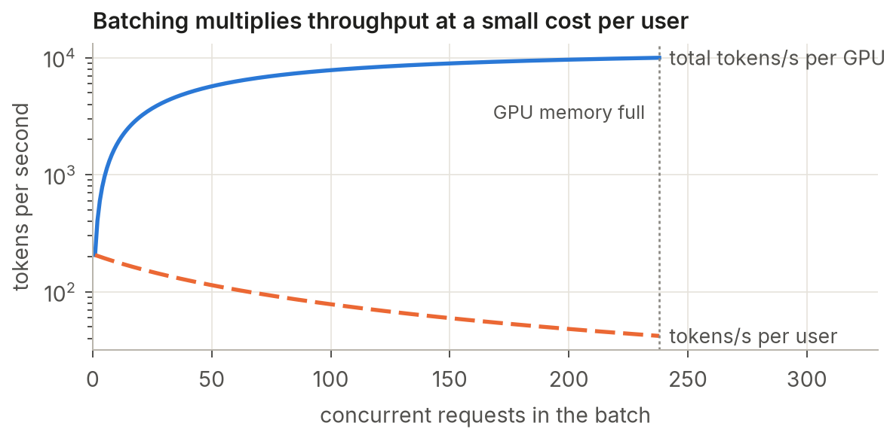

# 21 · Inference, decoding and serving

Part VI · Inference and prompting. Prerequisites: Chapter 10 (the transformer) and Chapter 42 (infrastructure primer). Written to be readable without any serving experience.

## Why it matters

Training happens once; inference happens on every request, so it is where the money and the latency are. Any LLM feature in a product (search, recommendations, support, content generation) has to be designed around three numbers from day one: how long a user waits, how many requests the system handles, and what each one costs. Interviewers test this with arithmetic ("how much GPU memory for 32 users with 8k-token prompts?") and trade-offs ("temperature 0 or not?", "self-host or API?"). This chapter builds the picture step by step: how a model produces text, how that text is chosen, why serving LLMs is memory-bound, what serving engines do about it, and how to compute latency and cost.

Numbers come from running the code in this chapter; hardware figures are round numbers for arithmetic, not vendor specs.

The chapter moves from the model to the machine that serves it. It starts with what happens at each step of generation (21.1) and how the next token is chosen from the model's probabilities (21.2), including forcing the output into a fixed structure (21.3). Sections 21.4 and 21.5 explain why serving is limited by memory rather than arithmetic: the KV cache, and the two very different phases of a request, prefill and decode. Section 21.6 shows how serving engines exploit those facts, and 21.7 and 21.8 cover the two main ways of going faster and cheaper: speculative decoding and quantisation. The chapter ends with the arithmetic of latency, throughput and cost (21.9), a worked cost reduction (21.10) and research-level topics (21.11).

One fact explains most of serving: generating a token requires reading every weight of the model, and the whole KV cache of the request, from GPU memory, while doing very little arithmetic with them. Almost every serving technique is a way to do more useful work per byte read, by batching users together, guessing several tokens at once, or storing fewer bytes.

## Key concepts

- **Autoregressive generation**: the model writes one token at a time, each time reading everything written so far. [Hugging Face: generation strategies](https://huggingface.co/docs/transformers/generation_strategies).
- **Logits and sampling**: the model outputs a score per vocabulary token; a decoding strategy (greedy, temperature, top-k, top-p) turns scores into a choice. [Nucleus sampling paper](https://arxiv.org/abs/1904.09751).
- **KV cache**: stored keys and values of past tokens so they are not recomputed at each step. [KV cache from scratch](https://huggingface.co/blog/kv-cache).
- **Prefill and decode**: processing the prompt (fast, parallel) vs generating the answer (one token per step, limited by memory speed).
- **TTFT, TPOT, throughput**: time to first token, time per output token, tokens or requests per second.
- **Continuous batching and PagedAttention**: serving-engine techniques that keep the GPU busy and pack memory tightly. [vLLM paper](https://arxiv.org/abs/2309.06180), [vLLM docs](https://docs.vllm.ai/en/latest/).
- **Speculative decoding**: a small model drafts tokens, the big model checks them in one pass. [Paper](https://arxiv.org/abs/2211.17192).
- **Quantisation**: storing weights in fewer bits (8 or 4 instead of 16). [Hugging Face quantisation overview](https://huggingface.co/docs/transformers/main/en/quantization/overview); methods: [GPTQ](https://arxiv.org/abs/2210.17323), [AWQ](https://arxiv.org/abs/2306.00978), [LLM.int8()](https://arxiv.org/abs/2208.07339), [SmoothQuant](https://arxiv.org/abs/2211.10438).
- **Grouped-query attention (GQA)**: several attention heads share one key-value head to shrink the cache. [Paper](https://arxiv.org/abs/2305.13245).
- **Constrained decoding / structured outputs**: forcing output to match a JSON schema or label set.
- **Batch API**: a provider endpoint that processes large jobs asynchronously at a discount.

## 21.1 How an LLM produces text, step by step

A language model is a function: give it a sequence of tokens, it returns, for the *next* position, a score (a **logit**) for every token in its vocabulary, often 100,000 or more. Softmax turns the scores into probabilities. Generating text is a loop:

1. Tokenise the prompt (Chapter 9): "Why is the sky blue?" → about 6 token ids.
2. Run the model on all prompt tokens; read the probabilities for the next token.
3. **Choose** one token (the decoding strategy, 21.2).
4. Append it to the sequence and repeat from step 2, until an end-of-sequence token or a length limit.

This is called **autoregressive** generation. Two consequences drive everything in this chapter: generating 300 tokens means 300 sequential steps that cannot run in parallel, and each step needs information about every earlier token.

## 21.2 Choosing the next token: decoding strategies

The model only gives probabilities; the **decoding strategy** picks. The same model behaves very differently with different settings.

```python
def sample_next(logits, temperature=1.0, top_k=0, top_p=1.0, min_p=0.0,
                prev_ids=None, rep_penalty=1.0):
    logits = logits.clone()
    if prev_ids is not None and rep_penalty != 1.0:      # discourage repeating tokens
        s = logits[prev_ids]
        logits[prev_ids] = torch.where(s > 0, s / rep_penalty, s * rep_penalty)
    if temperature == 0:
        return int(logits.argmax())                      # greedy: always the top token
    logits = logits / temperature                        # <1 sharpens, >1 flattens
    if top_k > 0:                                        # keep only the k best tokens
        kth = logits.topk(top_k).values[-1]
        logits[logits < kth] = float("-inf")
    probs = logits.softmax(-1)
    if min_p > 0:                                        # drop tokens far below the best one
        probs[probs < min_p * probs.max()] = 0
    if top_p < 1.0:                                      # nucleus: smallest set with mass >= p
        sp, si = probs.sort(descending=True)
        drop = sp.cumsum(0) - sp > top_p
        sp[drop] = 0
        probs = torch.zeros_like(probs).scatter(0, si, sp)
    probs = probs / probs.sum()
    return int(torch.multinomial(probs, 1))              # random draw
```

On logits `[3.0, 2.5, 1.0, 0.5, -1.0, -2.0]` (softmax 0.54, 0.33, 0.07, 0.04, 0.01, 0.004), 5,000 draws each gave:

| Setting | What it does | Token frequencies |
|---|---|---|
| greedy (T = 0) | always the most likely token | always token 0 |
| T = 1.0 | sample from the model's own probabilities | 0.53, 0.34, 0.08, 0.04, 0.01, 0.003 |
| T = 0.5 | sharpen: likely tokens become more likely | 0.71, 0.27, 0.01, 0.004, 0, 0 |
| top-k = 2 | only the 2 best tokens are allowed | 0.63, 0.37, rest 0 |
| top-p = 0.8 | smallest set covering 80% probability | 0.62, 0.38, rest 0 |
| min-p = 0.2 | drop tokens below 20% of the best one's probability | 0.63, 0.37, rest 0 |

When to use what:

- **Greedy (temperature 0)** for extraction, classification, JSON and anything you want repeatable. API outputs at temperature 0 are still not perfectly deterministic, because batching and floating-point order vary.
- **Beam search** keeps the B best partial sequences and returns the most likely whole sequence. Good for translation and short constrained outputs; for open-ended chat it gives bland, repetitive text.
- **Temperature + top-p (0.9–0.95)** for open-ended writing. **min-p** adapts the cut-off to how confident the model is, which behaves better at high temperature.
- **Repetition, frequency and presence penalties** reduce loops; too strong and the model avoids words it needs, such as a product or person's name that must be repeated.
- **Several samples + vote** (self-consistency) or + a verifier improves accuracy at a multiple of the cost.

### Beam search, length normalisation and why it degenerates

Beam search keeps the B highest-scoring partial sequences at each step, extends each by every token, and keeps the best B of the results. Its score is the sum of token log-probabilities, and that sum is the problem: every extra token adds a negative number, so the search prefers short outputs. A 5-token answer at an average of −0.5 nats per token scores −2.5; a 20-token answer at −0.3 per token scores −6.0 and loses, although each of its tokens is more likely. The standard fix is **length normalisation**, ranking finished beams by

$$
\mathrm{score}(y) = \dfrac{\log P(y \mid x)}{|y|^{\alpha}}
$$

where |y| is the output length in tokens and α (typically 0.6–1) sets how strongly length is forgiven. With α = 1 the two answers above score −0.5 and −0.3, and the longer one wins.

Even normalised, beam search finds the *most probable* text, and for open-ended generation the most probable text is not human-like: it is generic and repetitive, because once a phrase has been generated, repeating it becomes more likely under the model (Holtzman et al., 2020). Wider beams make this worse, not better: in translation, larger beams were found to lower quality, partly by favouring short or empty outputs. So beam search survives where the answer is nearly determined by the input (translation, speech recognition, short constrained outputs), and sampling with top-p or min-p is the default everywhere else.

### Decoding for reasoning models

Reasoning models (Chapter 19) generate thousands of thinking tokens before the answer, and decoding settings matter more for them than for chat models. Greedy decoding is a known failure mode: over a long chain of thought, a deterministic decoder tends to fall into loops, repeating a step or a sentence until it hits the length limit, and that trace is scored as wrong. Vendors therefore publish recommended settings. DeepSeek-R1-style and Qwen3 thinking models, for example, recommend a temperature around 0.6 with top-p 0.95 and advise against greedy decoding. Some APIs fix the temperature of their reasoning models altogether, and expose a reasoning-effort or thinking-budget setting instead.

Two practical consequences. First, a reasoning model's accuracy at temperature 0.6 is a random variable, so evaluations sample several answers per question and average them (Chapter 23). Second, a maximum output length that truncates the reasoning counts as a wrong answer, so length limits are part of the evaluation setup and the cost model, not a detail.

## 21.3 Structured outputs and constrained decoding

Applications usually need machine-readable output: a label, a JSON object. Asking nicely in the prompt works most of the time; **constrained decoding** makes it guaranteed. At each step, the engine masks (sets to minus infinity) every token that would break a grammar or JSON schema, so only valid continuations can be chosen. Libraries: Outlines, XGrammar, llguidance; most APIs and vLLM expose it as "structured outputs" with a JSON schema.

For classification, constrain the output to the label set and read the label probabilities from the logits: you get a confidence score for free, useful for routing low-confidence items to humans. Keep schemas simple; if the task needs reasoning, give the model a free-text field before the constrained answer field.

### What constrained decoding costs

Constrained decoding guarantees the *shape* of the output, but it does not sample from the model's distribution restricted to valid outputs. It masks invalid tokens and renormalises at each step, which is a greedy, local operation, while the correct conditional p(y | y is valid) depends on how much valid probability lies *downstream* of each choice. A two-step example shows the gap. Suppose the first token is "a" with probability 0.6 or "b" with 0.4; after "a", only 10% of the model's continuations are valid, and after "b", 90% are. The true conditional over valid outputs puts 0.6 × 0.1 / (0.6 × 0.1 + 0.4 × 0.9) = 0.14 on the "a" branch, but step-wise masking commits to "a" 60% of the time and then forces the model down a path it considered unlikely. Masking is not conditioning.

Two further costs are practical. **Token misalignment:** the grammar works on characters, the model on tokens, and forcing a boundary the tokenizer would not produce (a quote and a colon as separate tokens where training data had them merged) puts the model off its training distribution; good engines handle this, naive ones do not. **Format pressure on reasoning:** studies such as Tam et al. ([Let Me Speak Freely?](https://arxiv.org/abs/2408.02442), 2024) found that strict formats can lower accuracy on reasoning tasks compared with free text. The mitigations are the ones above: a free-text reasoning field before the constrained fields, or a two-pass design in which the model answers freely and a second, cheap constrained call extracts the answer.

## 21.4 Why serving LLMs is a memory problem: the KV cache

Inside each attention layer, every token produces a **key** and a **value** vector; to generate the next token, the model compares its new query with the keys of *all* earlier tokens. Recomputing all of those at every step would be wasteful, so they are stored: the **KV cache**. It grows by one entry per layer for every token, for every request being served.

How big is it?

```python
def kv_cache_gb(layers, kv_heads, head_dim, seq, batch, bytes_=2):   # fp16 = 2 bytes per number
    return 2 * layers * kv_heads * head_dim * seq * batch * bytes_ / 1e9  # 2 = keys and values

# A Llama-3-8B-shaped model: 32 layers, 8 KV heads (GQA), head_dim 128
kv_cache_gb(32, 8, 128, 8192, 1)    # 1.07 GB for one 8k-token conversation
kv_cache_gb(32, 8, 128, 8192, 32)   # 34.4 GB for 32 of them at once
kv_cache_gb(32, 32, 128, 8192, 1)   # 4.29 GB per conversation without GQA
```

The model weights for 8 billion parameters in 16-bit precision are 8e9 × 2 bytes = 16 GB. So at 32 users with long contexts, **the cache is bigger than the model**. That single fact explains why long context is expensive, why grouped-query attention was invented (it cut the cache 4× above), and why serving engines are mostly memory managers.


*KV cache for a single request of an 8B model with 32 layers and 128-dimensional heads, in fp16, by number of key–value heads. With full multi-head attention a 32k-token request needs as much memory as the whole model; GQA cuts it 4× and MQA 32×.*

**Levers that shrink the cache.** Every factor in the formula has a technique that targets it:

- **Fewer KV heads.** GQA and MQA (Chapter 10) shrink the head count.
- **A compressed latent.** MLA (Chapter 11) stores a small latent instead of full keys and values.
- **Lower precision.** An 8-bit or 4-bit cache halves or quarters the bytes per number.
- **Fewer cached tokens.** Sliding-window or local attention layers cache only the last few thousand tokens; hybrid models with state-space layers keep a fixed-size state for most layers.
- **Sharing across requests.** Prefix caching keeps one copy of a common prefix.

The cost of each is a possible quality loss, so they are evaluated on long-context tasks, not only on short benchmarks.

## 21.5 Prefill and decode: two very different phases


*Prefill fills the KV cache; decode reads it every step. Continuous batching refills a slot as soon as a request finishes.*

- **Prefill** processes the whole prompt in one parallel pass and fills the KV cache. Lots of computation, done efficiently: the GPU's maths units are busy. It sets **time to first token (TTFT)**, which grows with prompt length.
- **Decode** then produces one token per step. Each step does little maths but must read *all* the model weights and the whole cache from GPU memory. The GPU waits on memory, not on maths. It sets **time per output token (TPOT)**.

A rough single-user speed limit for decode: memory bandwidth / bytes read per token. With 2 TB/s of bandwidth and 16 GB of weights, about 2e12 / 16e9 = **125 tokens per second**, at best. End-to-end latency for one answer ≈ TTFT + output tokens × TPOT; a 300-token answer at 8 ms per token takes 2.4 s after the first token. That is why **streaming** tokens to the user matters: perceived latency becomes TTFT.

The key insight for serving: during decode, reading the weights once can serve **many users at the same time**. Batch 32 users together and each weight read produces 32 tokens instead of one. Throughput rises almost linearly with batch size, until the cache fills GPU memory or the maths units saturate. **Prefix caching** reuses the cache of a shared beginning (the system prompt, few-shot examples, a long document) across requests; API providers sell this as "prompt caching" at a discount. Put the stable part of the prompt first so it can be reused.



*Decode throughput of an 8B model on one 80 GB GPU (3.35 TB/s, 50% of 989 TFLOP/s usable) with 2k-token contexts. Each step reads the weights once plus every request's cache. Total throughput rises about 50× while each user's speed falls about 5×. The batch stops at 238 requests, when the caches fill memory.*

**Reading the curve.** A step's time is the larger of two numbers: the bytes it must read divided by bandwidth, or the FLOPs it must do divided by compute.

- **One request.** The step reads 16 GB of weights and a quarter of a gigabyte of cache: 4.9 ms, 206 tokens per second.
- **64 requests.** The same weights are read once for all of them, and the step takes 9.9 ms. Each user gets 101 tokens per second, and the GPU produces 6,500.
- **238 requests.** The caches now weigh 64 GB, four times the weights, so reading them dominates the step: 23.8 ms, 42 tokens per second per user and about 10,000 per GPU.

The maths units are never the limit here: even at 238 requests, the matmuls need under a third of the step. This is why serving work concentrates on memory (paging, cache compression, quantisation) and why a latency target (say 50 tokens per second per user) sets the batch size, and through it the cost per token.

## 21.6 Serving engines: what vLLM and friends actually do

A serving engine is the program that loads the model on GPUs and answers requests, usually behind an OpenAI-compatible HTTP API. The good ones do four things:

1. **Continuous batching.** Naive (static) batching waits until every request in a batch finishes before starting new ones, so short answers leave GPU slots idle while a long one finishes. Continuous batching adds a new request to the running batch at the next decode step and removes finished ones immediately (the diagram's bottom half).
2. **PagedAttention.** Instead of reserving cache memory for the maximum possible length of every request, the cache is stored in small fixed-size blocks, like pages of virtual memory in an operating system, allocated as the sequence grows. Far less waste, so more requests fit; shared prefixes can point to the same blocks.
3. **Chunked prefill.** A huge prompt is processed in pieces so it does not freeze other users' decode steps.
4. **Optimised kernels** (FlashAttention, fused operations) and **parallelism** across several GPUs when the model does not fit on one (tensor parallelism splits each layer across GPUs).

The main options: **vLLM** (the default open-source choice), **SGLang**, **Hugging Face TGI** (in maintenance mode since 2025), **NVIDIA TensorRT-LLM** (fastest, more setup), **llama.cpp / Ollama** (CPUs and laptops).

```bash
# Serve an open model with an OpenAI-compatible API (check current vLLM docs for flags)
vllm serve Qwen/Qwen2.5-7B-Instruct --max-model-len 8192 --gpu-memory-utilization 0.9
# then call it like any OpenAI-style endpoint at http://localhost:8000/v1/chat/completions
```

In production this runs inside a container on a GPU node of a Kubernetes cluster, behind a load balancer, exactly like the primer's model server (Chapter 42), with autoscaling on queue length or GPU utilisation instead of CPU.

### Serving at scale: routing, adapters, offload and goodput

Five topics come up once the discussion moves from one GPU to a fleet.

**Cache-aware routing.** Prefix caching only helps if a request reaches the replica that holds its prefix. With N replicas and a round-robin load balancer, a request whose prefix is cached on one replica lands there with probability 1/N, so at N = 8 the cache hit rate falls to one-eighth of what one replica would see. Prefix-aware routers hash the prefix (or track which replica holds which blocks) and send requests with the same system prompt or conversation to the same replica, falling back to the least-loaded replica when that one is busy. The tension is between cache locality and load balance, and production routers score both.

**Multi-LoRA serving.** Many fine-tuned variants of one base model (one per customer or per task) do not need many deployments. A rank-16 LoRA on every linear layer of a Llama-3-8B-shaped model has 42M parameters, about 84 MB in bf16, against 16 GB for the base. Systems in the S-LoRA and Punica line keep one copy of the base weights, page adapters in and out of GPU memory, and batch requests for *different* adapters in the same forward pass with custom kernels that apply each request's low-rank update. The base model's weight reads are shared across all of them, which is what makes it cheap (Chapter 20).

**KV-cache offload.** Prefix caches that do not fit in GPU memory can move to CPU memory or local SSD and be reloaded on a hit. It pays when loading is faster than recomputing: the 8k-token cache of the 8B model is 1.07 GB, about 43 ms over a link with an effective 25 GB/s, against roughly 0.3 s to recompute the prefill (21.9). Multi-turn chat and agents, which resend a long history every turn, benefit most.

**Tensor-parallel communication at decode.** Tensor parallelism splits each layer across t GPUs and needs two all-reduces per layer (after attention and after the MLP). At decode each all-reduce carries only batch × d_model × 2 bytes, so it is bound by latency, not bandwidth: a 70B model with 80 layers does 160 all-reduces per token, and at about 10 µs each that is 1.6 ms, a visible fraction of a 15–20 ms step. That is why tensor parallelism stays inside one fast NVLink domain, and why a model that fits on fewer GPUs often decodes with lower latency (Chapter 17).

**Goodput.** Raw throughput rewards packing the batch until every user is slow. **Goodput** counts only requests that meet their service-level objectives, for example TTFT under 1 s and TPOT under 50 ms at the 90th percentile. As load rises, throughput keeps climbing while goodput peaks and then falls, once queueing or prefill interference pushes the tail past the SLO. Capacity planning and disaggregated serving (21.11) optimise goodput per GPU, not tokens per second.

## 21.7 Speculative decoding: guessing ahead

Decode is slow because it is sequential. Speculative decoding cheats safely: a small, fast **draft model** proposes the next k tokens; the big model checks all k in **one** forward pass (checking is parallel, like prefill). It accepts the longest prefix it agrees with, using a rejection rule that keeps the output distribution exactly the big model's, then continues from there. If each draft token is accepted with probability α, the expected tokens per big-model pass is (1 − α^(k+1)) / (1 − α):

```python
def spec_expected_tokens(alpha, k):
    return (1 - alpha ** (k + 1)) / (1 - alpha)
# alpha 0.6: k=2 -> 1.96, k=4 -> 2.31, k=8 -> 2.47
# alpha 0.8: k=2 -> 2.44, k=4 -> 3.36, k=8 -> 4.33
```

So with a well-matched draft (80% acceptance) and k = 4, each expensive pass yields about 3.4 tokens instead of 1. Gains are biggest on predictable text: code, JSON, rewriting a given document. Variants avoid a separate draft model: Medusa (extra prediction heads), EAGLE, and prompt-lookup decoding (copy n-grams from the prompt, very effective for RAG and editing).

### The acceptance rule, and why it is lossless

"Prove that speculative decoding does not change the output distribution" is a standard follow-up, and the proof is three lines. At one position, let p be the target model's next-token distribution and q the draft model's. The draft proposes x ~ q. The target **accepts** x with probability min(1, p(x)/q(x)). If it rejects, it samples a replacement from the **residual distribution**

$$
r(x) = \dfrac{\max(0,\, p(x) - q(x))}{\sum_{y} \max(0,\, p(y) - q(y))}
$$

which puts mass only where the target likes a token more than the draft does. The probability that the final token is x is the probability of drafting and accepting it, plus the probability of rejecting something and resampling x:

$$
P(x) = q(x)\,\min\left(1, \dfrac{p(x)}{q(x)}\right) + P(\mathrm{reject})\; r(x)
$$

The first term is min(q(x), p(x)). The rejection probability is 1 − Σ min(p, q) = Σ (p − min(p, q)) = Σ max(0, p − q), which is exactly the denominator of r, so the second term is max(0, p(x) − q(x)). Adding them gives min(p, q) + max(0, p − q) = p(x) for every x: the output follows the target distribution exactly, whatever the draft. The draft affects only speed, through the acceptance rate α = Σ min(p, q) = 1 − TV(p, q), one minus the total-variation distance between the two models.

A three-token check: p = (0.6, 0.3, 0.1) and q = (0.3, 0.5, 0.2). Then min(p, q) = (0.3, 0.3, 0.1), so α = 0.7. The residual is (0.3, 0, 0)/0.3 = (1, 0, 0): token 1 is over-proposed by the draft (0.5 against 0.3), accepted only 60% of the time, and the lost mass is returned to token 0. Final probabilities: (0.3 + 0.3 × 1, 0.3, 0.1) = (0.6, 0.3, 0.1) = p.

For k drafted tokens the rule is applied left to right. At the first rejection the target's resample replaces that token and the round ends; if all k are accepted, the verification pass has already computed the target's distribution at position k + 1, so one **bonus token** is sampled for free. That is where the k + 1 in the formula comes from: if each token is accepted independently with probability α, the round produces at least i + 1 tokens with probability α^i, and summing over i = 0, …, k gives (1 − α^(k+1))/(1 − α). At temperature 0 the rule reduces to "accept while the draft's token equals the target's argmax", the greedy special case that is often (wrongly) given as the whole algorithm.

### Wall-clock speedup, and choosing k

Tokens per target pass is not the speedup, because the draft model also costs time. Let c be the cost of one draft forward pass relative to one target decode step. A round runs the draft k times and the target once on k + 1 positions; while decode is memory-bound, verifying k + 1 tokens costs about the same as generating one, since the weights are read once either way. The round therefore costs about 1 + kc target steps, and the speedup over plain decoding is

$$
S(\alpha, k, c) = \dfrac{1 - \alpha^{k+1}}{(1 - \alpha)(1 + kc)}
$$

With α = 0.8, k = 4 and c = 0.05 (a draft about twenty times cheaper), S = 3.36 / 1.2 = 2.8×, not the 3.4× of the token count. The numerator saturates in k at 1/(1 − α) while the denominator keeps growing, so there is an optimal k, and it falls as the draft gets more expensive or less accurate:

| α | c = 0.02 | c = 0.05 | c = 0.1 | c = 0.2 |
|---|---|---|---|---|
| 0.6 | k = 6, 2.17× | k = 4, 1.92× | k = 3, 1.67× | k = 2, 1.40× |
| 0.8 | k = 11, 3.82× | k = 8, 3.09× | k = 6, 2.47× | k = 4, 1.87× |

Real acceptance is not independent across positions (easy spans are accepted in runs), so engines tune k empirically, and some adapt it per request.

**When it does not help.** The "verification is free" assumption holds only while decode is memory-bound. At large batch sizes the GPU approaches its compute limit, and verifying k + 1 tokens per sequence multiplies the arithmetic by up to k + 1, so the speedup shrinks and can turn into a slowdown; speculative decoding is mainly a latency tool for small and medium batches. It also costs memory for the draft model and its KV cache, and it gains little when α is low (a mismatched draft, high temperature, creative text).

**Drafters built into the model.** Medusa adds extra decoding heads that predict tokens t + 2, t + 3, … from the last hidden state; EAGLE trains a small autoregressive head on the target's features, which gives higher acceptance. DeepSeek-V3 trains **multi-token-prediction (MTP)** modules as an auxiliary pre-training objective and can reuse them as drafters at inference: its report gives an 85–90% acceptance rate for the second token and about 1.8× higher generation speed. Building the drafter into training removes the separate draft model, its tokenizer mismatch and its maintenance.

## 21.8 Quantisation: smaller numbers, smaller model

Weights are normally stored as 16-bit floats (2 bytes each). **Quantisation** stores them as 8-bit or 4-bit integers plus a scale factor, so the model takes 2–4× less memory and decode (which is memory-bound) gets faster.

The simplest scheme, **absmax**, divides each weight by the largest absolute value and rounds to an integer between −127 and 127:

```python
def quant_int8(w):                       # one scale for the whole tensor
    scale = w.abs().max() / 127
    return torch.round(w / scale).clamp(-127, 127).to(torch.int8), scale

def quant_rowwise(w):                    # one scale per output row
    scale = w.abs().amax(1, keepdim=True) / 127
    return torch.round(w / scale).clamp(-127, 127), scale
# 256x256 Gaussian weights: 1.0% average error with one scale.
# Add ONE outlier of 40.0: error jumps to 9.9% (the scale is stretched for everyone);
# with per-row scales it stays at 0.7%.
```

That outlier effect is the central problem of LLM quantisation: a few unusually large values ruin a shared scale. The methods you should be able to name:

- **LLM.int8()**: keeps the rare outlier features in 16-bit and quantises the rest to 8-bit.
- **GPTQ**: quantises layer by layer after training, adjusting the remaining weights to compensate for each rounding error; good 4-bit quality.
- **AWQ**: finds the ~1% of weight channels that matter most (from activation sizes) and protects them by scaling before quantising.
- **SmoothQuant**: moves activation outliers into the weights so that both can be quantised to 8 bits.
- **GGUF** files for llama.cpp on CPUs and Macs; **FP8** on recent GPUs; **NF4** for QLoRA fine-tuning (Chapter 20).

The rest of this section gives the maths behind each, because "how does GPTQ work?" and "why does weight-only quantisation not speed up prefill?" are common follow-ups.

### The error of uniform quantisation, and group-wise scales

With b bits and a symmetric grid, a weight w is stored as the integer q = clamp(round(w/s), −Q, Q), where Q = 2^(b−1) − 1 (127 for 8 bits, 7 for 4 bits) and the scale is s = max|w| / Q over whatever block of weights shares it. It is read back as ŵ = s·q. Rounding errors are roughly uniform on [−s/2, s/2], so

$$
\mathbb{E}\left[(w - \hat{w})^2\right] \approx \dfrac{s^2}{12} = \dfrac{(\max|w|)^2}{12\,Q^2}
$$

The error grows with the *largest* value in the block, which is why one outlier of 40 multiplied the error tenfold above, and why every method shrinks the block that shares a scale or tames the largest values.

The cheapest fix is **group-wise** scales: one fp16 scale per group of g consecutive weights in a row, typically g = 128. The overhead is 16/g bits per weight, so 4-bit weights with g = 128 cost 4 + 16/128 = 4.125 bits per weight, or 4.25 with an fp16 zero point for asymmetric grids. An 8B model at 4.125 bits is 8e9 × 4.125 / 8 = 4.1 GB, against 16 GB in fp16. Smaller groups lower the error and raise the overhead (g = 32 costs 0.5 extra bits).

### LLM.int8(): split out the outliers

Dettmers et al. found that in large models a handful of hidden dimensions carry activations far larger than the rest (magnitudes above about 6, against typical values near 1), consistently across tokens. LLM.int8() decomposes each matrix multiply: the few outlier columns of the activations, with the matching weight rows, run in fp16, and everything else runs in int8 with per-row and per-column scales. Quality matches fp16 at 8 bits; the cost is a mixed-precision kernel that is slower than a pure int8 one.

### GPTQ: compensate each rounding error with the others

Round-to-nearest treats weights independently, but what matters is the layer's output. For one row w of a linear layer with inputs X (d_in × N calibration tokens), GPTQ minimises the output error ‖wX − ŵX‖², a quadratic in the weight error e = w − ŵ with Hessian H = 2XXᵀ. Building on Optimal Brain Surgeon, it quantises one weight at a time; after rounding weight j, it updates the not-yet-quantised weights to absorb the error:

$$
\delta w = -\dfrac{w_j - \mathrm{quant}(w_j)}{[H^{-1}]_{jj}}\; H^{-1}_{:,j}
$$

Here H⁻¹ with subscript :,j is column j of the inverse Hessian and [H⁻¹]_jj its diagonal entry. The intuition: if two inputs are correlated, an error on one weight can be cancelled by nudging the other.

A two-weight check, with integer grid points and inputs of unit variance and correlation 0.9 (so H ∝ [[1, 0.9], [0.9, 1]]): take w = (0.6, 0.6). Round-to-nearest gives (1, 1); the errors (−0.4, −0.4) point the same way, and the output error eᵀHe/2 is 0.16 + 0.16 + 2 × 0.9 × 0.16 = 0.608 (in units of the input variance). GPTQ rounds the first weight to 1 (error −0.4), then moves the second by −(−0.4) × (−0.9) = −0.36 to 0.24, which rounds to 0. The errors (−0.4, 0.6) now cancel through the correlation: 0.16 + 0.36 − 2 × 0.9 × 0.24 = 0.088, seven times lower, and the best of the four grid points. In practice GPTQ processes columns in blocks, uses a Cholesky factor of H⁻¹ for stability, and quantises a 70B model on one GPU in hours.

### AWQ: protect salient channels by rescaling

AWQ (activation-aware weight quantisation) starts from an exact identity: for any positive per-channel scales s,

$$
WX = \left(W\,\mathrm{diag}(s)\right)\left(\mathrm{diag}(s)^{-1}X\right)
$$

Multiplying the weights of input channel j by s_j > 1 and dividing that channel's activations by s_j changes nothing in full precision. After quantisation it does: if the group's maximum is set by other weights, the scaled weight gets the same absolute rounding error as before, but that error is then multiplied by the activation divided by s_j, so the channel's contribution to the output error shrinks by about s_j. AWQ's starting observation was that keeping the ~1% of channels with the largest activations in fp16 recovers most of the lost quality; scaling achieves the same protection without a mixed-precision kernel. It sets s_j = (mean |x_j|)^a for every input channel, so channels with large activations are scaled most, and grid-searches the exponent a in [0, 1] on calibration data to minimise the output error. There is no backpropagation and no weight update, so it is fast and less prone to over-fitting the calibration set than GPTQ.

### SmoothQuant: move activation outliers into the weights

Weight-only methods leave activations in 16 bits. To use int8 matrix units, the activations must be quantised too, and their outlier channels are the hard part: weights are smooth, activations are not. SmoothQuant uses the same identity in the other direction, dividing activation channel j by s_j and multiplying the corresponding weights by s_j, with

$$
s_j = \dfrac{\max |X_j|^{\beta}}{\max |W_j|^{1-\beta}}
$$

where the migration strength β is usually 0.5. With β = 0.5, a channel whose activations reach 60 and whose weights reach 0.5 gets s = √60 / √0.5 = 11.0, and both maxima become √(60 × 0.5) = 5.5: the difficulty is split evenly, and both tensors fit an 8-bit grid. The scales are folded into the previous layer's normalisation weights offline, so inference pays nothing extra.

### W4A16, W8A8 and FP8: which bottleneck each one helps

The notation WxAy gives the bits for weights and activations. The choice depends on whether the workload is memory-bound or compute-bound (21.5, 21.11):

| Scheme | What is stored | Matmul runs in | Helps | Does not help |
|---|---|---|---|---|
| W4A16 (GPTQ, AWQ) | 4-bit weights, 16-bit activations | bf16, after dequantising weights | memory-bound decode at small batch: ~4× fewer weight bytes | prefill and large-batch decode, which are compute-bound; dequantisation adds work, so they can even get slower |
| W8A8 int8 (SmoothQuant) | 8-bit weights and activations | int8 tensor cores | compute-bound prefill and large batches (about 2× peak FLOPs), plus 2× fewer weight bytes | needs activation outliers handled; less memory saving than 4-bit |
| FP8 (E4M3) W8A8 | 8-bit floats, per-tensor or per-channel scales | fp8 tensor cores | both regimes, with little tuning: the exponent gives dynamic range, so outliers hurt less than with int8 | older GPUs without fp8 units |

For the 8B model of 21.5, a single-stream decode step at 3.35 TB/s reads 16 GB in 4.8 ms in fp16 and 4.1 GB in about 1.2 ms at W4A16 with g = 128, close to a 4× speed-up for one user. At 238 concurrent users the step was dominated by the KV cache, so weight-only quantisation helps much less there, and KV-cache quantisation becomes the lever.

Rules of thumb: 8-bit is nearly lossless; 4-bit weight-only is usually fine for 7B+ models; below 4 bits quality drops fast. Always check on your own task and languages: non-English text and maths tend to degrade first. An 8B model goes from 16 GB to about 4 GB at 4-bit, leaving room for the KV cache on a cheaper GPU.

## 21.9 Latency, throughput and cost arithmetic

Define these in any design discussion:

| Metric | Meaning | Typical target for a chat feature |
|---|---|---|
| TTFT | time until the first token appears | < 1 s |
| TPOT / inter-token latency | time per additional token | 20–60 ms (faster than reading speed) |
| End-to-end latency | TTFT + output tokens × TPOT | depends on answer length |
| Throughput | tokens/s or requests/s per GPU | as high as latency targets allow |
| Cost | per 1M tokens or per request | set by the business case |

Report p50 and p95/p99, never only the mean (Chapter 42).

### Computing TTFT from the prefill

Prefill is compute-bound, so its time is FLOPs divided by the compute rate the GPU actually achieves. A forward pass costs about 2 FLOPs per parameter per token (one multiply and one add per weight), plus the attention scores, which grow with the square of the prompt length. For a causal model with L layers, model width d and prompt length T, the attention term is about 2LT²d (QKᵀ and the weighted sum of values each cost 2T²d, and the causal mask halves both). So

$$
\mathrm{TTFT} \approx \dfrac{2NT + 2LT^{2}d}{\mathrm{achieved\ FLOP/s}}
$$

For the 8B model (N = 8e9, L = 32, d = 4096) with an 8k-token prompt, the weights term is 2 × 8e9 × 8,192 = 1.3e14 FLOPs and the attention term 1.8e13, 13% more. At an achieved 500 TFLOP/s (about half of the peak of an H100-class GPU) the prefill takes 0.26 s for the weights term, 0.30 s in total. At 2k tokens it is 0.07 s and attention adds 3%; at 32k tokens it is 1.6 s and attention adds 54%. TTFT grows linearly with the prompt until a few tens of thousands of tokens, then faster, which is why long prompts are expensive in latency as well as money, and why prefix caching (which skips the cached part of the prefill) cuts TTFT so sharply.

### Queueing: why latency explodes near saturation

TTFT and TPOT describe one request on an idle system; in production, requests also wait. Little's law, L = λW, links the average number of requests in the system L, the arrival rate λ and the average time each spends W, for any stable system. A simple single-server queue (M/M/1) makes the danger concrete: the mean wait is ρ/(1 − ρ) service times, where ρ is the utilisation. At 50% utilisation a request waits one service time on average; at 80%, four; at 90%, nine; at 95%, nineteen. The tail is worse than the mean. So a fleet run "efficiently" at 90% utilisation has latency dominated by queueing, and the p95 target, not average throughput, sets how many replicas you need.

Levers and their trade-offs:

| Lever | Helps | Costs |
|---|---|---|
| Bigger batch | throughput, cost per token | per-user latency |
| Smaller or distilled model | everything | quality on hard cases |
| Quantisation | memory, cost, speed | some quality |
| Shorter prompts, prefix caching | TTFT, cost | engineering effort |
| Shorter outputs (structured, max_tokens) | latency, cost | nothing, usually |
| Speculative decoding | latency | extra memory; gains vary |
| Streaming | perceived latency | nothing |
| Cascade (small model first, escalate when unsure) | cost | complexity, needs a confidence signal |
| Batch API / offline jobs | roughly half the price, no rate-limit pain | results in hours |

**API cost** is simple multiplication: requests × (input tokens × input price + output tokens × output price). Chapter 9.7 has a worked example.

**Self-host or API?** An API gives the best models with no operations and pay-per-token pricing; data leaves your systems (check agreements). Self-hosting gives control, data residency and near-zero marginal cost, but GPUs cost money every hour whether used or not, and you own scaling, upgrades and on-call. Break-even: GPU cost per hour ÷ tokens per hour at realistic utilisation (often 30–50%, not 100%) vs the API price per token. Many teams use APIs for hard or low-volume tasks and self-host one small model for a single high-volume task.

## 21.10 Worked case: cutting the cost of an offline LLM job

A platform classifies 2 million merchants into categories with an LLM, re-running monthly as menus change. The first version calls the real-time API once per merchant with a 1,500-token prompt. How would you cut cost several-fold without losing quality?

1. **Question the latency need.** Nothing needs an answer in under a second, so move to the provider's **batch API**: typically around half price and much higher throughput limits. That alone is about 2×.
2. **Shrink the prompt.** Move fixed instructions and examples into a cached prefix, cut label definitions to what the model needs, send only the useful merchant fields: 1,500 → 600 tokens is another ~2.5× on input cost.
3. **Shrink the output.** Constrain it to a label id instead of prose; output tokens are usually the most expensive.
4. **Make fewer calls.** Skip merchants whose text has not changed since the last run (a hash of the inputs), and deduplicate chains with identical menus. Often half the calls disappear.
5. **Check quality at every step** on a fixed labelled set; keep a confidence threshold that sends doubtful cases to review.

Multiplied, these levers give 5–10×. In an interview, the point is not the number but the breakdown: be able to say which lever gave how much, and what you traded (results arrive in hours; you need job monitoring and retries for failed items).

## 21.11 Research-level serving topics

**Roofline thinking.** A GPU has a peak compute rate (around 1,000 TFLOP/s dense bf16 on current data-centre parts) and a memory bandwidth (around 3–8 TB/s). Their ratio, roughly 150–300 FLOPs per byte, is the **arithmetic intensity** an operation needs to be compute-bound. Decoding one token for a batch of b sequences does about 2 FLOPs per parameter per sequence while reading each 2-byte bf16 parameter once: an intensity of about b FLOPs per byte. Small batches are therefore memory-bound by a wide margin, which is why batching, quantisation and speculative decoding all pay off, and why prefill (many tokens per weight read) is compute-bound.

Batching raises the intensity of the *weight* reads only. Each sequence reads its own KV cache, so the attention part of decode does not amortise across the batch. Per sequence and layer, attention reads 2 × n_kv × d_head × T cached numbers (2 bytes each in fp16) and does about 4 × n_heads × d_head × T FLOPs (scores and weighted sum), so its intensity is n_heads / n_kv FLOPs per byte, whatever the batch size. That is 1 for multi-head attention and 4 for the 8B model's GQA (32 query heads sharing 8 KV heads), against the 150–300 a GPU needs. Long-context decode is therefore memory-bound however large the batch, which is the curve of 21.5 at 238 requests, and why GQA, MLA (more query heads per stored byte) and KV quantisation (fewer bytes per number) are the levers that matter there.

**Disaggregated prefill and decode.** Prefill is compute-bound and bursty; decode is memory-bound and steady. Running them on separate GPU pools, transferring the KV cache between them, lets each be sized and batched for its own bottleneck and stabilises time per output token. Large deployments increasingly use it.

**Low-precision inference.** fp8 weights and activations are standard on recent GPUs with little quality loss; 4-bit formats with block scaling (MXFP4, NVFP4) cut memory and bandwidth further, and some open models are released directly in such formats. **KV-cache quantisation** (8-bit or lower) matters as much as weight quantisation at long context, since the cache can exceed the weights. Validate any quantisation on long-context and reasoning tasks, where errors accumulate.

**Serving mixture-of-experts models.** All experts must be resident, so memory is set by total parameters while compute follows active ones. Large MoEs are served with expert parallelism across many GPUs, large batches (so each expert gets enough tokens) and careful load balancing; per-token cost is low but the minimum deployment is large.

**Attention-side savings.** MLA and GQA shrink the KV cache; sliding-window and sparse attention bound it; prefix caching reuses it across requests with shared prompts (Chapters 11 and 22).

**Serving reasoning models.** Outputs of thousands of thinking tokens make decode dominate cost and latency. Levers: reasoning-effort or budget settings, routing easy requests to non-thinking modes, speculative decoding (thinking text is often predictable), and the test-time compute strategies of Chapter 19 (parallel sampling and voting versus longer single chains), chosen per task by measured accuracy per dollar.

## Pitfalls

- Measuring average latency only; the p99 is what users feel.
- Sizing GPUs for weights only and forgetting the KV cache.
- Beam search for chat; high temperature for extraction.
- Treating temperature 0 as perfectly deterministic.
- Quantising and checking only English benchmarks.
- Putting variable content before the shared system prompt, which defeats prefix caching.
- Comparing self-hosting with APIs at 100% GPU utilisation.
- Quoting tokens per target pass as the speculative-decoding speedup; the draft's cost and large batches eat into it.
- Expecting weight-only 4-bit quantisation to speed up prefill or a large-batch offline job; it saves memory bytes, not arithmetic.
- Running a serving fleet near full utilisation; queueing delay grows as ρ/(1 − ρ) and dominates the tail.
- Decoding reasoning models greedily; long chains of thought loop and get truncated.

## Interview questions

**Mid level**

**1. Explain greedy, beam search, temperature, top-k and top-p. Which would you use for JSON extraction?** Greedy takes the most likely token each step; beam search keeps the B best partial sequences and, with length normalisation, returns the most probable whole output, which suits translation but makes chat bland and repetitive. Temperature divides the logits by T before the softmax (T < 1 sharpens), top-k keeps the k best tokens, top-p keeps the smallest set whose probability reaches p, and min-p cuts tokens below a fraction of the best one. On the chapter's logits, T = 0.5 lifts the top token from 0.54 to 0.71. For JSON extraction use temperature 0 with constrained decoding against the schema, then validate the parsed object, because a valid shape can still hold a wrong value. Follow-up: "Is temperature 0 deterministic?" Not quite: batch composition changes the order of floating-point reductions, so served outputs can differ run to run.

**2. What is the KV cache, and why does it grow with context length and batch size?** Every attention layer stores the key and value vectors of every past token so they are not recomputed at each step; its size is 2 × layers × KV heads × head dim × tokens × sequences × bytes per number. Each new token adds one entry per layer, and each concurrent sequence has its own cache, so it is linear in both. For a Llama-3-8B shape (32 layers, 8 KV heads, head dim 128, fp16) one 8k-token sequence needs 1.07 GB, and 32 of them need 34 GB, more than the 16 GB of weights. The trade-off is memory for compute: without the cache, generation would recompute attention over the whole prefix at every step. Follow-up: "How do you shrink it?" Fewer KV heads (GQA, MQA), a compressed latent (MLA), an 8-bit cache, sliding-window layers, and prefix sharing.

**3. What do TTFT and TPOT measure, and which phase drives each?** Time to first token is set by the prefill, which processes the whole prompt in parallel and is compute-bound: about 2 × parameters × prompt tokens FLOPs, so an 8k prompt on an 8B model is 1.3e14 FLOPs, about 0.3 s at an achieved 500 TFLOP/s. Time per output token is set by decode, which is memory-bound: each step reads all weights and the cache, so at batch 1 an 8B fp16 model on a 3.35 TB/s GPU cannot go below about 4.8 ms per token. Streaming makes perceived latency roughly TTFT. Follow-up: "Why does a long prompt from one user slow everyone else?" Its prefill occupies the GPU between other users' decode steps; chunked prefill or separate prefill and decode pools fix that.

**4. What is quantisation, and why are outliers a problem?** Quantisation stores weights (and possibly activations) as low-bit integers or floats with a scale per block, so the model takes 2–4× less memory and memory-bound decode gets faster. The rounding error grows with the scale, which is set by the largest absolute value in the block (mean squared error about s²/12), so one outlier stretches the grid for every other weight: in the chapter's test one value of 40 raised the int8 error from 1.0% to 9.9%, while per-row scales kept it at 0.7%. The fixes shrink the block (group-wise scales at about 4.125 bits per weight), split outliers into 16-bit (LLM.int8()), rescale channels (AWQ, SmoothQuant) or compensate errors (GPTQ). Follow-up: "Are activations or weights harder?" Activations: they have large outlier channels that vary by input, which is why W8A8 needs SmoothQuant or fp8.

**Senior level**

**5. How much GPU memory do you need to serve an 8B model to 32 concurrent users with 8k-token contexts? Walk through it.** Weights are 16 GB in fp16 (about 4 GB at 4-bit). The KV cache is about 1.07 GB per 8k sequence with GQA, times 32 = 34 GB. On top come activations and workspace for the prefill chunk (one to two GB), the CUDA context and captured CUDA graphs (about a gigabyte), and allocator fragmentation and the engine's headroom, so about 55 GB in total: one 80 GB GPU in fp16. The trade-offs show at longer contexts: at 32k tokens the cache is 4.3 GB per user and 137 GB for 32, which no single GPU holds; an fp8 cache halves it to 69 GB, still too much with the weights, so you either shard over two GPUs or serve about 13 users at 32k on one (60 GB left for cache ÷ 4.3 GB). Follow-up: "Why does vLLM grab 90% of memory at start-up?" It pre-allocates the cache pool and pages it out in blocks, so you size for the tokens actually in flight, not for the maximum length of every request.

**6. Explain continuous batching and PagedAttention. Why do they raise throughput?** Static batching waits for the longest sequence in a batch: with seven answers of 100 tokens and one of 500, the GPU's slots are only 30% used. Continuous batching admits a new request at the next decode step whenever a slot frees up, so the batch stays full. PagedAttention stores the cache in fixed-size blocks allocated as sequences grow, like virtual-memory pages, instead of reserving the maximum length per request; waste drops to less than one block per sequence, more sequences fit, and shared prefixes can point to the same blocks. Since decode throughput grows almost linearly with batch until memory runs out, packing memory tighter is throughput. Follow-up: "What happens when memory runs out mid-generation?" The engine preempts a request and either swaps its blocks to CPU or recomputes them later.

**7. How does speculative decoding keep the big model's output distribution? When does it not help?** A draft model proposes k tokens; the target scores them all in one pass, accepts each draft token x with probability min(1, p(x)/q(x)), and at the first rejection samples from the residual norm(max(0, p − q)); if all are accepted it samples a bonus token. Drafting and accepting gives min(p, q), rejecting and resampling gives max(0, p − q), and the two sum to p, so the output distribution is exactly the target's. The wall-clock speedup is (1 − α^(k+1)) / ((1 − α)(1 + kc)) with c the draft's relative cost: α = 0.8, k = 4, c = 0.05 gives 2.8×. It does not help when acceptance is low (mismatched draft, high temperature, creative text) or when large batches already make the GPU compute-bound, since verification then costs up to k + 1 times the arithmetic. Follow-up: "How do you choose k?" The optimum falls as c rises or α falls; at α = 0.8 it is about 8 for c = 0.05 and 4 for c = 0.2, and engines tune it empirically.

**8. A support chatbot has p95 latency of 9 seconds. What would you measure and change?** Decompose one slow request into queueing + retrieval and tool calls + TTFT + output tokens × TPOT and measure each at p95, not on average. A typical breakdown: 0.5 s queue, 0.4 s retrieval, 1.1 s TTFT for a 6k-token prompt, and 350 output tokens × 20 ms = 7.0 s, for 9.0 s in total, so here the answer length dominates: cap or shorten the output (a tighter format), stream so perceived latency is about 2 s, cache the stable prefix to cut TTFT, and consider a smaller model or speculative decoding to cut TPOT. Check whether the p95 is driven by the long tail of output lengths, by long prompts stalling other users' decodes (fix with chunked prefill or disaggregation), or by queueing: in a simple queue the wait is ρ/(1 − ρ) service times, so going from 80% to 90% utilisation more than doubles it (4 → 9). Follow-up: "Streaming is on and users still complain." Measure time to the first *useful* content, since a long preamble or a slow tool call before the answer is invisible in TTFT.

**9. Self-host or API for tagging 50M items a month? Show the break-even reasoning.** Start from volume: 50M items × about 600 input tokens = 30B tokens a month, with only a few output tokens per label. On a batch API at an illustrative $1.50 per million input tokens (half of a $3 list price) that is $45,000 a month; with a small API model at $0.075 per million it is $2,250. Self-hosting an 8B model is prefill-dominated: at an achieved 400 TFLOP/s and 1.6e10 FLOPs per token one GPU does about 25,000 tokens per second, so 30B tokens need 333 GPU-hours, 833 at 40% utilisation, about $2,100 a month at $2.50 an hour, plus engineering and on-call, say $15,000 a month. Against the $1.50 API the break-even is 15,000 / (1.50 − 0.07) ≈ 10B tokens a month, so at 30B self-hosting wins if an 8B model meets the quality bar on your eval set; against the small API model it never breaks even. Do not self-host when quality needs a frontier model, volume is spiky, or no team can run it. Follow-up: "What would change the answer?" API prefix caching, a distilled encoder classifier (cheaper than both) and data-residency rules.

**10. Prove that speculative decoding is lossless.** Let p be the target distribution and q the draft's at one position, with x drafted from q, accepted with probability min(1, p(x)/q(x)), and on rejection replaced by a sample from r = max(0, p − q) / Σ max(0, p − q). Then P(x) = q(x)·min(1, p(x)/q(x)) + P(reject)·r(x). The first term is min(p(x), q(x)); the rejection probability is 1 − Σ min(p, q) = Σ max(0, p − q), which cancels r's denominator, so the second term is max(0, p(x) − q(x)); and min(p, q) + max(0, p − q) = p. A check with p = (0.6, 0.3, 0.1) and q = (0.3, 0.5, 0.2) gives acceptance α = 0.7 and a residual of (1, 0, 0), and the totals come back to (0.6, 0.3, 0.1). The trade-off is that the draft affects only speed, through α = 1 − TV(p, q). Follow-up: "What about several tokens?" Apply the rule left to right, stop at the first rejection, and induction over positions gives exactness for the whole sequence.

**11. Compare GPTQ, AWQ and SmoothQuant. When would you choose W4A16 over FP8?** GPTQ quantises one weight at a time and updates the remaining weights of the row to cancel the output error, using the inverse of H = 2XXᵀ from calibration inputs; AWQ rescales input channels with an exact identity (W·diag(s))(diag(s)⁻¹X) so channels with large activations get relatively finer rounding; SmoothQuant uses the same identity the other way, with s = √(max|X|/max|W|), to move activation outliers into the weights so both fit int8. W4A16 cuts weight bytes about 4×, which speeds memory-bound decode at small batch (an 8B step falls from 4.8 ms to about 1.2 ms), but the matmul still runs in bf16 after dequantisation, so prefill and large batches gain nothing and can slow down. FP8 W8A8 halves the bytes and doubles tensor-core throughput, so it helps compute-bound serving with little tuning. Choose W4A16 for latency-sensitive, small-batch or memory-limited serving, and FP8 for high-throughput serving on GPUs that support it. Follow-up: "What do you check after quantising?" Long-context, maths and non-English evals, where errors accumulate first.

**12. Why is LLM decode memory-bound, and why does batching not fix it for long contexts?** A GPU needs about 150–300 FLOPs per byte read to be compute-bound. Decoding does about 2 FLOPs per parameter per sequence while reading each 2-byte weight once, so the weight part has an intensity of about b, the batch size: batching helps it. But each sequence reads its own KV cache, so the attention part has an intensity of n_heads / n_kv FLOPs per byte regardless of batch: 1 for multi-head attention and 4 for an 8B model with 32 query and 8 KV heads. In the chapter's curve, at 238 users of 2k tokens the caches are 64 GB against 16 GB of weights, and reading them takes 19 of the 23.8 ms step. The levers are therefore on the cache: GQA and MLA, an 8-bit cache, and bounded attention windows. Follow-up: "And prefill?" Thousands of tokens share each weight read, so prefill is compute-bound, which is why disaggregation runs the two phases on separate pools.

**13. Structured outputs made your extraction pipeline reliable to parse, but accuracy dropped on reasoning-heavy fields. Why, and what do you do?** Constrained decoding masks invalid tokens and renormalises step by step, which is not the same as conditioning the model on valid outputs: if the first token has probability 0.6 but only 10% of its continuations are valid, against 0.4 and 90% for the alternative, the correct conditional puts 0.14 on the first branch while masking commits to it 60% of the time. Strict formats can also force token boundaries the model never saw and leave no room to reason. Fix it by putting a free-text reasoning field before the constrained fields, or by a two-pass design (answer freely, then extract with a cheap constrained call), and compare the variants on a labelled set. The trade-off is extra output tokens. Follow-up: "Why not just parse free text with regex?" It breaks at scale; a second constrained pass is cheaper than handling parse failures.

**14. Why not decode a reasoning model greedily, and what settings would you use?** Over thousands of thinking tokens a deterministic decoder tends to fall into loops, repeating a step until it hits the length limit, and a truncated trace scores as wrong. Vendors of open reasoning models recommend sampling instead, for example a temperature around 0.6 with top-p 0.95 for DeepSeek-R1-style and Qwen3 thinking models, and some APIs fix the temperature and expose a reasoning-effort setting instead. Because sampled accuracy is a random variable, evaluate with several samples per question: on 30 competition problems, one sample per problem gives a standard error of about 9 points at 60% accuracy, so averages over 8–16 samples are standard (Chapter 23). Follow-up: "How do you control cost?" Effort or budget settings, routing easy requests to a non-thinking mode, and a length limit chosen from the measured accuracy-versus-tokens curve.

## Practice

1. Implement `sample_next` from memory and reproduce the frequency table.

<details><summary>Hint and expected result</summary>

With 5,000 draws the sampling standard error of a frequency is at most √(0.25/5,000) ≈ 0.007, so each frequency should be within about 0.015 of the exact value: softmax(logits/T) for temperature, and the renormalised kept tokens for top-k, top-p and min-p (0.62 and 0.38 for the top two tokens). `code/ch21_check.py` is the oracle. A common bug in top-p is dropping the token that crosses the threshold; the `cumsum − sp > top_p` test keeps it.

</details>

2. Compute KV cache and weight memory for three models of your choice from their config files on the Hugging Face Hub (`num_hidden_layers`, `num_key_value_heads`, `head_dim` or `hidden_size / num_attention_heads`).

<details><summary>Hint and expected result</summary>

Answer key for an 8k-token sequence in fp16: Llama-3-8B (32 layers, 8 KV heads, head dim 128) 1.07 GB, with 16 GB of weights; Llama-3-70B (80 layers, 8 KV heads) 2.68 GB per sequence, 10.7 GB at 32k, with about 140 GB of weights; Qwen2.5-7B (28 layers, 4 KV heads) 0.47 GB, with about 15 GB of weights. Then ask how many 8k users fit on one 80 GB GPU next to the weights.

</details>

3. Serve a 7B model with vLLM on a rented GPU, load-test it with 1, 8 and 32 concurrent users, and plot throughput against p95 latency.

<details><summary>Hint and expected result</summary>

Total tokens per second should rise several-fold from 1 to 32 users while each user's tokens per second falls modestly, the shape of the figure in 21.5. p95 TTFT stays flat until requests start queueing, then rises sharply; that knee is your capacity at the SLO. Use fixed prompt and output lengths first, then a realistic length distribution, and note how the tail of output lengths drives p95.

</details>

4. Quantise a small model to 4-bit with a library, then compare accuracy on 200 examples in each language you care about.

<details><summary>Hint and expected result</summary>

Expect 8-bit to be within noise of bf16, and 4-bit weight-only (GPTQ or AWQ, g = 128) to lose a point or two on English with larger drops on maths and lower-resource languages. With 200 examples the standard error of one accuracy is about 3 points, so compare the two models on the same items (paired, Chapter 23) and report the discordant items, not two separate scores.

</details>

5. Write the cost model for one LLM feature as a small spreadsheet: requests, tokens in and out, prices, batch and caching discounts.

<details><summary>Hint and expected result</summary>

Check it against Chapter 22's example: 3M calls, 3,000 static and 500 dynamic input tokens, 150 output tokens at $3/$15 per million gives $38,250 a month, and $16,380 with 90% of the static prefix read from cache at a tenth of the price. Then add the levers of 21.9 one at a time and record what each saves.

</details>

6. Simulate speculative decoding with NumPy: draw a random target p and draft q over 10 tokens, implement the accept-or-resample rule, and compare the empirical output distribution with p.

<details><summary>Hint and expected result</summary>

Over 100,000 trials every output frequency should match p within about 0.003, and the empirical acceptance rate should match Σ min(p, q). Replace the residual with a sample from p (a common wrong version) and the output distribution visibly shifts towards q. `code/ch21_check.py` runs both.

</details>

7. **Research exercise.** Measure the real speedup of speculative decoding against the formula S(α, k, c). Use a target model and a small draft from the same family (or prompt-lookup decoding), measure the acceptance rate α and the draft cost c, then time generation for k = 1 to 8 at batch sizes 1, 8 and 32, on code and on open-ended writing.

<details><summary>Hint and expected result</summary>

At batch 1 the measured speedup should peak at a moderate k and fall short of the formula by a few tens of per cent (acceptance is correlated across positions, and verification is not quite free). Acceptance should be clearly higher on code than on creative writing. As the batch grows the speedup should shrink, and at large batches it can fall below 1, because verification stops being free once the GPU is compute-bound. Report α per task with an interval, and the k that maximises speed at each batch size.

</details>

## Go deeper

- [Hugging Face: generation strategies](https://huggingface.co/docs/transformers/generation_strategies): every decoding option, with examples.
- Holtzman et al., [The Curious Case of Neural Text Degeneration](https://arxiv.org/abs/1904.09751) (2020): why greedy and beam search loop, and nucleus sampling.
- [KV cache from scratch](https://huggingface.co/blog/kv-cache) (Hugging Face blog): builds the cache in code.
- Kwon et al., [Efficient Memory Management for LLM Serving with PagedAttention](https://arxiv.org/abs/2309.06180) (2023), and the [vLLM documentation](https://docs.vllm.ai/en/latest/).
- Leviathan, Kalman and Matias, [Fast Inference from Transformers via Speculative Decoding](https://arxiv.org/abs/2211.17192) (2023).
- [Hugging Face quantisation overview](https://huggingface.co/docs/transformers/main/en/quantization/overview); papers: [GPTQ](https://arxiv.org/abs/2210.17323), [AWQ](https://arxiv.org/abs/2306.00978), [LLM.int8()](https://arxiv.org/abs/2208.07339), [SmoothQuant](https://arxiv.org/abs/2211.10438).
- Chen et al., [Accelerating Large Language Model Decoding with Speculative Sampling](https://arxiv.org/abs/2302.01318) (2023): the same acceptance rule, found independently.
- Ainslie et al., [GQA](https://arxiv.org/abs/2305.13245) (2023).

## Done when

- Without notes, implement temperature, top-k, top-p and min-p sampling in 10 minutes, and reproduce the frequency table within sampling error.
- Compute the KV cache of Llama-3-70B (80 layers, 8 KV heads, head dim 128) at 32k tokens in fp16 in two minutes: answer ≈ 10.7 GB per sequence.
- Estimate TTFT for an 8B model with an 8k-token prompt at an achieved 500 TFLOP/s: answer ≈ 0.26 s from the weights, 0.30 s with attention.
- Write the speculative-decoding acceptance rule and prove it is lossless in under 5 minutes; compute the speedup for α = 0.8, k = 4, c = 0.05: answer ≈ 2.8×.
- Explain GPTQ's error compensation, AWQ's rescaling identity and SmoothQuant's migration formula, and say which bottleneck W4A16 and FP8 each relieve.
- Show that decode attention has an intensity of n_heads / n_kv FLOPs per byte whatever the batch, and use it to explain why long-context decode stays memory-bound.
- Decompose a 9-second p95 latency into queueing, tools, TTFT and decode, and do the self-host versus API break-even for 30B tokens a month with stated assumptions.

---

[← 20 · Fine-tuning and parameter-efficient methods](20-fine-tuning-and-lora.md) · [Contents](../README.md#contents) · [22 · Prompting and context engineering →](22-prompting-and-context-engineering.md)
