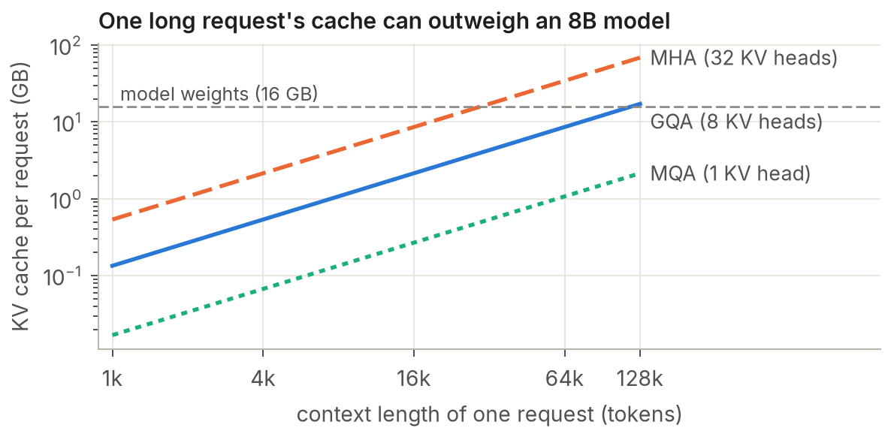
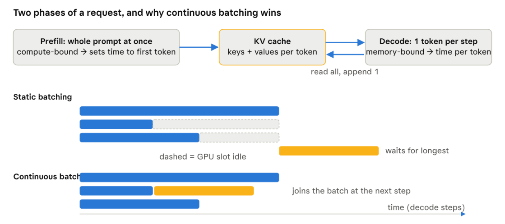

# 21 · Inference, decoding and serving

Part VI · Inference and prompting. Prerequisites: Chapter 10 (the transformer) and Chapter 42 (infrastructure primer). Written to be readable without any serving experience.

## Why it matters

Training happens once; inference happens on every request, so it is where the money and the latency are. Any LLM feature in a product (search, recommendations, support, content generation) has to be designed around three numbers from day one: how long a user waits, how many requests the system handles, and what each one costs. Interviewers test this with arithmetic ("how much GPU memory for 32 users with 8k-token prompts?") and trade-offs ("temperature 0 or not?", "self-host or API?"). This chapter builds the picture step by step: how a model produces text, how that text is chosen, why serving LLMs is memory-bound, what serving engines do about it, and how to compute latency and cost.

Numbers come from running the code in this chapter; hardware figures are round numbers for arithmetic, not vendor specs.

The chapter moves from the model to the machine that serves it. It starts with what happens at each step of generation (21.1) and how the next token is chosen from the model's probabilities (21.2), including forcing the output into a fixed structure (21.3). Sections 21.4 and 21.5 explain why serving is limited by memory rather than arithmetic: the KV cache, and the two very different phases of a request, prefill and decode. Section 21.6 shows how serving engines exploit those facts, and 21.7 and 21.8 cover the two main ways of going faster and cheaper: speculative decoding and quantisation. The chapter ends with the arithmetic of latency, throughput and cost (21.9), a worked cost reduction (21.10) and research-level topics (21.11).

One fact explains most of serving: generating a token requires reading every weight of the model, and the whole KV cache of the request, from GPU memory, while doing very little arithmetic with them. Almost every serving technique is a way to do more useful work per byte read, by batching users together, guessing several tokens at once, or storing fewer bytes.

## Key concepts

- **Autoregressive generation**: the model writes one token at a time, each time reading everything written so far. [Hugging Face: generation strategies](https://huggingface.co/docs/transformers/generation_strategies).
- **Logits and sampling**: the model outputs a score per vocabulary token; a decoding strategy (greedy, temperature, top-k, top-p) turns scores into a choice. [Nucleus sampling paper](https://arxiv.org/abs/1904.09751).
- **KV cache**: stored keys and values of past tokens so they are not recomputed at each step. [KV cache from scratch](https://huggingface.co/blog/kv-cache).
- **Prefill and decode**: processing the prompt (fast, parallel) vs generating the answer (one token per step, limited by memory speed).
- **TTFT, TPOT, throughput**: time to first token, time per output token, tokens or requests per second.
- **Continuous batching and PagedAttention**: serving-engine techniques that keep the GPU busy and pack memory tightly. [vLLM paper](https://arxiv.org/abs/2309.06180), [vLLM docs](https://docs.vllm.ai/en/latest/).
- **Speculative decoding**: a small model drafts tokens, the big model checks them in one pass. [Paper](https://arxiv.org/abs/2211.17192).
- **Quantisation**: storing weights in fewer bits (8 or 4 instead of 16). [Hugging Face quantisation overview](https://huggingface.co/docs/transformers/main/en/quantization/overview); methods: [GPTQ](https://arxiv.org/abs/2210.17323), [AWQ](https://arxiv.org/abs/2306.00978), [LLM.int8()](https://arxiv.org/abs/2208.07339).
- **Grouped-query attention (GQA)**: several attention heads share one key-value head to shrink the cache. [Paper](https://arxiv.org/abs/2305.13245).
- **Constrained decoding / structured outputs**: forcing output to match a JSON schema or label set.
- **Batch API**: a provider endpoint that processes large jobs asynchronously at a discount.

## 21.1 How an LLM produces text, step by step

A language model is a function: give it a sequence of tokens, it returns, for the *next* position, a score (a **logit**) for every token in its vocabulary, often 100,000 or more. Softmax turns the scores into probabilities. Generating text is a loop:

1. Tokenise the prompt (Chapter 9): "Is the shawarma spicy?" → about 7 token ids.
2. Run the model on all prompt tokens; read the probabilities for the next token.
3. **Choose** one token (the decoding strategy, 21.2).
4. Append it to the sequence and repeat from step 2, until an end-of-sequence token or a length limit.

This is called **autoregressive** generation. Two consequences drive everything in this chapter: generating 300 tokens means 300 sequential steps that cannot run in parallel, and each step needs information about every earlier token.

## 21.2 Choosing the next token: decoding strategies

The model only gives probabilities; the **decoding strategy** picks. The same model behaves very differently with different settings.

```python
def sample_next(logits, temperature=1.0, top_k=0, top_p=1.0, min_p=0.0,
                prev_ids=None, rep_penalty=1.0):
    logits = logits.clone()
    if prev_ids is not None and rep_penalty != 1.0:      # discourage repeating tokens
        s = logits[prev_ids]
        logits[prev_ids] = torch.where(s > 0, s / rep_penalty, s * rep_penalty)
    if temperature == 0:
        return int(logits.argmax())                      # greedy: always the top token
    logits = logits / temperature                        # <1 sharpens, >1 flattens
    if top_k > 0:                                        # keep only the k best tokens
        kth = logits.topk(top_k).values[-1]
        logits[logits < kth] = float("-inf")
    probs = logits.softmax(-1)
    if min_p > 0:                                        # drop tokens far below the best one
        probs[probs < min_p * probs.max()] = 0
    if top_p < 1.0:                                      # nucleus: smallest set with mass >= p
        sp, si = probs.sort(descending=True)
        drop = sp.cumsum(0) - sp > top_p
        sp[drop] = 0
        probs = torch.zeros_like(probs).scatter(0, si, sp)
    probs = probs / probs.sum()
    return int(torch.multinomial(probs, 1))              # random draw
```

On logits `[3.0, 2.5, 1.0, 0.5, -1.0, -2.0]` (softmax 0.54, 0.33, 0.07, 0.04, 0.01, 0.004), 5,000 draws each gave:

| Setting | What it does | Token frequencies |
|---|---|---|
| greedy (T = 0) | always the most likely token | always token 0 |
| T = 1.0 | sample from the model's own probabilities | 0.53, 0.34, 0.08, 0.04, 0.01, 0.003 |
| T = 0.5 | sharpen: likely tokens become more likely | 0.71, 0.27, 0.01, 0.004, 0, 0 |
| top-k = 2 | only the 2 best tokens are allowed | 0.63, 0.37, rest 0 |
| top-p = 0.8 | smallest set covering 80% probability | 0.62, 0.38, rest 0 |
| min-p = 0.2 | drop tokens below 20% of the best one's probability | 0.63, 0.37, rest 0 |

When to use what:

- **Greedy (temperature 0)** for extraction, classification, JSON and anything you want repeatable. API outputs at temperature 0 are still not perfectly deterministic, because batching and floating-point order vary.
- **Beam search** keeps the B best partial sequences and returns the most likely whole sequence. Good for translation and short constrained outputs; for open-ended chat it gives bland, repetitive text.
- **Temperature + top-p (0.9–0.95)** for open-ended writing. **min-p** adapts the cut-off to how confident the model is, which behaves better at high temperature.
- **Repetition, frequency and presence penalties** reduce loops; too strong and the model avoids words it needs, such as a restaurant's name.
- **Several samples + vote** (self-consistency) or + a verifier improves accuracy at a multiple of the cost.

## 21.3 Structured outputs and constrained decoding

Applications usually need machine-readable output: a label, a JSON object. Asking nicely in the prompt works most of the time; **constrained decoding** makes it guaranteed. At each step, the engine masks (sets to minus infinity) every token that would break a grammar or JSON schema, so only valid continuations can be chosen. Libraries: Outlines, XGrammar, llguidance; most APIs and vLLM expose it as "structured outputs" with a JSON schema.

For classification, constrain the output to the label set and read the label probabilities from the logits: you get a confidence score for free, useful for routing low-confidence items to humans. Keep schemas simple; if the task needs reasoning, give the model a free-text field before the constrained answer field.

## 21.4 Why serving LLMs is a memory problem: the KV cache

Inside each attention layer, every token produces a **key** and a **value** vector; to generate the next token, the model compares its new query with the keys of *all* earlier tokens. Recomputing all of those at every step would be wasteful, so they are stored: the **KV cache**. It grows by one entry per layer for every token, for every request being served.

How big is it?

```python
def kv_cache_gb(layers, kv_heads, head_dim, seq, batch, bytes_=2):   # fp16 = 2 bytes per number
    return 2 * layers * kv_heads * head_dim * seq * batch * bytes_ / 1e9  # 2 = keys and values

# A Llama-3-8B-shaped model: 32 layers, 8 KV heads (GQA), head_dim 128
kv_cache_gb(32, 8, 128, 8192, 1)    # 1.07 GB for one 8k-token conversation
kv_cache_gb(32, 8, 128, 8192, 32)   # 34.4 GB for 32 of them at once
kv_cache_gb(32, 32, 128, 8192, 1)   # 4.29 GB per conversation without GQA
```

The model weights for 8 billion parameters in 16-bit precision are 8e9 × 2 bytes = 16 GB. So at 32 users with long contexts, **the cache is bigger than the model**. That single fact explains why long context is expensive, why grouped-query attention was invented (it cut the cache 4× above), and why serving engines are mostly memory managers.



*KV cache for a single request of an 8B model with 32 layers and 128-dimensional heads, in fp16, by number of key–value heads. With full multi-head attention a 32k-token request needs as much memory as the whole model; GQA cuts it 4× and MQA 32×.*

**Levers that shrink the cache.** Every factor in the formula has a technique that targets it:

- **Fewer KV heads.** GQA and MQA (Chapter 10) shrink the head count.
- **A compressed latent.** MLA (Chapter 11) stores a small latent instead of full keys and values.
- **Lower precision.** An 8-bit or 4-bit cache halves or quarters the bytes per number.
- **Fewer cached tokens.** Sliding-window or local attention layers cache only the last few thousand tokens; hybrid models with state-space layers keep a fixed-size state for most layers.
- **Sharing across requests.** Prefix caching keeps one copy of a common prefix.

The cost of each is a possible quality loss, so they are evaluated on long-context tasks, not only on short benchmarks.

## 21.5 Prefill and decode: two very different phases



*Prefill fills the KV cache; decode reads it every step. Continuous batching refills a slot as soon as a request finishes.*

- **Prefill** processes the whole prompt in one parallel pass and fills the KV cache. Lots of computation, done efficiently: the GPU's maths units are busy. It sets **time to first token (TTFT)**, which grows with prompt length.
- **Decode** then produces one token per step. Each step does little maths but must read *all* the model weights and the whole cache from GPU memory. The GPU waits on memory, not on maths. It sets **time per output token (TPOT)**.

A rough single-user speed limit for decode: memory bandwidth / bytes read per token. With 2 TB/s of bandwidth and 16 GB of weights, about 2e12 / 16e9 = **125 tokens per second**, at best. End-to-end latency for one answer ≈ TTFT + output tokens × TPOT; a 300-token answer at 8 ms per token takes 2.4 s after the first token. That is why **streaming** tokens to the user matters: perceived latency becomes TTFT.

The key insight for serving: during decode, reading the weights once can serve **many users at the same time**. Batch 32 users together and each weight read produces 32 tokens instead of one. Throughput rises almost linearly with batch size, until the cache fills GPU memory or the maths units saturate. **Prefix caching** reuses the cache of a shared beginning (the system prompt, few-shot examples, a long document) across requests; API providers sell this as "prompt caching" at a discount. Put the stable part of the prompt first so it can be reused.


*Decode throughput of an 8B model on one 80 GB GPU (3.35 TB/s, 50% of 989 TFLOP/s usable) with 2k-token contexts. Each step reads the weights once plus every request's cache. Total throughput rises about 50× while each user's speed falls about 5×. The batch stops at 238 requests, when the caches fill memory.*

**Reading the curve.** A step's time is the larger of two numbers: the bytes it must read divided by bandwidth, or the FLOPs it must do divided by compute.

- **One request.** The step reads 16 GB of weights and a quarter of a gigabyte of cache: 4.9 ms, 206 tokens per second.
- **64 requests.** The same weights are read once for all of them, and the step takes 9.9 ms. Each user gets 101 tokens per second, and the GPU produces 6,500.
- **238 requests.** The caches now weigh 64 GB, four times the weights, so reading them dominates the step: 23.8 ms, 42 tokens per second per user and about 10,000 per GPU.

The maths units are never the limit here: even at 238 requests, the matmuls need under a third of the step. This is why serving work concentrates on memory (paging, cache compression, quantisation) and why a latency target (say 50 tokens per second per user) sets the batch size, and through it the cost per token.

## 21.6 Serving engines: what vLLM and friends actually do

A serving engine is the program that loads the model on GPUs and answers requests, usually behind an OpenAI-compatible HTTP API. The good ones do four things:

1. **Continuous batching.** Naive (static) batching waits until every request in a batch finishes before starting new ones, so short answers leave GPU slots idle while a long one finishes. Continuous batching adds a new request to the running batch at the next decode step and removes finished ones immediately (the diagram's bottom half).
2. **PagedAttention.** Instead of reserving cache memory for the maximum possible length of every request, the cache is stored in small fixed-size blocks, like pages of virtual memory in an operating system, allocated as the sequence grows. Far less waste, so more requests fit; shared prefixes can point to the same blocks.
3. **Chunked prefill.** A huge prompt is processed in pieces so it does not freeze other users' decode steps.
4. **Optimised kernels** (FlashAttention, fused operations) and **parallelism** across several GPUs when the model does not fit on one (tensor parallelism splits each layer across GPUs).

The main options: **vLLM** (the default open-source choice), **SGLang**, **Hugging Face TGI** (in maintenance mode since 2025), **NVIDIA TensorRT-LLM** (fastest, more setup), **llama.cpp / Ollama** (CPUs and laptops).

```bash
# Serve an open model with an OpenAI-compatible API (check current vLLM docs for flags)
vllm serve Qwen/Qwen2.5-7B-Instruct --max-model-len 8192 --gpu-memory-utilization 0.9
# then call it like any OpenAI-style endpoint at http://localhost:8000/v1/chat/completions
```

In production this runs inside a container on a GPU node of a Kubernetes cluster, behind a load balancer, exactly like the primer's model server (Chapter 42), with autoscaling on queue length or GPU utilisation instead of CPU.

## 21.7 Speculative decoding: guessing ahead

Decode is slow because it is sequential. Speculative decoding cheats safely: a small, fast **draft model** proposes the next k tokens; the big model checks all k in **one** forward pass (checking is parallel, like prefill). It accepts the longest prefix it agrees with, using a rejection rule that keeps the output distribution exactly the big model's, then continues from there. If each draft token is accepted with probability α, the expected tokens per big-model pass is (1 − α^(k+1)) / (1 − α):

```python
def spec_expected_tokens(alpha, k):
    return (1 - alpha ** (k + 1)) / (1 - alpha)
# alpha 0.6: k=2 -> 1.96, k=4 -> 2.31, k=8 -> 2.47
# alpha 0.8: k=2 -> 2.44, k=4 -> 3.36, k=8 -> 4.33
```

So with a well-matched draft (80% acceptance) and k = 4, each expensive pass yields about 3.4 tokens instead of 1. Gains are biggest on predictable text: code, JSON, rewriting a given document. Variants avoid a separate draft model: Medusa (extra prediction heads), EAGLE, and prompt-lookup decoding (copy n-grams from the prompt, very effective for RAG and editing).

## 21.8 Quantisation: smaller numbers, smaller model

Weights are normally stored as 16-bit floats (2 bytes each). **Quantisation** stores them as 8-bit or 4-bit integers plus a scale factor, so the model takes 2–4× less memory and decode (which is memory-bound) gets faster.

The simplest scheme, **absmax**, divides each weight by the largest absolute value and rounds to an integer between −127 and 127:

```python
def quant_int8(w):                       # one scale for the whole tensor
    scale = w.abs().max() / 127
    return torch.round(w / scale).clamp(-127, 127).to(torch.int8), scale

def quant_rowwise(w):                    # one scale per output row
    scale = w.abs().amax(1, keepdim=True) / 127
    return torch.round(w / scale).clamp(-127, 127), scale
# 256x256 Gaussian weights: 1.0% average error with one scale.
# Add ONE outlier of 40.0: error jumps to 9.9% (the scale is stretched for everyone);
# with per-row scales it stays at 0.7%.
```

That outlier effect is the central problem of LLM quantisation: a few unusually large values ruin a shared scale. The methods you should be able to name:

- **LLM.int8()**: keeps the rare outlier features in 16-bit and quantises the rest to 8-bit.
- **GPTQ**: quantises layer by layer after training, adjusting the remaining weights to compensate for each rounding error; good 4-bit quality.
- **AWQ**: finds the ~1% of weight channels that matter most (from activation sizes) and protects them by scaling before quantising.
- **GGUF** files for llama.cpp on CPUs and Macs; **FP8** on recent GPUs; **NF4** for QLoRA fine-tuning (Chapter 20).

Rules of thumb: 8-bit is nearly lossless; 4-bit weight-only is usually fine for 7B+ models; below 4 bits quality drops fast. Always check on your own task and languages: non-English text and maths tend to degrade first. An 8B model goes from 16 GB to about 4 GB at 4-bit, leaving room for the KV cache on a cheaper GPU.

## 21.9 Latency, throughput and cost arithmetic

Define these in any design discussion:

| Metric | Meaning | Typical target for a chat feature |
|---|---|---|
| TTFT | time until the first token appears | < 1 s |
| TPOT / inter-token latency | time per additional token | 20–60 ms (faster than reading speed) |
| End-to-end latency | TTFT + output tokens × TPOT | depends on answer length |
| Throughput | tokens/s or requests/s per GPU | as high as latency targets allow |
| Cost | per 1M tokens or per request | set by the business case |

Report p50 and p95/p99, never only the mean (Chapter 42).

Levers and their trade-offs:

| Lever | Helps | Costs |
|---|---|---|
| Bigger batch | throughput, cost per token | per-user latency |
| Smaller or distilled model | everything | quality on hard cases |
| Quantisation | memory, cost, speed | some quality |
| Shorter prompts, prefix caching | TTFT, cost | engineering effort |
| Shorter outputs (structured, max_tokens) | latency, cost | nothing, usually |
| Speculative decoding | latency | extra memory; gains vary |
| Streaming | perceived latency | nothing |
| Cascade (small model first, escalate when unsure) | cost | complexity, needs a confidence signal |
| Batch API / offline jobs | roughly half the price, no rate-limit pain | results in hours |

**API cost** is simple multiplication: requests × (input tokens × input price + output tokens × output price). Chapter 9.7 has a worked example.

**Self-host or API?** An API gives the best models with no operations and pay-per-token pricing; data leaves your systems (check agreements). Self-hosting gives control, data residency and near-zero marginal cost, but GPUs cost money every hour whether used or not, and you own scaling, upgrades and on-call. Break-even: GPU cost per hour ÷ tokens per hour at realistic utilisation (often 30–50%, not 100%) vs the API price per token. Many teams use APIs for hard or low-volume tasks and self-host one small model for a single high-volume task.

## 21.10 Worked case: cutting the cost of an offline LLM job

A platform classifies 2 million merchants into categories with an LLM, re-running monthly as menus change. The first version calls the real-time API once per merchant with a 1,500-token prompt. How would you cut cost several-fold without losing quality?

1. **Question the latency need.** Nothing needs an answer in under a second, so move to the provider's **batch API**: typically around half price and much higher throughput limits. That alone is about 2×.
2. **Shrink the prompt.** Move fixed instructions and examples into a cached prefix, cut label definitions to what the model needs, send only the useful merchant fields: 1,500 → 600 tokens is another ~2.5× on input cost.
3. **Shrink the output.** Constrain it to a label id instead of prose; output tokens are usually the most expensive.
4. **Make fewer calls.** Skip merchants whose text has not changed since the last run (a hash of the inputs), and deduplicate chains with identical menus. Often half the calls disappear.
5. **Check quality at every step** on a fixed labelled set; keep a confidence threshold that sends doubtful cases to review.

Multiplied, these levers give 5–10×. In an interview, the point is not the number but the breakdown: be able to say which lever gave how much, and what you traded (results arrive in hours; you need job monitoring and retries for failed items).

## 21.11 Research-level serving topics

**Roofline thinking.** A GPU has a peak compute rate (around 1,000 TFLOP/s dense bf16 on current data-centre parts) and a memory bandwidth (around 3–8 TB/s). Their ratio, roughly 150–300 FLOPs per byte, is the **arithmetic intensity** an operation needs to be compute-bound. Decoding one token for a batch of b sequences does about 2 FLOPs per parameter per sequence while reading each 2-byte bf16 parameter once: an intensity of about b FLOPs per byte. Small batches are therefore memory-bound by a wide margin, which is why batching, quantisation and speculative decoding all pay off, and why prefill (many tokens per weight read) is compute-bound.

**Disaggregated prefill and decode.** Prefill is compute-bound and bursty; decode is memory-bound and steady. Running them on separate GPU pools, transferring the KV cache between them, lets each be sized and batched for its own bottleneck and stabilises time per output token. Large deployments increasingly use it.

**Low-precision inference.** fp8 weights and activations are standard on recent GPUs with little quality loss; 4-bit formats with block scaling (MXFP4, NVFP4) cut memory and bandwidth further, and some open models are released directly in such formats. **KV-cache quantisation** (8-bit or lower) matters as much as weight quantisation at long context, since the cache can exceed the weights. Validate any quantisation on long-context and reasoning tasks, where errors accumulate.

**Serving mixture-of-experts models.** All experts must be resident, so memory is set by total parameters while compute follows active ones. Large MoEs are served with expert parallelism across many GPUs, large batches (so each expert gets enough tokens) and careful load balancing; per-token cost is low but the minimum deployment is large.

**Attention-side savings.** MLA and GQA shrink the KV cache; sliding-window and sparse attention bound it; prefix caching reuses it across requests with shared prompts (Chapters 11 and 22).

**Serving reasoning models.** Outputs of thousands of thinking tokens make decode dominate cost and latency. Levers: reasoning-effort or budget settings, routing easy requests to non-thinking modes, speculative decoding (thinking text is often predictable), and the test-time compute strategies of Chapter 19 (parallel sampling and voting versus longer single chains), chosen per task by measured accuracy per dollar.

## Pitfalls

- Measuring average latency only; the p99 is what users feel.
- Sizing GPUs for weights only and forgetting the KV cache.
- Beam search for chat; high temperature for extraction.
- Treating temperature 0 as perfectly deterministic.
- Quantising and checking only English benchmarks.
- Putting variable content before the shared system prompt, which defeats prefix caching.
- Comparing self-hosting with APIs at 100% GPU utilisation.

## Interview questions

**Mid level**

1. Explain greedy, beam search, temperature, top-k and top-p. Which would you use for JSON extraction?
2. What is the KV cache, and why does it grow with context length and batch size?
3. What do TTFT and TPOT measure, and which phase drives each?
4. What is quantisation, and why are outliers a problem?

**Senior level**

5. How much GPU memory do you need to serve an 8B model to 32 concurrent users with 8k-token contexts? Walk through it.
6. Explain continuous batching and PagedAttention. Why do they raise throughput?
7. How does speculative decoding keep the big model's output distribution? When does it not help?
8. A support chatbot has p95 latency of 9 seconds. What would you measure and change?
9. Self-host or API for tagging 50M items a month? Show the break-even reasoning.

Short answers: (5) Weights 16 GB in fp16 (about 4 GB at 4-bit) + KV cache about 1.07 GB per 8k sequence with GQA × 32 = 34 GB, plus activations and overhead: about 55 GB, so one 80 GB GPU in fp16. (6) Slots are refilled every step instead of waiting for the longest sequence; paging removes reserved-but-unused cache memory, so more sequences fit and the GPU stays busy. (7) Accept each draft token with probability min(1, p_big / p_draft) and resample from the leftover distribution on rejection; it does not help when acceptance is low or the system is already compute-bound at large batch sizes. (8) Split into TTFT and TPOT; check prompt length, retrieval time, tool calls and output length; stream; cache prefixes; shrink or cascade the model; cap output tokens. (9) Estimate tokens per month; price them at batch-API rates; compare with GPUs needed at realistic throughput and utilisation, plus engineering and on-call time.

## Practice

- Implement `sample_next` from memory and reproduce the frequency table.
- Compute KV cache and weight memory for three models of your choice from their config files on the Hugging Face Hub (`num_hidden_layers`, `num_key_value_heads`, `head_dim` or `hidden_size / num_attention_heads`).
- Serve a 7B model with vLLM on a rented GPU, load-test it with 1, 8 and 32 concurrent users, and plot throughput against p95 latency.
- Quantise a small model to 4-bit with a library, then compare accuracy on 200 examples in each language you care about.
- Write the cost model for one LLM feature as a small spreadsheet: requests, tokens in and out, prices, batch and caching discounts.

## Go deeper

- [Hugging Face: generation strategies](https://huggingface.co/docs/transformers/generation_strategies): every decoding option, with examples.
- Holtzman et al., [The Curious Case of Neural Text Degeneration](https://arxiv.org/abs/1904.09751) (2020): why greedy and beam search loop, and nucleus sampling.
- [KV cache from scratch](https://huggingface.co/blog/kv-cache) (Hugging Face blog): builds the cache in code.
- Kwon et al., [Efficient Memory Management for LLM Serving with PagedAttention](https://arxiv.org/abs/2309.06180) (2023), and the [vLLM documentation](https://docs.vllm.ai/en/latest/).
- Leviathan, Kalman and Matias, [Fast Inference from Transformers via Speculative Decoding](https://arxiv.org/abs/2211.17192) (2023).
- [Hugging Face quantisation overview](https://huggingface.co/docs/transformers/main/en/quantization/overview); papers: [GPTQ](https://arxiv.org/abs/2210.17323), [AWQ](https://arxiv.org/abs/2306.00978), [LLM.int8()](https://arxiv.org/abs/2208.07339).
- Ainslie et al., [GQA](https://arxiv.org/abs/2305.13245) (2023).

## Done when

You can explain autoregressive generation and why it is sequential. You can implement temperature, top-k, top-p and min-p sampling from memory.

You can compute KV cache and weight memory for any model shape in two minutes. You can explain prefill vs decode, continuous batching, paging and prefix caching to a beginner.

You can explain speculative decoding and the trade-offs of quantisation. You can break down an LLM cost reduction lever by lever.

---

[← 20 · Fine-tuning and parameter-efficient methods](20-fine-tuning-and-lora.md) · [Contents](../README.md#contents) · [22 · Prompting and context engineering →](22-prompting-and-context-engineering.md)
