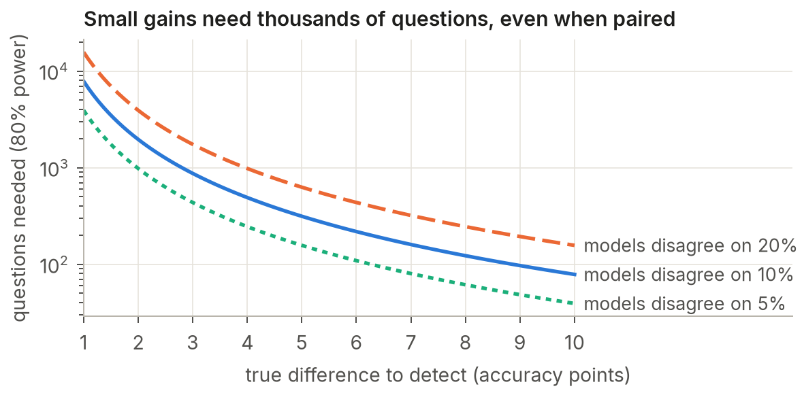
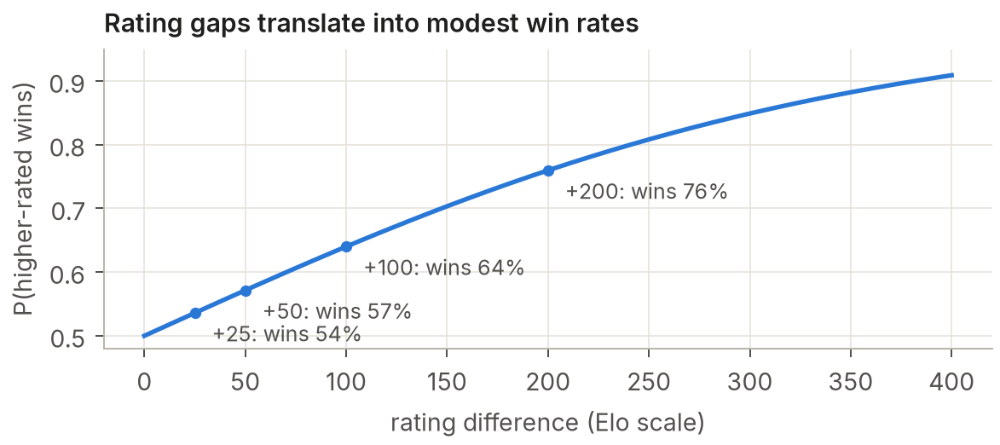

# 23 · Evaluating models

Part VII · Evaluation science. Assumes Chapter 2 (confidence intervals, hypothesis tests) and Chapter 4 (metrics). Chapter 24 covers evaluating LLM *applications* (task metrics, judges, eval sets for a product); Chapter 25 covers RAG and agents. This chapter is about evaluating *models*: benchmarks, statistics, contamination and comparisons.

## Why it matters

Every decision in model development rests on an evaluation: which data mixture to keep, which checkpoint to release, whether an architecture change helped, whether a paper's claim is real. Yet benchmark scores are noisy, often contaminated, sensitive to prompt formats, quickly saturated and sometimes measuring something other than their name. A research scientist is expected to treat evaluation as measurement science: quantify uncertainty, separate signal from noise, detect contamination, and know what a benchmark actually measures. Interviewers test this with questions like "model B beats A by 1.5 points on MMLU; is it better?", and the right answer starts with a standard error.

Numbers in this chapter come from `code/ch23_check.py` (seconds).

The chapter treats evaluation as measurement, with the same discipline as an experiment. It starts from the decision an evaluation supports (23.1), then quantifies the noise in a benchmark score: question sampling (23.2) and the other sources, such as seeds and prompts (23.3). Section 23.4 covers the most sensitive signal during training, held-out loss. Sections 23.5 to 23.7 are about benchmarks themselves: how they are designed and saturated, how contamination corrupts them, and how pairwise comparisons and arenas rank models when there is no single right answer. LLM judges (23.8), agents (23.9) and the infrastructure for reporting (23.10) complete the toolkit, 23.11 works through a real comparison, and 23.12 covers choosing evaluations for small-scale pretraining ablations, where most benchmarks give no signal.

The question behind every section is the one from Chapter 2: is this difference real? A benchmark is a sample, and most reported improvements between nearby models are smaller than the noise. Being able to compute the error bar, and to say what else could explain the difference, is what separates an evaluation from a number.

## Key concepts

- **Error bars for evals**: standard errors, clustering and paired comparisons. [Miller, "Adding Error Bars to Evals"](https://arxiv.org/abs/2411.00640).
- **Benchmark design and saturation**: harder, expert-written, sometimes held-out benchmarks. [GPQA](https://arxiv.org/abs/2311.12022), [Humanity's Last Exam](https://arxiv.org/abs/2501.14249).
- **Item response theory** for efficient and informative evaluation. [tinyBenchmarks](https://arxiv.org/abs/2402.14992).
- **Contamination** and how to detect it. [Min-K% Prob](https://arxiv.org/abs/2310.16789), [LiveCodeBench](https://arxiv.org/abs/2403.07974).
- **Pairwise comparison and arenas**. [Chatbot Arena](https://arxiv.org/abs/2403.04132), [The Leaderboard Illusion](https://arxiv.org/abs/2504.20879).
- **LLM-as-a-judge biases**. [Judging LLM-as-a-judge](https://arxiv.org/abs/2306.05685), [Length-controlled AlpacaEval](https://arxiv.org/abs/2404.04475).
- **Long-horizon capability measurement**. [METR time horizons](https://arxiv.org/abs/2503.14499).
- **Harnesses**: [lm-evaluation-harness](https://github.com/EleutherAI/lm-evaluation-harness), [Inspect](https://inspect.aisi.org.uk/), [HELM](https://arxiv.org/abs/2211.09110).

## 23.1 What evaluation is for

An evaluation exists to support a decision. Before choosing a metric, write down the decision ("ship checkpoint 41 or 38?", "keep the new data filter?") and the smallest difference that would change it. That fixes how precise the evaluation must be, and therefore how large.

Four levels, each with its own role:

| Level | Examples | Good for | Weak at |
|---|---|---|---|
| Loss on held-out data | Per-domain perplexity, bits per byte | Smooth, cheap, comparable across checkpoints and small scales | Not a capability measure; tokenizer-dependent |
| Capability benchmarks | MMLU-Pro, GPQA, Humanity's Last Exam, FrontierMath, SWE-bench, Terminal-Bench | Standardised comparison | Saturation, contamination, format sensitivity |
| Preference and arena comparisons | Pairwise human or judge votes | Open-ended quality | Style and length biases; selection effects |
| Task-specific and human evaluations | Your product's eval set (Chapter 24) | What you actually care about | Expensive; small |

**Construct validity**: does the benchmark measure the ability its name claims? A "reasoning" benchmark answerable by pattern-matching, a "long-context" benchmark solvable from the last page, a "coding" benchmark of short puzzles: all common. Read 20 items of any benchmark before trusting it.

## 23.2 Error bars

**The standard error of a mean.** A benchmark score is an average over questions, which are a sample from some population of possible questions. With n independent questions and accuracy p, the standard error is

$$
\mathrm{SE} = \sqrt{\dfrac{p\,(1-p)}{n}}
$$

where each question's score is a 0/1 Bernoulli variable with variance p(1 − p), and averaging n independent ones divides the variance by n. That is about 2.1 points for 500 questions at 67% (√(0.67 × 0.33 / 500) = 0.021), so a 95% interval of ±4.1 points.

**Clustered questions.** Many benchmarks group questions (several questions per reading passage, per code repository, per document). Questions in a cluster are correlated, so the effective sample size is smaller. The clustered standard error sums the residuals within each cluster *before* squaring, so that correlated errors add up instead of cancelling:

$$
\mathrm{SE}_{\mathrm{c}} = \dfrac{1}{n}\sqrt{\sum_{c} \left(\sum_{i \in c} (x_i - \bar{x})\right)^{2}}
$$

Here x_i is the score of question i, x̄ the mean score, n the total number of questions, and the outer sum runs over clusters c. With one question per cluster this is the ordinary standard error (up to the n versus n − 1 divisor). In the check script, 500 questions in 100 passages of 5 give a naive standard error of 0.0211 and a clustered one of 0.0261: 24% larger.

**The design effect.** How much larger depends on two numbers: the cluster size m and the intraclass correlation ρ, the correlation between two questions' scores from the same cluster. A cluster's total of m scores, each with variance σ², has variance mσ² from the diagonal terms plus m(m − 1)ρσ² from the covariances, so

$$
\mathrm{deff} = \dfrac{\mathrm{Var}_{\mathrm{clustered}}}{\mathrm{Var}_{\mathrm{independent}}} = 1 + (m - 1)\,\rho
$$

and the standard error grows by √deff. Equivalently, n clustered questions are worth n / deff independent ones. The check script's ratio of 1.24 is a design effect of 1.53, which with m = 5 implies ρ ≈ 0.13. Even a small correlation matters when clusters are large: at ρ = 0.1, clusters of 20 questions give deff = 2.9, so 1,000 questions behave like 345.

**Paired comparisons.** Comparing two models on the same questions, analyse the per-question differences, not two separate means: question difficulty is shared, and pairing removes it. The derivation is short. Let A_i and B_i be the 0/1 scores of the two models on question i, and D_i = B_i − A_i, which is +1, 0 or −1. Write d for the **discordant rate**, the fraction of questions on which the models disagree (D_i ≠ 0), and δ = E[D] for the true difference in accuracy. Since D_i² is 1 exactly when the models disagree, E[D²] = d, so Var(D) = d − δ², and

$$
\mathrm{SE}(\hat{\delta}) = \sqrt{\dfrac{d - \delta^{2}}{n}}
$$

For two models that disagree on 15% of 1,000 questions with a 1.5-point gap, the paired SE is √((0.15 − 0.015²)/1,000) = 1.22 points, while treating the two scores as independent at about 70% accuracy gives √(2 × 0.21/1,000) = 2.05 points. The connection to the unpaired formula is Var(D) = Var(A) + Var(B) − 2 Cov(A, B): pairing removes the covariance that shared difficulty creates, and the more the models agree, the more it removes. This is also why McNemar's test looks only at the discordant questions (Chapter 2).

In the check script, model B is truly about 2.5 points better than A on average. On 500 questions the observed difference is −0.6 points, with a paired 95% interval of [−5.7, +4.5]: 500 questions cannot detect a gain of this size. The paired standard error (0.026) is smaller than the unpaired (0.031), and the gap grows with how much the models agree.

**Sample size.** To detect a true difference δ with a two-sided test at the 5% level, you declare a difference when the estimate exceeds 1.96 standard errors. For 80% power, the estimate must exceed that threshold 80% of the time when the true difference is δ; since the estimate is roughly normal around δ, the threshold must sit 0.84 standard errors *below* δ (0.84 is the normal quantile for 80%). So δ = (1.96 + 0.84) × SE, and with the paired SE ≈ √(d/n) for small δ:

$$
n = \dfrac{(1.96 + 0.84)^{2}\, d}{\delta^{2}} \approx \dfrac{7.84\, d}{\delta^{2}}
$$

Detecting a 2-point gain needs about 7.84 × 0.10 / 0.02² = 1,960 questions if the models disagree on 10%, and about 3,920 at 20%. With clustering, multiply by the design effect. Many benchmark comparisons in papers are underpowered.



*Questions needed for a paired comparison to detect a true difference with 80% power at the 5% level, by how often the two models disagree. Halving the difference to detect quadruples the questions.*

**Many comparisons.** Comparing 20 checkpoints and picking the best is a multiple-comparison problem; the winner's score is biased upwards. Confirm on a held-out set or correct for multiplicity (Chapter 2).

### Within-question variance: when answers are sampled

Everything above treats each question's score as fixed for a given model. With sampled decoding (any temperature above zero, which is the norm for reasoning models, Chapter 21) it is not: the same model on the same question succeeds with some probability p_i, and one sampled answer is a coin flip with that probability. The total variance then has two parts, and the law of total variance separates them. If s_i is the average of K sampled answers to question i,

$$
\mathrm{Var}(s_i) = \mathrm{Var}(p_i) + \dfrac{\mathbb{E}\left[p_i (1 - p_i)\right]}{K}
$$

The first term is the **between-question** variance, how much questions differ in difficulty, which only more questions can reduce. The second is the **within-question** variance from sampling, which more samples per question reduce. The benchmark score's variance is Var(s_i)/n. Note that the two parts add up to p̄(1 − p̄) at K = 1, so one sample per question gives the familiar Bernoulli formula.

A worked example: a benchmark at 60% accuracy, where Var(p_i) = 0.16 and E[p_i(1 − p_i)] = 0.24 − 0.16 = 0.08. On 500 questions, the SE is 2.19 points with one sample, 1.90 with four and 1.82 with sixteen, against a floor of 1.79 from the questions alone. On a 30-question competition benchmark the same numbers give 8.9, 7.7 and 7.4 points: most of the uncertainty is in the questions, so averaging many samples (reports of "avg@16") helps, but no amount of sampling makes 30 questions precise.

Within-question variance matters most for **paired** comparisons, because pairing removes the between-question part but not the sampling noise. For two similar models whose per-question pass rates differ with variance 0.01, the paired variance per question is 0.01 + (0.08 + 0.08)/K: with one sample it is 0.17, with sixteen 0.02, so sixteen samples shrink the paired SE by a factor of 2.9, as much as 8.5 times more questions would. Three ways to reduce it, following Miller (2024):

- **Resample and average** K answers per question, which divides the within-question term by K; the per-question sample variance s_i(1 − s_i)·K/(K − 1) estimates that term.
- **Use token probabilities** where possible: for multiple choice, score the probability the model assigns to the correct option instead of sampling one answer, which removes sampling noise altogether.
- **Use greedy decoding for comparisons** only if it is how the model will be used; for reasoning models it is not (Chapter 21), so sampling is part of the construct.

The same per-question samples give **pass@k**, the probability that at least one of k attempts succeeds. Estimate it without bias from n ≥ k samples with c correct as 1 − C(n − c, k)/C(n, k), not by plugging the sample rate into 1 − (1 − p)^k (Chapter 13, section 13.9).

**Report**: the mean, its standard error (clustered if relevant), the number of questions, the number of samples per question, and for comparisons the paired difference with its interval.

## 23.3 Other sources of variance

Sampling questions is only one source of noise:

- **Prompt format**: the same model scored 60.5% to 66.0% across six reasonable templates in the check script's simulation, a 5.4-point range; real studies find similar or larger spreads, especially for small models and multiple-choice formats. Fix the format and report it, or average over several.
- **Few-shot examples**: which examples, and in which order.
- **Decoding**: greedy versus sampling, temperature, maximum length (truncated reasoning counts as wrong).
- **Answer extraction**: regex differences can move scores by points.
- **Training seed**: two runs of the same recipe differ. For small models, seed variance on some benchmarks rivals the effect of the change being tested. Train 2–3 seeds of the baseline at least once to know the noise floor.
- **Harness and version**: the same benchmark in two harnesses can differ by several points.

## 23.4 Loss, perplexity and bits per byte

Held-out loss is the most sensitive and least noisy signal during pretraining, and it moves at scales where benchmarks are flat. But loss per token depends on the tokenizer: a tokenizer with longer tokens has fewer, harder predictions. Compare models with different tokenizers in **bits per byte**: total loss in nats over the text, divided by the number of bytes, divided by ln 2.

| Model | Loss (nats/token) | Perplexity | Bits per byte |
|---|---|---|---|
| A, 32k vocabulary, 1.00M tokens for 4.1 MB | 2.10 | 8.2 | 0.739 |
| B, 128k vocabulary, 0.82M tokens for 4.1 MB | 2.45 | 11.6 | 0.707 |

B looks worse per token but compresses the text better: it is the better model on this data.

**Log-likelihood versus generative evaluation.** Multiple-choice benchmarks can be scored by comparing the model's likelihood of each option ("cloze" or ranked classification) or by generating an answer letter. Likelihood scoring works for small base models that cannot yet follow the answer format; generation is what users see. Report which you used, and do not compare across them. Section 23.12 shows why the choice matters most for small-scale ablations.

**Calibration as a model property.** Accuracy says how often the model is right; calibration says whether its confidence means anything. For multiple-choice items, take the probability the model assigns to its chosen option and compare it with how often such answers are correct, using a reliability diagram and the expected calibration error (Chapter 4, section 4.3). Pre-trained base models are often reasonably calibrated on such tasks, and post-training (RLHF in particular) tends to make them over-confident. It matters whenever a confidence is used downstream: abstention, routing to a bigger model, or a cascade.

## 23.5 Benchmark design

Benchmarks have a life cycle: introduced, climbed, saturated, sometimes contaminated, retired. MMLU went from hard to saturated in about four years; harder successors (MMLU-Pro, GPQA's expert-written questions, Humanity's Last Exam) followed, and the cycle keeps shortening. By late 2026, MMLU-Pro and GPQA Diamond no longer separate frontier models well, and SWE-bench Verified is approaching its ceiling, with part of the remaining failures due to flawed tasks rather than the models. Frontier comparisons have moved to harder or fresher sets: Humanity's Last Exam, FrontierMath, ARC-AGI-2 for abstraction, SWE-bench Pro and Terminal-Bench for software and command-line agents, and rolling benchmarks with post-cut-off items. Treat a benchmark's useful life (its "half-life") as a planning fact: a suite chosen for a model programme should still discriminate when the model ships, a year or more later. Good benchmark design:

- **Clear construct** and items that require it (no shortcuts from answer formats or artefacts).
- **Verified labels**: popular benchmarks have measurable label error rates (several percent in some MMLU subjects), which caps achievable accuracy and adds noise at the top.
- **Difficulty spread** so it discriminates between the models you care about.
- **Held-out or refreshed items** to resist contamination (private test sets, items created after model cut-off dates).
- **Size** for the precision you need (23.2).

**Item response theory (IRT)** models each item's difficulty and discrimination and each model's ability, as in educational testing. In the two-parameter logistic (2PL) model, the probability that model m answers item i correctly is

$$
P(\mathrm{correct}_{mi}) = \sigma\left(a_i\,(\theta_m - b_i)\right)
$$

where σ is the logistic function, θ_m the model's ability, b_i the item's difficulty (the ability at which the model has a 50% chance) and a_i its discrimination (how sharply the probability rises around b_i). The parameters are fitted from a matrix of 0/1 results for many models on many items, by maximising the likelihood of the matrix (joint maximum likelihood, EM over a prior on θ, or variational inference in libraries such as py-irt), with θ fixed to a standard normal scale so the model is identifiable.

**Why it picks informative items.** The Fisher information an item gives about θ is a²p(1 − p), with p the item's success probability at that ability. It peaks at θ = b, where p = 0.5, at a²/4. An item with a = 2 gives information 1.0 at its own difficulty, 0.42 one unit away and 0.07 two units away; an item with a = 0.5 gives at most 0.0625. So one sharp item near the models' ability is worth sixteen flat ones there, and items far from the abilities of the models you compare (all models get them right, or all wrong) tell you almost nothing. A subset that spreads high-discrimination items across the range of abilities measures as well as a much larger random one.

**Why negative discrimination signals a label error.** a_i < 0 means stronger models are *less* likely to be marked correct. The usual cause is a wrong answer key: strong models give the true answer and are marked wrong, while weak models sometimes hit the wrong key by chance. Ambiguous items produce the same pattern. Either way the item should be inspected.

IRT is used to find informative subsets, detect bad items and compare models on a common scale. In the check script, with 30 simulated models and 1,000 items, a random 100-item subset correlates 0.968 with the full score; 100 informative items spread across difficulty correlate 0.979. tinyBenchmarks and similar work use this to cut evaluation cost by 10× or more with small loss of accuracy.

## 23.6 Contamination

If test items, or close paraphrases, were in the training data, scores measure memory. Contamination is the default assumption for any public benchmark older than a model's training cut-off.

**Detection when you have the training data**: n-gram overlap between test items and training documents (Chapter 16), plus embedding search for paraphrases.

**Detection when you only have the model**:

- **Perturbation gap**: rephrase items, or change numbers in maths problems, so that the answer must be recomputed. A large drop on perturbed versions, beyond what the change in difficulty explains, suggests memorisation. In the check script, accuracy falls from 75.2% to 67.5% on rephrased items; a McNemar test on the 51 lost and 20 gained items gives p = 0.0003.
- **Guided completion**: give the model the beginning of a test item and see whether it completes it verbatim.
- **Likelihood signals**: Min-K% Prob and similar tests compare the likelihood of the least likely tokens of an item with that of comparable unseen text. Useful for screening, unreliable as proof.
- **Time splits**: evaluate on items published after the model's cut-off (LiveCodeBench-style rolling benchmarks); a drop on post-cut-off items is strong evidence.

**Prevention**: canary strings in benchmark files (so they can be filtered), private held-out test sets, and refreshed benchmarks.

## 23.7 Pairwise comparisons and arenas

Open-ended quality is hard to score absolutely, so many evaluations compare responses in pairs: humans or judges vote, and a **Bradley–Terry** model (the same as for reward models, Chapter 18) turns votes into ratings, usually on an Elo-like scale.

### The Bradley–Terry model, written out

Each model i has a latent strength s_i, and the probability that i beats j in a battle depends only on the difference:

$$
P(i \succ j) = \sigma(s_i - s_j) = \dfrac{1}{1 + e^{-(s_i - s_j)}}
$$

Fitting is logistic regression. Encode each battle b between models i and j as a feature vector x_b with +1 in position i, −1 in position j and zeros elsewhere, and the outcome y_b = 1 if i won. Then σ(s·x_b) is exactly the formula above, and maximising the log-likelihood Σ_b [y_b log σ(s·x_b) + (1 − y_b) log(1 − σ(s·x_b))] over s is a logistic regression without intercept. Adding a constant to every s_i leaves all probabilities unchanged, so fix one model's strength (or make them sum to zero), and a small L2 penalty keeps the fit stable when one model wins every battle.

**The Elo scale.** Arena ratings are the same strengths rescaled: R_i = 400 s_i / ln 10 + constant, which turns σ(s_i − s_j) into 1 / (1 + 10^(−(R_i − R_j)/400)), the chess Elo formula. The factor 400/ln 10 is 173.7 rating points per unit of strength.

**Ties.** The simplest treatment counts a tie as half a win for each side (two rows with weight 0.5, one in each direction); the Rao–Kupper and Davidson extensions add an explicit tie parameter. Arenas typically either drop ties or count them as halves; say which.

**Intervals.** Resample the battles with replacement, refit, and take percentiles of each rating, which is what the check script does:

```python
import math, numpy as np
from sklearn.linear_model import LogisticRegression

def fit_bt(battles, n_models):              # battles: rows of (i, j, 1 if i won else 0)
    X = np.zeros((len(battles), n_models))
    X[np.arange(len(battles)), battles[:, 0]] = 1
    X[np.arange(len(battles)), battles[:, 1]] = -1
    s = LogisticRegression(fit_intercept=False, C=1e6).fit(X, battles[:, 2]).coef_[0]
    return 400 / math.log(10) * (s - s[-1]) + 1000          # Elo scale, last model fixed at 1000

def bootstrap_ci(battles, n_models, reps=200, seed=0):
    rng = np.random.default_rng(seed)
    boot = [fit_bt(battles[rng.integers(0, len(battles), len(battles))], n_models) for _ in range(reps)]
    return np.percentile(boot, [2.5, 97.5], axis=0)
```

On 3,000 simulated battles among five models, fitted ratings recover the true order, but adjacent models' bootstrap intervals overlap (for example [1,181, 1,235] and [1,149, 1,205]): with this many votes, the top three are hard to separate.



*Win probability implied by a rating gap on the Elo scale, P = 1 / (1 + 10^(−gap/400)). A 50-point lead means winning 57% of battles; 100 points, 64%.*

The conversion keeps leaderboard gaps in proportion. Models 20 points apart win about 53% of head-to-head votes against each other: users would barely notice the difference. Interval width matters as much as the gap. A rating with a ±25-point interval cannot be ranked against neighbours within that range.

Arenas with crowd-sourced prompts and votes have become the most cited leaderboards, and their known problems are worth knowing:

- **Style and length**: voters prefer longer, more formatted answers; style-controlled ratings regress the votes on length and markdown features.
- **Selection effects**: a developer who tests many private variants and publishes the best gets an inflated rating. If ten variants of equal strength are tested and the best published, its expected inflation here is about 21 rating points, purely from noise. The number comes from order statistics: each variant's estimated rating is its true rating plus noise with standard deviation σ, and the expected maximum of 10 independent standard normals is 1.54, so the best of ten is inflated by about 1.54σ. Here σ ≈ (1,235 − 1,181)/3.92 = 13.8 points, read off the top model's bootstrap interval, which gives 1.54 × 13.8 ≈ 21. Twenty variants would give 1.87σ. The Leaderboard Illusion paper (2025) documented such practices and unequal sampling between providers.
- **Prompt distribution**: arena prompts are not your users' prompts.

Use arenas as one signal among several, with intervals, and run your own pairwise evaluations on your own prompt distribution.

## 23.8 LLM judges as measurement instruments

LLM judges are cheap and scalable, and they are instruments with biases that must be measured (Chapter 24 covers building them for applications):

- **Position bias**: preferring whichever answer is shown first (or second). In the check script, a judge with a 10-point first-position bias reports B's win rate as 45.1% or 64.9% depending on order; averaging both orders recovers 54.9% against a true 55%. Always run both orders. There are two ways to combine them, and they are not the same. **Score each prompt as the mean of its two verdicts**, so an inconsistent pair counts as a tie: this is exactly swap-and-average and is unbiased for the win rate when the bias is additive (here 0.29 + 0.5 × 0.52 = 0.55). **Count only consistent verdicts**, dropping inconsistent pairs: this answers a different question, "when the judge is sure, who wins?", and its win rate among consistent pairs is pushed away from 50% (60% here, from a true 55%), so it must not be reported as a win rate. Chapter 24 (section 24.7) recommends counting only consistent verdicts; that is a sound, stricter filter when building labels, as long as the resulting rate is not read as a win rate. Either way, report the inconsistency rate itself (52% in this simulation): it measures how much of the judge's verdict is position rather than content.
- **Length and verbosity bias**: correct with length-controlled win rates (regress out the length difference).
- **Self-preference**: judges favour outputs of their own model family. Use judges from a different family, or several.
- **Weak judges on hard tasks**: a judge that cannot solve the problem cannot reliably judge the solution. Give reference answers or use verifiers.

Validate any judge against human labels on a sample, per category, and report agreement with an interval.

## 23.9 Measuring agents and long-horizon capability

Single-turn benchmarks miss what matters for agents: completing long, multi-step tasks reliably. Two ideas to know:

- **Reliability over attempts**: pass^k (succeeds on all k tries) rather than pass@k (succeeds at least once); agents that succeed 60% of the time per attempt succeed on all of 8 attempts less than 2% of the time (0.6⁸ = 0.017, Chapter 25). pass@k is estimated without bias as in 23.2; pass^k from n ≥ k attempts with c successes as C(c, k)/C(n, k).
- **Time horizons**: METR measures, for each model, the length of tasks (in human expert time) it completes with 50% reliability, by fitting a logistic curve of success against the log of task length. In the original analysis that horizon doubled roughly every 7 months from 2019 to 2025, with signs of a faster pace (closer to 4 months) from 2024: a capability trend that is easier to interpret than benchmark points. The horizon at 80% reliability is several times shorter than at 50%, a reminder that "can sometimes do an hour-long task" and "can be trusted with one" are different claims.

Agentic benchmarks (SWE-bench Verified for software engineering, OSWorld for computer use, τ-bench for tool use with simulated users) need careful environment control: the same model can differ by many points with a different scaffold, tool set or time limit. Report the full setup.

## 23.10 Infrastructure and reporting

Use a harness (lm-evaluation-harness, Inspect, HELM, or your lab's own) so prompts, extraction and scoring are versioned code. Record model revision, harness version, prompt template, few-shot examples, decoding settings, number of samples and seeds. A reporting checklist for any model comparison:

1. What decision does this evaluation support?
2. Scores with standard errors (clustered where relevant) and the number of items.
3. Paired differences with intervals for comparisons.
4. Prompt format and decoding settings; variance across formats if checked.
5. Contamination checks done and their results.
6. For judges: which judge, bias controls, agreement with humans.
7. Seeds or training-variance estimates for training-time comparisons.

## 23.11 A worked comparison: is the new checkpoint better?

A new checkpoint scores 71.3% on a 1,000-question reading benchmark; the old one scored 69.5%. The team wants to announce a 1.8-point gain.

1. **Pair the comparison.** The two models disagree on 12% of questions. The paired standard error of the difference is √((0.12 − 0.018²)/1,000) = 1.09 points, so the 95% interval is [−0.3, +3.9]. It includes zero.
2. **Account for clusters.** The questions come in passages of 5, and answers within a passage are correlated (intraclass correlation about 0.1). The design effect is 1 + (5 − 1) × 0.1 = 1.4, so the standard error grows by √1.4 to 1.29 points, and the interval widens to [−0.7, +4.3].
3. **Ask what it would take.** To detect a 1.8-point gain with 80% power at this disagreement rate needs about 2,900 independent questions, or 4,100 with the clustering. The benchmark is about four times too small for the claim.
4. **Get more evidence, not a different test.** There are four honest options:
   - Evaluate on other benchmarks that measure the same skill and pool the paired differences.
   - Measure a lower-variance quantity, such as per-token loss or bits per byte on held-out text in the domain (23.4), which uses every token instead of one bit per question.
   - Check that the difference survives two other prompt formats (23.3).
   - Train a second seed of both recipes if the change was a training change.
5. **Report what you have.** For example: "+1.8 points (95% CI −0.7 to +4.3, clustered, 1,000 questions); consistent direction on two related benchmarks; loss on held-out reading text lower by 0.6%." That is a credible, modest claim. "New checkpoint is better at reading comprehension" is not, yet.

The same arithmetic applies to every row of a results table. A table of 10 benchmarks with no intervals invites readers to over-read the noise in each one.

## 23.12 Choosing evaluations for small-scale ablations

Much of a pretraining team's evaluation happens long before any model is worth benchmarking: a 1B-parameter model trained on 20–100B tokens, run twice with two data mixtures, to decide which mixture goes into the big run. "Which evals would you use for a 1B data ablation, and why?" is a standard lab question, and the answer is not "the leaderboard suite". At that scale most popular benchmarks sit at chance, the differences between recipes are a point or two, and the noise between neighbouring checkpoints of one run is about as large. An evaluation is only useful for an ablation if it separates recipes reliably at the scale you can afford.

### Criteria for an ablation eval

Four properties, each measurable from one or two reference runs before the ablations start:

- **Above chance, with room to grow.** A 4-option multiple-choice task at 25.5% tells you nothing; neither does one at 95%.
- **Monotonic over training.** The score should rise with training steps on a healthy run. Measure the Spearman correlation between score and step over the run's checkpoints; a task that zig-zags is mostly noise at this scale.
- **Low noise.** Measure the standard deviation of the score across the last few checkpoints of one run (or across seeds). It is the noise floor that any difference between recipes must beat.
- **Signal-to-noise.** Compare the spread *between* recipes or model sizes with the noise *within* one run:

$$
\mathrm{SNR} = \dfrac{\text{spread of scores across recipes}}{\text{std across neighbouring checkpoints}}
$$

A task with SNR below about 1 cannot rank recipes, whatever its reputation. Teams that build ablation suites (Hugging Face's FineWeb work, for example, selected its ablation tasks with criteria like these) keep tasks that pass these tests and drop those that do not, and also check **ordering consistency**: whether the ranking of recipes at small scale matches the ranking at a larger scale, which is the property that actually matters for the decision.

### Formulation: cloze versus multiple choice

The same items can be scored two ways (23.4), and at small scale the choice decides whether there is any signal. In the **multiple-choice formulation** the model sees the options labelled A–D and must produce the letter; a small model has not yet learned to map its knowledge onto letters, so it sits at 25% even when it "knows" the answer. In the **cloze formulation** the model scores the likelihood of each answer's *text* as a continuation of the question, normalised by length (per character or per token, so long answers are not penalised), and picks the most likely; this reflects knowledge from much smaller scales. The usual practice, standardised in OLMES (Gu et al., [2024](https://arxiv.org/abs/2406.08446)), is cloze for small models and multiple choice once models are large enough to handle the format, never mixing the two in one comparison.

### Continuous metrics and "emergence"

Accuracy is a step function of the model's probabilities: an answer is right or wrong, and a multi-token answer must have every token right. Schaeffer et al. (Chapter 13, section 13.8) showed that many "emergent" jumps come from such metrics, while the underlying log-probabilities improve smoothly. For ablations that means preferring continuous measures: the log-probability of the correct answer, bits per byte on the gold answers, or bits per byte on held-out text from the domains you care about (23.4). They have far lower noise, because they use every token, and they move at scales where accuracy is flat.

### A worked choice

Two data mixtures at 1B parameters are compared on three measures, with the noise taken from the last five checkpoints of a reference run (illustrative numbers):

| Measure | Recipe A | Recipe B | Checkpoint noise (std) | SNR |
|---|---|---|---|---|
| MMLU, multiple-choice letters | 25.4% | 25.9% | 0.8 points | 0.6 |
| Same items, cloze formulation | 31.2% | 33.0% | 0.6 points | 3.0 |
| Bits per byte, held-out science text | 0.912 | 0.904 | 0.001 | 8.0 |

The letter-format score cannot separate the recipes; the cloze version and the held-out loss can, and agree in direction. A defensible ablation report uses a small suite of cloze-formulated knowledge and commonsense tasks plus per-domain bits per byte, averages the last few checkpoints (which cuts checkpoint noise by about √m for m checkpoints, if their noise is roughly independent), and confirms the direction of the winning recipe with a second seed or at a second scale before it goes into a large run. Generative maths and code benchmarks wait for larger models, where they leave the floor.

## Pitfalls

- Declaring a winner from a difference smaller than two standard errors.
- Ignoring clustering and paired structure.
- Comparing per-token perplexity across tokenizers.
- Comparing scores from different harnesses, formats or extraction rules.
- Trusting public benchmark scores without contamination checks.
- Using an arena rating without its interval, or ignoring selection effects.
- Using an LLM judge without position swapping and length control.
- Evaluating a reasoning model with one sample per question, or comparing two models on sampled answers without counting the within-question noise.
- Running small-scale ablations on benchmarks that sit at chance at that scale.
- Reporting a "consistent verdicts only" judge rate as a win rate.

## Interview questions

**1. Model B beats A by 1.5 points on a 1,000-question benchmark. Is B better?** Not yet: compute the paired difference and its standard error. If the models disagree on 15% of questions, the paired SE is √((0.15 − 0.015²)/1,000) = 1.2 points, so the 95% interval is about 1.5 ± 2.4, which includes zero; unpaired, the SE would be about 2 points. Then check clustering (passages or repositories inflate the SE by √(1 + (m − 1)ρ)), prompt-format and seed variance, which can be as large as the gap, and contamination. What would convince me: the gap surviving more items or a second benchmark of the same skill, a consistent direction in held-out loss, and, for a training change, a second seed. If this is one row of a 10-benchmark table, expect one or two "significant" rows by chance. Follow-up: "How many questions would you need?" About 7.84 × 0.15 / 0.015² ≈ 5,200 for 80% power.

**2. Why cluster standard errors, and how?** Questions that share a passage, repository or template are correlated, so the naive SE understates uncertainty. Sum the residuals within each cluster, square the sums, add them over clusters, take the square root and divide by n; the inflation is the design effect 1 + (m − 1)ρ for clusters of size m and intraclass correlation ρ. With passages of 5 and ρ = 0.1 the variance grows 1.4×; with clusters of 20, 2.9×, so 1,000 questions behave like 345. The trade-off: with few clusters (under about 30) the clustered SE is itself noisy, and a cluster bootstrap is safer. Follow-up: "Where does the design effect come from?" A cluster sum of m scores has variance mσ² plus m(m − 1)ρσ² of covariance terms.

**3. How many questions do you need to detect a 2-point improvement?** For a paired comparison with 80% power at the 5% level, n = (1.96 + 0.84)² × d / δ² = 7.84 × d / 0.02², where d is the discordant rate: about 2,000 questions at d = 10% and 3,900 at 20%. The 1.96 is the two-sided critical value; the 0.84 places the threshold 0.84 SEs below the true effect so that 80% of estimates clear it. Multiply by the design effect if questions are clustered. Follow-up: "And unpaired?" Replace d by 2p(1 − p), about 0.42 at 70% accuracy, so roughly four times more questions than a pair with 10% disagreement.

**4. Why use bits per byte?** Loss per token depends on the tokenizer: a tokenizer with longer tokens has fewer, harder predictions per text. Bits per byte divides the total loss in nats by the number of bytes and by ln 2, which normalises by text length and allows comparisons across tokenizers. In the chapter's example, a model at 2.45 nats per token beats one at 2.10, because its tokenizer needs 18% fewer tokens: 0.707 against 0.739 bits per byte. Follow-up: "Is it fully tokenizer-independent?" Close, but byte counts depend on the encoding, so compare on the same raw text.

**5. How would you detect contamination in a closed model?** Perturbation gaps with significance tests (rephrase items or change the numbers, and test the paired drop with McNemar: 51 items lost against 20 gained gives p = 0.0003 in the chapter's example), guided completion (does it complete a test item verbatim?), likelihood-based tests such as Min-K% Prob, and time-split evaluations on items published after the cut-off, which are the strongest evidence. The trade-off: perturbed items can be genuinely harder, so compare with a model known to be clean. Follow-up: "Is a Min-K% signal proof?" No; it is a screening tool with false positives.

**6. What is IRT and how is it used in LLM evaluation?** Item response theory models P(correct) = σ(a_i(θ_m − b_i)) with item difficulty b, discrimination a and model ability θ, fitted by maximum likelihood on a models × items matrix. An item's Fisher information is a²p(1 − p), maximal at a²/4 where the model's ability equals its difficulty, so an a = 2 item is worth sixteen a = 0.5 items there; choosing high-information items spread across abilities builds small subsets (in the check script, 100 informative items correlate 0.979 with the full score against 0.968 for random ones). Negative discrimination flags likely label errors, since strong models are marked wrong. Follow-up: "What is the risk of a tiny subset?" It is tuned to today's models; a new model outside their ability range is measured poorly.

**7. What are the known problems with arena leaderboards?** Style and length biases (voters prefer longer, formatted answers), selection effects from testing private variants and publishing the best (ten equal variants inflate the published rating by about 1.54σ, 21 points in the chapter's example), unequal sampling between providers, a prompt distribution unlike your users', and overlapping intervals. A 20-point gap means a 53% head-to-head win rate. Follow-up: "How would you fix selection?" Pre-register the variant to be rated, or count every tested variant.

**8. How do you make an LLM judge trustworthy?** Run both orders and score each prompt as the mean of its two verdicts, control for length, use a different model family or several judges, provide references for hard tasks, and validate against human labels per category with intervals. In the chapter's simulation a 10-point position bias reports 45% or 65% depending on order and averaging recovers 55%; dropping inconsistent pairs instead reports 60%, a different quantity. Follow-up: "What does a high inconsistency rate tell you?" That much of the verdict is position, not content: make the rubric more specific or use a stronger judge.

**9. Why might a benchmark lack construct validity?** Items solvable by shortcuts, answer-format artefacts, label errors, or measuring a narrow skill under a broad name: a "long-context" task answerable from the last page, a "reasoning" set solvable by pattern matching. Read 20 items, and test blind or perturbed baselines: a model given only the answer options, or the question without its passage, should score near chance. Follow-up: "Give an example of a hidden shortcut." Multiple-choice sets where the longest or most specific option is usually right.

**10. What is METR's time-horizon metric?** The length of tasks, in human expert time, that a model completes with 50% success, estimated by fitting a logistic curve of success against log task length. It tracks agentic capability over time in interpretable units, and in METR's original analysis it doubled roughly every 7 months from 2019 to 2025, faster from 2024. The 80%-reliability horizon is several times shorter, which matters for deployment. Follow-up: "What are its weaknesses?" The task suite (mostly software and research tasks), how human times are measured, and the extrapolation of a trend.

**11. Derive the standard error of a paired difference between two models.** Let D_i = B_i − A_i ∈ {−1, 0, 1}. D_i² = 1 exactly when the models disagree, so E[D²] = d, the discordant rate, and with E[D] = δ, Var(D) = d − δ² and SE = √((d − δ²)/n). It equals Var(A) + Var(B) − 2Cov(A, B): pairing removes the covariance that shared question difficulty creates. Example: d = 0.12, δ = 0.018, n = 1,000 gives 1.09 points, about half the unpaired value at 70% accuracy. Follow-up: "What test goes with it?" McNemar's test on the discordant counts, which is the exact version of the same idea.

**12. A reasoning model is evaluated at temperature 0.6 on a 30-problem benchmark. How would you report it?** Separate the two sources of variance: Var(s_i) = Var(p_i) + E[p_i(1 − p_i)]/K for K samples per problem. Between-question variance is fixed by the 30 problems; sampling variance shrinks with K. At 60% accuracy with Var(p_i) = 0.16, one sample gives a SE of 8.9 points, sixteen give 7.4, and the floor is 7.3, so report the mean over K = 8–16 samples per problem with an interval, and the number of samples. For comparing two similar models, sampling noise dominates the paired variance, and sixteen samples can shrink the paired SE about threefold. Follow-up: "Why not use greedy decoding to remove the noise?" Greedy decoding loops on reasoning models and is not how they are used; the sampled behaviour is the construct.

**13. Which evaluations would you use for a 1B-parameter data ablation, and why?** Ones with signal at that scale: per-domain bits per byte on held-out text, and knowledge and commonsense tasks in the cloze formulation (length-normalised likelihood of each answer), not multiple-choice letters, which sit at chance for small models. Before the ablations, run a reference model and keep only tasks that are above chance, rise monotonically over checkpoints and have a signal-to-noise ratio above about 1 (spread between recipes over checkpoint-to-checkpoint noise); in the chapter's example the letter format has an SNR of 0.6, cloze 3.0 and held-out loss 8.0. Average the last few checkpoints, and confirm the winner at a second seed or scale. Follow-up: "Why not MATH or HumanEval?" They are at the floor at 1B, so their differences are noise; accuracy jumps there are largely a metric artefact.

**14. Write down the Bradley–Terry model and explain how you fit arena ratings with intervals.** P(i beats j) = σ(s_i − s_j). Each battle becomes a logistic-regression row with +1 for i and −1 for j and no intercept; fix one model's strength or centre them, add a small L2 penalty, and convert to the Elo scale with R = 400 s / ln 10, so P = 1 / (1 + 10^(−ΔR/400)) and a 100-point gap is a 64% win rate. Count ties as half a win each or use a tie parameter. Bootstrap battles for intervals; with 3,000 battles among five models, neighbouring intervals overlap. Follow-up: "What does it assume?" A single strength per model, the same for every prompt and voter, so mixed prompt types or style preferences break it; style-controlled variants add covariates.

## Practice

1. Take a public benchmark with passage structure; compute naive and clustered standard errors for an open model.

<details><summary>Hint and expected result</summary>

Expect the clustered SE to be 10–50% larger than the naive one for reading-comprehension sets with several questions per passage. Back out the implied intraclass correlation from (SE_c/SE)² = 1 + (m − 1)ρ and check it is plausible (0.05–0.3). If the ratio is below 1, check that residuals are summed within clusters before squaring.

</details>

2. Evaluate two open models on 1,000 multiple-choice questions; compute the paired difference with a bootstrap interval and the McNemar test.

<details><summary>Hint and expected result</summary>

The bootstrap interval (resample questions, keeping each question's pair of scores together) should match ±1.96 √((d − δ²)/n) within a few per cent. For two models of similar size, expect a discordant rate of 10–25%, so differences under 2–3 points will usually not be significant. The McNemar p-value uses only the two discordant counts.

</details>

3. Score one model with five prompt templates and with likelihood versus generation; report the spread.

<details><summary>Hint and expected result</summary>

Expect a range of a few points across templates, larger for small models and for generation than for likelihood scoring. Compare the range with the question-sampling SE: if the template range is larger, the template is a bigger source of error than the benchmark size, and a single-template result should not be reported alone.

</details>

4. **Research exercise.** Build a perturbed version of 200 maths word problems (change the numbers, recompute answers). Evaluate three open models of different release dates on original and perturbed sets. Test the gaps for significance and discuss what they say about contamination.

<details><summary>Hint and expected result</summary>

Expect every model to lose a few points on the perturbed set (changed numbers can be slightly harder), and models trained after the benchmark was public to lose more if contaminated. With McNemar, significance at the 5% level needs the lost items to exceed the gained ones by about 12 when 30 items flip and by about 20 when 80 flip, so report the counts, not just the two accuracies. Control for difficulty by also perturbing a small set of fresh, never-published problems: a gap on the public set but not on the fresh one is the contamination signal.

</details>

5. Fit a 2PL IRT model to a public matrix of per-item results for many models; inspect items with negative discrimination.

<details><summary>Hint and expected result</summary>

Expect most discriminations to be positive, with a few per cent of items near zero or negative. Read the negative ones: most should turn out to have a wrong or ambiguous key. Then build a 100-item subset from high-information items spread across difficulty and check that its correlation with the full score beats a random 100-item subset, as in the check script (0.979 against 0.968).

</details>

6. Measure within-question sampling variance for a reasoning model: sample 16 answers per question at the recommended temperature on 50–100 problems, and split the variance into between- and within-question parts.

<details><summary>Hint and expected result</summary>

Estimate the within part as the mean of s_i(1 − s_i)·K/(K − 1) and the between part as the variance of the s_i minus the within part divided by K. Expect the within part to be a sizeable fraction of the total on hard problems (many p_i between 0.2 and 0.8) and small on easy ones. Then compute how many samples per problem bring the SE within 10% of its floor; `code/ch23_check.py` simulates the same decomposition.

</details>

7. Pick an ablation suite: train or download two small models (or checkpoints of one run), and for five tasks compute monotonicity over checkpoints, checkpoint noise and SNR, in both cloze and multiple-choice formulations.

<details><summary>Hint and expected result</summary>

For models around 1B parameters, expect multiple-choice letter formats near chance with SNR well below 1, cloze formulations above chance with SNR of a few, and held-out bits per byte with the highest SNR. Tasks that are not monotonic over the last half of training should be dropped from the suite.

</details>

## Read next

- Miller, "Adding Error Bars to Evals: A Statistical Approach to Language Model Evaluations" (2024).
- Liang et al., "Holistic Evaluation of Language Models" (HELM, 2022).
- Rein et al., "GPQA" (2023); Phan et al., "Humanity's Last Exam" (2025).
- Polo et al., "tinyBenchmarks: evaluating LLMs with fewer examples" (2024).
- Shi et al., "Detecting Pretraining Data from Large Language Models" (Min-K% Prob, 2023); Jain et al., "LiveCodeBench" (2024).
- Chiang et al., "Chatbot Arena" (2024); Singh et al., "The Leaderboard Illusion" (2025).
- Zheng et al., "Judging LLM-as-a-Judge with MT-Bench and Chatbot Arena" (2023); Dubois et al., "Length-Controlled AlpacaEval" (2024).
- Kwa et al., "Measuring AI Ability to Complete Long Tasks" (METR, 2025).
- Gu et al., "OLMES: A Standard for Language Model Evaluations" (2024).
- Schaeffer, Miranda and Koyejo, "Are Emergent Abilities of Large Language Models a Mirage?" (2023).
- Links to these papers are in the Key concepts section at the top of this chapter.

## Done when

- Without notes, derive the paired standard error √((d − δ²)/n) from D ∈ {−1, 0, 1} in 3 minutes, and compute it for d = 0.15, δ = 0.015, n = 1,000: answer ≈ 1.2 points.
- Derive the design effect 1 + (m − 1)ρ and the sample-size formula 7.84 d/δ², and say where 1.96 and 0.84 come from: for d = 0.10 and δ = 2 points the answer is ≈ 1,960 questions.
- Compute the SE of a 500-question benchmark at 67%: answer 2.1 points (±4.1).
- Write the within-question variance decomposition and compute the SE of a 30-question benchmark at 60% with Var(p_i) = 0.16 for K = 1 and K = 16: answers 8.9 and 7.4 points.
- Write the Bradley–Terry likelihood, fit it as a logistic regression with bootstrap intervals in 10 lines, and convert a 100-point Elo gap to a win rate: answer 64%.
- Explain the selection inflation of the best of ten arena variants: 1.54σ, about 21 points when σ = 13.8.
- Compute IRT item information for a = 2 at θ = b and θ = b + 1: answers 1.0 and 0.42; explain why negative discrimination flags a label error.
- Choose the evaluation suite for a 1B data ablation and justify it with monotonicity and SNR, including why cloze rather than multiple-choice letters.
- Write an evaluation report that a sceptical reviewer would accept, using the checklist in 23.10.

---

[← 22 · Prompting and context engineering](22-prompting-and-context-engineering.md) · [Contents](../README.md#contents) · [24 · LLM evaluation →](24-llm-evaluation.md)
