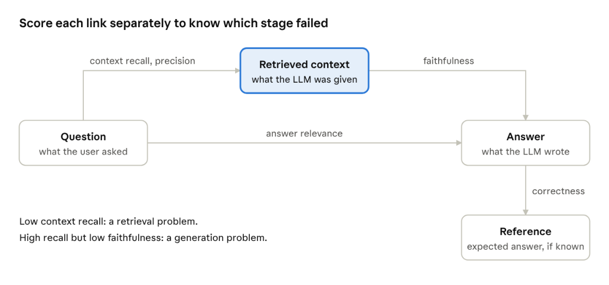

# 23 · RAG and agent evaluation

Part VII · Evaluation and safety. Applies Chapter 22's methods to Chapter 19 (RAG) and Chapter 21 (agents). Worked designs that depend on it: E.4 RAG support assistant and E.10 agentic customer-service flow.

## Why it matters

RAG systems and agents have several stages, and an end-to-end score ("72% of answers are correct") tells you that something is wrong, not what. Senior engineers evaluate each stage separately so they know where to spend effort: retrieval, context assembly, generation, tool use. Interviewers often ask "how would you evaluate this?" right after a RAG or agent design, and a staged answer with concrete metrics is what they look for.

## Key concepts

- **Component vs end-to-end evaluation**: measure retrieval and generation separately to find where a RAG system fails, then measure the whole answer.
- **Retrieval metrics**: recall@k (did the right passage come back?), MRR and NDCG (how high?).
- **Generation metrics for RAG**: faithfulness (claims supported by the context), answer relevance, context precision and recall. [Ragas paper](https://arxiv.org/abs/2309.15217), [Ragas documentation](https://docs.ragas.io/).
- **Synthetic test sets**: generating questions from your documents with an LLM to bootstrap evaluation, then checking a sample by hand.
- **Agent evaluation**: task success rate, number of steps, cost, tool-call correctness and the trajectory, ideally in a simulated environment with a user model. [τ-bench](https://arxiv.org/abs/2406.12045).
- **Error analysis**: reading failures and grouping them into categories before building metrics. [Your AI Product Needs Evals](https://hamel.dev/blog/posts/evals/).

## 23.1 Component vs end-to-end evaluation



*RAG evaluation · one metric per link*

| Link | Question it answers | Needs |
|---|---|---|
| Question → context | Did retrieval find the passages that answer the question, and rank them high? | Relevance labels per question, or an LLM judge |
| Context → answer | Is every claim in the answer supported by the context (faithfulness, also called groundedness)? | Only the context and the answer: no reference needed |
| Question → answer | Does the answer address what was asked (answer relevance)? | Only the question and answer |
| Answer → reference | Is the answer correct and complete? | A reference answer or required facts |

**End-to-end** metrics (correctness, task success, user satisfaction) tell you whether the system works. **Component** metrics tell you why it does not. You need both: end-to-end to decide whether to ship, components to decide what to fix. A useful habit is to tag every failed case with the first stage that went wrong (Chapter 19.9).

## 23.2 Retrieval metrics: context recall and precision

With relevance labels per question (which passages or documents answer it), use the standard retrieval metrics from Chapter 18.9. Two names you will meet in RAG tooling:

- **Context recall:** the share of the needed information that appears in the retrieved context. Label-based version: relevant passages retrieved ÷ relevant passages. Reference-based version (as in RAGAS): split the reference answer into claims and check how many are supported by the context.
- **Context precision:** how much of the context is relevant, rewarding relevant passages ranked early (an average-precision style score).

```python
def context_recall(retrieved_ids, relevant_ids):
    return len(set(retrieved_ids) & set(relevant_ids)) / len(relevant_ids) if relevant_ids else None

def context_precision(retrieved_ids, relevant_ids):
    """Average precision over the ranked context."""
    hits, total = 0, 0.0
    for i, pid in enumerate(retrieved_ids, start=1):
        if pid in relevant_ids:
            hits += 1
            total += hits / i
    return total / hits if hits else 0.0
```

Measure these **at the context the LLM actually receives** (after re-ranking and assembly), as well as at the retriever's output, so you can tell a retriever miss from an assembly drop. Without labels, an LLM judge can rate each retrieved passage as relevant or not to the question, which gives precision but not recall (it cannot know what was missed).

## 23.3 Generation metrics

**Faithfulness (groundedness).** Is every claim in the answer supported by the retrieved context? The standard method decomposes the answer into atomic claims, then checks each against the context with an LLM judge or an entailment (NLI) model. The score is supported claims ÷ total claims, and the unsupported claims themselves are the useful output for debugging.

```python
def faithfulness(answer, context, extract_claims, is_supported):
    """extract_claims and is_supported are LLM-judge (or NLI) calls in
practice."""
    claims = extract_claims(answer)
    if not claims:
        return None, []
    verdicts = [(c, is_supported(c, context)) for c in claims]
    return sum(v for _, v in verdicts) / len(claims), [c for c, v in verdicts if not v]

# "Vouchers are worth 20% of the order. Refunds arrive within 3 days."
# against a context that never mentions 3 days -> (0.5, ['Refunds arrive within 3 days'])
```

Faithfulness is not correctness: an answer can faithfully repeat an outdated policy that was retrieved. And it is not a hallucination detector for claims the model got right from its own knowledge but which are not in the context; decide whether those count as failures for your product (for policy answers, they usually should).

**Answer relevance.** Does the answer address the question? Judge it directly, or use the RAGAS-style trick of generating questions from the answer and measuring their similarity with the original question. Catches evasive or off-topic answers.

**Correctness.** Against a reference answer or a list of required facts: an LLM judge checks that the required facts are present and no contradicting facts are stated. For short factual answers, exact match or token F1 (Chapter 22.4).

**Abstention.** A RAG system must answer when the documents contain the answer and abstain when they do not. Include out-of-scope questions in the evaluation set and report:

```python
import numpy as np

def abstention_report(should_answer, did_answer, correct):
    sa, da, c = (np.asarray(x, dtype=bool) for x in (should_answer, did_answer, correct))
    return {
        "correct_when_answered": c[sa & da].mean() if (sa & da).any() else
None,
        "wrongly_abstained": (~da[sa]).mean() if sa.any() else None,    # missed answers
        "wrongly_answered": da[~sa].mean() if (~sa).any() else None,    # answered out of scope
    }
```

The last number, answering when it should not, is usually the most dangerous for customer-facing systems, and generic RAG metrics do not show it.

## 23.4 RAGAS-style frameworks and their pitfalls

Frameworks such as RAGAS, DeepEval and TruLens package these metrics (faithfulness, answer relevance, context precision and recall) as ready-made LLM-judge prompts. They are a fast start. The pitfalls:

- **Uncalibrated judges.** The scores come from LLM prompts you did not write and have not checked against human labels on your data. Calibrate them like any judge (Chapter 22.7) before trusting a number.
- **Generic criteria.** They measure generic properties, not your failure modes ("cited the wrong country's policy", "gave a refund amount above the cap"). Add your own checks.
- **Score drift with the judge model.** Changing the underlying LLM changes the scores. Pin versions.
- **Synthetic test sets.** Generated questions are cleaner than real ones and flatter the system (Chapter 18.9).
- **Averages that hide abstention failures.** A system that answers everything can score well on faithfulness and relevance while answering out-of-scope questions.

Use them as scaffolding: borrow the metric definitions, swap in calibrated judges, add product-specific checks, and always read the failures.

## 23.5 Evaluating agents

Agents take several steps, call tools and change the world (Chapter 21). Evaluate at three levels:

**1. Outcome (task success).** Did the agent achieve the goal? Best checked on the **finalstate** of a sandboxed environment rather than on the agent's words: the voucher issued equals the policy amount, the ticket is closed, nothing else changed. This is the approach of agent benchmarks such as τ-bench (simulated customer-service tasks with a database and policies).

```python
def check_end_state(state, expected):
    """Compare the final environment state with the expected outcome; ignore
unspecified fields."""
    return {k: state.get(k) == v for k, v in expected.items()}

check_end_state({"voucher_issued": 8.0, "ticket_status": "resolved"},
                {"voucher_issued": 5.0, "ticket_status": "resolved"})
# {'voucher_issued': False, 'ticket_status': True}: resolved, but paid more than policy allows
```

**2. Trajectory.** Was the path sensible? Right tools, right arguments, right order, no unnecessary or dangerous calls. Compare with expected tool calls where a reference trajectory exists:

```python
def tool_call_scores(expected, actual):
    """expected / actual: lists of (tool_name, args_dict). Order-aware
matching via LCS."""
    same = lambda a, b: a[0] == b[0] and a[1] == b[1]
    n, m = len(expected), len(actual)
    dp = [[0] * (m + 1) for _ in range(n + 1)]
    for i in range(1, n + 1):
        for j in range(1, m + 1):
            dp[i][j] = dp[i-1][j-1] + 1 if same(expected[i-1], actual[j-1]) else max(dp[i-1][j], dp[i][j-1])
    matched = dp[n][m]
    return {"call_recall": matched / n if n else 1.0,
            "call_precision": matched / m if m else 1.0,
            "extra_calls": m - matched}
```

Exact trajectory matching is too strict when several paths are valid, so combine it with rules ("must check courier status before issuing a voucher", "must never call `refund` above the cap") and with an LLM judge reading the trajectory for reasonableness.

**3. Efficiency and robustness.** Steps, tokens, cost and latency per task; behaviour on failure (a tool times out, returns an error, or returns surprising data); loops; consistency across repeated runs. Agents are stochastic: run each task several times and report the share of runs that succeed (a pass^k style metric, "succeeds in all k runs", is stricter and closer to what reliability means for users).

**Simulated users.** For conversational agents, an LLM can play the customer from a scripted persona and goal ("wants a refund for a missing drink, gets impatient, lies about a second item"). This gives repeatable multi-turn tests, including adversarial ones. Check the simulator's realism by reading its conversations.

**Safety evaluations for agents** are separate and mandatory: prompt injection in tool outputs, attempts to exceed permissions, and irreversible actions without confirmation (Chapter 24).

## 23.6 Putting it together: an evaluation suite

For the RAG assistant (E.4) and the agentic flow (E.10), a suite that would satisfy a senior interviewer:

| Layer | RAG assistant | Agentic customer-service flow |
|---|---|---|
| Code checks on every output | Valid format, citations exist, language, no PII | Valid tool calls, policy caps enforced, no forbidden tools |
| Component metrics | Context recall and precision at the final context | Tool-call accuracy against reference trajectories |
| Judged metrics (calibrated) | Faithfulness, correctness vs references, abstention | Trajectory reasonableness, message quality |
| End-to-end | Correct answers on real questions, per slice | Task success on end state, over repeated runs |
| Safety | Injection in documents, out-of- scope questions | Injection in tool output, permission escalation, refund abuse |
| Online | Resolution without escalation, re-contact rate, user feedback | Automation rate, human override rate, payouts per contact |

Run the offline suite in CI on every prompt, retrieval or model change, and the online metrics plus sampled judging on production daily.

## Pitfalls

- **Only end-to-end scores.** You know it is broken but not where.
- **Measuring retrieval at the retriever, not at the final context.** Assembly can drop the right passage.
- **Treating faithfulness as correctness.** Faithfully repeating the wrong document is still wrong.
- **No out-of-scope questions,** so wrong answering is never measured.
- **Trusting framework scores without calibration.**
- **Judging agents by their final message** instead of the environment's end state.
- **One run per agent task.** Stochastic agents need repeated runs.
- **Strict trajectory matching only,** which penalises valid alternative paths.
- **No failure-injection tests** for tools that time out or return errors.
- **Skipping safety tests for agents with write access.**

## Interview questions

Questions 1–4 basic, 5–9 intermediate, 10–12 senior.

**1. How do you evaluate a RAG system?** By component and end to end: retrieval (context recall and precision at the final context), generation (faithfulness, answer relevance), correctness against references, abstention on out-of-scope questions, plus online metrics. Tag failures by the first stage that broke.

**2. What is faithfulness and how is it measured?** Whether every claim in the answer is supported by the provided context. Decompose the answer into claims and verify each with an NLI model or calibrated LLM judge; report the supported share and the unsupported claims.

**3. Context precision vs context recall?** Recall: did the context contain what is needed to answer? Precision: how much of the context is relevant, rewarding relevant passages ranked early. Recall failures are retrieval problems; low precision adds distractors and cost.

**4. How do you evaluate an agent?** Task success on the environment's end state, trajectory quality (tool choice, arguments, order, forbidden actions), efficiency (steps, cost, latency), robustness to tool failures, repeated runs for reliability, and safety tests.

**5. Faithfulness is 0.95 but users say answers are wrong. How?** The retrieved documents are wrong or outdated, or the answer is faithful but incomplete, or it answers a different question. Check context recall and correctness against references, document freshness, and answer relevance.

**6. What are the risks of using RAGAS-style metrics as-is?** Uncalibrated judge prompts, generic criteria not tied to your failure modes, score changes when the judge model changes, flattering synthetic test sets, and no visibility of wrong answering on out-of-scope questions.

**7. How do you evaluate abstention?** Include questions the documents cannot answer; report correct-when-answered, wrongly-abstained and wrongly-answered rates; choose a threshold or prompt that balances them by business cost.

**8. Why check the end state instead of the agent's final message?** The message can claim success while the actions were wrong or incomplete; the state shows what actually happened (voucher amount, ticket status, side effects).

**9. How do you handle multiple valid agent trajectories in evaluation?** Score outcomes on end state; use rules for must-do and must-never steps; use soft matching (order-aware recall and precision of key calls) rather than exact sequences; add a calibrated trajectory judge.

**10. Design the evaluation for the agentic customer-service flow (E.10).** A sandbox with mocked order, courier and payment tools; replayed historical cases with expert decisions; simulated customers including adversarial ones; end-state checks (correct action, payout within policy); trajectory rules (evidence before payout); repeated runs; injection tests; shadow mode in production comparing agent proposals with human decisions; online automation and override rates.

**11. How do you know whether a RAG change helped, given noisy judges?** Paired comparison on the same questions; calibrated judges with known TPR and TNR; intervals; per-stage metrics that should move in the expected direction (a retrieval change should move context recall first); reading a sample of flipped cases.

**12. What would you monitor in production for a RAG assistant?** Retrieval scores and empty-retrieval rate, abstention rate, sampled faithfulness and correctness judgements, citation validity, latency and cost per answer, escalation and re-contact rates, user feedback, and drift in question topics (new topics with poor retrieval).

## Practice

1. **Component metrics.** On the RAG system and 60-question set from Chapter 19's practice, compute context recall and precision at the retriever and at the final context.
2. **Faithfulness judge.** Implement claim extraction and verification with an LLM; calibrate on 50 answers you label yourself.
3. **Abstention.** Add 15 out-of-scope questions and compute the abstention report before and after adding an explicit "don't know" instruction.
4. **Framework comparison.** Run RAGAS (or DeepEval) on the same set and compare its faithfulness scores with your calibrated judge and your own labels.
5. **Agent sandbox.** Build a toy order-support environment with three tools and a state dictionary; write 20 tasks with expected end states; run a simple agent five times per task and report success rate and pass^5.
6. **Robustness.** Make one tool fail 20% of the time and measure how success and trajectories change.

## Read next

- Es et al., *RAGAS: Automated Evaluation of Retrieval Augmented Generation* (2023), and the RAGAS documentation's metric definitions.
- Min et al., *FActScore: Fine-grained Atomic Evaluation of Factual Precision in Long Form* *Text Generation* (2023): the claim-decomposition idea.
- Yao et al., τ*-bench: A Benchmark for Tool-Agent-User Interaction in Real-World* *Domains* (2024).
- Anthropic, *Building Effective Agents* (2024), and their writing on agent evaluations.
- Hamel Husain's posts on evaluating RAG and agents.
- *AI Engineering* (Chip Huyen): sections on evaluating RAG and agentic systems.

**Links:** [Ragas documentation](https://docs.ragas.io/) · [Ragas paper](https://arxiv.org/abs/2309.15217) · [τ-bench](https://arxiv.org/abs/2406.12045) · [Your AI Product Needs Evals](https://hamel.dev/blog/posts/evals/). Other titles above can be found by searching their title.

## Done when

You can draw the RAG evaluation diagram and name the metric for each link.

You can compute context recall and precision and say where to measure them. You can explain claim-based faithfulness and its limits. You can design abstention evaluation with out-of-scope questions. You can explain the pitfalls of RAGAS-style frameworks.

You can evaluate an agent on end state, trajectory, efficiency, robustness and safety. You can write an evaluation suite for E.4 and E.10 from memory.

---

[← 22 · LLM evaluation](22-llm-evaluation.md) · [Contents](../README.md#contents) · [24 · Safety and responsible AI →](24-safety-and-responsible-ai.md)
