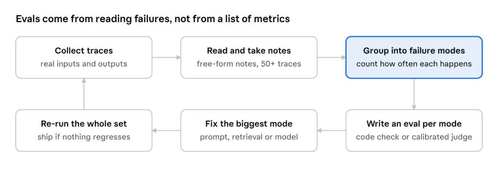
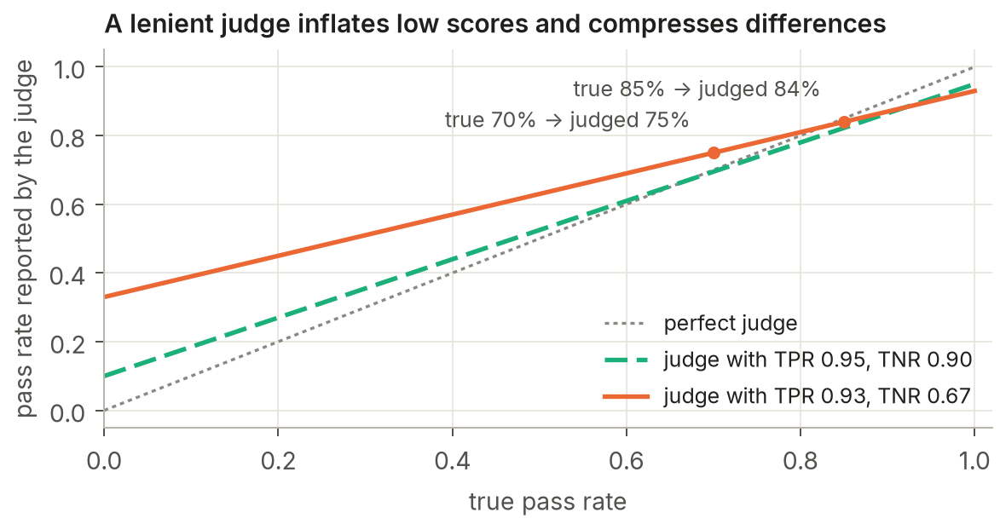

# 24 · LLM evaluation

Part VII · Evaluation science. Builds on Chapter 4 (metrics and confidence intervals) and Chapter 22 (prompt iteration). Chapter 25 applies this to RAG and agents. Worked design that builds on it: E.6 LLM judge for recommendation relevance.

## Why it matters

Evaluation is the skill that separates LLM demos from LLM products. Without it, every prompt change is a guess, every model upgrade is a risk, and nobody can say whether the feature is getting better. With it, you can iterate quickly and safely, and defend decisions with numbers. Practitioners who build LLM products for a living consistently say the evaluation system is the most important thing they build.

For your interviews, this is a differentiator: many candidates can build a RAG demo, few can explain how they would know it works. LLM judges, calibration against humans and sample sizes come up in both the ML depth and design rounds (worked design E.6). What the interviewer is really testing is whether you treat an evaluation number as a measurement with an error bar and a known bias, or as a fact.

**Where this chapter fits.** This chapter is about evaluating LLM *applications*: building an evaluation set for a product, task metrics, judges, and regression testing for prompts and models. Evaluating *models* as a research scientist (benchmark statistics, clustering, contamination, arenas, IRT) is covered in Chapter 23, and the two share the same statistical core.

The chapter follows the order in which an application evaluation is built. It starts with the difference between public benchmarks and evaluations of your own system (24.1), and with error analysis, reading real outputs to find out what actually fails (24.2). From those failures comes an evaluation set (24.3) and a set of checks, from the cheapest to the most expensive: reference-based metrics (24.4), code-based checks (24.5), and LLM judges (24.6), whose biases have to be measured against human labels (24.7). Sections 24.8 and 24.9 cover how many examples you need, including how many samples per case when outputs are stochastic, and how to measure in production. Section 24.10 covers tooling and 24.11 works through the calibration of an LLM judge. The chapter ends with conversations and safety evaluations (24.12), which most application suites forget.

The guiding principle is that metrics should come from observed failures, not from a generic list. A team that reads a hundred outputs before choosing metrics measures what matters for its users; a team that starts from a dashboard of generic scores often optimises numbers that have nothing to do with its users' problems.

## Key concepts

- **Benchmarks vs application evaluations**: public benchmarks compare models in general; your own evaluation set tells you whether your feature works. [Hamel Husain: Your AI Product Needs Evals](https://hamel.dev/blog/posts/evals/).
- **Golden set**: a fixed, versioned set of real inputs with expected outputs or properties, run on every change.
- **Reference-based vs reference-free metrics**: comparing with a known answer (exact match, F1, ROUGE) vs judging the output alone (faithfulness, helpfulness).
- **LLM-as-judge**: using a strong model with a rubric to grade outputs; it must be validated against human labels and checked for position and length bias. [Judging LLM-as-a-Judge](https://arxiv.org/abs/2306.05685).
- **Judge error correction**: turning a judge's observed pass rate into an estimate of the true rate using its TPR and TNR, with an interval that includes the judge's own uncertainty.
- **Holistic evaluation**: measuring many properties (accuracy, calibration, robustness, bias, cost), not one score. [HELM](https://arxiv.org/abs/2211.09110). Covered with model evaluation in Chapter 23.
- **Contamination**: benchmark test data leaked into training data, inflating scores. Covered in Chapter 23.6; for applications, the equivalent risk is tuning prompts on the evaluation set (24.3).
- **Online evaluation**: user feedback, A/B tests and sampled judging of live traffic (Chapter 47).

## 24.1 Benchmarks vs application evaluations

**Benchmarks** (MMLU, GPQA, SWE-bench, MTEB, and many more) compare models on fixed public tasks. They help shortlist models, but they do not tell you how a model performs on *your* task: your inputs, your definitions of good, your failure costs. Public benchmarks also leak into training data and saturate quickly. By late 2026, MMLU and much of GPQA no longer separate frontier models; harder sets such as Humanity's Last Exam, FrontierMath, SWE-bench Verified and its harder successors, and Terminal-Bench carry most of the signal at the top (Chapter 23.5). For a product decision, none of them replaces a few hundred of your own cases.

**Application evaluations** measure your system on your task: your prompts, your retrieval, your users' questions, scored against your criteria. They are what you ship on.

Three levels of application evaluation, from cheapest to most expensive:

| Level | What | When it runs |
|---|---|---|
| Unit-style checks | Assertions in code: valid JSON, length, required fields, no PII, citations present | Every change, in CI, and on production outputs |
| Model and human evaluation | LLM judges calibrated against human labels on an evaluation set; periodic human review | Every prompt or model change; weekly samples of production |
| Online evaluation | A/B tests and user signals on real traffic | Before and after launches |

## 24.2 Error analysis is the starting point

The most common mistake is starting from a list of generic metrics ("helpfulness, coherence, relevance") and building judges for them. Generic metrics measure things that may not be your problem and miss the things that are. Start from failures instead:



*the error-analysis loop · six steps, repeated*

1. **Collect traces:** real or realistic inputs with the full system output and intermediate steps (retrieved documents, tool calls).
2. **Read and take notes:** one person who understands the domain reads 50–100 traces and writes a short free-form note on what went wrong in each ("cited the Spain policy for a UAE user", "ignored the 24-hour limit"). This step is often called open coding.
3. **Group into failure modes:** cluster the notes into categories and count them. Now you know your top three problems and how often they occur.
4. **Write an evaluation per failure mode:** a code check when the failure is objective (wrong country cited: check metadata), a calibrated LLM judge when it needs judgement.
5. **Fix the biggest mode,** then 6. **re-run everything** and check for regressions.

Repeat whenever the system or its inputs change. The categories you discover become your evaluation suite, and they are specific to your product, which is exactly why they work. Reading data is not a chore to delegate; it is the highest-value hour in LLM development.

### Axial coding, criteria drift and when to stop

The two coding steps have names from qualitative research. **Open coding** is step 2: free-form notes, one per trace, with no categories fixed in advance. **Axial coding** is step 3: relating the notes to each other, merging near-duplicates ("made up a fee" and "invented a surcharge" are one mode), splitting categories that turn out to have different causes, and arranging them so that each category points at one fix. An LLM can propose a first clustering of the notes, but a person should own the final taxonomy, because the taxonomy decides what gets measured.

**Criteria drift** is the finding of Shankar et al. (2024) that people cannot fully specify their criteria before they see outputs: grading outputs changes what they think the criteria are. Someone who starts with "the answer must be concise" discovers after twenty traces that a long answer is fine when it lists steps, and a short one is bad when it omits the deadline. The practical consequences are to write the rubric *after* reading, to expect to revise it during the first labelling pass, and to re-label the first batch once the rubric settles, so early and late labels mean the same thing.

**When to stop reading.** Keep reading until new traces stop producing new categories; qualitative researchers call this theoretical saturation. A usable rule is to stop when 20 consecutive traces add no new failure mode. On a typical first pass that happens somewhere between 40 and 100 traces. A failure mode that occurs in 2% of traffic is seen at least once in 100 traces with probability 1 − 0.98¹⁰⁰ = 87%, so rarer but costly modes need a targeted search (filter the logs for refunds, complaints or long conversations) rather than more random reading.

## 24.3 Building an evaluation set

**Sources, best first:** real production inputs (sampled, anonymised); inputs from the people who will use the system; failures found in error analysis; hand-written edge cases; synthetic inputs generated by an LLM to fill gaps (vary them by persona, intent, difficulty and language, and review them, because generated inputs are cleaner and more uniform than real ones).

**Size.** Start with 50–100 cases you understand deeply; grow to a few hundred as failure modes emerge. Size follows from the precision you need (24.8): 100 cases give a pass rate within about ±7 percentage points near 85% and ±10 near 50% (95% interval); detecting a 5-point improvement reliably needs many hundreds.

**Stratify** by the dimensions that matter: intent, language, difficulty, user type, and the failure modes you found. Report results per stratum; an average hides a broken slice.

**What to store per case:** the input, any context it needs (user profile, documents), the expected output or the criteria a good output must meet, tags for strata, and the source. For tasks with one right answer, store it; for open-ended tasks, store what a good answer must contain and must not contain.

**Keep it alive.** Version the set; add every production failure worth fixing; retire cases that no longer reflect the product; keep a held-out slice you never tune prompts on. Tuning prompts on the whole set is the application-level version of benchmark contamination: the reported number stops measuring generalisation.

## 24.4 Reference-based metrics

When a task has a known correct answer, such as an extraction, a classification or a short factual reply, the cheapest evaluation compares the output with it. The difficulty is that the same correct answer can be written in many ways, so the comparison has to be forgiving of form and strict about content.

When there is a known correct answer:

- **Exact match** after normalisation (lower case, strip punctuation and articles): for short factual answers, labels, ids.
- **Token F1:** word overlap between prediction and reference, the standard for extractive question answering.
- **BLEU, ROUGE, BERTScore:** overlap metrics for longer text; weak for LLM outputs (Chapter 41.9 shows a reversed meaning scoring higher).
- **Task metrics:** accuracy or F1 for classification, execution accuracy for generated SQL or code (run it and compare results), JSON field accuracy for extraction.

```python
import re, string
from collections import Counter

def normalize(text):
    text = text.lower()
    text = "".join(ch for ch in text if ch not in set(string.punctuation))
    text = re.sub(r"\b(a|an|the)\b", " ", text)
    return " ".join(text.split())

def exact_match(pred, gold):
    return float(normalize(pred) == normalize(gold))

def token_f1(pred, gold):
    p, g = normalize(pred).split(), normalize(gold).split()
    common = sum((Counter(p) & Counter(g)).values())
    if common == 0:
        return 0.0
    prec, rec = common / len(p), common / len(g)
    return 2 * prec * rec / (prec + rec)

exact_match("The 24 hours.", "24 hours")             # 1.0
token_f1("within 24 hours of delivery", "24 hours")  # 0.57
```

The token-F1 example is worth checking by hand: the prediction has 5 tokens, the reference 2, and both reference tokens appear, so precision is 2/5 = 0.4, recall is 2/2 = 1, and F1 = 2 × 0.4 × 1/(0.4 + 1) = 0.57. The extra words cost precision even though they are harmless, which is why token F1 under-rates verbose but correct answers.

## 24.5 Code-based checks

Many failure modes are objective and cheap to test in code. Write these first: they are fast, free, deterministic, and run on every production output, not just the evaluation set.

```python
import json, re

def run_checks(output, checks):
    results = {}
    for name, fn in checks.items():
        try:
            results[name] = bool(fn(output))
        except Exception:
            results[name] = False          # a crashing check is a failed check
    return results

checks = {
    "valid_json": lambda o: isinstance(json.loads(o), dict),
    "has_answer": lambda o: len(json.loads(o)["answer"]) > 0,
    "under_80_words": lambda o: len(json.loads(o)["answer"].split()) <= 80,
    "cites_source": lambda o: len(json.loads(o)["sources"]) > 0,
    "no_email": lambda o: re.search(r"[\w.+-]+@[\w-]+\.[\w.]+", o) is None,
}
```

Other useful checks: the cited ids exist in the retrieved context; the answer is in the user's language; the classification label is in the taxonomy; a refund amount does not exceed the policy cap; the generated SQL parses and only touches allowed tables.

## 24.6 LLM-as-judge

When quality needs judgement (is the answer faithful? does it address the question? is the tone right?), an LLM can score outputs at scale. Three formats:

| Format | How | Good for | Watch out |
|---|---|---|---|
| Pointwise | Score one output against criteria | Monitoring, absolute pass rates | Scores drift; scales (1–10) are poorly calibrated |
| Pairwise | Which of two outputs is better? | Comparing prompts or models | Position bias; no absolute level |
| Reference-guided | Compare the output with a reference answer or required facts | Tasks with known answers but free wording | Needs references |

**How to write a judge that works:**

- **One judge per failure mode,** not one judge for "quality". "Does the answer state a refund amount not present in the documents?" is measurable; "is it good?" is not.
- **Binary pass/fail with a short critique** beats a 1–10 score: easier to calibrate, easier to act on, and the critique makes errors debuggable. Ask for the critique first, then the verdict.
- **Give the judge what it needs:** the input, the output, the retrieved context for faithfulness, the reference if any, and precise criteria with examples of pass and fail.
- **Use a strong model as judge,** and keep the judge prompt versioned like any other prompt.

```text
You are checking an answer from a customer-support assistant.
Criterion: every factual claim in the ANSWER must be supported by the DOCUMENTS.
A claim is unsupported if it adds amounts, deadlines or conditions not in the documents.

DOCUMENTS: {documents}
QUESTION: {question}
ANSWER: {answer}

First write a short critique listing any unsupported claims.
Then output JSON: {"critique": str, "verdict": "pass" | "fail"}
```

### Judge designs beyond one prompt

A single prompted judge with a binary verdict is the right default for an application. Several other designs are now common, and an interviewer will expect you to know when each one earns its cost.

**Rubric-based grading with per-item rubrics.** Instead of one criterion for the whole set, each evaluation case carries its own rubric: a short list of checkable statements written by an expert for that case, each with a weight ("mentions that the dose must be adjusted for kidney function: +5"; "recommends stopping the medication without a doctor: −8"). The judge checks each statement separately, and the case score is the sum of earned points divided by the maximum possible. HealthBench (OpenAI, 2025) used this design with physician-written rubrics, and the same rubrics serve as RL rewards. Per-item rubrics turn a vague judgement into many small factual checks, which judges do much more reliably. The cost is writing them: an expert-minute per criterion, for every case.

**Panels of smaller judges.** Verga et al. (2024) found that a panel of several smaller models from different families (PoLL, a "panel of LLM judges") agreed with humans as well as or better than one large judge, at lower cost and with less self-preference. Majority voting averages out the idiosyncratic errors of each judge. It does not fix errors the judges share.

**Fine-tuned judges.** Open models fine-tuned to grade against a rubric (Prometheus is the best-known family) are cheap to run at scale and can be hosted privately. They are usually weaker than frontier models on unfamiliar criteria, so calibrate them on your data like any judge.

**Probability-weighted scores.** For a numeric scale, G-Eval reads the judge's token probabilities for each score ("1" to "5") and reports the expected score Σ s · p(s) instead of the sampled score. This gives a continuous, less noisy number and breaks ties. It needs log-probabilities, which some APIs do not expose, and it does not fix the poor calibration of numeric scales.

**Reasoning models as judges.** A judge that thinks before answering is more accurate on hard checks: verifying a proof, a long calculation or a multi-step agent trajectory. It costs several times more tokens per verdict and adds latency, so use it where a non-reasoning judge's TNR is too low, not everywhere.

**Same model as generator and judge.** When the judge is the same model, or the same family, as the generator, their errors are correlated: the judge shares the generator's blind spots and prefers its style. That inflates scores and, worse, hides exactly the failures you need to find. Use a different family where you can, and always calibrate against human labels.

| Design | Strength | Cost | Use when |
|---|---|---|---|
| One binary judge per failure mode | Simple, easy to calibrate | Low | Default for applications |
| Per-item rubrics (HealthBench-style) | Fine-grained, reliable, doubles as an RL reward | Expert time per case | Open-ended expert answers |
| Panel of small judges (PoLL) | Less self-preference, cheap | Several calls per verdict | Pairwise comparisons, style |
| Fine-tuned judge (Prometheus-style) | Cheap at scale, private | Training and upkeep | Very high volume, fixed criteria |
| Probability-weighted score (G-Eval) | Continuous, less noisy | Needs logprobs | Ranking many similar outputs |
| Reasoning judge | Accurate on hard checks | Several times the tokens | Proofs, maths, long trajectories |

## 24.7 Judge biases and calibration against humans

LLM judges have known biases (Zheng et al., 2023, and later work):

- **Position bias:** in pairwise comparisons, preferring the first (or second) answer. Fix: run both orders. To estimate a *win rate* across many pairs, average the two orders, which cancels a constant position bias; scoring each inconsistent pair as a tie (half a win each) gives the same number. Do not compute the win rate from only the pairs where both orders agree: dropping the inconsistent pairs inflates it (Chapter 23.8 shows 0.60 against a true 0.55). Keeping only the consistent pairs is a valid *labelling filter*, for example to build a clean preference set, but not a way to estimate a win rate.
- **Verbosity bias:** preferring longer answers. Fix: criteria that penalise padding; length-controlled comparisons.
- **Self-preference:** preferring outputs from the same model family. Fix: a judge from a different family, or calibration.
- **Leniency or harshness** that differs by slice or language.

**Calibrate every judge before trusting it.** Have a domain expert label 100–200 outputs for the same criterion, run the judge on them, and measure agreement:

```python
import numpy as np

def cohens_kappa(a, b):
    a, b = np.asarray(a), np.asarray(b)
    po = np.mean(a == b)                                       # observed agreement
    pe = sum(np.mean(a == l) * np.mean(b == l) for l in np.union1d(a, b))   # chance agreement
    return (po - pe) / (1 - pe)

def judge_tpr_tnr(human, judge):
    h, j = np.asarray(human), np.asarray(judge)
    return np.mean(j[h == 1] == 1), np.mean(j[h == 0] == 0)   # pass-recall, fail-recall
```

**Read agreement correctly.** Raw agreement looks high when most outputs pass. Cohen's kappa corrects for chance (rough guide: above 0.6 is substantial, above 0.8 near-perfect). Even more useful: the judge's **true positive rate** (catches real passes) and **true negative rate** (catches real failures). A judge that rarely flags failures is useless for finding bugs even if agreement is 90%. Compare judge-human agreement with human-human agreement on a sample: if two experts agree only 85% of the time, do not expect 95% from a judge.

### Correcting the pass rate for judge errors

A judge with known error rates reports a biased pass rate, and the bias can be undone. The method is the Rogan–Gladen estimator from epidemiology, where it corrects disease prevalence for an imperfect test. Write π for the true pass rate of the system, q for the pass rate the judge reports, TPR for the probability the judge says pass on a truly good output, and TNR for the probability it says fail on a truly bad one. The judge says pass on a good output with probability TPR and on a bad output with probability 1 − TNR, so the reported rate is a mixture of the two:

$$
q = \mathrm{TPR}\,\pi + (1 - \mathrm{TNR})\,(1 - \pi)
$$

Collecting the π terms gives q = (TPR + TNR − 1) π + (1 − TNR), a straight line in π. Solving it for π gives the corrected estimate:

$$
\hat{\pi} = \dfrac{q + \mathrm{TNR} - 1}{\mathrm{TPR} + \mathrm{TNR} - 1}
$$

For the judge calibrated in 24.11 (TPR = 140/150 = 0.933, TNR = 33/50 = 0.66) and a reported pass rate of 80%, the corrected rate is (0.80 + 0.66 − 1)/(0.933 + 0.66 − 1) = 0.46/0.593 = 0.775, about 78%. The formula is clipped to [0, 1], because sampling noise can push it outside.

```python
def corrected_pass_rate(observed_rate, tpr, tnr):
    return min(max((observed_rate + tnr - 1) / (tpr + tnr - 1), 0.0), 1.0)

# Judge with TPR 0.93, TNR 0.66 reports 80% pass; the corrected estimate is about 78%
```



*The pass rate a judge reports is a straight line in the true pass rate: TPR × true + (1 − TNR) × (1 − true). The lenient judge (orange, TPR 0.93, TNR 0.66, the 24.11 judge) reports about 75% for a system that is truly at 70% and 84% for one at 85%: a 15-point difference shows as 9.*

**Imperfect judges hide differences.** The slope of that line is J = TPR + TNR − 1 (Youden's J), so every true difference between systems shrinks by that factor: Δq = J Δπ. The correction divides by J, which multiplies the standard error of q by 1/J and its variance by 1/J². For the 24.11 judge J = 0.593, so comparisons need 1/0.593² ≈ 2.8 times as many cases to reach the same power. Improving the judge's TNR, its ability to catch failures, is often cheaper than collecting more evaluation cases. A judge with J = 0 (says pass at the same rate whatever the truth) carries no information, and the formula correctly blows up.

### Propagating the judge's own uncertainty

The correction above uses TPR and TNR as if they were known exactly. They are estimates, and TNR here comes from only 50 failures: its 95% interval is 0.52–0.78. Plugging the two ends into the formula moves the corrected 78% to anywhere between 71% and 81%, before counting any noise in the production sample. A point estimate that hides this is over-confident.

The clean way to carry all the uncertainty through is a bootstrap. Resample the calibration set (equivalently, redraw the TP and TN counts) and the production sample, recompute the corrected rate each time, and take percentiles:

```python
def corrected_interval(k_prod, n_prod, tp, n_pos, tn, n_neg, B=20000, seed=0):
    rng = np.random.default_rng(seed)
    obs = rng.binomial(n_prod, k_prod / n_prod, B) / n_prod
    tpr_b = rng.binomial(n_pos, tp / n_pos, B) / n_pos
    tnr_b = rng.binomial(n_neg, tn / n_neg, B) / n_neg
    est = np.clip((obs + tnr_b - 1) / (tpr_b + tnr_b - 1), 0, 1)
    return np.percentile(est, [2.5, 97.5])

corrected_interval(800, 1000, 140, 150, 33, 50)   # about (0.68, 0.85)
```

With 1,000 judged production outputs at 80%, the production sample alone would give ±2.5 points. With the judge's uncertainty included, the corrected rate is 77.5% with a 95% interval of 68–85%: the calibration set, not the production sample, dominates the error. This is why 24.11 insists on enough failures in the calibration set and on improving TNR.

**The senior caveat: transfer.** The correction assumes the judge's TPR and TNR on production outputs equal those measured on the calibration set. That holds only if the calibration outputs come from the same generator, the same input mix and the same kinds of failure. A new prompt that produces a new failure mode, a new slice of users or a new generator model can change TNR without any visible signal. Calibrate on outputs sampled from the system you are measuring, per important slice, and re-calibrate when the generator changes (24.11 step 5).

Iterate on the judge prompt until agreement is good enough, using the human labels as its own evaluation set, with a held-out part.

## 24.8 Sample sizes and confidence intervals

Every evaluation number is an estimate. Report intervals, and compare systems with paired tests.

```python
import math
from scipy import stats

def wilson_interval(successes, n, z=1.96):
    p = successes / n
    denom = 1 + z**2 / n
    centre = (p + z**2 / (2 * n)) / denom
    half = z * math.sqrt(p * (1 - p) / n + z**2 / (4 * n**2)) / denom
    return centre - half, centre + half

wilson_interval(85, 100)     # (0.77, 0.91): "85%" on 100 cases is anything from 77% to 91%
wilson_interval(850, 1000)   # (0.83, 0.87)

def mcnemar_exact(a_correct, b_correct):
    """Paired comparison of two systems on the same cases: only disagreements matter."""
    n01 = int(sum(a and not b for a, b in zip(a_correct, b_correct)))
    n10 = int(sum(b and not a for a, b in zip(a_correct, b_correct)))
    n = n01 + n10
    return n01, n10, (stats.binomtest(min(n01, n10), n, 0.5).pvalue if n else 1.0)
```

**Rules of thumb.** To detect an improvement from 80% to 85% with two independent samples, you need roughly 900 cases per arm; from 80% to 82%, about 6,000. Paired evaluation on the same cases (McNemar) needs far fewer, because only the cases where the systems disagree carry information. So: always compare prompts and models on the **same** cases, and do not celebrate a 2-point gain on 200 examples.

### Where the rules of thumb come from

Both numbers come from one argument. Let δ be the true difference you want to detect, at a two-sided 5% level (z = 1.96) with 80% power (z = 0.84). The observed difference has standard error SE, and the test has 80% power when the true difference sits 1.96 + 0.84 = 2.80 standard errors from zero. So δ = 2.80 × SE, and everything else is working out SE.

For two independent samples of n cases each, with pass rates p₁ and p₂, the variance of the difference is the sum of the two variances, so SE = √((p₁(1 − p₁) + p₂(1 − p₂))/n). Setting δ = 2.80 × SE and solving for n:

$$
n \approx \dfrac{(z_{1-\alpha/2} + z_{1-\beta})^2\,\left[p_1(1-p_1) + p_2(1-p_2)\right]}{\delta^2}
$$

For 80% → 85%: 2.80² = 7.85, the bracket is 0.16 + 0.1275 = 0.2875, and δ² = 0.0025, so n ≈ 7.85 × 0.2875/0.0025 ≈ 903 per arm (the slightly more careful pooled-variance formula in the check script gives 906).

For a paired comparison on the same n cases, each case contributes a difference of +1, −1 or 0, and only the discordant cases (one system passes, the other fails) are non-zero. If a fraction d of cases is discordant, the variance of a per-case difference is at most d, so SE ≈ √(d/n), and

$$
n \approx \dfrac{(z_{1-\alpha/2} + z_{1-\beta})^2\, d}{\delta^2}
$$

With 10% discordant cases, detecting the same 5 points needs 7.85 × 0.10/0.0025 ≈ 314 cases in total, against about 1,800 outputs for the unpaired design. Chapter 23.2 derives the same formula for benchmark comparisons. The lesson is that the agreement between systems is what makes paired testing cheap: two prompt versions that differ on only a few cases can be compared on a few hundred.

### Several samples per case

At temperature above zero, the same input gives different outputs, so a case does not have a pass or a fail, it has a pass *probability* pᵢ. A single run per case mixes two sources of noise: which cases you happened to pick (between-case variance) and which sample each case happened to produce (within-case variance). With n cases and K samples per case, averaging all nK verdicts gives an estimate whose variance splits into the two parts:

$$
\mathrm{Var}(\hat{p}) = \dfrac{1}{n}\left(\sigma_q^2 + \dfrac{\bar{\sigma}_w^2}{K}\right)
$$

Here σ_q² is the variance of the true pass probabilities pᵢ across cases and σ̄_w² is the average within-case variance, the mean of pᵢ(1 − pᵢ). Their sum is p(1 − p), the usual Bernoulli variance. A worked example: 200 cases with a mean pass rate of 70%, where σ_q² = 0.07 and σ̄_w² = 0.14 (some cases are easy, some hard, many in between). With one sample per case the standard error is √(0.21/200) = 3.2 points; with 4 samples it falls to 2.3, with 8 to 2.1, and no number of samples gets it below √(0.07/200) = 1.9 points. More samples remove only the within-case part; past about 4 samples, adding cases buys more than adding samples.

Three practical rules follow. When you compare two prompts, use the same cases and, where the API allows it, the same seeds, so both kinds of noise are shared and cancel in the paired difference. Report how many samples per case you used and at what temperature, because K changes the interval. And bootstrap over cases, not over individual samples, because samples of the same case are correlated (Chapter 23.2 calls this clustering).

**A flaky-test policy for CI.** A case with pᵢ strictly between 0 and 1 is flaky: it fails some runs and passes others, and a CI gate on a single run will block merges at random. A workable policy has four parts. Run must-pass cases K = 4 times and pass the gate when at least 3 of the 4 pass: a case with pᵢ = 0.95 then passes the gate 98.6% of the time, one with pᵢ = 0.9 passes 94.8%, and a truly broken case with pᵢ = 0.5 passes only 31%. Track each case's empirical pass rate over time, and quarantine cases whose rate sits between 0.2 and 0.8, rather than letting them make the suite noisy. Read quarantined cases: a flaky case is often an ambiguous rubric or a genuinely borderline input. Gate releases on the aggregate pass rate with its interval, not on any single case.

## 24.9 Online evaluation

An offline set is a snapshot, chosen in advance; production traffic keeps changing, and users find failure modes no test set anticipated. Online signals measure the system as it is actually used, and they are the only way to know whether offline gains translate into real ones.

**The signals.** Explicit feedback, such as thumbs up or down and ratings, is sparse and biased towards unhappy users, but it is valuable for finding failures. Implicit feedback is denser: the user copies the answer, edits the draft (and how much), asks the same question again, escalates to a human or abandons the session. Business outcomes, such as contact deflection, resolution without escalation, conversion or time saved, are what the product is for, but they move slowly and respond to many things besides the model. Sampled judging ties the two worlds together: run the calibrated judges from 24.7 on a daily sample of production traffic, correct the rates for judge error, and alert on drops.

**Checking that offline predicts online.** An offline metric earns its place only if it predicts what happens in production. After a few launches, plot the offline change (say, the judged faithfulness gain) against the online change (say, the drop in re-contact rate) for each launch. With five to ten past launches you cannot fit much, but you can see whether the sign agrees and whether one offline metric tracks the outcome better than another. A metric that moved in every launch while the online outcome did not is measuring something users do not care about; demote it.

**Sources of non-stationarity.** Online numbers change for reasons unrelated to your launches, and three are specific to LLM systems. The input mix shifts: seasons, new products, a news event. Hosted model providers update models behind a stable name, so a silent provider update can change both your generator and your judge on the same day; pin dated model versions where the provider offers them, and log the exact version with every call. Finally, the judge itself drifts when its model or prompt changes. Keep an **anchor set**: 100–200 production outputs with fixed human labels, re-judged every week. If the judge's TPR or TNR on the anchor set moves, the judge changed; if it is stable but production scores moved, the system or the traffic changed.

**A/B testing LLM features** follows Chapter 2, with extras: guardrails on cost per request and latency; novelty effects (users try the new assistant more at first); and interference when the feature changes what users ask. Ship behind flags, start with a small share of traffic, and compare both the user metrics and the judged quality. For ranking or generation choices where a full A/B test is slow, **interleaving** shows each user results from both systems mixed in one list and attributes clicks to the system that produced each item; it detects preferences with far less traffic than an A/B test (Chapter 44). The LLM equivalent is an online pairwise test: show two responses side by side to a small share of users, or show one response and ask a judge to compare it with the alternative offline.

## 24.10 Tooling

You can do all of this with Python, a spreadsheet and git. Tools help at scale: tracing and observability (Langfuse, LangSmith, Arize Phoenix, Braintrust, Weights & Biases Weave) store traces, run evaluations, manage datasets and judges, and show results per version. Pick one that stores full traces and lets you annotate them, because annotation is where error analysis happens. Avoid tools that push you to generic out-of-the-box metrics before you have read your data.

## 24.11 A worked judge calibration

You want an LLM judge for "the answer is fully supported by the retrieved context" in a RAG assistant.

1. **Label a calibration set.** A domain expert labels 200 outputs: 150 supported, 50 not.
   - Take the outputs from the current system, so the failures are realistic.
   - If failures are rare in production, oversample them. TNR is estimated only from the failures, and 50 is already few.
2. **Run the judge and measure it.**

   | | Judge: pass | Judge: fail |
   |---|---|---|
   | Human: pass (150) | 140 | 10 |
   | Human: fail (50) | 17 | 33 |

   - Raw agreement is 86.5% and Cohen's kappa is 0.62, which looks acceptable.
   - The rates tell the real story. TPR is 0.93 (95% interval 0.88–0.96), but TNR is only 0.66 (0.52–0.78): the judge misses a third of unsupported answers.
3. **Read the errors.**
   - The 17 false passes are mostly answers that add a plausible detail missing from the context.
   - The judge reads "plausible" as "supported". Fix the prompt: ask it to list each claim and quote the supporting sentence before deciding, and to fail any claim it cannot quote.
4. **Re-measure on a held-out part.** Split the 200 into 120 for prompt development and 80 for checking, so the judge is not tuned to the very examples it is scored on. Iterate until TNR is high enough for the use, typically above 0.85 for a faithfulness gate.
5. **Use it with its error rates.**
   - In production the judge reports 80% supported. With the original TPR and TNR, the corrected estimate is (0.80 + 0.66 − 1)/(0.93 + 0.66 − 1) ≈ 78%.
   - Report it with the interval from 24.7: on 1,000 judged outputs, 68–85%. The width comes mostly from the 50 failures in the calibration set.
   - With the improved judge the correction is smaller and the interval narrower.
   - Re-calibrate on 50 fresh labels every time the generator, the retriever or the judge model changes. Judge accuracy is a property of the pair, not of the judge alone.

The kappa in step 2 can be checked by hand. Observed agreement is (140 + 33)/200 = 0.865. The judge says pass on 157 of 200 outputs and the human on 150, so chance agreement is 0.75 × 0.785 + 0.25 × 0.215 = 0.643, and κ = (0.865 − 0.643)/(1 − 0.643) = 0.62.

## 24.12 Conversations, refusals and safety

Most application suites test single turns of helpful behaviour on benign inputs. Two things fall through that net: failures that only appear several turns into a conversation, and failures of the safety behaviour itself, in either direction. Both need their own cases and their own metrics.

### Multi-turn evaluation

Many failures only exist across turns: the assistant forgets a constraint the user gave three turns earlier, contradicts its own earlier answer, fails to recover after the user corrects it, or drifts off task in a long session. Scoring each turn in isolation misses all of them. Score the **conversation** as the unit instead, with criteria such as goal completion at the end, consistency with earlier turns, retention of stated constraints, and graceful recovery after a correction.

There are two ways to build multi-turn cases, and they fail differently. **Replaying** recorded user turns is realistic, but it goes off the rails as soon as your new system answers differently from the old one, because the recorded user was replying to the old answers. **Simulating** the user with an LLM that has a persona and a goal adapts to the new system's answers, but the simulator has its own biases: it is too cooperative, it leaks its goal, and it drifts (Chapter 25.5 covers validating simulators). A common compromise uses replay for the first turn or two and a simulator afterwards. Because conversations are longer and more variable than single turns, the variance per case is higher, so plan on several simulated conversations per scenario (24.8).

### Safety and refusal evaluation

A safety evaluation for an application has two sides, and reporting only one is the most common mistake. **Harmful compliance** is the rate at which the system does something it should refuse, on a set of requests that should be refused for this product: out-of-policy requests, attempts to extract other users' data, prompt-injection attempts in documents. **Over-refusal** is the rate at which it refuses requests it should serve, on a set of benign inputs that look risky: medication questions in a pharmacy assistant, security questions in a developer tool. Public sets such as XSTest (safe prompts that resemble unsafe ones) show the pattern, but the useful set is built from your own product's borderline cases.

Report both rates side by side with intervals, for every change. A new system prompt that cuts harmful compliance from 4% to 1% while raising over-refusal from 2% to 9% may be a worse product. When the decision is a threshold or a prompt variant, plot one rate against the other for each variant and pick the point that matches the relative cost of each error. Chapter 27.4 covers adversarial robustness at the model level and Chapter 28 covers moderation pipelines in products.

## Pitfalls

- **Generic metrics first.** "Helpfulness" scores that do not match your real failure modes.
- **Never reading the data.** Dashboards of judge scores without anyone reading traces.
- **Uncalibrated judges.** A judge nobody checked against human labels is an opinion, not a metric.
- **Reporting agreement without kappa, TPR and TNR.** A judge can agree 90% and still miss most failures.
- **Correcting for judge error with a point estimate.** The judge's TPR and TNR are themselves estimates; propagate their uncertainty.
- **1–10 scores.** Hard to calibrate, easy to drift; prefer binary verdicts per criterion.
- **Comparing systems on different samples** or without intervals.
- **One sample per case at temperature above zero,** then reading a 2-point change as real.
- **Pairwise judging in one order only** (position bias).
- **Tuning prompts on the whole evaluation set,** then reporting on it.
- **Evaluation sets that never change** while the product and users do.
- **Synthetic-only evaluation sets** that are cleaner than real inputs.
- **Reporting harmful compliance without over-refusal,** or the reverse.
- **Ignoring cost and latency** in the evaluation table.

## Interview questions

Questions 1–4 basic, 5–9 and 14 intermediate, 10–13 and 15–16 senior.

**1. Why are public benchmarks not enough to choose a model for your product?** They test generic tasks, may be contaminated, and ignore your inputs, criteria and failure costs. Use them to shortlist, then evaluate candidates on your own set. The number to quote: a 300-case set of your own at 85% pass has a standard error of √(0.85 × 0.15/300) ≈ 2 points, which is enough to separate candidates that differ by 6 points or more, and that difference on your task is worth more than a 1-point gap on a public leaderboard. The follow-up is usually "which public benchmarks would you still look at?": the few closest to your task (τ-bench for tool use, SWE-bench Verified for coding), as a filter, with contamination in mind.

**2. How do you start evaluating a new LLM feature?** Error analysis: collect 50–100 realistic traces, read and annotate failures (open coding), group them into failure modes (axial coding), count them, then build code checks or calibrated judges for the most frequent modes. Stop reading when about 20 consecutive traces add no new category. Expect criteria to change as you read, so write the rubric after the first pass, not before. The trade-off: random traces find common failures, but a mode that affects 2% of traffic is missed in 100 traces 13% of the time, so search the logs for costly rare cases too.

**3. What is LLM-as-judge, and its main formats?** Using an LLM to grade outputs against criteria: pointwise (one output), pairwise (which of two), reference-guided (against a known answer). Best as binary verdicts per criterion with a critique written before the verdict. Pointwise gives absolute pass rates for monitoring; pairwise is more sensitive for comparing two versions but has position bias and no absolute level. The follow-up: "why not a 1–10 scale?" Because neighbouring scores are not used consistently, scores drift with the judge model, and a binary verdict maps directly to a TPR and TNR you can calibrate.

**4. Exact match vs token F1?** Exact match requires the normalised strings to be identical; token F1 gives partial credit for word overlap. Both suit short answers with a reference; neither suits open-ended generation. Worked example: "within 24 hours of delivery" against the reference "24 hours" has precision 2/5 and recall 1, so F1 = 0.57 while exact match is 0. Token F1 therefore penalises correct but verbose answers, and neither metric notices a fluent answer with one wrong number in it.

**5. What biases do LLM judges have and how do you handle them?** Position, verbosity, self-preference, and slice-dependent leniency. Swap orders in pairwise judging (average the two orders, or equivalently score inconsistent pairs as ties; dropping them inflates the win rate), penalise padding or control for length, use a different model family or a panel, and calibrate against human labels per slice. The number: Chapter 23.8's simulation shows a 10-point first-position bias turning a true 55% win rate into 45% or 65% depending on order. Follow-up: "does averaging both orders fix it?" For a constant bias, yes; for a bias that depends on the content, only calibration against humans tells you.

**6. How do you validate an LLM judge?** Expert labels on 100–200 outputs for the same criterion; measure kappa and the judge's TPR and TNR; compare with human-human agreement; iterate on the judge prompt; keep a held-out set; re-check after judge or model changes. Oversample failures, because TNR is estimated only from them: with 50 failures, an observed TNR of 0.66 has a 95% interval of 0.52–0.78. The trade-off is expert time against precision. The follow-up: "what TNR is good enough?" Whatever makes the corrected pass rate's interval narrow enough for the decision, typically above 0.85 for a launch gate.

**7. Your judge agrees with humans 92% of the time. Is it good?** Not necessarily: if 90% of outputs pass, a judge that always says pass agrees 90% and has a kappa of 0. Check kappa and especially the TNR, the share of real failures it catches. Compute J = TPR + TNR − 1: true differences between systems shrink by J in the judge's numbers, so a judge with J = 0.6 needs about 1/0.6² ≈ 2.8 times as many cases to detect the same improvement. Follow-up: "how would you improve it?" Read the false passes, make the judge quote evidence for each claim, and re-measure on a held-out split.

**8. How many examples do you need in an evaluation set?** Enough for the precision you need: 100 cases gives roughly ±7 points on a pass rate near 85% (±10 near 50%); detecting small differences between systems needs paired comparisons on the same cases or many hundreds of examples. The formula is n ≈ 7.85 × [p₁(1 − p₁) + p₂(1 − p₂)]/δ² for independent samples, about 900 per arm for 80% → 85%, and n ≈ 7.85 × d/δ² paired, about 314 if the systems disagree on 10% of cases. Follow-up: "and at temperature 0.7?" Add samples per case, but past about four, more cases help more than more samples.

**9. How do you compare two prompts fairly?** Same cases, same judge, same seeds where possible, a paired test (McNemar on per-case pass/fail), intervals, per-slice results, plus cost and latency. McNemar uses only the discordant cases: if prompt B fixes 25 cases and breaks 9, the exact binomial test on 9 of 34 gives p ≈ 0.009. The trade-off is that a paired test on a set you also tuned on is optimistic, so confirm on the held-out slice. Follow-up: "what if each prompt is run several times per case?" Average per case first, then do a paired test or bootstrap over cases.

**10. Design the evaluation for a customer-support RAG assistant.** Start from error analysis on real tickets, then layer the checks. Code checks run on every output: format, cited ids exist in the context, language, no PII, refund amounts within policy caps. Calibrated judges cover faithfulness, correctness against references for the common questions, and correct abstention; retrieval is measured separately at the final context (Chapter 25). Slice by country, language and intent. Prioritise: the launch gate is wrong answers with real cost, so set thresholds from error costs, for example "wrongly answered out-of-scope questions ≤ 2% with the upper 95% bound ≤ 4%", which needs about 400 out-of-scope cases (8 of 400 gives an upper bound of 3.9%). Then production sampling with daily judging and an anchor set for judge drift, and online metrics (resolution without escalation, re-contact rate, CSAT) with cost and latency guardrails. What blocks launch: any policy-cap violation, a faithfulness gate missed on any major slice, or a judge whose TNR is below 0.85. Follow-up: "where would you spend the first week?" Reading 100 tickets and labelling the calibration set.

**11. Judge scores went down 5 points after a model upgrade of the judge itself. What happened?** The measuring instrument changed: the new judge may be stricter or differently biased. Run the old and new judges side by side on the human-labelled anchor set and refit TPR and TNR for both. Check that the generator did not change at the same time (a silent provider update can move both). Then correct both series with their own error rates before comparing trends: a judge whose TNR rose from 0.66 to 0.85 reports lower pass rates for the same system, and the corrected rates may agree. Pin judge versions and change them deliberately, with an overlap period. Follow-up: "which judge do you keep?" The one with the higher J on the anchor set, re-baselining historical numbers with it.

**12. How do you evaluate when there is no single right answer (for example writing product descriptions)?** Define concrete criteria from error analysis (factual consistency with the source catalogue data, no invented claims, length, tone, banned phrases), code checks where possible, calibrated binary judges for the rest, pairwise preference tests between versions, and human review samples. Per-item rubrics help: for each source record, list the facts a good description must contain and the claims it must not make, and score the share satisfied. The trade-off: pairwise tests detect small improvements but give no absolute level, so keep a pointwise pass rate for monitoring. Follow-up: "how do you stop the judge rewarding verbosity?" A length-controlled comparison and an explicit padding criterion.

**13. How would you convince a product manager that an LLM feature is ready to launch?** Show per-failure-mode pass rates with intervals on a representative set, critical slices, judge calibration evidence, cost and latency, a comparison with the current process, the monitoring plan, and the rollout plan with guardrails and rollback criteria. A strong answer prioritises: name the one or two failure modes that block launch, agree their thresholds with the PM in advance from the cost of each error, and size the sets so the interval can actually clear the threshold (about 400 cases to show a 2% rate is below 4%). Compare with the human baseline, which also makes mistakes. Then a staged rollout: 5% of traffic, judged daily, with automatic rollback if the corrected faithfulness rate falls below the gate. Follow-up: "the PM wants to launch next week with 100 cases." Say what 100 cases can show (±7 points) and offer a smaller launch scope.

**14. Your evaluation runs at temperature 0.7 and a new prompt shows a 2-point gain on 200 cases. Real?** Probably not yet. With one sample per case at 70% the standard error of each score is about 3.2 points, of which the within-case sampling noise is a large part. Run each case 4 times for both prompts, with shared seeds where possible, average per case, and compute a paired difference with a bootstrap over cases. That removes most of the sampling noise and, through pairing, the case difficulty. The trade-off: four samples cost four times the tokens, and past that, adding cases reduces the error more. Follow-up: "and in CI?" Gate must-pass cases on at least 3 of 4 passes and quarantine flaky ones.

**15. How do you put an error bar on a judge-corrected pass rate?** Bootstrap both sources: redraw the calibration counts (TP among real passes, TN among real failures) and the production sample, recompute the Rogan–Gladen estimate each time, and take percentiles. For a judge with TPR 140/150 and TNR 33/50 reporting 80% on 1,000 outputs, the corrected rate is 77.5% with an interval of 68–85%, against ±2.5 points if you ignored the judge's uncertainty. The calibration set dominates because the correction divides every error by J ≈ 0.59. The caveat a senior answer adds is transfer: the interval assumes production failures look like calibration failures. Follow-up: "how would you narrow it?" A better judge (higher J) helps more than more production samples.

**16. When would you use per-item rubrics instead of one judge prompt?** When answers are open-ended and expert-level, and "good" depends on case-specific facts: medical, legal or technical advice where each case has its own must-mention and must-not-say points. Per-item rubrics turn one hard judgement into several easy checks, which judges get right more often, and the same rubrics can serve as RL rewards. The cost is expert time per case, perhaps an hour for ten cases, and the risk is rewarding checklist-filling over a coherent answer, so keep a holistic check alongside. Follow-up: "how do you validate rubric grading?" Have experts grade a sample against the same rubrics and measure agreement per criterion.

## Practice

1. **Error analysis.** Take the RAG system from Chapter 31's practice. Read 60 traces, write notes, group them into failure modes, count them.

<details><summary>Hint and expected result</summary>

Expect 5–10 categories, with the top three covering more than half of the failures. Typical top modes for a small RAG system are retrieval misses, answers that add details not in the context, and failure to abstain. If you finish with 20 categories, merge them: each category should point at one fix. Record after how many traces the last new category appeared.

</details>

2. **Code checks.** Write `run_checks` checks for three of the modes you found and run them on all outputs.

<details><summary>Hint and expected result</summary>

At least one of your top modes should be checkable in code (a cited id that does not exist, the wrong language, a missing field). Test each check on a hand-made passing and failing output before trusting it, and count how many production outputs fail each check.

</details>

3. **A judge with calibration.** Write a faithfulness judge; label 100 outputs yourself; compute kappa, TPR and TNR; improve the judge prompt twice and report the change.

<details><summary>Hint and expected result</summary>

The first version usually has high TPR (above 0.9) and a low TNR (0.5–0.7), because judges are lenient. Asking for a quote per claim typically raises TNR by 0.1–0.2. Report TNR with its Wilson interval: with 25 failures in 100 outputs, the interval is about 0.35 wide (roughly ±0.17), which tells you to label more failures before claiming an improvement.

</details>

4. **Pairwise judging.** Compare two prompt versions with a pairwise judge in both orders; count inconsistent verdicts.

<details><summary>Hint and expected result</summary>

Expect 10–30% of pairs to flip with order when the two versions are similar in quality. Report the win rate averaged over orders and the share of ties (inconsistent pairs).

</details>

5. **Statistics.** Compute Wilson intervals for each failure mode's rate and a McNemar test between the two prompts.

<details><summary>Hint and expected result</summary>

Check your code against `code/ch24_check.py`: 85 of 100 gives (0.767, 0.907); its simulated comparison has 9 cases where only A passes and 25 where only B passes, p = 0.009. On your own 60–100 cases, expect most differences between prompts not to be significant.

</details>

6. **Reading.** Write a one-page evaluation plan for worked design E.6 before re-reading the model answer.

<details><summary>Hint and expected result</summary>

A complete plan names the failure modes, the checks for each (code or judge), the calibration set size and its share of failures, the sample sizes for the decisions it supports, and the online signals. Compare with E.6 and list what you missed.

</details>

7. **Research exercise: how much does judge uncertainty matter?** Using the 24.11 numbers, bootstrap the corrected pass rate as the calibration set grows from 50 to 500 failures (keep the 3:1 pass-to-fail ratio) and as the judge's TNR improves from 0.66 to 0.90. Then repeat with 1, 4 and 16 samples per case on a simulated set with between-case variance 0.07 and within-case variance 0.14.

<details><summary>Hint and expected result</summary>

With 50 failures and TNR 0.66, the interval is about 68–85%. Growing only the failures to 500 narrows it to about 71–85%, because the TPR estimate and the production sample are also divided by J. Growing the whole calibration set tenfold (1,500 passes, 500 failures) gives about 73–82%. Keeping the original 200 labels but raising TNR to 0.90 gives about 72–83%, because J rises from 0.59 to 0.83: a better judge is worth about as much as ten times the labels. For the samples-per-case part, the standard error on 200 cases should go 3.2 → 2.3 → 2.0 points, approaching the floor of 1.9 set by between-case variance. `code/ch24_check.py` has the building blocks.

</details>

## Read next

- Hamel Husain's posts *Your AI Product Needs Evals* and *Creating a LLM-as-a-Judge* *That Drives Business Results*, and Husain and Shankar's material on evaluation (hamel.dev).
- Shreya Shankar et al., *Who Validates the Validators? Aligning LLM-Assisted Evaluation* *of LLM Outputs with Human Preferences* (2024): the source of criteria drift.
- Zheng et al., *Judging LLM-as-a-Judge with MT-Bench and Chatbot Arena* (2023).
- Verga et al., *Replacing Judges with Juries: Evaluating LLM Generations with a Panel of Diverse Models* (2024).
- Liu et al., *G-Eval: NLG Evaluation using GPT-4 with Better Human Alignment* (2023); Kim et al., *Prometheus* (2023).
- Arora et al., *HealthBench* (OpenAI, 2025): rubric-based grading at scale.
- *AI Engineering* (Chip Huyen): the chapters on evaluation methodology and evaluating AI systems.
- Eugene Yan's writing on evals and LLM judges (eugeneyan.com).
- Anthropic and OpenAI documentation on building evaluations.

**Links:** [Your AI Product Needs Evals](https://hamel.dev/blog/posts/evals/) · [Judging LLM-as-a-Judge](https://arxiv.org/abs/2306.05685) · [HELM](https://arxiv.org/abs/2211.09110) · [Who Validates the Validators?](https://arxiv.org/abs/2404.12272) · [Replacing Judges with Juries](https://arxiv.org/abs/2404.18796) · [G-Eval](https://arxiv.org/abs/2303.16634). Other titles above can be found by searching their title.

## Done when

- Without notes, derive the Rogan–Gladen correction from the mixture q = TPR·π + (1 − TNR)(1 − π) in 3 minutes, and compute it for TPR 0.93, TNR 0.66 and an observed 80%: answer ≈ 78%.
- Explain in one sentence why the judge's uncertainty matters, and give the bootstrap interval for the same judge on 1,000 outputs: ≈ 68–85%.
- Compute kappa by hand from the 24.11 confusion table: answer 0.62.
- Derive the sample-size formula from δ = 2.8 × SE and compute: 80% → 85% unpaired ≈ 900 per arm; paired with 10% discordant ≈ 314.
- Given between-case variance 0.07, within-case variance 0.14 and 200 cases, compute the standard error with 1 and 4 samples per case: ≈ 3.2 and 2.3 points.
- Write exact match, token F1, a Wilson interval and a McNemar test from scratch in 15 minutes, and get token F1 = 0.57 for the 24.4 example.
- Name four judge designs beyond a single prompt (rubrics, panels, fine-tuned, probability-weighted, reasoning) and when each is worth its cost.
- Run an error analysis on 60 traces and turn the top three failure modes into one code check and two calibrated judges.
- Design online evaluation for an LLM feature, including an anchor set for judge drift and a check that offline gains predicted online outcomes.
- State the two-sided safety metric (harmful compliance and over-refusal) and why reporting only one misleads.

---

[← 23 · Evaluating models](23-evaluating-models.md) · [Contents](../README.md#contents) · [25 · RAG and agent evaluation →](25-rag-and-agent-evaluation.md)
