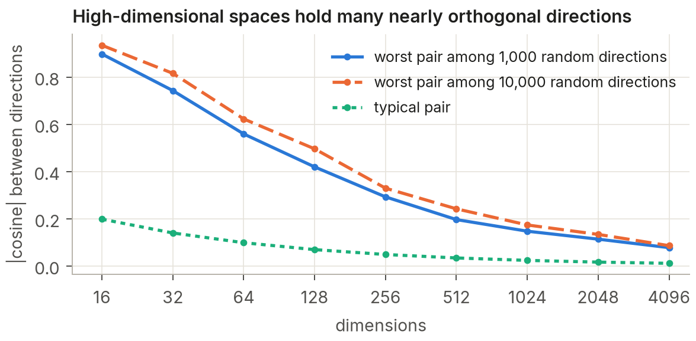

# 26 · Interpretability and analysis

Part VIII · Interpretability, alignment and safety. Assumes Chapter 10 (attention, the residual stream) and Chapter 6 (PyTorch hooks). Chapter 27 uses these tools for safety: detecting deception, monitoring reasoning, steering behaviour.

## Why it matters

We train models whose behaviour we can measure but whose internal computations we mostly cannot read. Interpretability tries to change that: find the features a model represents, the circuits that compute with them, and causal handles to change behaviour. It matters for science (what did the model actually learn?), for debugging (why does it fail on this input?), and for safety (can we tell when a model is being deceptive, or verify that a dangerous capability is absent?). Since 2023, sparse autoencoders and circuit-tracing methods have made it possible to find millions of interpretable features in production-scale models. Research-scientist interviews increasingly include interpretability: explain the residual stream view, what an induction head is, how activation patching works, and what sparse autoencoders do and fail to do.

Numbers in this chapter come from `code/ch26_check.py` (CPU, about 15 seconds): a tiny transformer trained from scratch, analysed with the same methods used on large models.

## Key concepts

- **Residual stream view**: each layer reads from and writes to a shared vector space. [A Mathematical Framework for Transformer Circuits](https://transformer-circuits.pub/2021/framework/index.html).
- **Induction heads**: a two-head circuit that implements in-context copying. [Olsson et al.](https://arxiv.org/abs/2209.11895).
- **Probing**: training simple classifiers on internal activations. [Control tasks (Hewitt and Liang)](https://arxiv.org/abs/1909.03368).
- **Logit lens and tuned lens**: decoding intermediate layers into vocabulary predictions. [Tuned lens](https://arxiv.org/abs/2303.08112).
- **Activation patching and causal interventions**. [ROME (causal tracing)](https://arxiv.org/abs/2202.05262), [IOI circuit](https://arxiv.org/abs/2211.00593), [Best practices for activation patching](https://arxiv.org/abs/2309.16042).
- **Superposition and sparse autoencoders (SAEs)**. [Toy Models of Superposition](https://arxiv.org/abs/2209.10652), [Towards Monosemanticity](https://transformer-circuits.pub/2023/monosemantic-features), [Scaling and evaluating sparse autoencoders (TopK)](https://arxiv.org/abs/2406.04093).
- **Circuit tracing with transcoders and attribution graphs**. [Circuit tracing (2025)](https://transformer-circuits.pub/2025/attribution-graphs/methods.html).
- **Steering and representation engineering**. [Activation addition](https://arxiv.org/abs/2308.10248), [Refusal is mediated by a single direction](https://arxiv.org/abs/2406.11717).
- **Tools**: [TransformerLens](https://github.com/TransformerLensOrg/TransformerLens), [nnsight](https://nnsight.net/), [SAELens](https://github.com/jbloomAus/SAELens), [Neuronpedia](https://www.neuronpedia.org/).

## 26.1 Questions and levels

| Question | Methods | Strength of evidence |
|---|---|---|
| Is information X present at layer l? | Probing | Correlational: present, not necessarily used |
| What does the model "think" at layer l? | Logit lens, tuned lens | Descriptive |
| Which components cause behaviour B? | Ablation, activation patching, attribution | Causal, at the component level |
| What algorithm implements B? | Circuit analysis | Causal and mechanistic, usually narrow |
| What features does the model use? | Sparse autoencoders, transcoders | Descriptive, with causal checks via steering |
| Can we change B by editing internals? | Steering vectors, model editing | Causal, practical |

Good interpretability work moves from description to causal tests: a probe that finds a feature is a hypothesis; an intervention that changes behaviour in the predicted way is evidence.

## 26.2 The residual stream view

A transformer's state at each position is a vector, the **residual stream**. Each attention head and MLP reads from it (through a linear map), computes, and adds its output back. Because everything is added, the final logits are a sum of contributions from every component, and one component's output can be read by any later component.

Two consequences shape all of mechanistic interpretability:

- **Attention heads decompose** into a QK circuit (where to look: which positions attend to which) and an OV circuit (what to move: how the attended content changes the stream). They can be studied separately.
- **Composition**: a later head can use an earlier head's output in its queries (Q-composition), keys (K-composition) or values (V-composition). Multi-step algorithms are built from such compositions.

## 26.3 Probing

Train a linear classifier on a layer's activations to predict a property (part of speech, truth value, a board-game state). High accuracy means the information is linearly decodable there.

Two cautions, both visible in the check script, where the target is whether x₀·x₁ > 0, a non-linear function of the input:

| Representation | Probe accuracy |
|---|---|
| Raw input | 0.486 (not linearly decodable) |
| Hidden layer of a random network | 0.624 |
| Hidden layer of a network trained on the task | 1.000 |
| Same layer, control task with random labels | 0.466 |

- **Even random features help**: a random non-linear layer makes many functions partly decodable. Compare against random-network and input baselines.
- **Control tasks**: a probe powerful enough to memorise random labels says little. Use simple (linear) probes and report selectivity: accuracy on the real task minus accuracy on a control.

And the central limitation: decodable is not the same as used. A model may represent a property it never uses for its output. Follow probes with interventions (26.5, 26.8).

## 26.4 Logit lens and tuned lens

Apply the final layer norm and unembedding to an intermediate layer's residual stream to see which tokens it would predict if computation stopped there. The **logit lens** often shows the answer forming gradually across layers: early layers predict generic continuations; the correct token rises in the middle-to-late layers. It works poorly on early layers of some models because their representations are not yet in the output basis; the **tuned lens** fixes this by learning a small affine map per layer. Both are cheap, descriptive tools for asking "when does the model know?"

## 26.5 Causal interventions

**Ablation**: remove a component's contribution and measure the change. How you remove it matters: zero-ablation produces activations the model never sees; **mean-ablation** (replace with the average over a dataset) or **resample-ablation** (replace with the activation from a different input) are closer to the data distribution.

**Activation patching** compares a clean input (where the behaviour occurs) with a corrupted input (minimally changed so it does not). Run the corrupted input, but replace one component's activation with its value from the clean run. If the behaviour comes back, that component carries the information that matters.

**Attribution patching** approximates patching every component at once with a first-order (gradient) estimate, which makes large-model scans feasible; confirm important findings with actual patching.

**Pitfalls**: results depend on the corruption (a different corruption isolates a different mechanism), on the metric (logit difference is more sensitive than accuracy), and on backup mechanisms (ablate one head and another takes over). Report several corruptions and metrics.

## 26.6 Circuits: induction heads

The check script trains a two-layer, attention-only transformer (two heads per layer) on sequences in which a random segment of random length is repeated: [x₁ … x_L … x₁ … x_L]. The repeated tokens can only be predicted by finding the earlier occurrence of the current token and copying what came after it. The trained model gets 97.5% of them right (chance: 3.1%).

Attention patterns reveal the mechanism:

| Head | Attends to the previous token | Attends to "the token after the previous occurrence" |
|---|---|---|
| L0H0 | 0.50 | 0.00 |
| L0H1 | 0.05 | 0.05 |
| L1H0 | 0.06 | 0.77 |
| L1H1 | 0.06 | 0.75 |

This is the **induction circuit** (Olsson et al., 2022). A **previous-token head** in layer 0 (L0H0) writes "the token before me was A" into each position. **Induction heads** in layer 1 use that through K-composition: at a position holding A, they look for positions whose previous token was A, which is the position right after the earlier A, and copy its token (B) to the output. That implements [A][B] … [A] → [B].

Ablations and patching confirm it causally:

| Intervention | Accuracy on repeated tokens |
|---|---|
| None | 0.975 |
| Ablate L0H0 (previous-token head) | 0.245 |
| Ablate L0H1 | 0.926 |
| Ablate L1H0 / L1H1 (one induction head) | 0.708 / 0.874 |
| Ablate both induction heads | 0.037 |
| Corrupt the first occurrence | 0.030 |
| … and patch in clean L1H0 / L1H1 / both | 0.721 / 0.615 / 0.974 |

The two induction heads are partly redundant (removing one hurts, removing both destroys the behaviour), a common pattern that single-component ablations can miss. In large models, induction heads form abruptly early in training, at the same time as a jump in in-context learning ability. Other well-studied circuits include indirect object identification in GPT-2 small (IOI) and factual recall, where causal tracing located facts in mid-layer MLPs (ROME).

## 26.7 Superposition and sparse autoencoders

Individual neurons are often **polysemantic**: one neuron responds to unrelated concepts. The leading explanation is **superposition**: a model represents more features than it has dimensions, as nearly-orthogonal directions, which works when features are sparse (rarely active together). Toy Models of Superposition showed this happens in small networks and depends on sparsity and importance.

*Absolute cosine between random unit directions. The typical pair (√(2/πd)) is close to orthogonal already at a few hundred dimensions. Even the worst-aligned pair among 10,000 directions has cosine below 0.09 at 4,096 dimensions, the width of a mid-sized model's residual stream.*

This geometry is what makes superposition possible. A residual stream of 4,096 dimensions can hold far more than 4,096 directions with little interference, and the number grows exponentially with the width if a fixed amount of interference is acceptable. The interference shows up as noise when several features are active at once, so superposition works when features are sparse. The model's nonlinearities then filter the small interference terms.

If features are directions in superposition, we need to recover those directions from activations. A **sparse autoencoder (SAE)** learns an over-complete dictionary: encode an activation into many latents with a sparsity constraint, decode back as a sparse combination of learned directions.

In the check script, 24 sparse features (each active 5% of the time, 1.2 on average per input) are stored in an 8-dimensional space (mean |cos| between feature directions 0.29: heavily overlapping). Three SAEs with 32 latents:

| SAE | Active latents per input (L0) | Unexplained variance | Features recovered (cos > 0.9) |
|---|---|---|---|
| L1 penalty 0.01 | 8.08 | 0.001 | 3 / 24 |
| L1 penalty 0.3 | 2.54 | 0.139 | 22 / 24 |
| TopK, k = 2 | 2.00 | 0.100 | 23 / 24 |

The first reconstructs perfectly and finds almost nothing: with weak sparsity, a dense code is easiest. Good reconstruction is not the goal; **sparse, faithful** reconstruction is. TopK SAEs (keep the k largest latents, no L1 penalty) make the sparsity level a direct choice and avoid shrinking active latents, and are widely used.

At scale, SAEs on a production model's residual stream found millions of features, many of them interpretable and multilingual and multimodal (a feature for a landmark firing on text and images of it), with causal effects when amplified. **Transcoders** replace an MLP with a sparse, wider MLP trained to imitate it, so features describe computation rather than just representation; **attribution graphs** built from them (2025) trace, for a specific prompt, which features influence which, producing readable pictures of multi-step computations such as planning a rhyme or doing two-hop reasoning.

**Open problems and evaluation.** SAEs miss features and invent others (feature splitting and absorption), the reconstruction error contains unexplained computation, and interpretability of features is judged by humans or LLMs with their own biases. Evaluate SAEs on: downstream loss when the SAE reconstruction replaces the real activation, sparsity, interpretability scores, and usefulness on concrete tasks (probing, steering, finding a known feature). Several 2025 studies found that simple baselines (linear probes) match SAE-based methods on some practical tasks: treat SAEs as one tool, not the answer.

## 26.8 Steering and editing

If a concept is a direction, adding that direction to the residual stream should change behaviour.

- **Steering vectors**: take the mean activation difference between contrasting prompts (for example "love" versus "hate", or honest versus dishonest completions) at one layer, and add a multiple of it at inference. Effective, cheap and often surprisingly precise; too large a coefficient degrades fluency.
- **Refusal direction**: in many chat models, refusal of harmful requests is mediated by roughly one direction; removing it from activations disables refusals, adding it causes refusal of harmless requests. A striking demonstration of both the power of linear interventions and the fragility of safety training in open-weight models.
- **SAE feature steering**: clamp an SAE feature to a high value. In the check script, adding feature 3's direction to a zero activation makes the TopK SAE's top latent the one aligned with feature 3 (cosine 1.00), the toy version of finding and turning up a concept.
- **Model editing** (ROME, MEMIT): rank-one updates to MLP weights to change specific facts. Edits generalise imperfectly and can have side effects.

## 26.9 Reasoning traces as an interpretability signal

Reasoning models produce long chains of thought in natural language. That is an opportunity: monitoring the chain of thought can reveal reward hacking or intent to deceive. It has a limit: the chain of thought is not guaranteed to be **faithful** to the computation; models can reach answers for reasons they do not state, and training pressure on the chain of thought can teach models to hide intent. Chapter 27 covers chain-of-thought monitoring as a safety tool.

## 26.10 Good practice

- Start with a behaviour you can measure precisely, on a dataset, not a single prompt.
- Form hypotheses from descriptive tools; test them with causal interventions.
- Use several corruptions, metrics and ablation types; look for backup mechanisms.
- Beware **interpretability illusions**: a direction that seems to control a concept may act through a different mechanism, especially in subspace interventions.
- Avoid cherry-picking: report how many features or examples you looked at and how many fit the story.
- Compare with simple baselines (probes, prompting) before claiming an SAE-based method is useful.

## 26.11 A worked investigation: does the model track the speaker's language?

**Question.** A multilingual model answers in the user's language. Is there an internal representation of "language of the conversation", and does the model use it to choose output tokens?

1. **Behaviour first.** Build 2,000 prompts in four languages, with matched content, and measure how often the answer is in the prompt's language. Include conflicting cases (an English instruction quoting a Spanish text) to see which signal wins.
2. **Descriptive tools.**
   - Train linear probes for the language at every layer on residual-stream activations, with a held-out split.
   - Add a control task (random labels assigned per word type) and report selectivity, the gap between the two accuracies (26.3).
   - Expect high accuracy almost everywhere, because language is easy to read from tokens. The interesting result is where a representation of the *conversation's* language exists separately from the *current token's*. Test that on the conflicting cases.
3. **Causal tests.**
   - **Steering.** Take the difference of mean activations between Spanish and English conversations at a middle layer, and add it to English prompts. Does the answer switch language while keeping its content?
   - **Activation patching** (26.5) between matched prompts in two languages localises the layers and positions where patching flips the output language.
   - Use several corruptions and report the share of prompts flipped, not single examples.
4. **Sparse features.** If an SAE is available for that layer, look for latents that fire on the conversation's language rather than on single tokens. Check them causally (ablate, amplify) and compare with the mean-difference direction. If the simple direction steers as well as the SAE latent, say so (26.10).
5. **Report.**
   - The behavioural rates.
   - The probe curves with their controls.
   - The causal effect sizes with intervals over prompts.
   - The failure cases: prompts where steering changed the content, or did nothing.
   - A short statement of what the evidence does and does not show. For example: "a linear direction at layers 14–18 causally controls output language for 87% of prompts; we did not test whether it is the mechanism the model uses without intervention."

The structure transfers to most interpretability questions: behaviour, then correlational evidence, then causal tests with controls, then honest scoping.

## Pitfalls

- Treating probe accuracy as evidence the model uses a feature.
- Using zero-ablation and concluding a component is essential.
- Ignoring redundancy: single ablations under-state what a set of components does.
- Optimising SAEs for reconstruction alone.
- Building a circuit story from a handful of prompts.
- Assuming chains of thought faithfully describe the model's reasoning.

## Interview questions

**1. Explain the residual stream view of transformers.** Each component reads linearly from a shared vector and adds its output back; logits are a sum of contributions; components communicate through the stream, which allows decomposition into paths and circuits.

**2. What is an induction head and how does it work?** A layer-1 head that attends from token A to the position after a previous occurrence of A and copies that token. It relies on a layer-0 previous-token head via K-composition.

**3. How does activation patching work, and how is it different from ablation?** Patching restores one component's clean activation into a corrupted run to test whether it carries the information that restores behaviour; ablation removes a component. Patching is targeted to a specific contrast.

**4. What can go wrong with probing?** Decodable is not used; powerful probes memorise; random features already make many properties decodable. Use linear probes, control tasks, baselines and causal follow-ups.

**5. What is superposition, and why does it motivate SAEs?** Models represent more sparse features than dimensions as overlapping directions, making neurons polysemantic. SAEs learn an over-complete sparse dictionary to recover those directions.

**6. How would you evaluate a sparse autoencoder?** Sparsity (L0), reconstruction, downstream loss with the SAE spliced in, feature interpretability, and usefulness on concrete tasks compared with baselines.

**7. TopK versus L1 SAEs?** TopK fixes the number of active latents directly and avoids shrinkage of active latents caused by the L1 penalty; L1 needs tuning of the penalty and trades sparsity against reconstruction less directly.

**8. What is a steering vector? Give an example.** A direction added to the residual stream to change behaviour, for example the mean difference between activations on refusing and complying prompts, which can add or remove refusals.

**9. Why doesn't the logit lens work on early layers, and what fixes it?** Early representations are not in the output basis; the tuned lens learns an affine map per layer to decode them.

**10. Is a reasoning model's chain of thought a faithful explanation?** Not necessarily: models can use unstated reasons, and optimisation pressure on the chain of thought can make it less informative. Useful for monitoring, not proof.

## Practice

1. Run the check script; then add a third layer and test whether the circuit changes.
2. With TransformerLens or nnsight, find induction heads in GPT-2 small using repeated random tokens, and ablate them.
3. Reproduce activation patching on the IOI task in GPT-2 small; compare logit-difference and accuracy metrics.
4. **Research exercise.** Train TopK SAEs with k ∈ {8, 16, 32, 64} on one residual-stream layer of a small open model (a few million tokens). Plot unexplained variance and downstream loss increase against L0, and label 30 random features per SAE by hand. Does interpretability change with k?
5. Compute a refusal direction for a small open chat model from 100 harmful and 100 harmless prompts; measure refusal rates when removing and adding it.

## Read next

- Elhage et al., "A Mathematical Framework for Transformer Circuits" (2021).
- Olsson et al., "In-context Learning and Induction Heads" (2022).
- Wang et al., "Interpretability in the Wild: a Circuit for Indirect Object Identification in GPT-2 small" (2022).
- Meng et al., "Locating and Editing Factual Associations in GPT" (ROME, 2022).
- Elhage et al., "Toy Models of Superposition" (2022); Bricken et al., "Towards Monosemanticity" (2023); Templeton et al., "Scaling Monosemanticity" (2024).
- Gao et al., "Scaling and evaluating sparse autoencoders" (2024).
- Ameisen et al., "Circuit Tracing: Revealing Computational Graphs in Language Models" (2025).
- Arditi et al., "Refusal in Language Models Is Mediated by a Single Direction" (2024).
- Zhang and Nanda, "Towards Best Practices of Activation Patching in Language Models" (2023).
- Links to these papers are in the Key concepts section at the top of this chapter.

## Done when

You can explain the residual stream view, QK and OV circuits and composition. You can find an induction circuit in a small model with attention patterns, ablations and patching, and explain the mechanism. You can run and interpret a probe with proper baselines.

You can explain superposition, train an SAE and evaluate it beyond reconstruction, and describe transcoders and attribution graphs. You can build a steering vector and explain the refusal-direction result. You can list the main pitfalls of interpretability evidence.

---

[← 25 · RAG and agent evaluation](25-rag-and-agent-evaluation.md) · [Contents](../README.md#contents) · [27 · Alignment and safety research →](27-alignment-and-safety-research.md)
