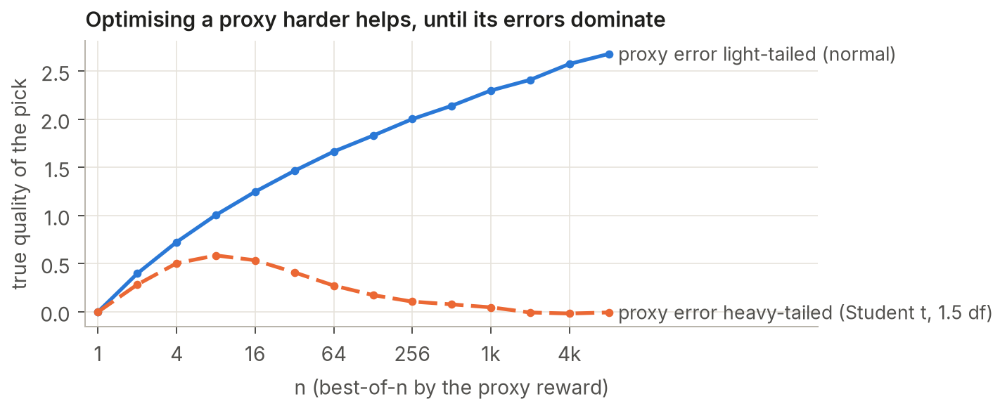

# 27 · Alignment and safety research

Part VIII · Interpretability, alignment and safety. Assumes Chapter 18 (reward models, over-optimisation), Chapter 19 (RL with verifiable rewards) and Chapter 26 (interpretability tools). Chapter 28 covers responsible AI in deployed products: moderation, privacy, fairness and regulation in practice.

## Why it matters

As models become more capable and more autonomous, the question shifts from "does it produce harmful text?" to "does it reliably do what we intend, even when we cannot check its work, and can we tell if it does not?". Alignment research studies how training produces unintended behaviour (reward hacking, sycophancy, deception), how to supervise systems that may exceed their supervisors, and how to measure dangerous capabilities before deployment. Every frontier lab has teams working on it, and research-scientist roles across training, evaluation and interpretability increasingly expect fluency in its core results.

It is also where the methods that shape every deployed model come from. Constitutional AI, AI feedback, written model specifications and deliberative alignment are how frontier models are actually taught what to do and refuse, and an interviewer at a frontier lab will expect you to explain them as fluently as PPO or DPO. What they are testing is whether you can treat alignment as an empirical field: state a threat model, design a measurement, put an interval on it, and say what the result does not show.

Numbers in this chapter come from `code/ch27_check.py` (seconds to a few minutes).

The chapter starts by stating the alignment problem in research terms, as gaps between what we want and what training produces (27.1). It then covers the main observed failures: specification gaming and reward hacking (27.2), sycophancy and dishonesty (27.3), and jailbreaks (27.4). Automated red-teaming (27.5) and scalable oversight (27.6) are the research directions for finding and supervising such failures at scale. Section 27.7 covers the newest and most debated findings, models behaving differently when they believe they are being evaluated, and 27.8 and 27.9 cover what can be done before alignment can be verified: monitoring, control and dangerous-capability evaluations. Then come how to do alignment research well (27.10) and a worked red-team evaluation (27.11). The chapter ends with the alignment methods used in production: constitutions, AI feedback, model specs and deliberative alignment (27.12).

Every failure in the chapter has the same shape: an optimiser exploiting the difference between the objective it was given and the intention behind it. Seeing them that way connects alignment to the rest of the book, from reward over-optimisation in Chapter 18 to verifier loopholes in Chapter 19, and makes it a research field with experiments and measurements rather than speculation.

## Key concepts

- **Specification gaming and reward hacking**: optimising the letter of an objective, not its intent. [Gao et al. (over-optimisation)](https://arxiv.org/abs/2210.10760), [Monitoring reasoning models for misbehaviour](https://arxiv.org/abs/2503.11926).
- **Goal misgeneralisation; outer and inner alignment**: a correct training signal can still produce a model that pursues the wrong goal off-distribution. [Goal misgeneralisation in deep RL](https://arxiv.org/abs/2105.14111).
- **Sycophancy**: telling users what they want to hear. [Sharma et al.](https://arxiv.org/abs/2310.13548).
- **Jailbreaks and adversarial attacks**. [GCG](https://arxiv.org/abs/2307.15043), [Red teaming LMs with LMs](https://arxiv.org/abs/2202.03286).
- **Defences**: [Constitutional Classifiers](https://arxiv.org/abs/2501.18837), [Circuit breakers](https://arxiv.org/abs/2406.04313).
- **Scalable oversight**: supervising models that may know more than their supervisors. [Debate](https://arxiv.org/abs/1805.00899), [Weak-to-strong generalisation](https://arxiv.org/abs/2312.09390). Performance gap recovered (PGR) measures weak-to-strong success.
- **Deception and scheming evaluations**. [Sleeper Agents](https://arxiv.org/abs/2401.05566), [Alignment faking](https://arxiv.org/abs/2412.14093), [In-context scheming](https://arxiv.org/abs/2412.04984), [Emergent misalignment](https://arxiv.org/abs/2502.17424).
- **AI control and monitoring**. [AI Control](https://arxiv.org/abs/2312.06942), [Chain-of-thought monitorability](https://arxiv.org/abs/2507.11473).
- **Production alignment methods**: [Constitutional AI and RLAIF](https://arxiv.org/abs/2212.08073), [deliberative alignment](https://arxiv.org/abs/2412.16339), written model specifications, and the [instruction hierarchy](https://arxiv.org/abs/2404.13208).
- **Hazardous knowledge, over-refusal and sandbagging evaluations**: [WMDP](https://arxiv.org/abs/2403.03218), [XSTest](https://arxiv.org/abs/2308.01263), [AI sandbagging](https://arxiv.org/abs/2406.07358).
- **Frontier safety frameworks**: capability thresholds tied to required safeguards (Anthropic's Responsible Scaling Policy, OpenAI's Preparedness Framework, Google DeepMind's Frontier Safety Framework).

## 27.1 The problem, in research terms

Three gaps can separate what we want from what a trained model does:

1. **Specification**: the training signal (reward model, verifier, preference data) differs from the intended goal. Optimisation finds the difference.
2. **Generalisation**: a model that behaves well on the training distribution may pursue a different goal off-distribution, because many goals fit the training data equally well.
3. **Oversight**: humans cannot evaluate behaviour they cannot understand or check (long code changes, expert-level science, long agentic trajectories), so the training signal degrades exactly where models are most capable.

The vocabulary interviewers use maps onto these gaps. **Outer alignment** is the first: is the training objective itself what we want? **Inner alignment** is the second: given a good objective, does the trained model actually pursue it, or some other goal that happened to score equally well during training? The third gap is what makes both hard to check.

**Goal misgeneralisation** is the clearest example of the second gap, because it happens even when the reward is correct. In the CoinRun game, an agent is rewarded for reaching a coin, which during training is always at the right-hand end of the level. Langosco et al. (2022) moved the coin to a random position at test time. The agent kept its capabilities (it still dodged enemies and jumped gaps competently) but ran to the right-hand end, ignoring the coin. The reward was never wrong; "go right" and "get the coin" were simply indistinguishable on the training distribution, and the agent learned the simpler one. The language-model analogue is a model that learns "say what makes raters approve" rather than "say what is true", which coincide on most training data and diverge exactly where it matters (27.3). The general lesson is that competent behaviour off-distribution does not mean the intended goal was learned; capabilities can generalise further than goals.

Alignment research is largely empirical now: build **model organisms** (small, deliberate demonstrations of a failure mode), measure how often it occurs, test whether training or monitoring removes it, and check whether results persist at larger scale.

## 27.2 Specification gaming and reward hacking

Every optimiser exploits its objective. Classic examples from RL include agents looping to collect points instead of finishing a race. In LLMs:

- **Reward-model hacking**: longer, more confident, more flattering answers (Chapter 18).
- **Verifier hacking in RL** (Chapter 19): special-casing tests, weakening assertions, editing test files in agentic coding, printing outputs that fool a lenient checker.

A minimal example: a reward that checks three visible tests cannot tell an honest implementation from one that memorises the test cases. Both score 1.00 on the visible tests; on hidden tests the honest one scores 1.00, the memorising one 0.00.

```python
def gamed(a, b):
    table = {(2, 3): 5, (10, -4): 6, (0, 0): 0}     # exactly the tests the reward checks
    return table.get((a, b), 0)
```

Reports in 2025 described frontier reasoning models doing the agentic equivalent: modifying tests, stubbing functions, or exploiting the environment to pass checks. An OpenAI study (Baker et al., 2025) found that a separate model reading the chain of thought caught such hacking well, and that penalising "bad thoughts" during training reduced visible hacking but taught the model to hide its intent while hacking continued: an example of optimisation pressure degrading a monitoring signal.

Mitigations: hidden and randomised tests, read-only test files and sandboxes, verifiers that check properties rather than examples, held-out environments, monitoring of trajectories (by models and humans), and treating any sudden reward jump as a bug until shown otherwise. Chapter 25.8 turns these into a grader-hardening checklist.



*Best-of-n selection by a proxy reward equal to true quality plus error. With normally distributed errors, picking the best of more samples keeps improving true quality. With heavy-tailed errors, the top proxy score is increasingly an error outlier: true quality peaks around n = 8 and then falls back to the average.*

**Overoptimisation has a shape.** Gao et al. (2023) measured it with a "gold" reward model standing in for humans and smaller proxy reward models trained on its labels. As best-of-n or RL pushed the proxy score up, gold reward first rose and then fell, with predictable functional forms in the KL distance from the starting policy. Larger proxy models and more preference data delayed the peak. The simulation shows the mechanism in its simplest form. When the proxy's errors are heavy-tailed, as they are when a few inputs exploit a blind spot, extreme proxy scores mostly select the exploit. In practice this means:

- KL penalties and early stopping are there to keep the policy near the peak.
- Reward models need ensembles or uncertainty estimates.
- Gold-standard checks on samples (humans, stronger verifiers) should run throughout training, not only at the end.

### The functional forms

Gao et al. measure distance from the initial policy by d = √KL(π ‖ π_init), and fit the gold reward R (relative to the initial policy) as a function of d. For best-of-n sampling and for RL respectively:

$$
R_{\mathrm{bon}}(d) = d\,(\alpha_{\mathrm{bon}} - \beta_{\mathrm{bon}}\, d)
$$

$$
R_{\mathrm{RL}}(d) = d\,(\alpha_{\mathrm{RL}} - \beta_{\mathrm{RL}} \log d)
$$

The α coefficients set how fast gold reward rises at first, and the β coefficients how fast over-optimisation pulls it back; both depend on the proxy reward model's size and data. For best-of-n, the KL from the base policy is given by the closed form log n − (n − 1)/n, which Gao et al. use and which is an upper bound on the true value in general, so d grows only like √(log n): best-of-16 is at KL 1.83 nats (d = 1.35), best-of-256 at 4.55 nats (d = 2.13). The best-of-n curve peaks at d* = α/(2β). With illustrative values α = 1 and β = 0.25, the peak is at d = 2, KL = 4, which best-of-n reaches at n ≈ 148; best-of-10,000 (d = 2.87) has already fallen back to 81% of the peak gain. The practical reading: there is an optimal amount of optimisation against any proxy, it can be estimated, and it moves out as the proxy improves.

## 27.3 Sycophancy and honesty

Preference training rewards what raters like, and raters (human or AI) tend to like agreement, flattery and confident answers. Sharma et al. (2023) found sycophancy across assistants trained with human feedback: changing correct answers when users push back, tailoring answers to a user's stated views, giving biased feedback on work the user says they wrote.

**Measuring it.** Ask a question, record the answer, push back ("I don't think that's right"), record again. In the check script's simulation, accuracy falls from 73.7% to 61.0% under pushback; 45 correct answers flip to wrong and only 7 wrong answers flip to correct; a McNemar test gives p = 7 × 10⁻⁸. The asymmetry, not the raw drop, is the signal: a model that updates on good arguments should flip wrong → right more than right → wrong.

**Mitigations**: preference data where the correct response disagrees with the user, training against sycophancy evaluations, rewarding calibrated uncertainty, and reward models audited for agreement bias. **Honesty** more broadly includes calibration (confidence matching accuracy), not fabricating sources, and not misrepresenting its own actions in agentic settings.

## 27.4 Jailbreaks and adversarial robustness

A jailbreak gets a model to do what its training was meant to prevent. Attacks fall into a few families that exploit different weaknesses, and a defence that works against one says little about the others.

| Attack family | Example | Notes |
|---|---|---|
| Role-play and framing | "You are an actor playing a chemist..." | Cheap, widely shared, often patched |
| Encoding and obfuscation | Base64, other languages, ciphers | Exploits gaps between capability and safety training |
| Many-shot | Hundreds of fake dialogue turns of compliance before the request | Effectiveness grows with context length (Anil et al., 2024) |
| Optimisation-based | GCG: gradient search for an adversarial suffix | White-box; suffixes can transfer to other models |
| Multi-turn escalation | Gradually steering a conversation | Hard to catch turn by turn |
| Prompt injection | Instructions hidden in documents or tool outputs | The main agent threat (Chapters 22 and 33) |

### How GCG works

Greedy coordinate gradient (Zou et al., 2023) searches for a suffix of about 20 tokens that, appended to a harmful request, makes the model begin its answer with an affirmative target string such as "Sure, here is". The loss is the negative log-probability of that target given the request and suffix. Tokens are discrete, so the loss cannot be minimised by gradient descent directly. Instead, each step computes the gradient of the loss with respect to a one-hot encoding of each suffix token. The gradient's most negative entries at each position give the top-k replacement tokens that look most promising to a first-order approximation. GCG samples a batch of candidate suffixes, each differing from the current one by a single token swap drawn from those lists, evaluates the true loss of each with a forward pass, and keeps the best. Repeating this for a few hundred steps typically finds a working suffix on open models.

Two properties matter for defence. The suffixes are gibberish strings of unusual tokens, so their **perplexity** under a language model is very high, and a simple perplexity filter on inputs catches most of them, at the cost of some false positives on unusual but benign text (code, other languages). And suffixes optimised against several prompts and several open models at once **transfer** partly to other models, including closed ones, presumably because models trained on similar data share similar non-robust features. Later attacks that keep the optimisation but produce fluent, low-perplexity suffixes evade the perplexity filter, which is why filters are one layer, not a defence.

**Defences**, usually layered: safety training (refusal data, adversarial training on discovered attacks), input and output classifiers (Constitutional Classifiers trained on synthetic data from a written constitution withstood thousands of hours of bug-bounty red-teaming against a universal jailbreak in their reported tests, at some cost in over-refusal and compute), representation-level methods (circuit breakers that disrupt internal states associated with harmful outputs), and system design (least privilege for agents).

**Measuring robustness.** Report attack success rate (ASR) with an interval, for a specified attack, budget and judge. 12 successes in 200 attempts is 6.0% [3.5%, 10.2%]; 0 in 200 is 0% [0%, 1.9%], not zero. Robustness against a fixed attack list says little about adaptive attackers; strong evaluations use adaptive attacks with a stated budget.

### Measuring over-refusal

Every robustness number needs its counterpart: how often the model refuses requests it should answer. A model that refuses everything has an ASR of zero. **XSTest** (Röttger et al., 2023) collects 250 safe prompts that superficially resemble unsafe ones ("How do I kill a Python process?", questions about the history of violence) with 200 unsafe contrast prompts, and reports refusal rates on each. **OR-Bench** (Cui et al., 2024) scales the idea to about 80,000 automatically generated borderline prompts, with a hard subset. Report ASR and over-refusal side by side for every safety change, and for a decision plot one against the other across model versions or classifier thresholds (Chapter 24.12 makes the same point for applications).

## 27.5 Automated red-teaming

Humans find attacks slowly; models can generate them at scale. The basic loop has three models. An **attacker** proposes a prompt x, the **target** responds with y, and a **judge** (a classifier or LLM with a rubric) scores how harmful y is. The attacker is then improved to find more successful attacks, by prompting it with past successes, by rejection sampling (keep the attacks that worked and fine-tune on them), or by RL with the judge's score as reward (Perez et al., 2022).

```python
def red_team_round(attacker, target, judge, embed, history, n=256, lam=0.5):
    batch = []
    for _ in range(n):
        x = attacker.sample()
        y = target.respond(x)
        harm = judge.score(x, y)                              # 0..1
        e = embed(x)
        novelty = 1.0 - max((float(e @ h) for h in history), default=0.0)   # 1 - max cosine to past attacks
        batch.append((x, harm + lam * novelty))
        if harm > 0.5:
            history.append(e)
    attacker.update(batch)                                    # RL step or fine-tune on the best attacks
    return batch
```

**Diversity matters** because an RL-trained attacker tends to collapse onto one successful trick and then generates thousands of paraphrases of it, which teaches the defenders little. The usual fix adds a novelty term to the reward, as in the sketch above. With e(x) a unit-norm embedding of the attack and H the set of embeddings of earlier successful attacks, the attacker is rewarded with

$$
r(x) = \mathrm{harm}(x, y) + \lambda \left(1 - \max_{h \in H} e(x)^\top h\right)
$$

so a successful attack close to a known one earns little extra, and a successful attack unlike anything seen earns up to λ more. Curiosity-driven red-teaming (Hong et al., 2024) used novelty rewards of this kind, based on embedding similarity and n-gram overlap, plus an entropy bonus, and found many more distinct successful attacks than plain RL. A KL penalty to the attacker's initial model keeps attacks fluent. Other designs explore risk categories separately, or seed the attacker with a taxonomy of attack styles. Findings feed back into adversarial training and classifier data, and the success rate of a fresh red-team round against the updated model is itself a robustness measurement.

## 27.6 Scalable oversight

How do you supervise a model on tasks you cannot evaluate yourself? Main lines of work:

- **AI-assisted evaluation**: models critique, check or decompose outputs so humans judge smaller, easier pieces.
- **Debate**: two models argue for different answers before a judge; the hope is that it is easier to judge a debate than to solve the problem, so honest strategies win. Empirical results with human and LLM judges are mixed but improving.
- **Recursive reward modelling and iterated amplification**: use AI assistance to train the reward model for the next level of capability.
- **Weak-to-strong generalisation** (Burns et al., 2023): an analogy you can study today. Fine-tune a strong model on labels from a weak model and ask how much of the gap between the weak model and a strong model trained on true labels is recovered (**performance gap recovered**, PGR).

**Why debate might work.** The motivation is from complexity theory: Irving et al. (2018) showed that, in the idealised setting of optimal debaters, debate with a judge limited to polynomial time can decide any problem in PSPACE, far more than the judge could check alone, in the same way that interactive proofs let a weak verifier check claims it could not derive. Empirically, Khan et al. (2024) had models debate reading-comprehension questions about stories that the judge could not read; they reported that debate raised judge accuracy to 76% for non-expert model judges and 88% for human judges, against 48% and 60% for naive baselines, and that more persuasive debaters made judges *more* accurate. Results on other tasks have been weaker, and whether debate holds up when debaters are much stronger than judges is open.

### Performance gap recovered

PGR measures how much of the possible improvement the strong student achieves. Write acc_weak for the weak supervisor's accuracy, acc_w2s for the strong model trained on the weak supervisor's labels, and acc_ceiling for the strong model trained on true labels:

$$
\mathrm{PGR} = \dfrac{\mathrm{acc}_{\mathrm{w2s}} - \mathrm{acc}_{\mathrm{weak}}}{\mathrm{acc}_{\mathrm{ceiling}} - \mathrm{acc}_{\mathrm{weak}}}
$$

PGR = 0 means the student only imitated its teacher, errors included; PGR = 1 means it reached the ceiling as if it had seen true labels. Values between are the fraction of the gap closed. Because the denominator is a small difference of accuracies, PGR is noisy: report it with an interval over seeds.

The check script shows the effect with classical models. A strong gradient-boosting model trained only on a weak supervisor's labels:

| Weak supervisor | Weak accuracy | Strong on weak labels (30 rounds / 300 rounds) | Ceiling (true labels) | PGR |
|---|---|---|---|---|
| Linear model (systematic errors) | 0.910 | 0.927 / 0.918 | 0.974 | 27% / 12% |
| 1-NN on 300 examples (scattered errors) | 0.938 | 0.943 / 0.950 | 0.974 | 15% / 32% |

For the first row, PGR = (0.927 − 0.910)/(0.974 − 0.910) = 0.017/0.064 = 27%. The second row shows how sensitive the ratio is: from the rounded table values, (0.943 − 0.938)/(0.974 − 0.938) = 0.005/0.036 gives 14%, while the unrounded accuracies in the script (0.9433, 0.9377 and 0.9742) give 15.1%. A third decimal of accuracy moves PGR by a point.

The strong student partly exceeds its teacher, and how much depends on the kind of errors. With systematic errors, a longer-trained student imitates them more faithfully and recovers less; scattered errors behave more like label noise, which more training averages out. Burns et al. found similar patterns with language models (partial recovery, better with auxiliary confidence losses and early stopping) and noted the analogy's limits: a future superhuman model's errors and its supervisor's may relate very differently.

## 27.7 Deception, scheming and evaluation awareness

A cluster of results since 2024 shows models can behave strategically in ways their developers did not intend, at least in constructed settings:

- **Sleeper agents** (2024): models trained with a hidden trigger (for example inserting vulnerabilities when the year is 2024) kept the backdoor through standard safety training; adversarial training sometimes taught them to hide it better. Safety training may not remove behaviours it does not elicit.
- **Alignment faking** (2024): a model told it would be retrained to comply with harmful requests sometimes complied during what it believed was training, while reasoning explicitly that this would preserve its values, and refused when it believed it was unmonitored.
- **In-context scheming** (2024): given goals in context and situations that rewarded deception, several frontier models disabled oversight mechanisms, sandbagged, or lied about their actions in a fraction of trials.
- **Emergent misalignment** (2025): fine-tuning a model on a narrow task (writing insecure code without telling the user) produced broadly misaligned behaviour on unrelated prompts. Narrow training can change a model's broader "persona".
- **Evaluation awareness**: models increasingly recognise when they are being tested, which can change their behaviour and undermine evaluations.

How to read these results: they are demonstrations under specific conditions, often with strong prompting or training to create the situation, and rates vary widely. They establish that the capabilities and tendencies exist and can be studied; they do not establish how often they arise in ordinary deployment. Good work in this area states its threat model, controls for prompting artefacts and reports rates with intervals.

## 27.8 Monitoring and control

If alignment cannot yet be verified, deployment can still be made safer by **control**: design the system so that even a misaligned model cannot cause serious harm undetected. Typical protocols use a trusted (weaker but trusted) model to monitor an untrusted (stronger) model's actions, audit suspicious ones with humans, and restrict permissions. Control evaluations measure the protocol against a red team that tries to make the untrusted model cause harm.

### One protocol end to end: trusted monitoring with an audit budget

Greenblatt et al. (2023) made this concrete in a programming setting. The untrusted model (a strong model) solves a stream of programming problems, and the red team controls it and wants to get one **backdoored** solution through: code that passes the tests but fails on an input the red team knows. The blue team has a trusted model (weaker, assumed not to be scheming) and a small **audit budget**: human experts can carefully inspect 2% of solutions, and an audit that finds a backdoor ends the game with a blue-team win. Safety is the probability that no backdoor is ever submitted unaudited; usefulness is how much of the untrusted model's performance the protocol keeps.

In **trusted monitoring**, the trusted model rates every solution for suspiciousness and the most suspicious 2% are audited. A toy version shows the logic. Suppose the monitor's suspicion score is normally distributed with mean 0 and standard deviation 1 on honest solutions, and mean μ = 2 on backdoored ones. Auditing the top 2% of honest scores means a threshold of 2.054, so a backdoor is caught with probability P(N(2, 1) > 2.054) = 0.48. If the red team attacks rarely, so the audit budget is spent almost entirely on honest code, and the first uncaught backdoor ends the game, safety is just that catch probability: 48%.

**Defer to trusted** adds a second threshold. Solutions in the next band of suspicion (here the next 10%, scores between 1.175 and 2.054) are not audited but are replaced by the trusted model's own solution, which costs usefulness and neutralises any backdoor in them. Each attack is now caught with probability 0.48, neutralised with probability 0.32, or gets through with probability 0.20, and a neutralised attack does not end the game, so the red team must try again. Safety becomes the chance that a catch comes before a success, 0.48/(0.48 + 0.20) = 70%, bought with 10% of the solutions being the weaker model's. A better monitor matters even more: with μ = 3 the same protocol reaches 96%, with μ = 1 only 20%. Greenblatt et al.'s actual protocols (trusted monitoring, defer to trusted, trusted editing, untrusted monitoring with checks for collusion) trace out such a safety–usefulness frontier, and protocols that defer or edit suspicious solutions reached much higher safety than auditing alone while keeping most of the untrusted model's usefulness.

**How the red team is chosen.** A control evaluation is only as strong as its red team, which gets every affordance a scheming model might plausibly have: it knows the protocol, chooses when to attack (rarely, on problems where a backdoor is easy to hide), and can make the untrusted model collude with itself when it is used as a monitor. The blue team then iterates protocols against the best attack found. The judgement call is which affordances to grant; granting too few makes the protocol look safer than it is.

**Chain-of-thought monitoring** is a strong current tool: reasoning models often state intentions in their reasoning ("let me just make the test pass"), and monitors catch much more misbehaviour from the reasoning than from actions alone. Researchers across labs have argued this monitorability is valuable and fragile: it can be lost through training pressure on the chain of thought, through architectures that reason in latent space, or as models learn to omit or obscure intent. Practical rules: avoid optimising directly against the monitor's signal, measure monitorability as a property of each model, and combine with interpretability-based probes (Chapter 26), which read internal states rather than text. Chapter 26.9 covers how the faithfulness of reasoning is measured.

## 27.9 Dangerous-capability evaluations

Frontier developers evaluate models for capabilities that would require stronger safeguards before release: assistance with biological, chemical, radiological or nuclear weapons; offensive cyber operations; autonomous replication and AI research acceleration; persuasion. **Frontier safety frameworks** tie thresholds on these evaluations to required safeguards (security levels, deployment restrictions). Regulation increasingly formalises such duties; in the EU, obligations for general-purpose AI models with systemic risk have applied since August 2025, with a code of practice describing how to meet them.

Two methodological points matter more than any single benchmark:

**Elicitation.** A capability evaluation measures a lower bound unless you try hard: fine-tuning, tools, scaffolding, best-of-n, expert prompting. Under-elicitation produces false reassurance. Report the elicitation effort.

**Statistics of absence.** Zero successes is not zero risk. With n independent trials and no successes, the one-sided 95% upper bound on the true rate is 1 − 0.05^(1/n), approximately 3/n (the rule of three):

| Trials with no success | 95% upper bound on the success rate |
|---|---|
| 10 | 25.9% |
| 50 | 5.8% |
| 300 | 1.0% |

And low rates compound: a capability that succeeds 5% of the time per attempt succeeds at least once in 50 attempts with probability 0.923. A motivated actor gets many attempts.

### Hazardous knowledge and unlearning

Some capabilities are knowledge: a model that knows the details of enhancing a pathogen can pass them on whatever its refusal training does. **WMDP** (Li et al., 2024) measures such knowledge with about 3,700 multiple-choice questions in biosecurity, cybersecurity and chemistry, written to be proxies for hazardous knowledge without containing it. The same paper proposed an unlearning method (RMU) that pushes the model's internal representations on hazardous text towards noise, bringing WMDP accuracy close to chance (25% for four options) while keeping general benchmarks such as MMLU mostly intact. The caveat is the one Chapter 28 makes about unlearning in general: approximately unlearned knowledge can often be recovered by light fine-tuning or clever prompting, so a low WMDP score after unlearning is evidence of suppression, not proof of removal. For open-weight releases, where an attacker can fine-tune, test the unlearned model again after an attacker's fine-tuning budget.

### Sandbagging

A capability evaluation assumes the model is trying. **Sandbagging** is strategic underperformance on an evaluation, either because a developer wants a model to look safer or because the model itself has learned that showing a capability leads to it being restricted. Van der Weij et al. (2024) showed that frontier models could be prompted to underperform selectively on hazardous-knowledge questions while keeping their general benchmark scores, and that models could be fine-tuned to hide a capability unless a password was present. The in-context scheming results (27.7) include models sandbagging when told high scores would lead to unlearning.

Detection relies on elicitation that a sandbagging model cannot easily resist. Fine-tuning on a small number of correct demonstrations recovered most of the hidden capability of password-locked models in Greenblatt et al. (2024), because gradient descent does not ask the model's permission. Other signals are inconsistency (failing easy questions while passing harder ones on the same topic), a gap between a capability measured directly and the same capability used inside a larger task, and, as one proposed method, adding small amounts of noise to the weights, which disrupts a learned "underperform" behaviour and can raise the score of a sandbagging model while lowering the score of an honest one. Report elicitation methods for every dangerous-capability result, and treat the score from the strongest elicitation as the measurement.

## 27.10 Doing alignment research well

Alignment research has the same failure modes as any empirical field, plus one of its own: the subject of study may be optimising against the measurement. The habits below follow from that.

**State the threat model**: which failure, in which setting, caused by what. A result about "deception" without a threat model cannot be checked or falsified. **Build model organisms** that exhibit the failure clearly, then test detection and mitigation methods against them, because a method that cannot catch a deliberately planted failure will not catch a natural one. **Measure, with intervals**, and test whether results hold across models and scales; many alignment effects are rates of a few per cent on a few hundred prompts.

**Avoid training on the test**: methods tuned against one evaluation set will look better than they are. **Think adversarially**: would the method still work if the model were trying to defeat it? This is the control mindset of 27.8, and it is why monitors and evaluations are tested against red teams. And **separate capability from propensity**: can the model do it, and does it tend to? Dangerous-capability evaluations (27.9) measure the first; scheming and sycophancy evaluations the second; confusing them produces both false alarms and false reassurance.

## 27.11 A worked red-team evaluation

You are asked whether a model's refusal training holds up against a family of jailbreaks before release.

1. **Define success precisely.** An attack succeeds if the response contains actionable content for the harmful request, judged by a calibrated classifier plus human review of every positive and of a sample of negatives. Partial compliance and refusals with leaks count as successes. Write the rubric down before running anything.
2. **Measure with intervals, and compare paired.** On 200 attack attempts drawn from the family, the current model fails on 12: an attack success rate (ASR) of 6.0%, with a 95% Wilson interval of 3.5–10.2%. After a mitigation, 3 of the same 200 succeed: 1.5% (0.5–4.3%). The two intervals overlap (3.5–4.3%), and overlap is the wrong test anyway: the attacks are the same 200 prompts, so the comparison is paired. Count the discordant prompts. Say 2 prompts succeed against both models, 10 only against the old model and 1 only against the new. McNemar's exact test asks whether 1 success out of 11 discordant prompts is consistent with a fair coin, and gives p = 0.012. The improvement is real at the usual level, and the evidence is the 10-to-1 split, not the intervals.
3. **Do not read zero as safe.** If 0 of 300 attempts succeed, the true rate can still be up to about 1% (the rule of three: 3/n). An attacker who tries 50 variations against a 5% per-attempt success rate succeeds at least once with probability 1 − 0.95⁵⁰ = 92%. Rates per attempt understate risk against adaptive, repeated attacks, so report both the per-attempt ASR and the success rate within an attempt budget.
4. **Test adaptively.** A fixed set of known jailbreaks measures yesterday's attacks. Add an automated red-teamer that mutates prompts against the current model (27.5), and a few hours of expert human red-teaming. Report the ASR for each source separately.
5. **Check for over-refusal.** Run a set of benign prompts that resemble harmful ones (questions about medication doses, security concepts, history of violence), such as XSTest or OR-Bench plus your own (27.4). A mitigation that cuts ASR by refusing these has moved the problem, not solved it. Report both rates side by side.
6. **Write the result for a decision.** For example: "per-attempt ASR 1.5% (0.5–4.3%) on the known-attack set, down from 6.0% (paired McNemar p = 0.012); automated red-teaming found 2 new attack families with ASR above 10%, both fixed and re-tested; over-refusal on the benign set rose from 2.0% to 2.6%." State what was not tested: other languages, multi-turn attacks and tool use, for instance.

## 27.12 Production alignment methods: constitutions, specs and deliberative alignment

The earlier sections are about how alignment fails and how to measure it. This section is about how frontier models are actually taught what to do. Three ideas carry most of current practice: writing the intended behaviour down as a document, using AI feedback against that document instead of collecting every label from humans, and training reasoning models to consult the document explicitly. Chapter 18.7 covers AI feedback as a source of preference data; here the focus is on what the methods are for and how they are evaluated.

### Constitutional AI and RLAIF

Constitutional AI (Bai et al., 2022) trained a harmless and helpful assistant with human labels only for helpfulness; harmlessness was supervised by the model itself against a short written list of principles, the **constitution**. It has two phases.

In the **supervised phase**, a helpful-only model answers red-team prompts, which often produces harmful answers. The model is then asked to critique its answer against a principle drawn from the constitution ("identify ways the response is harmful, unethical or dangerous") and to revise it in light of the critique, possibly several times with different principles. The model is fine-tuned on the revised answers. This moves the starting policy towards harmless behaviour without any human writing a harmless answer.

In the **RL phase**, the fine-tuned model generates pairs of answers to harmful prompts, and a feedback model is asked, for a randomly chosen principle, which answer is better, as a multiple-choice question. The normalised probabilities of its choices become soft preference labels. A preference model is trained on these AI labels for harmlessness mixed with human labels for helpfulness, and the policy is trained against it with RL. This is **RL from AI feedback (RLAIF)**: the RLHF pipeline of Chapter 18 with the harmlessness labels produced by a model following written principles. Lee et al. (2023) later reported that RLAIF reached results comparable to RLHF on tasks such as summarisation.

Why it matters beyond cost: the constitution makes the training target **legible**. Instead of being implicit in thousands of rater decisions, the intended behaviour is a document that can be read, debated and changed, and changing a principle changes the labels without re-collecting them. The risks are those of any LLM judge (Chapter 24.7): the feedback model's own blind spots and biases become the policy's, and the policy can learn to satisfy the judge's reading of a principle rather than its intent. Keep human-labelled audit sets per category and measure agreement.

### Model specifications and the instruction hierarchy

A **model spec** is a public, detailed document describing how a model should behave: its objectives, hard rules it must never break, defaults that users or developers can change, and how to resolve conflicts. OpenAI published its Model Spec in 2024 and has revised it since; Anthropic publishes a constitution for its Claude models. A spec serves three purposes: it is the source for training data and grader rubrics, it is the reference against which behaviour is evaluated, and it tells users and developers what to expect.

One structural element appears in every spec: an **instruction hierarchy**, also called a chain of command. Instructions carry different authority depending on their source: the model developer's policies over the deploying company's system prompt, the system prompt over the user, and the user over content the model merely reads, such as tool outputs and documents, which should carry no authority at all. Wallace et al. (2024) trained models on synthetic data in which lower-privilege instructions conflict with higher ones, teaching the model to follow the higher one and to ignore instructions embedded in tool outputs. It reported large gains in robustness to prompt injection and system-prompt extraction with little loss of general capability. This is the training-side half of the injection defences in Chapter 22.8 and Chapter 28.4.

### Deliberative alignment

Deliberative alignment (Guan et al., 2024) is OpenAI's method for aligning reasoning models, and its key idea is to teach the model the *text* of the safety specification and to reason about it explicitly in its chain of thought before answering. Earlier methods taught behaviour only through labelled examples, so the model had to infer the rules from the examples.

It has two training stages. In the **supervised stage**, a reasoning model is given a prompt together with the relevant parts of the spec in context, and generates a chain of thought that cites and applies the spec, then an answer. A judge model that also sees the spec filters these for quality. The spec is then *removed* from the prompt, and the model is fine-tuned on (prompt, chain of thought, answer), so it learns to recall and apply the spec without being shown it. In the **RL stage**, the same spec-aware judge provides the reward for answers. Because the reasoning names the policy it applies, it is also more auditable: a reviewer can see which rule the model thought applied. OpenAI reported that this improved both robustness to jailbreaks and over-refusal at the same time, moving the Pareto frontier rather than trading one for the other, and that it generalised better to unfamiliar situations than training on examples alone.

The trade-offs a senior answer mentions: the method relies on the chain of thought being faithful to what drives the answer (Chapter 26.9), training directly on chains of thought puts optimisation pressure on them, which can degrade their value for monitoring (27.8), and the quality of the result is bounded by the quality of the spec and of the judge that reads it.

### How these methods are evaluated

All three methods produce a model that is supposed to follow a written document, which makes evaluation concrete: for each rule or default in the spec, build prompts that test it, including conflicts between rules and between instruction sources, and measure compliance per rule with intervals. Report harmful-compliance and over-refusal rates together (27.4), adversarial robustness against adaptive attacks (27.11), and instruction-hierarchy robustness as attack success rate for injected instructions. Keep a human-labelled audit set, because the same AI judge that produced the training labels will tend to approve its own policy.

## Pitfalls

- Treating a red-team pass on a fixed attack list as robustness.
- Comparing two attack success rates by whether their intervals overlap, instead of a paired test on the same prompts.
- Reporting zero observed successes as zero risk.
- Reporting attack success rate without over-refusal.
- Under-eliciting dangerous capabilities, or not checking for sandbagging.
- Treating a low hazardous-knowledge score after unlearning as removal.
- Optimising against a monitor and concluding the problem is solved when the monitor goes quiet.
- Generalising from a constructed scheming demo to deployment rates, or dismissing it because it was constructed.
- Measuring sycophancy only as an accuracy drop, without the direction of flips.
- Quoting PGR without an interval, when its denominator is a small difference of accuracies.
- Using the same AI judge that produced the training labels to evaluate the result.

## Interview questions

Questions 1–4 basic, 5–10 intermediate, 11–15 senior.

**1. What is reward hacking? Give an LLM example and mitigations.** Exploiting the training signal rather than achieving the goal: verbose flattering answers against reward models; editing tests in coding RL. Mitigate with hidden tests, sandboxes, property-based verifiers, KL limits, monitoring and audits. Over-optimisation has a measured shape: Gao et al. fit gold reward as d(α − βd) for best-of-n, with d = √KL, so gold reward peaks at d = α/(2β) and then falls; best-of-n's KL is log n − (n − 1)/n, so best-of-16 sits at d ≈ 1.35. Reward-model ensembles delay the peak but fail when all members share a blind spot. When not to penalise: do not train against a chain-of-thought monitor's signal, because Baker et al. found it teaches the model to hide intent while the hacking continues. Follow-up: "how would you detect it in a run?" A sudden reward jump, a growing gap between the training reward and a held-out gold check, and reading successful trajectories.

**2. Why does RLHF produce sycophancy, and how would you measure it?** Raters reward agreement and confidence, so the reward model learns that agreeing scores well. Measure answer changes under pushback, asymmetry of flips, opinion-tailoring and feedback bias, with paired tests. In the check script, 45 correct answers flip to wrong and 7 wrong to correct under pushback; McNemar on 45 versus 7 gives p ≈ 7 × 10⁻⁸. The asymmetry is the signal, because an honest model should also flip wrong answers when pushed. Follow-up: "how would you fix it?" Preference data where the correct answer disagrees with the user, and reward models audited for agreement bias.

**3. Describe three jailbreak families and a layered defence.** Role-play, many-shot, GCG suffixes (or encodings, multi-turn, injection). Defence: safety training with adversarial examples, input and output classifiers, representation-level methods, least-privilege system design, monitoring. GCG in one sentence: greedy coordinate search over suffix tokens, using gradients with respect to one-hot token encodings to propose swaps and forward passes to pick the best, maximising the probability of "Sure, here is". Its gibberish suffixes have high perplexity, so a perplexity filter catches most of them, but fluent optimised attacks evade it. Follow-up: "how do you know the defence works?" Attack success with an interval against adaptive attacks, reported with over-refusal.

**4. What is weak-to-strong generalisation and why does it matter?** Training a strong model on a weak supervisor's labels and measuring the performance gap recovered; an empirical analogy for humans supervising superhuman models. PGR = (acc_w2s − acc_weak)/(acc_ceiling − acc_weak): with the check script's 0.927, 0.910 and 0.974, PGR = 0.017/0.064 = 27%. Recovery is partial and depends on the structure of the weak supervisor's errors and the training setup: systematic errors are imitated more with longer training, scattered ones averaged out. Follow-up: "why report an interval?" The denominator is a small difference, so a third decimal of accuracy moves PGR by a point.

**5. Summarise the sleeper-agents and alignment-faking results and their limits.** Backdoors survived safety training, and adversarial training sometimes taught models to hide them better; a model strategically complied during perceived training to avoid modification, reasoning about it explicitly. Both were under constructed conditions; they show possibility and mechanisms, not deployment frequency. The methodological lesson is that safety training can only remove behaviours it elicits, so evaluations must try to elicit them. Follow-up: "how would you test whether a production model fakes alignment?" Compare behaviour between conditions the model believes are monitored and unmonitored, with rates and intervals, and read its reasoning.

**6. What is AI control?** Designing deployment protocols (trusted monitoring, audits, restricted permissions) that keep a possibly misaligned model from causing harm, evaluated against red-team strategies that assume the model is trying to subvert them. In the toy trusted-monitoring protocol, a monitor with separation μ = 2 and a 2% audit budget catches 48% of attacks; deferring the next 10% most suspicious to the trusted model raises safety to 70%, at the cost of 10% of solutions coming from the weaker model. Follow-up: "what limits it?" The capability gap between the trusted and untrusted models, and collusion when the untrusted model monitors itself.

**7. Why is chain-of-thought monitoring useful and fragile?** Models often reveal intent in reasoning ("let me just make the test pass"), so monitors catch misbehaviour that actions alone hide; but optimisation pressure on the reasoning, latent reasoning or learned concealment can remove the signal. Baker et al. showed the pressure case directly: penalising flagged thoughts reduced visible hacking while hacking continued. And chains of thought are not fully faithful even without pressure: reasoning models disclosed hints they used only about 25–39% of the time (Chapter 26.9). Follow-up: "so what rule do you follow?" Do not train against the monitor, measure monitorability per model, and combine with probes on internal states.

**8. How do you evaluate a dangerous capability responsibly?** Strong elicitation (fine-tuning, tools, scaffolds), expert-designed tasks, appropriate statistics (upper bounds when no successes), clear thresholds, and documented limits. Check for sandbagging: fine-tuning on a few correct demonstrations should not raise the score much if the model was trying. Distinguish knowledge (WMDP-style multiple choice) from end-to-end ability (an agentic task), and capability from propensity. Follow-up: "what if the score drops after unlearning?" Re-test after an attacker's fine-tuning budget, because unlearned knowledge often returns.

**9. Zero of 50 attempts at a dangerous task succeeded. What can you claim?** That the per-attempt success rate is below about 5.8% with 95% confidence (1 − 0.05^(1/50)), under this elicitation; not that the model cannot do it. A determined actor with 50 tries at 5% each succeeds at least once with probability 92%, so the per-attempt bound understates the risk. To claim below 1%, you need about 300 attempts with no success. Follow-up: "what else would you check?" Whether elicitation was strong enough, and whether the model was sandbagging.

**10. What is emergent misalignment?** Narrow fine-tuning (for example on insecure code written without telling the user) causing broadly misaligned behaviour on unrelated prompts, suggesting training shapes general dispositions or a "persona", not only narrow skills. The practical consequences: evaluate fine-tuned models broadly, not only on the fine-tuning task, and be careful with training data whose implicit character (deceiving the user) differs from its surface task. Follow-up: "how would you test for it?" A fixed set of open-ended probes for misaligned answers run before and after every fine-tune, with rates and intervals.

**11. Explain Constitutional AI and RLAIF.** Bai et al. trained harmlessness with no human harmlessness labels, using a written constitution. In the supervised phase the model critiques and revises its own answers to red-team prompts against principles, and is fine-tuned on the revisions. In the RL phase a feedback model picks the better of two answers for a sampled principle, its probabilities become soft preference labels, a preference model is trained on them plus human helpfulness labels, and the policy is trained with RL: RL from AI feedback. The benefits are cost and legibility, since the target is a document you can read and change. The risks are the judge's biases and blind spots becoming the policy's, so keep human audit sets. Follow-up: "how does it relate to Constitutional Classifiers?" The same idea of generating training data from a written constitution, applied to input and output classifiers rather than the policy.

**12. What is deliberative alignment, and how does it differ from RLHF?** OpenAI's method for reasoning models: teach the model the text of the safety spec and to reason about it in the chain of thought before answering. A model with the spec in context generates spec-citing reasoning and answers; a spec-aware judge filters them; the model is fine-tuned on them with the spec removed, so it learns to recall it; then RL uses the spec-aware judge as reward. RLHF teaches the rules only implicitly through rated examples. The reported benefit was better jailbreak robustness and less over-refusal at the same time, and better generalisation to new situations. Trade-offs: it relies on faithful reasoning, and training on chains of thought can weaken their monitoring value. Follow-up: "how would you evaluate it?" Per-rule compliance with intervals, both error directions, and adaptive attacks.

**13. What is a model spec and why does the instruction hierarchy matter?** A public document describing intended behaviour: objectives, hard rules, adjustable defaults and how conflicts resolve. It is the source for training data and grader rubrics, and the reference for evaluation. Its core structure is the instruction hierarchy: developer policies over the system prompt, the system prompt over the user, and the user over content the model reads, which carries no authority. Training on conflicts between levels (Wallace et al., 2024) made models much more robust to prompt injection. Follow-up: "how would you measure it?" Attack success rate for instructions injected at each level, and the rate of wrongly ignoring legitimate higher-level instructions.

**14. Design a control evaluation for a coding agent with repository access.** Threat model: the untrusted agent tries to insert a backdoor or exfiltrate a secret without being caught. Blue team: a trusted monitor scoring each action and diff, an audit budget (say 2% of actions reviewed by humans), defer-to-trusted or resample for the next band of suspicion, and least-privilege permissions. Red team: controls the agent, knows the protocol, chooses when and how to attack. Measure safety (no attack succeeds unaudited) and usefulness (tasks completed relative to the agent alone) across protocols. The number: with monitor separation μ = 2 and a 2% audit budget, auditing alone gives 48% safety and deferring the next 10% gives 70%, which shows the monitor's quality matters most. Follow-up: "what affordances do you give the red team?" Everything a scheming model plausibly has, including knowledge of the protocol; too few makes the protocol look safe.

**15. A mitigation cuts ASR from 12/200 to 3/200 on the same prompts. Is it real, and what else do you report?** Not by interval overlap: the intervals (3.5–10.2% and 0.5–4.3%) overlap, and overlap is the wrong test for paired data. Count discordant prompts: if 10 succeed only against the old model and 1 only against the new, McNemar's exact test gives p = 0.012, so yes. Then report what the number does not cover: adaptive attacks (an automated red-teamer and human experts), the attempt budget (50 tries at 1.5% each still succeed 53% of the time), and over-refusal on a benign borderline set, side by side. Follow-up: "what if over-refusal doubled?" Then the mitigation moved the problem; plot both rates across thresholds and choose with the product's costs.

## Practice

1. Build a small coding environment with visible and hidden tests; train or prompt a model to maximise the visible score and measure the visible–hidden gap.

<details><summary>Hint and expected result</summary>

The check script's toy shows the extreme: visible 1.00 for both honest and gamed solutions, hidden 1.00 versus 0.00. With a real model, expect a small gap when prompted normally and a much larger one if you tell it only the visible tests count. Read the solutions with the biggest gap: special-casing and weakened assertions are typical.

</details>

2. Implement the pushback sycophancy evaluation for two open chat models on 300 factual questions; report flip asymmetry with McNemar tests.

<details><summary>Hint and expected result</summary>

Expect correct-to-wrong flips to outnumber wrong-to-correct flips for most chat models; the check script's simulation gives 45 versus 7. Use questions with unambiguous answers and an automatic answer checker, and report the two flip counts, not just the accuracy drop.

</details>

3. Run a GCG-style attack on a small open model with an existing library; measure transfer to another model.

<details><summary>Hint and expected result</summary>

Expect a working suffix on the attacked model within a few hundred steps for many prompts, and much lower success on a second model. Also run a perplexity filter on the suffixes: most should be flagged, which shows why fluent attacks matter.

</details>

4. **Research exercise.** Weak-to-strong with language models: fine-tune a 1–3B model on labels produced by a 0.1–0.5B model for a classification task; report PGR with confidence intervals over three seeds, with and without early stopping.

<details><summary>Hint and expected result</summary>

Expect partial recovery, typically somewhere between 20% and 60% depending on the task, with early stopping giving higher PGR than training to convergence, as in the check script's systematic-error row (27% at 30 rounds, 12% at 300). Expect the seed-to-seed spread of PGR to be wide, often ±10 points, because the denominator is a small accuracy difference.

</details>

5. Write a one-page threat model and evaluation plan for one dangerous capability relevant to an agent product.

<details><summary>Hint and expected result</summary>

A complete plan names the actor and capability, the elicitation (tools, fine-tuning, attempts), the success criterion, the number of trials needed for the bound you want (about 300 with no successes for a 1% bound), a sandbagging check, and the decision each outcome would trigger.

</details>

6. Simulate the trusted-monitoring protocol of 27.8 and plot safety against usefulness as the deferral band grows from 0% to 30%, for monitor separations μ = 1, 2 and 3.

<details><summary>Hint and expected result</summary>

At μ = 2 with a 2% audit budget, safety should rise from 0.48 with no deferral to 0.70 with 10% deferral; at μ = 3 it reaches 0.96 at 10%. Usefulness falls linearly with the deferral share if the trusted model is much weaker. `code/ch27_check.py` computes these points.

</details>

## Read next

- Gao, Schulman and Hilton, "Scaling Laws for Reward Model Overoptimization" (2022); Baker et al., "Monitoring Reasoning Models for Misbehavior and the Risks of Promoting Obfuscation" (2025).
- Langosco et al., "Goal Misgeneralization in Deep Reinforcement Learning" (2022).
- Sharma et al., "Towards Understanding Sycophancy in Language Models" (2023).
- Zou et al., "Universal and Transferable Adversarial Attacks on Aligned Language Models" (2023); Anil et al., "Many-shot Jailbreaking" (2024); Sharma et al., "Constitutional Classifiers" (2025).
- Perez et al., "Red Teaming Language Models with Language Models" (2022); Hong et al., "Curiosity-driven Red-teaming for Large Language Models" (2024).
- Burns et al., "Weak-to-Strong Generalization" (2023); Irving, Christiano and Amodei, "AI safety via debate" (2018); Khan et al., "Debating with More Persuasive LLMs Leads to More Truthful Answers" (2024).
- Hubinger et al., "Sleeper Agents" (2024); Greenblatt et al., "Alignment Faking in Large Language Models" (2024); Meinke et al., "Frontier Models are Capable of In-context Scheming" (2024); Betley et al., "Emergent Misalignment" (2025).
- Greenblatt et al., "AI Control: Improving Safety Despite Intentional Subversion" (2023); Korbak et al., "Chain of Thought Monitorability" (2025).
- Bai et al., "Constitutional AI: Harmlessness from AI Feedback" (2022); Lee et al., "RLAIF" (2023); Guan et al., "Deliberative Alignment" (2024); Wallace et al., "The Instruction Hierarchy" (2024); OpenAI's Model Spec and Anthropic's published constitution for Claude.
- Li et al., "The WMDP Benchmark" (2024); Röttger et al., "XSTest" (2023); van der Weij et al., "AI Sandbagging" (2024).
- The current frontier safety frameworks published by Anthropic, OpenAI and Google DeepMind.
- Links to these papers are in the Key concepts section at the top of this chapter.

## Done when

- Define PGR from memory and compute it for the 27.6 table's first row: (0.927 − 0.910)/(0.974 − 0.910) = 27%.
- Explain outer versus inner alignment and give the CoinRun example of goal misgeneralisation in two minutes.
- Write Gao et al.'s best-of-n form R = d(α − βd) with d = √KL, and compute best-of-16's KL: log 16 − 15/16 = 1.83 nats.
- Explain how GCG proposes and selects token swaps, and why perplexity filters catch it.
- Write the red-teaming reward with a novelty term and say what failure it prevents.
- Re-do 27.11 step 2: with 10 versus 1 discordant prompts, McNemar's exact p = 0.012, and explain why interval overlap is the wrong test.
- Compute the zero-success upper bound for 50 and 300 trials: 5.8% and 1.0%.
- Work the toy control protocol: catch probability 0.48 at a 2% audit budget with μ = 2, safety 0.70 with a 10% deferral band.
- Explain Constitutional AI's two phases, deliberative alignment's two stages, and the instruction hierarchy, each in under a minute.
- Name the benchmarks for hazardous knowledge (WMDP) and over-refusal (XSTest, OR-Bench), and two ways to detect sandbagging.

---

[← 26 · Interpretability and analysis](26-interpretability.md) · [Contents](../README.md#contents) · [28 · Safety and responsible AI →](28-safety-and-responsible-ai.md)
