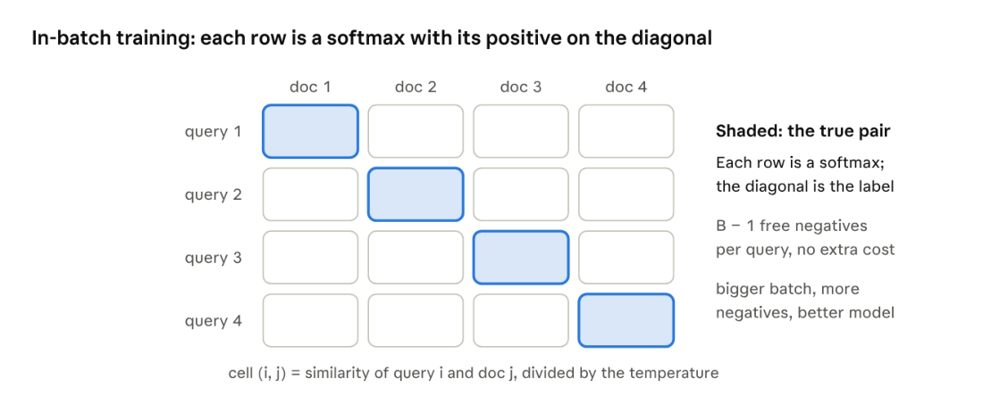

# 29 · Embeddings and representation learning

Part IX · Retrieval and agents. Assumes Chapter 10 (transformers). Embeddings power retrieval (Chapter 30), RAG (Chapter 31), two-tower recommenders (Chapter 43.4), semantic IDs (Chapter 43.11), clustering and classification (Chapter 41).

## Why it matters

An embedding turns text (or an item, a user, an image) into a vector so that similar things are close. Almost every modern retrieval, recommendation and semantic-matching system depends on embeddings, and their quality often decides the whole system's quality. Interviewers for LLM roles ask how embedding models are trained (contrastive learning), how to adapt them to a domain, how to evaluate them, and how to make them cheap to store and search.

## Key concepts

- **Embedding**: a vector that represents a piece of text, an image or an item so that similar things are close together. [The Illustrated Word2vec](https://jalammar.github.io/illustrated-word2vec/) builds the intuition.
- **Sentence embeddings and bi-encoders**: one encoder maps each text to one vector; search becomes a nearest-neighbour lookup. [Sentence-BERT](https://arxiv.org/abs/1908.10084), [Sentence Transformers documentation](https://www.sbert.net/).
- **Contrastive training and in-batch negatives**: train so matching pairs score higher than all other pairs in the batch (InfoNCE loss, Chapter 12).
- **Similarity measures**: cosine similarity and dot product; normalise vectors to make them equivalent.
- **Benchmarks (MTEB)**: compare embedding models across tasks and languages, then confirm on your own data. [MTEB paper](https://arxiv.org/abs/2210.07316), [MTEB leaderboard](https://huggingface.co/spaces/mteb/leaderboard).
- **Matryoshka embeddings**: vectors whose first dimensions alone still work, so you can truncate to save memory. [Matryoshka Representation Learning](https://arxiv.org/abs/2205.13147).
- **Fine-tuning embeddings**: adapting a model to your domain with pairs from search logs or LLM-generated queries.

## 29.1 From word to sentence embeddings

**Word embeddings** (word2vec, GloVe, fastText, Chapter 8) give one vector per word, regardless of context: "bank" has one vector for rivers and money.

**Contextual embeddings** from transformers give each token a vector that depends on the whole sentence. To embed a sentence or document, **pool** the token vectors:

- **CLS pooling:** use the vector of a special first token. Works when the model was trained that way.
- **Mean pooling:** average token vectors, ignoring padding. A robust default for sentence-transformers models.
- **Last-token pooling:** for decoder-based embedding models, the last token has seen the whole input.

```python
import torch

def mean_pool(token_embeddings, attention_mask):
    """token_embeddings: (B, T, d); attention_mask: (B, T) with 1 for real tokens."""
    mask = attention_mask.unsqueeze(-1).float()
    return (token_embeddings * mask).sum(1) / mask.sum(1).clamp(min=1e-9)
```

**Why not just use a raw pretrained model?** Mean-pooled embeddings from a model trained only on masked language modelling are poor for similarity: the vectors cluster in a narrow cone (anisotropy) and do not reflect semantic similarity well. Sentence-BERT (Reimers and Gurevych, 2019) showed that fine-tuning the encoder with a similarity objective on sentence pairs fixes this. Every good embedding model today is trained contrastively.

**Similarity:** cosine similarity, or dot product on L2-normalised vectors (the same thing). Normalise at indexing and at query time, consistently.

## 29.2 Contrastive learning and InfoNCE

**Idea.** Pull matching pairs together, push non-matching pairs apart. Training data are pairs that should be close: (question, answer passage), (query, clicked product), (title, body), (sentence, its translation), (merchant name, its category description).

**InfoNCE** (also called the multiple negatives ranking loss) treats each query as a classification over the batch: which of the B documents is its partner?



*in-batch contrastive training · a batch of 4 pairs*

`L = − (1/B) Σᵢ log [ exp(sim(qᵢ, dᵢ)/τ) / Σⱼ exp(sim(qᵢ, dⱼ)/τ) ]`

```python
import torch.nn.functional as F

def info_nce(q, d, temperature=0.05, symmetric=True):
    q, d = F.normalize(q, dim=-1), F.normalize(d, dim=-1)
    logits = q @ d.T / temperature                     # (B, B) similarity matrix
    labels = torch.arange(len(q))                       # the positive is on the diagonal
    loss = F.cross_entropy(logits, labels)              # query -> doc
    if symmetric:
        loss = (loss + F.cross_entropy(logits.T, labels)) / 2   # doc -> query as well
    return loss
```

**Temperature τ** controls how sharp the softmax is: small values (0.01–0.1) focus on the hardest negatives and are standard. It is sometimes learned (as in CLIP).

**Batch size matters.** Each query gets B − 1 negatives for free, so larger batches usually train better embedding models. Tricks to grow the effective batch: gradient caching, memory banks or queues of past embeddings (MoCo), and cross-device gathering of negatives.

**The same loss trains** CLIP (image-text pairs), DPR (Chapter 30.3), two-tower recommenders (Chapter 43.4, with the logQ correction for popularity), and modern text embedding models (E5, BGE, GTE families), typically in two stages: weakly supervised pre-training on hundreds of millions of noisy pairs mined from the web, then fine-tuning on high-quality labelled pairs with hard negatives.

**What the temperature does to the gradient.** In InfoNCE each negative pushes the query away from it with a weight equal to its softmax probability. So the temperature decides which negatives the model learns from:


*One query with a positive at cosine 0.8, 5 hard negatives at 0.60–0.75 and 250 easy ones around 0.3. At τ = 0.05 the 5 hard negatives receive 82% of the push-away; at τ = 0.3 the easy majority dominates.*

Two consequences:

- **Low temperature is a built-in form of hard-negative mining.** It concentrates learning on the confusable pairs, which is what retrieval needs. This is why values near 0.05 work well.
- **Low temperature also amplifies label noise.** If a "hard negative" is really a relevant passage (the false-negative trap below), a low temperature makes it the main thing the model learns from. Mined negatives and a low temperature need the filtering of 29.3 together.

## 29.3 Hard negatives

Random in-batch negatives are mostly easy ("refund policy" vs "pizza menu"). The model learns more from **hard negatives:** passages that look relevant but are not ("refund policy for partners" for a customer question).

**Mining them:** retrieve the top results for each query with BM25 or the current model, and take high-ranked results that are not labelled positive. Add one to a few per query as extra columns in the similarity matrix.

**The false-negative trap.** Unlabelled is not irrelevant: many mined "negatives" actually answer the query, because nobody labelled every relevant passage. Training against them teaches the model to push away correct answers. Mitigations:

- Skip the very top results (rank 1–3) and sample from further down (for example ranks 10–50).
- Filter with a cross-encoder: drop candidates it scores close to or above the positive.
- Use a margin: only keep negatives scoring below the positive by some amount.
- Re-mine with the improved model and repeat (curriculum).

Hard-negative mining is often the single biggest lever when fine-tuning an embedding model for a domain.

## 29.4 Fine-tuning an embedding model

**When it is worth it:** your domain has its own vocabulary (dish names, internal product terms, transliterated Arabic), off-the-shelf models lose to BM25 on your evaluation set, or similarity means something specific in your product (two restaurants are "similar" if the same customers order from both, not if their descriptions sound alike).

**Recipe:**

1. **Evaluation set first:** real queries with labelled relevant items, plus a baseline table (BM25, two or three off-the-shelf models). Chapter 30.9.
2. **Training pairs:** from logs (query → clicked or ordered item), from structure (title ↔ body, question ↔ accepted answer), from LLM-generated questions for your documents (review them), from human labels.
3. **Hard negatives** mined and filtered (29.3).
4. **Train** with in-batch negatives, the largest batch you can fit, a small learning rate (around 1e-5 to 5e-5), one to a few epochs.
5. **Evaluate** against the baselines on the held-out set, per segment and language; check that general ability did not collapse (a few out-of-domain queries).
6. **Re-index everything** with the new model (Chapter 30.5).

```python
from datasets import Dataset
from sentence_transformers import SentenceTransformer, losses
from sentence_transformers.trainer import SentenceTransformerTrainer
from sentence_transformers.training_args import SentenceTransformerTrainingArguments

model = SentenceTransformer("intfloat/multilingual-e5-base")
train = Dataset.from_dict({"anchor": queries, "positive": positives, "negative": hard_negatives})
loss = losses.MultipleNegativesRankingLoss(model)          # InfoNCE with in-batch + given negatives
args = SentenceTransformerTrainingArguments(
    output_dir="emb-ft", per_device_train_batch_size=128, learning_rate=2e-5, num_train_epochs=1,
    batch_sampler="no_duplicates")                          # avoid accidental duplicate positives in a batch
SentenceTransformerTrainer(model=model, args=args, train_dataset=train, loss=loss).train()
```

(API as of sentence-transformers 3+; check current docs.) For two-tower recommenders with IDs and features, train in plain PyTorch (Chapter 43.4).

## 29.5 Matryoshka embeddings

Storing 1,024-dimensional float vectors for 100 million items is expensive. **Matryoshka representation learning** (Kusupati et al., 2022) trains embeddings so that their **prefixes** are good embeddings too: the first 64, 128, 256 dimensions each work on their own. The loss is simply the contrastive loss summed over several prefix lengths:

```python
def matryoshka_loss(q, d, dims=(64, 128, 256, 768), temperature=0.05):
    return sum(info_nce(q[:, :k], d[:, :k], temperature) for k in dims) / len(dims)
```

At serving time you choose a size per use: short vectors for a fast first-stage search, full vectors to re-score the shortlist. Without Matryoshka training, truncating hurts badly: on a synthetic test, keeping 64 of 384 dimensions of an ordinary embedding kept only 31% of the true top-10 neighbours. Several current embedding models and APIs are trained this way and let you request a smaller dimension.

## 29.6 Quantising embeddings

Compression is the other route to cheap storage and fast search:

```python
import numpy as np

def int8_quantize(X):
    scale = np.abs(X).max(axis=0) / 127.0                  # per-dimension scale
    return np.round(X / scale).astype(np.int8), scale

def binary_quantize(X):
    return np.packbits(X > 0, axis=1)                      # 1 bit per dimension

def hamming_topk(q_bits, X_bits, k):
    dist = np.unpackbits(np.bitwise_xor(X_bits, q_bits), axis=1).sum(1)
    return np.argsort(dist, kind="stable")[:k]
```

On 20,000 clustered 384-dimensional unit vectors (recall@10 against exact float search):

| Representation | Memory vs float32 | Recall@10 |
|---|---|---|
| float32 | 100% | 1.00 |
| int8 | 25% | 0.98 |
| Binary (sign bits), Hamming search | 3% | 0.37 |
| Binary search for top 100, then re-score with float vectors | 3% in memory (floats on disk) | 1.00 |

The pattern "cheap approximate search, then exact re-scoring of a short list" recurs everywhere (PQ in Chapter 30.4, Matryoshka above). Real data is harder than this synthetic set; always measure on your own.

## 29.7 Multilingual embeddings

Multilingual models map text in different languages into one space, so an Arabic query can retrieve an English document. They are trained with translation pairs and multilingual contrastive data, or distilled from an English teacher into a multilingual student (Reimers and Gurevych, 2020).

What to check for the Gulf or Spain: quality per language (often weaker for Arabic than English); **cross-lingual** retrieval (Arabic query, English document) separately from monolingual; transliterated text ("shawerma", Arabizi), which many models handle poorly; and code-switching within one query. A shared multilingual space can also mix languages unhelpfully, ranking a same-language mediocre match above a better cross-language one; language-aware filters or boosts help.

## 29.8 Benchmarks and your own evaluation

**MTEB** (Massive Text Embedding Benchmark) compares models across many tasks (retrieval, classification, clustering, re-ranking, semantic similarity) and languages, and its leaderboard is the usual starting shortlist. Its limits: average scores mix very different tasks; some models are trained on data close to benchmark sets; and none of it is your data.

So: shortlist from MTEB (filtered to retrieval tasks and your languages), then compare three to five candidates on your own evaluation set, with latency, dimension, cost per million tokens (for APIs) and licence in the table. A model ten places lower on MTEB often wins on your data, and a fine-tuned small model often beats a large general one.

## 29.9 LLM-based embedders

The strongest general-purpose embedding models are now built on decoder LLM backbones (often 1–8B parameters) rather than BERT-sized encoders: take a pretrained LLM, enable bidirectional attention or use the last token's (or mean-pooled) hidden state, and train contrastively on large mixtures of retrieval, classification and clustering data, often synthetic, with task instructions prepended to queries ("Represent this question for retrieving supporting documents: ..."). MMTEB, the massively multilingual successor to MTEB, covers hundreds of tasks across many languages. Trade-offs: much higher quality on hard and multilingual retrieval, but larger vectors and slower encoding, which matters at index-build time and for latency. Matryoshka training (29.5) and quantisation (29.6) offset the storage cost. For representation analysis in research (comparing what different layers or models encode), see centred kernel alignment and probing in Chapter 26.

## 29.10 A worked choice: an embedding model for 2 million product descriptions

A marketplace wants semantic search over 2 million product descriptions in Arabic and English. The work goes in five steps.

1. **Build the evaluation set.**
   - Take 600 real search queries from logs, stratified by language and by head and tail.
   - For each one, pool the top 20 results of BM25 and two candidate models and have annotators label relevance.
   - Pooling keeps labelling cheap and limits the bias towards any one system.
   - Keep 200 queries aside as a test set.
2. **Compare baselines.** Score recall@10 and nDCG@10 for each system (Chapter 30.9), with bootstrap intervals over queries.
   - On 400 queries, an interval for recall@10 is typically ±3–4 points, so treat smaller differences as ties.
   - Look at the per-language and tail slices before the averages: a model that wins on English head queries and loses on Arabic tail queries is the wrong choice for this product.
3. **Price the storage.**
   - At 1,024 float32 dimensions, 2M vectors take 8.2 GB.
   - A Matryoshka model truncated to 256 dimensions in int8 takes 0.5 GB, small enough for one modest machine with room to grow.
   - Measure the recall cost of truncation on the evaluation set; do not assume it.
4. **Decide whether to fine-tune.** If the best off-the-shelf model trails BM25 on tail queries (product codes, brand names, transliterated dish names), first try hybrid search (Chapter 30.6). It is cheaper and often closes most of the gap. Fine-tune only if hybrid search still falls short:
   - pairs from query logs, with hard negatives mined from ranks 10–50 and filtered by a cross-encoder;
   - τ = 0.05 and the largest batch that fits;
   - one epoch, then evaluation against the same baselines.
5. **Plan the re-index.**
   - Embedding 2M descriptions of about 150 tokens is 300M tokens, a few GPU-hours for a base-size model.
   - Version the index with the model name, so queries are never embedded by a different model from the documents.

The decision is then written as a table: model, dimensions, precision, recall@10 overall and per slice, index size and query latency. That table is what the team will check again when a new model is released.

## Pitfalls

- **Using a raw pretrained encoder** (masked LM only) for similarity without contrastive training.
- **Picking a model from the MTEB average** without testing on your data and languages.
- **Mismatched pooling, prefixes or normalisation** between the model's training and your usage.
- **Mined negatives that are actually positives.**
- **Small batches with in-batch negatives,** then concluding contrastive training does not work.
- **Truncating embeddings that were not Matryoshka-trained.**
- **Comparing vectors from different models** or model versions.
- **Ignoring cross-lingual and transliteration cases** in multilingual products.
- **Fine-tuning without checking general ability** on a few out-of-domain queries.

## Interview questions

Questions 1–4 basic, 5–9 intermediate, 10–12 senior.

**1. How are sentence embeddings produced from a transformer?** Pool token vectors (mean pooling over real tokens, CLS, or last token for decoder models) from an encoder that was fine-tuned contrastively so that cosine similarity reflects meaning.

**2. What is contrastive learning?** Training with pairs that should be close and negatives that should be far, typically with the InfoNCE loss: a softmax over similarities where the true pair is the target class.

**3. Why does batch size matter for in-batch negatives?** Each query's negatives are the other items in the batch; larger batches give more and harder negatives and better gradient signal.

**4. Cosine similarity vs dot product?** Identical on L2-normalised vectors. Unnormalised dot product also rewards vector length, which some models use (for example to encode popularity); use what the model was trained with.

**5. What is the temperature in InfoNCE?** A divisor on similarities before the softmax; low temperature sharpens the distribution, focusing the gradient on the hardest negatives.

**6. How do you mine hard negatives safely?** Retrieve top candidates with BM25 or the current model, skip the very top ranks, filter with a cross-encoder or margin to remove false negatives, and re-mine as the model improves.

**7. What are Matryoshka embeddings?** Embeddings trained with the loss applied to several prefix lengths, so truncated vectors remain useful, allowing a choice of size per stage (short for first-pass search, full for re-scoring).

**8. How would you reduce embedding storage 30× with little quality loss?** Binary or product quantisation for the first-stage search with full-precision re-scoring of a short list; int8 for a 4× reduction with very small loss; Matryoshka truncation if the model supports it. Measure recall at each step.

**9. How do you choose an embedding model for a new product?** Shortlist from MTEB filtered by task and language, then evaluate on your own labelled queries with retrieval metrics, plus latency, dimension, cost and licence; consider fine-tuning the best small model.

**10. Design embeddings for restaurant similarity at a delivery company.** Define similarity by behaviour (co-ordering, substitution) as well as content; train a two-tower or item-item contrastive model on co-order pairs with content features (menu text embeddings, cuisine, price) for cold start; logQ correction for popularity; evaluate on held-out substitution and "also ordered" pairs; Matryoshka or PQ for cheap serving.

**11. Your fine-tuned embedding model beats the base model offline but RAG answers did not improve. Why?** The RAG bottleneck may be elsewhere (chunking, re-ranking, generation); the evaluation set may differ from real questions; gains may sit in queries that were already answered well; the index may not have been rebuilt consistently. Check end-to-end and per-stage metrics.

**12. How would you build a multilingual retrieval system for Arabic and English?** A multilingual embedding model plus language-specific BM25; per-language and cross-lingual evaluation sets; transliteration variants; fine-tuning on translated and code-switched pairs if needed; language-aware boosting; native-speaker review of failures.

## Practice

1. **InfoNCE from scratch:** implement the loss and train a tiny bi-encoder (a bag-of-embeddings encoder is fine) on question-answer pairs; plot recall@10 as batch size grows.
2. **Fine-tune a real model:** take a public question-answer dataset in your domain style (for example a support FAQ), fine-tune a small sentence-transformers model with and without hard negatives, and compare recall@10 with the base model and BM25.
3. **Matryoshka:** train with and without the Matryoshka loss and plot recall against dimension.
4. **Quantisation:** reproduce the int8 and binary-with-rescoring table on real embeddings of 100,000 passages.
5. **Multilingual:** evaluate two multilingual models on Arabic-English or Spanish-English pairs, monolingual and cross-lingual.
6. **MTEB:** run one retrieval task from MTEB for two models locally and compare with the leaderboard.

## Read next

- Reimers and Gurevych, *Sentence-BERT* (2019), and *Making Monolingual Sentence* *Embeddings Multilingual using Knowledge Distillation* (2020).
- van den Oord et al., *Representation Learning with Contrastive Predictive Coding* (InfoNCE, 2018); Radford et al., *CLIP* (2021).
- Wang et al., *Text Embeddings by Weakly-Supervised Contrastive Pre-training* (E5, 2022).
- Kusupati et al., *Matryoshka Representation Learning* (NeurIPS 2022).
- Muennighoff et al., *MTEB: Massive Text Embedding Benchmark* (2022).
- The sentence-transformers documentation: training overview, losses, and the posts on embedding quantisation.
- *Hands-On Large Language Models* (Alammar and Grootendorst): the chapter on creating and fine-tuning text embedding models.

**Links:** [Sentence Transformers documentation](https://www.sbert.net/) · [MTEB leaderboard](https://huggingface.co/spaces/mteb/leaderboard) · [Sentence-BERT](https://arxiv.org/abs/1908.10084). Other titles above can be found by searching their title.

## Done when

You can explain pooling and why contrastive training is needed for good sentence embeddings.

You can write symmetric InfoNCE from memory and explain temperature and batch size. You can mine hard negatives and avoid false negatives.

You can fine-tune an embedding model and evaluate it against BM25 and baselines. You can explain Matryoshka embeddings and embedding quantisation, with the re-scoring pattern.

You can evaluate multilingual and cross-lingual retrieval. You can choose an embedding model with MTEB and your own evaluation.

---

[← 28 · Safety and responsible AI](28-safety-and-responsible-ai.md) · [Contents](../README.md#contents) · [30 · Information retrieval →](30-information-retrieval.md)
