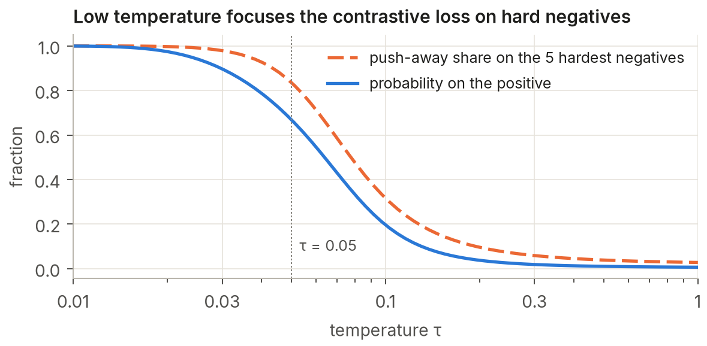

# 29 · Embeddings and representation learning

Part IX · Retrieval and agents. Assumes Chapter 10 (transformers). Embeddings power retrieval (Chapter 30), RAG (Chapter 31), two-tower recommenders (Chapter 43.4), semantic IDs (Chapter 43.11), clustering and classification (Chapter 41).

## Why it matters

An embedding turns text (or an item, a user, an image) into a vector so that similar things are close. Almost every modern retrieval, recommendation and semantic-matching system depends on embeddings, and their quality often decides the whole system's quality. Interviewers for LLM roles ask how embedding models are trained (contrastive learning), how to adapt them to a domain, how to evaluate them, and how to make them cheap to store and search.

What separates a strong answer is the mechanism. "Use hard negatives and a big batch" is the keyword answer; the strong one derives the InfoNCE gradient, shows that each negative is pushed away in proportion to its softmax probability, and uses that one line to explain why low temperature acts as hard-negative mining, why false negatives are so damaging, why batch size bounds what the loss can learn, and why distilling from a cross-encoder works. This chapter builds that line first and then reuses it.

The chapter starts with the step from word vectors to vectors for whole texts (29.1), then explains how modern embedding models are trained: contrastive learning with in-batch negatives (29.2), and the hard negatives that make the difference between a good model and a great one (29.3). Section 29.4 covers when and how to fine-tune one on your own data. Sections 29.5 and 29.6 deal with cost at scale, shrinking vectors by truncating them or quantising them, and 29.7 with multilingual text. The chapter ends with how to choose a model from benchmarks and your own evaluation (29.8), the new generation of LLM-based embedders (29.9), and a worked model choice for a real catalogue (29.10).

The idea under all of it is that an embedding model is trained to make one geometric relationship true: texts that should match are close, and texts that should not are far apart. Everything else, from the choice of negatives to the evaluation set, decides which texts count as "should match", and that is where most of the quality comes from.

## Key concepts

- **Embedding**: a vector that represents a piece of text, an image or an item so that similar things are close together. [The Illustrated Word2vec](https://jalammar.github.io/illustrated-word2vec/) builds the intuition.
- **Sentence embeddings and bi-encoders**: one encoder maps each text to one vector; search becomes a nearest-neighbour lookup. [Sentence-BERT](https://arxiv.org/abs/1908.10084), [Sentence Transformers documentation](https://www.sbert.net/).
- **Contrastive training and in-batch negatives**: train so matching pairs score higher than all other pairs in the batch (InfoNCE loss, derived in 29.2).
- **Similarity measures**: cosine similarity and dot product; normalise vectors to make them equivalent.
- **Benchmarks (MTEB)**: compare embedding models across tasks and languages, then confirm on your own data. [MTEB paper](https://arxiv.org/abs/2210.07316), [MTEB leaderboard](https://huggingface.co/spaces/mteb/leaderboard).
- **Matryoshka embeddings**: vectors whose first dimensions alone still work, so you can truncate to save memory. [Matryoshka Representation Learning](https://arxiv.org/abs/2205.13147).
- **Fine-tuning embeddings**: adapting a model to your domain with pairs from search logs or LLM-generated queries.

## 29.1 From word to sentence embeddings

Retrieval needs one vector per query and per document, compared with a single dot product. Word embeddings give one vector per word, with no context, and averaging them loses order and nuance. The progress from word vectors to today's sentence embedders is the story of learning a single vector that captures the meaning of a whole text.

**Word embeddings** (word2vec, GloVe, fastText, Chapter 8) give one vector per word, regardless of context: "bank" has one vector for rivers and money.

**Contextual embeddings** from transformers give each token a vector that depends on the whole sentence. To embed a sentence or document, **pool** the token vectors:

- **CLS pooling:** use the vector of a special first token. Works when the model was trained that way.
- **Mean pooling:** average token vectors, ignoring padding. A robust default for sentence-transformers models.
- **Last-token pooling:** for decoder-based embedding models, the last token has seen the whole input. Under causal attention, token t attends only to tokens 1…t, so the first tokens' vectors know nothing about the rest of the text and a mean over positions is dominated by partial views; only the final position (often an appended end-of-sequence token) summarises everything. This is why decoder embedders use last-token pooling or switch to bidirectional attention (29.9).

```python
import torch

def mean_pool(token_embeddings, attention_mask):
    """token_embeddings: (B, T, d); attention_mask: (B, T) with 1 for real tokens."""
    mask = attention_mask.unsqueeze(-1).float()
    return (token_embeddings * mask).sum(1) / mask.sum(1).clamp(min=1e-9)
```

**Why not just use a raw pretrained model?** Mean-pooled embeddings from a model trained only on masked language modelling are poor for similarity: the vectors cluster in a narrow cone (anisotropy) and do not reflect semantic similarity well. Sentence-BERT (Reimers and Gurevych, 2019) showed that fine-tuning the encoder with a similarity objective on sentence pairs fixes this. Every good embedding model today is trained contrastively.

**Where the anisotropy comes from.** Language-model training pushes every hidden state to predict tokens through the same output embedding matrix. Frequent tokens receive large, consistent gradients, so the representations share a few dominant directions related to word frequency, and rare tokens are pushed off in a common direction too (Gao et al., 2019, called this representation degeneration). The result is a large common component: the average cosine between two unrelated sentences can be 0.6 or more, so all similarities are squeezed into a narrow band and ranking is driven by the frequency direction, not meaning. A cheap baseline fix is **whitening**: subtract the mean vector and rescale by the inverse square root of the covariance (or simply drop the top few principal components), which spreads the vectors out. Whitening helps raw models noticeably but does not reach contrastively trained ones; contrastive training fixes the same problem from the loss side (29.2, alignment and uniformity).

**Similarity:** cosine similarity, or dot product on L2-normalised vectors (the same thing). Normalise at indexing and at query time, consistently.

## 29.2 Contrastive learning and InfoNCE

An embedding model has no labels of the form "this vector is right". What it has are pairs that should match: (question, answer passage), (query, clicked product), (title, body), (sentence, its translation), (image, caption). Contrastive learning turns those pairs into a training signal by asking the model to pick the true partner out of a crowd, which forces matching pairs closer together than non-matching ones.

**Idea.** Pull matching pairs together, push non-matching pairs apart. Training data are pairs that should be close, and the other items in the batch serve as the non-matching ones for free.

**InfoNCE** (also called the multiple negatives ranking loss) treats each query as a classification over the batch: which of the B documents is its partner?


*In-batch contrastive training with a batch of 4 pairs. The 4 × 4 matrix holds the similarity of every query with every document; the diagonal entries are the true pairs (the targets), and the 3 off-diagonal entries in each row are that query's in-batch negatives.*

$$
\mathcal{L} = -\dfrac{1}{B}\sum_{i=1}^{B}\log\dfrac{\exp(\mathrm{sim}(q_i,d_i)/\tau)}{\sum_{j=1}^{B}\exp(\mathrm{sim}(q_i,d_j)/\tau)}
$$

Here qᵢ is the embedding of the i-th query in a batch of B pairs and dᵢ the embedding of its matching document; dⱼ for j ≠ i are the other documents in the batch, used as negatives. sim is cosine similarity (a dot product of L2-normalised vectors), and τ is the temperature, a positive number that divides every similarity before the softmax. Each term is an ordinary cross-entropy: the row of similarities is a vector of logits, and the correct class is the diagonal entry. The loss is the average over the batch of −log of the probability the model gives to the true partner.

```python
import torch.nn.functional as F

def info_nce(q, d, temperature=0.05, symmetric=True):
    q, d = F.normalize(q, dim=-1), F.normalize(d, dim=-1)
    logits = q @ d.T / temperature                     # (B, B) similarity matrix
    labels = torch.arange(len(q))                       # the positive is on the diagonal
    loss = F.cross_entropy(logits, labels)              # query -> doc
    if symmetric:
        loss = (loss + F.cross_entropy(logits.T, labels)) / 2   # doc -> query as well
    return loss
```

**Temperature τ** controls how sharp the softmax is: small values (0.01–0.1) focus on the hardest negatives and are standard. It is sometimes learned (as in CLIP).

**Batch size matters.** Each query gets B − 1 negatives for free, so larger batches usually train better embedding models. Tricks to grow the effective batch: gradient caching, memory banks or queues of past embeddings (MoCo), and cross-device gathering of negatives.

**The same loss trains** CLIP (image-text pairs), DPR (Chapter 30.3), two-tower recommenders (Chapter 43.4, with the logQ correction for popularity), and modern text embedding models (E5, BGE, GTE families), typically in two stages: weakly supervised pre-training on hundreds of millions of noisy pairs mined from the web, then fine-tuning on high-quality labelled pairs with hard negatives.

### The gradient: who gets pushed, and how hard

Everything practical about contrastive training (temperature, hard negatives, false negatives, batch size) follows from one derivative. Fix a query i and write sᵢⱼ = sim(qᵢ, dⱼ) for its similarities and pᵢⱼ for the softmax probability it assigns to document j:

$$
p_{ij} = \dfrac{\exp(s_{ij}/\tau)}{\sum_{k=1}^{B}\exp(s_{ik}/\tau)}
$$

The query's loss is Lᵢ = −log pᵢᵢ = −sᵢᵢ/τ + log Σₖ exp(sᵢₖ/τ). Differentiating with respect to one similarity sᵢⱼ, the first term contributes −1/τ only when j = i, and the log-sum-exp contributes pᵢⱼ/τ, the softmax weight. Together:

$$
\dfrac{\partial L_i}{\partial s_{ij}} = \dfrac{p_{ij} - \mathbb{1}[j=i]}{\tau}
$$

This is the softmax-cross-entropy gradient (Chapter 5) divided by τ. Read it in two parts. The positive is pulled closer with weight (1 − pᵢᵢ)/τ: hard when the model is unsure, and fading to nothing once the positive wins clearly. Each negative j is pushed away with weight pᵢⱼ/τ, its own softmax probability. For dot-product similarity, sᵢⱼ = qᵢ · dⱼ, the chain rule gives the update to the query vector as a weighted sum of documents, ∂Lᵢ/∂qᵢ = (1/τ)[Σⱼ pᵢⱼ dⱼ − dᵢ]: move towards the positive and away from the probability-weighted average of all documents.

**A worked example.** A query has a positive at cosine 0.8, one hard negative at 0.7 and one easy negative at 0.3. At τ = 0.05 the logits are 16, 14 and 6, so p = [0.881, 0.119, 0.000] and the gradients ∂L/∂s are [−2.38, +2.38, 0.00]: the hard negative gets all of the push, the easy one none. At τ = 0.3, p = [0.525, 0.376, 0.099] and the gradients are [−1.58, +1.25, +0.33]: the easy negative now gets about a quarter of the hard one's push, and the loss is higher (0.645 against 0.127) even though the geometry is identical.

**What the temperature does to the gradient.** Because each negative's push is its softmax probability, the temperature decides which negatives the model learns from:



*One query with a positive at cosine 0.8, 5 hard negatives at 0.60–0.75 and 250 easy ones around 0.3. At τ = 0.05 the 5 hard negatives receive 82% of the push-away; at τ = 0.3 the easy majority dominates.*

Three consequences, each from the gradient formula:

- **Low temperature is a built-in form of hard-negative mining.** It concentrates learning on the confusable pairs, which is what retrieval needs. This is why values near 0.05 work well; E5, for example, trains at 0.01. CLIP learns τ, parameterised as a logit scale initialised at 1/0.07 and clamped at 100, so τ never falls below 0.01.
- **Low temperature also amplifies label noise.** If a "hard negative" is really a relevant passage (the false-negative trap in 29.3), it has a high similarity, therefore a high pᵢⱼ, therefore the largest push: a low temperature makes it the main thing the model learns from. Mined negatives and a low temperature need the filtering of 29.3 together.
- **Too low and training becomes unstable.** As τ → 0 the softmax approaches a hard max: almost all gradient flows through one negative per query, the effective number of negatives per step collapses to one, and the 1/τ factor makes steps large and noisy. Too high (τ ≈ 1) and all negatives are pushed almost equally, so cosine similarities live in a narrow range and the model learns only coarse topic separation.

### Why batch size matters: the mutual-information bound

The name InfoNCE comes from its link to mutual information. van den Oord et al. (2018) showed that for a batch with one positive and B − 1 negatives,

$$
I(q;\,d) \geq \log B - \mathcal{L}
$$

where I(q; d) is the mutual information between a query and its matching document and 𝓛 is the InfoNCE loss in nats. The intuition: the loss is a cross-entropy over B choices, and a classifier that picks the partner from B candidates can never have a loss below 0, so the bound can never certify more than log B nats. With B = 256 that ceiling is 5.55 nats; with B = 4,096 it is 8.32. A small batch caps how much the objective can reward fine distinctions: once the positive beats a few easy negatives, the loss is near zero and the gradient fades. Larger batches keep the task hard. In practice, the larger effective batch matters more than the bound's exact value, which is loose.

Bigger batches have a cost beyond memory. If any given document is a true but unlabelled match for a query with probability f, the chance that a batch of B contains at least one false negative for that query is 1 − (1 − f)^(B−1). With f = 10⁻⁴, that is 2.5% at B = 256, 34% at B = 4,096 and 96% at B = 32,768. Very large batches on corpora with many near-duplicates need deduplication or false-negative filtering. **GradCache** (Gao et al., 2021) removes the memory limit on B: it computes all embeddings without storing activations, computes the loss and the gradient with respect to each embedding, then re-runs each sub-batch forward with gradients and back-propagates the cached embedding gradients. Across devices, embeddings are all-gathered so that every query sees every device's documents as negatives.

### What contrastive training does to the geometry: alignment and uniformity

Wang and Isola (2020) split the InfoNCE objective, in the limit of many negatives, into two terms on the unit sphere. **Alignment**: matching pairs should be close, measured by the expected squared distance ‖f(x) − f(y)‖² over positive pairs. **Uniformity**: embeddings of all inputs should spread evenly over the sphere, measured by log E[exp(−2‖f(x) − f(y)‖²)] over random pairs, which is lowest when vectors are spread out. The positive term of the loss produces alignment and the log-sum-exp over negatives produces uniformity. This is the geometric reason contrastive training cures the anisotropy of 29.1: a narrow cone has terrible uniformity, and the negatives push it apart. The two metrics are cheap to compute on held-out data and make good diagnostics: a model with good alignment and poor uniformity has collapsed towards a common direction; the reverse has learnt to spread inputs without matching them.

## 29.3 Hard negatives

In-batch negatives are free, but most of them are easy: a question about refunds is trivially different from a passage about delivery zones, and by the gradient formula in 29.2 an easy negative with a tiny softmax probability contributes almost nothing. A model trained only on easy negatives learns coarse topic matching and fails exactly where search is hard, between passages on the same topic that answer different questions. **Hard negatives** supply those near-misses during training: passages that look relevant but are not ("refund policy for partners" for a customer's refund question).

**Mining them:** retrieve the top results for each query with BM25 or the current model, and take high-ranked results that are not labelled positive. Add one to a few per query as extra columns in the similarity matrix. With h mined negatives per query, the documents in a step are the B positives plus B·h mined negatives, and every query is scored against all of them:

$$
\mathcal{L}_i = -\log\dfrac{\exp(s_{ii}/\tau)}{\sum_{j=1}^{B(1+h)}\exp(s_{ij}/\tau)}
$$

Each query's denominator now has B(1 + h) terms: its own positive, the other B − 1 positives, its own h mined negatives, and the other queries' mined negatives, which act as extra semi-hard negatives. With B = 128 and h = 1 the matrix is 128 × 256. This is what `MultipleNegativesRankingLoss` computes when the dataset has a "negative" column (29.4). Its `batch_sampler="no_duplicates"` option makes sure no two pairs in a batch share the same text: if the same passage appeared as the positive for two queries, each query would see its own correct answer in another column, labelled as a negative, and the gradient would push it away.

**The false-negative trap.** Unlabelled is not irrelevant: many mined "negatives" actually answer the query, because nobody labelled every relevant passage. Training against them teaches the model to push away correct answers, and because they score high, the gradient pushes them hardest. Mitigations:

- Skip the very top results (rank 1–3) and sample from further down (for example ranks 10–50).
- Filter with a cross-encoder: drop candidates it scores close to or above the positive.
- Use a margin: only keep negatives scoring below the positive by some amount.
- Re-mine with the improved model and repeat (curriculum; ANCE, Xiong et al., 2020, re-mines from an asynchronously refreshed index during training).

Hard-negative mining is often the single biggest lever when fine-tuning an embedding model for a domain.

### Distilling from a cross-encoder

Hard negatives treat relevance as binary, but it is graded: a mined passage can be half-relevant. A cross-encoder (Chapter 30.7), which reads query and passage together, scores relevance far better than a bi-encoder but is too slow for first-stage retrieval. **Distillation** trains the bi-encoder (the student) to reproduce the cross-encoder's (the teacher's) judgements, which transfers graded relevance and sidesteps the false-negative problem: a mislabelled "negative" that the teacher scores highly is simply learnt as relevant. It is how most strong retrievers are trained, and the usual follow-up to "how do you mine hard negatives?".

Two losses are standard. **MarginMSE** (Hofstätter et al., 2020) matches score *differences* on triples of a query, a positive and a negative, so the student does not have to match the teacher's scale:

$$
\mathcal{L}_{\mathrm{MarginMSE}} = \left[(s^{S}_{+} - s^{S}_{-}) - (s^{T}_{+} - s^{T}_{-})\right]^2
$$

where s⁺ and s⁻ are the scores of the positive and the negative, S denotes the student and T the teacher. If the teacher scores the pair 9.0 and 2.0 (margin 7) and the student 0.80 and 0.70 (margin 0.1), the loss is (0.1 − 7)² = 47.6 before any rescaling of the student's scores; in practice the student's similarities are multiplied by a constant so the two scales are comparable. **KL distillation** instead takes, for each query, a list of candidates (the positive and several mined passages), turns both models' scores into softmax distributions, and minimises KL(teacher ‖ student) (Chapter 1.6). It teaches the whole ranking over the list. Both need the teacher's scores computed once offline over (query, candidate) lists, which is cheap compared with training the teacher.

## 29.4 Fine-tuning an embedding model

General-purpose embedding models are trained on web data and public datasets. If your users search with vocabulary, abbreviations or notions of relevance that those sources do not contain, a general model will rank poorly no matter how large it is. Fine-tuning on your own pairs is often the largest single improvement available, and it is cheap.

**When it is worth it:** your domain has its own vocabulary (internal product terms, codes, abbreviations, transliterated names), off-the-shelf models lose to BM25 on your evaluation set, or similarity means something specific in your product (two items are "similar" if the same users choose both, not if their descriptions sound alike).

**Recipe:**

1. **Evaluation set first:** real queries with labelled relevant items, plus a baseline table (BM25, two or three off-the-shelf models). Chapter 30.9.
2. **Training pairs:** from logs (query → clicked or ordered item), from structure (title ↔ body, question ↔ accepted answer), from LLM-generated questions for your documents (review them), from human labels.
3. **Hard negatives** mined and filtered (29.3).
4. **Train** with in-batch negatives, the largest batch you can fit, a small learning rate (around 1e-5 to 5e-5), one to a few epochs.
5. **Evaluate** against the baselines on the held-out set, per segment and language; check that general ability did not collapse (a few out-of-domain queries).
6. **Re-index everything** with the new model (Chapter 30.5).

```python
from datasets import Dataset
from sentence_transformers import SentenceTransformer, losses
from sentence_transformers.trainer import SentenceTransformerTrainer
from sentence_transformers.training_args import SentenceTransformerTrainingArguments

model = SentenceTransformer("intfloat/multilingual-e5-base")
train = Dataset.from_dict({"anchor": queries, "positive": positives, "negative": hard_negatives})
loss = losses.MultipleNegativesRankingLoss(model)          # InfoNCE with in-batch + given negatives
args = SentenceTransformerTrainingArguments(
    output_dir="emb-ft", per_device_train_batch_size=128, learning_rate=2e-5, num_train_epochs=1,
    batch_sampler="no_duplicates")                          # avoid accidental duplicate positives in a batch
SentenceTransformerTrainer(model=model, args=args, train_dataset=train, loss=loss).train()
```

(API as of sentence-transformers 3+; check current docs.) With a "negative" column the loss scores each query against B(1 + h) documents, as in 29.3, and `no_duplicates` keeps the same text from appearing twice in a batch, which would otherwise turn a correct answer into a labelled negative. Chapter 30.3 points here rather than repeating the code. For two-tower recommenders with IDs and features, train in plain PyTorch (Chapter 43.4).

## 29.5 Matryoshka embeddings

Storing 1,024-dimensional float vectors for 100 million items is expensive. **Matryoshka representation learning** (Kusupati et al., 2022) trains embeddings so that their **prefixes** are good embeddings too: the first 64, 128, 256 dimensions each work on their own. The loss is simply the contrastive loss summed over several prefix lengths:

```python
def matryoshka_loss(q, d, dims=(64, 128, 256, 768), temperature=0.05):
    return sum(info_nce(q[:, :k], d[:, :k], temperature) for k in dims) / len(dims)
```

Why it works: each prefix length gets its own contrastive loss, so the gradient forces the first dimensions to carry the most discriminative information on their own, the way the leading principal components carry the most variance. The longer prefixes then add finer distinctions.

At serving time you choose a size per use: short vectors for a fast first-stage search, full vectors to re-score the shortlist. Without Matryoshka training, truncating hurts badly: on a synthetic test, keeping 64 of 384 dimensions of an ordinary embedding kept only 31% of the true top-10 neighbours. Several current embedding models and APIs are trained this way and let you request a smaller dimension.

**How far to trust that 31%.** It comes from isotropic Gaussian clusters, where every dimension carries the same amount of information, so dropping five-sixths of them is the worst case. Real embeddings that were not Matryoshka-trained have skewed spectra: a few directions carry much of the variance (29.1), and those directions are spread across all coordinates rather than sitting in the first ones. On a second synthetic set with a decaying spectrum, a common offset and a random rotation (`code/ch29_check.py`), naive truncation to 64 dimensions kept 45% of the top-10 neighbours, and **PCA then truncation** (centre, project on the top 64 principal components, renormalise) kept 71%. Neither number transfers to your model. The lessons that do transfer: never truncate a non-Matryoshka model by coordinate; if you must shrink one, fit PCA on a sample of your corpus and compare it against the Matryoshka models you could switch to, on your evaluation set.

## 29.6 Quantising embeddings

Compression is the other route to cheap storage and fast search:

```python
import numpy as np

def int8_quantize(X):
    scale = np.abs(X).max(axis=0) / 127.0                  # per-dimension scale
    return np.round(X / scale).astype(np.int8), scale

def binary_quantize(X):
    return np.packbits(X > 0, axis=1)                      # 1 bit per dimension

def hamming_topk(q_bits, X_bits, k):
    dist = np.unpackbits(np.bitwise_xor(X_bits, q_bits), axis=1).sum(1)
    return np.argsort(dist, kind="stable")[:k]
```

On 20,000 clustered 384-dimensional unit vectors (recall@10 against exact float search):

| Representation | Memory vs float32 | Recall@10 |
|---|---|---|
| float32 | 100% | 1.00 |
| int8 | 25% | 0.98 |
| Binary (sign bits), Hamming search | 3% | 0.37 |
| Binary search for top 100, then re-score with float vectors | 3% in memory (floats on disk) | 1.00 |

Why each row looks the way it does. int8 keeps 256 levels per dimension, so the rounding error is tiny relative to the gaps between neighbours' scores. Binary keeps only the sign: the Hamming distance between sign vectors estimates the angle between the original vectors (for random hyperplanes through the origin, the probability that a bit differs is θ/π, and on isotropic data the coordinate axes behave like random hyperplanes), but with 384 bits the estimate is noisy, so the top 10 by Hamming distance are only roughly the true top 10. The true neighbours are, however, almost always somewhere in the top 100, which is why re-scoring that shortlist with float vectors recovers nearly everything.

The pattern "cheap approximate search, then exact re-scoring of a short list" recurs everywhere (PQ in Chapter 30.4, Matryoshka above).

**Caveat: these are isotropic synthetic data.** The 0.37 for binary search depends on the data's geometry and does not transfer. Sign bits waste information on real embeddings with a large common component (most vectors share signs on the dominant directions), so centring before binarising helps; on the skewed synthetic set in `code/ch29_check.py`, binary recall was 0.44 raw and 0.47 after centring, and re-scoring the top 100 again recovered about 1.0. On real models, the sentence-transformers quantisation write-up (2024) reported that binary search with float re-scoring kept roughly 90–96% of retrieval quality, depending on the model; models trained with quantisation in mind do better. Always measure on your own embeddings and queries.

## 29.7 Multilingual embeddings

Multilingual models map text in different languages into one space, so an Arabic query can retrieve an English document. They are trained with translation pairs and multilingual contrastive data, or distilled from an English teacher into a multilingual student (Reimers and Gurevych, 2020).

What to check for any multilingual product (for example Arabic and English in the Gulf, or Spanish and English): quality per language (often weaker for lower-resource languages than English); **cross-lingual** retrieval (Arabic query, English document) separately from monolingual; transliterated text ("shawerma", Arabizi written in Latin script), which many models handle poorly; and code-switching within one query. A shared multilingual space can also mix languages unhelpfully, ranking a same-language mediocre match above a better cross-language one; language-aware filters or boosts help.

## 29.8 Benchmarks and your own evaluation

**MTEB** (Massive Text Embedding Benchmark) compares models across many tasks (retrieval, classification, clustering, re-ranking, semantic similarity) and languages, and its leaderboard is the usual starting shortlist. Its limits: average scores mix very different tasks; some models are trained on data close to benchmark sets; and none of it is your data.

So: shortlist from MTEB (filtered to retrieval tasks and your languages), then compare three to five candidates on your own evaluation set, with latency, dimension, cost per million tokens (for APIs) and licence in the table. A model ten places lower on MTEB often wins on your data, and a fine-tuned small model often beats a large general one.

## 29.9 LLM-based embedders

Decoder LLMs have read far more text than BERT-sized encoders and follow instructions, so turning them into embedders is attractive. The obstacle is causal attention: in a decoder, token t sees only tokens 1…t, so no position except the last has read the whole input.

The strongest general-purpose embedding models are now built on decoder LLM backbones (often 1–8B parameters) rather than BERT-sized encoders: take a pretrained LLM, enable bidirectional attention or use the last token's (or mean-pooled) hidden state, and train contrastively on large mixtures of retrieval, classification and clustering data, often synthetic, with task instructions prepended to queries ("Represent this question for retrieving supporting documents: ..."). MMTEB, the massively multilingual successor to MTEB, covers hundreds of tasks across many languages. Trade-offs: much higher quality on hard and multilingual retrieval, but larger vectors and slower encoding, which matters at index-build time and for latency. Matryoshka training (29.5) and quantisation (29.6) offset the storage cost.

**Three recipes for the causal-attention problem.**

- **Keep causal attention and pool the last token.** The final token (usually an appended end-of-sequence token) has attended to everything, so its hidden state is a summary; contrastive fine-tuning teaches the model to put the meaning there. Simple and common: the Qwen3-Embedding family (2025, 0.6B to 8B parameters) uses last-token pooling with instruction-prefixed queries and supports Matryoshka-style smaller dimensions.
- **Switch on bidirectional attention and adapt.** Removing the causal mask lets every token see the whole text, but the model was never trained that way, so its representations are initially poor. **LLM2Vec** (BehnamGhader et al., 2024) fixes this in three steps: enable bidirectional attention, train briefly with **masked next-token prediction** (MNTP: mask some tokens and predict each from the representation at the previous position, which reuses the next-token head), then apply unsupervised contrastive training (SimCSE-style, where two dropout views of the same sentence are the positive pair) before supervised contrastive fine-tuning.
- **Learn the pooling.** **NV-Embed** (Lee et al., 2024) removes the causal mask during contrastive training and replaces mean or last-token pooling with a **latent-attention layer**: the token states attend to a small set of trainable latent vectors, and the output is mean-pooled, which lets the model learn what to summarise.

**Instruction-conditioned queries.** The same document embedding serves different tasks if the *query* carries the task ("Given a web search query, retrieve relevant passages" versus "Classify the sentiment"). Documents are usually embedded without instructions, so the index does not change when you add a task. Using the wrong instruction, or none, for a model trained with them is a silent quality loss, like the missing `query:` prefix in Chapter 30.3.

**Comparing representations in research.** To compare what different layers or models encode, use probing (Chapter 26.3) or **centred kernel alignment** (CKA, Kornblith et al., 2019). Linear CKA takes the two sets of representations of the same n inputs, X (n × d₁) and Y (n × d₂), centres each column, and computes ‖YᵀX‖²_F / (‖XᵀX‖_F ‖YᵀY‖_F), a similarity between 0 and 1 that does not change under rotations or uniform scaling of either representation. It answers "do these two layers organise the inputs alike?" without training anything.

## 29.10 A worked choice: an embedding model for 2 million product descriptions

A marketplace wants semantic search over 2 million product descriptions in Arabic and English. The work goes in five steps.

1. **Build the evaluation set.**
   - Take 600 real search queries from logs, stratified by language and by head and tail.
   - For each one, pool the top 20 results of BM25 and two candidate models and have annotators label relevance.
   - Pooling keeps labelling cheap and limits the bias towards any one system.
   - Keep 200 queries aside as a test set.
2. **Compare baselines.** Score recall@10 and nDCG@10 for each system (Chapter 30.9), with bootstrap intervals over queries.
   - On 400 queries, an interval for recall@10 is typically ±3–4 points, so treat smaller differences as ties.
   - Look at the per-language and tail slices before the averages: a model that wins on English head queries and loses on Arabic tail queries is the wrong choice for this product.
3. **Price the storage.**
   - At 1,024 float32 dimensions, 2M vectors take 8.2 GB.
   - A Matryoshka model truncated to 256 dimensions in int8 takes 0.5 GB, small enough for one modest machine with room to grow.
   - Measure the recall cost of truncation on the evaluation set; do not assume it.
4. **Decide whether to fine-tune.** If the best off-the-shelf model trails BM25 on tail queries (product codes, brand names, transliterated dish names), first try hybrid search (Chapter 30.6). It is cheaper and often closes most of the gap. Fine-tune only if hybrid search still falls short:
   - pairs from query logs, with hard negatives mined from ranks 10–50 and filtered by a cross-encoder;
   - τ = 0.05 and the largest batch that fits;
   - one epoch, then evaluation against the same baselines.
5. **Plan the re-index.**
   - Embedding 2M descriptions of about 150 tokens is 300M tokens, a few GPU-hours for a base-size model.
   - Version the index with the model name, so queries are never embedded by a different model from the documents.

The decision is then written as a table: model, dimensions, precision, recall@10 overall and per slice, index size and query latency. That table is what the team will check again when a new model is released.

## Pitfalls

- **Using a raw pretrained encoder** (masked LM only) for similarity without contrastive training.
- **Picking a model from the MTEB average** without testing on your data and languages.
- **Mismatched pooling, prefixes or normalisation** between the model's training and your usage.
- **Mined negatives that are actually positives.**
- **Small batches with in-batch negatives,** then concluding contrastive training does not work.
- **Truncating embeddings that were not Matryoshka-trained.**
- **Trusting compression numbers measured on synthetic or other models' embeddings.** Truncation and binary-quantisation losses depend on the spectrum of your model's vectors; measure them.
- **Comparing vectors from different models** or model versions.
- **Ignoring cross-lingual and transliteration cases** in multilingual products.
- **Fine-tuning without checking general ability** on a few out-of-domain queries.

## Interview questions

Questions 1–4 basic, 5–9 intermediate, 10–15 senior.

**1. How are sentence embeddings produced from a transformer?** Pool token vectors (mean pooling over real tokens, CLS, or last token for decoder models) from an encoder that was fine-tuned contrastively so that cosine similarity reflects meaning. Raw masked-LM encoders are poor at this: their vectors sit in a narrow cone, with average cosines between unrelated sentences of 0.6 or more, so similarity is dominated by a frequency direction. Follow-up: "Why last-token pooling for decoders?" Under causal attention only the last position has seen the whole input.

**2. What is contrastive learning?** Training with pairs that should be close and negatives that should be far, typically with the InfoNCE loss: a softmax over similarities where the true pair is the target class. Geometrically it does two things: aligns positive pairs and spreads all embeddings uniformly over the sphere (Wang and Isola). Follow-up: "Where do the negatives come from?" The other items in the batch for free, plus mined hard negatives.

**3. Why does batch size matter for in-batch negatives?** Each query's negatives are the other items in the batch; larger batches give more and harder negatives and better gradient signal, and InfoNCE's mutual-information bound I ≥ log B − L cannot certify more than log B nats (5.5 at B = 256, 8.3 at B = 4,096). To grow B beyond memory, use GradCache (embed without activations, compute embedding gradients, re-run sub-batches) and gather embeddings across devices. Trade-off: false negatives grow with B; at a 10⁻⁴ chance per document of an unlabelled match, 34% of queries see at least one in a batch of 4,096. Follow-up: "What else gives hard negatives without a huge batch?" Mining them explicitly (29.3).

**4. Cosine similarity vs dot product?** Identical on L2-normalised vectors. Unnormalised dot product also rewards vector length, which some models use (for example to encode popularity or confidence); use what the model was trained with, and normalise consistently at indexing and query time. Follow-up: "Which does an ANN index need?" Inner-product indexes on normalised vectors give cosine; mixing normalised queries with unnormalised documents silently changes the ranking.

**5. What is the temperature in InfoNCE?** A divisor on similarities before the softmax. Since each negative's gradient is pᵢⱼ/τ, a low temperature concentrates the push on the hardest negatives: with a positive at 0.8, a hard negative at 0.7 and an easy one at 0.3, τ = 0.05 gives the easy one essentially zero gradient, while τ = 0.3 gives it a quarter of the hard one's. Typical values are 0.01–0.05 for text embedders; CLIP learns it, with the logit scale clamped at 100 (τ ≥ 0.01). Too low amplifies false negatives and makes training unstable (almost all gradient through one negative, scaled by 1/τ); too high learns only coarse separation. Follow-up: "Why clamp a learned τ?" Without it the model can sharpen the softmax without improving the geometry and training diverges.

**6. How do you mine hard negatives safely?** Retrieve top candidates with BM25 or the current model, skip the very top ranks, filter with a cross-encoder or margin to remove false negatives, and re-mine as the model improves. The danger is specific: a false negative has a high similarity, hence a high softmax probability, hence the largest push away. Rule of thumb: sample from ranks 10–50 and drop any candidate the cross-encoder scores within a margin of the positive. Follow-up: "Better than filtering?" Distil from the cross-encoder, which turns half-relevant negatives into graded targets.

**7. What are Matryoshka embeddings?** Embeddings trained with the loss applied to several prefix lengths, so truncated vectors remain useful, allowing a choice of size per stage (short for first-pass search, full for re-scoring). Numbers: 2M vectors at 1,024 float32 dimensions take 8.2 GB; at 256 int8 dimensions, 0.5 GB. Without Matryoshka training, truncating by coordinate loses badly; PCA-then-truncate is the fallback to compare against. Follow-up: "Why do prefixes carry the most information?" Each prefix has its own loss term, so the first dimensions must discriminate on their own.

**8. How would you reduce embedding storage 30× with little quality loss?** Binary or product quantisation for the first-stage search with full-precision re-scoring of a short list; int8 for a 4× reduction with very small loss; Matryoshka truncation if the model supports it. Binary is 32× (1 bit instead of 32); on the chapter's synthetic set it kept 0.37 recall@10 alone and 1.00 after re-scoring the top 100, and published results on real models report roughly 90–96% of quality kept with re-scoring. Measure recall at each step on your own embeddings. Follow-up: "Where do the float vectors live?" On disk or cheaper storage; only the shortlist is read per query.

**9. How do you choose an embedding model for a new product?** Shortlist from MTEB filtered by task and language, then evaluate on your own labelled queries with retrieval metrics, plus latency, dimension, cost and licence; consider fine-tuning the best small model. On 400 queries a recall@10 interval is about ±3–4 points, so smaller differences are ties. Follow-up: "Why not take the top of the leaderboard?" Averages mix tasks, some models trained near benchmark data, and none of it is your data.

**10. Design embeddings for item similarity at a marketplace (for example restaurants at a delivery company).** Define similarity by behaviour (co-ordering, substitution) as well as content; train a two-tower or item-item contrastive model on co-order pairs with content features (description embeddings, category, price) for cold start; logQ correction for popularity, because popular items appear as in-batch negatives far more often than chance; evaluate on held-out substitution and "also ordered" pairs; Matryoshka or PQ for cheap serving. Numbers: 500k items at 256 int8 dimensions is 128 MB, small enough to serve from memory everywhere. Trade-off: behaviour-only similarity cannot place new items. Follow-up: "How do you stop it recommending only the popular?" logQ correction in training and exposure constraints at serving (Chapter 43).

**11. Your fine-tuned embedding model beats the base model offline but RAG answers did not improve. Why?** The RAG bottleneck may be elsewhere (chunking, re-ranking, generation); the evaluation set may differ from real questions; gains may sit in queries that were already answered well; the index may not have been rebuilt consistently. Check end-to-end and per-stage metrics: if recall@5 rose from 0.80 to 0.85 but 70% of wrong answers had the right passage in context, the ceiling on end-to-end gain is small. Follow-up: "Which per-stage metric first?" Context recall at the number of passages the LLM sees.

**12. How would you build a multilingual retrieval system, for example for Arabic and English?** A multilingual embedding model plus language-specific BM25; per-language and cross-lingual evaluation sets; transliteration variants; fine-tuning on translated and code-switched pairs if needed; language-aware boosting; native-speaker review of failures. Report each slice separately, because an average dominated by English hides a weak second language. Follow-up: "Same-language mediocre matches outrank better cross-language ones. Fix?" Language-aware boosts or retrieve per language and fuse with RRF.

**13. Derive the gradient of InfoNCE with respect to a similarity, and say what it explains.** For query i, Lᵢ = −sᵢᵢ/τ + log Σₖ exp(sᵢₖ/τ), so ∂Lᵢ/∂sᵢⱼ = (pᵢⱼ − 1[j = i])/τ. The positive is pulled with (1 − pᵢᵢ)/τ and each negative pushed with pᵢⱼ/τ, its softmax probability. It explains four things at once: low τ is hard-negative mining (the push concentrates on high-similarity negatives), false negatives are the most damaging examples (highest similarity, largest push), easy in-batch negatives teach little (p ≈ 0), and the loss stops teaching once pᵢᵢ ≈ 1. Example: at τ = 0.05 with similarities 0.8, 0.7 and 0.3, the gradients are −2.38, +2.38 and 0.00. Follow-up: "Gradient with respect to the query vector?" (1/τ)(Σⱼ pᵢⱼdⱼ − dᵢ) for dot products.

**14. How are the strongest retrievers trained beyond hard negatives?** By distillation from a cross-encoder: the teacher reads query and passage together and gives graded scores, and the bi-encoder learns them with MarginMSE, the squared difference between student and teacher margins (s⁺ − s⁻), or with KL between softmaxes over a candidate list. It transfers graded relevance and neutralises false negatives, since a mislabelled negative the teacher likes is learnt as relevant. Cost: one teacher pass per (query, candidate) pair, done offline. Follow-up: "Why match margins, not scores?" The student's cosine scale and the teacher's logit scale differ; margins are comparable after one scale factor.

**15. How do you turn a decoder LLM into an embedding model?** Causal attention means only the last position has seen everything, so either pool the last token (as Qwen3-Embedding does) or remove the causal mask and adapt: LLM2Vec adds masked next-token prediction and unsupervised SimCSE before supervised contrastive training; NV-Embed adds a latent-attention pooling layer. Then train contrastively on large mixed data with instructions on the query side. Trade-off: a 7B embedder costs far more per token to encode than a 100M encoder, which dominates index-build cost (300M tokens is hours on one GPU for a base model, much more for 7B). Follow-up: "Why instructions only on queries?" So the document index is task-independent and need not be rebuilt per task.

## Practice

1. **InfoNCE from scratch:** implement the loss and train a tiny bi-encoder (a bag-of-embeddings encoder is fine) on question-answer pairs; plot recall@10 as batch size grows.

<details><summary>Hint and expected result</summary>

Check your loss against `F.cross_entropy` on the similarity matrix first; with random vectors and B = 8 it should be near log 8 = 2.08 at τ = 1. Expect recall@10 to rise with batch size and flatten; with very small batches (8–16) the loss falls quickly while recall stays poor, because the negatives are too easy.

</details>

2. **Fine-tune a real model:** take a public question-answer dataset in your domain style (for example a support FAQ), fine-tune a small sentence-transformers model with and without hard negatives, and compare recall@10 with the base model and BM25.

<details><summary>Hint and expected result</summary>

Hold out 20% of the questions before mining anything. Expect fine-tuning to beat the base model, and hard negatives to add a further gain mainly on near-miss questions; if the gain from hard negatives is negative, check for false negatives (inspect the mined passages the cross-encoder scores highest).

</details>

3. **Matryoshka:** train with and without the Matryoshka loss and plot recall against dimension.

<details><summary>Hint and expected result</summary>

Expect the Matryoshka model's curve to stay nearly flat down to 64–128 dimensions and the plain model's to fall steeply under coordinate truncation. Add a PCA-then-truncate curve for the plain model: it should sit between the two.

</details>

4. **Quantisation:** reproduce the int8 and binary-with-rescoring table on real embeddings of 100,000 passages.

<details><summary>Hint and expected result</summary>

Expect int8 near 0.97–0.99 and binary with re-scoring of the top 100–200 to recover most of the float recall; binary alone will differ from the synthetic 0.37. Try centring before taking signs and report whether it helps on your model.

</details>

5. **Multilingual:** evaluate two multilingual models on Arabic-English or Spanish-English pairs, monolingual and cross-lingual.

<details><summary>Hint and expected result</summary>

Expect cross-lingual recall to be lower than monolingual for both models, and the gap to differ between models more than their MTEB averages suggest. Report each slice with a bootstrap interval.

</details>

6. **MTEB:** run one retrieval task from MTEB for two models locally and compare with the leaderboard.

<details><summary>Hint and expected result</summary>

Use the model's documented prefixes or instructions. Your numbers should match the leaderboard to within about a point; a larger gap usually means a missing prefix, wrong pooling or no normalisation.

</details>

7. **Research exercise.** Measure how temperature and false negatives interact. Fine-tune a small embedding model on a public retrieval dataset with mined hard negatives at τ ∈ {0.01, 0.02, 0.05, 0.1, 0.2}, with and without cross-encoder filtering of the negatives, three seeds each. Report recall@10 with seed spread, and log the share of the push-away gradient (Σ pᵢⱼ over mined negatives divided by Σ over all negatives) during training.

<details><summary>Hint and expected result</summary>

Expect an optimum around τ = 0.02–0.05. Without filtering, the lowest temperatures should be hurt most, because false negatives receive the largest share of the gradient; filtering should move the optimum lower and narrow the seed spread. Differences under about 1 point of recall@10 are likely within seed noise on a few hundred queries.

</details>

## Read next

- Reimers and Gurevych, *Sentence-BERT* (2019), and *Making Monolingual Sentence* *Embeddings Multilingual using Knowledge Distillation* (2020).
- van den Oord et al., *Representation Learning with Contrastive Predictive Coding* (InfoNCE, 2018); Radford et al., *CLIP* (2021).
- Wang et al., *Text Embeddings by Weakly-Supervised Contrastive Pre-training* (E5, 2022).
- Kusupati et al., *Matryoshka Representation Learning* (NeurIPS 2022).
- Muennighoff et al., *MTEB: Massive Text Embedding Benchmark* (2022).
- Wang and Isola, *Understanding Contrastive Representation Learning through Alignment and Uniformity on the Hypersphere* (ICML 2020).
- Hofstätter et al., *Improving Efficient Neural Ranking Models with Cross-Architecture Knowledge Distillation* (MarginMSE, 2020); Xiong et al., *ANCE* (2020).
- BehnamGhader et al., *LLM2Vec* (2024); Lee et al., *NV-Embed* (2024).
- The sentence-transformers documentation: training overview, losses, and the posts on embedding quantisation.
- *Hands-On Large Language Models* (Alammar and Grootendorst): the chapter on creating and fine-tuning text embedding models.

**Links:** [Sentence Transformers documentation](https://www.sbert.net/) · [MTEB leaderboard](https://huggingface.co/spaces/mteb/leaderboard) · [Sentence-BERT](https://arxiv.org/abs/1908.10084). Other titles above can be found by searching their title.

## Done when

- Without notes, write symmetric InfoNCE in PyTorch in 5 minutes, with every symbol of the formula defined.
- Derive ∂Lᵢ/∂sᵢⱼ = (pᵢⱼ − 1[j = i])/τ in 3 minutes, and compute the gradients for similarities 0.8 (positive), 0.7 and 0.3 at τ = 0.05 (answer: −2.38, +2.38, 0.00).
- Use the gradient to explain in one minute why low temperature mines hard negatives and why false negatives are the most damaging examples.
- State the bound I(q; d) ≥ log B − L and give its ceiling at B = 4,096 (answer: 8.3 nats); compute the chance of at least one false negative per query at f = 10⁻⁴ and B = 4,096 (answer: about 34%).
- Write the MarginMSE loss and say why it matches margins rather than raw scores.
- Fine-tune an embedding model with mined, filtered hard negatives and report recall@10 against BM25 and the base model with bootstrap intervals.
- Compute the storage of 2M vectors at 1,024 float32 dimensions and at 256 int8 dimensions (answers: 8.2 GB and 0.5 GB), and say why the synthetic 0.37 binary recall does not transfer to real embeddings.
- Explain in two minutes the three ways to turn a decoder LLM into an embedder (last-token pooling, LLM2Vec, NV-Embed).
- Evaluate a multilingual model per language and cross-lingually, and choose a model from MTEB plus your own evaluation table.

---

[← 28 · Safety and responsible AI](28-safety-and-responsible-ai.md) · [Contents](../README.md#contents) · [30 · Information retrieval →](30-information-retrieval.md)
