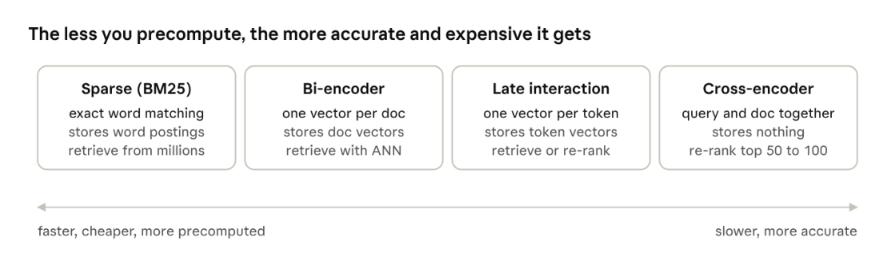
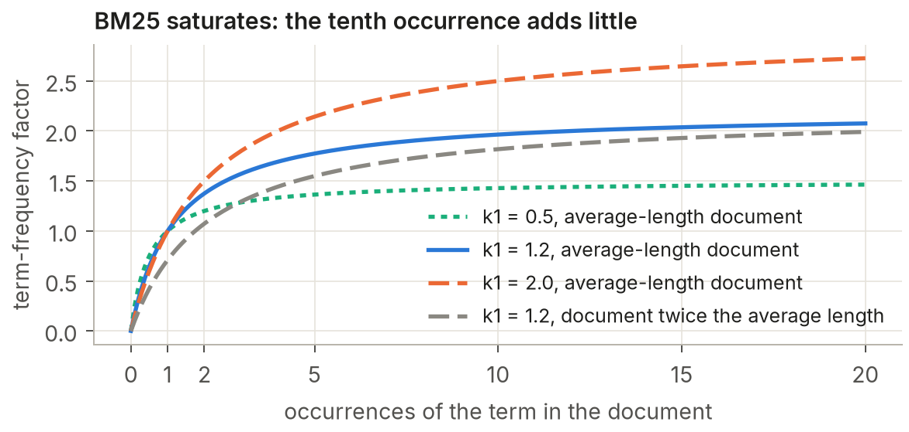

# 30 · Information retrieval

Part IX · Retrieval and agents. Draws on Chapter 44 (BM25, reciprocal rank fusion and learning to rank are coded there; read it alongside) and Chapter 43 (two-tower training). Leads into Chapter 31 (RAG), where retrieval is the part that most often decides whether the answer is right. Chapter 29 covers embedding models themselves.

## Why it matters

Retrieval is the part of a RAG or search system that most often decides whether the final answer is right: an LLM cannot use a passage it never saw. Most "the LLM hallucinated" bugs in RAG turn out to be retrieval bugs. Retrieval is also where engineering trade-offs are sharpest: recall vs latency, index memory vs accuracy, freshness vs cost.

For a Senior Applied ML role with an LLM focus, you should be able to explain how an inverted index and an HNSW graph work, choose between sparse, dense, hybrid and re-ranked retrieval, pick a vector store for a given scale, and evaluate retrieval separately from generation. All of this comes up in both the ML depth and the architecture rounds.

## Key concepts

- **Inverted index**: for each word, the list of documents containing it; the data structure behind classic search. [Inverted index](https://en.wikipedia.org/wiki/Inverted_index).
- **BM25**: the standard lexical ranking function, rewarding rare query terms and penalising long documents. [Okapi BM25](https://en.wikipedia.org/wiki/Okapi_BM25).
- **Dense retrieval**: embed queries and documents and find nearest neighbours; catches synonyms that BM25 misses. [Dense Passage Retrieval](https://arxiv.org/abs/2004.04906).
- **Approximate nearest neighbour search (HNSW, IVF, PQ)**: fast vector search that trades a little recall for speed and memory. [HNSW paper](https://arxiv.org/abs/1603.09320), [FAISS wiki](https://github.com/facebookresearch/faiss/wiki).
- **Late interaction (ColBERT)**: keep one vector per token for finer matching. [ColBERT](https://arxiv.org/abs/2004.12832).
- **Hybrid search and reciprocal rank fusion**: combine lexical and dense results; RRF sums 1/(k + rank) across lists.
- **Re-ranking with cross-encoders**: score the top candidates with a model that reads query and document together.
- **Retrieval metrics**: recall@k, MRR and NDCG (Chapter 4).
- **Textbook**: [Introduction to Information Retrieval](https://nlp.stanford.edu/IR-book/) (Manning, Raghavan and Schütze), free online.

## 30.1 The retrieval landscape

Every retrieval method answers the same question, "which of N documents best match this query?", and they differ in how much work is done ahead of time.



*retrieval models · from fully precomputed to fully per-query*

The standard production pattern combines them: a cheap first stage (sparse, dense, or both) retrieves 100–1,000 candidates from millions with high recall, then an expensive second stage (cross-encoder, or late interaction) re-orders the top few dozen for precision. It is the same funnel as in Chapter 43, applied to text.

## 30.2 Sparse retrieval: inverted index, TF-IDF and BM25

**The inverted index** is the data structure behind every search engine. Instead of storing each document's words, store each word's documents: a **postings list** of (document id, term count). A query only touches the postings of its own terms, so scoring millions of documents takes milliseconds.

```python
import math
from collections import Counter, defaultdict

class InvertedIndex:
    def __init__(self, docs):
        self.postings = defaultdict(list)          # term -> [(doc_id, term_count)]
        self.n_docs = len(docs)
        for doc_id, text in enumerate(docs):
            for term, count in Counter(text.lower().split()).items():
                self.postings[term].append((doc_id, count))

    def idf(self, term):
        df = len(self.postings.get(term, []))
        return math.log((1 + self.n_docs) / (1 + df)) + 1    # smoothed, as in scikit-learn
    def search(self, query, k=10):
        scores = defaultdict(float)
        for term in query.lower().split():
            w = self.idf(term)
            for doc_id, count in self.postings.get(term, []):   # only docs containing the term
                scores[doc_id] += (1 + math.log(count)) * w       # sublinear tf × idf
        return sorted(scores.items(), key=lambda kv: -kv[1])[:k]

idx = InvertedIndex(["refund policy for late orders", "how to change delivery address",
                     "late delivery compensation voucher", "allergy information for dishes"])
idx.search("late delivery")    # doc 2 first: it contains both terms
```

**TF-IDF** scores a document by term frequency (how often the term appears) times inverse document frequency (how rare the term is across the collection). **BM25** improves it in two ways: term frequency saturates (the tenth "pizza" adds little), and long documents are normalised so they do not win just by containing more words. The BM25 formula and a from-scratch implementation are in Chapter 44.3. Real systems add tokenisation and stemming per language, field weights (title counts more than body), and phrase matching.



*BM25's term-frequency factor, tf × (k1 + 1) / (tf + k1 × (1 − b + b × length / average length)). k1 sets how fast it saturates (ceiling k1 + 1); b = 0.75 lowers the factor for long documents, so the grey curve needs more occurrences to reach the same score.*

The defaults (k1 between 0.9 and 1.5, b = 0.75) are good starting points. Tune them on your evaluation set when documents are unusual: very short fields such as titles or product names often want a lower b, and long documents with repeated key terms a higher k1.

**Strengths:** exact matches on names, codes, numbers and rare terms; no training; transparent (you can see why a document matched); cheap to update. **Weaknesses:** the vocabulary mismatch problem: "refund" does not match "money back", and "late order" does not match "delivery delay".

**Learned sparse retrieval** (SPLADE and similar) keeps the inverted index but uses a transformer to decide term weights and to add related terms to each document ("refund" adds weight to "money" and "reimbursement"). You get much of the vocabulary bridging of dense retrieval with the efficiency and exact matching of an inverted index.

## 30.3 Dense retrieval

**Idea.** Encode queries and documents into vectors in the same space, so that relevant pairs are close. Retrieval becomes nearest-neighbour search. Because the meaning is in the vector, "money back for a late order" can match a passage titled "refund policy for delayed deliveries" with no shared words.

**DPR (Dense Passage Retrieval, Karpukhin et al., 2020)** made this work at scale for question answering: two BERT encoders (one for questions, one for passages), trained on (question, relevant passage) pairs with **in-batch negatives** plus one hard negative per question mined with BM25. It clearly beat BM25 on open-domain QA benchmarks. The training recipe is exactly the two-tower recipe from Chapter 43.4, with text encoders as towers.

**What you do in practice today.** You rarely train from scratch. Start from a pretrained embedding model (open models such as the E5, BGE or GTE families, or an embeddings API), evaluate it on your own data, and fine-tune it on your own (query, relevant passage) pairs if it falls short. Things to know:

- **Asymmetric inputs.** Queries are short, passages long. Some models expect prefixes such as `query:` and `passage:`, and forgetting them silently hurts quality. Read the model card.
- **Normalise and use cosine or dot product** consistently between indexing and querying.
- **Memory.** 1 million passages × 768 dimensions × 4 bytes = 3.1 GB of float32. Smaller dimensions, Matryoshka truncation and quantisation cut this (Chapter 29 and 30.4).
- **Domain shift.** The BEIR benchmark (Thakur et al., 2021) showed that many dense models trained on one domain did worse than BM25 on others. Never assume an embedding model beats BM25 on your data; measure it.
- **Multilingual data.** For Arabic and English, or Spanish and English, use a multilingual model and evaluate per language.

**Fine-tuning sketch with sentence-transformers** (API of version 3+; check the current docs before relying on it):

```python
from datasets import Dataset
from sentence_transformers import SentenceTransformer, losses
from sentence_transformers.trainer import SentenceTransformerTrainer

model = SentenceTransformer("intfloat/multilingual-e5-base")
train = Dataset.from_dict({"anchor": queries, "positive": passages})   # (optionally a "negative" column)
loss = losses.MultipleNegativesRankingLoss(model)                       # in-batch negatives, softmax loss
trainer = SentenceTransformerTrainer(model=model, train_dataset=train, loss=loss)
trainer.train()
```

**Hard negatives and false negatives.** Hard negatives (passages that look relevant but are not) teach the most, but mined "negatives" are often actually relevant, because nobody labelled them. Filter them: drop mined negatives that a cross-encoder scores close to or above the positive. Large batch sizes help in-batch training because each query sees more negatives.

## 30.4 Approximate nearest neighbour (ANN) search

**Why approximate.** Exact search compares the query with every vector: N × d multiply-adds. For 10 million 768-dimensional vectors that is about 7.7 billion operations per query. Fine for a few thousand queries a day on a GPU; too slow and expensive at hundreds of queries per second. Exact search is the right choice up to a few hundred thousand vectors, or for computing ground truth. Beyond that, ANN indexes trade a little recall for orders of magnitude in speed.

**IVF (inverted file index).** Cluster the vectors with k-means into `n_lists` cells. At query time, find the `n_probe` nearest centroids and search only the vectors in those cells. More probes = higher recall, slower search.

```python
import numpy as np

def kmeans(X, k, iters=10, seed=0):
    rng = np.random.default_rng(seed)
    C = X[rng.choice(len(X), k, replace=False)].copy()
    for _ in range(iters):
        assign = np.argmin(((X[:, None, :] - C[None]) ** 2).sum(-1), axis=1)
        for j in range(k):
            if (assign == j).any():
                C[j] = X[assign == j].mean(0)
    return C, assign

class IVFIndex:
    def __init__(self, X, n_lists=100, seed=0):
        sample = X[np.random.default_rng(seed).choice(len(X), min(len(X), 5000), replace=False)]
        self.centroids, _ = kmeans(sample, n_lists, seed=seed)       # train on a sample
        assign = np.argmax(X @ self.centroids.T, axis=1)
        self.lists = [np.flatnonzero(assign == j) for j in range(n_lists)]
        self.X = X
    def search(self, q, k=10, n_probe=8):
        cells = np.argsort(-(self.centroids @ q))[:n_probe]
        cand = np.concatenate([self.lists[j] for j in cells])
        return cand[np.argsort(-(self.X[cand] @ q))[:k]]
```


*Recall@10 against exact search as the number of probed cells grows, on 100,000 clustered 64-dimensional vectors with 300 queries. More lists make each cell smaller, so 1,024 lists reach a given recall while scanning a smaller share of the collection, but each probe finds fewer true neighbours.*

The curve is the tool for tuning. Pick the recall your application needs (often 0.9–0.95 for a first stage followed by re-ranking), then read off the cheapest setting. A rule of thumb is about √N lists for N vectors, and probes chosen from such a curve on real queries. Recall falls when the data drift away from the clusters the index was trained on, so retrain the centroids when the collection changes substantially.

**PQ (product quantisation)** compresses vectors. Split each vector into m sub-vectors, run k-means with 256 centroids on each sub-space, and store each sub-vector as one byte: the id of its nearest centroid. A 64-dimensional float32 vector (256 bytes) becomes 16 bytes. At query time, precompute the query's similarity to every centroid in each sub-space (m small tables), and a vector's approximate score is the sum of m table lookups.

```python
class PQ:
    def __init__(self, X, m=16, k=256, seed=0):
        self.m, self.ds = m, X.shape[1] // m
        self.codebooks, codes = [], np.empty((len(X), m), dtype=np.uint8)
        for i in range(m):
            sub = X[:, i * self.ds:(i + 1) * self.ds]
            sample = sub[np.random.default_rng(seed).choice(len(sub), 4000, replace=False)]
            C, _ = kmeans(sample, k, iters=8, seed=seed)
            self.codebooks.append(C)
            codes[:, i] = np.argmin(((sub[:, None, :] - C[None]) ** 2).sum(-1), axis=1)
        self.codes = codes

    def search(self, q, k=10):
        tables = np.stack([self.codebooks[i] @ q[i * self.ds:(i + 1) * self.ds] for i in range(self.m)])
        scores = tables[np.arange(self.m), self.codes].sum(axis=1)   # m lookups per vector
        return np.argsort(-scores)[:k]

def pq_search_rerank(pq, X, q, k=10, n_candidates=100):
    cand = pq.search(q, k=n_candidates)                             # cheap, approximate
    return cand[np.argsort(-(X[cand] @ q))[:k]]                     # exact re-score of a short list
```

**HNSW (hierarchical navigable small world)** builds a multi-layer graph: each vector links to its nearest neighbours, with sparse long-range layers on top. Search starts at the top layer, greedily walks towards the query, and drops a layer at a time, like using motorways first and then local streets. Parameters: `M` (links per node: memory and recall), `efConstruction` (build quality), `efSearch` (candidates explored per query: the main recall/latency knob at query time).

```python
import faiss

index = faiss.IndexHNSWFlat(d, 32, faiss.METRIC_INNER_PRODUCT)   # M = 32
index.hnsw.efConstruction = 200
index.add(X)                                                       # float32, normalised for cosine
index.hnsw.efSearch = 64
scores, ids = index.search(Q, 10)
```

**What these gave on a test** with 20,000 clustered 64-dimensional vectors and 200 queries (recall@10 against exact search; synthetic clustered data is easier than real text, so treat the numbers as directions, not benchmarks):

| Index | Setting | Recall@10 | Memory per vector |
|---|---|---|---|
| IVF (from scratch) | 100 lists, 1 probe | 0.77 | 256 bytes |
| IVF (from scratch) | 100 lists, 4 probes | 1.00 | 256 bytes |
| PQ (from scratch) | 16 bytes per vector | 0.33 | 16 bytes |
| PQ + exact re-rank of top 100 | 16 bytes per vector | 0.88 | 16 bytes + originals on disk |
| HNSW (FAISS) | M = 32, efSearch = 64 | 1.00 | 256 bytes + graph links |
| IVF-PQ (FAISS) | 100 lists, 16 probes, 16 bytes | 0.56 | 16 bytes |

**How to choose.**

| Index | Strength | Weakness | Choose when |
|---|---|---|---|
| Exact (flat) | Perfect recall, simple | Linear cost | Under a few hundred thousand vectors, or as ground truth |
| HNSW | Best recall at low latency; the default in most vector databases | Memory for vectors plus links; deletes and rebuilds are awkward | Fits in RAM, latency matters |
| IVF | Fast to build, simple to shard | Recall depends on n_probe and on clusters fitting the data | Large collections, batch rebuilds |
| IVF-PQ | 10–30× less memory | Lossy: needs re-ranking with full vectors | Hundreds of millions of vectors |
| Disk-based (DiskANN) | Billions of vectors on SSD | More engineering | Collections far bigger than RAM |

In an interview, the senior answer always includes: **measure ANN recall against exact search** on a sample of real queries, and tune the knob (`efSearch`, `n_probe`) to the recall your application needs.

## 30.5 Vector databases and filtering

**The options.**

| Kind | Examples | Good for |
|---|---|---|
| Libraries | FAISS, hnswlib, ScaNN | Full control, offline batch jobs, embedding inside a service; you build persistence and updates |
| Vector search inside an existing database | pgvector (Postgres), Elasticsearch / OpenSearch kNN, Redis | Teams already running that database; easy joins with business data; hybrid search in Elasticsearch / OpenSearch |
| Dedicated vector databases | Qdrant, Weaviate, Milvus, Pinecone (managed), Vespa, LanceDB | Large scale, rich filtering, hybrid search, multi-tenancy, managed operations |

A pragmatic default: if you have a few million vectors and already run Postgres, start with pgvector and its HNSW index; move to a dedicated engine when scale, filtering or hybrid needs outgrow it. Choose on recall at your latency target, filtering behaviour, update pattern, hybrid support and operational burden, not on benchmark headlines.

**Metadata filtering** is where vector search gets hard: "policies for this country", "restaurants that deliver here", "documents this user may see".

- **Post-filtering:** search top k × oversample, then drop rows that fail the filter. Simple, but with a selective filter you end up with too few results. In a test with a filter keeping 25% of vectors and 4× oversampling, one query returned 7 of the 10 results it needed.
- **Pre-filtering:** restrict the search to allowed ids first. Exact search over the allowed subset is fine when it is small; ANN engines support filtered traversal, which works well unless the filter is extremely selective.
- **Partitioning:** a separate index (or namespace) per tenant, country or city, when the filter is always present. This is the usual answer for multi-tenant RAG and for city-scoped food delivery.

```python
# FAISS: pre-filter with an ID selector (supported for flat, IVF and HNSW indexes in recent versions)
allowed = np.flatnonzero(city == "DXB").astype("int64")
params = faiss.SearchParametersHNSW(sel=faiss.IDSelectorBatch(allowed), efSearch=64)
scores, ids = index.search(q[None], 10, params=params)
```

**Access control is a filter, not a prompt instruction.** In RAG, documents a user may not see must be filtered out in retrieval. Telling the LLM "do not reveal restricted documents" is not a security boundary.

**Operations to plan for:** upserts and deletes (many ANN indexes mark deletions and need periodic compaction); freshness (how fast a new document becomes searchable); and **re-embedding**: when you change the embedding model, every vector must be recomputed, because vectors from different models are not comparable. Version indexes by model, build the new one alongside, and switch over after evaluating it.

**Memory maths for the interview:** 10 million vectors × 768 dimensions × 4 bytes = about 31 GB of raw float32, before index overhead; with 64-byte PQ codes, about 640 MB.

## 30.6 Hybrid search and fusion

Sparse and dense retrieval fail on different queries: sparse on paraphrases, dense on exact names, codes and rare terms. Running both and fusing the results is a reliable gain on most real datasets, and the usual default for RAG.

**Reciprocal rank fusion (RRF)** uses only ranks: each document scores Σ 1 / (k + rank) over the lists it appears in, with k = 60. No tuning, robust to the two systems' different score scales. Code in Chapter 44.3.

**Convex combination of normalised scores** can do better when you have labelled data to tune it. Normalise each system's scores per query (min-max), then mix:

```python
import numpy as np

def minmax(scores):
    lo, hi = min(scores.values()), max(scores.values())
    return {d: (s - lo) / (hi - lo) if hi > lo else 1.0 for d, s in scores.items()}

def convex_fusion(sparse, dense, alpha=0.5):
    """sparse, dense: dict doc_id -> raw score for one query. alpha: weight on dense."""
    s, d = minmax(sparse), minmax(dense)
    docs = set(s) | set(d)
    fused = {doc: alpha * d.get(doc, 0.0) + (1 - alpha) * s.get(doc, 0.0) for doc in docs}
    return sorted(fused, key=fused.get, reverse=True)
```

Tune `alpha` on your evaluation set (30.9). Bruch et al. (2023) compared fusion functions and found a tuned convex combination generally beat RRF, needing only a small labelled set; RRF remains the safe choice with no labels.

**Where hybrid lives:** Elasticsearch, OpenSearch, Vespa, Weaviate and Qdrant support it natively; otherwise run BM25 and the vector index separately and fuse in your service. Either way, pass both scores to a re-ranker or learning-to-rank model later if you have one: a learned combination beats any fixed formula.

## 30.7 Re-ranking: cross-encoders and late interaction

**Cross-encoders** read the query and passage together in one transformer and output a relevance score. Because every query token attends to every passage token, they judge relevance far better than bi-encoders, but cost one forward pass per (query, passage) pair, so they only re-rank a short list (code in Chapter 44.8). Practical decisions:

- **Re-rank depth.** Retrieve 50–200 candidates, re-rank them, keep the top 5–10 for the LLM. Plot recall@final-k against depth on your evaluation set; beyond some depth, gains stop and latency keeps growing.
- **Latency.** Batch all pairs into one forward pass on a GPU; truncate long passages; use a small model (MiniLM-sized) or distil a larger one.
- **Domain.** Off-the-shelf re-rankers are trained on web search (MS MARCO). Fine-tuning on your own judged pairs often gives the biggest single gain in a RAG pipeline.
- **LLM re-rankers** (Chapter 44.8) give strong quality on small lists but add cost and latency; they are a good label source for training a cheaper re-ranker.

**Late interaction (ColBERT).** Encode the query and each document into one vector **per token**, precompute the document token vectors, and score with **MaxSim**: for each query token, take its best-matching document token, then sum over query tokens.

```python
import torch

def maxsim(q_tok, d_tok):
    """q_tok: (Lq, dim), d_tok: (Ld, dim), rows L2-normalised."""
    return (q_tok @ d_tok.T).max(dim=1).values.sum()
```

This keeps fine-grained token matching (close to cross-encoder quality) while documents are still encoded offline. The cost is storage: one vector per token instead of per document. ColBERTv2 compresses token vectors heavily, and the PLAID engine makes retrieval with them fast. Use it when bi-encoder quality is not enough and cross-encoder latency is too high, or as a re-ranker. Libraries such as RAGatouille wrap it for RAG use (check current support before adopting).

## 30.8 Query understanding and rewriting

The user's words are often a poor search query, especially in chat. Chapter 44.2 covered spelling, intent and entities for product search; for RAG and assistants, the main tools are LLM-based rewrites.

| Technique | What it does | Example |
|---|---|---|
| Conversational rewrite | Turns a follow-up into a standalone query using the chat history | "And in Dubai?" → "refund policy for late deliveries in Dubai" |
| Decomposition | Splits a multi-part question into sub-queries, retrieved separately | "Compare the refund rules for Spain and the UAE" → two queries |
| Multi-query expansion | Generates several paraphrases, retrieves for each, fuses with RRF | Covers vocabulary the user did not use |
| Self-query (filter extraction) | Extracts structured filters from the question | "policies changed this year for riders" → filter year = 2026, audience = riders |
| Routing | Chooses the source: vector index, SQL database, an API | "Where is my order?" goes to the orders API, not the policy index |
| HyDE | Generates a hypothetical answer and embeds it instead of the question | Covered in Chapter 31 |

A rewrite step with structured output:

```python
import json

# Literal braces in the JSON example are doubled so str.format leaves them alone.
REWRITE_PROMPT = """Rewrite the user's last message as a standalone search
query for the help-centre index.
Use the conversation for missing context. Extract filters if stated.
Return JSON: {{"query": str, "country": str | null, "audience": "customer" | "rider" | "partner" | null}}

Conversation:
{history}

Last message: {message}"""

def rewrite(history, message, llm):
    out = llm(REWRITE_PROMPT.format(history=history, message=message))   # use JSON / structured output mode
    return json.loads(out)
```

**Costs and risks.** Each rewrite is an extra LLM call: use a small, fast model, cache frequent rewrites, and skip the step when the message is already a clear standalone query. Rewrites can also drift from what the user meant, so log the original and the rewrite, and evaluate retrieval with and without rewriting on the same set (30.9).

## 30.9 Evaluating retrieval

Evaluate retrieval separately from generation. If the right passage is not in the context, no prompt will fix the answer; if it is there and the answer is still wrong, the problem is downstream.

**Building the evaluation set.**

1. **Real queries** from logs or from the people who will use the system, 100–500 to start, covering the main intents and some hard cases.
2. **Relevance labels**: for each query, the passages that answer it, marked by a domain expert, or by an LLM judge that you have checked against expert labels.
3. **Synthetic queries** to grow coverage: have an LLM write questions for sampled passages. Ask for paraphrased, realistic questions; generated questions tend to copy the passage's wording, which flatters BM25 and overstates recall.
4. Keep a held-out slice you never tune on.

**Metrics.**

| Metric | Why |
|---|---|
| Recall@k | For RAG the key metric: did a relevant passage make it into the k passages the LLM sees? |
| MRR, NDCG@10 | Ordering quality: matters when context is truncated or the LLM attends more to early passages |
| Precision@k | Noise in the context: irrelevant passages can distract the LLM |
| ANN recall vs exact | Loss from the index itself, separate from the embedding model |
| p50 / p95 latency, index size, freshness lag | Whether it works in production |

```python
import numpy as np

def evaluate_retriever(retrieve, eval_set, k=10):
    """retrieve(query) -> ranked list of doc ids; eval_set: list of (query, set of relevant ids)."""
    recalls, rrs = [], []
    for query, relevant in eval_set:
        ranked = retrieve(query)[:k]
        recalls.append(len(set(ranked) & relevant) / len(relevant))
        rr = next((1.0 / i for i, d in enumerate(ranked, start=1) if d in relevant), 0.0)
        rrs.append(rr)
    return {"recall@k": np.mean(recalls), "mrr@k": np.mean(rrs)}

# Compare configurations on the same set:
# for name, fn in {"bm25": bm25_search, "dense": dense_search, "hybrid": hybrid_search,
#                  "hybrid+rerank": hybrid_rerank}.items():
#     print(name, evaluate_retriever(fn, eval_set))
```

Report the comparison table per query segment (language, intent, query length) with bootstrap intervals over queries (Chapter 4.9). A typical finding: hybrid beats either alone, re-ranking adds the most on long and vague queries, and some segment (often a second language) is much worse than the average.

## 30.10 Frontier topics in retrieval

- **Learned sparse retrieval** (SPLADE-style): a transformer predicts weights over the vocabulary for each document and query, including terms that do not appear in the text, giving inverted-index efficiency with semantic matching. A strong middle ground between BM25 and dense retrieval, and good for hybrid search.
- **Reasoning-intensive retrieval**: benchmarks such as BRIGHT contain queries whose relevant documents share little surface or semantic overlap with them (a maths problem and the theorem needed to solve it). Standard embedders score poorly; gains come from query rewriting with reasoning models, reasoning-trained rerankers and retrievers fine-tuned on such data.
- **Generative and agentic retrieval**: models that issue many searches, read results and refine queries over multiple steps (Chapter 33), which shifts the bottleneck from single-shot ranking quality to recall over a search session and to the cost of many calls.
- **Long context versus retrieval**: very long contexts reduce but do not remove the need for retrieval; retrieval remains cheaper, fresher and more precise for large corpora (Chapter 31).

## 30.11 A worked index sizing: 50 million chunks

A document platform will hold 50M chunks with 768-dimensional embeddings, must answer at 200 queries per second with p95 under 100 ms for the retrieval step, and grows 3% a month.

**Memory for the candidate designs.** HNSW with M = 32 stores about 64 neighbour ids of 4 bytes per vector at the base layer.

| Design | Vectors | Graph or codes | Total |
|---|---|---|---|
| HNSW over float32 | 153.6 GB | 12.8 GB | 166 GB |
| HNSW over int8 | 38.4 GB | 12.8 GB | 51 GB |
| HNSW over Matryoshka 256 dims, int8 | 12.8 GB | 12.8 GB | 26 GB |
| IVF-PQ, 64 bytes per vector | 3.2 GB | centroids only | about 3.2 GB |

**Exact search is out.** Each query would need 38 billion multiply-adds, roughly a second of CPU time per query, and 200 queries per second would need hundreds of cores. It remains the tool for computing ground truth on a sample.

**The choice.**

- **Recall, latency and simplicity.** HNSW over int8 (51 GB) on two replicas of a 128 GB machine gives this with headroom for a year of growth.
- **Lower memory.** The Matryoshka variant halves the memory if its recall, measured on the evaluation queries, is adequate.
- **Very low memory.** IVF-PQ needs the least memory, but its recall depends on re-ranking. Re-scoring 200 candidates with float32 vectors from SSD reads about 0.6 MB per query, which fits the budget on NVMe drives.

**The re-ranker dominates latency, not the index.** A cross-encoder over the top 50 candidates costs far more than the ANN search itself. Budget it separately and batch it on a GPU.

**Operations.**

- **Embedding.** The corpus at an assumed 20,000 chunks per minute per GPU is about 42 GPU-hours; measure the real rate on a sample first.
- **Deletes and updates.** Plan for them: HNSW handles deletes poorly, so use tombstones plus periodic rebuilds.
- **Ground truth.** Recompute recall@10 against exact search on 1,000 real queries after every rebuild.

## Pitfalls

- **Blaming the LLM for retrieval failures.** Check recall@k first: if the right passage was not retrieved, the generator never had a chance.
- **Dense only.** Embeddings miss exact names, product codes, numbers and rare terms. Keep a lexical path.
- **Assuming the embedding model fits your domain.** Measure against BM25 on your own queries before committing.
- **Missing query/passage prefixes** or mismatched normalisation between indexing and querying.
- **Never measuring ANN recall.** The index silently loses results; tune efSearch or n_probe against exact search.
- **Post-filtering with selective filters.** You return too few results. Pre-filter or partition.
- **Access control in the prompt.** Permissions must be enforced in retrieval, never by instructions to the LLM.
- **Mixing vectors from two embedding models.** Changing the model means re-embedding everything; version your indexes.
- **Synthetic evaluation queries that copy passage wording.** They flatter BM25 and overstate recall.
- **Tuning on the whole evaluation set.** Keep a held-out slice.
- **Re-ranking too few candidates,** or re-ranking with a web-trained model on very different domain text without checking.

## Interview questions

Questions 1–5 are basic, 6–11 intermediate, 12–15 senior.

**1. How does an inverted index work?** For each term, store a postings list of the documents that contain it and how often. A query only reads the postings of its own terms and accumulates scores (TF-IDF or BM25) per document, so it scales to millions of documents with millisecond latency.

**2. Sparse vs dense retrieval: strengths of each?** Sparse: exact matches on names, codes, rare terms; no training; explainable; cheap to update. Dense: matches meaning across different wording and languages. Sparse fails on paraphrase; dense fails on exact identifiers and can fail out of domain. Hybrid combines both.

**3. What is a bi-encoder and why can it scale?** Two encoders map query and document to vectors independently; relevance is their dot product. Because document vectors do not depend on the query, they are precomputed and indexed for ANN search.

**4. Why approximate nearest neighbour instead of exact search?** Exact search costs N × d per query, too slow at tens of millions of vectors and high traffic. ANN indexes (HNSW, IVF, PQ) search a small part of the collection and lose a little recall, which you measure and tune.

**5. What is reciprocal rank fusion?** Combine ranked lists by summing 1 / (k + rank) per document, with k around 60. It needs no score normalisation or training, so it is the standard way to merge BM25 and dense results.

**6. Explain HNSW and its main parameters.** A multi-layer proximity graph: sparse upper layers with long links, dense bottom layer with all points. Search descends greedily from the top. M sets links per node (memory and recall), efConstruction sets build quality, efSearch sets candidates per query (the recall/latency knob at query time).

**7. Explain product quantisation and when you would use it.** Split vectors into sub-vectors, quantise each against 256 learned centroids, store one byte per sub-vector. Scoring uses lookup tables of query-to-centroid similarities. It cuts memory 10–30× at a recall cost, so it suits hundreds of millions of vectors, usually combined with IVF and an exact re-rank of the short list.

**8. How do you train a dense retriever for your domain?** Start from a pretrained embedding model; collect (query, relevant passage) pairs from logs, experts or LLM generation; fine-tune with in-batch negatives (multiple negatives ranking loss) plus mined hard negatives filtered for false negatives; evaluate recall@k against BM25 and the base model on a held-out set.

**9. Cross-encoder vs ColBERT vs bi-encoder?** Bi-encoder: one vector per document, fastest, least precise. ColBERT: one vector per token with MaxSim scoring, near cross-encoder quality with offline document encoding, at a large storage cost. Cross-encoder: reads query and document together, most accurate, one pass per pair, so re-ranking only.

**10. How do you handle metadata filters in vector search?** Post-filtering with oversampling is simple but returns too few results for selective filters. Pre-filtering restricts search to allowed ids (filtered HNSW traversal, or exact search on small subsets). If a filter is always present (tenant, country, city), partition the index.

**11. How would you evaluate the retrieval part of a RAG system?** A labelled set of real queries with relevant passages, extended with careful synthetic queries; recall@k at the context size the LLM gets, plus MRR or NDCG for ordering; compare BM25, dense, hybrid and re-ranked configurations, by segment, with bootstrap intervals; separately measure ANN recall and latency.

**12. RAG answers are wrong for 20% of questions. How do you find out whether retrieval is the cause?** For a sample of failures, check whether a relevant passage was in the retrieved set (manually or with an LLM judge). If not, it is a retrieval failure: look at query type, language, chunking, missing documents, filters. If yes, it is a generation or context-assembly failure. Quantify the split before fixing anything.

**13. Design retrieval for a multilingual help centre with 50,000 articles in Arabic and English.** Hybrid: BM25 with language-specific analysers plus a multilingual embedding model; filter by country and audience; cross-encoder re-ranking of the top 50 with a multilingual re-ranker; conversational rewriting for follow-ups. At this size, HNSW in pgvector or a dedicated store is plenty. Evaluate per language with native-speaker labels; check cross-lingual retrieval (Arabic query, English article).

**14. You must switch to a new embedding model. How do you do it safely?** Build a second index with the new model in parallel, evaluate it on the same set (recall, latency, size), shadow-test on live queries, then switch reads with a flag and keep the old index for rollback. Never mix vectors from two models in one index.

**15. How would you serve 100 million vectors with a p95 under 50 ms on a budget?** IVF-PQ (or HNSW over PQ-compressed vectors) to fit memory, with an exact re-rank of the top few hundred from full vectors on SSD; shard by a natural partition if filters allow; tune n_probe or efSearch to the required recall measured against exact search on a sample; cache frequent queries. Show the memory maths: 100M × 768 × 4 bytes is about 307 GB raw, about 6.4 GB at 64-byte codes.

## Practice

1. **Inverted index and BM25 from scratch** (no autocomplete, 40 minutes): index a few thousand documents, support multi-term queries, compare results with the `rank_bm25` package.
2. **ANN from scratch.** Implement IVF and PQ from 30.4 on 100,000 real embeddings (embed a public text dataset with a small sentence-transformers model). Plot recall@10 against n_probe, and PQ recall with and without re-ranking.
3. **FAISS and HNSW.** Build `IndexFlatIP`, `IndexHNSWFlat` and `IndexIVFPQ` on the same data; plot recall@10 against queries per second for several efSearch and n_probe values. *Good solution:* a recall-latency curve per index and a one-paragraph recommendation.
4. **Hybrid on BEIR.** Pick two BEIR datasets from different domains (for example SciFact and FiQA). Compare BM25, a dense model, RRF, and a tuned convex combination on NDCG@10 and recall@100. *Good solution:* hybrid wins on both; dense alone loses to BM25 on at least one.
5. **Re-ranking.** Add a cross-encoder over the top 100 from exercise 4; report the NDCG@10 gain and the added latency per query.
6. **Your own RAG retrieval eval.** Take 200 help-centre style articles (any public FAQ), write 50 real-sounding questions yourself and generate 100 with an LLM, label relevant articles, and run `evaluate_retriever` across configurations. Compare results on your questions vs generated ones.
7. **Filtering.** Reproduce the post-filter shortfall from 30.5 with filters keeping 50%, 10% and 1% of vectors, and fix it with pre-filtering.

## Read next

- Manning, Raghavan and Schütze, *Introduction to Information Retrieval* (free online): chapters 1–2 (inverted index), 6 (scoring and TF-IDF), 8 (evaluation).
- Karpukhin et al., *Dense Passage Retrieval for Open-Domain Question Answering* (EMNLP 2020).
- Thakur et al., *BEIR: A Heterogeneous Benchmark for Zero-shot Evaluation of* *Information Retrieval Models* (NeurIPS 2021).
- Malkov and Yashunin, *Efficient and Robust Approximate Nearest Neighbor Search* *Using Hierarchical Navigable Small World Graphs* (2016/2018).
- Jégou, Douze and Schmid, *Product Quantization for Nearest Neighbor Search* (2011).
- Khattab and Zaharia, *ColBERT* (SIGIR 2020); Santhanam et al., *ColBERTv2* (2022).
- Formal et al., *SPLADE* (2021).
- Bruch, Gai and Ingber, *An Analysis of Fusion Functions for Hybrid Retrieval* (ACM TOIS, 2023).
- The FAISS wiki on GitHub, especially the guidelines for choosing an index.
- *AI Engineering* (Chip Huyen): the chapter on RAG, for the retrieval side of RAG systems.

**Links:** [Introduction to Information Retrieval](https://nlp.stanford.edu/IR-book/) · [Dense Passage Retrieval](https://arxiv.org/abs/2004.04906) · [FAISS wiki](https://github.com/facebookresearch/faiss/wiki) · [ColBERT](https://arxiv.org/abs/2004.12832). Other titles above can be found by searching their title.

## Done when

You can write an inverted index with TF-IDF scoring and explain how BM25 improves it.

You can explain dense retrieval, DPR's training recipe, and how to fine-tune an embedding model on your data.

You can explain IVF, PQ and HNSW, their parameters, and choose one for a given scale and latency. You can do the memory maths for an index out loud.

You can choose a vector store and explain pre-filtering, post-filtering and partitioning. You can implement RRF and a convex score fusion, and say when each is better. You can explain cross-encoders vs ColBERT vs bi-encoders and choose a re-rank depth. You can design query rewriting for a chat assistant and say what it costs. You can build a retrieval evaluation set and separate retrieval failures from generation failures.

---

[← 29 · Embeddings and representation learning](29-embeddings.md) · [Contents](../README.md#contents) · [31 · Retrieval-augmented generation →](31-retrieval-augmented-generation.md)
