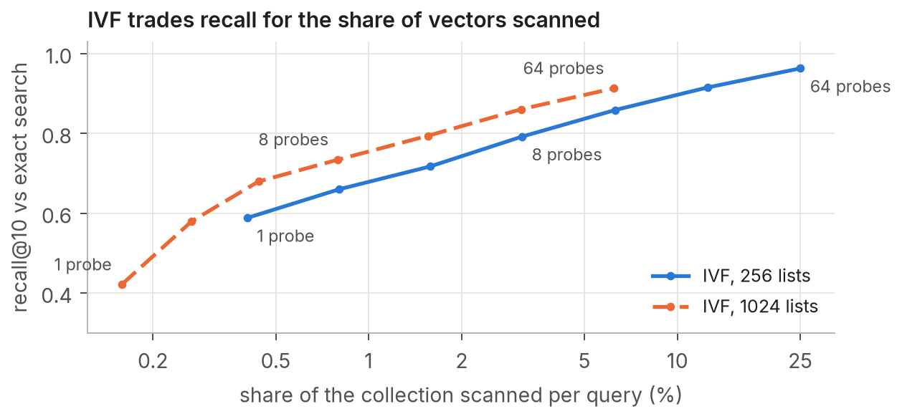

# 30 · Information retrieval

Part IX · Retrieval and agents. Draws on Chapter 44 (BM25, reciprocal rank fusion and learning to rank are coded there; read it alongside) and Chapter 43 (two-tower training). Leads into Chapter 31 (RAG), where retrieval is the part that most often decides whether the answer is right. Chapter 29 covers embedding models themselves.

## Why it matters

Retrieval is the part of a RAG or search system that most often decides whether the final answer is right: an LLM cannot use a passage it never saw. Most "the LLM hallucinated" bugs in RAG turn out to be retrieval bugs. Retrieval is also where engineering trade-offs are sharpest: recall vs latency, index memory vs accuracy, freshness vs cost.

For a Senior Applied ML role with an LLM focus, you should be able to explain how an inverted index and an HNSW graph work, choose between sparse, dense, hybrid and re-ranked retrieval, pick a vector store for a given scale, and evaluate retrieval separately from generation. All of this comes up in both the ML depth and the architecture rounds.

The chapter starts with the landscape: the families of retrieval methods and how they fit into a pipeline (30.1). It then covers the two main ways of finding candidates, sparse retrieval with an inverted index and BM25 (30.2) and dense retrieval with embeddings (30.3), followed by the machinery that makes dense retrieval fast at scale: approximate nearest-neighbour search (30.4) and vector databases with filtering (30.5). Sections 30.6 to 30.8 improve quality: fusing sparse and dense results, re-ranking the top candidates with a stronger model, and rewriting the query before searching. The chapter ends with evaluation (30.9), frontier topics (30.10) and a worked index sizing (30.11).

Retrieval is a funnel. Each stage trades accuracy for speed: the first stage must search millions of documents in milliseconds, so it uses cheap representations; later stages see only a few hundred candidates, so they can afford expensive models. Most design decisions in this chapter are about where to put each method in that funnel.

## Key concepts

- **Inverted index**: for each word, the list of documents containing it; the data structure behind classic search. [Inverted index](https://en.wikipedia.org/wiki/Inverted_index).
- **BM25**: the standard lexical ranking function, rewarding rare query terms and penalising long documents. [Okapi BM25](https://en.wikipedia.org/wiki/Okapi_BM25).
- **Dense retrieval**: embed queries and documents and find nearest neighbours; catches synonyms that BM25 misses. [Dense Passage Retrieval](https://arxiv.org/abs/2004.04906).
- **Approximate nearest neighbour search (HNSW, IVF, PQ)**: fast vector search that trades a little recall for speed and memory. [HNSW paper](https://arxiv.org/abs/1603.09320), [FAISS wiki](https://github.com/facebookresearch/faiss/wiki).
- **Late interaction (ColBERT)**: keep one vector per token for finer matching. [ColBERT](https://arxiv.org/abs/2004.12832).
- **Hybrid search and reciprocal rank fusion**: combine lexical and dense results; RRF sums 1/(k + rank) across lists.
- **Re-ranking with cross-encoders**: score the top candidates with a model that reads query and document together.
- **Retrieval metrics**: recall@k, MRR and NDCG (Chapter 4).
- **Textbook**: [Introduction to Information Retrieval](https://nlp.stanford.edu/IR-book/) (Manning, Raghavan and Schütze), free online.

## 30.1 The retrieval landscape

Every retrieval method answers the same question, "which of N documents best match this query?", and they differ in how much work is done ahead of time.


*Retrieval models ordered from fully precomputed (left: document representations built offline, query scored by a cheap lookup) to fully per-query (right: query and document read together by one model at query time).*

| Method | Precomputed offline | Query–document interaction | Cost per query | Typical role |
|---|---|---|---|---|
| BM25 | Inverted index of term counts | Exact term overlap, weighted | Postings of the query terms only | First stage; exact names and codes |
| Learned sparse (SPLADE) | Inverted index of learned term weights, with expansion terms | Weighted overlap over a learned vocabulary | Like BM25, somewhat more postings | First stage; a hybrid partner |
| Bi-encoder (dense) | One vector per document | One dot product between two vectors | ANN search over all vectors | First stage; paraphrases, cross-lingual |
| Late interaction (ColBERT) | One vector per document token | Each query token matched to its best document token (MaxSim) | Many vectors per candidate; large index | Re-ranking or first stage with PLAID |
| Cross-encoder | Nothing | Full attention between every query and document token | One transformer pass per pair | Re-ranking the top 50–200 |

The further right a method sits, the richer the interaction between query and document and the higher its quality per candidate, but the less of the work can be done before the query arrives.

The standard production pattern combines them: a cheap first stage (sparse, dense, or both) retrieves 100–1,000 candidates from millions with high recall, then an expensive second stage (cross-encoder, or late interaction) re-orders the top few dozen for precision. It is the same funnel as in Chapter 43, applied to text.

## 30.2 Sparse retrieval: inverted index, TF-IDF and BM25

**The inverted index** is the data structure behind every search engine. Instead of storing each document's words, store each word's documents: a **postings list** of (document id, term count). A query only touches the postings of its own terms, so scoring millions of documents takes milliseconds.

```python
import math
from collections import Counter, defaultdict

class InvertedIndex:
    def __init__(self, docs):
        self.postings = defaultdict(list)          # term -> [(doc_id, term_count)]
        self.n_docs = len(docs)
        for doc_id, text in enumerate(docs):
            for term, count in Counter(text.lower().split()).items():
                self.postings[term].append((doc_id, count))

    def idf(self, term):
        df = len(self.postings.get(term, []))
        return math.log((1 + self.n_docs) / (1 + df)) + 1    # smoothed, as in scikit-learn
    def search(self, query, k=10):
        scores = defaultdict(float)
        for term in query.lower().split():
            w = self.idf(term)
            for doc_id, count in self.postings.get(term, []):   # only docs containing the term
                scores[doc_id] += (1 + math.log(count)) * w       # sublinear tf × idf
        return sorted(scores.items(), key=lambda kv: -kv[1])[:k]

idx = InvertedIndex(["refund policy for late orders", "how to change delivery address",
                     "late delivery compensation voucher", "allergy information for dishes"])
idx.search("late delivery")    # doc 2 first: it contains both terms
```

**TF-IDF** scores a document by term frequency (how often the term appears) times inverse document frequency (how rare the term is across the collection). **BM25** improves it in two ways: term frequency saturates (the tenth "pizza" adds little), and long documents are normalised so they do not win just by containing more words. The BM25 formula and a from-scratch implementation are in Chapter 44.3. Real systems add tokenisation and stemming per language, field weights (title counts more than body), and phrase matching.

In full, a document d's BM25 score for a query q sums over the query's terms t:

$$
\mathrm{BM25}(q,d) = \sum_{t\in q}\mathrm{IDF}(t)\,\dfrac{\mathrm{tf}(t,d)\,(k_1+1)}{\mathrm{tf}(t,d) + k_1\left(1 - b + b\,\frac{|d|}{\mathrm{avgdl}}\right)}
$$

where tf(t, d) is how often t occurs in d, |d| is the document's length and avgdl the average length in the collection. k₁ and b are tuning constants (below). The fraction is the saturating term-frequency factor plotted below. IDF(t) is the inverse document frequency of the term, which rewards rare terms. With N documents in the collection, of which df(t) contain t, the form used by Lucene and Elasticsearch is

$$
\mathrm{IDF}(t) = \ln\left(1 + \dfrac{N - \mathrm{df}(t) + 0.5}{\mathrm{df}(t) + 0.5}\right)
$$

It comes from a probabilistic argument (the Robertson–Spärck Jones weight): (N − df + 0.5)/(df + 0.5) estimates the odds that a random document does *not* contain the term, so a term found in few documents carries strong evidence of relevance when it matches. The 0.5s smooth the estimate for very rare terms. The classic form is the plain log of those odds; it turns negative for terms in more than half the documents, so a match on a very common word would *lower* the score. The "1 +" inside the log keeps every IDF positive.

**A worked example.** Three documents, with k₁ = 1.2 and b = 0.75: d₁ = "late order refund" (3 words), d₂ = "refund policy refund rules for every order" (7 words), d₃ = "delivery address change" (3 words), so avgdl = 13/3 = 4.33. For the query "late refund":

- IDF(late), in 1 of 3 documents: ln(1 + 2.5/1.5) = ln 2.667 = 0.981. IDF(refund), in 2 of 3: ln(1 + 1.5/2.5) = ln 1.6 = 0.470. (A term in all 3 would get ln(1 + 0.5/3.5) = 0.134; the classic form would give −1.95.)
- d₁: tf = 1 for both terms, and the length factor is 1 − 0.75 + 0.75 × 3/4.33 = 0.769, so each term-frequency factor is 1 × 2.2 / (1 + 1.2 × 0.769) = 1.144. Score = 1.144 × (0.981 + 0.470) = 1.660.
- d₂: only "refund" matches, twice, in a longer-than-average document: the length factor is 0.25 + 0.75 × 7/4.33 = 1.462, so the factor is 2 × 2.2 / (2 + 1.2 × 1.462) = 1.172. Score = 0.470 × 1.172 = 0.551.
- d₃: no query term, score 0.

Two things to notice. The rare term "late" is worth twice the common "refund" per occurrence. And the second "refund" in d₂ lifted its factor only from about 0.8 to 1.17, because term frequency saturates and d₂'s length is penalised: repeating a common word cannot beat matching a rare one. (`code/ch30_check.py` reproduces these numbers.)


*BM25's term-frequency factor, tf × (k1 + 1) / (tf + k1 × (1 − b + b × length / average length)). k1 sets how fast it saturates (ceiling k1 + 1); b = 0.75 lowers the factor for long documents, so the grey curve needs more occurrences to reach the same score.*

The defaults (k1 between 0.9 and 1.5, b = 0.75) are good starting points. Tune them on your evaluation set when documents are unusual: very short fields such as titles or product names often want a lower b, and long documents with repeated key terms a higher k1.

**Strengths:** exact matches on names, codes, numbers and rare terms; no training; transparent (you can see why a document matched); cheap to update. **Weaknesses:** the vocabulary mismatch problem: "refund" does not match "money back", and "late order" does not match "delivery delay".

**Learned sparse retrieval** (SPLADE and similar) keeps the inverted index but uses a transformer to decide term weights and to add related terms to each document ("refund" adds weight to "money" and "reimbursement"). For each input token position, the model's masked-language-model head produces a score for every vocabulary term; SPLADE takes log(1 + ReLU(score)), max-pools over positions, and trains with a sparsity penalty so that each document keeps only a few hundred non-zero terms. You get much of the vocabulary bridging of dense retrieval with the efficiency and exact matching of an inverted index, which makes it a strong first stage and a good partner in hybrid search (30.6).

## 30.3 Dense retrieval

**Idea.** Encode queries and documents into vectors in the same space, so that relevant pairs are close. Retrieval becomes nearest-neighbour search. Because the meaning is in the vector, "money back for a late order" can match a passage titled "refund policy for delayed deliveries" with no shared words.

**DPR (Dense Passage Retrieval, Karpukhin et al., 2020)** made this work at scale for question answering: two BERT encoders (one for questions, one for passages), trained on (question, relevant passage) pairs with **in-batch negatives** plus one hard negative per question mined with BM25. It clearly beat BM25 on open-domain QA benchmarks. The training recipe is exactly the two-tower recipe from Chapter 43.4, with text encoders as towers.

**What you do in practice today.** You rarely train from scratch. Start from a pretrained embedding model (open models such as the E5, BGE or GTE families, or an embeddings API), evaluate it on your own data, and fine-tune it on your own (query, relevant passage) pairs if it falls short. Things to know:

- **Asymmetric inputs.** Queries are short, passages long. Some models expect prefixes such as `query:` and `passage:`, and forgetting them silently hurts quality. Read the model card.
- **Normalise and use cosine or dot product** consistently between indexing and querying.
- **Memory.** 1 million passages × 768 dimensions × 4 bytes = 3.1 GB of float32. Smaller dimensions, Matryoshka truncation and quantisation cut this (Chapter 29 and 30.4).
- **Domain shift.** The BEIR benchmark (Thakur et al., 2021) showed that many dense models trained on one domain did worse than BM25 on others. Never assume an embedding model beats BM25 on your data; measure it.
- **Multilingual data.** For Arabic and English, or Spanish and English, use a multilingual model and evaluate per language.

**Fine-tuning.** The recipe and a sentence-transformers training script (in-batch negatives with `MultipleNegativesRankingLoss`, an optional column of mined negatives, and the `no_duplicates` batch sampler) are in Chapter 29.4; the loss and its gradient are derived in 29.2.

**Hard negatives and false negatives.** Hard negatives (passages that look relevant but are not) teach the most, but mined "negatives" are often actually relevant, because nobody labelled them. Filter them: drop mined negatives that a cross-encoder scores close to or above the positive, or distil from the cross-encoder instead (Chapter 29.3). Large batch sizes help in-batch training because each query sees more negatives.

## 30.4 Approximate nearest neighbour (ANN) search

**Why approximate.** Exact search compares the query with every vector: N × d multiply-adds. For 10 million 768-dimensional vectors that is about 7.7 billion operations per query. Fine for a few thousand queries a day on a GPU; too slow and expensive at hundreds of queries per second. Exact search is the right choice up to a few hundred thousand vectors, or for computing ground truth. Beyond that, ANN indexes trade a little recall for orders of magnitude in speed.

**IVF (inverted file index).** Cluster the vectors with k-means into `n_lists` cells. At query time, find the `n_probe` nearest centroids and search only the vectors in those cells. More probes = higher recall, slower search. A detail that matters with cosine similarity: k-means centroids are means of unit vectors and so are shorter than unit length, by different amounts per cell. Assigning by inner product with unnormalised centroids favours tight cells with long centroids; normalising the centroids (spherical k-means) makes cell assignment and probing consistent with the cosine used for the final ranking.

```python
import numpy as np

def kmeans(X, k, iters=10, seed=0):
    rng = np.random.default_rng(seed)
    C = X[rng.choice(len(X), k, replace=False)].copy()
    for _ in range(iters):
        assign = np.argmin(((X[:, None, :] - C[None]) ** 2).sum(-1), axis=1)
        for j in range(k):
            if (assign == j).any():
                C[j] = X[assign == j].mean(0)
    return C, assign

class IVFIndex:
    def __init__(self, X, n_lists=100, seed=0):
        sample = X[np.random.default_rng(seed).choice(len(X), min(len(X), 5000), replace=False)]
        C, _ = kmeans(sample, n_lists, seed=seed)                    # train on a sample
        self.centroids = C / np.linalg.norm(C, axis=1, keepdims=True)  # unit centroids, so that the
        assign = np.argmax(X @ self.centroids.T, axis=1)             # inner product ranks by cosine
        self.lists = [np.flatnonzero(assign == j) for j in range(n_lists)]
        self.X = X
    def search(self, q, k=10, n_probe=8):
        cells = np.argsort(-(self.centroids @ q))[:n_probe]
        cand = np.concatenate([self.lists[j] for j in cells])
        return cand[np.argsort(-(self.X[cand] @ q))[:k]]
```



*Recall@10 against exact search as the number of probed cells grows, on 100,000 clustered 64-dimensional vectors with 300 queries. More lists make each cell smaller, so 1,024 lists reach a given recall while scanning a smaller share of the collection, but each probe finds fewer true neighbours.*

The curve is the tool for tuning. Pick the recall your application needs (often 0.9–0.95 for a first stage followed by re-ranking), then read off the cheapest setting. A rule of thumb is about √N lists for N vectors, and probes chosen from such a curve on real queries. Recall falls when the data drift away from the clusters the index was trained on, so retrain the centroids when the collection changes substantially.

**PQ (product quantisation)** compresses vectors. Split each vector into m sub-vectors, run k-means with 256 centroids on each sub-space, and store each sub-vector as one byte: the id of its nearest centroid. A 64-dimensional float32 vector (256 bytes) becomes 16 bytes. At query time, precompute the query's similarity to every centroid in each sub-space (m small tables), and a vector's approximate score is the sum of m table lookups.

```python
class PQ:
    def __init__(self, X, m=16, k=256, seed=0):
        self.m, self.ds = m, X.shape[1] // m
        self.codebooks, codes = [], np.empty((len(X), m), dtype=np.uint8)
        for i in range(m):
            sub = X[:, i * self.ds:(i + 1) * self.ds]
            sample = sub[np.random.default_rng(seed).choice(len(sub), 4000, replace=False)]
            C, _ = kmeans(sample, k, iters=8, seed=seed)
            self.codebooks.append(C)
            codes[:, i] = np.argmin(((sub[:, None, :] - C[None]) ** 2).sum(-1), axis=1)
        self.codes = codes

    def search(self, q, k=10):
        tables = np.stack([self.codebooks[i] @ q[i * self.ds:(i + 1) * self.ds] for i in range(self.m)])
        scores = tables[np.arange(self.m), self.codes].sum(axis=1)   # m lookups per vector
        return np.argsort(-scores)[:k]

def pq_search_rerank(pq, X, q, k=10, n_candidates=100):
    cand = pq.search(q, k=n_candidates)                             # cheap, approximate
    return cand[np.argsort(-(X[cand] @ q))[:k]]                     # exact re-score of a short list
```

**Why PQ alone recalls only a third here, and how re-ranking fixes it.** The search is **asymmetric** (asymmetric distance computation, ADC): the query stays in full precision and only the database vectors are quantised, which gives a smaller error than quantising both sides (symmetric distance computation). Even so, on the test set below the PQ score of a vector differs from its exact score with a standard deviation of 0.034. The exact score of the 10th neighbour averages 0.813 and that of the 100th 0.771, a difference of only 0.042, and the gap between the 10th and 11th is typically under 0.001. A quantisation error as large as the whole spread of the top 100 shuffles that list: PQ's top 10 is a near-random draw from the true top 100. But most of the true top 10 do land *somewhere* in PQ's top 100, so exact re-scoring of that shortlist lifts recall from 0.33 to 0.88. Real embeddings, with more dimensions and less clustered structure, behave differently; measure the error-to-gap ratio on your own data.

Three refinements matter in practice. **IVF-PQ encodes residuals**: each vector is stored as its IVF centroid plus a PQ code for x − c, and the residuals are smaller and more alike across cells than the raw vectors, so the same 16 bytes give a smaller error (FAISS's `IndexIVFPQ` does this by default). **OPQ** learns a rotation before splitting the vector into sub-vectors, so that variance is balanced across sub-spaces and correlated dimensions are not split apart. **ScaNN's anisotropic quantisation** penalises the component of the quantisation error parallel to the data vector more than the orthogonal component, because parallel error changes the inner product with the queries most likely to score that vector highly.

**HNSW (hierarchical navigable small world)** builds a multi-layer graph: each vector links to its nearest neighbours, with sparse long-range layers on top. Search starts at the top layer, greedily walks towards the query, and drops a layer at a time, like using motorways first and then local streets. Parameters: `M` (links per node: memory and recall), `efConstruction` (build quality), `efSearch` (candidates explored per query: the main recall/latency knob at query time).

### HNSW, step by step

"Explain HNSW" is one of the most common retrieval interview questions, and the strong answer explains why each design choice is there.

**The problem it solves.** In a proximity graph where each vector links to its near neighbours, you can find a query's nearest neighbour by **greedy routing**: start anywhere, repeatedly move to the neighbour closest to the query, and stop when no neighbour is closer. On a graph with only short links this takes many hops to cross the collection, and on clustered data it gets stuck in local minima. A flat "navigable small world" graph adds some long links, but search cost still grows faster than logarithmically. HNSW borrows the idea of a **skip list**: put a random sample of the points in a sparser layer above, a sample of that sample above it, and so on, so that the upper layers provide the long jumps and the bottom layer the precise local search.

**Layer assignment.** Each inserted vector draws its top layer l = ⌊−ln(U) · m_L⌋, with U uniform on (0, 1) and m_L = 1/ln M. Since −ln U is exponentially distributed, the probability of reaching layer l or above is

$$
P(\mathrm{level} \geq l) = e^{-l/m_L} = M^{-l}
$$

so each layer holds about 1/M of the nodes of the layer below, and the top layer index is about log_M N. With N = 50 million and M = 32, that is ln(5 × 10⁷)/ln 32 = 5.1, so about six layers; only 3.1% of the nodes appear above layer 0, and about 49,000 (0.1%) above layer 1. The choice m_L = 1/ln M is what makes the layers' density ratio match the number of links per node, so that one hop on layer l + 1 covers roughly the ground of several hops on layer l.

**Insertion.** A new vector descends greedily from the entry point (a node in the top layer) to its own top layer. From there down to layer 0, it runs a beam search with `efConstruction` candidates to find its near neighbours on each layer, connects to up to M of them in both directions, and prunes any neighbour whose list now exceeds the maximum degree. Layer 0 allows **2M** links per node instead of M: it contains every vector and is where the final, precise search happens, and the paper recommends 2M as the setting that raises recall at little extra cost.

**Neighbour selection.** Linking simply to the M nearest candidates works badly on clustered data: all M links point into the same tight cluster, and nothing connects that cluster to its neighbours. HNSW's heuristic processes candidates from nearest to farthest and keeps a candidate only if it is closer to the new node than to every neighbour already kept. A candidate that sits "behind" an existing neighbour is skipped, since the graph can reach it through that neighbour. The result is a set of links that point in different directions, including a few longer links to other clusters, which is what keeps the graph navigable.

**Search.** On each upper layer, walk greedily (a beam of one) towards the query and use the final node as the entry point to the layer below. On layer 0, run a beam search: keep a candidate queue and a result list of size `efSearch`, repeatedly expand the closest unexpanded candidate, add any unvisited neighbour that is closer than the worst current result, and stop when the closest candidate is farther than the worst result. Return the best k of the `efSearch` results, so `efSearch` must be at least k.

**Why the cost grows like log N.** Each upper layer is a 1/M sample, so the greedy walk on it takes a roughly constant expected number of hops before handing over to a layer where the query's neighbourhood is M times denser. With about log_M N layers, the work is a constant number of hops times M distance computations per hop per layer, plus about `efSearch` × 2M distance computations at the bottom. This is an empirical scaling on real data, not a worst-case guarantee: adversarial or very high intrinsic-dimensional data can need far more work.

**What `efSearch` buys.** On the 20,000-vector test set below, recall@10 is 0.88 at efSearch = 8, 0.966 at 16, 0.992 at 32, 0.999 at 64 and 1.00 at 128. Latency grows roughly linearly in efSearch while recall saturates, so the right setting is the smallest one that meets the recall target, measured on real queries.

**Memory.** Per vector, HNSW stores the vector (d × 4 bytes in float32) plus 2M neighbour ids of 4 bytes at layer 0, plus an expected M/(M − 1) ≈ 1 extra link from the upper layers (M links on each of an expected 1/(M − 1) upper layers). For 768 dimensions and M = 32 that is 3,072 + 256 = 3,328 bytes, so the graph adds 8%; over int8 vectors it adds 25%. This is the "graph" column of the sizing table in 30.11.

**Why deletes and filters hurt.** The graph's navigability depends on every node being a usable stepping stone. Deleting a node removes the links other searches routed through, so engines mark deletions with tombstones (still traversed, never returned) and rebuild or repair periodically; after many deletions, recall drifts down. Filters cause the same problem in another form: if search may visit only nodes that pass the filter, the allowed subgraph falls apart into disconnected pieces when the filter is selective, and greedy search stalls far from the answer (30.5).

```python
import faiss

index = faiss.IndexHNSWFlat(d, 32, faiss.METRIC_INNER_PRODUCT)   # M = 32
index.hnsw.efConstruction = 200
index.add(X)                                                       # float32, normalised for cosine
index.hnsw.efSearch = 64
scores, ids = index.search(Q, 10)
```

**What these gave on a test** with 20,000 clustered 64-dimensional vectors and 200 queries (recall@10 against exact search). These are isotropic Gaussian clusters in 64 dimensions, which are easier than real text embeddings for IVF and HNSW (clusters match the cells well) and differently hard for PQ (the error-to-gap ratio above). Read the rows as the *ordering* and the *mechanism*, not as numbers to quote for a real system:

| Index | Setting | Recall@10 | Memory per vector |
|---|---|---|---|
| IVF (from scratch) | 100 lists, 1 probe | 0.78 | 256 bytes |
| IVF (from scratch) | 100 lists, 4 probes | 1.00 | 256 bytes |
| PQ (from scratch) | 16 bytes per vector | 0.33 | 16 bytes |
| PQ + exact re-rank of top 100 | 16 bytes per vector | 0.88 | 16 bytes + originals on disk |
| HNSW (FAISS) | M = 32, efSearch = 64 | 1.00 | 256 bytes + graph links |
| IVF-PQ (FAISS) | 100 lists, 16 probes, 16 bytes | 0.56 | 16 bytes |

**How to choose.**

| Index | Strength | Weakness | Choose when |
|---|---|---|---|
| Exact (flat) | Perfect recall, simple | Linear cost | Under a few hundred thousand vectors, or as ground truth |
| HNSW | Best recall at low latency; the default in most vector databases | Memory for vectors plus links; deletes and rebuilds are awkward | Fits in RAM, latency matters |
| IVF | Fast to build, simple to shard | Recall depends on n_probe and on clusters fitting the data | Large collections, batch rebuilds |
| IVF-PQ | 10–30× less memory | Lossy: needs re-ranking with full vectors | Hundreds of millions of vectors |
| Disk-based (DiskANN) | Billions of vectors on SSD | More engineering | Collections far bigger than RAM |

In an interview, the senior answer always includes: **measure ANN recall against exact search** on a sample of real queries, and tune the knob (`efSearch`, `n_probe`) to the recall your application needs.

## 30.5 Vector databases and filtering

**The options.**

| Kind | Examples | Good for |
|---|---|---|
| Libraries | FAISS, hnswlib, ScaNN | Full control, offline batch jobs, embedding inside a service; you build persistence and updates |
| Vector search inside an existing database | pgvector (Postgres), Elasticsearch / OpenSearch kNN, Redis | Teams already running that database; easy joins with business data; hybrid search in Elasticsearch / OpenSearch |
| Dedicated vector databases | Qdrant, Weaviate, Milvus, Pinecone (managed), Vespa, LanceDB | Large scale, rich filtering, hybrid search, multi-tenancy, managed operations |

A pragmatic default: if you have a few million vectors and already run Postgres, start with pgvector and its HNSW index; move to a dedicated engine when scale, filtering or hybrid needs outgrow it. Choose on recall at your latency target, filtering behaviour, update pattern, hybrid support and operational burden, not on benchmark headlines.

**Metadata filtering** is where vector search gets hard: "policies for this country", "restaurants that deliver here", "documents this user may see".

- **Post-filtering:** search top k × oversample, then drop rows that fail the filter. Simple, but with a selective filter you end up with too few results. In a test with a filter keeping 25% of vectors and 4× oversampling, one query returned 7 of the 10 results it needed.
- **Pre-filtering:** restrict the search to allowed ids first. Exact search over the allowed subset is fine when it is small; ANN engines support filtered traversal, which works well unless the filter is extremely selective.
- **Partitioning:** a separate index (or namespace) per tenant, country or city, when the filter is always present. This is the usual answer for multi-tenant RAG and for location-scoped services such as city-by-city delivery.

**Why post-filtering comes up short, in numbers.** If a fraction s of vectors passes the filter (its selectivity) and you retrieve k × o candidates, the number that pass is roughly binomial with mean k·o·s, assuming the filter is independent of similarity. With k = 10, o = 4 and s = 0.25 the mean is exactly 10, so roughly half the queries get fewer than 10: the binomial gives P(X < 10) = 0.44, and in the test above 38% of the 200 queries came back short. For 95% of queries to get 10 results, the oversampling factor must be 3 at s = 0.5, 16 at s = 0.1 and 157 at s = 0.01. Post-filtering is fine for permissive filters and hopeless for selective ones.

**Why filtered HNSW degrades at low selectivity.** Engines implement pre-filtering on HNSW in one of two ways, and both break down as s falls. If the search may step only on allowed nodes, the allowed subgraph is a random 1% of the graph and falls apart into disconnected islands, so greedy search stalls. If it may step on any node but return only allowed ones, it must explore roughly k/s nodes to collect k results, so at s = 0.01 the work is a hundred times that of an unfiltered search. Production engines therefore use a **query planner**: estimate the filter's selectivity from the payload index, and below a threshold (when the allowed set is small, say thousands to tens of thousands of vectors) switch to exact search over the allowed ids, which is fast at that size and has perfect recall. **ACORN** (Patel et al., 2024) attacks the middle range by building HNSW with denser neighbour lists and, at search time, expanding through neighbours' neighbours restricted to nodes that pass the filter, which keeps the filtered subgraph connected; some engines similarly add extra graph links for frequent filter values.

```python
# FAISS: pre-filter with an ID selector (supported for flat, IVF and HNSW indexes in recent versions)
allowed = np.flatnonzero(city == "DXB").astype("int64")
params = faiss.SearchParametersHNSW(sel=faiss.IDSelectorBatch(allowed), efSearch=64)
scores, ids = index.search(q[None], 10, params=params)
```

**Access control is a filter, not a prompt instruction.** In RAG, documents a user may not see must be filtered out in retrieval. Telling the LLM "do not reveal restricted documents" is not a security boundary.

**Operations to plan for:** upserts and deletes (many ANN indexes mark deletions and need periodic compaction); freshness (how fast a new document becomes searchable); and **re-embedding**: when you change the embedding model, every vector must be recomputed, because vectors from different models are not comparable. Version indexes by model, build the new one alongside, and switch over after evaluating it.

**Memory maths for the interview:** 10 million vectors × 768 dimensions × 4 bytes = about 31 GB of raw float32, before index overhead; with 64-byte PQ codes, about 640 MB.

## 30.6 Hybrid search and fusion

Sparse and dense retrieval fail on different queries: sparse on paraphrases, dense on exact names, codes and rare terms. Running both and fusing the results is a reliable gain on most real datasets, and the usual default for RAG.

**Reciprocal rank fusion (RRF)** uses only ranks: each document scores Σ 1 / (k + rank) over the lists it appears in, with k = 60. No tuning, robust to the two systems' different score scales. Code in Chapter 44.3.

**Convex combination of normalised scores** can do better when you have labelled data to tune it. Normalise each system's scores per query (min-max), then mix:

```python
import numpy as np

def minmax(scores):
    lo, hi = min(scores.values()), max(scores.values())
    return {d: (s - lo) / (hi - lo) if hi > lo else 1.0 for d, s in scores.items()}

def convex_fusion(sparse, dense, alpha=0.5):
    """sparse, dense: dict doc_id -> raw score for one query. alpha: weight on dense."""
    s, d = minmax(sparse), minmax(dense)
    docs = set(s) | set(d)
    fused = {doc: alpha * d.get(doc, 0.0) + (1 - alpha) * s.get(doc, 0.0) for doc in docs}
    return sorted(fused, key=fused.get, reverse=True)
```

Tune `alpha` on your evaluation set (30.9). Bruch et al. (2023) compared fusion functions and found a tuned convex combination generally beat RRF, needing only a small labelled set; RRF remains the safe choice with no labels.

**Where hybrid lives:** Elasticsearch, OpenSearch, Vespa, Weaviate and Qdrant support it natively; otherwise run BM25 and the vector index separately and fuse in your service. Either way, pass both scores to a re-ranker or learning-to-rank model later if you have one: a learned combination beats any fixed formula.

## 30.7 Re-ranking: cross-encoders and late interaction

**Cross-encoders** read the query and passage together in one transformer and output a relevance score. Because every query token attends to every passage token, they judge relevance far better than bi-encoders, but cost one forward pass per (query, passage) pair, so they only re-rank a short list (code in Chapter 44.8). Practical decisions:

- **Re-rank depth.** Retrieve 50–200 candidates, re-rank them, keep the top 5–10 for the LLM. Plot recall@final-k against depth on your evaluation set; beyond some depth, gains stop and latency keeps growing.
- **Latency.** Batch all pairs into one forward pass on a GPU; truncate long passages; use a small model (MiniLM-sized) or distil a larger one.
- **Domain.** Off-the-shelf re-rankers are trained on web search (MS MARCO). Fine-tuning on your own judged pairs often gives the biggest single gain in a RAG pipeline.
- **LLM re-rankers** (Chapter 44.8) give strong quality on small lists but add cost and latency; they are a good label source for training a cheaper re-ranker.

**Late interaction (ColBERT).** Encode the query and each document into one vector **per token**, precompute the document token vectors, and score with **MaxSim**: for each query token, take its best-matching document token, then sum over query tokens.

```python
import torch

def maxsim(q_tok, d_tok):
    """q_tok: (Lq, dim), d_tok: (Ld, dim), rows L2-normalised."""
    return (q_tok @ d_tok.T).max(dim=1).values.sum()
```

This keeps fine-grained token matching (close to cross-encoder quality) while documents are still encoded offline. The cost is storage: one vector per token instead of per document. ColBERTv2 compresses token vectors heavily, and the PLAID engine makes retrieval with them fast. Use it when bi-encoder quality is not enough and cross-encoder latency is too high, or as a re-ranker. Libraries such as RAGatouille wrap it for RAG use (check current support before adopting).

## 30.8 Query understanding and rewriting

The user's words are often a poor search query, especially in chat. Chapter 44.2 covered spelling, intent and entities for product search; for RAG and assistants, the main tools are LLM-based rewrites.

| Technique | What it does | Example |
|---|---|---|
| Conversational rewrite | Turns a follow-up into a standalone query using the chat history | "And in Dubai?" → "refund policy for late deliveries in Dubai" |
| Decomposition | Splits a multi-part question into sub-queries, retrieved separately | "Compare the refund rules for Spain and the UAE" → two queries |
| Multi-query expansion | Generates several paraphrases, retrieves for each, fuses with RRF | Covers vocabulary the user did not use |
| Self-query (filter extraction) | Extracts structured filters from the question | "policies changed this year for riders" → filter year = 2026, audience = riders |
| Routing | Chooses the source: vector index, SQL database, an API | "Where is my order?" goes to the orders API, not the policy index |
| HyDE | Generates a hypothetical answer and embeds it instead of the question | Covered in Chapter 31 |

A rewrite step with structured output:

```python
import json

# Literal braces in the JSON example are doubled so str.format leaves them alone.
REWRITE_PROMPT = """Rewrite the user's last message as a standalone search
query for the help-centre index.
Use the conversation for missing context. Extract filters if stated.
Return JSON: {{"query": str, "country": str | null, "audience": "customer" | "rider" | "partner" | null}}

Conversation:
{history}

Last message: {message}"""

def rewrite(history, message, llm):
    out = llm(REWRITE_PROMPT.format(history=history, message=message))   # use JSON / structured output mode
    return json.loads(out)
```

**Costs and risks.** Each rewrite is an extra LLM call: use a small, fast model, cache frequent rewrites, and skip the step when the message is already a clear standalone query. Rewrites can also drift from what the user meant, so log the original and the rewrite, and evaluate retrieval with and without rewriting on the same set (30.9).

## 30.9 Evaluating retrieval

Evaluate retrieval separately from generation. If the right passage is not in the context, no prompt will fix the answer; if it is there and the answer is still wrong, the problem is downstream.

**Building the evaluation set.**

1. **Real queries** from logs or from the people who will use the system, 100–500 to start, covering the main intents and some hard cases.
2. **Relevance labels**: for each query, the passages that answer it, marked by a domain expert, or by an LLM judge that you have checked against expert labels.
3. **Synthetic queries** to grow coverage: have an LLM write questions for sampled passages. Ask for paraphrased, realistic questions; generated questions tend to copy the passage's wording, which flatters BM25 and overstates recall.
4. Keep a held-out slice you never tune on.

**Metrics.** Recall@k and MRR are defined in Chapter 4.6 and computed in the code below. **nDCG** needs a definition here, because it is the metric of BEIR and most papers, and because it uses **graded** relevance (for example 0 = irrelevant, 1 = related, 2 = relevant, 3 = perfect). The gain of a document with grade rel at rank i is discounted by the log of its position:

$$
\mathrm{DCG@}k = \sum_{i=1}^{k} \dfrac{2^{\mathrm{rel}_i} - 1}{\log_2(i+1)}
$$

and nDCG@k divides DCG@k by the DCG of the ideal ordering (the judged documents sorted by grade), so a perfect ranking scores 1. Example: a ranking with grades [3, 0, 2, 1, 0] has DCG = 7/1 + 0 + 3/2 + 1/log₂5 + 0 = 7 + 1.5 + 0.431 = 8.931; the ideal order [3, 2, 1, 0, 0] has 7 + 3/log₂3 + 1/2 = 7 + 1.893 + 0.5 = 9.393, so nDCG@5 = 0.951. The exponential gain makes the top grade dominate: putting the grade-3 document first is worth more than everything else combined.

| Metric | Why |
|---|---|
| Recall@k | For RAG the key metric: did a relevant passage make it into the k passages the LLM sees? |
| MRR, NDCG@10 | Ordering quality: matters when context is truncated or the LLM attends more to early passages |
| Precision@k | Noise in the context: irrelevant passages can distract the LLM |
| ANN recall vs exact | Loss from the index itself, separate from the embedding model |
| p50 / p95 latency, index size, freshness lag | Whether it works in production |

```python
import numpy as np

def evaluate_retriever(retrieve, eval_set, k=10):
    """retrieve(query) -> ranked list of doc ids; eval_set: list of (query, set of relevant ids)."""
    recalls, rrs = [], []
    for query, relevant in eval_set:
        ranked = retrieve(query)[:k]
        recalls.append(len(set(ranked) & relevant) / len(relevant))
        rr = next((1.0 / i for i, d in enumerate(ranked, start=1) if d in relevant), 0.0)
        rrs.append(rr)
    return {"recall@k": np.mean(recalls), "mrr@k": np.mean(rrs)}

# Compare configurations on the same set:
# for name, fn in {"bm25": bm25_search, "dense": dense_search, "hybrid": hybrid_search,
#                  "hybrid+rerank": hybrid_rerank}.items():
#     print(name, evaluate_retriever(fn, eval_set))
```

Report the comparison table per query segment (language, intent, query length) with bootstrap intervals over queries (Chapter 4.9). A typical finding: hybrid beats either alone, re-ranking adds the most on long and vague queries, and some segment (often a second language) is much worse than the average.

**Pooling bias and unjudged documents.** Relevance labels are expensive, so collections are labelled by **pooling**: judge the union of the top results of the systems that existed when the set was built, and treat everything else as irrelevant. A new retriever that finds relevant documents none of the old systems found is then penalised, because its best results are unjudged and count as misses. This hits dense retrievers evaluated on sets pooled from BM25 systems, and it is the first thing a reviewer will ask about when you claim a new retriever wins. Report **judged@k**, the fraction of your top-k results that have a label at all: if the new system's judged@10 is 0.6 while the baseline's is 0.95, the comparison is biased against the new system. The fixes are to judge the new system's unjudged top results (an LLM judge calibrated against experts makes this affordable, Chapter 24.7), or to report metrics computed only over judged documents alongside the standard ones.

## 30.10 Frontier topics in retrieval

- **Learned sparse retrieval** (SPLADE-style, explained in 30.2): a strong middle ground between BM25 and dense retrieval, and a good hybrid partner.
- **Reasoning-intensive retrieval**: benchmarks such as BRIGHT contain queries whose relevant documents share little surface or semantic overlap with them (a maths problem and the theorem needed to solve it). Standard embedders score poorly; gains come from query rewriting with reasoning models, reasoning-trained rerankers and retrievers fine-tuned on such data.
- **Generative and agentic retrieval**: models that issue many searches, read results and refine queries over multiple steps (Chapter 33), which shifts the bottleneck from single-shot ranking quality to recall over a search session and to the cost of many calls.
- **Long context versus retrieval**: very long contexts reduce but do not remove the need for retrieval; retrieval remains cheaper, fresher and more precise for large corpora (Chapter 31).

## 30.11 A worked index sizing: 50 million chunks

A document platform will hold 50M chunks with 768-dimensional embeddings, must answer at 200 queries per second with p95 under 100 ms for the retrieval step, and grows 3% a month.

**Memory for the candidate designs.** HNSW with M = 32 stores about 64 neighbour ids of 4 bytes per vector at the base layer.

| Design | Vectors | Graph or codes | Total |
|---|---|---|---|
| HNSW over float32 | 153.6 GB | 12.8 GB | 166 GB |
| HNSW over int8 | 38.4 GB | 12.8 GB | 51 GB |
| HNSW over Matryoshka 256 dims, int8 | 12.8 GB | 12.8 GB | 26 GB |
| IVF-PQ, 64 bytes per vector | 3.2 GB | centroids only | about 3.2 GB |

**Exact search on CPUs is out.** Each query needs 38.4 billion multiply-adds, but the binding limit is memory bandwidth, not arithmetic: one query must read every vector, 153.6 GB in float32 (38.4 GB in int8). At about 100 GB/s of memory bandwidth per server socket, that is roughly 1.5 s per query (0.4 s in int8), so 200 queries per second would need hundreds of sockets. Batching queries changes the picture, because each pass over memory then serves many queries. **On GPUs, batched brute force is a real option**: the corpus in fp16 is 76.8 GB, which fits on one 141 GB GPU or two 80 GB ones; one pass over it at 3.35 TB/s takes about 23 ms, and 200 queries per second need about 15 TFLOP/s, a small fraction of a modern GPU's throughput. Exact GPU search gives perfect recall, no index to build and trivial updates, at the price of GPUs that must hold the whole corpus. Either way, exact search remains the tool for computing ground truth on a sample.

**The choice.**

- **Recall, latency and simplicity.** HNSW over int8 (51 GB) on two replicas of a 128 GB machine gives this with headroom for a year of growth (3% a month compounds to 1.43× in 12 months, so 73 GB).
- **Why two replicas.** Throughput is not the constraint. An HNSW query at efSearch around 100 computes a few thousand distances; as a planning figure (measure it), that is about 1 ms on one core including cache misses, so 200 queries per second use about 0.2 cores' worth of work, and a 16-core machine has large headroom. Replicas are for **availability** (one machine can carry the full load while the other is down or rebuilding) and for p95 latency under bursts; add more only if measurements show queueing.
- **Lower memory.** The Matryoshka variant halves the memory if its recall, measured on the evaluation queries, is adequate.
- **Very low memory.** IVF-PQ needs the least memory, but its recall depends on re-ranking. Re-scoring 200 candidates with float32 vectors from SSD reads about 0.6 MB per query, which fits the budget on NVMe drives.

**The re-ranker dominates latency, not the index.** A cross-encoder over the top 50 candidates costs far more than the ANN search itself. Budget it separately and batch it on a GPU.

**Operations.**

- **Embedding.** The corpus at an assumed 20,000 chunks per minute per GPU is about 42 GPU-hours; measure the real rate on a sample first.
- **Deletes and updates.** Plan for them: HNSW handles deletes poorly, so use tombstones plus periodic rebuilds.
- **Ground truth.** Recompute recall@10 against exact search on 1,000 real queries after every rebuild.

## Pitfalls

- **Blaming the LLM for retrieval failures.** Check recall@k first: if the right passage was not retrieved, the generator never had a chance.
- **Dense only.** Embeddings miss exact names, product codes, numbers and rare terms. Keep a lexical path.
- **Assuming the embedding model fits your domain.** Measure against BM25 on your own queries before committing.
- **Missing query/passage prefixes** or mismatched normalisation between indexing and querying.
- **Never measuring ANN recall.** The index silently loses results; tune efSearch or n_probe against exact search.
- **Post-filtering with selective filters.** You return too few results. Pre-filter or partition.
- **Access control in the prompt.** Permissions must be enforced in retrieval, never by instructions to the LLM.
- **Mixing vectors from two embedding models.** Changing the model means re-embedding everything; version your indexes.
- **Synthetic evaluation queries that copy passage wording.** They flatter BM25 and overstate recall.
- **Tuning on the whole evaluation set.** Keep a held-out slice.
- **Quoting ANN recall from synthetic benchmarks** (including this chapter's table) as if it held for your embeddings.
- **Re-ranking too few candidates,** or re-ranking with a web-trained model on very different domain text without checking.

## Interview questions

Questions 1–5 are basic, 6–11 intermediate, 12–18 senior.

**1. How does an inverted index work?** For each term, store a postings list of the documents that contain it and how often. A query only reads the postings of its own terms and accumulates scores (TF-IDF or BM25) per document, so it scales to millions of documents with millisecond latency. Cost is proportional to the postings touched, which is why very common terms are expensive and why engines skip or prune them. Follow-up: "How do updates work?" New documents go into small new segments that are merged in the background; deletes are marked and purged on merge.

**2. Sparse vs dense retrieval: strengths of each?** Sparse: exact matches on names, codes, rare terms; no training; explainable; cheap to update. Dense: matches meaning across different wording and languages. Sparse fails on paraphrase; dense fails on exact identifiers and can fail out of domain (BEIR showed many dense models losing to BM25 on new domains). Hybrid combines both and is the usual default. Follow-up: "Where does SPLADE sit?" Learned term weights with expansion in an inverted index: sparse efficiency with some semantic matching.

**3. What is a bi-encoder and why can it scale?** Two encoders map query and document to vectors independently; relevance is their dot product. Because document vectors do not depend on the query, they are precomputed and indexed for ANN search: 10 million documents become one 7.7-billion-multiply-add exact scan or a millisecond HNSW lookup. The price is that query and document never interact token by token, which caps precision. Follow-up: "How do you recover that precision?" Re-rank the top candidates with a cross-encoder.

**4. Why approximate nearest neighbour instead of exact search?** Exact search costs N × d per query, too slow at tens of millions of vectors and high traffic; it is also memory-bandwidth bound, since every query reads every vector (153.6 GB for 50M × 768 float32). ANN indexes (HNSW, IVF, PQ) search a small part of the collection and lose a little recall, which you measure against exact search on a sample and tune. Follow-up: "When is exact fine?" Under a few hundred thousand vectors, for ground truth, or batched on GPUs.

**5. What is reciprocal rank fusion?** Combine ranked lists by summing 1 / (k + rank) per document, with k around 60. It needs no score normalisation or training, so it is the standard way to merge BM25 and dense results. With k = 60, rank 1 is worth 0.0164 and rank 10 is worth 0.0143, so a document found by both lists at moderate ranks beats one found at the top of only one. Follow-up: "When is something better?" With a labelled set, a tuned convex combination of normalised scores usually wins (Bruch et al., 2023).

**6. Explain HNSW and its main parameters.** A multi-layer proximity graph: sparse upper layers with long links, dense bottom layer with all points. Each node's top layer is drawn so that P(level ≥ l) = M^(−l), like a skip list, giving about log_M N layers (5 for 50M at M = 32). Search descends greedily from the top and finishes with a beam search of width efSearch on layer 0; neighbours are chosen by a diversity heuristic that keeps links to other clusters. M sets links per node (2M on layer 0: memory and recall), efConstruction sets build quality, efSearch sets candidates per query (the recall/latency knob at query time). Memory is about d × 4 + 2M × 4 bytes per vector: 3,328 bytes at 768 dimensions and M = 32. On the chapter's test, recall@10 rose from 0.88 at efSearch 8 to 0.999 at 64. Follow-up: "Weaknesses?" Memory, slow builds, deletes (tombstones and rebuilds) and selective filters that disconnect the graph.

**7. Explain product quantisation and when you would use it.** Split vectors into m sub-vectors, quantise each against 256 learned centroids, store one byte per sub-vector. Scoring is asymmetric: the query stays full precision, and a table of query-to-centroid similarities per sub-space turns each vector's score into m lookups. It cuts memory 10–30× at a recall cost, so it suits hundreds of millions of vectors, usually combined with IVF (encoding residuals from the cell centroid) and an exact re-rank of the short list. Numbers: 100M × 768 float32 is 307 GB; at 64-byte codes, 6.4 GB. Why recall drops: when the score error is comparable to the gaps between neighbours (0.034 against a 0.042 spread over the top 100 in the chapter's test), the top 10 is shuffled, but the true neighbours mostly stay in the top 100. Follow-up: "Beats HNSW when?" When the vectors do not fit in RAM at a cost you accept; OPQ and ScaNN's anisotropic loss reduce the error further.

**8. How do you train a dense retriever for your domain?** Start from a pretrained embedding model; collect (query, relevant passage) pairs from logs, experts or LLM generation; fine-tune with in-batch negatives (multiple negatives ranking loss) plus mined hard negatives filtered for false negatives, or distil from a cross-encoder; evaluate recall@k against BM25 and the base model on a held-out set. Follow-up: "Why filter negatives?" A false negative scores high and therefore gets the largest push away in the InfoNCE gradient (Chapter 29.2).

**9. Cross-encoder vs ColBERT vs bi-encoder?** Bi-encoder: one vector per document, fastest, least precise. ColBERT: one vector per token with MaxSim scoring, near cross-encoder quality with offline document encoding, at a large storage cost (a 200-token passage stores 200 vectors instead of one, though ColBERTv2 compresses them to a few dozen bytes each). Cross-encoder: reads query and document together, most accurate, one pass per pair, so re-ranking only. Follow-up: "Re-rank depth?" Plot recall at the final k against depth on your evaluation set; 50–200 is typical.

**10. How do you handle metadata filters in vector search?** Post-filtering with oversampling is simple but returns too few results for selective filters: at selectivity 0.25 and 4× oversampling the expected number of hits is exactly 10, so 44% of queries come back short. Pre-filtering restricts search to allowed ids (filtered HNSW traversal, or exact search on small subsets, which a query planner switches to below a selectivity threshold). If a filter is always present (tenant, country, city), partition the index. Follow-up: "Why does filtered HNSW degrade?" At low selectivity the allowed subgraph disconnects, or the search must visit about k/s nodes.

**11. How would you evaluate the retrieval part of a RAG system?** A labelled set of real queries with relevant passages, extended with careful synthetic queries; recall@k at the context size the LLM gets, plus MRR or nDCG for ordering; compare BM25, dense, hybrid and re-ranked configurations, by segment, with bootstrap intervals; separately measure ANN recall and latency. Report judged@k when comparing a new retriever on an old pooled set. Follow-up: "Why recall over nDCG for RAG?" The LLM reads all k passages; what matters most is whether the answer is among them.

**12. RAG answers are wrong for 20% of questions. How do you find out whether retrieval is the cause?** For a sample of failures, check whether a relevant passage was in the retrieved set (manually or with an LLM judge). If not, it is a retrieval failure: look at query type, language, chunking, missing documents, filters. If yes, it is a generation or context-assembly failure. Quantify the split before fixing anything: with 100 sampled failures, a 60/40 split has an interval of about ±10 points, enough to decide where to start. Follow-up: "What if the passage was retrieved at rank 40 but only 5 reach the LLM?" That is a ranking failure: add or fine-tune a re-ranker.

**13. Design retrieval for a multilingual help centre with 50,000 articles (for example Arabic and English).** Hybrid: BM25 with language-specific analysers plus a multilingual embedding model; filter by country and audience; cross-encoder re-ranking of the top 50 with a multilingual re-ranker; conversational rewriting for follow-ups. At this size, HNSW in pgvector or a dedicated store is plenty: 50,000 articles at about five chunks each is 250,000 vectors, 0.8 GB in float32 at 768 dimensions. Evaluate per language with native-speaker labels; check cross-lingual retrieval (Arabic query, English article). Follow-up: "BM25 in Arabic?" Needs a proper analyser (normalisation of letter variants, light stemming); whitespace tokenisation underperforms.

**14. You must switch to a new embedding model. How do you do it safely?** Build a second index with the new model in parallel, evaluate it on the same set (recall, latency, size), shadow-test on live queries, then switch reads with a flag and keep the old index for rollback. Never mix vectors from two models in one index. Budget the re-embedding: 50M chunks at 20,000 a minute per GPU is about 42 GPU-hours. Follow-up: "Queries cached with old embeddings?" Version every cache and index by model name.

**15. How would you serve 100 million vectors with a p95 under 50 ms on a budget?** IVF-PQ (or HNSW over PQ-compressed vectors) to fit memory, with an exact re-rank of the top few hundred from full vectors on SSD; shard by a natural partition if filters allow; tune n_probe or efSearch to the required recall measured against exact search on a sample; cache frequent queries. Show the memory maths: 100M × 768 × 4 bytes is about 307 GB raw, about 6.4 GB at 64-byte codes; re-scoring 200 candidates reads 0.6 MB from NVMe per query. Follow-up: "Why not HNSW over floats?" It needs over 330 GB of RAM per replica with the graph.

**16. Derive BM25's IDF and explain why Lucene adds 1 inside the log.** IDF(t) = ln(1 + (N − df + 0.5)/(df + 0.5)). The ratio estimates the odds that a document lacks the term (the Robertson–Spärck Jones relevance weight with no relevance information), smoothed by 0.5; rare terms get large weights. The classic form ln((N − df + 0.5)/(df + 0.5)) is negative when df > N/2, so matching a very common word would lower a score; adding 1 keeps it positive. Example with N = 3: df = 1 gives 0.981, df = 2 gives 0.470 (classic: −0.511), df = 3 gives 0.134. Follow-up: "What do k₁ and b do?" k₁ sets how fast term frequency saturates (ceiling k₁ + 1); b sets how strongly long documents are penalised.

**17. Why does HNSW search take about log N steps, and what is the role of m_L = 1/ln M?** Each node's top level is exponential with P(level ≥ l) = M^(−l), so each layer is a 1/M sample of the one below, like a skip list, and there are about log_M N layers. On each layer a greedy walk takes roughly a constant number of hops before the next, M-times denser, layer takes over, so total work is about (hops × M) per layer times log_M N, plus efSearch × 2M at the bottom. Choosing m_L = 1/ln M matches the layer density ratio to the node degree, which the paper recommends. It is empirical: worst-case inputs have no such guarantee. Follow-up: "Why 2M links on layer 0?" All points live there and the final precise search happens there.

**18. A reviewer says your new dense retriever's nDCG gain on an old benchmark is unreliable. Why might they be right?** The benchmark's labels were pooled from older (often lexical) systems, so documents only your system retrieves are unjudged and count as irrelevant; that biases against you, but it can also hide failures, since judged@k differences make the numbers incomparable. Report judged@10 for both systems; if yours is much lower, judge the new top results (with a calibrated LLM judge if needed) and recompute. Also check for training-set overlap with the benchmark and report intervals over queries. Follow-up: "Graded or binary gains?" nDCG with 2^rel − 1 gains, so top-grade placement dominates.

## Practice

1. **Inverted index and BM25 from scratch** (no autocomplete, 40 minutes): index a few thousand documents, support multi-term queries, compare results with the `rank_bm25` package.

<details><summary>Hint and expected result</summary>

Check your scores on the three-document example in 30.2 first (1.660, 0.551, 0). `rank_bm25`'s `BM25Okapi` uses a different IDF with a floor for negative values, so scores differ in level; compare the rankings, which should agree on almost all queries once tokenisation matches.

</details>

2. **ANN from scratch.** Implement IVF and PQ from 30.4 on 100,000 real embeddings (embed a public text dataset with a small sentence-transformers model). Plot recall@10 against n_probe, and PQ recall with and without re-ranking.

<details><summary>Hint and expected result</summary>

Use about √N ≈ 300 lists. Expect IVF recall to need more probes than on the synthetic set (real embeddings fit k-means cells less well). For PQ, also print the score-error standard deviation and the mean gap between the 10th and 100th neighbours: if the error is comparable to that gap, expect low PQ-only recall and a large gain from re-ranking.

</details>

3. **FAISS and HNSW.** Build `IndexFlatIP`, `IndexHNSWFlat` and `IndexIVFPQ` on the same data; plot recall@10 against queries per second for several efSearch and n_probe values. *Good solution:* a recall-latency curve per index and a one-paragraph recommendation.

<details><summary>Hint and expected result</summary>

Time with a batch of queries and with single queries separately; they rank indexes differently. Expect HNSW to dominate at high recall, IVF-PQ to win on memory, and flat search to be competitive only at small N or in large batches.

</details>

4. **Hybrid on BEIR.** Pick two BEIR datasets from different domains (for example SciFact and FiQA). Compare BM25, a dense model, RRF, and a tuned convex combination on NDCG@10 and recall@100. *Good solution:* hybrid wins on both; dense alone loses to BM25 on at least one.

<details><summary>Hint and expected result</summary>

Tune α for the convex combination on half the queries and report on the other half. Report judged@10 for each system as well.

</details>

5. **Re-ranking.** Add a cross-encoder over the top 100 from exercise 4; report the NDCG@10 gain and the added latency per query.

<details><summary>Hint and expected result</summary>

Expect a gain of several NDCG points on most datasets and a latency of tens of milliseconds per query on a GPU for 100 pairs with a MiniLM-sized model; on CPU, much more.

</details>

6. **Your own RAG retrieval eval.** Take 200 help-centre style articles (any public FAQ), write 50 real-sounding questions yourself and generate 100 with an LLM, label relevant articles, and run `evaluate_retriever` across configurations. Compare results on your questions vs generated ones.

<details><summary>Hint and expected result</summary>

Expect BM25 to look better on the generated questions than on yours, because generated questions copy the article's wording. If the ranking of configurations differs between the two sets, trust your own questions.

</details>

7. **Filtering.** Reproduce the post-filter shortfall from 30.5 with filters keeping 50%, 10% and 1% of vectors, and fix it with pre-filtering.

<details><summary>Hint and expected result</summary>

The share of queries returning fewer than k should match the binomial calculation in 30.5 when the filter is independent of similarity (oversampling of about 3, 16 and 157 for 95% coverage). Pre-filtering with `IDSelectorBatch` should always return k results; time it at 1% to see the extra work.

</details>

8. **Research exercise.** Measure HNSW's recall-latency curve and its variance on real embeddings. Build `IndexHNSWFlat` on 1M real embeddings with M ∈ {8, 16, 32, 64}, three different insertion orders (shuffles) each, and sweep efSearch. Then delete 20% of the vectors (rebuild without them versus mark-and-skip) and remeasure.

<details><summary>Hint and expected result</summary>

Expect recall at fixed efSearch to rise with M and the curves to vary by insertion order by around a point of recall at low efSearch, less at high efSearch. Search cost should grow slowly with N if you also run 100k and 300k subsets (roughly logarithmic in practice). After deletions, the mark-and-skip index needs a higher efSearch than a rebuilt one for the same recall.

</details>

## Read next

- Manning, Raghavan and Schütze, *Introduction to Information Retrieval* (free online): chapters 1–2 (inverted index), 6 (scoring and TF-IDF), 8 (evaluation).
- Karpukhin et al., *Dense Passage Retrieval for Open-Domain Question Answering* (EMNLP 2020).
- Thakur et al., *BEIR: A Heterogeneous Benchmark for Zero-shot Evaluation of* *Information Retrieval Models* (NeurIPS 2021).
- Malkov and Yashunin, *Efficient and Robust Approximate Nearest Neighbor Search* *Using Hierarchical Navigable Small World Graphs* (2016/2018).
- Jégou, Douze and Schmid, *Product Quantization for Nearest Neighbor Search* (2011).
- Khattab and Zaharia, *ColBERT* (SIGIR 2020); Santhanam et al., *ColBERTv2* (2022).
- Formal et al., *SPLADE* (2021).
- Bruch, Gai and Ingber, *An Analysis of Fusion Functions for Hybrid Retrieval* (ACM TOIS, 2023).
- Guo et al., *Accelerating Large-Scale Inference with Anisotropic Vector Quantization* (ScaNN, ICML 2020); Patel et al., *ACORN* (SIGMOD 2024), for filtered vector search.
- The FAISS wiki on GitHub, especially the guidelines for choosing an index.
- *AI Engineering* (Chip Huyen): the chapter on RAG, for the retrieval side of RAG systems.

**Links:** [Introduction to Information Retrieval](https://nlp.stanford.edu/IR-book/) · [Dense Passage Retrieval](https://arxiv.org/abs/2004.04906) · [FAISS wiki](https://github.com/facebookresearch/faiss/wiki) · [ColBERT](https://arxiv.org/abs/2004.12832). Other titles above can be found by searching their title.

## Done when

- Write an inverted index with TF-IDF scoring in 15 minutes without notes, then add BM25 and reproduce the three-document example in 30.2 (scores 1.660, 0.551, 0).
- Write the BM25 IDF from memory, explain the 0.5s and the "1 +", and compute it for df = 2 of N = 3 (answer: 0.470; classic form −0.511).
- Explain DPR's training recipe and how to fine-tune an embedding model on your data, pointing to the InfoNCE gradient (Chapter 29.2).
- On a whiteboard in 10 minutes, explain HNSW: layer assignment P(level ≥ l) = M^(−l), insertion, the neighbour-selection heuristic, layer-0 degree 2M, search with efSearch, and why deletes and filters hurt. Compute the number of layers for 50M vectors at M = 32 (answer: about 5) and the bytes per vector at 768 float32 dimensions (answer: 3,328).
- Explain IVF, PQ with asymmetric distance and residual encoding, and why PQ alone loses recall that re-ranking recovers.
- Do the memory maths for an index out loud: 50M × 768 in float32 (153.6 GB), int8 (38.4 GB), HNSW links (12.8 GB), 64-byte PQ (3.2 GB); and explain why exact CPU search is bandwidth-bound (about 1.5 s per query at 100 GB/s).
- Compute the post-filter shortfall at selectivity 0.25 and 4× oversampling (answer: P(fewer than 10) ≈ 0.44) and the oversampling needed at 1% selectivity (answer: about 157).
- Implement RRF and a convex score fusion, and say when each is better. Explain cross-encoders vs ColBERT vs bi-encoders and choose a re-rank depth from a measured curve.
- Compute nDCG@5 for grades [3, 0, 2, 1, 0] (answer: 0.951), and explain pooling bias and judged@k.
- Design query rewriting for a chat assistant and say what it costs. Build a retrieval evaluation set and separate retrieval failures from generation failures.

---

[← 29 · Embeddings and representation learning](29-embeddings.md) · [Contents](../README.md#contents) · [31 · Retrieval-augmented generation →](31-retrieval-augmented-generation.md)
