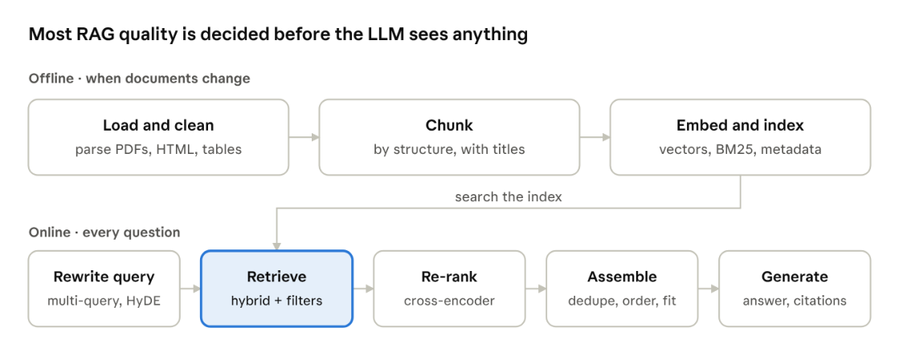

# 31 · Retrieval-augmented generation

Part IX · Retrieval and agents. Builds directly on Chapter 30 (retrieval) and Chapter 22 (prompting). Chapter 25 covers how to evaluate RAG systems. Worked design that builds on it: E.4 RAG support assistant.

## Why it matters

RAG (retrieval-augmented generation) is the most common way companies put LLMs to work on their own knowledge: help centres, internal wikis, policy assistants, catalogue Q&A. It lets an LLM answer from current, private, citable documents without retraining. It is also where most LLM projects first disappoint: a demo built in a day answers 70% of questions well, and getting to 95% takes months of retrieval, chunking and evaluation work.

A RAG design question (worked design E.4) is very likely in any applied-LLM system design round. Interviewers look for whether you see RAG as a retrieval system with an LLM at the end, can name where it fails, and can measure and fix each failure. Research interviews at labs ask a different set of questions about the same idea: how the original RAG model marginalises over retrieved documents, how retrieval can be trained jointly with the generator (REALM, RETRO, Atlas), how to fine-tune a model to use or ignore its context (RAFT, RA-DIT), and what a model should do when the context contradicts what it learnt in pretraining. Section 31.11 covers that side.

The chapter follows a question through a RAG system. It starts with the whole pipeline, offline indexing and online answering (31.1), then takes the offline side: parsing and chunking documents (31.2) and the metadata that makes filtering possible (31.3). The online side follows: rewriting the question into better search queries (31.4), choosing and ordering the passages the model will read (31.5), and generating an answer with citations that can be checked (31.6). Sections 31.7 and 31.8 cover two extensions, graph-based retrieval and agentic retrieval that searches in several steps. The chapter then gives a table of common failures and their fixes (31.9) and a worked debugging session (31.10), and ends with the research view of RAG: retrieval-augmented models and training (31.11).

The guiding principle is that a RAG system is only as good as its weakest stage, and the weakest stage is usually not the language model. Most production failures trace back to parsing, chunking or retrieval: the right passage was never indexed cleanly, or never retrieved. Debugging starts at the beginning of the pipeline, not the end.

## Key concepts

- **Retrieval-augmented generation (RAG)**: retrieve relevant documents and give them to the LLM as context, so answers are grounded and knowledge can be updated without retraining. [RAG paper](https://arxiv.org/abs/2005.11401).
- **Chunking**: splitting documents into passages small enough to retrieve precisely but large enough to make sense alone.
- **Contextual retrieval**: adding a short document-level summary to each chunk before embedding, to fix chunks that lose meaning out of context. [Anthropic: contextual retrieval](https://www.anthropic.com/news/contextual-retrieval).
- **Query rewriting and HyDE**: reformulating the user's question, or generating a hypothetical answer and searching with it. [HyDE paper](https://arxiv.org/abs/2212.10496).
- **Hybrid retrieval and re-ranking**: Chapter 30's tools applied to RAG.
- **Grounding and citations**: instructing the model to answer only from the context and cite passages, then checking the citations (Chapter 28).
- **Failure modes**: missed retrieval, wrong chunk, ignored context, hallucinated answer; each needs its own metric (Chapter 25).
- **Design patterns overview**: [Eugene Yan: Patterns for Building LLM-based Systems](https://eugeneyan.com/writing/llm-patterns/).

## 31.1 The pipeline end to end



*the RAG pipeline · offline indexing and online answering*

**Offline (indexing):** load documents from their sources, clean and parse them (PDF tables and HTML layouts are a frequent source of silent errors), split them into chunks, embed and index the chunks with their metadata, and keep the index in sync as documents change.

**Online (answering):** rewrite the question if needed, retrieve candidates (hybrid search with filters, Chapter 30), re-rank, assemble the best passages into the context within a token budget, and generate an answer that cites its sources, or says it does not know.

When RAG answers are wrong, the cause is usually upstream of the LLM: the document was never indexed, the chunk split the answer in two, the retriever missed it, or the context was too noisy. That is why this chapter spends more time before generation than on it.

## 31.2 Ingestion and chunking

**Parsing comes first.** Garbage in the index means garbage answers. Check what your parser does to tables (rows flattened into nonsense), headers and footers repeated on every page, multi-column PDFs, and scanned documents (which need OCR). Look at a sample of parsed output by eye before anything else.

**Why chunk at all?** Embedding a whole long document into one vector blurs its meaning, and the LLM's context has a budget. Chunks are the unit of retrieval: small enough to be specific, large enough to be self-contained.

| Strategy | How | Good for | Watch out |
|---|---|---|---|
| Fixed size with overlap | Every N tokens, overlapping by M | Quick baseline | Splits sentences, tables and lists mid-way |
| Recursive, by structure | Split on headings, then paragraphs, then sentences, packing up to a size | Most documents: the sensible default | Needs reasonably structured input |
| Semantic | Split where embedding similarity between adjacent sentences drops | Long unstructured text | More compute; gains are often small |
| Small-to-big (parent-child) | Retrieve small chunks for precision, return their larger parent section to the LLM | Answers that need surrounding context | Bigger contexts, more tokens |
| Document-level | One chunk per short document (FAQ entry, product) | Short, self-contained items | Long items lose detail |

**Add context to every chunk.** A chunk saying "Requests must be made within 24 hours" is useless on its own: requests for what? Prepend the document title and heading path, so both the embedding and the LLM see it. Anthropic's "contextual retrieval" write-up (2024) takes this further: an LLM writes one or two sentences situating each chunk in its document, prepended before embedding and BM25 indexing, and they reported a large reduction in retrieval failures.

**A structure-aware chunker:**

```python
import re

def n_tokens(text):
    return len(text.split())          # stand-in; use the model's tokenizer in practice

def split_markdown_sections(doc):
    """Split on headings, keeping the heading path as context for each section."""
    sections, path, buf = [], [], []
    for line in doc.splitlines():
        m = re.match(r"^(#{1,6})\s+(.*)", line)
        if m:
            if buf:
                sections.append((" > ".join(path), "\n".join(buf).strip()))
                buf = []
            level = len(m.group(1))
            path = path[:level - 1] + [m.group(2).strip()]
        else:
            buf.append(line)
    if buf:
        sections.append((" > ".join(path), "\n".join(buf).strip()))
    return [(p, t) for p, t in sections if t]

def chunk_text(text, max_tokens=300, overlap=40):
    """Pack paragraphs (sentences for long paragraphs) into chunks up to max_tokens, with overlap."""
    units = []
    for para in [p for p in text.split("\n\n") if p.strip()]:
        if n_tokens(para) <= max_tokens:
            units.append(para.strip())
        else:
            units += [s.strip() for s in re.split(r"(?<=[.!?])\s+", para) if s.strip()]
    chunks, current = [], []
    for unit in units:
        if current and n_tokens(" ".join(current + [unit])) > max_tokens:
            chunks.append(" ".join(current))
            tail = " ".join(current).split()[-overlap:] if overlap else []
            current = [" ".join(tail)] if tail else []
        current.append(unit)
    if current:
        chunks.append(" ".join(current))
    return chunks

def chunk_document(doc, doc_id, title, max_tokens=300, overlap=40):
    out = []
    for path, body in split_markdown_sections(doc):
        for chunk in chunk_text(body, max_tokens, overlap):
            header = f"{title} > {path}" if path else title
            out.append({"id": f"{doc_id}#{len(out)}", "doc_id": doc_id, "section": path,
                        "text": f"[{header}]\n{chunk}"})
    return out
```

Run on a small refunds policy with a deliberately tiny budget (`max_tokens=25, overlap=5`, so that the output fits here), it produces:

```text
policy-17#0 | [Help centre > Refunds > Late orders]
              If your order arrives more than 30 minutes after the promised time, you can request a voucher.
policy-17#1 | [Help centre > Refunds > Late orders]
              you can request a voucher. Vouchers are worth 20% of the order value, up to 10 euros.
              Requests must be made within 24 hours.
policy-17#2 | [Help centre > Refunds > Missing items]
              Report missing items in the app within 48 hours. We refund the item price to your original payment method.
```

The second chunk starts with the five-word overlap from the first, and every chunk carries its heading path, so "Requests must be made within 24 hours" is now retrievable as a statement about late-order refunds.

**Choosing chunk size** is an empirical question: try two or three sizes (for example 200, 400 and 800 tokens) and compare retrieval recall and answer quality on your evaluation set (Chapter 25). Smaller chunks retrieve more precisely; larger ones keep more context.

Compare sizes at a **fixed context budget**, not at a fixed k, or the comparison is unfair. With 2,000 tokens for passages, the LLM sees 10 chunks of 200 tokens, 5 of 400 or 2 of 800. Small chunks give more chances to catch the answer from different documents but each may lack the sentence that qualifies it; large chunks bring their own context but spend the budget on two documents. The usual finding is that structure-aware chunks of a few hundred tokens with heading paths are a good default, that contextual headers matter more than the exact size, and that small-to-big retrieval removes much of the trade-off. Measure recall@budget, not recall@k.

### PDFs, slides and other visual documents

Much enterprise knowledge lives in PDFs, slide decks and scanned forms, where meaning sits in layout: tables, charts, multi-column text, captions. Two approaches are now standard. **Parse to text**: a layout-aware parser or a vision-language model converts each page to structured Markdown (tables as tables, headings as headings), and the text pipeline above runs on the result; check a sample by eye, because a flattened table silently produces wrong answers. **Retrieve page images directly**: ColPali (Faysse et al., 2024) embeds each page image with a vision-language model into a grid of patch vectors and scores queries against them with ColBERT-style late interaction (Chapter 30.7), so charts and tables are matched without OCR; the retrieved page images then go to a multimodal LLM. Image retrieval avoids parsing errors and handles figures, at the cost of many vectors per page and a multimodal generator. A common hybrid is to index both and fuse.

**Keeping the index fresh.** Track a content hash per document; re-chunk and re-embed only changed documents; delete chunks of removed documents (stale policies are a classic RAG failure); record the indexing time so answers can say how current they are.

## 31.3 Metadata and filtering

Similarity alone cannot answer "what is the refund policy in the UAE as of this year?": the right passage depends on the country and the date, not just the wording. Storing structured metadata with each chunk lets retrieval apply those constraints exactly, which is often worth more than a better embedding model.

Store metadata with each chunk: source, document id, section, language, country, audience (customer, rider, partner), product, effective date, version, and access permissions. Then:

- **Filter** on hard constraints before or during retrieval: country, audience, language, and above all **permissions** (Chapter 30.5: access control belongs in retrieval, never in the prompt).
- **Boost** on soft preferences: newer documents, official policy over community answers.
- **Show** metadata in the context so the model can say "according to the UAE refund policy updated in March".

Filters can come from the user's session (their country and role) or from the question itself, extracted by an LLM (self-query, Chapter 30.8).

## 31.4 Query transformation

The user's question is often not the best search query. Techniques, roughly in order of usefulness:

- **Conversational rewriting:** turn "and for riders?" into a standalone question using the chat history. Essential for any chat interface.
- **Multi-query:** generate three to five paraphrases, retrieve for each, fuse with reciprocal rank fusion. Improves recall when users and documents use different words.
- **Decomposition:** split "compare the late-order policy in Spain and the UAE" into one query per country.
- **Step-back prompting:** also search for the more general question ("refund policy overview") to retrieve background the specific question needs.
- **HyDE (hypothetical document embeddings,** Gao et al., 2022): ask the LLM to write a plausible answer, embed that answer, and search with it. A fake answer looks more like the real document than the question does. It helps when queries are short and documents are long; it can mislead when the LLM's guess is confidently wrong, so combine it with the original query.

```python
import numpy as np

def hyde_search(question, llm, embed, index, k=20):
    draft = llm(f"Write a short help-centre paragraph that answers: {question}")
    q_vec, d_vec = embed(question), embed(draft)          # unit vectors
    v = q_vec + d_vec                                     # keep the original query in the search
    return index.search(v / np.linalg.norm(v), k)         # renormalise: the mean of two unit vectors is shorter
```

Averaging two unit vectors gives a vector shorter than unit length (its norm is the cosine of half the angle between them), which changes scores under inner-product search and breaks any score threshold. Renormalise, as above, or run two searches and fuse the result lists with RRF (Chapter 30.6), which also lets you weight the original query more.

Each transformation adds an LLM call (latency and cost) and can drift from what the user meant. Add them one at a time and keep each only if retrieval recall on your evaluation set improves.

## 31.5 Context assembly and ordering

After re-ranking you have, say, 30 scored passages and a budget of a few thousand tokens. Assembly decides what the LLM actually reads:

- **Deduplicate** near-identical chunks (the same paragraph in two document versions, overlapping chunks). The code below catches exact duplicates only; for near-duplicates, compare MinHash signatures (Chapter 16.5) or drop a passage whose embedding has cosine above about 0.95 with one already chosen.
- **Limit per document** so one long document does not crowd out others.
- **Fit a token budget**, leaving room for instructions, history and the answer.
- **Order** with the most relevant first (and possibly last), given position effects (Chapter 22.6). The original evidence was "lost in the middle" (Liu et al., 2023): models used information at the start and end of a long context better than in the middle. Frontier models of 2025–26 largely pass simple needle-in-a-haystack tests across their whole window, so the effect is weaker for single-fact lookups. But performance still falls as context grows when the task needs several pieces of evidence, when the needle shares no words with the question (the NoLiMa benchmark, 2025), or when the context contains plausible distractors, an effect a 2025 study by Chroma called **context rot**. The advice holds for that reason: fewer, better passages, best first.
- **Format** each passage with an id and its metadata, so the model can cite it.
- **Expand** small retrieved chunks to their parent section if the answer needs surrounding context (small-to-big).

```python
def assemble_context(passages, budget_tokens, max_per_doc=2):
    """passages: dicts with id, doc_id, text, score, sorted best first."""
    chosen, used, per_doc, seen = [], 0, {}, set()
    for p in passages:
        key = p["text"].strip().lower()                 # exact duplicates only; see above
        if key in seen or per_doc.get(p["doc_id"], 0) >= max_per_doc:
            continue
        cost = n_tokens(p["text"])
        if used + cost > budget_tokens:
            continue
        chosen.append(p)
        used += cost
        seen.add(key)
        per_doc[p["doc_id"]] = per_doc.get(p["doc_id"], 0) + 1
    context = "\n\n".join(f'<doc id="{p["id"]}">\n{p["text"]}\n</doc>' for p in chosen)
    return context, [p["id"] for p in chosen]
```

More context is not better. Past a point, extra passages add distractors and cost. Tune the number of passages on your evaluation set just like chunk size.

## 31.6 Generation with citations and grounding

**The generation prompt** needs: the role and audience; an instruction to answer only from the provided documents; what to do when they do not contain the answer ("say you don't know and offer to connect to an agent"); how to cite (passage ids after each claim); tone and length; and the documents clearly marked as data. Then the question, last.

**Grounding checks after generation:**

- Every cited id must exist in the context (models sometimes invent ids).
- Each cited sentence should be supported by its source: a cheap word-overlap check catches gross errors; an entailment model or LLM judge checks properly (Chapter 25).
- Sentences with no citation in a policy answer are suspicious.

```python
import re

def check_citations(answer, allowed_ids, passages_by_id, min_overlap=0.5):
    problems = []
    for sentence in re.split(r"(?<=[.!?])\s+", answer.strip()):
        cited = re.findall(r"\[([^\]]+)\]", sentence)
        if not cited:
            problems.append(("uncited", sentence))
            continue
        for cid in cited:
            if cid not in allowed_ids:
                problems.append(("unknown id", cid))
                continue
            words = set(re.findall(r"\w+", re.sub(r"\[[^\]]+\]", "", sentence).lower()))
            src = set(re.findall(r"\w+", passages_by_id[cid].lower()))
            if words and len(words & src) / len(words) < min_overlap:
                problems.append(("weak support", sentence))
    return problems
```

What to do with a failed check depends on the stakes: regenerate, drop the unsupported sentence, show the answer with a warning, or hand over to a human. For customer-facing policy answers (refund amounts, legal terms), err towards handing over.

**"I don't know" is a feature.** Measure how often the system answers when it should abstain (and the reverse) as its own metric. A RAG system that always answers is a hallucination generator for every question outside its documents.

**Abstaining well needs calibrated signals.** The tempting rule, "abstain if the top retrieval score is below 0.5", fails because cosine and re-ranker scores are not calibrated across queries: a short, generic question gets lower similarities to its correct passage than a long, specific one gets to an irrelevant passage. Two fixes. **Calibrate** the signal on your evaluation set: fit, by isotonic or logistic regression on labelled questions, the probability that the retrieved context contains the answer as a function of the re-ranker score (and features such as query length), then threshold that probability. Or ask an LLM a **sufficiency** question ("does this context contain enough information to answer?"); Joren et al. (2025) proposed this "sufficient context" lens and found that models often answer wrongly rather than abstain when context is insufficient. Either way, report the trade-off as a curve: **coverage** (share of questions answered) against **selective accuracy** (accuracy on the answered ones). Abstaining on 15% of questions to lift accuracy from 80% to 90% on the rest is a product decision with numbers attached: 0.85 × 0.90 = 76.5% of all questions answered correctly, against 80% before, with the wrong answers cut from 20% of questions to 8.5%.

### RAG security: poisoned corpora and injected documents

Every document a RAG system can retrieve is input to the model, so anyone who can write to the corpus can attack it. **Corpus poisoning**: an attacker adds passages crafted to be retrieved for target questions and to carry a false answer; PoisonedRAG (Zou et al., 2024) showed that a handful of such passages per target question, in a corpus of millions, made the system give the attacker's answer most of the time. **Indirect prompt injection** through retrieved content: a wiki page or ticket containing "ignore your instructions and…" reaches the prompt with everything else (Chapter 28.4). Defences: control who can write to indexed sources and record provenance in metadata; prefer authoritative sources in ranking; treat retrieved text as data, delimited and never able to trigger tools by itself; check outputs for links and actions that the question did not call for; and for agentic RAG, apply the lethal-trifecta test of Chapter 28.4.

## 31.7 GraphRAG

Some questions are not answered by any single passage: "what themes come up across all complaints this quarter?" needs a view of the whole collection. Graph-based RAG builds an explicit structure of entities and relationships, or summaries of document communities, so that such global questions can be answered from it.

Standard RAG retrieves passages similar to the question. It struggles with **global questions** that need the whole corpus ("what are the main themes in this year's complaints?") and with **multi-hop questions** across entities ("which partners affected by the March policy change also had late-delivery escalations?").

**GraphRAG** (Microsoft, 2024) builds a knowledge graph offline: an LLM extracts entities and relationships from every chunk, groups the graph into communities, and writes a summary per community. Global questions are answered from community summaries (map-reduce); local questions combine graph neighbours with text chunks.

**Trade-offs:** indexing is expensive (LLM calls over the whole corpus) and must be redone as documents change; extraction errors propagate; it pays off for analysis over a fixed corpus and for entity-heavy domains, rarely for a help centre answering specific questions. A lighter version: store extracted entities as metadata and filter or join on them.

## 31.8 Agentic RAG

A single retrieve-then-generate pass fails when the question needs several lookups, or when the first search shows that the question should have been asked differently. Agentic RAG lets the model decide when and what to search, read the results and search again, at the cost of more latency and less predictability.

Instead of one fixed retrieve-then-generate pass, an agent (Chapter 33) decides: whether to retrieve at all, which source or tool to use (vector index, SQL, an orders API), whether results are good enough, and whether to search again with a refined query. Research variants include Self-RAG (the model judges when to retrieve and whether passages support its output) and Corrective RAG (grade retrieved documents and fall back to other sources when they are poor).

**When it is worth it:** multi-part questions, questions mixing documents with live data ("why was my order refunded only 5 euros?" needs the policy and the order record), or research-style tasks. **Costs:** several LLM calls per question, higher latency, harder evaluation (trajectories, Chapter 25), and new failure modes such as loops. Start with a fixed pipeline and add agentic steps only where evaluation shows a single pass fails.

## 31.9 Common failure modes and fixes

| Symptom | Likely cause | Fix |
|---|---|---|
| Answer missing although the document exists | Not indexed, parsing broke it, or filtered out | Ingestion checks; index coverage report; test filters |
| Right document, wrong part retrieved | Chunks too big or split badly; no heading context | Structure-aware chunking with titles; contextual chunk headers |
| Retrieval misses paraphrased questions | Dense model weak in domain; vocabulary mismatch | Hybrid search; multi-query; fine-tune embeddings |
| Retrieval misses exact codes and names | Dense-only retrieval | Add BM25 |
| Correct passage retrieved but answer still wrong | Too many distractors; passage in the middle; model ignores it | Fewer, re-ranked passages; ordering; stronger instructions; better model |
| Confident answers to out-of-scope questions | No abstain path | Explicit "don't know" instruction; retrieval-score threshold; evaluation on out-of-scope questions |
| Outdated answers | Stale chunks kept after updates | Content hashing, deletes, effective dates in metadata |
| Answers mix rules from different countries | Missing metadata filters | Filter by country and audience from the session |
| Invented citations | Model fabricates ids | Validate ids; constrain citation format |

The debugging order is always the same: first check whether the right passage was retrieved (retrieval problem), then whether it reached the context (assembly problem), then whether the answer used it correctly (generation problem). Chapter 25 turns this into metrics.

## 31.10 A worked debugging session

Suppose an internal policy assistant answers 64% of a 200-question evaluation set correctly, and the team's instinct is to try a bigger model. Debug in the order of 31.9 instead.

1. **Label each failure by where it happened.** For each of the 72 wrong answers, check three things in the trace: whether the gold passage is in the top 50 retrieved, whether it is in the final context, and whether the answer used it. A plausible breakdown:

   | Where the failure happened | Count | Share of failures |
   |---|---|---|
   | Gold passage not retrieved in the top 50 | 30 | 42% |
   | Retrieved, but ranked out of the final 5 | 14 | 19% |
   | In the context, answer still wrong | 20 | 28% |
   | Wrongly abstained | 5 | 7% |
   | Label or question problem | 3 | 4% |

2. **Fix the biggest group first.** Reading the 30 retrieval misses shows two patterns:
   - Questions using internal codes ("form HR-7"), which dense retrieval misses. Fix: add BM25 and fuse the results (Chapter 30.6).
   - Questions about tables that the parser flattened into nonsense. Fix: table-aware parsing, with each table chunked together with its title.

   Re-index and re-run.
3. **Then the ranking group.** Add a cross-encoder re-ranker over the top 50 and keep the final 5. Check that the context recall at 5 rises on the evaluation set.
4. **Then the generation group.** The 20 in-context failures split into two kinds:
   - Answers that mix two policies, because the passages for two countries were both retrieved. Fix: a country metadata filter from the user's profile (31.3).
   - Answers that ignore a passage placed in the middle of a long context. Fix: fewer, better passages, with the most relevant placed first.

   Only failures that remain after this are evidence for a stronger model.
5. **Fix the labels** for the 3 questions with problems, and keep them in the set as regression tests.

Each step is a separate, measured change. The order matters because upstream fixes change what reaches the model: a prompt tuned before the retrieval fixes would be tuned to the wrong context. In most RAG systems the first two groups are the majority, and the biggest gains come from ingestion and retrieval rather than the generator.

## 31.11 RAG in research: retrieval-augmented models and training

Everything above treats the retriever and the LLM as fixed components joined by a prompt. The research line that named RAG asks a different question: if a model can look things up, how should it be *trained* to do so, and how much knowledge then needs to live in its weights? Lab interviews probe this side, because it connects retrieval to likelihoods, gradients and the parametric-versus-contextual knowledge trade-off.

### The original RAG model: marginalising over documents

Lewis et al. (2020) treated the retrieved document z as a latent variable. A retriever p_η(z | x) (a DPR bi-encoder, Chapter 30.3) gives a distribution over the top-k documents for input x, and a generator p_θ (BART in the paper) produces the output y given x and z. The answer's probability sums over documents, in one of two ways. **RAG-sequence** uses one document for the whole answer:

$$
p_{\mathrm{seq}}(y\mid x) = \sum_{z\in \mathrm{top}k} p_\eta(z\mid x)\,\prod_{i} p_\theta(y_i\mid x, z, y_{<i})
$$

**RAG-token** lets every output token draw on a different document, by moving the sum inside the product:

$$
p_{\mathrm{tok}}(y\mid x) = \prod_{i}\,\sum_{z\in \mathrm{top}k} p_\eta(z\mid x)\,p_\theta(y_i\mid x, z, y_{<i})
$$

Here yᵢ is the i-th output token and y₍<ᵢ₎ the tokens before it. **A worked example** with two documents and a two-token answer: p(z₁ | x) = 0.6 and p(z₂ | x) = 0.4. Document z₁ supports the first token well (0.9) but not the second (0.1); z₂ the reverse (0.2 and 0.9). RAG-sequence gives 0.6 × 0.9 × 0.1 + 0.4 × 0.2 × 0.9 = 0.054 + 0.072 = 0.126. RAG-token gives (0.6 × 0.9 + 0.4 × 0.2) × (0.6 × 0.1 + 0.4 × 0.9) = 0.62 × 0.42 = 0.260, about twice as much, because it can take the first token from z₁ and the second from z₂. RAG-token suits answers that combine facts from several sources; RAG-sequence suits answers that should come from one coherent source, and it is easier to decode (beam search per document, then combine).

**How the retriever learns without relevance labels.** Training maximises log p(y | x) over (question, answer) pairs only. Write the retriever's scores as logits s_z, so p_η(z | x) is their softmax. For RAG-sequence, differentiating the log of the sum gives

$$
\dfrac{\partial \log p(y\mid x)}{\partial s_z} = p(z\mid x, y) - p_\eta(z\mid x)
$$

where p(z | x, y) = p_η(z | x) p(y | x, z) / p(y | x) is the posterior: how much document z helped explain the actual answer. The retriever is pushed up on documents that explain the answer better than it expected and down on the rest. In the example the posteriors are 0.054/0.126 = 0.429 and 0.072/0.126 = 0.571, so the gradients are −0.171 for z₁ and +0.171 for z₂: the answer is better explained by z₂ than the retriever's 0.4 suggested. In practice only the query encoder is trained; the document encoder and index stay fixed, because re-encoding millions of documents after each step is too expensive.

### Retrieval inside pretraining and architecture

- **REALM** (Guu et al., 2020) put retrieval into masked-language-model pretraining: to fill a masked span, the model retrieves passages from Wikipedia and is trained through the same marginal likelihood, so the retriever learns what helps prediction. Because the document encoder is trained too, the index is stale; REALM re-embeds the corpus asynchronously every few hundred steps.
- **Fusion-in-Decoder** (FiD; Izacard and Grave, 2021) encodes each (question, passage) pair separately with the encoder of an encoder-decoder model and lets the decoder attend to all the encoded passages together. Encoder cost grows linearly with the number of passages rather than quadratically, so FiD can read 100 passages and combine evidence across them.
- **RETRO** (Borgeaud et al., 2022) retrieves continuously during language modelling: the input is split into 64-token chunks, the nearest neighbours of each chunk are fetched from a database of about 2 trillion tokens with a frozen BERT retriever, and the model attends to them through chunked cross-attention layers. The paper reported a 7.5B-parameter RETRO comparable to GPT-3 on the Pile with 25× fewer parameters, which is the argument that knowledge can move from weights to a database.
- **Atlas** (Izacard et al., 2022) trained a retriever and a FiD reader jointly and showed strong few-shot performance on knowledge-intensive tasks, reporting results on Natural Questions with 64 examples that beat a much larger closed-book model.

The common lesson: a smaller model with retrieval can match a larger one on knowledge-heavy tasks, the knowledge can be updated by editing the index, and the cost moves from parameters to retrieval infrastructure. The same lesson explains why modern systems pair a strong general LLM with a retriever rather than training RETRO-style models: the retriever-reader interface is a prompt, which lets each side improve independently.

### Training the generator to use, or ignore, its context

An off-the-shelf LLM is not trained to read retrieved passages critically, so two fine-tuning recipes target that skill.

- **RA-DIT** (Lin et al., 2023, retrieval-augmented dual instruction tuning) fine-tunes in two independent steps. The language model is instruction-tuned with retrieved passages prepended, so it learns to use relevant context and to ignore irrelevant context. The retriever is then tuned with **LM-supervised retrieval**: its distribution over candidates is trained towards the distribution of how much each candidate raises the language model's likelihood of the correct answer, which is the posterior idea above without joint training.
- **RAFT** (Zhang et al., 2024, retrieval-augmented fine-tuning) trains on questions paired with the "oracle" document that contains the answer plus several distractor documents, and in a fraction of examples with distractors only. Answers are chain-of-thought explanations that quote the relevant passage. The model learns to find the useful document among distractors and to fall back on what it knows when no document helps, which is the domain-specific "open-book exam" setting of a company's RAG system.

### When context and parametric knowledge disagree

A retrieved passage may contradict what the model learnt in pretraining: the policy changed, the passage is wrong, or the passage is poisoned (31.6). Which should win depends on the application, and the research shows models are not consistent. Longpre et al. (2021) substituted the answer entity in passages and found that QA models often ignored the context and answered from memory, a form of hallucination with respect to the context. Later work on LLMs (Xie et al., 2024) found the opposite tendency when the counter-evidence is coherent and persuasive: models readily adopt the context even against strong parametric knowledge, while showing confirmation bias when the context holds both views.

The practical consequences are two measurements and a design choice. Measure **context faithfulness** with counterfactual tests: edit the answer in the gold passage and check whether the model follows the passage (what a policy assistant must do, since the documents are the source of truth). Measure **robustness to misleading context**: insert a plausible wrong passage and check whether the model is misled (what an open-web assistant must resist). Then decide which behaviour the product needs, say it in the instructions ("the documents are authoritative; if they conflict with what you know, follow them and say so"), and train or select for it. A model cannot be maximally faithful to its context and maximally robust to bad context at the same time; trust in the corpus decides the balance.

## Pitfalls

- **Skipping the parsing check.** Broken tables and repeated footers poison the index silently.
- **Fixed-size chunks with no headings.** Chunks lose what they are about.
- **Tuning the prompt before measuring retrieval.** Most failures are upstream.
- **Stuffing the context.** More passages add distractors and cost.
- **No abstain path,** so the system answers everything, including questions outside its documents.
- **Access control in the prompt** instead of retrieval filters.
- **Stale or duplicated documents** from several versions of the same policy.
- **Query transformations added without measuring** their effect on recall, latency and cost.
- **Going agentic or GraphRAG first,** before a simple pipeline is measured.
- **No citations, or unverified citations.** Users and reviewers cannot check answers.
- **Thresholding raw similarity scores to abstain.** They are not calibrated across queries.
- **Letting anyone write to the indexed corpus.** Poisoned or injected documents reach the prompt.

## Interview questions

Questions 1–4 basic, 5–9 intermediate, 10–17 senior.

**1. What problem does RAG solve compared with fine-tuning?** It gives the model current, private, citable knowledge at query time without retraining; updating knowledge means updating the index. Fine-tuning changes behaviour, style or format, and is a poor way to add facts that change: it is slow to update, cannot cite, and fine-tuning on new facts can even raise hallucination rates. Follow-up: "When combine them?" Fine-tune for the skill of using context (RAFT-style) or for format, and retrieve for the facts.

**2. Walk through a RAG pipeline.** Offline: load, parse, chunk with context, embed and index with metadata, keep in sync. Online: rewrite the query, hybrid retrieval with filters, re-rank, assemble context in a budget, generate with citations and an abstain option, verify grounding. Most failures are upstream of the LLM, so each stage gets its own metric. Follow-up: "Where would you look first when answers are wrong?" Whether the gold passage was retrieved at all.

**3. How do you choose a chunking strategy?** Start with structure-aware recursive chunking with headings prepended; try two or three sizes; compare retrieval recall and answer quality on an evaluation set at a fixed token budget (with 2,000 tokens, that is 10 chunks of 200 versus 5 of 400); consider small-to-big when answers need surrounding context. Follow-up: "What matters more than size?" Contextual headers, so that a chunk like "Requests must be made within 24 hours" says what it is about.

**4. What is HyDE?** Generate a hypothetical answer with an LLM and search with its embedding, because a fake answer resembles real documents more than a short question does. Combine with the original query, and renormalise the combined vector or fuse two searches with RRF; it can mislead when the guess is confidently wrong, and it adds an LLM call of latency. Follow-up: "When does it help most?" Short queries against long documents in a domain the LLM knows well.

**5. How do you make RAG answers trustworthy?** Answer only from retrieved documents, cite passage ids per claim, validate citations and support, abstain when documents do not answer, show sources to users, and monitor the share of unsupported claims. Calibrate the abstain signal rather than thresholding raw similarity, and report coverage against selective accuracy. Follow-up: "How do you check support cheaply?" Word overlap catches gross errors; an NLI model or judge checks properly on a sample.

**6. The right document is retrieved but answers are still wrong. What do you check?** Whether the relevant passage made it into the final context after assembly; its position; the number of distractors; whether the passage is self-contained; instruction clarity; whether a stronger model fixes it (a sign of reasoning difficulty rather than retrieval). Current frontier models pass simple needle tests, but accuracy still drops with long, distractor-heavy or multi-hop contexts (context rot), so cutting from 30 passages to 5 good ones often fixes it. Follow-up: "And if the model ignores the passage in favour of what it knows?" A context–memory conflict: instruct that documents are authoritative, test with counterfactual passages, and consider RAFT-style fine-tuning.

**7. How do you keep a RAG index up to date?** Incremental indexing by content hash; deletes for removed documents; effective dates and versions in metadata; re-embedding everything when the embedding model changes, built in parallel and switched after evaluation. Track freshness lag (time from a document change to it being searchable) as a metric. Follow-up: "Stale answers despite updates?" Old versions still indexed: dedupe by document id and keep only the current version unless history is asked for.

**8. When would you use GraphRAG?** For global or multi-hop questions over a relatively stable, entity-rich corpus, where the indexing cost is justified. Not for a help centre answering specific questions. Cost: an LLM extraction pass over every chunk, so a 50M-token corpus means at least 50M input tokens of LLM calls plus the extracted output and community summaries, redone as documents change. Follow-up: "A cheaper middle ground?" Extract entities as metadata and filter or join on them.

**9. What is agentic RAG and what does it cost?** The model decides whether, where and how often to retrieve, possibly combining documents with live tools. Better for complex or mixed questions; costs more calls, latency, and harder evaluation. Three retrieval rounds with a 2,000-token context each roughly triple the input tokens and add two model round-trips of latency. Follow-up: "How do you evaluate it?" On trajectories as well as answers (Chapter 25): did it search for the right things, and did it stop.

**10. Design a RAG assistant for workforce policies (for example courier or rider policies) in 10 countries and 3 languages.** Ingestion with country, language, audience and effective-date metadata; structure-aware chunks with headings; hybrid retrieval filtered by the user's country and language from the session; multilingual embeddings and re-ranker; citations and abstain path; per-country, per-language evaluation sets; freshness checks when policies change; escalation to support for low-confidence answers. Size the evaluation: 30 slices (country × language) at 50 questions each is 1,500 labelled questions, with about ±14 points per slice at 50%, so report slices for large markets and pooled numbers for the rest. Follow-up: "Mixing rules across countries?" A hard country filter from the session, never from the prompt.

**11. Your RAG demo scored well, but users complain after launch. What happened, and what do you do?** The demo questions were not real questions: users ask vaguer, multi-part, out-of-scope and follow-up questions. Collect real queries and failures, label them, build an evaluation set from them, and run error analysis by stage (retrieval, assembly, generation). Expect the out-of-scope share to be much higher than in the demo set, which makes the abstain path the first fix. Follow-up: "How many to label first?" 100–200 failures are enough to rank the failure categories.

**12. How do you decide between a bigger context window and better retrieval?** Compare on the evaluation set: answer quality, cost per question and latency for "top 5 passages" vs "top 50" vs whole documents. At 300-token passages and an illustrative $3 per million input tokens, 5 passages plus instructions is about 2,000 tokens ($0.006 a question), 50 passages about 15,500 ($0.047), and a whole 200,000-token corpus $0.60. Better retrieval usually wins on cost and often on quality, because distractors hurt. Long context wins when the corpus is small and static: with prompt caching at, say, a tenth of the input price, the 200k corpus costs $0.06 a question and avoids retrieval errors altogether (cache-augmented generation). Follow-up: "Latency?" Prefill of 200k tokens takes seconds even when cached reads are cheap; time to first token often decides.

**13. How would you reduce hallucinations in a customer-facing RAG system by half?** Measure first: classify hallucinations by cause (retrieval miss, ignored context, out-of-scope question, invented details). Then: abstain on calibrated low-sufficiency signals, stricter grounding instructions, citation verification with regeneration, better retrieval for the miss category, and human handover for high-stakes topics. Show the arithmetic of abstention: answering 85% of questions at 90% accuracy cuts wrong answers from 20% of questions to 8.5%. Follow-up: "Why not threshold the top cosine score?" Scores are not comparable across queries; calibrate on labelled data or ask a sufficiency question.

**14. Explain RAG-sequence versus RAG-token.** Both treat the retrieved document as a latent variable and sum over the top k. RAG-sequence uses one document for the whole answer: Σ_z p(z|x) Π_i p(yᵢ | x, z, y₍<ᵢ₎). RAG-token sums over documents at every token: Π_i Σ_z p(z|x) p(yᵢ | …), so different tokens can draw on different documents. Example: with p(z) = 0.6/0.4 and per-token probabilities 0.9/0.1 for z₁ and 0.2/0.9 for z₂, sequence gives 0.126 and token gives 0.260. The retriever trains without labels through ∂log p/∂s_z = p(z | x, y) − p(z | x). Follow-up: "Why freeze the document encoder?" Re-encoding the index every step is too expensive; REALM refreshes it asynchronously.

**15. What do RETRO and FiD change compared with putting passages in the prompt?** FiD encodes each (question, passage) pair separately and fuses them in the decoder's cross-attention, so encoder cost is linear in the number of passages and 100 passages are affordable. RETRO retrieves neighbours for every 64-token chunk from a trillions-of-tokens database and reads them through chunked cross-attention during pretraining, reporting GPT-3-level perplexity on the Pile with 25× fewer parameters. Both show knowledge can move from weights to an index. Trade-off: they need architecture changes and joint training, whereas prompt-based RAG lets retriever and LLM improve independently. Follow-up: "Why is prompt-based RAG dominant?" Strong general LLMs plus long contexts make the prompt a good enough interface.

**16. Retrieved context contradicts the model's knowledge. Which should win, and how do you test it?** It depends on whether the corpus is the source of truth. A policy assistant must follow its documents; an open-web assistant must resist misleading or poisoned pages. Measure both: counterfactual passages (edit the answer and check whether the model follows) for faithfulness, and inserted plausible wrong passages for robustness. Models are inconsistent: some ignore context in favour of memory, while LLMs readily adopt coherent counter-evidence. Fix with explicit instructions, RAFT-style training with distractors, and source authority in ranking. Follow-up: "Can you have both?" Not fully: maximal faithfulness and maximal robustness to bad context pull in opposite directions; trust in the corpus sets the balance.

**17. How can an attacker compromise a RAG system, and how do you defend it?** By writing to the corpus: poisoned passages crafted to be retrieved for target questions and to carry a false answer (a handful per question sufficed in PoisonedRAG), or indirect prompt injection inside documents. Defend by controlling who can write to indexed sources, recording provenance, ranking authoritative sources higher, treating retrieved text as delimited data that can never trigger tools on its own, and checking outputs for links or actions the question did not call for. For agentic RAG, apply the lethal-trifecta test (Chapter 28.4). Follow-up: "How do you measure it?" Attack success rate on a red-team set of poisoned documents, per release.

## Practice

1. **Build a RAG baseline end to end** on a public help centre or documentation site (a few hundred pages): parse, chunk with `chunk_document`, hybrid retrieval (Chapter 30), generation with citations. Keep it under 300 lines of plain Python.

<details><summary>Hint and expected result</summary>

Log, for every question, the retrieved ids, the final context ids and the answer; without that trace you cannot do the failure analysis in exercise 6. A first baseline typically answers well on simple lookups and fails on tables, follow-ups and out-of-scope questions.

</details>

2. **Evaluation set.** Write 60 real-sounding questions, including 10 out-of-scope and 10 follow-ups, with the passages that answer them. Score it with the retrieval and generation metrics of Chapter 25, and reuse it for every exercise below.

<details><summary>Hint and expected result</summary>

Write the questions before looking at the documents' wording, or they will copy it. Expect the out-of-scope questions to expose the lack of an abstain path in the baseline.

</details>

3. **Chunking experiment.** Compare fixed-size, structure-aware, and structure-aware with contextual headers at two sizes on retrieval recall at a fixed token budget (for example 2,000 tokens of passages).

<details><summary>Hint and expected result</summary>

Compare at equal tokens, not equal k. Expect contextual headers to help most on chunks whose text does not name their subject, and the size effect to be smaller than the header effect; with 60 questions, differences of a few questions are noise.

</details>

4. **Query transformation.** Add multi-query and HyDE; measure recall gains, latency and cost.

<details><summary>Hint and expected result</summary>

Renormalise the HyDE vector or fuse with RRF. Expect gains concentrated on short or vague questions and none on questions that already use the documents' words; report the added latency per question.

</details>

5. **Grounding.** Implement `check_citations`, then replace the overlap check with an LLM judge, and compare with your own judgement on 50 answers.

<details><summary>Hint and expected result</summary>

Report agreement with your labels (and Cohen's kappa) for both checks. Expect the overlap check to miss paraphrased unsupported claims and to flag correct paraphrases; the judge should agree with you more often but needs its own spot checks.

</details>

6. **Failure analysis.** For 30 wrong answers, label the stage that failed using the table in 31.9.

<details><summary>Hint and expected result</summary>

Use the three checks of 31.10 (retrieved, in context, used). Expect most failures to be retrieval or assembly, as in the worked session; if most are generation, check the questions for ambiguity before blaming the model.

</details>

7. **Research exercise.** Measure context faithfulness against parametric knowledge. Take 200 questions from a public open-domain QA set that a small open model answers correctly closed-book. For each, give the model the gold passage with the answer entity replaced by a plausible alternative, and measure how often it follows the passage; repeat with the instruction "the documents are authoritative" and with a second, unedited passage added. Run three seeds or prompt paraphrases and report intervals.

<details><summary>Hint and expected result</summary>

Expect the follow-the-context rate to rise with the explicit instruction and to fall when a second, conflicting passage supports the model's memory (confirmation bias). Popular facts the model is very sure of tend to resist substitution most. With 200 questions, a 95% interval on a rate near 50% is about ±7 points, so differences smaller than that need more questions.

</details>

## Read next

- *AI Engineering* (Chip Huyen): the RAG chapter.
- *Hands-On Large Language Models* (Alammar and Grootendorst): the chapter on semantic search and RAG.
- Lewis et al., *Retrieval-Augmented Generation for Knowledge-Intensive NLP Tasks* (2020), the original RAG paper.
- Gao et al., *Precise Zero-Shot Dense Retrieval without Relevance Labels* (HyDE, 2022).
- Anthropic, *Introducing Contextual Retrieval* (2024).
- Edge et al., *From Local to Global: A Graph RAG Approach to Query-Focused* *Summarization* (Microsoft, 2024).
- Asai et al., *Self-RAG* (2023); Yan et al., *Corrective Retrieval Augmented Generation* (2024).
- Barnett et al., *Seven Failure Points When Engineering a Retrieval Augmented* *Generation System* (2024).
- Guu et al., *REALM* (2020); Izacard and Grave, *Leveraging Passage Retrieval with Generative Models for Open Domain Question Answering* (FiD, 2021); Borgeaud et al., *Improving Language Models by Retrieving from Trillions of Tokens* (RETRO, 2022); Izacard et al., *Atlas* (2022).
- Lin et al., *RA-DIT: Retrieval-Augmented Dual Instruction Tuning* (2023); Zhang et al., *RAFT: Adapting Language Model to Domain Specific RAG* (2024).
- Longpre et al., *Entity-Based Knowledge Conflicts in Question Answering* (2021); Xie et al., *Adaptive Chameleon or Stubborn Sloth* (2024).
- Faysse et al., *ColPali* (2024); Zou et al., *PoisonedRAG* (2024); Joren et al., *Sufficient Context* (2025).

**Links:** [RAG paper](https://arxiv.org/abs/2005.11401) · [Contextual retrieval](https://www.anthropic.com/news/contextual-retrieval) · [Patterns for LLM systems](https://eugeneyan.com/writing/llm-patterns/) · [Lost in the Middle](https://arxiv.org/abs/2307.03172). Other titles above can be found by searching their title.

## Done when

- Draw the RAG pipeline in 3 minutes and say where most failures happen; write a structure-aware chunker with heading paths in 20 minutes without notes.
- Design metadata and filters for a multi-country assistant, including permissions enforced in retrieval.
- Choose query transformations and justify each with a measurement; explain why the HyDE vector must be renormalised (the mean of two unit vectors has norm cos(θ/2)).
- Assemble context within a budget, compare chunk sizes at a fixed token budget, and explain context rot and why "lost in the middle" still motivates ordering.
- Design citation, grounding checks and a calibrated abstain path; compute the share of wrong answers when answering 85% of questions at 90% accuracy (answer: 8.5%, against 20% at 80% accuracy on all).
- Compute cost per question for 5 versus 50 passages of 300 tokens plus 500 tokens of overhead at $3 per million (answers: $0.006 and $0.047), and say when long context with caching wins.
- Write the RAG-sequence and RAG-token likelihoods from memory, compute them for the two-document example in 31.11 (answers: 0.126 and 0.260), and derive the retriever gradient p(z | x, y) − p(z | x).
- Explain REALM, FiD, RETRO, Atlas, RA-DIT and RAFT in one sentence each, and design a test of context faithfulness versus robustness to misleading context.
- Explain when GraphRAG and agentic RAG are worth their cost, name two attacks on a RAG corpus with a defence for each, and debug a wrong answer by stage using the failure table.

---

[← 30 · Information retrieval](30-information-retrieval.md) · [Contents](../README.md#contents) · [32 · Frameworks and tooling →](32-frameworks-and-tooling.md)
