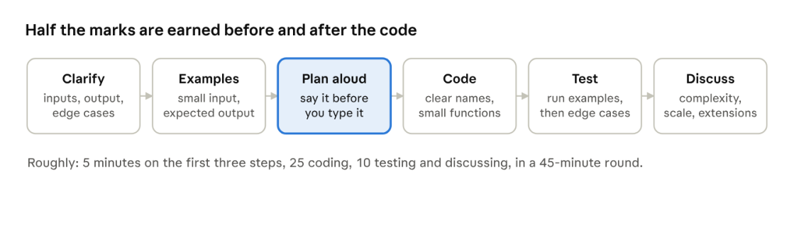

# 31 · The ML coding interview

Part X · The interview. Pulls together the from-scratch code across the book: Chapters 3, 4, 5, 10, 16, 18 and 25 contain most of the implementations listed here. At many product companies the ML coding round is data handling, ML code and object-oriented design rather than algorithm puzzles (check recent candidate reports for your target company); this chapter prepares for that, with a little classic algorithm practice as insurance.

## Why it matters

In your readiness assessment, coding was the decisive gap: the area most likely to fail an otherwise strong loop. The good news is that ML coding rounds reward practice more than talent: the same twenty or so patterns come up again and again. This chapter lists them, gives you working code for the most common ones, and a plan for practising with autocomplete off until they are automatic.

## Key concepts

- **Coding round formats**: algorithmic problems, ML from scratch (implement k-means or logistic regression), data manipulation (pandas or SQL), and practical design (write a small, clean class or service).
- **Big-O complexity**: how time and memory grow with input size; say it for every solution. [Big O notation](https://en.wikipedia.org/wiki/Big_O_notation).
- **Core patterns**: hash maps, two pointers, sliding window, heaps for top-k, BFS/DFS, sorting, binary search. [NeetCode roadmap](https://neetcode.io/roadmap) groups practice problems by pattern.
- **NumPy vectorisation**: replacing Python loops with array operations; expected in ML coding rounds. [NumPy quickstart](https://numpy.org/doc/stable/user/quickstart.html).
- **From-scratch ML implementations**: the models in Chapters 3–6 and 10, written without libraries; build fluency with [Karpathy's Zero to Hero](https://karpathy.ai/zero-to-hero.html).
- **Think-aloud process**: clarify, give examples, state a plan and its complexity, code, test with edge cases. [Tech Interview Handbook](https://www.techinterviewhandbook.org/coding-interview-prep/).

## 31.1 The common formats

| Format | What you get | What they check |
|---|---|---|
| Data manipulation | A pandas DataFrame or SQL tables of orders, users, events; questions like "top 3 restaurants per city by repeat rate" | Fluency with groupby, joins, windows, time; correctness on edge cases |
| ML from scratch | "Implement k-means / logistic regression / AUC / a decision tree split" | Understanding of the algorithm; clean NumPy; vectorisation |
| ML code and OOP | "Design classes for a training pipeline", "write a feature transformer", "extend this model class" | Abstractions, readability, testability, sensible interfaces |
| Applied mini- project | A small dataset and an hour: clean, featurise, train, evaluate | End-to-end judgement: baseline first, correct split, honest evaluation |
| Debugging or code review | Code with bugs or leakage | Reading code, spotting leakage and silent errors |
| Classic algorithms | Arrays, hash maps, heaps, two pointers, BFS | Basic data structures and complexity |

Ask the recruiter which formats to expect and in which language and environment (plain editor, notebook, shared doc). Practise in the same environment, without autocomplete or AI assistance.

## 31.2 How to approach any coding question



*solving a coding question · six steps*

1. **Clarify:** inputs, types, sizes, missing values, ties, what to return. Many lost points come from solving a different problem.
2. **Examples:** write a tiny input and the expected output; it catches misunderstandings early.
3. **Plan aloud:** the approach in two or three sentences, and its complexity. Interviewers can redirect you before you spend 20 minutes on a dead end.
4. **Code:** small functions, clear names, no premature cleverness. Talk as you go, briefly.
5. **Test:** run your example; then empty input, single row, ties, missing values, duplicates.
6. **Discuss:** complexity, what changes at 100× the data (chunking, Spark, SQL), and how you would productionise it.

When stuck, say what you are trying, write a brute-force version first, and improve it. A working simple solution beats an unfinished clever one.

## 31.3 pandas patterns

All on one small `orders` table (order_id, user_id, restaurant, ts, amount). Each pattern below ran on test data; know each one without looking it up.

```python
import pandas as pd

# 1. Top-k per group: each user's two largest orders
top2 = (orders.sort_values(["user_id", "amount"], ascending=[True, False])
              .groupby("user_id").head(2))

# 2. Share within group (transform keeps the original shape)
spend = orders.groupby(["user_id", "restaurant"], as_index=False)
["amount"].sum()
spend["share"] = spend["amount"] / spend.groupby("user_id")
["amount"].transform("sum")

# 3. Time since previous event per user (shift / diff within group)
o = orders.sort_values(["user_id", "ts"]).copy()
o["days_since_prev"] = o.groupby("user_id")["ts"].diff().dt.total_seconds() / 86400

# 4. Sessionisation: a new session after a 30-minute gap or a new user
o["new_session"] = (o["ts"].diff() > pd.Timedelta("30min")) | (o["user_id"] != o["user_id"].shift())
o["session_id"] = o["new_session"].cumsum()

# 5. Rolling time window per user: spend in the last 7 days, including this order
roll = (o.set_index("ts").groupby("user_id")["amount"]
          .rolling("7D").sum().reset_index(name="spend_7d"))

# 6. Point-in-time join: the latest restaurant rating known at order time
pit = pd.merge_asof(orders.sort_values("ts"), ratings.sort_values("ts"),
                    on="ts", by="restaurant", direction="backward")

# 7. Repeat rate: share of users who order again within 7 days of their first order
first = orders.groupby("user_id")["ts"].min().rename("first_ts")
m = orders.join(first, on="user_id")
repeaters = m[(m.ts > m.first_ts) & (m.ts <= m.first_ts + pd.Timedelta("7D"))].user_id.unique()
repeat_rate = len(repeaters) / orders.user_id.nunique()
```

**Also know cold:** `pivot_table` and `melt`; `merge` with `how=` and `indicator=True` to find unmatched rows; `drop_duplicates(subset, keep=)`; `rank(method="dense")`; `pd.cut` and `pd.qcut` for buckets; `explode` for list columns; `value_counts(normalize=True)`; `np.where` and `np.select` for conditional columns; `.dt` accessors; handling `NaN` in groupbys (`dropna=False`).

**Performance habits:** vectorise instead of `apply` with Python functions; use `category` dtype for repeated strings; filter early; avoid chained assignment (use `.loc` or `.assign`); know that `groupby().transform` is usually faster than merging aggregates back.

## 31.4 SQL patterns

Window functions are the heart of SQL interviews for data and ML roles. The same table in SQLite (which supports windows), tested:

```sql
-- Order number, previous order time and running spend per user
SELECT user_id, order_id,
       ROW_NUMBER() OVER (PARTITION BY user_id ORDER BY ts) AS n,
       LAG(ts)      OVER (PARTITION BY user_id ORDER BY ts) AS prev_ts,
       SUM(amount)  OVER (PARTITION BY user_id ORDER BY ts
                          ROWS BETWEEN UNBOUNDED PRECEDING AND CURRENT ROW) AS running_spend
FROM orders;

-- Repeat within 7 days of first order (same answer as pandas pattern 7: 0.75 on the test data)
WITH firsts AS (SELECT user_id, MIN(ts) AS first_ts FROM orders GROUP BY user_id)
SELECT COUNT(DISTINCT o.user_id) * 1.0 / (SELECT COUNT(*) FROM firsts) AS repeat_7d
FROM orders o JOIN firsts f ON o.user_id = f.user_id
WHERE o.ts > f.first_ts AND julianday(o.ts) <= julianday(f.first_ts) + 7;

-- Top 3 restaurants per city by orders
SELECT * FROM (
  SELECT city, restaurant, COUNT(*) AS n_orders,
         DENSE_RANK() OVER (PARTITION BY city ORDER BY COUNT(*) DESC) AS rk
  FROM orders GROUP BY city, restaurant) t
WHERE rk <= 3;

-- Sessionisation: running sum of "new session" flags
WITH flagged AS (
  SELECT *, CASE WHEN julianday(ts) - julianday(LAG(ts) OVER (PARTITION BY user_id ORDER BY ts))
                     > 30.0 / 1440 OR LAG(ts) OVER (PARTITION BY user_id ORDER BY ts) IS NULL
                 THEN 1 ELSE 0 END AS new_session
  FROM events)
SELECT *, SUM(new_session) OVER (PARTITION BY user_id ORDER BY ts) AS session_n FROM flagged;
```

**Also know:** `RANK` vs `DENSE_RANK` vs `ROW_NUMBER` (ties); `LEAD`; moving averages with `ROWS BETWEEN 6 PRECEDING AND CURRENT ROW`; conditional aggregation (`SUM(CASE WHEN` `... THEN 1 ELSE 0 END)`); `LEFT JOIN ... WHERE right.id IS NULL` for anti-joins; cohort retention tables; funnels; deduplication with `ROW_NUMBER() ... = 1`; date functions in the dialect you will use (BigQuery, Snowflake, Postgres, Spark SQL). Chapter 30 goes deeper on SQL for ML, including point-in-time joins.

## 31.5 Algorithms to implement from scratch

Each links to the chapter that has tested code. Target times assume practice; aim for these by week 8.

| Algorithm | Chapter | Target time |
|---|---|---|
| Linear regression (normal equation and gradient descent) | 4.1, 3.5 | 15 min |
| Logistic regression with mini-batch SGD / Adam | 3.5 | 20 min |
| k-means (with k-means++ init) | 4.9 | 15 min |
| kNN classifier | 4.6 | 10 min |
| Algorithm | Chapter | Target time |
| Decision tree split (Gini) and a small tree | 4.3 | 30–40 min |
| Gradient boosting for squared loss | 4.5 | 20 min |
| PCA via SVD | 4.10 | 10 min |
| Naive Bayes (multinomial) | 4.8 | 15 min |
| Precision, recall, F1, ROC-AUC, average precision | 5.1–5.2 | 10 min each |
| NDCG@k, MRR, recall@k | 5.6, 26.9 | 10 min |
| Bootstrap confidence interval | 5.9, 2.1 | 10 min |
| Train/test split by time, out-of-fold target encoding | 3.6, 3.8 | 15 min |
| BM25 and an inverted index | 18.2, 26.3 | 25 min |
| Cosine-similarity top-k, item-to-item CF | 25.2 | 10 min |
| Scaled dot-product attention with causal mask | 10.2 | 15 min |
| Softmax, cross-entropy, InfoNCE | 3.3, 17.2 | 10 min |
| LoRA linear layer | 16.3 | 15 min |
| Thompson sampling | 25.8 | 10 min |

**Insurance for classic algorithm questions:** two sum (hash map), top-k with a heap (`heapq.nlargest`), sliding window maximum or sums, merging intervals, binary search on a sorted array, BFS on a grid or graph, LRU cache (`OrderedDict`). Fifteen to twenty LeetCode Easy/Medium problems on these patterns is enough for a data-focused round.

## 31.6 Object-oriented code for ML

OOP questions check whether your code would survive in a team codebase. Know the scikit-learn estimator conventions, because "make it work like scikit-learn" is a common ask and gives you a free, well-known design:

```python
import numpy as np
from sklearn.base import BaseEstimator, ClassifierMixin
from sklearn.utils.validation import check_X_y, check_array, check_is_fitted

class LogisticRegressionGD(BaseEstimator, ClassifierMixin):
    """Hyperparameters in __init__ (stored as-is), learned state with a
trailing underscore."""
    def __init__(self, lr=0.1, n_iter=500, l2=0.0):
        self.lr, self.n_iter, self.l2 = lr, n_iter, l2

    def fit(self, X, y):
        X, y = check_X_y(X, y)
        self.classes_ = np.unique(y)
        Xb = np.c_[np.ones(len(X)), X]
        self.w_ = np.zeros(Xb.shape[1])
        for _ in range(self.n_iter):
            p = 1 / (1 + np.exp(-Xb @ self.w_))
            grad = Xb.T @ (p - y) / len(y)
            grad[1:] += self.l2 * self.w_[1:]          # do not regularise the bias
            self.w_ -= self.lr * grad
        return self                                      # enables chaining

    def predict_proba(self, X):
        check_is_fitted(self, "w_")
        X = check_array(X)
        p = 1 / (1 + np.exp(-(np.c_[np.ones(len(X)), X] @ self.w_)))
        return np.c_[1 - p, p]

    def predict(self, X):
        return self.classes_[(self.predict_proba(X)[:, 1] >= 0.5).astype(int)]
```

Because it follows the conventions, it works with `cross_val_score`, `Pipeline` and `GridSearchCV` unchanged (0.83 mean accuracy in 5-fold cross-validation on a synthetic dataset).

**Design principles to say out loud:**

- **Separate concerns:** data loading, feature transformation, model, evaluation, each a class or module with a small interface.
- **Composition over deep inheritance:** a `Pipeline` holding steps beats a five-level class hierarchy.
- **Abstract base classes** (`abc.ABC`, `@abstractmethod`) when several implementations share an interface (several candidate generators, several rankers).
- **Dataclasses** for configuration and records; type hints everywhere.
- **Stateless where possible;** learned state only set in `fit`.
- **Dependency injection:** pass the model or the feature store client in, so tests can pass fakes.

A typical exercise: "Design classes for a recommender with several candidate sources and a ranker": a `CandidateSource` abstract class with `get_candidates(user, k)`, concrete sources, a `Ranker` with `score(user, items)`, and a `Recommender` composing them with deduplication and a re-ranking step (Chapter 25.3 in code form).

## 31.7 Testing

Show that you test without being asked: it is a strong senior signal.

```python
def test_predict_proba_sums_to_one():
    m = LogisticRegressionGD().fit(X, y)
    assert np.allclose(m.predict_proba(X).sum(1), 1)

def test_learns_separable_data():
    rng = np.random.default_rng(0)
    Xs = np.r_[rng.normal(-2, 1, (50, 2)), rng.normal(2, 1, (50, 2))]
    ys = np.r_[np.zeros(50), np.ones(50)]
    assert (LogisticRegressionGD().fit(Xs, ys).predict(Xs) == ys).mean() > 0.95
```

What to test in ML code: shapes and dtypes; invariants (probabilities in [0, 1] and summing to 1; metrics in range); agreement with a reference implementation (`np.isclose` against scikit-learn); behaviour on trivial cases (perfectly separable data, a single class, empty input); no leakage (a time split never puts future rows in training); determinism with a fixed seed. Use `pytest` with fixtures and `parametrize` in real projects.

## 31.8 Problem bank: where to practise

| Skill | Where | Amount before the interview |
|---|---|---|
| pandas | LeetCode "Introduction to Pandas" and "30 Days of Pandas" study plans; StrataScratch Python questions | Both study plans, then 20 StrataScratch questions |
| SQL | LeetCode "SQL 50"; DataLemur; StrataScratch | SQL 50 plus 15 window-function questions |
| ML from scratch | Deep-ML (deep-ml.com); the table in 31.5 | 30 Deep-ML problems; every row of 31.5 twice |
| Skill | Where | Amount before the interview |
| Classic algorithms | LeetCode Easy/Medium on arrays, hash maps, heaps, sliding window, BFS | 15–20 problems |
| OOP for ML | Rebuild a small scikit-learn-style library: an estimator, a transformer, a pipeline | One afternoon, then explain it aloud |
| Mock interviews | A friend, interviewing.io-style services, or ask me to run a mock with a timer | One per week from week 4 |

The learning plan's coding track already schedules these day by day; this table is the reference.

## Pitfalls

- **Coding before clarifying.**
- **Silent coding:** the interviewer cannot give credit for reasoning they cannot hear.
- `apply` **with Python loops** where vectorised pandas works; `iterrows` on large frames.
- **Off-by-one and tie handling** in ranking and windows (`RANK` vs `ROW_NUMBER`).
- **Forgetting to sort** before `diff`, `shift`, `cumsum` or `merge_asof`.
- **Leakage in the applied mini-project:** random splits on time data, fitting preprocessing on all data.
- **No tests,** or only the happy path.
- **Practising with autocomplete and AI assistants on,** then freezing without them.
- **Over-engineering OOP answers** with deep hierarchies.

## Practice plan

1. **Daily (25–40 minutes):** two pandas or SQL problems, or one from-scratch algorithm from 31.5, timed, autocomplete off.
2. **Weekly:** one applied mini-project in 60 minutes on a fresh Kaggle dataset (baseline, time split, one model, honest evaluation, five-line summary).
3. **Weekly from week 4:** one mock coding round with someone watching, or with me as interviewer.
4. **Before the interview:** rewrite every algorithm in 31.5 once more from a blank file.
5. **Keep an error log:** every bug or blank moment, what the fix was; re-read it before each mock.

## Read next

- *Python for Data Analysis* (Wes McKinney, 3rd edition, free online): chapters on data wrangling, groupby and time series.
- *Effective Pandas* (Matt Harrison), for idiomatic, chained pandas.
- Mode or SQLBolt SQL tutorials for window-function refreshers; the documentation of the SQL dialect your target team uses.
- scikit-learn developer guide, "Developing scikit-learn estimators".
- *Fluent Python* (Luciano Ramalho), chapters on data classes, interfaces and protocols, for idiomatic OOP.

**Links:** [NeetCode roadmap](https://neetcode.io/roadmap) · [Tech Interview Handbook](https://www.techinterviewhandbook.org/coding-interview-prep/) · [NumPy quickstart](https://numpy.org/doc/stable/user/quickstart.html) · [Neural Networks: Zero to Hero](https://karpathy.ai/zero-to-hero.html). Other titles above can be found by searching their title.

## Done when

You can solve the seven pandas patterns and four SQL patterns from memory.

You can implement every algorithm in 31.5 within its target time, autocomplete off. You can write a scikit-learn-compatible estimator and explain its conventions. You can design classes for a small ML system and justify the interfaces. You write tests for your code without being asked.

You have done at least three timed mock coding rounds.

---

[← 30 · Data for ML](30-data-for-ml.md) · [Contents](../README.md#contents) · [32 · ML depth question bank →](32-ml-depth-question-bank.md)
