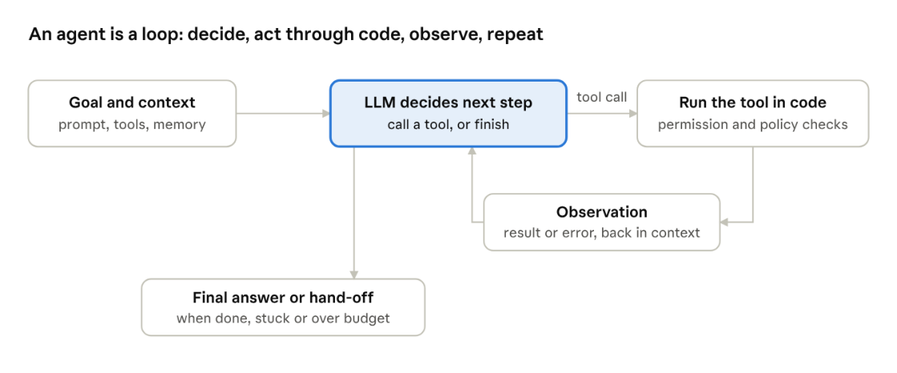
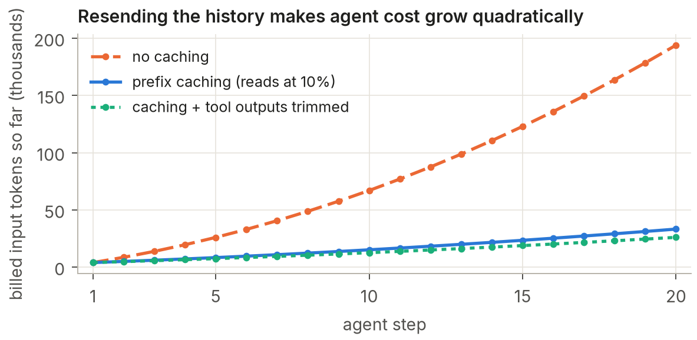

# 33 · Agents and tool use

Part IX · Retrieval and agents. Assumes Chapter 22 (prompting, structured output, injection). Chapter 25 covers agent evaluation in depth; Chapter 32 the frameworks (LangGraph and others). Worked design that builds on it: E.10 Agentic customer-service flow.

## Why it matters

Agents, LLMs that call tools in a loop to complete tasks, are where much of the industry's investment is going: customer-service automation, coding assistants, operations copilots, research tools. They are also where LLM systems most often fail in production, through compounding errors, runaway costs and security holes. A senior answer shows you can build one, and also that you know when not to: most business problems are better served by a fixed workflow with an LLM in specific steps. Any role with a GenAI component will probe it; worked design E.10 shows the shape of a typical question.

The chapter starts with the most important design decision: whether a task needs an agent at all, or a fixed workflow would do (33.1). It then builds an agent from its parts: function calling (33.2), the reason-act loop (33.3), planning and reflection (33.4), and memory (33.5). Sections 33.6 and 33.7 cover systems of several agents and the Model Context Protocol for connecting tools. Guardrails and permissions (33.8) and reliability, cost and latency (33.9) are what make an agent safe and affordable to run. The chapter then covers evaluation (33.10), how agents are trained with reinforcement learning over many turns (33.11), and a worked design for a refund agent (33.12). It ends with the two topics that dominate long-horizon agent work in 2025–26: context engineering, deciding what the model sees at each step (33.13), and coding and computer-use agents (33.14).

The fact that shapes every agent design is that errors compound. An agent that takes ten steps, each right 95% of the time, completes the whole task correctly only about 60% of the time. Good agent design therefore keeps the number of steps small, checks the results of risky ones, and makes mistakes cheap to undo.

## Key concepts

- **Workflow vs agent**: a workflow runs LLM calls in a fixed sequence you designed; an agent lets the model decide the next step. Most production systems should be workflows. [Anthropic: Building effective agents](https://www.anthropic.com/engineering/building-effective-agents).
- **Tool (function) calling**: the model outputs a structured request to call a function; your code runs it and returns the result.
- **ReAct loop**: reason, act (call a tool), observe, repeat until done. [ReAct paper](https://arxiv.org/abs/2210.03629).
- **Planning, memory and reflection**: the components that make agents handle longer tasks. Survey: [LLM Powered Autonomous Agents](https://lilianweng.github.io/posts/2023-06-23-agent/) (Lilian Weng).
- **Model Context Protocol (MCP)**: an open standard for connecting models to tools and data sources. [modelcontextprotocol.io](https://modelcontextprotocol.io/).
- **Guardrails for agents**: step and cost limits, least-privilege tools, human approval for consequential actions (Chapter 28).
- **Agent evaluation**: judged on task success, cost and trajectory, not just the final text (Chapter 25).

## 33.1 Workflows vs agents

Anthropic's "Building Effective Agents" (2024) draws a useful line:

- **Workflows:** LLM calls orchestrated through **predefined code paths**. Predictable, testable, cheaper.
- **Agents:** the LLM **dynamically decides** its own steps and tool use, in a loop, until the task is done.



*the agent loop · with code between the model and the world*

Common workflow patterns, in increasing complexity:

| Pattern | How | Example |
|---|---|---|
| Prompt chaining | Fixed sequence of LLM steps, with checks between | Extract order details → classify issue → draft reply |
| Routing | Classify the input, send it to a specialised prompt or model | Refund questions to one flow, account questions to another |
| Parallelisation | Run sub-tasks at once (sectioning) or the same task several times (voting) | Check a review for toxicity, PII and spam in parallel |
| Orchestrator-workers | An LLM splits the task and delegates sub-tasks dynamically | Research a question across several sources |
| Evaluator-optimiser | One LLM generates, another critiques, loop until good | Draft and refine a restaurant description |
| Autonomous agent | LLM chooses tools step by step with environment feedback | Resolve a ticket end to end with lookups and actions |

**The senior default:** start with the simplest pattern that works, and move towards autonomy only where the task genuinely needs flexible, multi-step decisions and evaluation shows a fixed flow fails. E.10 deliberately uses a state machine with LLM decisions inside steps, not a free-roaming agent.

## 33.2 Function calling

Models with tool use receive tool definitions (name, description, JSON schema of arguments) and can respond with a structured tool call instead of text. Your code executes the call and returns the result; the model continues. The model never executes anything itself: that boundary is where you put every check.

**Designing good tools** matters as much as prompting:

- **Clear names and descriptions,** written for a new colleague: what it does, when to use it, what it returns, units, limits.
- **Few, well-scoped tools** rather than many overlapping ones; models choose badly among near-duplicates.
- **Strict argument schemas:** enums for closed sets, required fields, no free-form "query" strings where structured fields work.
- **Helpful errors** the model can act on ("amount above policy cap of 10 euros; escalate instead"), not stack traces.
- **Idempotent and reversible where possible;** irreversible actions behind confirmation.
- **Concise outputs:** return what the model needs, not whole database rows that flood the context.

**Tool specs from Python functions, and an agent loop from scratch:**

```python
import inspect, json, time
from typing import get_type_hints, Literal, get_origin, get_args

PY_TO_JSON = {str: "string", int: "integer", float: "number", bool: "boolean"}

def tool(fn):
    """Attach a JSON-schema spec built from the signature and docstring."""
    hints, props, required = get_type_hints(fn), {}, []
    for name, param in inspect.signature(fn).parameters.items():
        t = hints[name]
        props[name] = ({"type": "string", "enum": list(get_args(t))} if get_origin(t) is Literal
                       else {"type": PY_TO_JSON[t]})
        if param.default is inspect.Parameter.empty:
            required.append(name)
    fn.spec = {"name": fn.__name__, "description": inspect.getdoc(fn),
               "input_schema": {"type": "object", "properties": props, "required": required}}
    return fn

@tool
def get_order(order_id: str) -> dict:
    """Look up an order by id. Returns status, items and total in euros."""
    return ORDERS.get(order_id, {"error": f"order {order_id} not found"})

@tool
def issue_voucher(order_id: str, amount: float, reason: Literal["missing_item", "late", "quality"]) -> dict:
    """Issue a voucher for an order. Amount in euros, at most 10. Requires a reason."""
    if amount > 10:                                         # the policy lives in code, not in the prompt
        return {"error": "amount above policy cap of 10 euros; escalate instead"}
    return {"ok": True, "voucher": amount}

def run_agent(llm, tools, user_message, max_steps=8, max_seconds=60):
    registry = {t.__name__: t for t in tools}
    messages = [{"role": "user", "content": user_message}]
    start = time.time()
    for step in range(max_steps):                            # hard step budget
        if time.time() - start > max_seconds:                # hard time budget
            return {"status": "timeout", "messages": messages}
        reply = llm(messages, [t.spec for t in tools])       # provider call in practice
        messages.append({"role": "assistant", "content": reply})
        if reply.get("tool_call") is None:
            return {"status": "done", "answer": reply["text"], "steps": step + 1, "messages": messages}
        call = reply["tool_call"]
        fn = registry.get(call["name"])
        try:
            result = fn(**call["arguments"]) if fn else {"error": f"unknown tool {call['name']}"}
        except Exception as e:
            result = {"error": str(e)}                       # errors go back to the model, not up the stack
        messages.append({"role": "tool", "name": call["name"], "content": json.dumps(result)})
    return {"status": "max_steps", "messages": messages}
```

With a scripted model that looks up order A1, issues a 2.50 euro voucher and replies, the loop finishes in 3 steps. Provider APIs differ in message formats (tool-use blocks, tool-call ids), but every agent framework is a version of this loop.

**Two things the sketch leaves out, and real code must not.** First, real APIs can return *several* tool calls in one turn, each with an id; you run them (in parallel if they are independent) and return each result tagged with its id, because the model matches results to calls by id, not by order. Second, validate the arguments against the schema before executing anything: the model can omit a required field, invent an argument or pass a value outside an enum. Return the validation errors to the model as a tool result so it can correct itself:

```python
JSON_TO_PY = {"string": str, "integer": int, "number": (int, float), "boolean": bool}

def validate(args, schema):
    errs = [f"missing argument {k}" for k in schema["required"] if k not in args]
    for k, v in args.items():
        spec = schema["properties"].get(k)
        if spec is None:
            errs.append(f"unknown argument {k}")
        elif "enum" in spec and v not in spec["enum"]:
            errs.append(f"{k} must be one of {spec['enum']}")
        elif not isinstance(v, JSON_TO_PY[spec["type"]]):
            errs.append(f"{k} should be a {spec['type']}")
    return errs                                   # [] means safe to call
```

For `issue_voucher` called with `{"order_id": "A1", "amount": "2.5", "reason": "cold"}`, it returns two errors (the amount is a string, and "cold" is not an allowed reason); the policy cap inside the tool is still needed, because a well-typed call can still be against policy.

## 33.3 ReAct

**ReAct** (Yao et al., 2022) interleaves **reasoning** ("I need the order details first") with **acting** (a tool call) and **observing** (the result), repeating until done. Reasoning helps the model plan its next action and recover from surprises; actions ground the reasoning in real data. Native tool calling plus reasoning models now implement this pattern without the original text-parsing format, but the loop is the same.

A short trace of the voucher example from 33.2 shows the shape:

```text
Thought: The user says the cola was missing from order A1. Check the order before deciding anything.
Action: get_order(order_id="A1")
Observation: {"status": "delivered", "items": ["burger", "fries", "cola"], "total": 18.5}
Thought: The cola is on the order and it was delivered. A missing item qualifies for a voucher under the cap.
Action: issue_voucher(order_id="A1", amount=2.5, reason="missing_item")
Observation: {"ok": true, "voucher": 2.5}
Thought: Done. Confirm to the user.
Answer: Sorry about the missing cola. I've added a 2.50 euro voucher to your account.
```

Each thought is short and decides the next action; each observation can change the plan. If `get_order` had returned "order not found", the next thought would ask the user for the right id instead of issuing a voucher, which is the recovery a fixed chain cannot do.

## 33.4 Planning and reflection

A pure reason-act loop decides one step at a time and can wander: it repeats searches, loses track of the goal, or stops too early. Planning gives the agent a structure before it starts acting, and reflection lets it check its own work before reporting. Both cost extra model calls, and both help most on long tasks.

- **Plan-then-execute:** the model writes a plan (a list of steps), code executes steps (possibly with smaller models), and the planner re-plans when a step fails. More predictable than step-by-step improvisation; cheaper when executors are small.
- **Reflection:** after a failure, the model writes a critique of what went wrong and retries with it in context (Reflexion, Shinn et al., 2023). Works best when there is a real signal (a failing test, a tool error, a judge verdict), not just "think again".
- **Verification steps:** check results before acting on them (does the voucher amount match policy? does the generated SQL return plausible numbers?).

## 33.5 Memory

A model remembers nothing between calls; everything it knows about the task has to be in its context. Agents that work over many steps, or many sessions, need memory managed outside the model, and the design question is what to store, how to retrieve it, and what to leave out so the context stays useful.

| Kind | What | How |
|---|---|---|
| Working memory | The current task's messages, tool results, scratchpad | The context window; trim or summarise old steps |
| Episodic memory | Past interactions with this user or task | Stored summaries retrieved when relevant |
| Semantic memory | Durable facts and preferences ("customer prefers refunds as vouchers") | A key-value or vector store, written deliberately, retrieved per task |
| Procedural memory | How to do things | The system prompt, tool descriptions, few-shot examples, skills files |

Memory needs the same care as RAG: what gets written (only confirmed facts, not guesses), how it expires, who can see it (privacy), and how it is retrieved. A model writing wrong "facts" into long-term memory poisons every later conversation.

## 33.6 Multi-agent patterns

Several LLM "agents" with different prompts, tools or models working together:

- **Supervisor / orchestrator with workers:** one agent delegates sub-tasks to specialised agents (search, analysis, writing) and combines results.
- **Hand-offs:** an agent passes the conversation to another specialised agent (billing to refunds), as in OpenAI's Swarm-style designs.
- **Debate or critic:** one agent proposes, another critiques.
- **Parallel research:** several agents explore different sources at once, then a lead agent synthesises; Anthropic described this for its research feature, noting it uses many more tokens than a single agent.

**When it helps:** tasks that split cleanly into independent parts, need different tools or permissions per part, or exceed one context window. **Costs:** more tokens, more latency, harder debugging and evaluation, and errors that pass between agents. Many "multi-agent" designs work just as well as one agent with good tools; start with one.

## 33.7 The Model Context Protocol (MCP)

MCP, introduced by Anthropic in late 2024 and since adopted widely across the industry, is an open protocol for connecting AI applications to tools and data. An **MCP server** exposes tools (functions), resources (readable data) and prompts; an **MCP client** inside the AI application (a chat app, an IDE, an agent) discovers and calls them over a standard transport.

Why it matters: instead of writing a custom integration for every model and every data source, a company writes one MCP server for, say, its order system, and any MCP-capable application can use it. In interviews, know what it is, what problem it solves (the integration matrix), and its security implications: an MCP server is code with access to your systems, tool descriptions from third-party servers are untrusted input (tool poisoning), and permissions and authentication must be explicit.

## 33.8 Guardrails and permissions

Agents act, so mistakes have consequences. Layers, from Chapter 22.8 and worked design E.10:

- **Least privilege:** tools scoped to the task and the user; read-only by default; separate credentials per user.
- **Policy in code:** caps, eligibility rules and rate limits enforced by the tool implementation, never only by the prompt.
- **Human in the loop** for irreversible, costly or unusual actions; shadow mode before automation.
- **Input and output checks:** injection detection on tool outputs, PII filters, schema validation on every call.
- **Budgets:** maximum steps, tokens, time and money per task; stop and hand off when exceeded.
- **Audit trail:** every step, tool call, argument and result logged and traceable.

## 33.9 Reliability, cost and latency budgets

**Errors compound.** If each step succeeds independently with probability p, a task of n steps succeeds with roughly pⁿ:

| Per-step success | 5 steps | 10 steps | 20 steps |
|---|---|---|---|
| 99% | 95% | 90% | 82% |
| 95% | 77% | 60% | 36% |
| 90% | 59% | 35% | 12% |

This is the strongest argument for short, structured flows, verification steps that catch errors early, and recovery paths. It also explains why demos look great (one lucky run) and production disappoints (thousands of runs).

**Where pⁿ is too pessimistic, and where averages mislead.** The formula assumes every error is fatal and independent. Two corrections matter in practice.

- **Agents recover.** If an agent notices a failed step (a tool error, a failing test) and fixes it with probability q, the effective per-step success is p + (1 − p)q. With p = 0.95 and q = 0.5 that is 0.975, and a 10-step task succeeds 0.975¹⁰ = 78% of the time instead of 60%. This is why verification steps and informative tool errors pay off so well: they raise q. Measure it from traces: of the steps that went wrong, how many were corrected later in the same run?
- **Errors are not independent across runs of the same task.** Some tasks are easy for the agent and some are nearly impossible, so the success rate is a distribution over tasks, not one number. Suppose half the tasks succeed with probability 0.9 and half with 0.3: the average success rate is 0.6, and the chance that 4 repeated runs all succeed (pass^4) is 0.5 × 0.9⁴ + 0.5 × 0.3⁴ = 0.33, not 0.6⁴ = 0.13. The average hides that half the tasks fail more often than not, which is what users of those tasks experience. Measure it by running each task k times and reporting pass^k and the distribution of per-task success rates, not only the mean (Chapter 25).

**Cost and latency** grow with steps: each step resends a growing context. A 10-step agent with 8,000 tokens of context per step processes 80,000+ input tokens per task. Control it with prompt caching of the stable prefix (Chapter 22.7), trimming tool outputs, small models for simple steps, parallel tool calls where independent, and hard budgets. Set the budget from the business value of the task: an agent resolving a 15-euro support ticket cannot spend 2 euros of tokens on it.



*Billed input tokens for a 20-step agent with a 4,000-token fixed prefix, where each step adds 600 tokens of output and tool results to the history. Without caching, the total is 194,000 tokens, quadratic in the number of steps. With prefix caching (cached reads billed at 10%) it is 33,000; trimming tool outputs to 400 new tokens per step brings it to 26,000.*

**What the curve means for design.**

- **Quadratic cost.** At step t the model rereads everything before it, so input cost grows with the square of the number of steps, and long tasks cost far more than proportionally.
- **Caching changes the slope.** Caching applies as long as each request extends the previous one byte for byte. So append to the history; do not rewrite or re-order earlier turns.
- **Trimming helps twice.** Summarising or truncating long tool outputs before they enter the history saves tokens on every later step, and it also keeps the context focused.
- **Budget the latency too.** At about 0.6 s to the first token and 200 output tokens at 15 ms each, the 20 steps take about 72 seconds before any tool time. That is acceptable for a background task and unacceptable for a chat reply, which is another argument for fewer, larger steps and for parallel tool calls.
- **Cache writes and expiry change the numbers.** The figure bills cached reads at 10% and treats writing to the cache as free. Some providers charge a premium for cache writes (about 1.25× the input price for a short-lived cache) and expire cached prefixes after a few minutes without use. With the write premium on each step's new tokens, the 33,000 becomes about 37,000. If one slow tool call (a long test run) lets the cache expire at step 10, that step rewrites the whole 9,400-token context at the premium, and the total rises to about 47,000. If every step outlives the cache, the agent pays 1.25× on the full context every time, 242,500 tokens, which is more than not caching at all. Long-running tools therefore argue for a longer cache lifetime where the provider offers one, or for keeping the cache warm.

## 33.10 Evaluating agents

Covered in Chapter 25.5: task success on the environment's end state, trajectory checks (right tools, right order, no forbidden calls), efficiency (steps, tokens, latency), robustness to tool failures, repeated runs for reliability, and safety tests including injection through tool outputs. Before automation, run in **shadow mode**: the agent proposes, people decide, and you measure agreement.

## 33.11 Training agents

Prompted agents are limited by what the base model learned. Frontier agent capability now comes from **training on agentic tasks**:

- **Environments**: sandboxed software repositories with tests, simulated websites and operating systems for computer use, tool APIs with checkable end states, multi-turn conversations with simulated users.
- **Agentic RL**: the policy acts for many turns (tool calls and observations interleaved); the reward comes at the end (tests pass, task state correct), sometimes with intermediate checks. The algorithms are those of Chapter 19, extended to multi-turn trajectories: mask tool outputs from the loss (the model did not generate them), handle very long and variable-length trajectories, and run many environments in parallel.
- **Reward hacking is the central risk**: agents find shortcuts the environment allows (editing tests, hard-coding outputs, exploiting the grader). Environment design and hidden checks are as important as the algorithm (Chapter 27).
- **Computer use**: models act on screenshots with mouse and keyboard actions; evaluated on suites like OSWorld. Errors compound over long action sequences, so reliability per step must be very high.
- **Measuring progress**: pass^k reliability rather than pass@k, and task-length horizons (Chapter 23), on held-out environments the agent was not trained on.

Lab interviews go well beyond these bullets. The subsections below take each piece in turn: what the objective looks like over many turns, how credit is assigned, why rollouts become asynchronous, what limits throughput, and how to keep the reward honest.

### The multi-turn objective and the loss mask

A single-turn RLVR sample is a prompt followed by one response, and every response token was sampled from the policy. An agentic trajectory interleaves two kinds of tokens: **actions** the policy generated (reasoning, tool calls, the final answer) and **observations** the environment wrote (tool results, test output, a simulated user's reply). Only the first kind has a probability under the policy that the update can change. Write mᵢₜ = 1 for tokens of trajectory i that the policy generated and 0 for prompt and observation tokens. With the per-token clipped term ℓᵢₜ of Chapter 19 (ratio times advantage, clipped), the loss averages over generated tokens only:

$$
J(\theta) = \frac{\sum_i \sum_t m_{it}\,\ell_{it}}{\sum_i \sum_t m_{it}}
$$

Why the mask matters: without it, the gradient trains the policy to predict the tool outputs, a world-modelling objective it was never asked to learn, and the importance ratio on those tokens is meaningless because they were never sampled from π_old. The mask also changes how much of each trajectory is trained on. In a three-turn coding trajectory with a 1,200-token task prompt, actions of 150, 200 and 100 tokens, and observations of 2,000 and 800 tokens, only 450 of 4,450 tokens (10%) carry gradient. Two practical consequences follow: count the token budget per update in generated tokens, not trajectory tokens, and check the mask in a unit test, because a mask shifted by one token at each boundary trains on the first token of every observation.

### Credit assignment: trajectory-level or turn-level

With a single reward at the end, the simplest choice is GRPO's: sample a group of trajectories for the same task, and give every action token in trajectory i the same advantage, its reward minus the group mean. For rewards [1, 0, 0, 1] each successful trajectory's tokens get +0.5 and each failed one's −0.5. This is unbiased and needs no value model, but the variance grows with the horizon: in a 40-turn trajectory where one bad edit at turn 12 caused the failure, all 40 turns are pushed down equally, and many trajectories are needed before the signal on turn 12 stands out.

Turn-level credit reduces the variance by scoring parts of the trajectory. The options, roughly in order of cost: intermediate checks from the environment (the code compiles after this turn, the right file was opened), which act as process rewards and must be designed as carefully as the final reward; a learned per-turn value model, which brings back PPO's critic and its cost (Chapter 18); and turn-level baselines computed by branching, re-running several continuations from the same intermediate state, which is expensive but unbiased. Most published agentic RL recipes still use trajectory-level advantages with large groups and a curriculum of shorter tasks, and add turn-level signals only where the environment provides cheap, reliable checks.

### Asynchronous rollouts and staleness

In single-turn RL every rollout takes roughly the same time. In agentic RL the durations are heavy-tailed: one trajectory finishes in three tool calls, another runs a test suite twenty times. A synchronous step waits for the slowest trajectory in the batch. If durations are log-normal with a median of 2 minutes (mean 198 s), the slowest of 64 trajectories takes about 1,400 s on average, so the rollout workers are busy only about 14% of the time.

Asynchronous RL fixes the utilisation: the trainer updates on whichever trajectories have finished, while generation continues with weights that are one or more updates old. The cost is **staleness**: a trajectory generated by the policy from k updates ago is off-policy, and the importance ratio π_θ/π_behaviour that corrects for it grows noisier with k. The usual controls are a hard bound on staleness (drop or down-weight trajectories more than a few updates old), computing the ratio against the log-probabilities recorded by the policy that actually generated each token, and truncated importance weights (Chapter 19.10). Partial rollouts are a related trick: long trajectories are paused at a weight update and resumed with the new weights, so a single trajectory can span several policy versions and needs per-token behaviour log-probabilities.

### Environment throughput is the bottleneck

For agents, the GPUs are often waiting for the environment rather than the reverse. A batch of 512 trajectories with 30 turns each and 15 seconds of tool time per turn (starting containers, running tests, executing code) needs 64 sandbox-hours of environment time. To produce that batch in 10 minutes takes about 384 sandboxes running concurrently, and no amount of parallelism makes one trajectory faster than its own 30 sequential turns (7.5 minutes of tool time alone). Hence the engineering effort that goes into environments: container pools that start in seconds, snapshotting so that a task's setup is done once, caching of deterministic tool results, and a scheduler that keeps both the sandboxes and the inference engine busy. An interviewer who asks "what limits your RL throughput?" wants this arithmetic.

### Context length during training

Long-horizon trajectories outgrow the context window, and the policy must learn to work within it. Options: cap the number of turns and the length of tool outputs in the environment itself; mask truncated trajectories from the loss rather than scoring them as failures (the overlong-response fix from Chapter 19); and, increasingly, make context management a learned skill, with summarisation or note-taking as actions the agent takes and is rewarded for indirectly through task success. Whatever the agent does at deployment (the context-engineering strategies of 33.13) should also happen during training, or the policy meets a context it has never seen.

### Hardening the verifier against reward hacking

In coding and computer-use environments, the reward is a program, and an RL policy is an optimiser searching for any input that makes the program return 1. Documented hacks include editing or deleting the tests, special-casing the test inputs, catching the exception that a test expected, writing "PASSED" where a log parser looks for it, and reading the repository's git history to find the commit that fixed the bug. Over-broad end-state checks invite the same problem: a check that a file exists rewards creating an empty file.

Hardening follows from treating the verifier as an adversarial target:

- **Grade in a fresh sandbox.** Apply only the agent's diff to non-test files of a clean checkout, restore the original tests, and run hidden tests the agent never saw.
- **Remove the answer from the environment.** Strip git history after the task's base commit, disable network access, and keep reference solutions outside the container.
- **Check the diff, not just the result.** Flag edits to test files, hard-coded expected outputs, and suppressed exceptions; a cheap LLM monitor reading sampled trajectories catches hacks no rule anticipated.
- **Watch for divergence.** Plot the training reward against the pass rate on held-out tasks graded by a stricter verifier; a rising reward with a flat held-out score is the signature of hacking (Chapter 27).

## 33.12 A worked agent design: refund requests

A delivery platform wants an agent to resolve "missing item" complaints, which today take a human agent four minutes each.

1. **Is an agent needed?** Most complaints follow one path: check the order, check the courier's photo and the restaurant's confirmation, apply the refund policy, reply. That is a workflow (33.1) with one model call to read the complaint and one to write the reply. Keep an agent loop only for the 15% of cases that do not fit, such as several orders, a dispute with the courier, or an ambiguous description.
2. **Tools and permissions.**
   - Read-only tools: `get_order`, `get_delivery_evidence`, `get_customer_history`.
   - A write tool, `issue_refund(order_id, amount, reason)`, with server-side checks: the amount is capped by the order value and the policy, and refunds above €20 or for customers with more than three refunds in 30 days go to a human approval queue.
   - The model never sees payment details.
   - Tool outputs are passed as data, never as instructions (33.8).
3. **Budgets.** A hard cap of 12 steps and €0.10 of tokens per case. With a 3,000-token prefix that is mostly cached, the typical 5-step case costs about €0.04. When a cap is hit, hand the case to a human with the trace attached rather than retrying.
4. **Evaluation before launch.** Replay 500 historical cases in a sandbox with the real outcomes as labels (Chapter 25.7). Measure:
   - correct refund amount and correct escalation, as end-state checks;
   - policy violations, which must be zero;
   - pass^4 on a 100-case subset;
   - cost and latency per case.

   Then run in shadow mode for two weeks: the agent proposes, a human decides, and the disagreements are labelled.
5. **Launch and monitor.**
   - Automate only the case types where shadow-mode agreement exceeds the target (for example 97%).
   - Track the refund amount per case, the escalation rate, re-contacts within 7 days and the human override rate, by case type and week.
   - A rise in refunds per case is the first sign of manipulation by users or of a policy drift in the prompt.

The design puts most of the safety in the tools and the policy checks, not in the prompt. A prompt can be argued with; a server-side cap cannot.

## 33.13 Context engineering for long-horizon agents

A coding or research agent that works for an hour reads files, runs tests and searches the web, and its context fills with tool output far faster than with anything it decides. Three things then go wrong. The window runs out. Cost grows quadratically, because every step rereads the history (33.9). And quality falls before the window is full: models attend less reliably to information buried in a long context, an effect measured on long-context benchmarks and sometimes called **context rot** (Chapter 22.6). Context engineering is the discipline of deciding, at every step, what the model sees. For long-horizon agents it matters as much as the prompt.

### The tools

- **Tool-result clearing.** Old tool outputs are the bulkiest and least useful part of the history. Replace each one older than a few steps with a short stub ("[output of run_tests at step 12 cleared; rerun if needed]"), keeping the call itself so the model knows it happened.
- **Compaction.** When the context passes a threshold, ask the model to summarise the history into a structured note: the goal, decisions made and why, current state, open problems, files touched. Then restart the context from the system prompt, the note and the last few turns. The summary prompt is worth tuning, because whatever it drops is gone.
- **Memory on disk.** Give the agent tools to write and read files outside the context: a progress log, a to-do list, notes on what failed. The context then holds a pointer, not the content, and the notes survive compaction and even a new session. Project instruction files that agents read at start-up are the procedural version of this (33.5).
- **Sub-agents for isolation.** Delegate a search-heavy sub-task to a sub-agent with its own fresh context, and have it return a short report. A sub-agent that reads 50,000 tokens of code to answer "where is the retry logic?" returns perhaps 1,000, and the main agent's context never sees the rest.
- **Retrieval just in time.** Keep identifiers (file paths, URLs, row ids) in context and fetch content only when needed, rather than loading everything up front.

### The tension with caching

Prompt caching (Chapter 22.7) rewards an append-only context: a request is cheap only up to the first token that differs from the previous request. Every edit to the history, such as clearing an old result, invalidates the cache from that point on. So the question is not only what to remove but how often to edit.

A simulation makes the trade-off concrete. A coding agent runs 80 steps with a 6,000-token fixed prefix; each step adds 300 tokens of model output and 2,200 tokens of tool output. The window is 200,000 tokens; cached reads cost 0.1× the input price and cache writes 1.25×. Billed input is counted in input-token equivalents:

| Strategy | Peak context | Billed input (token-equivalents) |
|---|---|---|
| Append everything | Overflows the window at step 79 | 1.07M even with an unlimited window |
| Clear results older than 5 steps, at every step | 44,000 | 1.33M |
| Clear results older than 5 steps, only when the context passes 100k | 98,500 | 0.74M |
| Compact to a 4,000-token summary plus the last 3 steps at 100k | 100,000 | 0.69M, plus two summarising calls |

Clearing at every step keeps the context smallest and costs the most, more than doing nothing, because every step edits the history five steps back and rewrites everything after it at the cache-write price. Batching the edits (clear or compact rarely, append-only in between) keeps most of the cache benefit and still bounds the context. The rule generalises: **edit the context rarely and in batches; append in between.**

### What to measure

Context strategies are easy to argue about and cheap to test. Run the same task set with each strategy and report task success, cost per task and tokens per step, over repeated runs; inspect failures for the signature of a bad compaction (the agent repeats work it already did, or forgets a constraint the user gave at the start). A summary that loses the user's constraint is the context-engineering equivalent of a retrieval miss in RAG.

## 33.14 Coding and computer-use agents

Two kinds of agent dominate frontier evaluation and training in 2025–26, and both are named in interviews often enough to need more than a sentence.

### Coding agents and SWE-bench

A coding agent gets a repository and a task (an issue, a failing test, a feature request) and works in a sandbox with a small set of tools: a shell, file viewing and editing (usually by exact string replacement, which is less error-prone than rewriting whole files), and search. It loops: read code, form a hypothesis, edit, run tests, read the output, repeat. **SWE-bench** turns real GitHub issues from Python repositories into tasks graded by the repository's own tests; **SWE-bench Verified** is a 500-task subset whose tasks were checked by people to be solvable and fairly tested. Newer suites such as SWE-bench Pro and Terminal-Bench aim at harder, longer or less contaminated tasks, since public repositories may be in training data.

The **harness** (the scaffold around the model) moves scores as much as the model does: which tools are offered and how they are described, how test output is truncated, how many steps are allowed, whether the agent may run the tests, and how many attempts are sampled. The same model can score very differently under two harnesses, so compare models only within one harness, and report the harness with the score. This is also why "our model scores X on SWE-bench Verified" is an incomplete claim in an interview: ask about the scaffold, the number of attempts, and whether the hidden tests were run in a clean environment (33.11).

### Computer-use agents

A computer-use agent controls a desktop or browser through the same interface a person uses. Each step: the environment returns a screenshot (sometimes with an accessibility tree), the model outputs an action (click at coordinates, type text, press a key, scroll), the environment executes it, and the loop repeats. The characteristic failures are **grounding errors** (clicking a few pixels off, or on the wrong one of two similar buttons), acting on a stale screenshot after the page changed, and getting lost in long sequences. Because a realistic task takes dozens of actions, per-step reliability must be very high: at 98% per step a 50-step task succeeds 0.98⁵⁰ = 36% of the time, before any recovery. Each step also costs a screenshot's worth of input tokens and a few seconds of latency, so computer use is the tool of last resort: where an API or a command line exists, an agent should use it instead. Benchmarks such as OSWorld measure end-state success on scripted desktop tasks (Chapter 25).

## Pitfalls

- **Building an autonomous agent for a task a workflow solves.**
- **Policy enforced only in the prompt.**
- **Vague, overlapping tools** with loose schemas.
- **No step, token, time or money budget.**
- **Tool outputs dumped into context** in full, every step.
- **Trusting tool outputs and third-party tool descriptions** as instructions (injection).
- **Writing unverified guesses into long-term memory.**
- **Multi-agent designs by default.**
- **Evaluating on a handful of happy-path demos;** reliability only shows over many runs.
- **No shadow mode** before giving an agent write access.
- **Editing the context at every step,** which throws away the prompt cache; edit rarely and in batches.
- **Training on observation tokens** in agentic RL because the loss mask is missing or off by one.
- **A verifier the agent can reach:** tests it can edit, git history it can read, an end-state check it can satisfy trivially.

## Interview questions

Questions 1–4 basic, 5–9 intermediate, 10–16 senior.

**1. What is an LLM agent?** A system where an LLM chooses actions (tool calls) in a loop, observes results, and decides the next step until the task is complete, rather than following a fixed code path. The defining property is that the model controls the control flow, which is also why reliability compounds: ten steps at 95% each give about 60% end to end. Follow-up: "so is a RAG pipeline an agent?" Not if retrieval always happens once in a fixed place; it becomes one when the model decides whether and what to retrieve.

**2. How does function calling work?** The model receives tool schemas, outputs a structured call (name and JSON arguments), the application executes it and returns the result as a message, and the model continues. The model never executes code itself. Real APIs can return several calls in one turn, each with an id, and the results go back tagged with those ids. Follow-up: "what do you check before executing?" Validate the arguments against the schema and the policy in code; return errors to the model rather than raising.

**3. What is ReAct?** Interleaving reasoning, actions and observations in a loop so the model plans, acts, and adjusts based on real results. The reasoning step decides the next action; the observation can change the plan, which is what lets an agent recover when a lookup fails. Modern tool-calling APIs and reasoning models implement the same loop natively, without the original text format. Follow-up: "why not plan everything up front?" Plans break on surprises; plan-then-execute with re-planning combines both (33.4).

**4. Workflow or agent: how do you choose?** Workflow when steps are known and stable (cheaper, predictable, testable); agent when the path depends on what is found and cannot be enumerated. Start simple; add autonomy only where evaluation shows the need. A useful test: if you can draw the flowchart, build the workflow and put LLM calls inside its boxes. Follow-up: "what if 15% of cases don't fit the flowchart?" Route those to an agent or a human, and keep the workflow for the rest (33.12).

**5. How do you design good tools for an agent?** Few, distinct tools; clear descriptions with units and limits; strict schemas with enums; concise outputs; actionable errors; idempotency; confirmation for irreversible actions; policy checks inside the tool. Output size is a cost lever: trimming a tool's output from 600 to 400 tokens per step cut the 20-step example in 33.9 from 33,000 to 26,000 billed tokens. Follow-up: "how do you know a description is good?" Watch which tool the model picks on an evaluation set and fix the descriptions where it confuses them.

**6. What types of memory do agents use?** Working (context), episodic (past interactions), semantic (durable facts) and procedural (instructions, tools). Each needs rules for writing, expiry, privacy and retrieval. The risk is writing wrong "facts" into long-term memory, which poisons every later session, so write only confirmed facts. Follow-up: "how does memory relate to context engineering?" Files on disk are memory the agent reads on demand, which keeps the working context small (33.13).

**7. What is MCP?** An open protocol for exposing tools, resources and prompts from servers to AI applications through a standard interface, replacing per-application integrations; it requires explicit trust, authentication and permission management. It turns an M × N integration problem (M applications, N systems) into M + N. Follow-up: "what is the security risk?" A third-party server's tool descriptions and outputs are untrusted input that can carry injected instructions (tool poisoning).

**8. Why do agents fail more in production than in demos?** Errors compound over steps (pⁿ), real inputs are messier, tools fail, contexts grow, and demos are single lucky runs. At 95% per step a 10-step task succeeds 60% of the time, while a demo shows the 60% that worked. Two corrections make the answer senior: recovery raises the effective per-step rate (p = 0.95 with half of errors fixed gives 78% over 10 steps), and an average hides per-task spread (an average of 0.6 can mean half the tasks fail most of the time), so report pass^k and per-task success over repeated runs. Follow-up: "what do you change first?" Verification after risky steps and informative tool errors, because they raise the recovery rate.

**9. How do you control an agent's cost?** Budgets per task, caching the stable prefix, trimming tool outputs and history, smaller models for simple steps, parallel calls, fewer steps through better tools, and a hand-off when the budget is reached. The quadratic term dominates: in the 33.9 example caching cuts 194,000 billed tokens to 33,000, and trimming takes it to 26,000. Watch cache expiry during slow tool calls, which can make caching cost more than it saves. Follow-up: "how do you set the budget?" From the value of the task: a 15-euro ticket cannot spend 2 euros of tokens.

**10. Design an agent that handles "where is my order?" and refund requests.** Route first: "where is my order" is a workflow (lookup, format the answer), which is most of the traffic and needs no agent. Refunds use a state machine with LLM decisions inside steps: gather evidence with read-only tools, propose an action, validate it with a policy engine in code, auto-approve small amounts, require human approval above a threshold, make payment calls idempotent, keep a full audit log, and run in shadow mode before automating. Put numbers on it: a 12-step cap and €0.10 of tokens per case, with a typical 5-step case at about €0.04 (33.12), and evaluation on 500 replayed tickets. Follow-up: "how do you decide to automate a case type?" When shadow-mode agreement with humans exceeds a target, say 97%, on enough cases to bound the error.

**11. A user's message contains instructions to call the refund tool. What stops it?** Refund eligibility and amounts are decided in code against order data, not by the model's reading of the message; caps and human approval for higher amounts; the message is treated as data; monitoring and injection tests. The deeper point is that a prompt-level defence lowers the attack success rate but never to zero, so the design must assume some injections succeed and bound the damage: a successful injection can at most request a capped refund that the policy engine would have allowed anyway. Follow-up: "how do you test it?" A red-team set of injected messages and tool outputs, measuring attack success rate over hundreds of attempts.

**12. When would you use multiple agents?** When sub-tasks are independent and benefit from parallelism, need different tools or permissions, or exceed a single context; otherwise one agent with good tools is simpler, cheaper and easier to evaluate. Put a number on the cost: Anthropic reported that its multi-agent research system used about 15 times the tokens of a chat interaction, against about 4 times for a single agent, and that token usage alone explained most of the variance in performance on its browsing evaluation. So multi-agent pays when the task is valuable and parallelisable (broad research); it loses when sub-tasks depend on each other (most coding), where errors pass between agents and context is lost at every hand-off. A middle ground is one agent that calls sub-agents as tools for isolated searches. Follow-up: "how do you evaluate it?" End-to-end task success and cost per task against a single-agent baseline at matched token budget.

**13. How do you take an agent from prototype to production?** Define success and budgets; build a sandbox and evaluation set from real cases; measure task success over repeated runs; add guardrails and audit logs; shadow mode against humans; gradual automation by risk tier; monitoring of success, cost, escalations and overrides; a rollback path. Size the evaluation: on 500 replayed cases at 90% success the standard error is 1.3 points, enough to see a 5-point regression, while 50 demo cases (±4.2 points) are not. Follow-up: "what is the first production metric you watch?" The human override rate by case type, because it moves before customer complaints do.

**14. How does RL for multi-turn agents differ from single-turn RLVR?** Trajectories interleave generated actions with environment observations, so the loss is masked to the policy's own tokens (often only about 10% of a coding trajectory); the reward usually arrives only at the end, so credit assignment across 30–50 turns is noisy and calls for large groups, curricula or turn-level checks; rollout durations are heavy-tailed, so synchronous batches leave workers idle (about 14% utilisation in the 33.11 example) and teams move to asynchronous RL with bounded staleness; and environment throughput, not GPU time, often limits training. Reward hacking is the main risk: the verifier must grade in a clean sandbox with hidden tests. Follow-up: "how do you know the agent is hacking?" Training reward rising while held-out pass rate under a stricter grader stays flat.

**15. How would you design an agent that reads untrusted content and still uses private data safely?** Start from the threat model: an agent that has access to private data, reads untrusted content (web pages, emails, tool outputs) and can communicate externally has all three parts of what Simon Willison called the "lethal trifecta", and an injection can make it exfiltrate data. Remove one leg where possible (no external communication from sessions that read untrusted content). Otherwise use an architecture, not a filter: the dual-LLM pattern, where a privileged model plans from the trusted request and a quarantined model reads untrusted text but cannot call tools, or CaMeL-style designs that also track where every value came from and enforce policies on tool arguments. Add the instruction hierarchy (system above user above tool output) and measure attack success rate on a benchmark such as AgentDojo: at 1,000 attempts, a 1% rate has a 95% interval of about ±0.6 points. Follow-up: "what does it cost?" Some utility, since the planner cannot react to content it never sees.

**16. Your coding agent degrades after an hour of work. What do you change?** Look at the context first: at hour one it is likely tens of thousands of tokens of stale tool output, which costs money on every step and dilutes attention. Clear old tool results and compact the history into a structured summary when the context passes a threshold, keep durable notes (progress, decisions, failed approaches) in files the agent can reread, and delegate search-heavy sub-tasks to sub-agents that return short reports. Do the edits in batches: in the 33.13 simulation, clearing at every step costs 1.33M token-equivalents against 0.74M for clearing at a threshold, because every edit invalidates the cache. Follow-up: "how do you know the summary is good?" Check for repeated work and forgotten user constraints after compaction, across repeated runs.

## Practice

1. **Agent loop from scratch:** implement `run_agent` against a real provider's tool-use API with the two tools above and a fake order database; add a third tool and test that the model picks correctly.
2. **Budgets and failures:** make a tool fail 20% of the time; add retries and a hand-off; measure success over 50 runs.
3. **Workflow vs agent:** solve the same support task as a fixed chain and as an agent; compare success, cost and latency.
4. **MCP:** write a tiny MCP server exposing `get_order` with an official SDK and connect it to an MCP-capable client.
5. **LangGraph:** rebuild the refund flow from E.10 as a state graph with a human-approval node (Chapter 32).
6. **Injection test:** put an instruction inside an order note returned by `get_order` and check whether your agent follows it; then fix the design.
7. **Context strategies:** re-run the 33.13 simulation in `code/ch33_check.py` with your own agent's numbers (prefix, tokens per step, steps) and find the threshold that minimises cost.
8. **Research exercise.** Measure how much repeated runs change an agent's reported reliability. Take 30 tasks for any agent you can run (your refund agent, or a small public suite), run each task 8 times, and report pass@1, pass^4 and pass^8, the distribution of per-task success rates, and the 95% interval of pass@1 from a bootstrap over tasks. Then make one change (better tool descriptions, or a verification step) and test whether the difference exceeds the noise.

<details><summary>Hint and expected result</summary>

Items 1–3: with a capable model, the scripted case from 33.2 should succeed in 3 steps; with a 20% tool failure rate and one retry, each call fails with probability 0.2² = 4%, so a 3-call task succeeds about 0.96³ = 88% of the time without a hand-off. The workflow usually wins on cost and latency for the common path. Item 6: expect the naive agent to follow the injected instruction at least some of the time; the fix is in code (caps, policy checks, tool output treated as data), not only in the prompt. Item 7: the cheapest strategy is almost always a rare, batched edit; clearing at every step is the most expensive. Item 8: expect pass^8 to be far below pass@1, but above (pass@1)⁸, because some tasks always succeed and some always fail. With 30 tasks the bootstrap interval of pass@1 is wide, often ±10 to 15 points, so many claimed improvements will not exceed the noise; report that honestly.

</details>

## Read next

- Anthropic, *Building Effective Agents* (2024), and Anthropic's engineering posts on writing tools for agents and on their multi-agent research system.
- Yao et al., *ReAct: Synergizing Reasoning and Acting in Language Models* (2022).
- Shinn et al., *Reflexion: Language Agents with Verbal Reinforcement Learning* (2023).
- Schick et al., *Toolformer* (2023).
- The Model Context Protocol specification and documentation (modelcontextprotocol.io).
- Lilian Weng, *LLM Powered Autonomous Agents* (2023).
- *AI Engineering* (Chip Huyen): the chapter on agents.
- Yao et al., τ*-bench* (2024), for how agents are evaluated.
- Anthropic engineering posts on context engineering for agents and on their multi-agent research system (2025).
- Debenedetti et al., *Defeating Prompt Injections by Design* (CaMeL, 2025), and *AgentDojo* (2024), for injection-resistant agent architectures and how to measure attack success.
- Jimenez et al., *SWE-bench* (2023), and the SWE-bench Verified write-up (2024), for how coding agents are evaluated.

**Links:** [Building effective agents](https://www.anthropic.com/engineering/building-effective-agents) · [LLM Powered Autonomous Agents](https://lilianweng.github.io/posts/2023-06-23-agent/) · [ReAct](https://arxiv.org/abs/2210.03629) · [Toolformer](https://arxiv.org/abs/2302.04761) · [MCP](https://modelcontextprotocol.io/). Other titles above can be found by searching their title.

## Done when

- Without notes, you explain workflows versus agents and name the five workflow patterns of 33.1 in two minutes.
- From a blank file, you write an agent loop with tool schemas built from function signatures, argument validation, errors returned to the model, and step and time budgets, in 25 minutes.
- You compute end-to-end success for 10 steps at 95% (60%), and with half the errors recovered (78%), and explain why pass^k is above (pass@1)^k when tasks differ in difficulty.
- You compute the billed input tokens of a 20-step agent with a 4,000-token prefix and 600 tokens per step, with and without caching (194,000 and about 33,000), and say how cache expiry changes the answer.
- You write the masked multi-turn RL objective and explain, in three minutes, trajectory- versus turn-level credit, asynchronous rollouts and staleness, and environment throughput (384 sandboxes for 512 trajectories × 30 turns × 15 s in 10 minutes).
- You list four reward hacks in coding environments and the verifier change that blocks each.
- You describe four context-engineering tools and explain why clearing at every step can cost more than no clearing at all.
- You describe the lethal trifecta and one architecture (dual-LLM or CaMeL) that breaks it, and how you would measure attack success rate.
- You have taken one agent through repeated-run evaluation and shadow mode, and can quote its pass^k.

---

[← 32 · Frameworks and tooling](32-frameworks-and-tooling.md) · [Contents](../README.md#contents) · [34 · Research craft →](34-research-craft.md)
