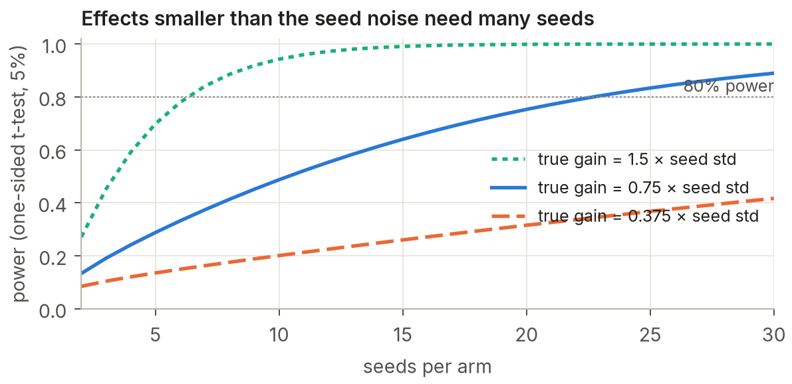

# 34 · Research craft

Part X · Research craft and interviews. Draws on Chapter 2 (statistics), Chapter 13 (scaling laws and small-scale proxies) and Chapter 23 (evaluation statistics). Chapter 36 covers how research craft is tested in interviews.

## Why it matters

Two researchers with the same knowledge and compute produce very different output. The difference is craft: picking problems worth solving, running experiments that answer the question asked, telling signal from noise, iterating fast, and writing results others can trust and build on. None of this appears in papers, and most of it is learned by making expensive mistakes. This chapter collects the habits that separate productive research scientists from busy ones, with simulations that show why the statistical habits matter.

Numbers in this chapter come from `code/ch34_check.py` (seconds).

The chapter follows a research project from start to finish. It begins with what craft consists of (34.1) and how to choose a problem worth working on (34.2), then covers reading papers efficiently (34.3) and reproducing results before building on them (34.4). Sections 34.5 to 34.8 are the experimental core: designing experiments that can answer the question, handling noise between seeds, budgeting compute for fast iteration, and the infrastructure that keeps results trustworthy. The chapter ends with writing (34.9), collaboration and integrity (34.10), and a worked project from question to conclusion (34.11).

The skill underneath all of it is turning a vague idea into an experiment whose outcome would change your mind. Most wasted research time goes into experiments that could not have failed, or whose results could not be distinguished from noise, and every section is in some way a defence against that.

## Key concepts

- **Research taste**: judgement about which problems are important, tractable and suited to you. [Hamming, "You and Your Research"](https://www.cs.virginia.edu/~robins/YouAndYourResearch.html), [Schulman, "An Opinionated Guide to ML Research"](http://joschu.net/blog/opinionated-guide-ml-research.html).
- **Reading papers**: structured reading and critical checking. [Keshav, "How to Read a Paper"](https://web.stanford.edu/class/ee384m/Handouts/HowtoReadPaper.pdf).
- **Ablations and baselines**: isolating what causes an improvement; tuning baselines as hard as methods. [Melis et al., "On the State of the Art of Evaluation in Neural Language Models"](https://arxiv.org/abs/1707.05589).
- **Seeds and variance**: [Bouthillier et al., "Accounting for Variance in Machine Learning Benchmarks"](https://arxiv.org/abs/2103.03098), [Agarwal et al., "Deep RL at the Edge of the Statistical Precipice"](https://arxiv.org/abs/2108.13264).
- **Experiment tracking**: [Weights & Biases](https://wandb.ai/), [MLflow](https://mlflow.org/).
- **Training recipes**: [Karpathy, "A Recipe for Training Neural Networks"](https://karpathy.github.io/2019/04/25/recipe/), [Google's Deep Learning Tuning Playbook](https://github.com/google-research/tuning_playbook).

## 34.1 What craft consists of

Three things, in roughly this order of importance:

1. **Taste**: choosing what to work on. A well-executed answer to an unimportant question is still unimportant.
2. **Rigour**: designing experiments whose results mean what you claim.
3. **Speed**: shortening the loop from idea to evidence, so you get many more chances to be right.

They trade off. Too much rigour too early slows exploration; too little later produces results that collapse under scrutiny. A useful pattern: explore fast and loosely, then confirm slowly and carefully before you believe or share anything.

## 34.2 Choosing problems

Ask four questions before starting:

- **Impact**: if this works, what changes? Who would use it? Would it change a decision at your lab?
- **Tractability**: is there a plausible path to a result in weeks, not years? What is the smallest experiment that would tell you if you are on track?
- **Edge**: why you? Unique data, compute, infrastructure, an insight others lack, or a skill combination.
- **Timeliness**: is the field about to need this, or has it moved on?

Habits that improve taste:

- Keep a list of open problems and failed ideas; revisit it monthly.
- Write a one-page proposal before any experiment: the question, the hypothesis, the experiment that would falsify it, and what you would do with each outcome.
- Time-box exploration (for example two weeks). At the end, decide explicitly: continue, pivot, or kill.
- **Kill ideas cheaply**: look for the fastest experiment that could prove the idea wrong, and run it first.
- Work on problems that matter even if they fail: a careful negative result on an important question is still useful.

## 34.3 Reading papers

Three passes (Keshav): skim (title, abstract, figures, conclusions: five minutes, decide whether to continue); read for the argument (method, experiments, without proofs); and, for papers you will build on, a deep pass where you could re-derive and reproduce the key result.

**Checklist for the claims**:

| Question | Red flag |
|---|---|
| What exactly is compared? | Baseline from an older paper, not re-run; different data or compute |
| Were baselines tuned as hard as the method? | Method swept over many settings, baseline at defaults |
| How big is the effect relative to noise? | No seeds, no intervals, gains under a point |
| Does it hold across scales and tasks? | One model size, one benchmark |
| Is the evaluation sound? | Contamination, judge without controls, cherry-picked examples |
| What do the ablations show? | Ablations that remove everything at once |
| What is not reported? | Compute, failed settings, wall-clock cost |

Keep a short note per important paper: claim, evidence, your doubts, and what experiment would test it.

## 34.4 Reproducing results

Reproducing a result is the best way to understand it and the fastest way to find out whether it is real.

1. Start from the official code if it exists; run it unchanged and match the reported numbers before changing anything.
2. Otherwise, start from the smallest setting the paper reports.
3. Match everything: data and preprocessing, tokenizer, model size, optimiser and schedule, evaluation code, number of samples.
4. When numbers differ, bisect: swap components between your version and the reference one at a time.
5. Report what you matched and what you could not.

Many "failed replications" come from an unreported detail (a learning-rate warm-up, a data filter, an evaluation prompt). Many successful ones show smaller effects than reported: expect that.

## 34.5 Designing experiments

**Baselines.** Tune the baseline with the same effort and budget as the new method. Melis et al. (2017) showed that a carefully tuned LSTM beat several newer architectures that had been reported as improvements. The same pattern recurs with optimisers, architectures and fine-tuning methods.

**One change at a time**, at matched compute or matched tokens, with matched schedules (Chapter 7) and the same evaluation.

**Ablations** answer "which part of this matters?". One-at-a-time ablations from a baseline miss interactions. In the check script, component B does nothing on its own (−0.25 from the baseline, within noise) but adds a full point when combined with A:

| Design | What it says about B |
|---|---|
| Add B to the baseline | "No effect" (−0.25) |
| 2 × 2 factorial | No effect without A (+0.03), +1.00 with A |
| Remove B from the full system | Costs 1.00 |

For systems with several components, ablate by removing each from the full system (leave-one-out), or run a factorial design if components are few.

**Small-scale proxies.** Most research questions can be asked at small scale first. Check that the effect has the same sign and similar size at two small scales, and fit a trend (Chapter 13) before spending large compute. Some effects only appear at scale; some disappear. A single small-scale result is a hypothesis.

**Controls.** Include a condition that should not work (shuffled labels, random data, a trivially simple method). If it does surprisingly well, your evaluation has a problem.

## 34.6 Noise, seeds and statistics

Training runs differ by seed: initialisation, data order, dropout, non-deterministic GPU kernels. For small models fine-tuned on small datasets, seed variance can exceed the effects people report.

**How many seeds?** Suppose a change truly improves a score by 0.3 points and the seed-to-seed standard deviation is 0.4:

| Seeds per arm | What you see |
|---|---|
| 1 | The new run looks better 70% of the time; with no real gain it would still look better 50% of the time |
| 3 | 16% power to detect the gain at p < 0.05 |
| 5 | 27% |
| 10 | 49% |

When the effect is comparable to the noise, a handful of seeds cannot establish it. Options: reduce the noise (larger evaluation sets, continuous metrics such as loss, paired evaluation on the same items, Chapter 23), increase the effect (test at a scale where it is larger), or run many seeds of cheap configurations. At minimum, run 2–3 seeds of the baseline once to know the noise floor of your setup.

*Power of a one-sided t-test at 5% to detect a true gain, by seeds per arm, for gains of 1.5, 0.75 and 0.375 times the seed-to-seed standard deviation. The middle curve is the table's case (a 0.3-point gain with 0.4-point noise): about 23 seeds per arm reach 80% power.*

The curve gives a planning rule. Measure the seed noise first, then express the effect you care about in units of it. Effects above about 1.5 standard deviations are visible with 5–7 seeds per arm. Effects below about 0.75 need either many cheap runs or a less noisy measurement.

**Winner's curse.** In a sweep of 12 configurations that are all equally good, with evaluation noise of 0.5 points, the best observed score averages 70.81 against a true 70.00. Re-running the winner regresses to 70.00. Always confirm a sweep's winner with fresh seeds before reporting it, and report the sweep, not only its maximum.

**Report**: means and intervals over seeds, the number of seeds, and all configurations tried.

## 34.7 Compute budgeting and iteration speed

Plan compute like money. For a project testing an idea on a four-size model ladder (125M to 1.4B parameters, about 20 tokens per parameter), three learning rates and two seeds each, then one 7B confirmation run on 140B tokens, at 40% MFU on one 989-TFLOP/s GPU:

| Phase | FLOPs | GPU-hours |
|---|---|---|
| Ladder sweep (24 runs) | 1.9 × 10²¹ | ~1,350 |
| 7B confirmation | 5.9 × 10²¹ | ~4,130 |

Spending about a quarter of the budget on the small-scale sweep is typical and usually worth it: it tells you whether the large run is worth doing and which settings to use.

**Iteration speed** is often the real constraint:

- Keep a **fast loop** (minutes) for debugging and sanity checks, a **medium loop** (hours) for most experiments, and a **slow loop** (days) only for confirmation.
- Overfit one batch before training anything.
- Automate the boring parts: launching sweeps, collecting results, plotting.
- Run several experiments in parallel; do not wait idle for one.
- Delete experiments that cannot change your decision.

## 34.8 Experiment infrastructure

- **Configuration files** for every run, committed with the code; no hand-edited constants.
- **Tracking**: log configuration, code version (git commit), data version, metrics, system statistics and artefacts for every run (Weights & Biases, MLflow, or your lab's system).
- **Naming**: runs named so you can find them in six months.
- **Determinism where cheap**: fixed seeds for initialisation and data order (same seed twice gives identical results in the check script; a different seed does not); accept that GPU kernels and distributed training are not bit-exact, and measure the resulting variance instead.
- **Evaluation as code**, versioned, run automatically on checkpoints (Chapter 23).

## 34.9 Writing

Writing is part of the research, not a report on it. Writing early exposes gaps in the argument and missing experiments.

**A research memo** (one to three pages) for every finished experiment cycle:

1. **Question** and why it matters.
2. **Answer** in one or two sentences, with the key number and its uncertainty.
3. **Evidence**: the main figure or table, with the setup needed to interpret it.
4. **What else could explain it**, and what you did to rule it out.
5. **Limitations** and what would change your mind.
6. **Next steps** and the decision you recommend.

Figures: label axes with units, show intervals, use the same scale for compared panels, and make the main point visible without reading the caption. Claims must match evidence: "improves" needs an interval that excludes zero; "generalises" needs several settings.

**Negative results** deserve a memo too. They save colleagues from repeating the work, and they are part of your track record of judgement.

## 34.10 Collaboration and integrity

- Agree on roles and authorship early and revisit when contributions change.
- Credit others' ideas and code explicitly.
- Report all configurations and seeds, not the best ones; report failed replications.
- Never adjust evaluations after seeing results to make a method look better; if you must change the evaluation, re-run every method.
- Share code and data where you can; reproducibility is a service to the field and to your future self.

## 34.11 A worked project: does a data curriculum help?

**Question.** Does ordering pretraining data from easy to hard (by a quality-classifier score, say) lower the final loss at a fixed token budget? The answer feeds a decision about the data loader for next quarter's runs.

1. **Read first.** Prior results on curricula for language-model pretraining are mixed. Benefits often appear early in training and shrink by the end, and some vanish once the learning-rate schedule is tuned. So the prior is a small effect, and the design must be able to see one.
2. **Choose the metrics.**
   - Primary: final loss on a fixed held-out set of 50M tokens from the target distribution. Loss is continuous and low-noise, so it suits small effects.
   - Secondary: five benchmarks, reported with intervals and not used for the decision unless they agree with the loss.
3. **Reproduce the baseline.** The random-order baseline at 125M parameters must match the team's known loss curve within seed noise before anything else is run.
4. **Measure the noise.** Run three baseline seeds at 125M. Suppose the final loss varies with a standard deviation of 0.003 nats. An effect of 0.005 nats is then 1.7 standard deviations: by the curve above, 5–6 seeds per arm give good power, 3 give about 50%.
5. **Design with a control for the obvious confound.**
   - A curriculum changes not only the order but also which data the model sees during the final learning-rate decay. Add a third arm that keeps random order but places the hardest data in the last 10% of tokens.
   - If that arm matches the full curriculum, the effect comes from the end of training (an annealing effect, Chapter 16), not from ordering.
6. **Budget.**
   - Use three sizes (125M, 350M, 760M) at 20 tokens per parameter, with 3 seeds each. Two arms cost 5.2 × 10²⁰ FLOPs, about 360 GPU-hours at 40% MFU; the third arm brings it to about 540.
   - The largest single run takes about 49 GPU-hours, so the whole study fits in a week on a small cluster.
7. **Set the kill criteria in advance.** Stop if the 125M difference is below one seed standard deviation and the 350M difference is smaller still. A shrinking effect with scale is the most common outcome and is a result worth reporting.
8. **Write it up.**
   - Loss against compute for each arm and size.
   - The effect with intervals at each size, and the fitted trend.
   - The control arm's result.
   - A one-paragraph recommendation that names its scope ("up to 760M parameters and 15B tokens").

The plan takes a page and about an hour to write. It will save weeks of runs that could not have answered the question.

## Pitfalls

- Starting experiments before writing down what result would change your mind.
- Comparing a tuned method with an untuned baseline.
- One seed per configuration; reporting the best of a sweep without re-running it.
- One-at-a-time ablations for interacting components.
- Scaling up an idea that has been tested at one small scale.
- Not logging code and data versions, then being unable to reproduce your own best run.
- Writing only at the end.

## Interview questions

**1. How do you decide what to work on?** Impact, tractability, my edge and timeliness; a one-page proposal with a falsifiable hypothesis and the cheapest experiment that could kill it; time-boxed exploration with explicit continue/pivot/kill decisions.

**2. A paper claims a 2-point gain. How do you assess it?** Check whether baselines were re-run and tuned, compute and data matched, seeds and intervals reported, results consistent across scales and tasks, evaluation sound (contamination, judges), ablations meaningful. Then try to reproduce the smallest setting.

**3. Your change improves the score by 0.3 points on one seed. What next?** Estimate seed variance on the baseline; run more seeds or reduce evaluation noise; test with a paired comparison; do not claim anything until the interval excludes zero.

**4. Why do one-at-a-time ablations mislead?** They miss interactions: a component that helps only in combination with another looks useless when added alone. Use leave-one-out from the full system or factorial designs.

**5. What is the winner's curse in hyperparameter sweeps?** The best observed configuration's score is biased upwards by noise; re-running it gives a lower number. Confirm with fresh seeds and report the whole sweep.

**6. How would you budget compute for testing a new idea?** Small-scale ladder with a few learning rates and seeds to establish the effect and its trend, then a confirmation at the target scale only if the trend holds; roughly a quarter or more of the budget for the small-scale phase.

**7. How do you make your experiments reproducible?** Config files, tracked code and data versions, seeds, automatic logging of all metrics and artefacts, versioned evaluation code, and documented variance where bit-exact determinism is impractical.

**8. Describe a research result you got wrong, and what you changed afterwards.** (Behavioural, see Chapter 38.) Strong answers name a specific methodological lesson: added seeds, re-tuned baselines, changed evaluation.

## Practice

1. Pick a 2024–2026 paper close to your interests. Write the claims-and-doubts note from 34.3 and identify the smallest experiment that would test its main claim.
2. Reproduce one figure from a paper at small scale; document every discrepancy and how you resolved it.
3. Run 5 seeds of a small fine-tuning task; compute the seed standard deviation and the number of seeds needed to detect a 1-point gain with 80% power.
4. **Research exercise.** Take a published "improvement" to a small training recipe (an optimiser tweak, a regularisation trick). Re-run it against a baseline tuned with the same budget, 5 seeds each, at two model sizes. Write a research memo with the template in 34.9, whatever the outcome.
5. Write a one-page proposal for a project you would like to do, with the kill criterion stated.

## Read next

- Richard Hamming, "You and Your Research" (talk, 1986).
- John Schulman, "An Opinionated Guide to ML Research" (2020).
- Andrej Karpathy, "A Recipe for Training Neural Networks" (2019); Google Research, "Deep Learning Tuning Playbook" (2023).
- Melis, Dyer and Blunsom, "On the State of the Art of Evaluation in Neural Language Models" (2017).
- Bouthillier et al., "Accounting for Variance in Machine Learning Benchmarks" (2021); Agarwal et al., "Deep Reinforcement Learning at the Edge of the Statistical Precipice" (2021).
- S. Keshav, "How to Read a Paper" (2007).
- Links are in the Key concepts section at the top of this chapter.

## Done when

You can choose and scope a research problem with a falsifiable hypothesis and a kill criterion. You can read a paper critically and reproduce its key result. You can design experiments with tuned baselines, matched compute, controls and appropriate ablations.

You can estimate how many seeds an experiment needs, avoid the winner's curse, and report results with intervals. You can budget compute across small-scale and confirmation phases, keep experiments reproducible, and write a research memo whose claims match its evidence.

---

[← 33 · Agents and tool use](33-agents-and-tool-use.md) · [Contents](../README.md#contents) · [35 · The ML coding interview →](35-the-ml-coding-interview.md)
