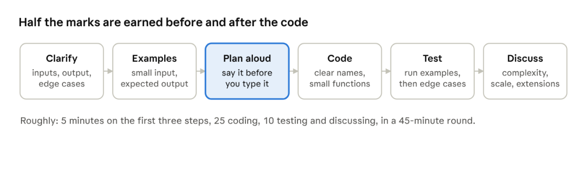

# 35 · The ML coding interview

Part X · Research craft and interviews. Pulls together the from-scratch code across the book: Chapters 3, 40, 4, 10, 20, 30 and 43 contain most of the implementations listed here. At many product companies the ML coding round is data handling, ML code and object-oriented design rather than algorithm puzzles (check recent candidate reports for your target company); this chapter prepares for that, with a little classic algorithm practice as insurance.

## Why it matters

For many experienced data scientists, coding is the decisive gap: the area most likely to fail an otherwise strong loop. The good news is that ML coding rounds reward practice more than talent: the same twenty or so patterns come up again and again. This chapter lists them, gives you working code for the most common ones, and a plan for practising with autocomplete off until they are automatic.

The chapter starts with the formats coding rounds take (35.1) and a six-step approach that works for any question (35.2). It then covers the material: pandas (35.3) and SQL (35.4) patterns for data questions, algorithms to implement from scratch (35.5), object-oriented design for ML code (35.6) and testing (35.7). Section 35.8 lists where to practise and how much, 35.9 covers the from-scratch model components research roles ask for, and 35.10 works through a full applied question in fifteen minutes. The last three sections are for research loops and newer formats: a debugging round on a broken training loop (35.11), a worked attention question with grouped-query heads and a KV cache (35.12), and how AI-assisted rounds are scored (35.13).

Coding rounds test two things at once: whether you can produce correct code under time pressure, and whether you work the way a good colleague would, clarifying the problem, checking edge cases and testing without being asked. Candidates who know the material often fail on the second, and it is the easier one to practise.

## Key concepts

- **Coding round formats**: algorithmic problems, ML from scratch (implement k-means or logistic regression), data manipulation (pandas or SQL), and practical design (write a small, clean class or service).
- **Big-O complexity**: how time and memory grow with input size; say it for every solution. [Big O notation](https://en.wikipedia.org/wiki/Big_O_notation).
- **Core patterns**: hash maps, two pointers, sliding window, heaps for top-k, BFS/DFS, sorting, binary search. [NeetCode roadmap](https://neetcode.io/roadmap) groups practice problems by pattern.
- **NumPy vectorisation**: replacing Python loops with array operations; expected in ML coding rounds. [NumPy quickstart](https://numpy.org/doc/stable/user/quickstart.html).
- **From-scratch ML implementations**: the models in Chapters 3, 4, 5, 10 and 40, written without libraries; build fluency with [Karpathy's Zero to Hero](https://karpathy.ai/zero-to-hero.html).
- **Think-aloud process**: clarify, give examples, state a plan and its complexity, code, test with edge cases. [Tech Interview Handbook](https://www.techinterviewhandbook.org/coding-interview-prep/).

## 35.1 The common formats

| Format | What you get | What they check |
|---|---|---|
| Data manipulation | A pandas DataFrame or SQL tables of orders, users, events; questions like "top 3 restaurants per city by repeat rate" | Fluency with groupby, joins, windows, time; correctness on edge cases |
| ML from scratch | "Implement k-means / logistic regression / AUC / a decision tree split" | Understanding of the algorithm; clean NumPy; vectorisation |
| ML code and OOP | "Design classes for a training pipeline", "write a feature transformer", "extend this model class" | Abstractions, readability, testability, sensible interfaces |
| Applied mini-project | A small dataset and an hour: clean, featurise, train, evaluate | End-to-end judgement: baseline first, correct split, honest evaluation |
| Debugging or code review | Code with bugs or leakage | Reading code, spotting leakage and silent errors |
| Classic algorithms | Arrays, hash maps, heaps, two pointers, BFS | Basic data structures and complexity |

Ask the recruiter which formats to expect and in which language and environment (plain editor, notebook, shared doc). Practise in the same environment, without autocomplete or AI assistance.

## 35.2 How to approach any coding question



*solving a coding question · six steps*

1. **Clarify:** inputs, types, sizes, missing values, ties, what to return. Many lost points come from solving a different problem.
2. **Examples:** write a tiny input and the expected output; it catches misunderstandings early.
3. **Plan aloud:** the approach in two or three sentences, and its complexity. Interviewers can redirect you before you spend 20 minutes on a dead end.
4. **Code:** small functions, clear names, no premature cleverness. Talk as you go, briefly.
5. **Test:** run your example; then empty input, single row, ties, missing values, duplicates.
6. **Discuss:** complexity, what changes at 100× the data (chunking, Spark, SQL), and how you would productionise it.

When stuck, say what you are trying, write a brute-force version first, and improve it. A working simple solution beats an unfinished clever one.

### Managing the clock

The figure's six steps map onto a 45-minute round roughly as 5 minutes to clarify, give an example and state the plan, 25 minutes to code, 10 minutes to test and discuss, and 5 minutes for your questions. Check the time at the end of each phase, out loud if it helps ("I'm about 20 minutes in; I'll finish the core and then test"). The split matters because candidates usually lose the round in the last 15 minutes: they are still writing the clever version and never run a test, which is exactly what the interviewer wanted to see.

When 15 minutes remain and the code is not working, cut scope in this order:

1. **Drop optimisations.** Revert to the O(n²) or loop-based version you know is correct, and say what you would vectorise.
2. **Drop generality.** Handle the main case (one batch, no padding, no ties) and name the cases you are skipping.
3. **Keep one test.** Running the tiny example from step 2 is worth more than any extra feature.

### Recovering from a stuck point

Silence is the expensive failure. A script that works:

- **Name the obstacle.** "I'm not sure how to handle ties in the ranking; let me think about the two options." Interviewers often help as soon as they know where you are.
- **Shrink the problem.** Solve it for n = 2, one head, or one group, then generalise.
- **Take hints gracefully.** A hint is not a penalty; ignoring one is. Restate it ("so I can sort first and then use one pass?"), use it, and move on.
- **Debug in the open.** Print a shape or an intermediate value rather than staring at the code. In ML code, a shape print finds most bugs in under a minute.

## 35.3 pandas patterns

All on one small `orders` table (order_id, user_id, restaurant, ts, amount). Each pattern below ran on test data; know each one without looking it up.

```python
import pandas as pd

# 1. Top-k per group: each user's two largest orders
top2 = (orders.sort_values(["user_id", "amount"], ascending=[True, False])
              .groupby("user_id").head(2))

# 2. Share within group (transform keeps the original shape)
spend = orders.groupby(["user_id", "restaurant"], as_index=False)["amount"].sum()
spend["share"] = spend["amount"] / spend.groupby("user_id")["amount"].transform("sum")

# 3. Time since previous event per user (shift / diff within group)
o = orders.sort_values(["user_id", "ts"]).copy()
o["days_since_prev"] = o.groupby("user_id")["ts"].diff().dt.total_seconds() / 86400

# 4. Sessionisation: a new session after a 30-minute gap or a new user
o["new_session"] = (o["ts"].diff() > pd.Timedelta("30min")) | (o["user_id"] != o["user_id"].shift())
o["session_id"] = o["new_session"].cumsum()

# 5. Rolling time window per user: spend in the last 7 days, including this order
roll = (o.set_index("ts").groupby("user_id")["amount"]
          .rolling("7D").sum().reset_index(name="spend_7d"))

# 6. Point-in-time join: the latest restaurant rating known at order time
pit = pd.merge_asof(orders.sort_values("ts"), ratings.sort_values("ts"),
                    on="ts", by="restaurant", direction="backward")

# 7. Repeat rate: share of users who order again within 7 days of their first order
first = orders.groupby("user_id")["ts"].min().rename("first_ts")
m = orders.join(first, on="user_id")
repeaters = m[(m.ts > m.first_ts) & (m.ts <= m.first_ts + pd.Timedelta("7D"))].user_id.unique()
repeat_rate = len(repeaters) / orders.user_id.nunique()
```

**Also know cold:** `pivot_table` and `melt`; `merge` with `how=` and `indicator=True` to find unmatched rows; `drop_duplicates(subset, keep=)`; `rank(method="dense")`; `pd.cut` and `pd.qcut` for buckets; `explode` for list columns; `value_counts(normalize=True)`; `np.where` and `np.select` for conditional columns; `.dt` accessors; handling `NaN` in groupbys (`dropna=False`).

**Performance habits:** vectorise instead of `apply` with Python functions; use `category` dtype for repeated strings; filter early; avoid chained assignment (use `.loc` or `.assign`); know that `groupby().transform` is usually faster than merging aggregates back.

## 35.4 SQL patterns

Window functions are the heart of SQL interviews for data and ML roles. The same table in SQLite (which supports windows), tested:

```sql
-- Order number, previous order time and running spend per user
SELECT user_id, order_id,
       ROW_NUMBER() OVER (PARTITION BY user_id ORDER BY ts) AS n,
       LAG(ts)      OVER (PARTITION BY user_id ORDER BY ts) AS prev_ts,
       SUM(amount)  OVER (PARTITION BY user_id ORDER BY ts
                          ROWS BETWEEN UNBOUNDED PRECEDING AND CURRENT ROW) AS running_spend
FROM orders;

-- Repeat within 7 days of first order (same answer as pandas pattern 7: 0.75 on the test data)
WITH firsts AS (SELECT user_id, MIN(ts) AS first_ts FROM orders GROUP BY user_id)
SELECT COUNT(DISTINCT o.user_id) * 1.0 / (SELECT COUNT(*) FROM firsts) AS repeat_7d
FROM orders o JOIN firsts f ON o.user_id = f.user_id
WHERE o.ts > f.first_ts AND julianday(o.ts) <= julianday(f.first_ts) + 7;

-- Top 3 restaurants per city by orders (city lives in restaurants(restaurant, city), so join first)
SELECT * FROM (
  SELECT r.city, o.restaurant, COUNT(*) AS n_orders,
         DENSE_RANK() OVER (PARTITION BY r.city ORDER BY COUNT(*) DESC) AS rk
  FROM orders o JOIN restaurants r ON o.restaurant = r.restaurant
  GROUP BY r.city, o.restaurant) t
WHERE rk <= 3;

-- Sessionisation: running sum of "new session" flags
WITH flagged AS (
  SELECT *, CASE WHEN julianday(ts) - julianday(LAG(ts) OVER (PARTITION BY user_id ORDER BY ts))
                     > 30.0 / 1440 OR LAG(ts) OVER (PARTITION BY user_id ORDER BY ts) IS NULL
                 THEN 1 ELSE 0 END AS new_session
  FROM events)
SELECT *, SUM(new_session) OVER (PARTITION BY user_id ORDER BY ts) AS session_n FROM flagged;
```

**Also know:** `RANK` vs `DENSE_RANK` vs `ROW_NUMBER` (ties); `LEAD`; moving averages with `ROWS BETWEEN 6 PRECEDING AND CURRENT ROW`; conditional aggregation (`SUM(CASE WHEN` `... THEN 1 ELSE 0 END)`); `LEFT JOIN ... WHERE right.id IS NULL` for anti-joins; cohort retention tables; funnels; deduplication with `ROW_NUMBER() ... = 1`; date functions in the dialect you will use (BigQuery, Snowflake, Postgres, Spark SQL). Chapter 48 goes deeper on SQL for ML, including point-in-time joins.

## 35.5 Algorithms to implement from scratch

Each links to the chapter that has tested code. Target times assume practice; aim for these by week 8.

| Algorithm | Chapter | Target time |
|---|---|---|
| Linear regression (normal equation and gradient descent) | 40.1, 3.5 | 15 min |
| Logistic regression with mini-batch SGD / Adam | 3.5 | 20 min |
| k-means (with k-means++ init) | 40.9 | 15 min |
| kNN classifier | 40.6 | 10 min |
| Decision tree split (Gini) and a small tree | 40.3 | 30–40 min |
| Gradient boosting for squared loss | 40.5 | 20 min |
| PCA via SVD | 40.10 | 10 min |
| Naive Bayes (multinomial) | 40.8 | 15 min |
| Precision, recall, F1, ROC-AUC, average precision | 4.1–4.2 | 10 min each |
| NDCG@k, MRR, recall@k | 4.6, 44.9 | 10 min |
| Bootstrap confidence interval | 4.9, 2.1 | 10 min |
| Train/test split by time, out-of-fold target encoding | 3.6, 3.8 | 15 min |
| BM25 and an inverted index | 30.2, 44.3 | 25 min |
| Cosine-similarity top-k, item-to-item CF | 43.2 | 10 min |
| Scaled dot-product attention with causal mask | 10.2 | 15 min |
| Softmax, cross-entropy, InfoNCE | 3.3, 29.2 | 10 min |
| LoRA linear layer | 20.3 | 15 min |
| Thompson sampling | 43.8 | 10 min |

**Insurance for classic algorithm questions:** two sum (hash map), top-k with a heap (`heapq.nlargest`), sliding window maximum or sums, merging intervals, binary search on a sorted array, BFS on a grid or graph, LRU cache (`OrderedDict`). Fifteen to twenty LeetCode Easy/Medium problems on these patterns is enough for a data-focused round.

## 35.6 Object-oriented code for ML

OOP questions check whether your code would survive in a team codebase. Know the scikit-learn estimator conventions, because "make it work like scikit-learn" is a common ask and gives you a free, well-known design:

```python
import numpy as np
from sklearn.base import BaseEstimator, ClassifierMixin
from sklearn.utils.validation import check_X_y, check_array, check_is_fitted

class LogisticRegressionGD(BaseEstimator, ClassifierMixin):
    """Hyperparameters in __init__ (stored as-is), learned state with a trailing underscore."""
    def __init__(self, lr=0.1, n_iter=500, l2=0.0):
        self.lr, self.n_iter, self.l2 = lr, n_iter, l2

    def fit(self, X, y):
        X, y = check_X_y(X, y)
        self.classes_ = np.unique(y)
        Xb = np.c_[np.ones(len(X)), X]
        self.w_ = np.zeros(Xb.shape[1])
        for _ in range(self.n_iter):
            p = 1 / (1 + np.exp(-Xb @ self.w_))
            grad = Xb.T @ (p - y) / len(y)
            grad[1:] += self.l2 * self.w_[1:]          # do not regularise the bias
            self.w_ -= self.lr * grad
        return self                                      # enables chaining

    def predict_proba(self, X):
        check_is_fitted(self, "w_")
        X = check_array(X)
        p = 1 / (1 + np.exp(-(np.c_[np.ones(len(X)), X] @ self.w_)))
        return np.c_[1 - p, p]

    def predict(self, X):
        return self.classes_[(self.predict_proba(X)[:, 1] >= 0.5).astype(int)]
```

Because it follows the conventions, it works with `cross_val_score`, `Pipeline` and `GridSearchCV` unchanged (0.83 mean accuracy in 5-fold cross-validation on a synthetic dataset).

**Design principles to say out loud:**

- **Separate concerns:** data loading, feature transformation, model, evaluation, each a class or module with a small interface.
- **Composition over deep inheritance:** a `Pipeline` holding steps beats a five-level class hierarchy.
- **Abstract base classes** (`abc.ABC`, `@abstractmethod`) when several implementations share an interface (several candidate generators, several rankers).
- **Dataclasses** for configuration and records; type hints everywhere.
- **Stateless where possible;** learned state only set in `fit`.
- **Dependency injection:** pass the model or the feature store client in, so tests can pass fakes.

A typical exercise: "Design classes for a recommender with several candidate sources and a ranker": a `CandidateSource` abstract class with `get_candidates(user, k)`, concrete sources, a `Ranker` with `score(user, items)`, and a `Recommender` composing them with deduplication and a re-ranking step (Chapter 43.3 in code form).

## 35.7 Testing

Show that you test without being asked: it is a strong senior signal.

```python
def test_predict_proba_sums_to_one():
    m = LogisticRegressionGD().fit(X, y)
    assert np.allclose(m.predict_proba(X).sum(1), 1)

def test_learns_separable_data():
    rng = np.random.default_rng(0)
    Xs = np.r_[rng.normal(-2, 1, (50, 2)), rng.normal(2, 1, (50, 2))]
    ys = np.r_[np.zeros(50), np.ones(50)]
    assert (LogisticRegressionGD().fit(Xs, ys).predict(Xs) == ys).mean() > 0.95
```

What to test in ML code: shapes and dtypes; invariants (probabilities in [0, 1] and summing to 1; metrics in range); agreement with a reference implementation (`np.isclose` against scikit-learn); behaviour on trivial cases (perfectly separable data, a single class, empty input); no leakage (a time split never puts future rows in training); determinism with a fixed seed. Use `pytest` with fixtures and `parametrize` in real projects.

## 35.8 Problem bank: where to practise

| Skill | Where | Amount before the interview |
|---|---|---|
| pandas | LeetCode "Introduction to Pandas" and "30 Days of Pandas" study plans; StrataScratch Python questions | Both study plans, then 20 StrataScratch questions |
| SQL | LeetCode "SQL 50"; DataLemur; StrataScratch | SQL 50 plus 15 window-function questions |
| ML from scratch | Deep-ML (deep-ml.com); the table in 35.5 | 30 Deep-ML problems; every row of 35.5 twice |
| Classic algorithms | LeetCode Easy/Medium on arrays, hash maps, heaps, sliding window, BFS | 15–20 problems |
| OOP for ML | Rebuild a small scikit-learn-style library: an estimator, a transformer, a pipeline | One afternoon, then explain it aloud |
| Mock interviews | A friend, interviewing.io-style services, or an LLM acting as interviewer with a timer | One per week from week 4 |


## 35.9 From-scratch components for research roles

Research-scientist coding rounds ask you to implement model components, usually in PyTorch, talking through shapes and checking as you go. The list below covers most questions; each links to the chapter with tested code.

| Component | Chapter | Target time |
|---|---|---|
| Multi-head attention with causal mask, GQA and a KV cache | 10.3, 10.8 | 25 min |
| RoPE | 10.4 | 15 min |
| RMSNorm, SwiGLU, a pre-norm transformer block | 10.5–10.6 | 20 min |
| Training loop for a mini-GPT | 10.10, 6.4 | 25 min |
| BPE training and encoding | 9.3 | 25 min |
| Temperature, top-k, top-p sampling; beam search | 21.2, below | 15 min each |
| Numerically stable softmax and cross-entropy with ignored positions | below | 10 min |
| LoRA layer | 20.3 | 15 min |
| SFT loss masking and sequence packing | 18.2 | 15 min |
| Bradley–Terry, DPO, PPO-clip and GRPO losses | 18.3–18.6, 19.3, below | 10 min each |
| GAE | 18.4 | 10 min |
| Top-k MoE router with load-balancing loss | 11.2 | 20 min |
| Linear attention, recurrent and parallel forms | 11.4 | 20 min |
| Unbiased pass@k | 13.9 | 5 min |
| Ring all-reduce (simulated) | 17.3 | 15 min |
| MinHash signatures | 16.5 | 15 min |
| Sparse autoencoder (TopK) | 26.7 | 15 min |

Four that have no home elsewhere, all checked in `code/ch35_check.py`:

```python
def stable_cross_entropy(logits, targets, ignore_index=-100):
    mask = targets != ignore_index
    logits, targets = logits[mask], targets[mask]
    m = logits.max(-1, keepdim=True).values                      # subtract the max: no overflow
    lse = m.squeeze(-1) + (logits - m).exp().sum(-1).log()
    return (lse - logits.gather(-1, targets[:, None]).squeeze(-1)).mean()
# matches F.cross_entropy on logits of size ~50 with ignored positions

def top_p_filter(logits, p=0.9):
    probs = logits.softmax(-1)
    sorted_p, idx = probs.sort(descending=True)
    keep = sorted_p.cumsum(-1) - sorted_p < p                    # mass before this token is still < p
    out = torch.full_like(logits, float("-inf"))
    out.scatter_(-1, idx, torch.where(keep, logits.gather(-1, idx), torch.tensor(float("-inf"))))
    return out
# probabilities [0.5, 0.3, 0.15, 0.05], p = 0.9: keeps the first three

def beam_search(step_logprobs, beam=2, steps=3, eos=0, alpha=0.0):
    norm = lambda c: c[1] / len(c[0]) ** alpha                  # alpha = 0: raw sum of log-probs
    beams = [((), 0.0)]
    for _ in range(steps):
        cand = []
        for seq, score in beams:
            if seq and seq[-1] == eos: cand.append((seq, score)); continue   # finished beams compete as they are
            for tok, lp in enumerate(step_logprobs(seq)):
                cand.append((seq + (tok,), score + lp))
        beams = sorted(cand, key=norm, reverse=True)[:beam]
    return beams[0]

def grpo_loss(logp_new, logp_old, rewards, mask, group_size, eps_lo=0.2, eps_hi=0.28,
              logp_ref=None, beta=0.0, scale_std=False):
    """logp_*: (B, T) token log-probs, B = prompts x group_size, rows grouped by prompt;
    rewards: (B,); mask: (B, T), 1 on generated tokens."""
    r = rewards.view(-1, group_size)                                   # (P, G)
    adv = r - r.mean(1, keepdim=True)                                  # per-group baseline
    if scale_std:                                                      # original GRPO; Dr. GRPO drops it
        adv = adv / (r.std(1, keepdim=True) + 1e-6)
    adv = adv.reshape(-1, 1)                                           # one advantage per response, every token
    ratio = (logp_new - logp_old).exp()
    obj = torch.minimum(ratio * adv, ratio.clamp(1 - eps_lo, 1 + eps_hi) * adv)   # asymmetric clip (DAPO)
    if logp_ref is not None and beta > 0:                              # KL in the loss (k3), not in the reward
        d = logp_ref - logp_new
        obj = obj - beta * (d.exp() - d - 1)
    return -(obj * mask).sum() / mask.sum()                            # token-level mean (DAPO)
```

**The beam-search example.** Token 0 is end-of-sequence. The next-token probabilities are:

| Prefix | P(0) | P(1) | P(2) |
|---|---|---|---|
| (start) | 0.10 | 0.50 | 0.40 |
| (1) | 0.30 | 0.35 | 0.35 |
| (2) | 0.05 | 0.90 | 0.05 |

Greedy decoding takes token 1 (0.5) and then the best continuation (0.35), for a sequence probability of 0.5 × 0.35 = 0.175. Beam search with two beams keeps (1) and (2) after the first step, and finds (2, 1) at 0.4 × 0.9 = 0.36: the second-best first token leads to a much better sequence.

**Length bias.** Summed log-probabilities favour short outputs, because every extra token multiplies in a number below 1. Change the table so that stopping at once has probability 0.4 and token 1 (probability 0.35) is followed by the end token with probability 0.6. Stopping at once then scores 0.4, the best two-token sequence (1, 0) scores 0.35 × 0.6 = 0.21, and raw beam search returns the empty answer (0). Dividing each score by len(seq)^α with α = 1 compares average log-probability per token, −0.92 against −0.78, and returns (1, 0). Production systems use α between about 0.6 and 1, or a minimum length.

**The GRPO loss, written out.** For each prompt, sample a group of G responses o₁ … o_G with rewards r₁ … r_G. The advantage of response i is its reward minus the group's mean, optionally divided by the group's standard deviation:

$$
\hat{A}_i = r_i - \frac{1}{G}\sum_{j=1}^{G} r_j
$$

With ρᵢₜ = π_θ(oᵢₜ | context) / π_old(oᵢₜ | context) the per-token ratio, the clipped surrogate for one token is

$$
\ell_{it} = \min\left(\rho_{it}\hat{A}_i,\ \mathrm{clip}(\rho_{it}, 1-\epsilon_{lo}, 1+\epsilon_{hi})\,\hat{A}_i\right) - \beta\, k_3(i,t)
$$

where k₃ = exp(d) − d − 1 with d = log π_ref − log π_θ is the low-variance KL estimator (Chapter 19). The three published variants differ mainly in how the ℓᵢₜ are averaged, and in three smaller choices:

| Variant | Aggregation of ℓᵢₜ | Advantage | Clip | KL |
|---|---|---|---|---|
| GRPO (DeepSeekMath) | Mean over each response's tokens, then mean over responses: (1/G) Σᵢ (1/\|oᵢ\|) Σₜ | Divided by group std | Symmetric, ε = 0.2 | k₃ in the loss |
| DAPO | Sum over all tokens in the batch divided by the total token count | Divided by group std | Asymmetric, 0.2 / 0.28 ("clip-higher") | Removed |
| Dr. GRPO | Sum over tokens divided by a constant (for example the maximum length), so no per-response 1/\|oᵢ\| | Not divided by std | Symmetric | A separate choice |

The function above is therefore DAPO-style: token-level mean and clip-higher, with the std division off by default (as in Dr. GRPO) and switchable. Two details an interviewer will check:

- **The baseline is per group.** Subtracting the mean over the whole batch mixes prompts of different difficulty. With an easy prompt solved 4/4 and a hard one solved 1/4, the batch mean (0.625) gives every easy response an advantage of +0.375, rewarding the model for the prompt being easy. The per-group means give 0 to all easy responses and −0.25, −0.25, −0.25, +0.75 to the hard group, which is the signal you want. Code that subtracts `rewards.mean()` over the whole batch is correct only when the batch holds a single prompt.
- **Where the KL lives, and why it is off here.** GRPO puts the KL penalty in the loss, per token, rather than subtracting it from the reward as PPO-RLHF does (Chapter 18). DAPO and most long-reasoning RLVR recipes drop it, because the policy is supposed to move far from the reference and a verifier, not a learned reward model, limits reward hacking. Keep it (β around 0.001–0.04) when the reward is a learned model or a judge that the policy can exploit.

At ratio 1 (the first update on fresh samples) the gradient of this loss with respect to each token's log-probability is −Âᵢ divided by the batch's token count, which the check script confirms with autograd: the clip only matters on later updates of the same batch.

Interviewers probe the details: why subtract the max, what happens at p = 1 (every token should survive, but in fp32 the mass before a tail token rounds to exactly 1.0: for logits [10, 0, −20, −30] the filter keeps only the first two tokens, so treat p ≥ 1 as "no filtering" explicitly), how beam search handles finished sequences and length bias, and why the GRPO loss uses a per-group baseline, a token-level mean and asymmetric clipping (Chapter 19).

### Fluency staples: einsum, autograd and numerical stability

Four smaller skills come up inside almost every research coding round, usually as follow-ups.

**einsum and broadcasting.** Attention scores are `torch.einsum("bhtd,bhsd->bhts", q, k)`: name every axis, and the letters that disappear from the output are summed over. Writing the einsum first and the matmul second is a good way to get transposes right; the check script confirms the two agree. For broadcasting, align shapes from the right: (B, 1, T, S) + (T, S) works; (B, H, T) + (B, T) does not until you insert the head axis with `[:, None]`.

**A scalar autograd engine.** "Implement backpropagation for scalars" (Karpathy's micrograd) is a common 20-minute question. Each value stores its parents and a closure that pushes its gradient to them; `backward` visits the graph in reverse topological order:

```python
import math

class Value:
    def __init__(self, data, parents=()):
        self.data, self.grad, self._parents, self._backward = data, 0.0, parents, lambda: None
    def __add__(self, other):
        other = other if isinstance(other, Value) else Value(other)
        out = Value(self.data + other.data, (self, other))
        def backward(): self.grad += out.grad; other.grad += out.grad
        out._backward = backward; return out
    def __mul__(self, other):
        other = other if isinstance(other, Value) else Value(other)
        out = Value(self.data * other.data, (self, other))
        def backward(): self.grad += other.data * out.grad; other.grad += self.data * out.grad
        out._backward = backward; return out
    def tanh(self):
        t = math.tanh(self.data); out = Value(t, (self,))
        def backward(): self.grad += (1 - t * t) * out.grad
        out._backward = backward; return out
    def backward(self):
        order, seen = [], set()
        def visit(v):
            if id(v) not in seen:
                seen.add(id(v))
                for p in v._parents: visit(p)
                order.append(v)
        visit(self); self.grad = 1.0
        for v in reversed(order): v._backward()
```

For f = tanh(a·b + c·a) at a = 0.5, b = −1.5, c = 0.25, the engine gives f = −0.5546 and gradients −0.8655, 0.3462 and 0.3462, matching PyTorch. The test case uses a twice on purpose: the `+=` in each closure is what makes gradients from two paths add up, and writing `=` instead is the bug interviewers look for.

**Numerical stability beyond softmax.** Losses built on log σ(x) (Bradley–Terry, DPO, logistic regression) must use `F.logsigmoid`, which computes −log(1 + e^(−x)) without forming σ(x). In fp16, σ(−20) ≈ 2 × 10⁻⁹ underflows to zero, so −log σ(−20) evaluates to infinity, while `-F.logsigmoid` returns 20.0; in fp32 the naive form fails at a margin of −200. The same rule covers log-sum-exp (subtract the max) and log-probabilities of sequences (add log-probs, never multiply probabilities).

**Memory and complexity at long context.** Say the cost of what you wrote. Naive attention materialises a (B, H, T, T) score matrix: at T = 32,768 with 32 heads in bf16 that is 68.7 GB per layer for one sequence, which is why real code uses a fused kernel (FlashAttention keeps the O(T²) FLOPs but never stores the matrix; Chapter 10). The KV cache, by contrast, grows linearly; 35.12 works out its size.

## 35.10 A worked question: ROC-AUC from scratch in 15 minutes

**Prompt:** "Implement ROC-AUC without scikit-learn."

1. **Clarify (1 minute).**
   - Are the labels 0 and 1? Can scores tie? What should happen if only one class is present?
   - Answers: 0/1 labels; ties possible; raise an error for a single class.
2. **Example (1 minute).** Labels [0, 0, 1, 1] with scores [0.1, 0.2, 0.8, 0.9] give 1.0. Reversed scores give 0.0. All-equal scores give 0.5.
3. **Plan (1 minute).** "AUC is the probability that a random positive scores above a random negative, with ties counting half. The pairwise definition is O(n²); the rank form is O(n log n): sort, give tied scores their average rank, then AUC = (sum of positive ranks − n₊(n₊ + 1)/2) / (n₊ n₋)."
4. **Code (8 minutes).**

```python
import numpy as np

def roc_auc(y_true, scores):
    y = np.asarray(y_true); s = np.asarray(scores, dtype=float)
    n_pos, n_neg = int((y == 1).sum()), int((y == 0).sum())
    if n_pos == 0 or n_neg == 0:
        raise ValueError("AUC needs both classes")
    order = np.argsort(s, kind="mergesort"); s_sorted = s[order]
    ranks = np.empty(len(s)); i = 0
    while i < len(s):                                    # average ranks over tied scores
        j = i
        while j + 1 < len(s) and s_sorted[j + 1] == s_sorted[i]:
            j += 1
        ranks[order[i:j + 1]] = (i + j) / 2 + 1
        i = j + 1
    return (ranks[y == 1].sum() - n_pos * (n_pos + 1) / 2) / (n_pos * n_neg)
```

5. **Test (3 minutes).** Run the three hand examples. Then compare with a brute-force pairwise version on random data with many ties. The check script does both and also matches scikit-learn to 12 decimal places.
6. **Discuss (1 minute).**
   - Complexity is dominated by the sort.
   - For data too large to sort in memory, bin the scores into a histogram per class and sum over bins. This is exact if the scores are already discrete, approximate otherwise, and it parallelises in Spark or SQL.
   - For weighted samples, replace counts with sums of weights.
   - AUC ignores calibration and class balance, so report it with a precision–recall view when positives are rare (Chapter 4).

What earns the points is the order of the steps: confirming the tie and single-class behaviour, stating the probabilistic meaning, choosing the O(n log n) method deliberately, and testing against a definition. A correct but untested one-liner earns less.

## 35.11 A worked debugging round: find the bugs in this training loop

Research labs often replace one coding round with a debugging round: you get a model and a training loop that run without errors but are wrong, and you have 30–45 minutes to find what is broken. The round tests the habit that matters most in research engineering, which is distrusting a number until you have checked it. Reading the code line by line finds some bugs; a handful of cheap experiments finds the rest, and saying which experiment you are running and why is most of the score.

**The prompt.** "This character-level language model trains, but the team doesn't trust the results. Find the problems." V = 64 tokens, context T = 32.

```python
class TinyLM(nn.Module):                                   # embedding, one attention block, MLP, head
    def forward(self, x):                                  # x: (B, T) token ids
        B, T = x.shape
        h = self.tok(x) + self.pos(torch.arange(T))
        q, k, v = self.qkv(self.ln1(h)).chunk(3, -1)       # single head for brevity
        att = q @ k.transpose(-2, -1) / q.shape[-1] ** 0.5  # (B, T, T)
        mask = torch.tril(torch.ones(T, T, dtype=torch.bool), -1)
        att = att.masked_fill(mask, float("-inf"))
        h = h + self.drop(self.proj(att.softmax(-1) @ v))
        h = h + self.drop(self.mlp(self.ln2(h)))
        return self.head(h)                                # (B, T, V) logits

windows = [tokens[i:i + T + 1] for i in range(len(tokens) - T)]     # every start position
random.shuffle(windows)
cut = int(0.9 * len(windows))
train, val = windows[:cut], windows[cut:]

model = TinyLM(); opt = torch.optim.AdamW(model.parameters(), lr=3e-3)
for step in range(steps):
    batch = sample(train, 32)                              # (32, T + 1)
    logits = model(batch[:, :-1])
    probs = logits.softmax(-1)
    loss = F.cross_entropy(probs.reshape(-1, V), batch[:, :-1].reshape(-1))
    loss.backward()
    opt.step()

def evaluate(model, val):
    losses = [F.cross_entropy(model(b[:, :-1]).reshape(-1, V), b[:, 1:].reshape(-1)) for b in batches(val)]
    return sum(losses) / len(losses)
```

There are six bugs. The order below is the order of cheap checks that expose them, not the order in the file, and that order is what to say aloud: start with the checks that need no training, then one batch, then a short run.

**Check 1: read for the classic slips (2 minutes).** Three bugs are visible on a careful read:

- **No `opt.zero_grad()`.** Gradients accumulate across steps, so each update uses the sum of every gradient so far. On one batch the loss goes from 4.57 to 74.9 in 300 steps instead of falling.
- **Softmax before `F.cross_entropy`.** The loss function applies log-softmax itself, so the model's outputs are squashed into [0, 1] and then softmaxed again. The loss can never fall below ln(1 + (V − 1)/e) = 3.19 nats for V = 64, whatever the model learns; in the check script a single batch stalls at 3.43.
- **`evaluate` never calls `model.eval()` or `torch.no_grad()`.** Dropout stays on, so the validation loss is noisy and biased upwards: two calls give 2.686 and 2.696, against 2.649 twice in eval mode. Without `no_grad` it also builds a graph and wastes memory.

**Check 2: loss at initialisation (seconds).** A fresh model should predict roughly uniformly, so the loss should be close to ln V = 4.16. Here it is 4.57 with the fix and 4.16 with the softmax bug: an initial loss near ln V does not prove the loss is right, but one far above it (say 10) points to a bad initialisation or a wrong reduction.

**Check 3: a loss that is too good (1 minute of training).** The data come from a source with an entropy rate of 2.39 nats per token, so no honest model can beat that on held-out text, and training loss should approach it from above. After 1,500 steps, the corrected loop reaches 2.27 on the last training batch (close to the floor; one batch is noisy). With the loop as given it reaches 0.000: the loss uses `batch[:, :-1]` as targets, the same tokens as the input, so the model only has to copy its own input. **Targets must be shifted by one:** inputs `batch[:, :-1]`, targets `batch[:, 1:]`. Any language-model loss well below the data's plausible entropy is a leak until proven otherwise.

**Check 4: the causality test (seconds).** Fix the shift and the loss is still suspiciously low (0.096). Change the last input token and check that the logits at all earlier positions are unchanged. With the given mask they move by up to 35; with the correct mask, by exactly 0. `torch.tril(..., -1)` marks the *past* as masked, so each position sees itself and the future, including the token it must predict. The future is above the diagonal: the mask should be `torch.triu(torch.ones(T, T, dtype=torch.bool), diagonal=1)`. This test is worth writing for any attention code, because a reversed mask produces no error and a beautiful loss curve.

**Check 5: audit the split (2 minutes).** The windows start at every position and are shuffled before the split, so a validation window shares 32 of its 33 tokens with its neighbours, which are almost all in training. In the check script, 100% of validation windows overlap a training window. Validation loss then tracks training loss even when the model memorises, and overfitting is invisible. **Split the token stream by position first** (first 90% for training, last 10% for validation), then cut windows inside each part.

| Bug | Symptom | Cheapest check |
|---|---|---|
| Missing `zero_grad` | Loss rises or oscillates | Overfit one batch |
| Softmax before cross-entropy | Loss stalls above a floor (3.19 here) | Overfit one batch; read the loss call |
| Targets not shifted | Loss → 0 | Compare with the data's entropy |
| Mask reversed | Loss far below the entropy | Perturb a future token |
| Dropout on in evaluation | Different validation loss on each call | Evaluate twice |
| Overlapping windows across the split | Validation loss tracks training loss | Check index ranges of train and val |

**What earns the points.** Naming the check before running it, fixing one bug at a time and re-running, and ending with the regression tests you would add: an init-loss assertion, an overfit-one-batch test, and the causality test. Candidates who find four bugs and explain their method usually score higher than candidates who find six by staring.

## 35.12 A worked research question: causal attention with GQA and a KV cache

**Prompt:** "Implement causal multi-head self-attention in PyTorch, with grouped-query attention and a KV cache for decoding. Then tell me the shapes at decode step t." This is the most common research coding question, and the follow-ups go straight to shapes, masks and memory.

1. **Clarify (2 minutes).** Batch-first input of shape (B, T, d_model)? Does the cache have to support prefill of many tokens and then one token at a time? Any padding? Agree: no padding, no dropout, no RoPE (mention where it would go: on q and k, before the cache write).
2. **State the shapes (2 minutes).** Write them down before any code; most bugs in this question are shape bugs.
   - H query heads and H_kv key/value heads, with H divisible by H_kv; d_head = d_model / H. H_kv = H is standard multi-head attention, H_kv = 1 is multi-query attention, anything between is GQA.
   - q is (B, H, T, d_head); k and v are (B, H_kv, S, d_head), where S is the number of positions seen so far (past plus new).
   - Each KV head serves H / H_kv query heads, so k and v are repeated along the head axis to (B, H, S, d_head) before the product.
   - Scores are (B, H, T, S), and the output goes back to (B, T, H·d_head) before the output projection.
3. **Code (12 minutes).**

```python
class CausalSelfAttention(nn.Module):
    def __init__(self, d_model, n_heads, n_kv_heads):
        super().__init__()
        assert d_model % n_heads == 0 and n_heads % n_kv_heads == 0
        self.h, self.kv, self.dh = n_heads, n_kv_heads, d_model // n_heads
        self.wq = nn.Linear(d_model, n_heads * self.dh, bias=False)
        self.wk = nn.Linear(d_model, n_kv_heads * self.dh, bias=False)   # GQA: fewer K and V heads
        self.wv = nn.Linear(d_model, n_kv_heads * self.dh, bias=False)
        self.wo = nn.Linear(n_heads * self.dh, d_model, bias=False)

    def forward(self, x, cache=None):
        B, T, _ = x.shape                                              # T new tokens
        q = self.wq(x).view(B, T, self.h, self.dh).transpose(1, 2)     # (B, H, T, dh)
        k = self.wk(x).view(B, T, self.kv, self.dh).transpose(1, 2)    # (B, Hkv, T, dh)
        v = self.wv(x).view(B, T, self.kv, self.dh).transpose(1, 2)
        if cache is not None:                                          # append to past keys and values
            k = torch.cat([cache[0], k], dim=2); v = torch.cat([cache[1], v], dim=2)
        new_cache = (k, v)                                             # cache the un-repeated tensors
        S = k.shape[2]                                                 # past + new positions
        rep = self.h // self.kv
        k = k.repeat_interleave(rep, dim=1); v = v.repeat_interleave(rep, dim=1)   # (B, H, S, dh)
        att = q @ k.transpose(-2, -1) / self.dh ** 0.5                 # (B, H, T, S)
        # new query i sits at absolute position S - T + i and may see keys 0 .. S - T + i
        mask = torch.ones(T, S, dtype=torch.bool, device=x.device).tril(diagonal=S - T)
        att = att.masked_fill(~mask, float("-inf"))
        out = (att.softmax(-1) @ v).transpose(1, 2).reshape(B, T, self.h * self.dh)
        return self.wo(out), new_cache
```

4. **Test (5 minutes).** Two tests cover almost every bug. First, compare the full forward pass with `F.scaled_dot_product_attention(q, k, v, is_causal=True)` on the same projections. Second, run a prefill of 6 tokens, then decode 4 tokens one at a time through the cache, and check the concatenated outputs equal a single full pass over all 10. The check script runs both with d_model = 64, 8 query heads and 2 KV heads; both match to 10⁻⁵, and the final cache has shape (2, 2, 10, 8). The `tril(diagonal=S − T)` line is the one most often wrong: with S = T it is the ordinary causal mask, and with T = 1 it lets the single new query see every cached key.
5. **Answer the shapes question.** At decode step t with B = 1, 32 query heads, 8 KV heads and d_head = 128: q is (1, 32, 1, 128); the cache holds k and v of (1, 8, t, 128) each; after the repeat they are (1, 32, t, 128); the scores are (1, 32, 1, t). Each decode step does O(t) work per head instead of recomputing O(t²).
6. **Discuss memory (2 minutes).** The cache stores two tensors (K and V) per layer:

$$
M_{KV} = 2 \cdot L \cdot H_{kv} \cdot d_{head} \cdot T \cdot b
$$

with L layers, H_kv KV heads, d_head the head size, T cached tokens and b bytes per number. For a Llama-3-8B-like shape (L = 32, H_kv = 8, d_head = 128) at T = 32,768 in bf16 (b = 2), M = 2 × 32 × 8 × 128 × 32,768 × 2 = 4.29 GB per sequence. Full multi-head attention with 32 KV heads would need 17.2 GB, four times more, which is the whole point of GQA: decoding is limited by reading the cache from memory, so a 4× smaller cache means roughly 4× more sequences per GPU or 4× less memory traffic per token (Chapters 10 and 21). The follow-ups to expect: where RoPE goes (applied to q and k at their absolute positions before caching k), why the repeat can be avoided (reshape q to (B, H_kv, rep, T, d_head) and broadcast, so no copy of k and v is made), and what changes for batched decoding with different lengths (a padding mask per sequence, or a paged cache, Chapter 21).

## 35.13 AI-assisted coding rounds

Some large companies have started to run coding rounds in which an AI assistant is allowed, or provided, in the interview environment; Meta's move in this direction was reported in 2025. Formats are changing quickly, so ask the recruiter exactly what is allowed: which tools, whether the assistant may write whole functions, and whether you will be asked to work without it for part of the round.

The scoring shifts rather than disappears. In practice the scoring looks at four things:

- **Problem decomposition before prompting.** You still clarify, give an example and state a plan; then you ask the assistant for well-scoped pieces ("a function that computes per-group advantages for rewards of shape (P·G,)"), not for the whole task.
- **Reading generated code critically.** An assistant's version of the GRPO loss in 35.9 can easily contain the batch-mean bug, and its attention code can have the mask reversed. Read every line it writes and say what you are checking.
- **Verification.** Tests and reference comparisons matter more, not less: the debugging checks in 35.11 and the reference tests in 35.12 are what separate a candidate who used the tool well from one who pasted its output.
- **Knowing when not to use it.** For a ten-line function it is often faster to write it yourself and explain it as you go.

Default preparation is still to practise without assistance, because most rounds are still unassisted and because you cannot judge generated code you could not have written. Add two or three practice rounds with an assistant if your target company uses the format.

## Pitfalls

- **Coding before clarifying.**
- **Silent coding:** the interviewer cannot give credit for reasoning they cannot hear.
- `apply` **with Python loops** where vectorised pandas works; `iterrows` on large frames.
- **Off-by-one and tie handling** in ranking and windows (`RANK` vs `ROW_NUMBER`).
- **Forgetting to sort** before `diff`, `shift`, `cumsum` or `merge_asof`.
- **Leakage in the applied mini-project:** random splits on time data, fitting preprocessing on all data.
- **No tests,** or only the happy path.
- **Practising with autocomplete and AI assistants on,** then freezing without them.
- **Over-engineering OOP answers** with deep hierarchies.
- **Trusting a falling loss.** A loss below the data's entropy, or a validation loss that tracks training loss perfectly, is a bug until proven otherwise (35.11).
- **Shape bugs that broadcast silently,** such as a batch-wide mean where a per-group or per-row mean was meant; print shapes at every step.

## Interview questions

**Mid level**

**1. Why does a stable softmax subtract the maximum logit, and does it change the answer?** Softmax is invariant to adding a constant to every logit, because the factor e^(−m) cancels between numerator and denominator, so subtracting the max m changes nothing mathematically. It keeps the largest exponent at e⁰ = 1, so nothing overflows: e^89 already overflows fp32 (max about 3.4 × 10³⁸) and e^12 overflows fp16 (max 65,504). The same trick gives log-sum-exp, lse(x) = m + log Σ e^(xᵢ − m), which is what a stable cross-entropy uses. Follow-up: "and for log σ(x)?" Use `F.logsigmoid`; in fp16 the naive −log σ(−20) is infinite.

**2. In multi-head attention with a KV cache, what are the shapes at decode step t?** With batch B, H query heads, H_kv KV heads and head size d: the new query is (B, H, 1, d); the cache holds K and V of (B, H_kv, t, d) each; after repeating KV heads they are (B, H, t, d); the scores are (B, H, 1, t) and the output (B, 1, H·d) before the output projection. For B = 1, H = 32, H_kv = 8, d = 128 at t = 1,000, the scores are (1, 32, 1, 1000). No causal mask is needed at decode, because the single new token may see every cached position. Follow-up: "what does the cache cost?" 2·L·H_kv·d·T·bytes, 4.29 GB at 32k tokens for an 8B-class model in bf16 (35.12).

**3. Your top-p sampler is called with p = 1. What should happen, and what can go wrong?** Every token should stay eligible, so sampling equals plain temperature sampling. The usual implementation keeps a token if the mass before it is below p; in floating point the cumulative sum reaches exactly 1.0 before the tail, so tiny-probability tokens are dropped (for logits [10, 0, −20, −30] only two survive). That is harmless for quality but breaks tests that compare with unfiltered sampling, so short-circuit p ≥ 1. Follow-up: "and p = 0?" Keep at least the top token, otherwise every logit becomes −∞ and the softmax returns NaN.

**4. How do you test ML code you just wrote in an interview?** Three layers: a hand example with a known answer (AUC of perfectly separated scores is 1.0); a comparison with a reference or brute-force version on random inputs, including edge cases such as ties, padding and a single class; and an invariant (probabilities sum to 1, a causal model's earlier outputs do not change when a later token does). In 35.10 the brute-force pairwise AUC and scikit-learn agree to 10⁻¹². When not to: do not write a test framework; three assertions in the last five minutes are enough. Follow-up: "what would you add in production?" Property-based tests and a regression test for every bug you fixed.

**Senior level**

**5. A language model's training loss drops to 0.00 within a few hundred steps. What do you check?** A loss far below the data's entropy is a leak until proven otherwise: the model can see what it predicts. Check the target shift first (targets must be inputs shifted by one), then the causal mask with a perturbation test (change token t + 1; logits at positions ≤ t must not move), then whether training and validation windows overlap. In 35.11 an unshifted target gives 0.000 and a reversed mask 0.096, against an honest floor of 2.39 nats. Do not start by tuning the learning rate: a falling loss is not evidence of learning. Follow-up: "and if the loss never moves?" Overfit one batch; if that fails, look for a missing `zero_grad`, a detached graph, a softmax before the loss or a learning rate of zero.

**6. Your GRPO code computes the advantage as `rewards - rewards.mean()`. What is wrong, and when is it right?** The baseline must be the mean of each prompt's own group, not of the whole batch; the code is only right when the batch holds one prompt. With an easy prompt solved 4/4 and a hard one solved 1/4, the batch mean of 0.625 gives every easy response +0.375, which rewards the model for having been given an easy prompt, and the hard prompt's one success gets +0.375 instead of +0.75. Reshape rewards to (prompts, G) and subtract the row means. Follow-ups: whether to divide by the group std (original GRPO does; Dr. GRPO does not, because it over-weights nearly solved and nearly failed prompts), how to aggregate tokens (DAPO's batch token mean versus per-response means), and where the KL goes (in the loss, often dropped for verifiable rewards).

**7. What does grouped-query attention change relative to multi-head attention, and what does it cost?** Query heads keep their own projections, but groups of H/H_kv query heads share one key and value head, so the K and V projections and the KV cache shrink by H/H_kv. With 32 query heads and 8 KV heads the cache for a 32k-token sequence falls from 17.2 GB to 4.29 GB in bf16, and decode, which is bound by reading the cache, can serve up to about 4× more sequences per GPU at long context. The cost is a small quality loss, usually recovered by training with GQA from the start or uptraining an MHA checkpoint. When not to bother: with short contexts and small batches the cache is not the bottleneck. Follow-up: "how would you avoid copying K and V for each group?" Reshape q to (B, H_kv, rep, T, d) and broadcast.

**8. Fifteen minutes are left and your beam search returns wrong sequences. What do you do?** Say so, then shrink the problem: run beam size 1, which must equal greedy decoding, and print the beams after each step on a two-step hand example such as the table in 35.9 (greedy 0.175, beam 0.36). Most bugs are in the handling of finished beams (they must be carried forward unchanged) or in sorting the wrong way. If it still fails with five minutes left, stop editing, state the bug you suspect and the test that would confirm it: a clear diagnosis scores better than a silent last-minute edit. Follow-up: "how do you handle length bias?" Divide each score by len^α with α around 0.6–1.

**9. In a round where an AI assistant is allowed, how do you show your own skill?** Do the thinking the assistant cannot see: clarify, plan aloud, and give it small, well-specified pieces. Then read every generated line as if reviewing a colleague's code, and verify with a hand example and a reference test before moving on. A useful number to say: if each of five generated pieces is right 90% of the time, all five are right only 0.9⁵ = 59% of the time, so verification is the job. When not to use it: short functions you can write and explain faster yourself. Follow-up: "what if the assistant's code passes your test but you don't understand it?" Rewrite it or explain it line by line; never submit code you cannot defend.

## Practice

1. **Daily (25–40 minutes):** two pandas or SQL problems, or one from-scratch algorithm from 35.5, timed, autocomplete off.
2. **Weekly:** one applied mini-project in 60 minutes on a fresh Kaggle dataset (baseline, time split, one model, honest evaluation, five-line summary).
3. **Weekly from week 4:** one mock coding round with someone watching, or with an LLM as interviewer.
4. **Before the interview:** rewrite every algorithm in 35.5 once more from a blank file.
5. **Keep an error log:** every bug or blank moment, what the fix was; re-read it before each mock.
6. **Debugging drill:** ask a friend (or an LLM) to plant three to six bugs in a working training loop of yours, then find them in 30 minutes with the checks of 35.11, naming each check before you run it.
7. **Attention from a blank file:** write 35.12 from memory, with both tests, in 25 minutes.
8. **Research exercise.** Implement the GRPO loss of 35.9 twice, once with a batch-mean baseline and once with per-group baselines. Train a small policy on a verifiable task whose prompts vary in difficulty (a toy bandit with easy and hard prompts, or a small model on arithmetic of mixed length) for the same number of steps, 3 seeds each. Report held-out reward with seed-to-seed intervals and learning curves split by difficulty.

<details><summary>Hint and expected result</summary>

Items 1–5: the target times in 35.5 and 35.9 are the measure; most people reach them after two to three weeks of daily practice. Item 6: the checks of 35.11 should find every bug in a short loop; if one survives, add the check that would have caught it to your list. Item 7: both tests must pass (match `F.scaled_dot_product_attention` to about 10⁻⁵, and prefill plus cached decode equal to the full pass). Item 8: expect the per-group baseline to learn the hard prompts faster. The batch-mean baseline spends its signal on prompt difficulty: on easy prompts every response gets a positive advantage, and on hard prompts the rare success gets a smaller one. With prompts of similar difficulty the two versions behave alike, which is itself a useful finding: the bug only bites when difficulty varies within a batch. Three seeds will give wide intervals; say so in the write-up.

</details>

## Read next

- *Python for Data Analysis* (Wes McKinney, 3rd edition, free online): chapters on data wrangling, groupby and time series.
- *Effective Pandas* (Matt Harrison), for idiomatic, chained pandas.
- Mode or SQLBolt SQL tutorials for window-function refreshers; the documentation of the SQL dialect your target team uses.
- scikit-learn developer guide, "Developing scikit-learn estimators".
- *Fluent Python* (Luciano Ramalho), chapters on data classes, interfaces and protocols, for idiomatic OOP.

**Links:** [NeetCode roadmap](https://neetcode.io/roadmap) · [Tech Interview Handbook](https://www.techinterviewhandbook.org/coding-interview-prep/) · [NumPy quickstart](https://numpy.org/doc/stable/user/quickstart.html) · [Neural Networks: Zero to Hero](https://karpathy.ai/zero-to-hero.html). Other titles above can be found by searching their title.

## Done when

- From a blank file, you solve the seven pandas patterns in 35.3 in 30 minutes and the four SQL queries in 35.4 in 20 minutes; the repeat-rate query returns 0.75 on the test data.
- You implement every algorithm in 35.5 and every component in 35.9 within its target time, autocomplete off.
- You write a scikit-learn-compatible estimator in 15 minutes that works with `cross_val_score` unchanged.
- You write `grpo_loss` with per-group baselines in 10 minutes and state, without notes, what GRPO, DAPO and Dr. GRPO each do with the token average, the std division, the clip and the KL.
- You write 35.12 (MHA with GQA and a KV cache) in 25 minutes with both tests passing, and compute the KV cache of a 32-layer model with 8 KV heads and d_head = 128 at 32k tokens in bf16 in under a minute (4.29 GB).
- Given a broken training loop, you find at least four of six planted bugs in 30 minutes, naming the check before each experiment.
- You write a scalar autograd engine with `+`, `*` and `tanh` in 20 minutes, and it matches PyTorch on f = tanh(a·b + c·a).
- You have done at least three timed mock coding rounds, one of them a debugging round.

---

[← 34 · Research craft](34-research-craft.md) · [Contents](../README.md#contents) · [36 · Research interviews →](36-research-interviews.md)
